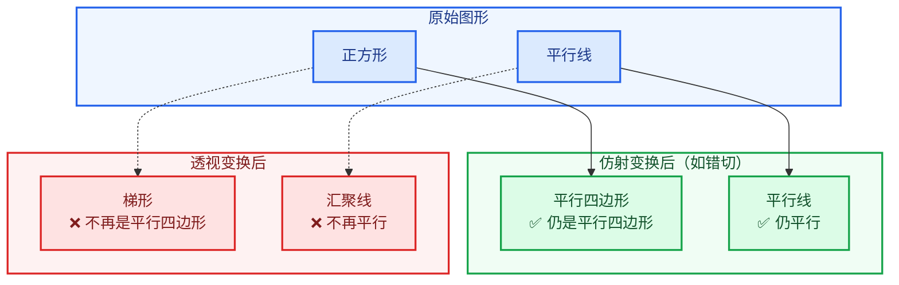
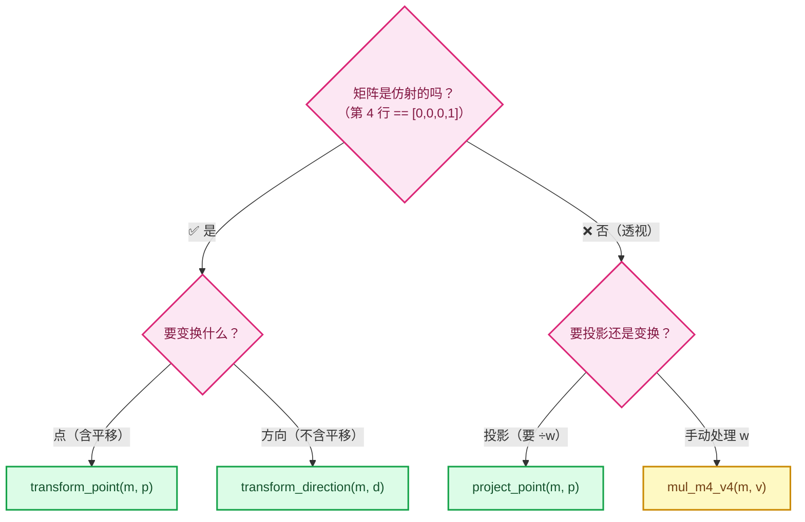

# 04 · 仿射变换详解

> 🔗 [返回索引](./README.md) | 上一篇：[03-变换顺序与乘法顺序](./03-变换顺序与乘法顺序.md) | 下一篇：[05-数值推演实例](./05-数值推演实例.md)

本文讲清**仿射（affine）**这个概念，以及它如何决定了 Blender 矩阵 API 的选择。

---

## 目录

- [1. 什么是仿射变换](#1-什么是仿射变换)
- [2. 仿射矩阵的判定标志](#2-仿射矩阵的判定标志)
- [3. 仿射保持什么、不保持什么](#3-仿射保持什么不保持什么)
- [4. 透视为什么不是仿射](#4-透视为什么不是仿射)
- [5. 仿射性质决定了 API 选择](#5-仿射性质决定了-api-选择)
- [6. transform_point 的实现剖析](#6-transform_point-的实现剖析)
- [7. 实践中的判断方法](#7-实践中的判断方法)

---

## 1. 什么是仿射变换

### 1.1 定义

⭐⭐ **仿射变换 = 线性变换 + 平移**

| 组成部分 | 包含 |
|---------|------|
| **线性变换** | 旋转、缩放、错切（shear）、镜像 |
| **平移** | 位置偏移 |

### 1.2 数学形式

```
仿射变换作用在点 p 上：

  p' = A · p + t
       ↑     ↑
    线性部分  平移
```

其中 `A` 是 3×3 矩阵，`t` 是 3D 向量。

⭐ **用 4×4 齐次矩阵统一表示**：

```
        ┌              ┐
        │   A      t   │
M   =   │              │
        └  0  0  0  1  ┘
                      ↑
              ★ 最后一行固定为 [0,0,0,1]
```

### 1.3 为什么能统一表示

⭐ **齐次坐标的关键作用**：把"平移"也变成矩阵乘法。

```
没有齐次坐标：
  p' = A · p + t        ← 必须"乘法 + 加法"两步

有齐次坐标：
  ┌ p' ┐   ┌      A      t ┐   ┌ p ┐
  │    │ = │               │ × │   │
  └ 1  ┘   └  0  0  0  1   ┘   └ 1 ┘
            ↑ 一次矩阵乘法搞定，平移靠第 4 列
```

⭐ **这就是为什么 `vec4[3] = 1.0`**：

```
w = 1  →  第 4 列（平移）参与运算  →  这是"点"
w = 0  →  第 4 列被忽略            →  这是"方向向量"
```

---

## 2. 仿射矩阵的判定标志

### 2.1 唯一判据

⭐⭐ **最后一行是否为 `[0, 0, 0, 1]`。**

| 最后一行 | 是否仿射 |
|---------|---------|
| `[0, 0, 0, 1]` | ✅ **是** |
| 其他任何值 | ❌ 不是 |

### 2.2 Blender 的代码证据

#### `copy_m4_m3` —— 构造仿射矩阵

> `math_matrix_c.cc:109-130`

```cpp
void copy_m4_m3(float m1[4][4], const float m2[3][3]) /* no clear */
{
  m1[0][0] = m2[0][0];
  m1[0][1] = m2[0][1];
  m1[0][2] = m2[0][2];

  m1[1][0] = m2[1][0];
  m1[1][1] = m2[1][1];
  m1[1][2] = m2[1][2];

  m1[2][0] = m2[2][0];
  m1[2][1] = m2[2][1];
  m1[2][2] = m2[2][2];

  m1[0][3] = 0.0f;      // ← 第 4 行
  m1[1][3] = 0.0f;
  m1[2][3] = 0.0f;

  m1[3][0] = 0.0f;      // ← 第 4 列的前 3 个（平移，此处清零）
  m1[3][1] = 0.0f;
  m1[3][2] = 0.0f;
  m1[3][3] = 1.0f;      // ★★★ 关键：设为 1
}
```

⚠️ **注意索引是 `[列][行]`**（列主序），所以：

```cpp
m1[0][3] = 0.0f;    // 第 0 列第 3 行
m1[1][3] = 0.0f;    // 第 1 列第 3 行
m1[2][3] = 0.0f;    // 第 2 列第 3 行
m1[3][3] = 1.0f;    // 第 3 列第 3 行
                    // → 这 4 个合起来就是"数学记法的第 4 行 = [0,0,0,1]"
```

⭐⭐ **`copy_m4_m3` 显式地把第 4 行设为 `[0,0,0,1]`** —— 这就是"构造仿射矩阵"的代码体现。

#### `loc_rot_size_to_mat4` —— 完整的仿射构造

> `math_matrix_c.cc:2321-2329`

```cpp
void loc_rot_size_to_mat4(float R[4][4],
                          const float loc[3],
                          const float rot[3][3],
                          const float size[3])
{
  copy_m4_m3(R, rot);        // ← 这里已经把第 4 行设成 [0,0,0,1]
  rescale_m4(R, size);       // ← 只改前 3 列，不动第 4 行
  copy_v3_v3(R[3], loc);     // ← 只改第 4 列的前 3 个，不动 m[3][3]
}
```

⭐ **三步都不破坏第 4 行**：

| 步骤 | 是否碰第 4 行 |
|------|--------------|
| `copy_m4_m3` | 设置它为 `[0,0,0,1]` |
| `rescale_m4` | ❌ 只改第 0/1/2 列 |
| `copy_v3_v3(R[3], loc)` | ❌ 只改第 3 列的前 3 个元素 |

✅ **结果仍是仿射矩阵**。

#### 对比：透视投影矩阵

> `gpu_matrix.cc:327-330`

```cpp
  m[0][3] = 0.0f;
  m[1][3] = 0.0f;
  m[2][3] = -1.0f;      // ★★★ 不是 0！
  m[3][3] = 0.0f;       // ★★★ 不是 1！
```

⭐⭐ **透视投影矩阵的第 4 行是 `[0,0,-1,0]`** → **不是仿射矩阵**。

### 2.3 两种矩阵的形式对比

```
仿射矩阵（M、V）：
        ┌ R00 R01 R02 Tx ┐
        │ R10 R11 R12 Ty │
        │ R20 R21 R22 Tz │
        └  0   0   0   1 ┘
                         ↑
                  最后一行固定

透视矩阵（P）：
        ┌ 2n/(r-l)    0      (r+l)/(r-l)      0    ┐
        │   0     2n/(t-b)  (t+b)/(t-b)      0    │
        │   0         0     -(f+n)/(f-n)  -2fn/(f-n)│
        └   0         0          -1           0    ┘
                                  ↑
                        最后一行不是 [0,0,0,1]
```

### 2.4 正交投影矩阵呢

⚠️ **正交投影矩阵是"边界情况"**：

```
        ┌ 2/(r-l)      0           0             0      ┐
P_ortho =│    0      2/(t-b)       0             0      │
        │    0          0      -2/(f-n)    -(f+n)/(f-n)  │
        └    0          0           0             1      ┘
                                      ↑
                             第 4 行 = [0,0,0,1]
```

⭐⭐ **正交投影矩阵的最后一行是 `[0,0,0,1]`** → **从"矩阵形式"看它是仿射的**！

⭐ **但语义上它不是** —— 因为它做的是"投影"（把 3D 压到 2D 平面），不是"空间变换"。

⚠️ **这个区分很重要**：**"仿射"是矩阵的结构性质，"投影"是它的语义作用**。正交投影矩阵恰好结构上是仿射的，但它不是"物体变换"。

⭐ **实用判断**：看代码里**怎么用它**：

```cpp
/* 用 transform_point（仿射简化版）—— 对正交投影也"能算"，但语义不对 */
transform_point(ortho_proj, p);      // ⚠️ 会丢掉 z 信息，因为没做透视除法

/* 正确：应该用完整的 4×4 */
mul_m4_v4(ortho_proj, vec4);
```

---

## 3. 仿射保持什么、不保持什么

### 3.1 保持的性质 ✅

| 性质 | 说明 |
|------|------|
| **直线仍是直线** | 不会弯曲 |
| **平行线仍平行** | ⭐ 这是仿射的**标志性性质** |
| **直线上的比例** | 中点仍是中点 |
| **共线性** | 三点共线变换后仍共线 |
| **重心坐标** | 三角形内的权重关系不变 |
| **交比**（cross ratio） | 保持 |

### 3.2 不保持的性质 ❌

| 性质 | 说明 |
|------|------|
| **长度** | 会变（除非缩放为 1） |
| **角度** | 会变（除非只有旋转） |
| **面积** | 会变（按行列式比例） |
| **圆的形状** | 会变椭圆（除非只有旋转+均匀缩放） |

### 3.3 图示对比



### 3.4 为什么"保持平行"是标志

⭐⭐ **数学原因**：仿射变换是**线性变换 + 平移**。

```
两条平行线：  p₁(t) = a₁ + t·d
              p₂(t) = a₂ + t·d        ← 方向向量相同 d

仿射变换后：
  p₁'(t) = A·(a₁ + t·d) + t₀ = (A·a₁ + t₀) + t·(A·d)
  p₂'(t) = A·(a₂ + t·d) + t₀ = (A·a₂ + t₀) + t·(A·d)
                                  ↑ 方向都是 A·d
  → 仍平行 ✅
```

⭐ **透视变换**：

```
透视要除以 w，而 w 随位置变化
  → 两条线的"缩放比例"不同
  → 方向向量被不同程度拉伸
  → 不再平行 ❌
```

---

## 4. 透视为什么不是仿射

### 4.1 核心原因：`w` 不是常数

```
透视变换：
  p' = P · p / w        ← ★ 除以 w
              ↑
        w = -z_view，随位置变化

仿射变换：
  p' = A · p + t        ← 没有除法
```

⭐ **"除以一个变化的量"** 是透视与仿射的本质区别。

### 4.2 从矩阵结构看

```
仿射矩阵第 4 行 = [0, 0, 0, 1]
  → w' = 0·x + 0·y + 0·z + 1·1 = 1        ← 恒为 1
  → 除以 1 无效果
  → 是纯线性变换 + 平移 ✅

透视矩阵第 4 行 = [0, 0, -1, 0]
  → w' = 0·x + 0·y + (-1)·z + 0·1 = -z    ← 随 z 变化
  → 除以变化的 w'
  → 产生非线性效果 ❌
```

### 4.3 用具体例子验证"平行线不保持"

**场景**：两条平行线，都在 z = −5 和 z = −10 的平面上。

```
观察空间（相机在原点，看向 -Z）：

  z = -5 处：  ●───────●        距离 5
  z = -10 处： ●───────●        距离 10
                （平行的两条线）
```

**透视投影后**（除以距离）：

```
z = -5 的线：  除以 5   → 缩放到 1/5
z = -10 的线： 除以 10  → 缩放到 1/10
                          ↑ 缩放比例不同！

结果：远的线被缩得更小 → 视觉上"汇聚" ❌ 不再平行
```

⭐ **这就是"铁轨在远处汇聚"的原理**。

### 4.4 正交投影的特殊情况

⭐ **正交投影的 `w' = 1`（恒定）**：

```
正交投影：
  w' = 1        ← 不随位置变化
  → 除以 1 无效果
  → 平行线保持平行 ✅
```

⭐⭐ **所以正交投影"看起来"像仿射** —— 但它是"投影"（语义上把 3D 压到平面），不是"空间变换"。

| | 数学结构 | 语义 |
|---|---------|------|
| M、V | 仿射 | 空间变换 |
| P_ortho | **恰好也是仿射** | **投影**（但无透视效果） |
| P_persp | 非仿射 | 投影（有透视效果） |

---

## 5. 仿射性质决定了 API 选择

### 5.1 Blender 提供的三类函数

| 函数 | 实现 | 适用矩阵 |
|------|------|---------|
| `transform_point(m, p)` | `m₃ₓ₃·p + T` | **仅仿射** |
| `transform_direction(m, d)` | `m₃ₓ₃·d` | **仅仿射** |
| `mul_m4_v4(m, v)` | 完整 4×4 | **任意**（含透视） |
| `project_point(m, p)` | 完整 4×4 + `÷w` | **投影矩阵** |

### 5.2 选择决策树



### 5.3 本 patch 的实际选择

```cpp
/* ✅ 仿射矩阵 → 用 transform_point（物体空间 → 世界空间） */
const float3 center = math::transform_point(object_to_world, positions[i]);
const float3 position = math::transform_point(object_to_world, positions[i]);

/* ✅ 仿射矩阵 + 方向 → 用 transform_direction（不含平移） */
const float3 local_direction = math::transform_direction(world_to_object, toward_camera);

/* ✅ 透视矩阵 → 必须用完整 4×4 */
float vec4[4];
copy_v3_v3(vec4, co);
vec4[3] = 1.0;
mul_m4_v4(perspmat, vec4);      // ← 不能简化
```

⭐ **三处选择都正确** —— 因为各自用在了合适的矩阵上。

---

## 6. transform_point 的实现剖析

### 6.1 完整代码

> `BLI_math_matrix.hh:1652-1656`

```cpp
template<typename T>
VecBase<T, 3> transform_point(const MatBase<T, 4, 4> &mat, const VecBase<T, 3> &point)
{
  return mat.template view<3, 3>() * point + mat.location();
}
```

### 6.2 逐部分解析

#### `mat.view<3, 3>()` —— 取出左上 3×3

> `BLI_math_matrix_types.hh:196-205`

```cpp
template<int ViewNumCol = NumCol, int ViewNumRow = NumRow,
         int SrcStartCol = 0, int SrcStartRow = 0>
const MatView<T, ViewNumCol, ViewNumRow, NumCol, NumRow, SrcStartCol, SrcStartRow, Alignment>
view() const
{
  return MatView<...>(const_cast<MatBase &>(*this));
}
```

⭐ **`view<3,3>()` 创建"原矩阵左上 3×3 的视图"** —— **不拷贝数据**，只是重新解释内存。

```
原矩阵（数学记法）：
        ┌ m00 m01 m02 │ m03 ┐
        │ m10 m11 m12 │ m13 │
        │ m20 m21 m22 │ m23 │
        ├─────────────┼─────┤
        └ m30 m31 m32 │ m33 ┘

view<3,3>() 取出：
        ┌ m00 m01 m02 ┐
        │ m10 m11 m12 │     ← 线性部分（旋转 + 缩放）
        └ m20 m21 m22 ┘
```

⭐ **"视图"意味着零开销** —— 它就是一个指向原数据的轻量包装。

#### `mat.location()` —— 取出平移

> `BLI_math_matrix_types.hh:291-296`

```cpp
const loc_type &location() const
{
  BLI_STATIC_ASSERT(NumCol >= 3, "Wrong Matrix dimension");
  BLI_STATIC_ASSERT(NumRow >= 2, "Wrong Matrix dimension");
  return *reinterpret_cast<const loc_type *>(&(*this)[NumCol - 1]);
  //                                             └─ NumCol-1 = 3 ─┘
}
```

⭐ **`NumCol - 1 = 3`**，所以取**第 3 列**（列主序）= 第 4 列。

```
第 3 列 = (m03, m13, m23, m33)
                ↓
location() 取前 3 个 → (m03, m13, m23) = 平移向量 T
```

#### 整体展开

```
transform_point(M, p)
  = M₃ₓ₃ × p + T

  = ┌ m00 m01 m02 ┐   ┌ px ┐     ┌ m03 ┐
    │ m10 m11 m12 │ × │ py │  +  │ m13 │
    └ m20 m21 m22 ┘   └ pz ┘     └ m23 ┘
```

### 6.3 ⭐ 与完整 4×4 乘法的对比

#### 完整版本（`mul_m4_v4` 的数学）

```
┌ m00 m01 m02 m03 ┐   ┌ px ┐   ┌ m00·px + m01·py + m02·pz + m03·1 ┐
│ m10 m11 m12 m13 │ × │ py │ = │ m10·px + m11·py + m12·pz + m13·1 │
│ m20 m21 m22 m23 │   │ pz │   │ m20·px + m21·py + m22·pz + m23·1 │
└ m30 m31 m32 m33 ┘   └ 1  ┘   └ m30·px + m31·py + m32·pz + m33·1 ┘
                                  ↑ 这一行被丢弃
```

#### `transform_point` 版本

```
M₃ₓ₃ × p + T

= ┌ m00·px + m01·py + m02·pz + m03 ┐
  │ m10·px + m11·py + m12·pz + m13 │   ← 前 3 行完全相同！
  └ m20·px + m21·py + m22·pz + m23 ┘
```

⭐⭐ **前 3 行完全一致** —— 所以 `transform_point` 是"省略第 4 行"的优化版本。

### 6.4 为什么可以省略第 4 行

⭐ **对仿射矩阵**：

```
第 4 行 = [0, 0, 0, 1]

w' = 0·px + 0·py + 0·pz + 1·1 = 1      ← 恒为 1
```

⭐ **`w'` 恒为 1，所以**：

| 操作 | 是否需要 |
|------|---------|
| 计算 `w'` | ❌ 无意义（永远是 1） |
| 除以 `w'` | ❌ 除以 1 无变化 |
| 第 4 行 | ❌ 可以完全跳过 |

⭐⭐ **这就是 `transform_point` 能简化的全部原因**。

### 6.5 ⚠️ 对透视矩阵就不行

```
persmat 第 4 行 = [0, 0, -1, 0]

w' = 0·px + 0·py + (-1)·pz + 0·1 = -pz      ← 随 z 变化！
```

⭐ **`w'` 携带了关键信息（到相机的距离）**：

| 如果省略 | 后果 |
|---------|------|
| 不计算 `w'` | 无法做透视除法 |
| 不除以 `w'` | **没有近大远小**，退化成正交投影 |

⚠️ **所以投影必须用完整 4×4**：

```cpp
/* draw_manager_text.cc:193-196 —— 必须完整 */
float vec4[4];
copy_v3_v3(vec4, co);
vec4[3] = 1.0;
mul_m4_v4(perspmat, vec4);      // ← 不能简化
```

### 6.6 transform_direction 的区别

> `BLI_math_matrix.hh:1664-1668`

```cpp
template<typename T>
VecBase<T, 3> transform_direction(const MatBase<T, 4, 4> &mat, const VecBase<T, 3> &direction)
{
  return mat.template view<3, 3>() * direction;
  //                                     ↑ 没有 + location()
}
```

⭐ **只做线性部分，不加平移**。

**为什么**：方向向量描述"朝向"，与"位置"无关。

```
方向 (1, 0, 0)（指向 X 轴）
  平移 (5, 2, 1) 后，方向应该还是 (1, 0, 0)
  ❌ 如果加平移 → (6, 2, 1)  ← 错！这不是方向
```

⭐ **数学依据**：齐次坐标里方向向量的 `w = 0`：

```
p' = M · (d, 0)ᵀ
   = ┌      A      T ┐   ┌ d ┐
     │              │ × │   │
     └  0  0  0  1  ┘   └ 0 ┘
   = A · d + T · 0
   = A · d                    ← T 被乘 0 消掉了
```

✅ **`transform_direction` 就是 `w = 0` 的等价实现**。

### 6.7 本 patch 的用法

```cpp
/* overlay_attribute_text.hh:255 —— 变换"方向"，用 transform_direction */
const float3 local_direction = math::transform_direction(world_to_object, toward_camera);
```

⭐ **`toward_camera` 是从物体指向相机的方向**，转成物体空间后仍是方向 —— **不应该被平移影响** ✅ 选择正确。

---

## 7. 实践中的判断方法

### 7.1 快速判断矩阵是否仿射

⭐⭐ **看第 4 行**：

```cpp
bool is_affine(const float m[4][4])
{
  return m[0][3] == 0.0f && m[1][3] == 0.0f &&
         m[2][3] == 0.0f && m[3][3] == 1.0f;
  //       ↑ 注意列主序：这 4 个就是"数学记法的第 4 行"
}
```

### 7.2 常见矩阵的仿射性

| 矩阵 | 仿射？ | 第 4 行 |
|------|--------|---------|
| `object_to_world`（M） | ✅ | `[0,0,0,1]` |
| `viewmat`（V） | ✅ | `[0,0,0,1]` |
| `viewinv` | ✅ | `[0,0,0,1]` |
| `persmat`（P×V） | ❌ | `[0,0,-1,0]`（透视时） |
| `persmatob` | ❌ | 同上 |
| `winmat`（透视） | ❌ | `[0,0,-1,0]` |
| `winmat`（正交） | ⚠️ 结构上是 | `[0,0,0,1]` |
| `world_to_object`（M⁻¹） | ✅ | `[0,0,0,1]` |

### 7.3 ⚠️ 陷阱：正交投影矩阵

⭐⭐ **正交投影矩阵结构上是仿射的**，但**不能当仿射变换用**：

```cpp
/* ❌ 错误：正交投影后 z 会被错误处理 */
float3 result = math::transform_point(ortho_proj, world_pos);
/* transform_point 做的是：m₃ₓ₃ · p + T
   → 结果的 z 是"变换后的 z"，但没有做任何投影语义的操作
   → 而且丢掉了 w 分量（虽然 w=1，但语义上不对） */

/* ✅ 正确：正交投影也用完整 4×4 */
float vec4[4] = {world_pos.x, world_pos.y, world_pos.z, 1.0f};
mul_m4_v4(ortho_proj, vec4);
```

⭐ **判断标准不是"结构是否仿射"，而是"语义是否是空间变换"**：

| 语义 | 用什么 |
|------|--------|
| 空间变换（物体↔世界、世界↔观察） | `transform_point` |
| 投影（任何投影，含正交） | `mul_m4_v4` 或 `project_point` |

### 7.4 决策速查

```
问：这个矩阵是"把点从一个空间搬到另一个空间"吗？
  ├─ 是 → transform_point（仿射矩阵）
  └─ 否（是投影）→ mul_m4_v4 / project_point

问：变换的是"点"还是"方向"？
  ├─ 点 → transform_point（含平移）
  └─ 方向 → transform_direction（不含平移）
```

---

## 小结

| 问题 | 答案 |
|------|------|
| ⭐ **仿射是什么** | 线性变换 + 平移。矩阵形式：**最后一行固定 `[0,0,0,1]`** |
| ⭐ **判定标志** | 第 4 行是否 `[0,0,0,1]`（列主序下是 `m[0][3]=m[1][3]=m[2][3]=0, m[3][3]=1`） |
| ⭐ **保持什么** | 直线、**平行性**、直线上的比例、共线性 |
| ⭐ **不保持** | 长度、角度、面积、圆形状 |
| ⭐ **透视为什么不是仿射** | 第 4 行是 `[0,0,-1,0]` → `w' = -z_view` 随位置变化 → 除法产生非线性 |
| ⭐ **为什么 transform_point 能简化** | 仿射矩阵 `w' ≡ 1`，第 4 行可省略 |
| ⭐ **为什么 mul_m4_v4 不能简化** | 透视矩阵 `w'` 携带距离信息，是透视除法的依据 |
| ⚠️ **正交投影的陷阱** | 结构上仿射，但语义是投影 → **仍应用 `mul_m4_v4`** |

### 一句话总结

```
仿射 = 最后一行 [0,0,0,1] = w 恒为 1 = 可以省略第 4 行
透视 = 最后一行 [0,0,-1,0] = w 是距离 = 必须完整计算
```

---

## 下一篇

- 手算一遍完整投影 → [05-数值推演实例](./05-数值推演实例.md)
