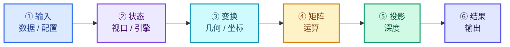
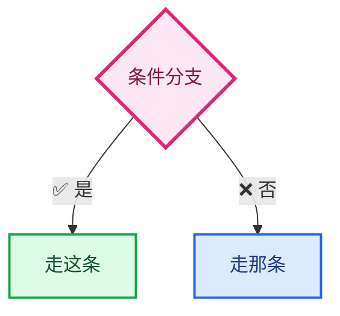
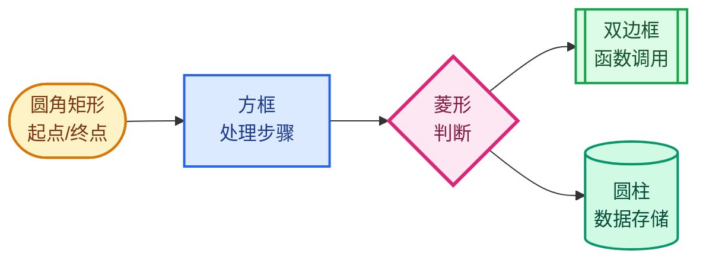

# 配色与图例约定

> 🔗 [返回索引](./README.md)

本套文档的流程图遵循**统一的配色语义** —— 相同颜色表示同一类概念，跨文档保持一致。

---

## 一、六色语义

| 语义 | 颜色 | 填充 / 描边 | 典型内容 |
|------|------|-------------|----------|
| **输入** | 🔵 蓝 | `#DBEAFE` / `#2563EB` | 用户配置、FOV、near/far、视口尺寸 |
| **状态** | 🟣 紫 | `#EDE9FE` / `#7C3AED` | `RegionView3D`、`rv3d->viewquat` |
| **变换** | 🩵 青 | `#CFFAFE` / `#0891B2` | 坐标空间、`transform_point` |
| **矩阵** | 🟡 琥珀 | `#FEF3C7` / `#D97706` | `mul_m4_m4m4`、矩阵字段 |
| **投影** | 🟢 绿 | `#D1FAE5` / `#059669` | `w'`、NDC、深度、裁剪 |
| **结果** | 🟦 靛 | `#E0E7FF` / `#4F46E5` | 屏幕像素、最终输出 |

---

## 二、状态色（语义固定）

| 状态 | 填充 / 描边 | 用于 |
|------|-------------|------|
| ✅ 绿 | `#DCFCE7` / `#16A34A` | 正确做法、保持的性质、API 适用 |
| ⚠️ 黄 | `#FEF9C3` / `#CA8A04` | 命名陷阱、边界情况、需注意 |
| ❌ 红 | `#FEE2E2` / `#DC2626` | 错误顺序、破坏的性质、不适用 |

---

## 三、判断色

| 类型 | 填充 / 描边 | 形状 |
|------|-------------|------|
| **判断** | `#FCE7F3` / `#DB2777` | 菱形 |

---

## 四、节点形状约定

| 形状 | Mermaid 语法 | 用途 |
|------|--------------|------|
| 圆角矩形 | `id(["文本"])` | 流程起点 / 终点 |
| 方框 | `id["文本"]` | 普通步骤 |
| 菱形 | `id{"文本"}` | 条件判断 |
| 双边框 | `id[["文本"]]` | 函数调用 |
| 圆柱 | `id[("文本")]` | 数据存储 |

---

## 五、线条语义

| 线型 | Mermaid 语法 | 含义 |
|------|--------------|------|
| 实线箭头 | `-->` | 数据流 / 执行顺序 |
| 虚线箭头 | `-.->` | 引用 / 可选 / 补充说明 |
| 粗箭头 | `==>` | 关键路径 / 高开销 |
| 带标签 | `-->\|文本\|` | 条件分支 |

---

## 六、文本约定

| 记号 | 含义 |
|------|------|
| ⭐ | 关键点 |
| ⚠️ | 陷阱 / 易错点 |
| ⭐⭐ | 极重要 |
| ✅ | 正确 / 适用 |
| ❌ | 错误 / 不适用 |
| `M` `V` `P` | 数学符号（斜体意义） |
| `viewmat` `winmat` | 代码字段名 |
| `$公式$` | 行内数学 |
| `$$公式$$` | 块级数学 |

---

## 七、与另一套文档的对应

本套沿用 [属性文本遮挡剔除-DS](../属性文本遮挡剔除-DS/配色与图例约定.md) 的配色体系，但**语义映射略有调整**：

| 颜色 | 剔除-DS 的语义 | 本套的语义 |
|------|---------------|-----------|
| 🔵 蓝 | 用户界面层（DNA/RNA/UI） | **输入数据 / 配置** |
| 🟣 紫 | Overlay 状态层 | **引擎 / 视口状态** |
| 🩵 青 | 锚点与几何层 | **坐标变换** |
| 🟡 琥珀 | 文本缓存层 | **矩阵运算** |
| 🟢 绿 | 深度层 | **投影 / 深度** |
| 🩷 粉 | 判定层 | **判断分支** |
| 🟦 靛 | 结果层 | **最终结果** |

⭐ **两套的主题不同**（一个是"特性实现"，一个是"数学基础"），所以同一颜色承载的具体对象不同，但**层级递进的视觉逻辑一致**。

---

## 返回

[返回索引](./README.md)
