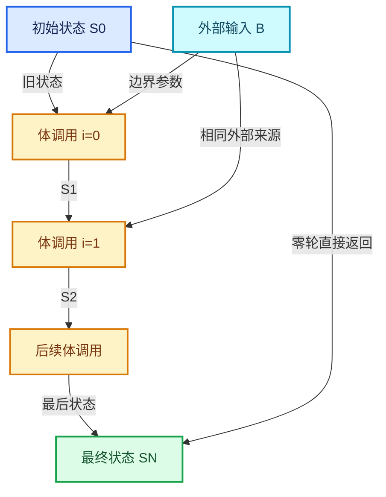

# RZ-01 重复区域全景与状态递推

[返回总入口](../README.md) · [本组导航](README.md) · [源码与版本](../00-课程指南/源码版本与覆盖索引.md)

> 源码基准提交：`e2e58a974edb3a5e949aa273d7ff940b5c5797c8`。具体文件内容以证据清单的 SHA-256 为准。

## 先回答一个具体问题

两端只有几个插槽，为什么内部能表达一整段多次执行的程序？

建立状态递推、区域边界、执行图和观察上下文四层模型，能够手算每一轮的输入输出。

## 阅读前需要的概念

1. **`状态元组`**：一次轮次之间传递的全部状态项，记为 S_i，不限于一个几何值。

2. **`初始状态`**：尚未执行体时的 S_0，也是零轮输出。

3. **`循环体`**：输入旧状态和本轮索引，产生下一轮状态的程序。

4. **`迭代索引`**：当前体调用的零基编号，第一轮为0。

5. **`边界输入`**：从区域外直接进入体的输入，不自动跨轮更新。

6. **`最终状态`**：完成实际轮数后得到的 S_N，不自动含全部历史。

7. **`编辑图`**：用户编辑的bNodeTree及其节点、插槽和连线。

8. **`执行图`**：根据编辑结构建立的LazyFunction图及其接口。

## 本篇的机制地图



图中连线标签区分状态流、接口、拥有与观察关系；它不是线程调度记录，也不表示未声明的类型继承关系。

## 核心机制与设计推导

### 01 · 把重复区域写成递推式

令状态为 S_i，外部输入为 B，循环体为 F，则 S_(i+1)=F(S_i,i,B)。

N 次迭代输出 S_N；N 为零时输出 S_0。

这里的 i 是从零开始的轮次，不能用最终状态下标直接替代。

一个状态可以包含几何、标量和其他当前树支持的插槽值，不能把整个区域误解为只对几何做复制。

### 02 · 两端节点共同描述一个程序结构

输入端提供初始状态与 Iterations，输出端定义需要跨轮传递的 Repeat Items。

两端节点的位置影响阅读布局，配对关系与拓扑才影响区域身份。

把普通节点移动到彩色背景上，不能作为已经建立有效区域语义的证明。

必须核查它是否在输入输出之间的合法依赖路径内。

### 03 · 状态与外部输入分工

从 Repeat Input 接入的状态会进入上一轮到下一轮的链。

从区域外直接连入内部的值形成 border link，它并不自动成为可更新状态。

假设初始 x=1，体内做 x+b，b=2，三轮得到 7。

若每轮都从外部的 x=1 重新开始做同一运算，则得到的是反复求 3，二者图结构不同。

### 04 · 循环体与循环包装器分工

ZoneBodyFunction 表达一次体求值所需的接口和函数。

LazyFunctionForRepeatZone 负责按轮数构造调用图，并把这些体调用串起来。

当前实现共享一个体函数对象，但创建多个 FunctionNode 调用点。

共享函数不等于共享每次调用的执行状态。

### 05 · 零轮是身份映射

零轮分支把每项主输入直接连接到主输出。

它同时传递相应的使用需求，并把外部跨界输入的使用标记设为 false。

这个分支没有执行第零轮，不能把它和一次执行但 Iteration=0 混在一起。

负数轮次在几何节点包装器中被钳制为零。

### 06 · 最终值不会自动收集历史

输出端给出最后一轮形成的状态，不会额外创建所有中间几何的集合。

要保留历史，应在状态中显式携带累计几何或其他累计容器，并在体内更新。

累计结果的大小由具体体逻辑决定，可能线性增长，也可能重复包含已有结果而快速膨胀。

看到多轮运行不代表系统自动做 Join Geometry。

### 07 · Repeat与其他程序结构比较

Repeat 的核心是跨轮状态依赖；Foreach Geometry Element 的核心是按元素组织任务与结果。

Simulation 的状态还涉及时间与缓存协议，不能用 Repeat 的一次求值状态解释跨帧缓存。

Closure 则把体程序包装为可传递和调用的值。

这里只比较职责，不据此断言它们具有相同执行路径。

### 08 · 从使用问题走到源码

先手算小例子，再看 Repeat Input 与 Repeat Output 的声明，最后追到 build_repeat_zone_function。

发现结果不符合预期时，先判断错误属于状态建模、插槽映射还是体运算。

把迭代次数增加到几千并不能帮助定位第一轮就存在的问题。

最有价值的诊断输入往往是零、一、二三种轮数。

## 小数据推演与反例实验

以下预期来自明确的输入和模型推导。未附 Blender 运行记录的案例属于待执行实验，不把手算结果当作后端实测。

### 实验 01 · 常量平移

**输入与操作**

S_0=1；F(x,i,b)=x+b；b=2；N=3

**预期与判据**

1 → 3 → 5 → 7

**为什么这个案例有辨别力**

必须把前轮 x 接回状态，外部 b 保持为 2。

**执行时记录**

- 保留输入、轮数与状态项身份，避免只保存截图。
- 将实际观察和上述预期对照；不一致时先定位本实验涉及的边界。

### 实验 02 · 使用轮次

**输入与操作**

S_0=0；F(x,i)=x+i；N=4

**预期与判据**

0 → 0 → 1 → 3 → 6

**为什么这个案例有辨别力**

第一次 i=0，因此第一轮看起来没有改变状态。

**执行时记录**

- 保留输入、轮数与状态项身份，避免只保存截图。
- 将实际观察和上述预期对照；不一致时先定位本实验涉及的边界。

### 实验 03 · 几何累计

**输入与操作**

状态含 current 与 accumulated；每轮先追加 current 再变换 current

**预期与判据**

N 轮后累计 N 份本轮输入几何

**为什么这个案例有辨别力**

先追加还是先变换会改变第一份几何的位置。

**执行时记录**

- 保留输入、轮数与状态项身份，避免只保存截图。
- 将实际观察和上述预期对照；不一致时先定位本实验涉及的边界。

### 实验 04 · 空循环

**输入与操作**

S_0=42；体内有会改变值的运算；N=0

**预期与判据**

输出仍为 42

**为什么这个案例有辨别力**

零次迭代不等价于执行一次默认体。

**执行时记录**

- 保留输入、轮数与状态项身份，避免只保存截图。
- 将实际观察和上述预期对照；不一致时先定位本实验涉及的边界。

### 实验 05 · 外部值误作状态

**输入与操作**

外部 x=1 接到体运算，每次加 2，但上一轮结果没有回传给运算

**预期与判据**

每轮都计算 3

**为什么这个案例有辨别力**

需要改变数据连线，而不是更换 Iteration 的数值。

**执行时记录**

- 保留输入、轮数与状态项身份，避免只保存截图。
- 将实际观察和上述预期对照；不一致时先定位本实验涉及的边界。

### 实验 06 · 嵌套循环

**输入与操作**

外层两轮、内层三轮，两层各自累计一次

**预期与判据**

被完整需求的路径有六次内体调用

**为什么这个案例有辨别力**

轮次身份必须同时包含父上下文与本层轮次。

**执行时记录**

- 保留输入、轮数与状态项身份，避免只保存截图。
- 将实际观察和上述预期对照；不一致时先定位本实验涉及的边界。

## 连续源码与定向阅读批注

以下代码逐字摘自本地源码，保留原始空行、注释和条件编译。
文件头中的许可证以源文件为准；本教程的说明文字不改变上游源码的授权。
区间摘录不保证从函数边界开始；标题明确标明连续区间时，应结合所链接源文件查看外围声明。
每个块的原始文件、起止行和哈希记入 `_evidence/source-excerpts.json`，校验脚本会逐块比较。

### 源码 01 · 运行时包装器的完整实现

来源：[source/blender/nodes/intern/geometry_nodes_repeat_zone.cc](../../../../../source/blender/nodes/intern/geometry_nodes_repeat_zone.cc)，连续区间 L1—L432。

<!-- source:repeat:1:432 -->

```cpp
/* SPDX-FileCopyrightText: 2024 Blender Authors
 *
 * SPDX-License-Identifier: GPL-2.0-or-later */

/** \file
 * \ingroup nodes
 */

#include "NOD_geometry_nodes_lazy_function.hh"

#include "BKE_compute_contexts.hh"
#include "BKE_node_runtime.hh"
#include "BKE_node_socket_value.hh"

#include "FN_lazy_function_execute.hh"

#include "BLT_translation.hh"

#include "BLI_array_utils.hh"

#include "DEG_depsgraph_query.hh"

#include "FN_lazy_function_graph_executor.hh"

namespace blender::nodes {

using bke::SocketValueVariant;

/**
 * Wraps the execution of a repeat loop body. The purpose is to setup the correct #ComputeContext
 * inside of the loop body. This is necessary to support correct logging inside of a repeat zone.
 * An alternative would be to use a separate `LazyFunction` for every iteration, but that would
 * have higher overhead.
 */
class RepeatBodyNodeExecuteWrapper : public lf::GraphExecutorNodeExecuteWrapper {
 public:
  const bNode *repeat_output_bnode_ = nullptr;
  VectorSet<lf::FunctionNode *> *lf_body_nodes_ = nullptr;

  void execute_node(const lf::FunctionNode &node,
                    lf::Params &params,
                    const lf::Context &context) const override
  {
    GeoNodesUserData &user_data = *static_cast<GeoNodesUserData *>(context.user_data);
    const int iteration = lf_body_nodes_->index_of_try(const_cast<lf::FunctionNode *>(&node));
    const LazyFunction &fn = node.function();
    if (iteration == -1) {
      /* The node is not a loop body node, just execute it normally. */
      fn.execute(params, context);
      return;
    }

    /* Setup context for the loop body evaluation. */
    bke::RepeatZoneComputeContext body_compute_context{
        user_data.compute_context, *repeat_output_bnode_, iteration};
    GeoNodesUserData body_user_data = user_data;
    body_user_data.compute_context = &body_compute_context;
    body_user_data.verbose_log = should_log_verbose_in_context(user_data,
                                                               body_compute_context.hash());

    GeoNodesLocalUserData body_local_user_data{body_user_data};
    lf::Context body_context{context.storage, &body_user_data, &body_local_user_data};
    fn.execute(params, body_context);
  }
};

/**
 * Knows which iterations of the loop evaluation have side effects.
 */
class RepeatZoneSideEffectProvider : public lf::GraphExecutorSideEffectProvider {
 public:
  const bNode *repeat_output_bnode_ = nullptr;
  Span<lf::FunctionNode *> lf_body_nodes_;

  Vector<const lf::FunctionNode *> get_nodes_with_side_effects(
      const lf::Context &context) const override
  {
    GeoNodesUserData &user_data = *static_cast<GeoNodesUserData *>(context.user_data);
    const GeoNodesCallData &call_data = *user_data.call_data;
    if (!call_data.side_effect_nodes) {
      return {};
    }
    const ComputeContextHash &context_hash = user_data.compute_context->hash();
    const Span<int> iterations_with_side_effects =
        call_data.side_effect_nodes->iterations_by_iteration_zone.lookup(
            {context_hash, repeat_output_bnode_->identifier});

    Vector<const lf::FunctionNode *> lf_nodes;
    for (const int i : iterations_with_side_effects) {
      if (i >= 0 && i < lf_body_nodes_.size()) {
        lf_nodes.append(lf_body_nodes_[i]);
      }
    }
    return lf_nodes;
  }
};

struct RepeatEvalStorage {
  LinearAllocator<> allocator;
  VectorSet<lf::FunctionNode *> lf_body_nodes;
  lf::Graph graph;
  std::optional<LazyFunctionForLogicalOr> or_function;
  std::optional<RepeatZoneSideEffectProvider> side_effect_provider;
  std::optional<RepeatBodyNodeExecuteWrapper> body_execute_wrapper;
  std::optional<lf::GraphExecutor> graph_executor;
  Array<SocketValueVariant> index_values;
  void *graph_executor_storage = nullptr;
  bool multi_threading_enabled = false;
  Vector<int> input_index_map;
  Vector<int> output_index_map;
};

class LazyFunctionForRepeatZone : public LazyFunction {
 private:
  const bNodeTree &btree_;
  const bke::bNodeTreeZone &zone_;
  const bNode &repeat_output_bnode_;
  const ZoneBuildInfo &zone_info_;
  const ZoneBodyFunction &body_fn_;

 public:
  LazyFunctionForRepeatZone(const bNodeTree &btree,
                            const bke::bNodeTreeZone &zone,
                            ZoneBuildInfo &zone_info,
                            const ZoneBodyFunction &body_fn)
      : btree_(btree),
        zone_(zone),
        repeat_output_bnode_(*zone.output_node()),
        zone_info_(zone_info),
        body_fn_(body_fn)
  {
    debug_name_ = "Repeat Zone";

    initialize_zone_wrapper(zone, zone_info, body_fn, true, inputs_, outputs_);
    /* Iterations input is always used. */
    inputs_[zone_info.indices.inputs.main[0]].usage = lf::ValueUsage::Used;
  }

  void *init_storage(LinearAllocator<> &allocator) const override
  {
    return allocator.construct<RepeatEvalStorage>().release();
  }

  void destruct_storage(void *storage) const override
  {
    RepeatEvalStorage *s = static_cast<RepeatEvalStorage *>(storage);
    if (s->graph_executor_storage) {
      s->graph_executor->destruct_storage(s->graph_executor_storage);
    }
    std::destroy_at(s);
  }

  void execute_impl(lf::Params &params, const lf::Context &context) const override
  {
    const ScopedNodeTimer node_timer{context, repeat_output_bnode_};

    auto &user_data = *static_cast<GeoNodesUserData *>(context.user_data);
    auto &local_user_data = *static_cast<GeoNodesLocalUserData *>(context.local_user_data);

    const NodeGeometryRepeatOutput &node_storage = *static_cast<const NodeGeometryRepeatOutput *>(
        repeat_output_bnode_.storage);
    RepeatEvalStorage &eval_storage = *static_cast<RepeatEvalStorage *>(context.storage);

    const int iterations_usage_index = zone_info_.indices.outputs.input_usages[0];
    if (!params.output_was_set(iterations_usage_index)) {
      /* The iterations input is always used. */
      params.set_output(iterations_usage_index, true);
    }

    if (!eval_storage.graph_executor) {
      /* Create the execution graph in the first evaluation. */
      this->initialize_execution_graph(
          params, eval_storage, node_storage, user_data, local_user_data);
    }

    /* Execute the graph for the repeat zone. */
    lf::RemappedParams eval_graph_params{*eval_storage.graph_executor,
                                         params,
                                         eval_storage.input_index_map,
                                         eval_storage.output_index_map,
                                         eval_storage.multi_threading_enabled};
    lf::Context eval_graph_context{
        eval_storage.graph_executor_storage, context.user_data, context.local_user_data};
    eval_storage.graph_executor->execute(eval_graph_params, eval_graph_context);
  }

  /**
   * Generate a lazy-function graph that contains the loop body (`body_fn_`) as many times
   * as there are iterations. Since this graph depends on the number of iterations, it can't be
   * reused in general. We could consider caching a version of this graph per number of iterations,
   * but right now that doesn't seem worth it. In practice, it takes much less time to create the
   * graph than to execute it (for intended use cases of this generic implementation, more special
   * case repeat loop evaluations could be implemented separately).
   */
  void initialize_execution_graph(lf::Params &params,
                                  RepeatEvalStorage &eval_storage,
                                  const NodeGeometryRepeatOutput &node_storage,
                                  GeoNodesUserData &user_data,
                                  GeoNodesLocalUserData &local_user_data) const
  {
    const int num_repeat_items = node_storage.items_num;
    const int num_border_links = body_fn_.indices.inputs.border_links.size();

    /* Number of iterations to evaluate. */
    const int iterations = std::max<int>(
        0,
        params.get_input<SocketValueVariant>(zone_info_.indices.inputs.main[0])
            .ensure_type<int>());

    if (iterations >= 10) {
      /* Constructing and running the repeat zone has some overhead so that it's probably worth
       * trying to do something else in the meantime already. */
      lazy_threading::send_hint();
    }

    /* Show a warning when the inspection index is out of range. */
    if (node_storage.inspection_index > 0) {
      if (node_storage.inspection_index >= iterations) {
        if (eval_log::NodeTreeLogger *tree_logger = local_user_data.try_get_tree_logger(user_data))
        {
          tree_logger->node_warnings.append(
              *tree_logger->allocator,
              {repeat_output_bnode_.identifier,
               {NodeWarningType::Info, N_("Inspection index is out of range")}});
        }
      }
    }

    /* Take iterations input into account. */
    const int main_inputs_offset = 1;
    const int body_inputs_offset = 1;

    lf::Graph &lf_graph = eval_storage.graph;

    Vector<lf::GraphInputSocket *> lf_inputs;
    Vector<lf::GraphOutputSocket *> lf_outputs;

    for (const int i : inputs_.index_range()) {
      const lf::Input &input = inputs_[i];
      lf_inputs.append(&lf_graph.add_input(*input.type, this->input_name(i)));
    }
    for (const int i : outputs_.index_range()) {
      const lf::Output &output = outputs_[i];
      lf_outputs.append(&lf_graph.add_output(*output.type, this->output_name(i)));
    }

    /* Create body nodes. */
    VectorSet<lf::FunctionNode *> &lf_body_nodes = eval_storage.lf_body_nodes;
    for ([[maybe_unused]] const int i : IndexRange(iterations)) {
      lf::FunctionNode &lf_node = lf_graph.add_function(*body_fn_.function);
      lf_body_nodes.add_new(&lf_node);
    }

    /* Create nodes for combining border link usages. A border link is used when any of the loop
     * bodies uses the border link, so an "or" node is necessary. */
    Array<lf::FunctionNode *> lf_border_link_usage_or_nodes(num_border_links);
    eval_storage.or_function.emplace(iterations);
    for (const int i : IndexRange(num_border_links)) {
      lf::FunctionNode &lf_node = lf_graph.add_function(*eval_storage.or_function);
      lf_border_link_usage_or_nodes[i] = &lf_node;
    }

    const bool use_index_values = zone_.input_node()->output_socket(0).is_directly_linked();

    if (use_index_values) {
      eval_storage.index_values.reinitialize(iterations);
      threading::parallel_for(IndexRange(iterations), 1024, [&](const IndexRange range) {
        for (const int i : range) {
          eval_storage.index_values[i].emplace<int>(i);
        }
      });
    }

    /* Handle body nodes one by one. */
    static const SocketValueVariant static_unused_index{-1};
    for (const int iter_i : lf_body_nodes.index_range()) {
      lf::FunctionNode &lf_node = *lf_body_nodes[iter_i];
      const SocketValueVariant *index_value = use_index_values ?
                                                  &eval_storage.index_values[iter_i] :
                                                  &static_unused_index;
      lf_node.input(body_fn_.indices.inputs.main[0]).set_default_value(index_value);
      for (const int i : IndexRange(num_border_links)) {
        lf_graph.add_link(*lf_inputs[zone_info_.indices.inputs.border_links[i]],
                          lf_node.input(body_fn_.indices.inputs.border_links[i]));
        lf_graph.add_link(lf_node.output(body_fn_.indices.outputs.border_link_usages[i]),
                          lf_border_link_usage_or_nodes[i]->input(iter_i));
      }

      /* Handle reference sets. */
      for (const auto &item : body_fn_.indices.inputs.reference_sets.items()) {
        lf_graph.add_link(*lf_inputs[zone_info_.indices.inputs.reference_sets.lookup(item.key)],
                          lf_node.input(item.value));
      }
    }

    static bool static_true = true;

    /* Handle body nodes pair-wise. */
    for (const int iter_i : lf_body_nodes.index_range().drop_back(1)) {
      lf::FunctionNode &lf_node = *lf_body_nodes[iter_i];
      lf::FunctionNode &lf_next_node = *lf_body_nodes[iter_i + 1];
      for (const int i : IndexRange(num_repeat_items)) {
        lf_graph.add_link(
            lf_node.output(body_fn_.indices.outputs.main[i]),
            lf_next_node.input(body_fn_.indices.inputs.main[i + body_inputs_offset]));
        /* TODO: Add back-link after being able to check for cyclic dependencies. */
        // lf_graph.add_link(lf_next_node.output(body_fn_.indices.outputs.input_usages[i]),
        //                   lf_node.input(body_fn_.indices.inputs.output_usages[i]));
        lf_node.input(body_fn_.indices.inputs.output_usages[i]).set_default_value(&static_true);
      }
    }

    /* Handle border link usage outputs. */
    for (const int i : IndexRange(num_border_links)) {
      lf_graph.add_link(lf_border_link_usage_or_nodes[i]->output(0),
                        *lf_outputs[zone_info_.indices.outputs.border_link_usages[i]]);
    }

    if (iterations > 0) {
      {
        /* Link first body node to input/output nodes. */
        lf::FunctionNode &lf_first_body_node = *lf_body_nodes[0];
        for (const int i : IndexRange(num_repeat_items)) {
          lf_graph.add_link(
              *lf_inputs[zone_info_.indices.inputs.main[i + main_inputs_offset]],
              lf_first_body_node.input(body_fn_.indices.inputs.main[i + body_inputs_offset]));
          lf_graph.add_link(
              lf_first_body_node.output(
                  body_fn_.indices.outputs.input_usages[i + body_inputs_offset]),
              *lf_outputs[zone_info_.indices.outputs.input_usages[i + main_inputs_offset]]);
        }
      }
      {
        /* Link last body node to input/output nodes. */
        lf::FunctionNode &lf_last_body_node = *lf_body_nodes.as_span().last();
        for (const int i : IndexRange(num_repeat_items)) {
          lf_graph.add_link(lf_last_body_node.output(body_fn_.indices.outputs.main[i]),
                            *lf_outputs[zone_info_.indices.outputs.main[i]]);
          lf_graph.add_link(*lf_inputs[zone_info_.indices.inputs.output_usages[i]],
                            lf_last_body_node.input(body_fn_.indices.inputs.output_usages[i]));
        }
      }
    }
    else {
      /* There are no iterations, just link the input directly to the output. */
      for (const int i : IndexRange(num_repeat_items)) {
        lf_graph.add_link(*lf_inputs[zone_info_.indices.inputs.main[i + main_inputs_offset]],
                          *lf_outputs[zone_info_.indices.outputs.main[i]]);
        lf_graph.add_link(
            *lf_inputs[zone_info_.indices.inputs.output_usages[i]],
            *lf_outputs[zone_info_.indices.outputs.input_usages[i + main_inputs_offset]]);
      }
      for (const int i : IndexRange(num_border_links)) {
        static bool static_false = false;
        lf_outputs[zone_info_.indices.outputs.border_link_usages[i]]->set_default_value(
            &static_false);
      }
    }

    lf_outputs[zone_info_.indices.outputs.input_usages[0]]->set_default_value(&static_true);

    /* The graph is ready, update the node indices which are required by the executor. */
    lf_graph.update_node_indices();

    // std::cout << "\n\n" << lf_graph.to_dot() << "\n\n";

    /* Create a mapping from parameter indices inside of this graph to parameters of the repeat
     * zone. The main complexity below stems from the fact that the iterations input is handled
     * outside of this graph. */
    eval_storage.output_index_map.reinitialize(outputs_.size() - 1);
    eval_storage.input_index_map.resize(inputs_.size() - 1);
    array_utils::fill_index_range<int>(eval_storage.input_index_map, 1);

    Vector<const lf::GraphInputSocket *> lf_graph_inputs = lf_inputs.as_span().drop_front(1);

    const int iteration_usage_index = zone_info_.indices.outputs.input_usages[0];
    array_utils::fill_index_range<int>(
        eval_storage.output_index_map.as_mutable_span().take_front(iteration_usage_index));
    array_utils::fill_index_range<int>(
        eval_storage.output_index_map.as_mutable_span().drop_front(iteration_usage_index),
        iteration_usage_index + 1);

    Vector<const lf::GraphOutputSocket *> lf_graph_outputs = lf_outputs.as_span().take_front(
        iteration_usage_index);
    lf_graph_outputs.extend(lf_outputs.as_span().drop_front(iteration_usage_index + 1));

    eval_storage.body_execute_wrapper.emplace();
    eval_storage.body_execute_wrapper->repeat_output_bnode_ = &repeat_output_bnode_;
    eval_storage.body_execute_wrapper->lf_body_nodes_ = &lf_body_nodes;
    eval_storage.side_effect_provider.emplace();
    eval_storage.side_effect_provider->repeat_output_bnode_ = &repeat_output_bnode_;
    eval_storage.side_effect_provider->lf_body_nodes_ = lf_body_nodes;

    eval_storage.graph_executor.emplace(lf_graph,
                                        std::move(lf_graph_inputs),
                                        std::move(lf_graph_outputs),
                                        nullptr,
                                        &*eval_storage.side_effect_provider,
                                        &*eval_storage.body_execute_wrapper);
    eval_storage.graph_executor_storage = eval_storage.graph_executor->init_storage(
        eval_storage.allocator);

    /* Log graph for debugging purposes. */
    const bNodeTree &btree_orig = *DEG_get_original(&btree_);
    if (btree_orig.runtime->logged_zone_graphs) {
      std::lock_guard lock{btree_orig.runtime->logged_zone_graphs->mutex};
      btree_orig.runtime->logged_zone_graphs->graph_by_zone_id.lookup_or_add_cb(
          repeat_output_bnode_.identifier, [&]() { return lf_graph.to_dot(); });
    }
  }

  std::string input_name(const int i) const override
  {
    return zone_wrapper_input_name(zone_info_, zone_, inputs_, i);
  }

  std::string output_name(const int i) const override
  {
    return zone_wrapper_output_name(zone_info_, zone_, outputs_, i);
  }
};

LazyFunction &build_repeat_zone_lazy_function(ResourceScope &scope,
                                              const bNodeTree &btree,
                                              const bke::bNodeTreeZone &zone,
                                              ZoneBuildInfo &zone_info,
                                              const ZoneBodyFunction &body_fn)
{
  return scope.construct<LazyFunctionForRepeatZone>(btree, zone, zone_info, body_fn);
}

}  // namespace blender::nodes
```

**读完这段后回到本篇问题**

- 对照“把重复区域写成递推式”，明确这段代码是定义存储、建立接口还是执行已有结构。
- 结合“常量平移”重画输入到输出的关系，区分源码事实与例子的推导。
- 保留失败分支、默认值、析构和条件编译；不要仅摘取看起来像主算法的几行。

### 源码 02 · 两端插槽声明及初始存储

来源：[source/blender/nodes/geometry/nodes/node_geo_repeat.cc](../../../../../source/blender/nodes/geometry/nodes/node_geo_repeat.cc)，连续区间 L60—L245。

<!-- source:node:60:245 -->

```cpp
          panel->use_property_decorate_set(false);
          panel->prop(item_ptr, "socket_type", UI_ITEM_NONE, std::nullopt, ICON_NONE);
        });
  }

  layout.prop(&output_node_ptr, "inspection_index", UI_ITEM_NONE, std::nullopt, ICON_NONE);
}

namespace repeat_input_node {

NODE_STORAGE_FUNCS(NodeGeometryRepeatInput);

static void node_declare(NodeDeclarationBuilder &b)
{
  b.use_custom_socket_order();
  b.allow_any_socket_order();
  b.add_output<decl::Int>("Iteration"_ustr)
      .description("Index of the current iteration. Starts counting at zero");
  b.add_input<decl::Int>("Iterations"_ustr).min(0).default_value(1);

  const bNode *node = b.node_or_null();
  const bNodeTree *tree = b.tree_or_null();
  if (node && tree) {
    const NodeGeometryRepeatInput &storage = node_storage(*node);
    if (const bNode *output_node = tree->node_by_id(storage.output_node_id)) {
      const auto &output_storage = *static_cast<const NodeGeometryRepeatOutput *>(
          output_node->storage);
      for (const int i : IndexRange(output_storage.items_num)) {
        const NodeRepeatItem &item = output_storage.items[i];
        const eNodeSocketDatatype socket_type = item.socket_type;
        const UString name = item.name ? UString(item.name) : ""_ustr;
        const UString identifier(RepeatItemsAccessor::socket_identifier_for_item(item));
        auto &input_decl = b.add_input(socket_type, name, identifier)
                               .socket_name_ptr(
                                   &tree->id, *RepeatItemsAccessor::item_srna, &item, "name")
                               .structure_type(StructureType::Dynamic)
                               .compositor_realization_mode(CompositorInputRealizationMode::None);
        b.add_output(socket_type, name, identifier)
            .align_with_previous()
            .propagate_all({input_decl.index()})
            .inferred_structure_type({input_decl.index()})
            .structure_type(StructureType::Dynamic);
      }
    }
  }
  b.add_input<decl::Extend>(""_ustr, "__extend__"_ustr)
      .structure_type(StructureType::Dynamic)
      .custom_draw(socket_items::ui::draw_extend_socket_fn<RepeatItemsAccessor>());
  b.add_output<decl::Extend>(""_ustr, "__extend__"_ustr)
      .structure_type(StructureType::Dynamic)
      .align_with_previous();
}

static void node_init(bNodeTree * /*tree*/, bNode *node)
{
  NodeGeometryRepeatInput *data = MEM_new<NodeGeometryRepeatInput>(__func__);
  /* Needs to be initialized for the node to work. */
  data->output_node_id = 0;
  node->storage = data;
}

static void node_label(const bNodeTree * /*ntree*/,
                       const bNode * /*node*/,
                       char *label,
                       const int label_maxncpy)
{
  BLI_strncpy_utf8(label, CTX_IFACE_(BLT_I18NCONTEXT_ID_NODETREE, "Repeat"), label_maxncpy);
}

static bool node_insert_link(bke::NodeInsertLinkParams &params)
{
  bNode *output_node = params.ntree.node_by_id(node_storage(params.node).output_node_id);
  if (!output_node) {
    return true;
  }
  return socket_items::try_add_item_via_any_extend_socket<RepeatItemsAccessor>(
      params.ntree, params.node, *output_node, params.link);
}

static int node_shader_fn(GPUMaterial *mat,
                          bNode *node,
                          bNodeExecData * /*execdata*/,
                          GPUNodeStack *in,
                          GPUNodeStack *out)
{
  int zone_id = node_storage(*node).output_node_id;
  return GPU_stack_link_zone(mat, node, "REPEAT_BEGIN", in, out, zone_id, false, 1, 1);
}

static void node_register()
{
  static bke::bNodeType ntype;
  common_node_type_base(&ntype, "GeometryNodeRepeatInput"_ustr, GEO_NODE_REPEAT_INPUT);
  ntype.ui_name = "Repeat Input";
  ntype.enum_name_legacy = "REPEAT_INPUT";
  ntype.nclass = NODE_CLASS_INTERFACE;
  ntype.initfunc = node_init;
  ntype.declare = node_declare;
  ntype.labelfunc = node_label;
  ntype.gather_link_search_ops = nullptr;
  ntype.insert_link = node_insert_link;
  ntype.no_muting = true;
  ntype.draw_buttons_ex = node_layout_ex;
  ntype.gpu_fn = node_shader_fn;
  bke::node_type_storage(
      ntype, "NodeGeometryRepeatInput", node_free_standard_storage, node_copy_standard_storage);
  bke::node_register_type(ntype);
}
NOD_REGISTER_NODE(node_register)

}  // namespace repeat_input_node

namespace repeat_output_node {

NODE_STORAGE_FUNCS(NodeGeometryRepeatOutput);

static void node_declare(NodeDeclarationBuilder &b)
{
  b.use_custom_socket_order();
  b.allow_any_socket_order();
  const bNodeTree *tree = b.tree_or_null();
  const bNode *node = b.node_or_null();
  if (node) {
    const NodeGeometryRepeatOutput &storage = node_storage(*node);
    for (const int i : IndexRange(storage.items_num)) {
      const NodeRepeatItem &item = storage.items[i];
      const eNodeSocketDatatype socket_type = item.socket_type;
      const UString name = item.name ? UString(item.name) : ""_ustr;
      const UString identifier(RepeatItemsAccessor::socket_identifier_for_item(item));
      auto &input_decl = b.add_input(socket_type, name, identifier)
                             .socket_name_ptr(
                                 &tree->id, *RepeatItemsAccessor::item_srna, &item, "name")
                             .structure_type(StructureType::Dynamic)
                             .compositor_realization_mode(CompositorInputRealizationMode::None);
      b.add_output(socket_type, name, identifier)
          .align_with_previous()
          .propagate_all({input_decl.index()})
          .inferred_structure_type({input_decl.index()})
          .structure_type(StructureType::Dynamic);
    }
  }
  b.add_input<decl::Extend>(""_ustr, "__extend__"_ustr)
      .structure_type(StructureType::Dynamic)
      .custom_draw(socket_items::ui::draw_extend_socket_fn<RepeatItemsAccessor>());
  b.add_output<decl::Extend>(""_ustr, "__extend__"_ustr)
      .structure_type(StructureType::Dynamic)
      .align_with_previous();
}

static void node_init(bNodeTree *tree, bNode *node)
{
  NodeGeometryRepeatOutput *data = MEM_new<NodeGeometryRepeatOutput>(__func__);

  data->next_identifier = 0;

  if (tree->type == NTREE_GEOMETRY) {
    data->items = MEM_new_array<NodeRepeatItem>(1, __func__);
    data->items[0].name = BLI_strdup(DATA_("Geometry"));
    data->items[0].socket_type = SOCK_GEOMETRY;
    data->items[0].identifier = data->next_identifier++;
    data->items_num = 1;
  }

  node->storage = data;
}

static void node_free_storage(bNode *node)
{
  socket_items::destruct_array<RepeatItemsAccessor>(*node);
  MEM_delete(reinterpret_cast<NodeGeometryRepeatOutput *>(node->storage));
}

static void node_copy_storage(bNodeTree * /*dst_tree*/, bNode *dst_node, const bNode *src_node)
{
  const NodeGeometryRepeatOutput &src_storage = node_storage(*src_node);
  auto *dst_storage = MEM_new<NodeGeometryRepeatOutput>(__func__, dna::shallow_copy(src_storage));
  dst_node->storage = dst_storage;

  socket_items::copy_array<RepeatItemsAccessor>(*src_node, *dst_node);
}

static bool node_insert_link(bke::NodeInsertLinkParams &params)
{
  return socket_items::try_add_item_via_any_extend_socket<RepeatItemsAccessor>(
      params.ntree, params.node, params.node, params.link);
}
```

**读完这段后回到本篇问题**

- 对照“两端节点共同描述一个程序结构”，明确这段代码是定义存储、建立接口还是执行已有结构。
- 结合“使用轮次”重画输入到输出的关系，区分源码事实与例子的推导。
- 保留失败分支、默认值、析构和条件编译；不要仅摘取看起来像主算法的几行。

### 源码 03 · 区域接口索引与构建协议

来源：[source/blender/nodes/NOD_geometry_nodes_lazy_function.hh](../../../../../source/blender/nodes/NOD_geometry_nodes_lazy_function.hh)，连续区间 L591—L677。

<!-- source:buildh:591:677 -->

```cpp
struct ZoneFunctionIndices {
  struct {
    Vector<int> main;
    Vector<int> border_links;
    Vector<int> output_usages;
    Map<ReferenceSetIndex, int> reference_sets;
  } inputs;
  struct {
    Vector<int> main;
    Vector<int> border_link_usages;
    Vector<int> input_usages;
  } outputs;
};

struct ZoneBuildInfo {
  /** The lazy function that contains the zone. */
  const LazyFunction *lazy_function = nullptr;

  /** Information about what the various inputs and outputs of the lazy-function are. */
  ZoneFunctionIndices indices;
};

/**
 * Contains the lazy-function for the "body" of a zone. It contains all the nodes inside of the
 * zone. The "body" function is wrapped by another lazy-function which represents the zone as a
 * hole. The wrapper function might invoke the zone body multiple times (like for repeat zones).
 */
struct ZoneBodyFunction {
  const LazyFunction *function = nullptr;
  ZoneFunctionIndices indices;
};

LazyFunction &build_repeat_zone_lazy_function(ResourceScope &scope,
                                              const bNodeTree &btree,
                                              const bke::bNodeTreeZone &zone,
                                              ZoneBuildInfo &zone_info,
                                              const ZoneBodyFunction &body_fn);

LazyFunction &build_foreach_geometry_element_zone_lazy_function(ResourceScope &scope,
                                                                const bNodeTree &btree,
                                                                const bke::bNodeTreeZone &zone,
                                                                ZoneBuildInfo &zone_info,
                                                                const ZoneBodyFunction &body_fn);

LazyFunction &build_closure_zone_lazy_function(
    ResourceScope &scope,
    const bNodeTree &btree,
    const bke::bNodeTreeZone &zone,
    ZoneBuildInfo &zone_info,
    const ZoneBodyFunction &body_fn,
    std::shared_ptr<GeometryNodesLazyFunctionGraphInfo> &lf_graph_info);

struct EvaluateClosureFunctionIndices {
  struct {
    Vector<int> main;
    Vector<int> output_usages;
    Map<int, int> reference_set_by_output;
  } inputs;
  struct {
    Vector<int> main;
    Vector<int> input_usages;
  } outputs;
};

struct EvaluateClosureFunction {
  const LazyFunction *lazy_function = nullptr;
  EvaluateClosureFunctionIndices indices;
};

EvaluateClosureFunction build_evaluate_closure_node_lazy_function(ResourceScope &scope,
                                                                  const bNode &bnode);

void initialize_zone_wrapper(const bke::bNodeTreeZone &zone,
                             ZoneBuildInfo &zone_info,
                             const ZoneBodyFunction &body_fn,
                             bool expose_all_reference_sets,
                             Vector<lf::Input> &r_inputs,
                             Vector<lf::Output> &r_outputs);

std::string zone_wrapper_input_name(const ZoneBuildInfo &zone_info,
                                    const bke::bNodeTreeZone &zone,
                                    const Span<lf::Input> inputs,
                                    const int lf_socket_i);

std::string zone_wrapper_output_name(const ZoneBuildInfo &zone_info,
                                     const bke::bNodeTreeZone &zone,
                                     const Span<lf::Output> outputs,
```

**读完这段后回到本篇问题**

- 对照“状态与外部输入分工”，明确这段代码是定义存储、建立接口还是执行已有结构。
- 结合“几何累计”重画输入到输出的关系，区分源码事实与例子的推导。
- 保留失败分支、默认值、析构和条件编译；不要仅摘取看起来像主算法的几行。

### 源码 04 · 体函数建立与引用集合连接

来源：[source/blender/nodes/intern/geometry_nodes_lazy_function.cc](../../../../../source/blender/nodes/intern/geometry_nodes_lazy_function.cc)，连续区间 L2243—L2411。

<!-- source:builder:2243:2411 -->

```cpp
  void build_repeat_zone_function(const bNodeTreeZone &zone)
  {
    ZoneBuildInfo &zone_info = zone_build_infos_[zone.index];
    /* Build a function for the loop body. */
    ZoneBodyFunction &body_fn = this->build_zone_body_function(
        zone, "Repeat Body", &scope_.construct<GeometryNodesLazyFunctionSideEffectProvider>());
    /* Wrap the loop body by another function that implements the repeat behavior. */
    auto &zone_fn = build_repeat_zone_lazy_function(scope_, btree_, zone, zone_info, body_fn);
    zone_info.lazy_function = &zone_fn;
  }

  void build_foreach_geometry_element_zone_function(const bNodeTreeZone &zone)
  {
    ZoneBuildInfo &zone_info = zone_build_infos_[zone.index];
    /* Build a function for the loop body. */
    ZoneBodyFunction &body_fn = this->build_zone_body_function(
        zone, "Foreach Body", &scope_.construct<GeometryNodesLazyFunctionSideEffectProvider>());
    /* Wrap the loop body in another function that implements the foreach behavior. */
    auto &zone_fn = build_foreach_geometry_element_zone_lazy_function(
        scope_, btree_, zone, zone_info, body_fn);
    zone_info.lazy_function = &zone_fn;
  }

  void build_closure_zone_function(const bNodeTreeZone &zone)
  {
    ZoneBuildInfo &zone_info = zone_build_infos_[zone.index];
    /* Build a function for the closure body. */
    ZoneBodyFunction &body_fn = this->build_zone_body_function(
        zone, "Closure Body", &scope_.construct<GeometryNodesLazyFunctionSideEffectProvider>());
    auto &zone_fn = build_closure_zone_lazy_function(
        scope_, btree_, zone, zone_info, body_fn, lf_graph_info_);
    zone_info.lazy_function = &zone_fn;
  }

  /**
   * Build a lazy-function for the "body" of a zone, i.e. for all the nodes within the zone.
   */
  ZoneBodyFunction &build_zone_body_function(
      const bNodeTreeZone &zone,
      const StringRef name,
      const lf::GraphExecutorSideEffectProvider *side_effect_provider)
  {
    lf::Graph &lf_body_graph = scope_.construct<lf::Graph>(name);

    BuildGraphParams graph_params{lf_body_graph};

    Vector<lf::GraphInputSocket *> lf_body_inputs;
    Vector<lf::GraphOutputSocket *> lf_body_outputs;
    ZoneBodyFunction &body_fn = scope_.construct<ZoneBodyFunction>();

    for (const bNodeSocket *bsocket : zone.input_node()->output_sockets()) {
      if (ignore_zone_bsocket(*bsocket)) {
        continue;
      }
      lf::GraphInputSocket &lf_input = lf_body_graph.add_input(CPPType::get<SocketValueVariant>(),
                                                               bsocket->name);
      lf::GraphOutputSocket &lf_input_usage = lf_body_graph.add_output(
          CPPType::get<bool>(), "Usage: " + StringRef(bsocket->name));
      body_fn.indices.inputs.main.append(lf_body_inputs.append_and_get_index(&lf_input));
      body_fn.indices.outputs.input_usages.append(
          lf_body_outputs.append_and_get_index(&lf_input_usage));
      graph_params.lf_output_by_bsocket.add_new(bsocket, &lf_input);
    }

    this->build_zone_border_links_inputs(
        zone, lf_body_graph, lf_body_inputs, body_fn.indices.inputs.border_links);
    this->build_zone_border_link_input_usages(
        zone, lf_body_graph, lf_body_outputs, body_fn.indices.outputs.border_link_usages);

    for (const bNodeSocket *bsocket : zone.output_node()->input_sockets()) {
      if (ignore_zone_bsocket(*bsocket)) {
        continue;
      }
      lf::GraphOutputSocket &lf_output = lf_body_graph.add_output(
          CPPType::get<SocketValueVariant>(), bsocket->name);
      lf::GraphInputSocket &lf_output_usage = lf_body_graph.add_input(
          CPPType::get<bool>(), "Usage: " + StringRef(bsocket->name));
      graph_params.lf_inputs_by_bsocket.add(bsocket, &lf_output);
      graph_params.usage_by_bsocket.add(bsocket, &lf_output_usage);
      body_fn.indices.outputs.main.append(lf_body_outputs.append_and_get_index(&lf_output));
      body_fn.indices.inputs.output_usages.append(
          lf_body_inputs.append_and_get_index(&lf_output_usage));
    }

    this->insert_nodes_and_zones(zone.child_nodes(), zone.child_zones, graph_params);

    this->build_output_socket_usages(*zone.input_node(), graph_params);

    {
      int valid_socket_i = 0;
      for (const bNodeSocket *bsocket : zone.input_node()->output_sockets()) {
        if (ignore_zone_bsocket(*bsocket)) {
          continue;
        }
        lf::OutputSocket *lf_usage = graph_params.usage_by_bsocket.lookup_default(bsocket,
                                                                                  nullptr);
        lf::GraphOutputSocket &lf_usage_output =
            *lf_body_outputs[body_fn.indices.outputs.input_usages[valid_socket_i]];
        if (lf_usage) {
          lf_body_graph.add_link(*lf_usage, lf_usage_output);
        }
        else {
          static const bool static_false = false;
          lf_usage_output.set_default_value(&static_false);
        }
        valid_socket_i++;
      }
    }

    for (const auto item : graph_params.lf_output_by_bsocket.items()) {
      this->insert_links_from_socket(*item.key, *item.value, graph_params);
    }

    this->link_border_link_inputs_and_usages(zone,
                                             lf_body_inputs,
                                             body_fn.indices.inputs.border_links,
                                             lf_body_outputs,
                                             body_fn.indices.outputs.border_link_usages,
                                             graph_params);

    this->add_default_inputs(graph_params);

    Map<int, lf::OutputSocket *> lf_reference_sets;
    this->build_reference_set_for_zone(graph_params, lf_reference_sets);
    for (const auto item : lf_reference_sets.items()) {
      lf::OutputSocket &lf_attribute_set_socket = *item.value;
      if (lf_attribute_set_socket.node().is_interface()) {
        body_fn.indices.inputs.reference_sets.add_new(
            item.key, lf_body_inputs.append_and_get_index(&lf_attribute_set_socket));
      }
    }
    this->link_reference_sets(graph_params, lf_reference_sets);
    this->fix_link_cycles(lf_body_graph, graph_params.socket_usage_inputs);

    lf_body_graph.update_node_indices();

    auto &logger = scope_.construct<GeometryNodesLazyFunctionLogger>(*lf_graph_info_);

    body_fn.function = &scope_.construct<lf::GraphExecutor>(lf_body_graph,
                                                            lf_body_inputs.as_span(),
                                                            lf_body_outputs.as_span(),
                                                            &logger,
                                                            side_effect_provider,
                                                            nullptr);

    lf_graph_info_->debug_zone_body_graphs.add(zone.output_node()->identifier, &lf_body_graph);

    // std::cout << "\n\n" << lf_body_graph.to_dot() << "\n\n";

    return body_fn;
  }

  void build_zone_border_links_inputs(const bNodeTreeZone &zone,
                                      lf::Graph &lf_graph,
                                      Vector<lf::GraphInputSocket *> &r_lf_graph_inputs,
                                      Vector<int> &r_indices)
  {
    for (const bNodeLink *border_link : zone.border_links) {
      r_indices.append(r_lf_graph_inputs.append_and_get_index(
          &lf_graph.add_input(CPPType::get<SocketValueVariant>(),
                              StringRef("Link from ") + border_link->fromsock->name)));
    }
  }

  void build_zone_border_link_input_usages(const bNodeTreeZone &zone,
                                           lf::Graph &lf_graph,
                                           Vector<lf::GraphOutputSocket *> &r_lf_graph_outputs,
                                           Vector<int> &r_indices)
  {
```

**读完这段后回到本篇问题**

- 对照“循环体与循环包装器分工”，明确这段代码是定义存储、建立接口还是执行已有结构。
- 结合“空循环”重画输入到输出的关系，区分源码事实与例子的推导。
- 保留失败分支、默认值、析构和条件编译；不要仅摘取看起来像主算法的几行。

## 练习与参考答案

### 练习 01 · 解释“把重复区域写成递推式”

**题目**

不看代码，说明“把重复区域写成递推式”解决的具体问题，并给出一个会违背其约束的错误实现。

**参考答案的核心**

令状态为 S_i，外部输入为 B，循环体为 F，则 S_(i+1)=F(S_i,i,B)。

**验收追问**

一个状态可以包含几何、标量和其他当前树支持的插槽值，不能把整个区域误解为只对几何做复制。

**自查方法**

回到上面的源码区间和本篇实验，找出支持该回答的实际字段、调用或分支；若答案是设计推论，应明确写为推论。

### 练习 02 · 解释“两端节点共同描述一个程序结构”

**题目**

不看代码，说明“两端节点共同描述一个程序结构”解决的具体问题，并给出一个会违背其约束的错误实现。

**参考答案的核心**

输入端提供初始状态与 Iterations，输出端定义需要跨轮传递的 Repeat Items。

**验收追问**

必须核查它是否在输入输出之间的合法依赖路径内。

**自查方法**

回到上面的源码区间和本篇实验，找出支持该回答的实际字段、调用或分支；若答案是设计推论，应明确写为推论。

### 练习 03 · 解释“状态与外部输入分工”

**题目**

不看代码，说明“状态与外部输入分工”解决的具体问题，并给出一个会违背其约束的错误实现。

**参考答案的核心**

从 Repeat Input 接入的状态会进入上一轮到下一轮的链。

**验收追问**

若每轮都从外部的 x=1 重新开始做同一运算，则得到的是反复求 3，二者图结构不同。

**自查方法**

回到上面的源码区间和本篇实验，找出支持该回答的实际字段、调用或分支；若答案是设计推论，应明确写为推论。

### 练习 04 · 解释“循环体与循环包装器分工”

**题目**

不看代码，说明“循环体与循环包装器分工”解决的具体问题，并给出一个会违背其约束的错误实现。

**参考答案的核心**

ZoneBodyFunction 表达一次体求值所需的接口和函数。

**验收追问**

共享函数不等于共享每次调用的执行状态。

**自查方法**

回到上面的源码区间和本篇实验，找出支持该回答的实际字段、调用或分支；若答案是设计推论，应明确写为推论。

### 练习 05 · 解释“零轮是身份映射”

**题目**

不看代码，说明“零轮是身份映射”解决的具体问题，并给出一个会违背其约束的错误实现。

**参考答案的核心**

零轮分支把每项主输入直接连接到主输出。

**验收追问**

负数轮次在几何节点包装器中被钳制为零。

**自查方法**

回到上面的源码区间和本篇实验，找出支持该回答的实际字段、调用或分支；若答案是设计推论，应明确写为推论。

### 练习 06 · 解释“最终值不会自动收集历史”

**题目**

不看代码，说明“最终值不会自动收集历史”解决的具体问题，并给出一个会违背其约束的错误实现。

**参考答案的核心**

输出端给出最后一轮形成的状态，不会额外创建所有中间几何的集合。

**验收追问**

看到多轮运行不代表系统自动做 Join Geometry。

**自查方法**

回到上面的源码区间和本篇实验，找出支持该回答的实际字段、调用或分支；若答案是设计推论，应明确写为推论。

### 练习 07 · 解释“Repeat与其他程序结构比较”

**题目**

不看代码，说明“Repeat与其他程序结构比较”解决的具体问题，并给出一个会违背其约束的错误实现。

**参考答案的核心**

Repeat 的核心是跨轮状态依赖；Foreach Geometry Element 的核心是按元素组织任务与结果。

**验收追问**

这里只比较职责，不据此断言它们具有相同执行路径。

**自查方法**

回到上面的源码区间和本篇实验，找出支持该回答的实际字段、调用或分支；若答案是设计推论，应明确写为推论。

### 练习 08 · 解释“从使用问题走到源码”

**题目**

不看代码，说明“从使用问题走到源码”解决的具体问题，并给出一个会违背其约束的错误实现。

**参考答案的核心**

先手算小例子，再看 Repeat Input 与 Repeat Output 的声明，最后追到 build_repeat_zone_function。

**验收追问**

最有价值的诊断输入往往是零、一、二三种轮数。

**自查方法**

回到上面的源码区间和本篇实验，找出支持该回答的实际字段、调用或分支；若答案是设计推论，应明确写为推论。

## 本篇完成标准

- 能直接回答：两端只有几个插槽，为什么内部能表达一整段多次执行的程序？
- 能解释本篇目标：建立状态递推、区域边界、执行图和观察上下文四层模型，能够手算每一轮的输入输出。
- 能手算至少一个正轮数案例和一个边界案例，并说明各自验证的错误类型。
- 能沿源码链接区分配置、构图、求值和观察各阶段。
- 能陈述本篇实际证据的范围，不把静态摘录核对写成后端运行通过。

## 继续阅读

- 下一篇：[02-DNA存储配对与动态插槽](../01-语义与编辑表示/02-DNA存储配对与动态插槽.md)
- [练习脚本与运行范围](../示例/README.md)
- [验收记录与尚未执行的集成检查](../00-课程指南/验收报告.md)
