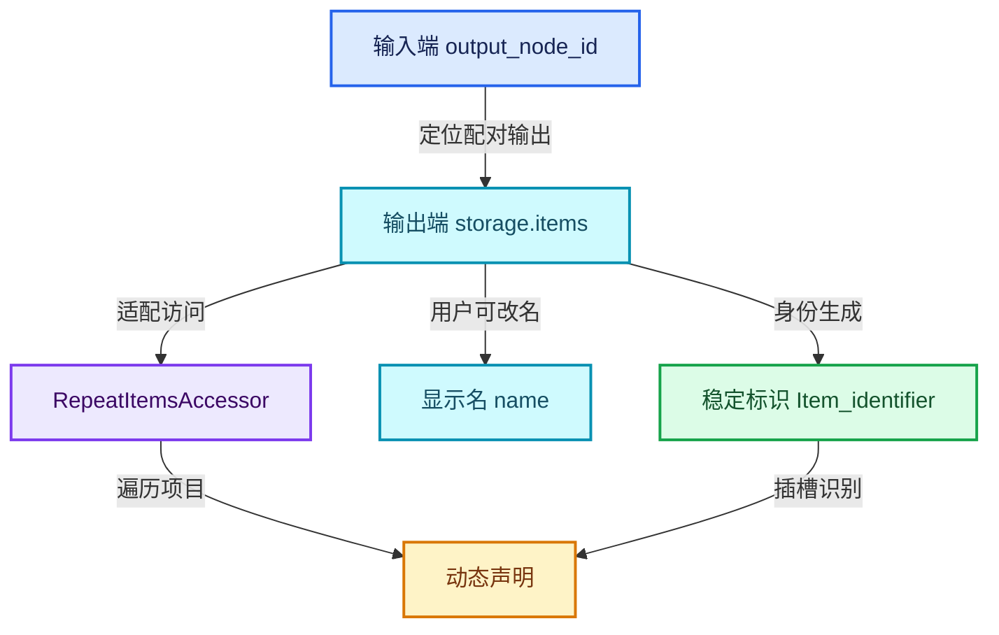

# RZ-02 DNA存储配对与动态插槽

[返回总入口](../README.md) · [本组导航](README.md) · [源码与版本](../00-课程指南/源码版本与覆盖索引.md)

> 源码基准提交：`e2e58a974edb3a5e949aa273d7ff940b5c5797c8`。具体文件内容以证据清单的 SHA-256 为准。

## 先回答一个具体问题

修改状态项名称或顺序时，两端插槽如何保持对应？

区分持久化状态项、节点配对标识、插槽稳定标识与运行时位置索引。

## 阅读前需要的概念

1. **`NodeRepeatItem`**：描述状态项名称、类型和稳定身份的DNA项目结构。

2. **`output_node_id`**：输入边界存储的配对输出节点标识。

3. **`identifier`**：稳定身份；要区分节点、项目与插槽各自所属的标识空间。

4. **`next_identifier`**：为新状态项分配身份的递增计数，不等于活动位置。

5. **`RepeatItemsAccessor`**：使共享socket_items模板能访问Repeat特定存储的适配器。

6. **`active_index`**：界面当前选中项目的位置，重排后含义可能变化。

7. **`插槽声明`**：根据节点配置描述插槽及结构和引用关系的Builder过程。

8. **`Extend`**：编辑时扩充项目的占位插槽，通常不作为体实际数据参数。

## 本篇的机制地图



图中连线标签区分状态流、接口、拥有与观察关系；它不是线程调度记录，也不表示未声明的类型继承关系。

## 核心机制与设计推导

### 01 · 输出端拥有状态项数组

NodeGeometryRepeatOutput 持有 items 指针、数量和活动位置等元数据。

输入端只保存所配对输出节点的 identifier，不保存另一份独立状态项数组。

因此输入端声明插槽时需要沿 output_node_id 找到输出节点。

排查两端不一致要先看配对与声明刷新，不能先猜数组被两边独立修改。

### 02 · 四种索引不能混用

节点 identifier 识别一棵节点树里的节点；item.identifier 识别一个状态项；active_index 表示界面当前选中项；LF 索引表示执行接口中的位置。

它们的数值可能偶然相等，但语义不相同。

删除某一项之后，数组位置会变化，而存活项的稳定标识应继续标识同一个项目。

将数组下标拼成插槽标识会破坏这种区分。

### 03 · 稳定插槽名称生成

RepeatItemsAccessor::socket_identifier_for_item 返回 Item_ 与项目整数标识的拼接。

显示名称从 item.name 取得，供界面与用户识别。

重命名只改变显示语义，不应要求连线用新显示名重新识别项目。

脚本长期保存连线目标时，应优先理解并使用稳定标识。

### 04 · 新项目分配身份

init_with_socket_type_and_name 设置 socket_type，再从 next_identifier 分配标识并递增。

它还调用共享命名工具建立合法且唯一的显示名称。

这里的单调计数服务于新项目身份，不要求项目在界面中按标识排序。

撤销、复制和重新加载的完整行为还取决于外围节点树操作。

### 05 · 动态声明需要上下文

输入端 node_declare 先声明 Iteration 与 Iterations，再在有节点和树上下文时读取配对输出的项目。

输出端则根据自身存储声明相同项目。

没有具体节点时，声明系统无法凭空生成用户尚未配置的状态列表。

阅读 Builder 代码时，要留意 node_or_null 与 tree_or_null 的适用阶段。

### 06 · Extend不是一个运行时状态值

Extend 插槽用于编辑交互，插入连线时可以触发添加项目。

区域接口构建还会过滤不可用插槽和没有几何节点默认值的插槽，典型对象就是 Extend。

把末尾插槽数量直接当成 Repeat Items 数量会出现偏移错误。

正确做法是跟随已有过滤与索引记录。

### 07 · Dynamic结构与引用传播

声明使用 StructureType::Dynamic，并描述从相应输入传播到输出的关系。

它表达插槽可承载的结构与引用推导契约，不等于在声明时执行了字段求值。

inferred_structure_type 与 propagate_all 作用于分析和声明层。

实际值的创建、传递和物化发生在后续执行链。

### 08 · 拷贝必须处理嵌套拥有

输出端复制先建立存储副本，再调用 copy_array 复制项目数组。

RepeatItemsAccessor::copy_item 还会复制项目名称字符串。

只复制 items 指针会让两个节点共享本应独立拥有的数组，导致修改串扰或重复释放。

分析这段代码时应画出存储、数组与名称三层所有权。

## 小数据推演与反例实验

以下预期来自明确的输入和模型推导。未附 Blender 运行记录的案例属于待执行实验，不把手算结果当作后端实测。

### 实验 01 · 项目改名

**输入与操作**

已有 Item_7，显示名从速度改成偏移

**预期与判据**

连线仍识别 Item_7

**为什么这个案例有辨别力**

名称与稳定身份是两条独立信息。

**执行时记录**

- 保留输入、轮数与状态项身份，避免只保存截图。
- 将实际观察和上述预期对照；不一致时先定位本实验涉及的边界。

### 实验 02 · 项目重排

**输入与操作**

项目标识依次为 2、8、11，把 11 移到首位

**预期与判据**

顺序变为 11、2、8

**为什么这个案例有辨别力**

位置变化后不能让执行接口继续使用旧位置假设。

**执行时记录**

- 保留输入、轮数与状态项身份，避免只保存截图。
- 将实际观察和上述预期对照；不一致时先定位本实验涉及的边界。

### 实验 03 · 删除再新增

**输入与操作**

删除标识为 8 的项，再增加一个新项

**预期与判据**

新项由 next_identifier 分配

**为什么这个案例有辨别力**

不要假定一定复用数字 8。

**执行时记录**

- 保留输入、轮数与状态项身份，避免只保存截图。
- 将实际观察和上述预期对照；不一致时先定位本实验涉及的边界。

### 实验 04 · 输入端未配对

**输入与操作**

输入节点 output_node_id 无法定位有效输出

**预期与判据**

动态项目声明无法从配对输出取得

**为什么这个案例有辨别力**

先恢复配对，再检查状态项列表。

**执行时记录**

- 保留输入、轮数与状态项身份，避免只保存截图。
- 将实际观察和上述预期对照；不一致时先定位本实验涉及的边界。

### 实验 05 · 复制区域

**输入与操作**

拷贝输出节点并随后编辑拷贝的项目名

**预期与判据**

原节点项目名应独立

**为什么这个案例有辨别力**

仅存储结构的浅拷贝不足以建立完整独立拥有。

**执行时记录**

- 保留输入、轮数与状态项身份，避免只保存截图。
- 将实际观察和上述预期对照；不一致时先定位本实验涉及的边界。

### 实验 06 · 链接Extend

**输入与操作**

把受支持类型的输出连到扩展插槽

**预期与判据**

共享工具尝试新增对应状态项

**为什么这个案例有辨别力**

应核查类型支持和连线重定向，不能让 Extend 进入实际状态列表。

**执行时记录**

- 保留输入、轮数与状态项身份，避免只保存截图。
- 将实际观察和上述预期对照；不一致时先定位本实验涉及的边界。

## 连续源码与定向阅读批注

以下代码逐字摘自本地源码，保留原始空行、注释和条件编译。
文件头中的许可证以源文件为准；本教程的说明文字不改变上游源码的授权。
区间摘录不保证从函数边界开始；标题明确标明连续区间时，应结合所链接源文件查看外围声明。
每个块的原始文件、起止行和哈希记入 `_evidence/source-excerpts.json`，校验脚本会逐块比较。

### 源码 01 · Repeat持久化结构

来源：[source/blender/makesdna/DNA_node_types.h](../../../../../source/blender/makesdna/DNA_node_types.h)，连续区间 L3543—L3578。

<!-- source:dna:3543:3578 -->

```cpp
struct NodeRepeatItem {
  char *name = nullptr;
  eNodeSocketDatatype socket_type = {};
  char _pad[2] = {};
  /**
   * Generated unique identifier for sockets which stays the same even when the item order or
   * names change.
   */
  int identifier = 0;
};

struct NodeGeometryRepeatInput {
  DNA_DEFINE_CXX_METHODS(NodeGeometryRepeatInput)

  /** bNode.identifier of the corresponding output node. */
  int32_t output_node_id = 0;
};

struct NodeGeometryRepeatOutput {
  DNA_DEFINE_CXX_METHODS(NodeGeometryRepeatOutput)

  NodeRepeatItem *items = nullptr;
  int items_num = 0;
  int active_index = 0;
  /** Identifier to give to the next repeat item. */
  int next_identifier = 0;
  int inspection_index = 0;

#ifdef __cplusplus
  Span<NodeRepeatItem> items_span() const;
  MutableSpan<NodeRepeatItem> items_span();
#endif
};

struct NodeGeometryForeachGeometryElementInput {
  DNA_DEFINE_CXX_METHODS(NodeGeometryForeachGeometryElementInput)
```

**读完这段后回到本篇问题**

- 对照“输出端拥有状态项数组”，明确这段代码是定义存储、建立接口还是执行已有结构。
- 结合“项目改名”重画输入到输出的关系，区分源码事实与例子的推导。
- 保留失败分支、默认值、析构和条件编译；不要仅摘取看起来像主算法的几行。

### 源码 02 · RepeatItemsAccessor完整适配器

来源：[source/blender/nodes/geometry/include/NOD_geo_repeat.hh](../../../../../source/blender/nodes/geometry/include/NOD_geo_repeat.hh)，连续区间 L1—L89。

<!-- source:access:1:89 -->

```cpp
/* SPDX-FileCopyrightText: 2024 Blender Authors
 *
 * SPDX-License-Identifier: GPL-2.0-or-later */

#pragma once

#include "DNA_node_types.h"

#include "NOD_socket_items.hh"

namespace blender::nodes {

/**
 * Makes it possible to use various functions (e.g. the ones in `NOD_socket_items.hh`) with
 * repeat items.
 */
struct RepeatItemsAccessor : public socket_items::SocketItemsAccessorDefaults {
  using ItemT = NodeRepeatItem;
  static StructRNA **item_srna;
  static int node_type;
  static constexpr StringRefNull node_idname = "GeometryNodeRepeatOutput";
  static constexpr bool has_type = true;
  static constexpr bool has_name = true;
  struct operator_idnames {
    static constexpr StringRefNull add_item = "NODE_OT_repeat_zone_item_add";
    static constexpr StringRefNull remove_item = "NODE_OT_repeat_zone_item_remove";
    static constexpr StringRefNull move_item = "NODE_OT_repeat_zone_item_move";
  };
  struct ui_idnames {
    static constexpr StringRefNull list = "DATA_UL_repeat_zone_state";
  };
  struct rna_names {
    static constexpr StringRefNull items = "repeat_items";
    static constexpr StringRefNull active_index = "active_index";
  };

  static socket_items::SocketItemsRef<NodeRepeatItem> get_items_from_node(bNode &node)
  {
    auto *storage = static_cast<NodeGeometryRepeatOutput *>(node.storage);
    return {&storage->items, &storage->items_num, &storage->active_index};
  }

  static void copy_item(const NodeRepeatItem &src, NodeRepeatItem &dst)
  {
    dst = src;
    dst.name = BLI_strdup_null(dst.name);
  }

  static void destruct_item(NodeRepeatItem *item)
  {
    MEM_SAFE_DELETE(item->name);
  }

  static void blend_write_item(BlendWriter *writer, const ItemT &item);
  static void blend_read_data_item(BlendDataReader *reader, ItemT &item);

  static eNodeSocketDatatype get_socket_type(const NodeRepeatItem &item)
  {
    return item.socket_type;
  }

  static char **get_name(NodeRepeatItem &item)
  {
    return &item.name;
  }

  static bool supports_socket_type(const eNodeSocketDatatype socket_type, const int ntree_type)
  {
    return bke::node_tree_type_supports_socket_type_static(ntree_type, socket_type);
  }

  static void init_with_socket_type_and_name(bNode &node,
                                             NodeRepeatItem &item,
                                             const eNodeSocketDatatype socket_type,
                                             const char *name)
  {
    auto *storage = static_cast<NodeGeometryRepeatOutput *>(node.storage);
    item.socket_type = socket_type;
    item.identifier = storage->next_identifier++;
    socket_items::set_item_name_and_make_unique<RepeatItemsAccessor>(node, item, name);
  }

  static std::string socket_identifier_for_item(const NodeRepeatItem &item)
  {
    return "Item_" + std::to_string(item.identifier);
  }
};

}  // namespace blender::nodes
```

**读完这段后回到本篇问题**

- 对照“四种索引不能混用”，明确这段代码是定义存储、建立接口还是执行已有结构。
- 结合“项目重排”重画输入到输出的关系，区分源码事实与例子的推导。
- 保留失败分支、默认值、析构和条件编译；不要仅摘取看起来像主算法的几行。

### 源码 03 · 节点声明注册与复制释放

来源：[source/blender/nodes/geometry/nodes/node_geo_repeat.cc](../../../../../source/blender/nodes/geometry/nodes/node_geo_repeat.cc)，连续区间 L1—L372。

<!-- source:node:1:372 -->

```cpp
/* SPDX-FileCopyrightText: 2023 Blender Authors
 *
 * SPDX-License-Identifier: GPL-2.0-or-later */

#include "BLI_string.hh"
#include "BLI_string_utf8.hh"

#include "NOD_geo_repeat.hh"
#include "NOD_socket.hh"
#include "NOD_socket_items_blend.hh"
#include "NOD_socket_items_ops.hh"
#include "NOD_socket_items_ui.hh"
#include "NOD_socket_search_link.hh"

#include "BLO_read_write.hh"

#include "RNA_access.hh"
#include "RNA_prototypes.hh"

#include "BKE_screen.hh"

#include "WM_api.hh"

#include "UI_interface_layout.hh"

#include "node_geometry_util.hh"
#include "shader/node_shader_util.hh"

namespace blender {

namespace nodes::node_geo_repeat_cc {

/** Shared between repeat zone input and output node. */
static void node_layout_ex(ui::Layout &layout, bContext *C, PointerRNA *current_node_ptr)
{
  bNodeTree &ntree = *reinterpret_cast<bNodeTree *>(current_node_ptr->owner_id);
  bNode *current_node = static_cast<bNode *>(current_node_ptr->data);

  const bke::bNodeTreeZones *zones = ntree.zones();
  if (!zones) {
    return;
  }
  const bke::bNodeTreeZone *zone = zones->get_zone_by_node(current_node->identifier);
  if (!zone) {
    return;
  }
  if (!zone->output_node_id) {
    return;
  }
  bNode &output_node = const_cast<bNode &>(*zone->output_node());
  PointerRNA output_node_ptr = RNA_pointer_create_discrete(
      current_node_ptr->owner_id, RNA_Node, &output_node);

  if (ui::Layout *panel = layout.panel(C, "repeat_items", false, IFACE_("Repeat Items"))) {
    socket_items::ui::draw_items_list_with_operators<RepeatItemsAccessor>(
        C, panel, ntree, output_node);
    socket_items::ui::draw_active_item_props<RepeatItemsAccessor>(
        ntree, output_node, [&](PointerRNA *item_ptr) {
          panel->use_property_split_set(true);
          panel->use_property_decorate_set(false);
          panel->prop(item_ptr, "socket_type", UI_ITEM_NONE, std::nullopt, ICON_NONE);
        });
  }

  layout.prop(&output_node_ptr, "inspection_index", UI_ITEM_NONE, std::nullopt, ICON_NONE);
}

namespace repeat_input_node {

NODE_STORAGE_FUNCS(NodeGeometryRepeatInput);

static void node_declare(NodeDeclarationBuilder &b)
{
  b.use_custom_socket_order();
  b.allow_any_socket_order();
  b.add_output<decl::Int>("Iteration"_ustr)
      .description("Index of the current iteration. Starts counting at zero");
  b.add_input<decl::Int>("Iterations"_ustr).min(0).default_value(1);

  const bNode *node = b.node_or_null();
  const bNodeTree *tree = b.tree_or_null();
  if (node && tree) {
    const NodeGeometryRepeatInput &storage = node_storage(*node);
    if (const bNode *output_node = tree->node_by_id(storage.output_node_id)) {
      const auto &output_storage = *static_cast<const NodeGeometryRepeatOutput *>(
          output_node->storage);
      for (const int i : IndexRange(output_storage.items_num)) {
        const NodeRepeatItem &item = output_storage.items[i];
        const eNodeSocketDatatype socket_type = item.socket_type;
        const UString name = item.name ? UString(item.name) : ""_ustr;
        const UString identifier(RepeatItemsAccessor::socket_identifier_for_item(item));
        auto &input_decl = b.add_input(socket_type, name, identifier)
                               .socket_name_ptr(
                                   &tree->id, *RepeatItemsAccessor::item_srna, &item, "name")
                               .structure_type(StructureType::Dynamic)
                               .compositor_realization_mode(CompositorInputRealizationMode::None);
        b.add_output(socket_type, name, identifier)
            .align_with_previous()
            .propagate_all({input_decl.index()})
            .inferred_structure_type({input_decl.index()})
            .structure_type(StructureType::Dynamic);
      }
    }
  }
  b.add_input<decl::Extend>(""_ustr, "__extend__"_ustr)
      .structure_type(StructureType::Dynamic)
      .custom_draw(socket_items::ui::draw_extend_socket_fn<RepeatItemsAccessor>());
  b.add_output<decl::Extend>(""_ustr, "__extend__"_ustr)
      .structure_type(StructureType::Dynamic)
      .align_with_previous();
}

static void node_init(bNodeTree * /*tree*/, bNode *node)
{
  NodeGeometryRepeatInput *data = MEM_new<NodeGeometryRepeatInput>(__func__);
  /* Needs to be initialized for the node to work. */
  data->output_node_id = 0;
  node->storage = data;
}

static void node_label(const bNodeTree * /*ntree*/,
                       const bNode * /*node*/,
                       char *label,
                       const int label_maxncpy)
{
  BLI_strncpy_utf8(label, CTX_IFACE_(BLT_I18NCONTEXT_ID_NODETREE, "Repeat"), label_maxncpy);
}

static bool node_insert_link(bke::NodeInsertLinkParams &params)
{
  bNode *output_node = params.ntree.node_by_id(node_storage(params.node).output_node_id);
  if (!output_node) {
    return true;
  }
  return socket_items::try_add_item_via_any_extend_socket<RepeatItemsAccessor>(
      params.ntree, params.node, *output_node, params.link);
}

static int node_shader_fn(GPUMaterial *mat,
                          bNode *node,
                          bNodeExecData * /*execdata*/,
                          GPUNodeStack *in,
                          GPUNodeStack *out)
{
  int zone_id = node_storage(*node).output_node_id;
  return GPU_stack_link_zone(mat, node, "REPEAT_BEGIN", in, out, zone_id, false, 1, 1);
}

static void node_register()
{
  static bke::bNodeType ntype;
  common_node_type_base(&ntype, "GeometryNodeRepeatInput"_ustr, GEO_NODE_REPEAT_INPUT);
  ntype.ui_name = "Repeat Input";
  ntype.enum_name_legacy = "REPEAT_INPUT";
  ntype.nclass = NODE_CLASS_INTERFACE;
  ntype.initfunc = node_init;
  ntype.declare = node_declare;
  ntype.labelfunc = node_label;
  ntype.gather_link_search_ops = nullptr;
  ntype.insert_link = node_insert_link;
  ntype.no_muting = true;
  ntype.draw_buttons_ex = node_layout_ex;
  ntype.gpu_fn = node_shader_fn;
  bke::node_type_storage(
      ntype, "NodeGeometryRepeatInput", node_free_standard_storage, node_copy_standard_storage);
  bke::node_register_type(ntype);
}
NOD_REGISTER_NODE(node_register)

}  // namespace repeat_input_node

namespace repeat_output_node {

NODE_STORAGE_FUNCS(NodeGeometryRepeatOutput);

static void node_declare(NodeDeclarationBuilder &b)
{
  b.use_custom_socket_order();
  b.allow_any_socket_order();
  const bNodeTree *tree = b.tree_or_null();
  const bNode *node = b.node_or_null();
  if (node) {
    const NodeGeometryRepeatOutput &storage = node_storage(*node);
    for (const int i : IndexRange(storage.items_num)) {
      const NodeRepeatItem &item = storage.items[i];
      const eNodeSocketDatatype socket_type = item.socket_type;
      const UString name = item.name ? UString(item.name) : ""_ustr;
      const UString identifier(RepeatItemsAccessor::socket_identifier_for_item(item));
      auto &input_decl = b.add_input(socket_type, name, identifier)
                             .socket_name_ptr(
                                 &tree->id, *RepeatItemsAccessor::item_srna, &item, "name")
                             .structure_type(StructureType::Dynamic)
                             .compositor_realization_mode(CompositorInputRealizationMode::None);
      b.add_output(socket_type, name, identifier)
          .align_with_previous()
          .propagate_all({input_decl.index()})
          .inferred_structure_type({input_decl.index()})
          .structure_type(StructureType::Dynamic);
    }
  }
  b.add_input<decl::Extend>(""_ustr, "__extend__"_ustr)
      .structure_type(StructureType::Dynamic)
      .custom_draw(socket_items::ui::draw_extend_socket_fn<RepeatItemsAccessor>());
  b.add_output<decl::Extend>(""_ustr, "__extend__"_ustr)
      .structure_type(StructureType::Dynamic)
      .align_with_previous();
}

static void node_init(bNodeTree *tree, bNode *node)
{
  NodeGeometryRepeatOutput *data = MEM_new<NodeGeometryRepeatOutput>(__func__);

  data->next_identifier = 0;

  if (tree->type == NTREE_GEOMETRY) {
    data->items = MEM_new_array<NodeRepeatItem>(1, __func__);
    data->items[0].name = BLI_strdup(DATA_("Geometry"));
    data->items[0].socket_type = SOCK_GEOMETRY;
    data->items[0].identifier = data->next_identifier++;
    data->items_num = 1;
  }

  node->storage = data;
}

static void node_free_storage(bNode *node)
{
  socket_items::destruct_array<RepeatItemsAccessor>(*node);
  MEM_delete(reinterpret_cast<NodeGeometryRepeatOutput *>(node->storage));
}

static void node_copy_storage(bNodeTree * /*dst_tree*/, bNode *dst_node, const bNode *src_node)
{
  const NodeGeometryRepeatOutput &src_storage = node_storage(*src_node);
  auto *dst_storage = MEM_new<NodeGeometryRepeatOutput>(__func__, dna::shallow_copy(src_storage));
  dst_node->storage = dst_storage;

  socket_items::copy_array<RepeatItemsAccessor>(*src_node, *dst_node);
}

static bool node_insert_link(bke::NodeInsertLinkParams &params)
{
  return socket_items::try_add_item_via_any_extend_socket<RepeatItemsAccessor>(
      params.ntree, params.node, params.node, params.link);
}

static void node_operators()
{
  socket_items::ops::make_common_operators<RepeatItemsAccessor>();
}

static void node_gather_link_searches(GatherLinkSearchOpParams &params)
{
  const bNodeSocket &other_socket = params.other_socket();
  if (!RepeatItemsAccessor::supports_socket_type(other_socket.type, params.node_tree().type)) {
    return;
  }
  if (other_socket.in_out == SOCK_OUT) {
    params.add_item_full_name(
        std::string(IFACE_("Repeat")) + " " + UI_MENU_ARROW_SEP + IFACE_("Iterations"),
        [](LinkSearchOpParams &params) {
          bNode &input_node = params.add_node("GeometryNodeRepeatInput"_ustr);
          bNode &output_node = params.add_node("GeometryNodeRepeatOutput"_ustr);
          output_node.location[0] = 300;

          auto &input_storage = *static_cast<NodeGeometryRepeatInput *>(input_node.storage);
          input_storage.output_node_id = output_node.identifier;
          socket_items::clear<RepeatItemsAccessor>(output_node);

          params.update_and_connect_available_socket(input_node, "Iterations"_ustr);
        });
  }
  params.add_item_full_name(IFACE_("Repeat"), [](LinkSearchOpParams &params) {
    bNode &input_node = params.add_node("GeometryNodeRepeatInput"_ustr);
    bNode &output_node = params.add_node("GeometryNodeRepeatOutput"_ustr);
    output_node.location[0] = 300;

    auto &input_storage = *static_cast<NodeGeometryRepeatInput *>(input_node.storage);
    input_storage.output_node_id = output_node.identifier;

    socket_items::clear<RepeatItemsAccessor>(output_node);
    const UString name(params.socket.name);
    auto *item = socket_items::add_item_with_socket_type_and_name<RepeatItemsAccessor>(
        params.node_tree, output_node, params.socket.type, name.c_str());
    update_node_declaration_and_sockets(params.node_tree, input_node);
    update_node_declaration_and_sockets(params.node_tree, output_node);
    bNode &node = params.socket.in_out == SOCK_IN ? output_node : input_node;
    params.connect_available_socket_by_identifier(
        node, UString(RepeatItemsAccessor::socket_identifier_for_item(*item)));
    params.node_tree.ensure_topology_cache();
    bke::node_add_link(params.node_tree,
                       input_node,
                       input_node.output_socket(1),
                       output_node,
                       output_node.input_socket(0));
  });
}

static void node_blend_write(const bNodeTree & /*tree*/, const bNode &node, BlendWriter &writer)
{
  socket_items::blend_write<RepeatItemsAccessor>(&writer, node);
}

static void node_blend_read(bNodeTree & /*tree*/, bNode &node, BlendDataReader &reader)
{
  socket_items::blend_read_data<RepeatItemsAccessor>(&reader, node);
}

static int node_shader_fn(GPUMaterial *mat,
                          bNode *node,
                          bNodeExecData * /*execdata*/,
                          GPUNodeStack *in,
                          GPUNodeStack *out)
{
  int zone_id = node->identifier;
  return GPU_stack_link_zone(mat, node, "REPEAT_END", in, out, zone_id, true, 0, 0);
}

static void node_register()
{
  static bke::bNodeType ntype;
  common_node_type_base(&ntype, "GeometryNodeRepeatOutput"_ustr, GEO_NODE_REPEAT_OUTPUT);
  ntype.ui_name = "Repeat Output";
  ntype.enum_name_legacy = "REPEAT_OUTPUT";
  ntype.nclass = NODE_CLASS_INTERFACE;
  ntype.initfunc = node_init;
  ntype.declare = node_declare;
  ntype.labelfunc = repeat_input_node::node_label;
  ntype.insert_link = node_insert_link;
  ntype.gather_link_search_ops = node_gather_link_searches;
  ntype.no_muting = true;
  ntype.draw_buttons_ex = node_layout_ex;
  ntype.register_operators = node_operators;
  ntype.blend_write_storage_content = node_blend_write;
  ntype.blend_data_read_storage_content = node_blend_read;
  ntype.gpu_fn = node_shader_fn;
  bke::node_type_storage(ntype, "NodeGeometryRepeatOutput", node_free_storage, node_copy_storage);
  bke::node_register_type(ntype);
}
NOD_REGISTER_NODE(node_register)

}  // namespace repeat_output_node

}  // namespace nodes::node_geo_repeat_cc

namespace nodes {

StructRNA **RepeatItemsAccessor::item_srna = &RNA_RepeatItem;

void RepeatItemsAccessor::blend_write_item(BlendWriter *writer, const ItemT &item)
{
  writer->write_string(item.name);
}

void RepeatItemsAccessor::blend_read_data_item(BlendDataReader *reader, ItemT &item)
{
  BLO_read_string(reader, &item.name);
}

}  // namespace nodes

Span<NodeRepeatItem> NodeGeometryRepeatOutput::items_span() const
{
  return Span<NodeRepeatItem>(items, items_num);
}

MutableSpan<NodeRepeatItem> NodeGeometryRepeatOutput::items_span()
{
  return MutableSpan<NodeRepeatItem>(items, items_num);
}

}  // namespace blender
```

**读完这段后回到本篇问题**

- 对照“稳定插槽名称生成”，明确这段代码是定义存储、建立接口还是执行已有结构。
- 结合“删除再新增”重画输入到输出的关系，区分源码事实与例子的推导。
- 保留失败分支、默认值、析构和条件编译；不要仅摘取看起来像主算法的几行。

### 源码 04 · 共享数组与命名机制

来源：[source/blender/nodes/NOD_socket_items.hh](../../../../../source/blender/nodes/NOD_socket_items.hh)，连续区间 L1—L270。

<!-- source:items:1:270 -->

```cpp
/* SPDX-FileCopyrightText: 2023 Blender Authors
 *
 * SPDX-License-Identifier: GPL-2.0-or-later */

/** \file
 * \ingroup nodes
 */

#pragma once

/**
 * Some nodes have a dynamic number of sockets (e.g. simulation input/output). These nodes store an
 * array of items in their `bNode->storage` (e.g. `NodeSimulationItem`). Different nodes have
 * slightly different storage requirements, but a lot of the logic is still the same between nodes.
 * This file implements various shared functionality that can be used by different nodes to deal
 * with these item arrays.
 *
 * In order to use the functions, one has to implement an "accessor" which tells the shared code
 * how to deal with specific item arrays. Different functions have different requirements for the
 * accessor. It's easiest to just look at existing accessors like #SimulationItemsAccessor and
 * #RepeatItemsAccessor and to implement the same methods.
 */

#include <optional>

#include "BLI_string.hh"
#include "BLI_string_utils.hh"

#include "BKE_node.hh"
#include "BKE_node_runtime.hh"
#include "BKE_node_tree_update.hh"

#include "DNA_array_utils.hh"

#include "NOD_socket.hh"

namespace blender::nodes::socket_items {

struct SocketItemsAccessorDefaults {
  static constexpr bool has_single_identifier_str = true;
  static constexpr bool has_name_validation = false;
  static constexpr bool has_custom_initial_name = false;
  static constexpr bool has_vector_dimensions = false;
  static constexpr bool can_have_empty_name = false;
  static constexpr char unique_name_separator = '.';
};

/**
 * References a "C-Array" that is stored elsewhere. This is different from a MutableSpan, because
 * one can even resize the array through this reference.
 */
template<typename T> struct SocketItemsRef {
  T **items;
  int *items_num;
  int *active_index;
};

/**
 * Iterates over the node tree to find the node that this item belongs to.
 */
template<typename Accessor>
inline bNode *find_node_by_item(bNodeTree &ntree, const typename Accessor::ItemT &item)
{
  ntree.ensure_topology_cache();
  for (bNode *node : ntree.nodes_by_type(UString(Accessor::node_idname))) {
    SocketItemsRef array = Accessor::get_items_from_node(*node);
    if (&item >= *array.items && &item < *array.items + *array.items_num) {
      return node;
    }
  }
  return nullptr;
}

/** Find the item with the given identifier. */
template<typename Accessor>
inline typename Accessor::ItemT *find_item_by_identifier(bNode &node, const StringRef identifier)
{

  SocketItemsRef array = Accessor::get_items_from_node(node);
  for (const int i : IndexRange(*array.items_num)) {
    typename Accessor::ItemT &item = (*array.items)[i];
    if (Accessor::socket_identifier_for_item(item) == identifier) {
      return &item;
    }
  }
  return nullptr;
}

/**
 * Destruct all the items and the free the array itself.
 */
template<typename Accessor> inline void destruct_array(bNode &node)
{
  using ItemT = typename Accessor::ItemT;
  SocketItemsRef ref = Accessor::get_items_from_node(node);
  for (const int i : IndexRange(*ref.items_num)) {
    ItemT &item = (*ref.items)[i];
    Accessor::destruct_item(&item);
  }
  MEM_SAFE_DELETE(*ref.items);
}

/**
 * Removes all items from the node.
 */
template<typename Accessor> inline void clear(bNode &node)
{
  destruct_array<Accessor>(node);
  SocketItemsRef ref = Accessor::get_items_from_node(node);
  *ref.items_num = 0;
  if (ref.active_index) {
    *ref.active_index = 0;
  }
}

/**
 * Copy the items from the storage of the source node to the storage of the destination node.
 */
template<typename Accessor> inline void copy_array(const bNode &src_node, bNode &dst_node)
{
  using ItemT = typename Accessor::ItemT;
  SocketItemsRef src_ref = Accessor::get_items_from_node(const_cast<bNode &>(src_node));
  SocketItemsRef dst_ref = Accessor::get_items_from_node(dst_node);
  const int items_num = *src_ref.items_num;
  *dst_ref.items = MEM_new_array<ItemT>(items_num, __func__);
  for (const int i : IndexRange(items_num)) {
    Accessor::copy_item((*src_ref.items)[i], (*dst_ref.items)[i]);
  }
}

/**
 * Enforce constraints on the name of the item.
 */
template<typename Accessor> inline std::string get_validated_name(const StringRef name)
{
  if constexpr (Accessor::has_name_validation) {
    return Accessor::validate_name(name);
  }
  else {
    return name;
  }
}

/**
 * Changes the name of an existing item and makes sure that the name is unique among other the
 * other items in the same array.
 */
template<typename Accessor>
inline void set_item_name_and_make_unique(bNode &node,
                                          typename Accessor::ItemT &item,
                                          const char *value)
{
  using ItemT = typename Accessor::ItemT;
  SocketItemsRef array = Accessor::get_items_from_node(node);

  std::string name = value;
  if constexpr (!Accessor::can_have_empty_name) {
    if (name.empty()) {
      if constexpr (Accessor::has_type) {
        name = *bke::node_static_socket_label(Accessor::get_socket_type(item), 0);
      }
      else {
        name = "Item";
      }
    }
  }

  const std::string validated_name = get_validated_name<Accessor>(name);

  const std::string unique_name = BLI_uniquename_cb(
      [&](const StringRef name) {
        for (ItemT &item_iter : MutableSpan(*array.items, *array.items_num)) {
          if (&item_iter != &item) {
            if (*Accessor::get_name(item_iter) == name) {
              return true;
            }
          }
        }
        return false;
      },
      Accessor::unique_name_separator,
      validated_name);

  /* The unique name should still be valid. */
  BLI_assert(unique_name == get_validated_name<Accessor>(unique_name));

  char **item_name = Accessor::get_name(item);
  MEM_SAFE_DELETE(*item_name);
  *item_name = BLI_strdup(unique_name.c_str());
}

namespace detail {

template<typename Accessor> inline typename Accessor::ItemT &add_item_to_array(bNode &node)
{
  using ItemT = typename Accessor::ItemT;
  SocketItemsRef array = Accessor::get_items_from_node(node);

  ItemT *old_items = *array.items;
  const int old_items_num = *array.items_num;
  const int new_items_num = old_items_num + 1;

  ItemT *new_items = MEM_new_array<ItemT>(new_items_num, __func__);
  std::copy_n(old_items, old_items_num, new_items);
  ItemT &new_item = new_items[old_items_num];

  MEM_SAFE_DELETE(old_items);
  *array.items = new_items;
  *array.items_num = new_items_num;
  if (array.active_index) {
    *array.active_index = old_items_num;
  }

  return new_item;
}

}  // namespace detail

/**
 * Add a new item at the end with the given socket type and name. The optional dimensions argument
 * can be provided for types that support multiple possible dimensions like Vector. It is expected
 * to be in the range [2, 4] and if not provided, 3 should be assumed.
 */
template<typename Accessor>
inline typename Accessor::ItemT *add_item_with_socket_type_and_name(
    bNodeTree &ntree,
    bNode &node,
    const eNodeSocketDatatype socket_type,
    const char *name,
    std::optional<int> dimensions = std::nullopt)
{
  using ItemT = typename Accessor::ItemT;
  BLI_assert(Accessor::supports_socket_type(socket_type, ntree.type));
  BLI_assert(!(dimensions.has_value() && socket_type != SOCK_VECTOR));
  BLI_assert(ELEM(dimensions.value_or(3), 2, 3, 4));
  UNUSED_VARS_NDEBUG(ntree);
  ItemT &new_item = detail::add_item_to_array<Accessor>(node);
  if constexpr (Accessor::has_vector_dimensions) {
    Accessor::init_with_socket_type_and_name(node, new_item, socket_type, name, dimensions);
  }
  else {
    Accessor::init_with_socket_type_and_name(node, new_item, socket_type, name);
  }
  return &new_item;
}

/**
 * Add a new item at the end with the given name.
 */
template<typename Accessor>
inline typename Accessor::ItemT *add_item_with_name(bNode &node, const char *name)
{
  using ItemT = typename Accessor::ItemT;
  ItemT &new_item = detail::add_item_to_array<Accessor>(node);
  Accessor::init_with_name(node, new_item, name);
  return &new_item;
}

/**
 * Add a new item at the end.
 */
template<typename Accessor> inline typename Accessor::ItemT *add_item(bNode &node)
{
  using ItemT = typename Accessor::ItemT;
  ItemT &new_item = detail::add_item_to_array<Accessor>(node);
  Accessor::init(node, new_item);
  return &new_item;
}

template<typename Accessor>
```

**读完这段后回到本篇问题**

- 对照“新项目分配身份”，明确这段代码是定义存储、建立接口还是执行已有结构。
- 结合“输入端未配对”重画输入到输出的关系，区分源码事实与例子的推导。
- 保留失败分支、默认值、析构和条件编译；不要仅摘取看起来像主算法的几行。

### 源码 05 · 执行接口对编辑插槽的过滤

来源：[source/blender/nodes/intern/geometry_nodes_lazy_function.cc](../../../../../source/blender/nodes/intern/geometry_nodes_lazy_function.cc)，连续区间 L1692—L1756。

<!-- source:builder:1692:1756 -->

```cpp
static bool ignore_zone_bsocket(const bNodeSocket &bsocket)
{
  if (!bsocket.is_available()) {
    return true;
  }
  if (!bsocket.typeinfo->geometry_nodes_default_value) {
    /* These are typically extend sockets. */
    return true;
  }
  return false;
}

void initialize_zone_wrapper(const bNodeTreeZone &zone,
                             ZoneBuildInfo &zone_info,
                             const ZoneBodyFunction &body_fn,
                             const bool expose_all_reference_sets,
                             Vector<lf::Input> &r_inputs,
                             Vector<lf::Output> &r_outputs)
{
  for (const bNodeSocket *socket : zone.input_node()->input_sockets()) {
    if (ignore_zone_bsocket(*socket)) {
      continue;
    }
    zone_info.indices.inputs.main.append(r_inputs.append_and_get_index_as(
        socket->name, CPPType::get<SocketValueVariant>(), lf::ValueUsage::Maybe));
  }

  for (const bNodeLink *link : zone.border_links) {
    zone_info.indices.inputs.border_links.append(r_inputs.append_and_get_index_as(
        link->fromsock->name, CPPType::get<SocketValueVariant>(), lf::ValueUsage::Maybe));
  }

  for (const bNodeSocket *socket : zone.output_node()->output_sockets()) {
    if (ignore_zone_bsocket(*socket)) {
      continue;
    }
    zone_info.indices.inputs.output_usages.append(
        r_inputs.append_and_get_index_as("Usage", CPPType::get<bool>(), lf::ValueUsage::Maybe));
    zone_info.indices.outputs.main.append(
        r_outputs.append_and_get_index_as(socket->name, CPPType::get<SocketValueVariant>()));
  }

  for ([[maybe_unused]] const bNodeSocket *socket : zone.input_node()->input_sockets()) {
    if (ignore_zone_bsocket(*socket)) {
      continue;
    }
    zone_info.indices.outputs.input_usages.append(
        r_outputs.append_and_get_index_as("Usage", CPPType::get<bool>()));
  }

  for ([[maybe_unused]] const bNodeLink *link : zone.border_links) {
    zone_info.indices.outputs.border_link_usages.append(
        r_outputs.append_and_get_index_as("Border Link Usage", CPPType::get<bool>()));
  }

  /* Some zone types (e.g. the closure zone) do not expose all reference sets. */
  if (expose_all_reference_sets) {
    for (const auto item : body_fn.indices.inputs.reference_sets.items()) {
      zone_info.indices.inputs.reference_sets.add_new(
          item.key,
          r_inputs.append_and_get_index_as(
              "Reference Set", CPPType::get<GeometryNodesReferenceSet>(), lf::ValueUsage::Maybe));
    }
  }
}
```

**读完这段后回到本篇问题**

- 对照“动态声明需要上下文”，明确这段代码是定义存储、建立接口还是执行已有结构。
- 结合“复制区域”重画输入到输出的关系，区分源码事实与例子的推导。
- 保留失败分支、默认值、析构和条件编译；不要仅摘取看起来像主算法的几行。

## 练习与参考答案

### 练习 01 · 解释“输出端拥有状态项数组”

**题目**

不看代码，说明“输出端拥有状态项数组”解决的具体问题，并给出一个会违背其约束的错误实现。

**参考答案的核心**

NodeGeometryRepeatOutput 持有 items 指针、数量和活动位置等元数据。

**验收追问**

排查两端不一致要先看配对与声明刷新，不能先猜数组被两边独立修改。

**自查方法**

回到上面的源码区间和本篇实验，找出支持该回答的实际字段、调用或分支；若答案是设计推论，应明确写为推论。

### 练习 02 · 解释“四种索引不能混用”

**题目**

不看代码，说明“四种索引不能混用”解决的具体问题，并给出一个会违背其约束的错误实现。

**参考答案的核心**

节点 identifier 识别一棵节点树里的节点；item.identifier 识别一个状态项；active_index 表示界面当前选中项；LF 索引表示执行接口中的位置。

**验收追问**

将数组下标拼成插槽标识会破坏这种区分。

**自查方法**

回到上面的源码区间和本篇实验，找出支持该回答的实际字段、调用或分支；若答案是设计推论，应明确写为推论。

### 练习 03 · 解释“稳定插槽名称生成”

**题目**

不看代码，说明“稳定插槽名称生成”解决的具体问题，并给出一个会违背其约束的错误实现。

**参考答案的核心**

RepeatItemsAccessor::socket_identifier_for_item 返回 Item_ 与项目整数标识的拼接。

**验收追问**

脚本长期保存连线目标时，应优先理解并使用稳定标识。

**自查方法**

回到上面的源码区间和本篇实验，找出支持该回答的实际字段、调用或分支；若答案是设计推论，应明确写为推论。

### 练习 04 · 解释“新项目分配身份”

**题目**

不看代码，说明“新项目分配身份”解决的具体问题，并给出一个会违背其约束的错误实现。

**参考答案的核心**

init_with_socket_type_and_name 设置 socket_type，再从 next_identifier 分配标识并递增。

**验收追问**

撤销、复制和重新加载的完整行为还取决于外围节点树操作。

**自查方法**

回到上面的源码区间和本篇实验，找出支持该回答的实际字段、调用或分支；若答案是设计推论，应明确写为推论。

### 练习 05 · 解释“动态声明需要上下文”

**题目**

不看代码，说明“动态声明需要上下文”解决的具体问题，并给出一个会违背其约束的错误实现。

**参考答案的核心**

输入端 node_declare 先声明 Iteration 与 Iterations，再在有节点和树上下文时读取配对输出的项目。

**验收追问**

阅读 Builder 代码时，要留意 node_or_null 与 tree_or_null 的适用阶段。

**自查方法**

回到上面的源码区间和本篇实验，找出支持该回答的实际字段、调用或分支；若答案是设计推论，应明确写为推论。

### 练习 06 · 解释“Extend不是一个运行时状态值”

**题目**

不看代码，说明“Extend不是一个运行时状态值”解决的具体问题，并给出一个会违背其约束的错误实现。

**参考答案的核心**

Extend 插槽用于编辑交互，插入连线时可以触发添加项目。

**验收追问**

正确做法是跟随已有过滤与索引记录。

**自查方法**

回到上面的源码区间和本篇实验，找出支持该回答的实际字段、调用或分支；若答案是设计推论，应明确写为推论。

### 练习 07 · 解释“Dynamic结构与引用传播”

**题目**

不看代码，说明“Dynamic结构与引用传播”解决的具体问题，并给出一个会违背其约束的错误实现。

**参考答案的核心**

声明使用 StructureType::Dynamic，并描述从相应输入传播到输出的关系。

**验收追问**

实际值的创建、传递和物化发生在后续执行链。

**自查方法**

回到上面的源码区间和本篇实验，找出支持该回答的实际字段、调用或分支；若答案是设计推论，应明确写为推论。

### 练习 08 · 解释“拷贝必须处理嵌套拥有”

**题目**

不看代码，说明“拷贝必须处理嵌套拥有”解决的具体问题，并给出一个会违背其约束的错误实现。

**参考答案的核心**

输出端复制先建立存储副本，再调用 copy_array 复制项目数组。

**验收追问**

分析这段代码时应画出存储、数组与名称三层所有权。

**自查方法**

回到上面的源码区间和本篇实验，找出支持该回答的实际字段、调用或分支；若答案是设计推论，应明确写为推论。

## 本篇完成标准

- 能直接回答：修改状态项名称或顺序时，两端插槽如何保持对应？
- 能解释本篇目标：区分持久化状态项、节点配对标识、插槽稳定标识与运行时位置索引。
- 能手算至少一个正轮数案例和一个边界案例，并说明各自验证的错误类型。
- 能沿源码链接区分配置、构图、求值和观察各阶段。
- 能陈述本篇实际证据的范围，不把静态摘录核对写成后端运行通过。

## 继续阅读

- 上一篇：[01-重复区域全景与状态递推](../01-语义与编辑表示/01-重复区域全景与状态递推.md)
- 下一篇：[03-区域发现嵌套关系与跨界连线](../01-语义与编辑表示/03-区域发现嵌套关系与跨界连线.md)
- [练习脚本与运行范围](../示例/README.md)
- [验收记录与尚未执行的集成检查](../00-课程指南/验收报告.md)
