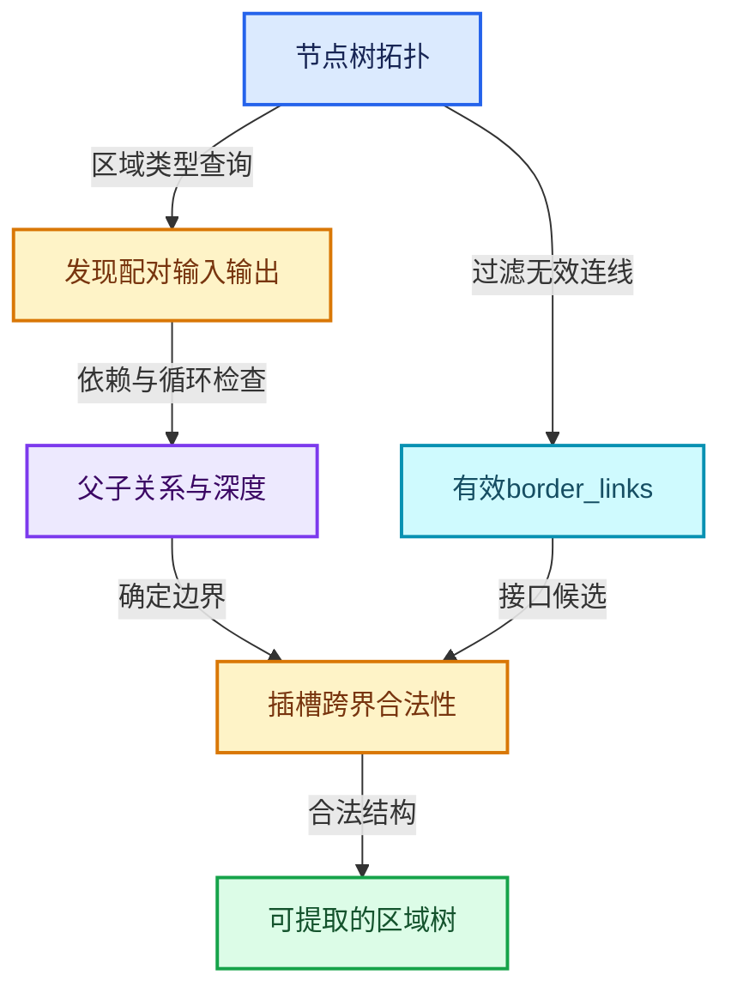

# RZ-03 区域发现嵌套关系与跨界连线

[返回总入口](../README.md) · [本组导航](README.md) · [源码与版本](../00-课程指南/源码版本与覆盖索引.md)

> 源码基准提交：`e2e58a974edb3a5e949aa273d7ff940b5c5797c8`。具体文件内容以证据清单的 SHA-256 为准。

## 先回答一个具体问题

节点编辑器的连线怎样成为可执行的嵌套区域树？

理解配对发现、区域依赖关系、父子归属、边界插槽和合法跨界方向。

## 阅读前需要的概念

1. **`bNodeTreeZone`**：一个已识别区域及其边界、父子关系和跨界连线。

2. **`bNodeTreeZones`**：节点树内全部区域以及归属与合法性查询的集合。

3. **`parent_zone`**：直接父区域；为空表示顶层区域。

4. **`child_zones`**：直接子区域列表，不等于全部递归后代。

5. **`child_node_ids`**：直接子节点标识，不包含已经属于子区域的普通内部节点。

6. **`border_links`**：进入区域并携带有效信息的跨界连线。

7. **`depth`**：区域在嵌套层次中的深度，构图时用于先处理深层。

8. **`拓扑缓存`**：保存节点和连线结构查询结果的运行时机制，修改后需与树更新协调。

## 本篇的机制地图



图中连线标签区分状态流、接口、拥有与观察关系；它不是线程调度记录，也不表示未声明的类型继承关系。

## 核心机制与设计推导

### 01 · 区域发现先识别两端

find_zone_nodes 从已注册区域类型搜集输出节点，再查找相应输入节点。

区域对象保存输入输出节点标识，通过 owner 关联节点树。

当前实现会拒绝不完整的区域集合，不能把孤立输出节点理解成一个可正常求值的空循环。

入口是树拓扑，区域背景框不是发现算法的输入。

### 02 · 归属是一棵层次结构

每个区域记录直接父区域、直接子区域和直接子节点。

child_nodes 不包含所有递归后代，递归包含关系由专门查询负责。

构建体函数时，子区域被作为区域调用插入，而不是把它的节点再次当普通直接子节点插入。

否则同一程序片段会被重复编译进错误层级。

### 03 · 区域关系来自依赖

实现通过依赖标记建立区域间关系，并检测反向关系形成的循环。

它会去掉传递关系，得到直接父子关系所需的信息。

阅读时要区分全体祖先关系与紧邻父子关系。

把两者混用会让 depth 或插入顺序出错。

### 04 · 深度服务于构建顺序

顶层区域 depth 为零，子区域深度是父深度加一。

图构建器按深度降序先构建内层，保证外层体插入子区域时能取得其函数。

这里的构建顺序不是运行时所有节点的实际执行顺序。

运行时仍由数据需求和副作用根决定。

### 05 · 插槽归属比节点归属更细

输入边界节点的输入侧与输出侧位于边界的不同侧。

get_zone_by_socket 用于判断实际连线跨过哪些边界，get_zone_by_node 则回答节点所属区域。

不能用一个节点的归属直接替代它所有插槽的归属。

输出边界同样需要按照插槽语义处理。

### 06 · 允许进入不等于允许逃逸

公共接口描述通常允许连线从外部进入内部，但不允许内部值绕过输出边界直接逃到外部。

合法输出应经区域输出端成为区域调用结果。

这个限制让区域可以被提取成具有显式接口的子程序。

遇到不允许的连线时，应先判断是否缺少一个正式的状态输出。

### 07 · 跨界输入的筛选

border_links 记录进入区域且携带有效信息的连线，排除静音、不可用以及只接到悬空转接点的情况。

它不是编辑树中所有与背景边界相交的线段集合。

执行器使用这份列表建立额外输入和使用需求输出。

几何位置与线段是否穿过彩色边框没有语义决定权。

### 08 · 缓存与错误定位

bNodeTree::zones 调用区域查询，具体缓存维护与树更新机制协同工作。

修改项目或配对后，若仍持有旧区域对象或旧插槽位置，可能在错误版本的拓扑上分析。

调试时先确认树更新是否完成，再读节点与插槽归属。

不完整区域导致的失败与合法零轮区域是不同情况。

## 小数据推演与反例实验

以下预期来自明确的输入和模型推导。未附 Blender 运行记录的案例属于待执行实验，不把手算结果当作后端实测。

### 实验 01 · 简单嵌套

**输入与操作**

外层A包住内层B，B没有更深子区域

**预期与判据**

B先构建，A后构建

**为什么这个案例有辨别力**

构建顺序由深度决定。

**执行时记录**

- 保留输入、轮数与状态项身份，避免只保存截图。
- 将实际观察和上述预期对照；不一致时先定位本实验涉及的边界。

### 实验 02 · 跨两层输入

**输入与操作**

根级常量连接到内层B的体节点

**预期与判据**

需要识别从根进入A再进入B的边界

**为什么这个案例有辨别力**

不能只登记最后一次边界穿越。

**执行时记录**

- 保留输入、轮数与状态项身份，避免只保存截图。
- 将实际观察和上述预期对照；不一致时先定位本实验涉及的边界。

### 实验 03 · 内部结果逃逸

**输入与操作**

体内普通输出绕过Repeat Output直接接外部

**预期与判据**

违反区域输出接口约束

**为什么这个案例有辨别力**

应新增正式状态项输出。

**执行时记录**

- 保留输入、轮数与状态项身份，避免只保存截图。
- 将实际观察和上述预期对照；不一致时先定位本实验涉及的边界。

### 实验 04 · 悬空转接

**输入与操作**

外部连线进入区域中的未使用转接节点

**预期与判据**

不会因为视觉进入背景就成为有效数据需求

**为什么这个案例有辨别力**

核查 border_links 的实际过滤。

**执行时记录**

- 保留输入、轮数与状态项身份，避免只保存截图。
- 将实际观察和上述预期对照；不一致时先定位本实验涉及的边界。

### 实验 05 · 缺失输入端

**输入与操作**

输出节点存在但配对输入被删除

**预期与判据**

当前区域发现不能把它当正常完整区域

**为什么这个案例有辨别力**

与 N=0 的完整区域严格区分。

**执行时记录**

- 保留输入、轮数与状态项身份，避免只保存截图。
- 将实际观察和上述预期对照；不一致时先定位本实验涉及的边界。

### 实验 06 · 直接孩子误用

**输入与操作**

外层含一个子区域，子区域内有数学节点M

**预期与判据**

M不应再次作为外层直接普通节点插入

**为什么这个案例有辨别力**

避免重复构图和错误接口。

**执行时记录**

- 保留输入、轮数与状态项身份，避免只保存截图。
- 将实际观察和上述预期对照；不一致时先定位本实验涉及的边界。

## 连续源码与定向阅读批注

以下代码逐字摘自本地源码，保留原始空行、注释和条件编译。
文件头中的许可证以源文件为准；本教程的说明文字不改变上游源码的授权。
区间摘录不保证从函数边界开始；标题明确标明连续区间时，应结合所链接源文件查看外围声明。
每个块的原始文件、起止行和哈希记入 `_evidence/source-excerpts.json`，校验脚本会逐块比较。

### 源码 01 · 区域树公开结构与查询契约

来源：[source/blender/blenkernel/BKE_node_tree_zones.hh](../../../../../source/blender/blenkernel/BKE_node_tree_zones.hh)，连续区间 L1—L122。

<!-- source:zoneh:1:122 -->

```cpp
/* SPDX-FileCopyrightText: 2023 Blender Authors
 *
 * SPDX-License-Identifier: GPL-2.0-or-later */

#pragma once

/** \file
 * \ingroup bke
 */

#include <iosfwd>

#include "DNA_node_types.h"

#include "BLI_map.hh"
#include "BLI_vector.hh"

namespace blender {
namespace bke {

class bNodeTreeZones;

class bNodeTreeZone {
 public:
  bNodeTreeZones *owner = nullptr;
  /** Index of the zone in the array of all zones in a node tree. */
  int index = -1;
  /** Zero for top level zones, one for a nested zone, and so on. */
  int depth = -1;
  /** Input node of the zone. */
  std::optional<int> input_node_id;
  /** Output node of the zone. */
  std::optional<int> output_node_id;
  /** Direct parent of the zone. If this is null, this is a top level zone. */
  bNodeTreeZone *parent_zone = nullptr;
  /** Direct children zones. Does not contain recursively nested zones. */
  Vector<bNodeTreeZone *> child_zones;
  /** Direct children nodes excluding nodes that belong to child zones. */
  Vector<int> child_node_ids;
  /**
   * Links that enter the zone through the zone border and carry information. This excludes muted
   * and unavailable links as well as links that are dangling because they are only connected to a
   * reroute.
   */
  Vector<const bNodeLink *> border_links;

  const bNode *input_node() const;
  const bNode *output_node() const;
  Vector<const bNode *> child_nodes() const;

  bool contains_node_recursively(const bNode &node) const;
  bool contains_zone_recursively(const bNodeTreeZone &other_zone) const;

  friend std::ostream &operator<<(std::ostream &stream, const bNodeTreeZone &zone);
};

class bNodeTreeZones {
 public:
  const bNodeTree *tree = nullptr;
  Vector<std::unique_ptr<bNodeTreeZone>> zones_ptrs;
  /** Same as #zones_ptrs, but usually easier to iterate over. */
  Vector<bNodeTreeZone *> zones;
  Vector<bNodeTreeZone *> root_zones;
  Vector<int> node_ids_outside_zones;
  /**
   * Zone index by node. Nodes that are in no zone, are not included. Nodes that are at the border
   * of a zone (e.g. Simulation Input) are mapped to the zone they create.
   */
  Map<int, int> zone_by_node_id;

  Vector<const bNode *> nodes_outside_zones() const;

  /**
   * Get the deepest zone that a socket is in. Note that the inputs of a Simulation Input node are
   * in a different zone than its output sockets.
   */
  const bNodeTreeZone *get_zone_by_socket(const bNodeSocket &socket) const;

  /**
   * Get the deepest zone that the node is in. Note that the e.g. Simulation Input and Output nodes
   * are considered to be inside of the zone they create.
   */
  const bNodeTreeZone *get_zone_by_node(const int32_t node_id) const;

  /**
   * Check if a link from the first zone to a socket in the second zone is allowed. Either zone
   * input may also be null which represents the root tree outside of any zone. Generally, a link
   * can only go into zones, but not out of zones.
   */
  bool link_between_zones_is_allowed(const bNodeTreeZone *from_zone,
                                     const bNodeTreeZone *to_zone) const;

  /**
   * Check if a link between the given sockets is allowed. It's not allowed if link would go from
   * an inner zone to an outer zone.
   */
  bool link_between_sockets_is_allowed(const bNodeSocket &from, const bNodeSocket &to) const;

  /**
   * Get the ordered list of zones that a link going from an outer to an inner zone has to enter.
   */
  Vector<const bNodeTreeZone *> get_zones_to_enter(const bNodeTreeZone *outer_zone,
                                                   const bNodeTreeZone *inner_zone) const;

  /**
   * Same as #get_zones_to_enter but starts at the top level of the node tree.
   */
  Vector<const bNodeTreeZone *> get_zones_to_enter_from_root(const bNodeTreeZone *zone) const;

  friend std::ostream &operator<<(std::ostream &stream, const bNodeTreeZones &zones);
};

const bNodeTreeZones *get_tree_zones(const bNodeTree &tree);

}  // namespace bke

inline const bke::bNodeTreeZones *bNodeTree::zones() const
{
  return bke::get_tree_zones(*this);
}

}  // namespace blender
```

**读完这段后回到本篇问题**

- 对照“区域发现先识别两端”，明确这段代码是定义存储、建立接口还是执行已有结构。
- 结合“简单嵌套”重画输入到输出的关系，区分源码事实与例子的推导。
- 保留失败分支、默认值、析构和条件编译；不要仅摘取看起来像主算法的几行。

### 源码 02 · 区域发现与合法性检查完整文件

来源：[source/blender/blenkernel/intern/node_tree_zones.cc](../../../../../source/blender/blenkernel/intern/node_tree_zones.cc)，连续区间 L1—L653。

<!-- source:zones:1:653 -->

```cpp
/* SPDX-FileCopyrightText: 2023 Blender Authors
 *
 * SPDX-License-Identifier: GPL-2.0-or-later */

/** \file
 * \ingroup bke
 */

#include <iostream>

#include "BKE_node.hh"
#include "BKE_node_runtime.hh"
#include "BKE_node_tree_zones.hh"

#include "BLI_bit_group_vector.hh"
#include "BLI_bit_span_ops.hh"
#include "BLI_set.hh"

namespace blender::bke {

static void update_zone_depths(bNodeTreeZone &zone)
{
  if (zone.depth >= 0) {
    return;
  }
  if (zone.parent_zone == nullptr) {
    zone.depth = 0;
    return;
  }
  update_zone_depths(*zone.parent_zone);
  zone.depth = zone.parent_zone->depth + 1;
}

static Vector<std::unique_ptr<bNodeTreeZone>> find_zone_nodes(
    const bNodeTree &tree,
    bNodeTreeZones &owner,
    Map<const bNode *, bNodeTreeZone *> &r_zone_by_inout_node)
{
  const Span<const bNodeZoneType *> zone_types = all_zone_types();

  Vector<std::unique_ptr<bNodeTreeZone>> zones;
  Vector<const bNode *> zone_output_nodes;
  for (const bNodeZoneType *zone_type : zone_types) {
    zone_output_nodes.extend(tree.nodes_by_type(zone_type->output_idname));
  }
  for (const bNode *node : zone_output_nodes) {
    auto zone = std::make_unique<bNodeTreeZone>();
    zone->owner = &owner;
    zone->index = zones.size();
    zone->output_node_id = node->identifier;
    r_zone_by_inout_node.add(node, zone.get());
    zones.append(std::move(zone));
  }
  for (const bNodeZoneType *zone_type : zone_types) {
    for (const bNode *input_node : tree.nodes_by_type(zone_type->input_idname)) {
      if (const bNode *output_node = zone_type->get_corresponding_output(tree, *input_node)) {
        if (bNodeTreeZone *zone = r_zone_by_inout_node.lookup_default(output_node, nullptr)) {
          zone->input_node_id = input_node->identifier;
          r_zone_by_inout_node.add(input_node, zone);
        }
      }
    }
  }
  /* Avoid incomplete zones, all zones must have a valid input and output node. */
  for (const std::unique_ptr<bNodeTreeZone> &zone : zones) {
    if (!zone->input_node_id || !zone->output_node_id) {
      r_zone_by_inout_node.clear();
      return {};
    }
  }
  return zones;
}

struct ZoneRelation {
  bNodeTreeZone *parent;
  bNodeTreeZone *child;

  uint64_t hash() const
  {
    return get_default_hash(this->parent, this->child);
  }

  friend bool operator==(const ZoneRelation &a, const ZoneRelation &b) = default;
};

static std::optional<Vector<ZoneRelation>> get_direct_zone_relations(
    const Span<bNodeTreeZone *> all_zones, const BitGroupVector<> &depend_on_input_flag_array)
{
  VectorSet<ZoneRelation> all_zone_relations;

  /* Gather all relations, even the transitive once. */
  for (bNodeTreeZone *zone : all_zones) {
    const int zone_i = zone->index;
    for (const bNode *node : {zone->output_node()}) {
      if (node == nullptr) {
        continue;
      }
      const BoundedBitSpan depend_on_input_flags = depend_on_input_flag_array[node->index()];
      bits::foreach_1_index(depend_on_input_flags, [&](const int parent_zone_i) {
        if (parent_zone_i != zone_i) {
          all_zone_relations.add_new({all_zones[parent_zone_i], zone});
        }
      });
    }
  }

  for (const ZoneRelation &relation : all_zone_relations) {
    const ZoneRelation reverse_relation{relation.child, relation.parent};
    if (all_zone_relations.contains(reverse_relation)) {
      /* There is a cyclic zone dependency. */
      return std::nullopt;
    }
  }

  /* Remove transitive relations. This is a brute force algorithm currently. */
  Vector<int> transitive_relations;
  for (const int a : all_zone_relations.index_range()) {
    const ZoneRelation &relation_a = all_zone_relations[a];
    for (const int b : all_zone_relations.index_range()) {
      if (a == b) {
        continue;
      }
      const ZoneRelation &relation_b = all_zone_relations[b];
      if (relation_a.child != relation_b.parent) {
        continue;
      }
      const ZoneRelation transitive_relation{relation_a.parent, relation_b.child};
      const int transitive_relation_i = all_zone_relations.index_of_try(transitive_relation);
      if (transitive_relation_i != -1) {
        transitive_relations.append_non_duplicates(transitive_relation_i);
      }
    }
  }
  std::ranges::sort(transitive_relations, std::greater<>());

  Vector<ZoneRelation> zone_relations = all_zone_relations.as_span();
  for (const int i : transitive_relations) {
    zone_relations.remove_and_reorder(i);
  }

  return zone_relations;
}

static bool update_zone_per_node(const Span<const bNode *> all_nodes,
                                 const Span<bNodeTreeZone *> all_zones,
                                 const BitGroupVector<> &depend_on_input_flag_array,
                                 const Map<const bNode *, bNodeTreeZone *> &zone_by_inout_node,
                                 Map<int, int> &r_zone_by_node_id,
                                 Vector<int> &r_node_outside_zones)
{
  bool found_node_in_multiple_zones = false;
  for (const int node_i : all_nodes.index_range()) {
    const bNode &node = *all_nodes[node_i];
    const BoundedBitSpan depend_on_input_flags = depend_on_input_flag_array[node_i];
    bNodeTreeZone *parent_zone = nullptr;
    bits::foreach_1_index(depend_on_input_flags, [&](const int parent_zone_i) {
      bNodeTreeZone *zone = all_zones[parent_zone_i];
      if (ELEM(&node, zone->input_node(), zone->output_node())) {
        return;
      }
      if (parent_zone == nullptr) {
        parent_zone = zone;
        return;
      }
      for (bNodeTreeZone *iter_zone = zone->parent_zone; iter_zone;
           iter_zone = iter_zone->parent_zone)
      {
        if (iter_zone == parent_zone) {
          /* This zone is nested in the parent zone, so it becomes the new parent of the node. */
          parent_zone = zone;
          return;
        }
      }
      for (bNodeTreeZone *iter_zone = parent_zone->parent_zone; iter_zone;
           iter_zone = iter_zone->parent_zone)
      {
        if (iter_zone == zone) {
          /* This zone is a parent of the current parent of the node, do nothing. */
          return;
        }
      }
      found_node_in_multiple_zones = true;
    });
    if (parent_zone == nullptr) {
      if (!zone_by_inout_node.contains(&node)) {
        r_node_outside_zones.append(node.identifier);
      }
    }
    else {
      r_zone_by_node_id.add(node.identifier, parent_zone->index);
    }
  }
  for (const MapItem<const bNode *, bNodeTreeZone *> item : zone_by_inout_node.items()) {
    r_zone_by_node_id.add_overwrite(item.key->identifier, item.value->index);
  }
  return found_node_in_multiple_zones;
}

static void update_zone_border_links(const bNodeTree &tree, bNodeTreeZones &tree_zones)
{
  tree.ensure_topology_cache();
  for (const bNodeLink *link : tree.all_links()) {
    if (!link->is_available()) {
      continue;
    }
    if (link->is_muted()) {
      continue;
    }
    if (link->fromnode->is_dangling_reroute()) {
      continue;
    }
    bNodeTreeZone *from_zone = const_cast<bNodeTreeZone *>(
        tree_zones.get_zone_by_socket(*link->fromsock));
    bNodeTreeZone *to_zone = const_cast<bNodeTreeZone *>(
        tree_zones.get_zone_by_socket(*link->tosock));
    if (from_zone == to_zone) {
      continue;
    }
    BLI_assert(from_zone == nullptr || from_zone->contains_zone_recursively(*to_zone));
    for (bNodeTreeZone *zone = to_zone; zone != from_zone; zone = zone->parent_zone) {
      zone->border_links.append(link);
    }
  }
}

static std::unique_ptr<bNodeTreeZones> discover_tree_zones(const bNodeTree &tree)
{
  tree.ensure_topology_cache();
  if (tree.has_available_link_cycle()) {
    return {};
  }

  const Span<int> input_types = all_zone_input_node_types();
  const Span<int> output_types = all_zone_output_node_types();

  std::unique_ptr<bNodeTreeZones> tree_zones = std::make_unique<bNodeTreeZones>();
  tree_zones->tree = &tree;

  const Span<const bNode *> all_nodes = tree.all_nodes();
  Map<const bNode *, bNodeTreeZone *> zone_by_inout_node;
  tree_zones->zones_ptrs = find_zone_nodes(tree, *tree_zones, zone_by_inout_node);
  for (const std::unique_ptr<bNodeTreeZone> &zone : tree_zones->zones_ptrs) {
    tree_zones->zones.append(zone.get());
  }

  const int zones_num = tree_zones->zones.size();
  const int nodes_num = all_nodes.size();
  /* A bit for every node-zone-combination. The bit is set when the node is in the zone. */
  BitGroupVector<> depend_on_input_flag_array(nodes_num, zones_num, false);
  /* The bit is set when the node depends on the output of the zone. */
  BitGroupVector<> depend_on_output_flag_array(nodes_num, zones_num, false);

  const Span<const bNode *> sorted_nodes = tree.toposort_left_to_right();
  for (const bNode *node : sorted_nodes) {
    const int node_i = node->index();
    MutableBoundedBitSpan depend_on_input_flags = depend_on_input_flag_array[node_i];
    MutableBoundedBitSpan depend_on_output_flags = depend_on_output_flag_array[node_i];

    /* Forward all bits from the nodes to the left. */
    for (const bNodeSocket *input_socket : node->input_sockets()) {
      if (!input_socket->is_available()) {
        continue;
      }
      for (const bNodeLink *link : input_socket->directly_linked_links()) {
        if (link->is_muted()) {
          continue;
        }
        const bNode &from_node = *link->fromnode;
        const int from_node_i = from_node.index();
        depend_on_input_flags |= depend_on_input_flag_array[from_node_i];
        depend_on_output_flags |= depend_on_output_flag_array[from_node_i];
      }
    }
    if (input_types.contains(node->type_legacy)) {
      if (const bNodeTreeZone *zone = zone_by_inout_node.lookup_default(node, nullptr)) {
        /* Now entering a zone, so set the corresponding bit. */
        depend_on_input_flags[zone->index].set();
      }
    }
    else if (output_types.contains(node->type_legacy)) {
      if (const bNodeTreeZone *zone = zone_by_inout_node.lookup_default(node, nullptr)) {
        /* The output is implicitly linked to the input, so also propagate the bits from there. */
        if (const bNode *zone_input_node = zone->input_node()) {
          const int input_node_i = zone_input_node->index();
          depend_on_input_flags |= depend_on_input_flag_array[input_node_i];
          depend_on_output_flags |= depend_on_output_flag_array[input_node_i];
        }
        /* Now exiting a zone, so change the bits accordingly. */
        depend_on_input_flags[zone->index].reset();
        depend_on_output_flags[zone->index].set();
      }
    }

    if (bits::has_common_set_bits(depend_on_input_flags, depend_on_output_flags)) {
      /* A node can not be inside and after a zone at the same time. */
      return {};
    }
  }

  const std::optional<Vector<ZoneRelation>> zone_relations = get_direct_zone_relations(
      tree_zones->zones, depend_on_input_flag_array);
  if (!zone_relations) {
    /* Found cyclic relations. */
    return {};
  }

  /* Set parent and child pointers in zones. */
  for (const ZoneRelation &relation : *zone_relations) {
    relation.parent->child_zones.append(relation.child);
    BLI_assert(relation.child->parent_zone == nullptr);
    relation.child->parent_zone = relation.parent;
  }

  Set<const bNodeTreeZone *> found_zones;
  for (bNodeTreeZone *main_zone : tree_zones->zones) {
    found_zones.clear();
    for (bNodeTreeZone *zone = main_zone; zone; zone = zone->parent_zone) {
      if (!found_zones.add(zone)) {
        /* Found cyclic parent relationships between zones. */
        return {};
      }
    }
  }

  /* Update depths. */
  for (bNodeTreeZone *zone : tree_zones->zones) {
    update_zone_depths(*zone);
  }

  for (bNodeTreeZone *zone : tree_zones->zones) {
    if (zone->depth == 0) {
      tree_zones->root_zones.append(zone);
    }
  }

  const bool found_node_in_multiple_zones = update_zone_per_node(
      all_nodes,
      tree_zones->zones,
      depend_on_input_flag_array,
      zone_by_inout_node,
      tree_zones->zone_by_node_id,
      tree_zones->node_ids_outside_zones);
  if (found_node_in_multiple_zones) {
    return {};
  }

  for (const UString output_idname : {"NodeGroupOutput"_ustr,
                                      "ShaderNodeOutputMaterial"_ustr,
                                      "ShaderNodeOutputLight"_ustr,
                                      "ShaderNodeOutputWorld"_ustr,
                                      "ShaderNodeOutputAOV"_ustr})
  {
    for (const bNode *node : tree.nodes_by_type(output_idname)) {
      if (tree_zones->zone_by_node_id.contains(node->identifier)) {
        /* Output nodes must not be in a zone. */
        return {};
      }
    }
  }

  for (const int node_i : all_nodes.index_range()) {
    const bNode *node = all_nodes[node_i];
    const int zone_i = tree_zones->zone_by_node_id.lookup_default(node->identifier, -1);
    if (zone_i == -1) {
      continue;
    }
    bNodeTreeZone &zone = *tree_zones->zones[zone_i];
    if (ELEM(node->identifier, zone.input_node_id, zone.output_node_id)) {
      continue;
    }
    zone.child_node_ids.append(node->identifier);
  }

  update_zone_border_links(tree, *tree_zones);

  // std::cout << *tree_zones << std::endl;
  return tree_zones;
}

const bNodeTreeZones *get_tree_zones(const bNodeTree &tree)
{
  tree.ensure_topology_cache();
  tree.runtime->tree_zones_cache_mutex.ensure([&]() {
    tree.runtime->tree_zones = discover_tree_zones(tree);
    if (tree.runtime->tree_zones) {
      tree.runtime->last_valid_zones = tree.runtime->tree_zones;
    }
  });
  return tree.runtime->tree_zones.get();
}

bool bNodeTreeZone::contains_node_recursively(const bNode &node) const
{
  const bNodeTreeZones *zones = this->owner;
  const int zone_i = zones->zone_by_node_id.lookup_default(node.identifier, -1);
  if (zone_i == -1) {
    return false;
  }
  for (const bNodeTreeZone *zone = zones->zones[zone_i]; zone; zone = zone->parent_zone) {
    if (zone == this) {
      return true;
    }
  }
  return false;
}

bool bNodeTreeZone::contains_zone_recursively(const bNodeTreeZone &other_zone) const
{
  for (const bNodeTreeZone *zone = other_zone.parent_zone; zone; zone = zone->parent_zone) {
    if (zone == this) {
      return true;
    }
  }
  return false;
}

const bNodeTreeZone *bNodeTreeZones::get_zone_by_socket(const bNodeSocket &socket) const
{
  const bNode &node = socket.owner_node();
  const bNodeTreeZone *zone = this->get_zone_by_node(node.identifier);
  if (zone == nullptr) {
    return zone;
  }
  if (zone->input_node_id == node.identifier) {
    if (socket.is_input()) {
      return zone->parent_zone;
    }
  }
  if (zone->output_node_id == node.identifier) {
    if (socket.is_output()) {
      return zone->parent_zone;
    }
  }
  return zone;
}

const bNodeTreeZone *bNodeTreeZones::get_zone_by_node(const int32_t node_id) const
{
  const int zone_i = this->zone_by_node_id.lookup_default(node_id, -1);
  if (zone_i == -1) {
    return nullptr;
  }
  return this->zones[zone_i];
}

bool bNodeTreeZones::link_between_zones_is_allowed(const bNodeTreeZone *from_zone,
                                                   const bNodeTreeZone *to_zone) const
{
  if (from_zone == to_zone) {
    /* Links between zones in the same zone are always allowed. */
    return true;
  }
  if (!from_zone) {
    /* Links from the root tree can go to any zone. */
    return true;
  }
  if (!to_zone) {
    /* Links can not leave a zone and connect to a socket in the root tree. */
    return false;
  }
  return from_zone->contains_zone_recursively(*to_zone);
}

bool bNodeTreeZones::link_between_sockets_is_allowed(const bNodeSocket &from,
                                                     const bNodeSocket &to) const
{
  BLI_assert(from.in_out == SOCK_OUT);
  BLI_assert(to.in_out == SOCK_IN);
  const bNodeTreeZone *from_zone = this->get_zone_by_socket(from);
  const bNodeTreeZone *to_zone = this->get_zone_by_socket(to);
  return this->link_between_zones_is_allowed(from_zone, to_zone);
}

Vector<const bNodeTreeZone *> bNodeTreeZones::get_zones_to_enter(
    const bNodeTreeZone *outer_zone, const bNodeTreeZone *inner_zone) const
{
  BLI_assert(this->link_between_zones_is_allowed(outer_zone, inner_zone));
  Vector<const bNodeTreeZone *> zones_to_enter;
  for (const bNodeTreeZone *zone = inner_zone; zone != outer_zone; zone = zone->parent_zone) {
    zones_to_enter.append(zone);
  }
  std::reverse(zones_to_enter.begin(), zones_to_enter.end());
  return zones_to_enter;
}

Vector<const bNodeTreeZone *> bNodeTreeZones::get_zones_to_enter_from_root(
    const bNodeTreeZone *zone) const
{
  return this->get_zones_to_enter(nullptr, zone);
}

const bNode *bNodeZoneType::get_corresponding_input(const bNodeTree &tree,
                                                    const bNode &output_bnode) const
{
  tree.ensure_topology_cache();
  for (const bNode *node : tree.nodes_by_type(this->input_idname)) {
    if (this->get_corresponding_output_id(*node) == output_bnode.identifier) {
      return node;
    }
  }
  return nullptr;
}

const bNode *bNodeZoneType::get_corresponding_output(const bNodeTree &tree,
                                                     const bNode &input_bnode) const
{
  return tree.node_by_id(this->get_corresponding_output_id(input_bnode));
}

bNode *bNodeZoneType::get_corresponding_input(bNodeTree &tree, const bNode &output_bnode) const
{
  return const_cast<bNode *>(
      this->get_corresponding_input(const_cast<const bNodeTree &>(tree), output_bnode));
}

bNode *bNodeZoneType::get_corresponding_output(bNodeTree &tree, const bNode &input_bnode) const
{
  return const_cast<bNode *>(
      this->get_corresponding_output(const_cast<const bNodeTree &>(tree), input_bnode));
}

static Vector<const bNodeZoneType *> &get_zone_types_vector()
{
  static Vector<const bNodeZoneType *> zone_types;
  return zone_types;
};

void register_node_zone_type(const bNodeZoneType &zone_type)
{
  get_zone_types_vector().append(&zone_type);
}

Span<const bNodeZoneType *> all_zone_types()
{
  return get_zone_types_vector();
}

Span<int> all_zone_node_types()
{
  static const Vector<int> node_types = []() {
    Vector<int> node_types;
    for (const bNodeZoneType *zone_type : all_zone_types()) {
      node_types.append(zone_type->input_type);
      node_types.append(zone_type->output_type);
    }
    return node_types;
  }();
  return node_types;
}

Span<int> all_zone_input_node_types()
{
  static const Vector<int> node_types = []() {
    Vector<int> node_types;
    for (const bNodeZoneType *zone_type : all_zone_types()) {
      node_types.append(zone_type->input_type);
    }
    return node_types;
  }();
  return node_types;
}

Span<int> all_zone_output_node_types()
{
  static const Vector<int> node_types = []() {
    Vector<int> node_types;
    for (const bNodeZoneType *zone_type : all_zone_types()) {
      node_types.append(zone_type->output_type);
    }
    return node_types;
  }();
  return node_types;
}

const bNodeZoneType *zone_type_by_node_type(const int node_type)
{
  for (const bNodeZoneType *zone_type : all_zone_types()) {
    if (ELEM(node_type, zone_type->input_type, zone_type->output_type)) {
      return zone_type;
    }
  }
  return nullptr;
}

const bNode *bNodeTreeZone::input_node() const
{
  if (!this->input_node_id) {
    return nullptr;
  }
  return this->owner->tree->node_by_id(*this->input_node_id);
}

const bNode *bNodeTreeZone::output_node() const
{
  if (!this->output_node_id) {
    return nullptr;
  }
  return this->owner->tree->node_by_id(*this->output_node_id);
}

static Vector<const bNode *> node_ids_to_vector(const bNodeTree &tree, const Vector<int> &node_ids)
{
  Vector<const bNode *> nodes(node_ids.size());
  for (const int i : nodes.index_range()) {
    nodes[i] = tree.node_by_id(node_ids[i]);
  }
  return nodes;
}

Vector<const bNode *> bNodeTreeZone::child_nodes() const
{
  return node_ids_to_vector(*this->owner->tree, this->child_node_ids);
}

Vector<const bNode *> bNodeTreeZones::nodes_outside_zones() const
{
  return node_ids_to_vector(*this->tree, this->node_ids_outside_zones);
}

std::ostream &operator<<(std::ostream &stream, const bNodeTreeZones &zones)
{
  for (const bNodeTreeZone *zone : zones.zones) {
    stream << *zone;
    if (zones.zones.last() != zone) {
      stream << "\n";
    }
  }
  return stream;
}

std::ostream &operator<<(std::ostream &stream, const bNodeTreeZone &zone)
{
  stream << zone.index << ": Parent index: ";
  if (zone.parent_zone != nullptr) {
    stream << zone.parent_zone->index;
  }
  else {
    stream << "*";
  }

  stream << "; Input: " << (zone.input_node() ? zone.input_node()->name : "null");
  stream << ", Output: " << (zone.output_node() ? zone.output_node()->name : "null");

  stream << "; Border Links: {\n";
  for (const bNodeLink *border_link : zone.border_links) {
    stream << "  " << border_link->fromnode->name << ": " << border_link->fromsock->name << " -> ";
    stream << border_link->tonode->name << ": " << border_link->tosock->name << ";\n";
  }
  stream << "}.";
  return stream;
}

}  // namespace blender::bke
```

**读完这段后回到本篇问题**

- 对照“归属是一棵层次结构”，明确这段代码是定义存储、建立接口还是执行已有结构。
- 结合“跨两层输入”重画输入到输出的关系，区分源码事实与例子的推导。
- 保留失败分支、默认值、析构和条件编译；不要仅摘取看起来像主算法的几行。

### 源码 03 · 嵌套区域构建次序

来源：[source/blender/nodes/intern/geometry_nodes_lazy_function.cc](../../../../../source/blender/nodes/intern/geometry_nodes_lazy_function.cc)，连续区间 L2063—L2110。

<!-- source:builder:2063:2110 -->

```cpp
   * Builds lazy-functions for all zones in the node tree.
   */
  void build_zone_functions()
  {
    zone_build_infos_ = scope_.construct<Array<ZoneBuildInfo>>(tree_zones_->zones.size());

    const Array<int> zone_build_order = this->compute_zone_build_order();

    for (const int zone_i : zone_build_order) {
      const bNodeTreeZone &zone = *tree_zones_->zones[zone_i];
      switch (zone.output_node()->type_legacy) {
        case GEO_NODE_SIMULATION_OUTPUT: {
          this->build_simulation_zone_function(zone);
          break;
        }
        case GEO_NODE_REPEAT_OUTPUT: {
          this->build_repeat_zone_function(zone);
          break;
        }
        case GEO_NODE_FOREACH_GEOMETRY_ELEMENT_OUTPUT:
          this->build_foreach_geometry_element_zone_function(zone);
          break;
        case NODE_CLOSURE_OUTPUT:
          this->build_closure_zone_function(zone);
          break;
        default: {
          BLI_assert_unreachable();
          break;
        }
      }
    }
  }

  Array<int> compute_zone_build_order()
  {
    /* Build nested zones first. */
    Array<int> zone_build_order(tree_zones_->zones.size());
    array_utils::fill_index_range<int>(zone_build_order);
    std::ranges::sort(zone_build_order, [&](const int zone_a, const int zone_b) {
      return tree_zones_->zones[zone_a]->depth > tree_zones_->zones[zone_b]->depth;
    });
    return zone_build_order;
  }

  /**
   * Builds a lazy-function for a simulation zone.
   * Internally, the generated lazy-function is just another graph.
   */
```

**读完这段后回到本篇问题**

- 对照“区域关系来自依赖”，明确这段代码是定义存储、建立接口还是执行已有结构。
- 结合“内部结果逃逸”重画输入到输出的关系，区分源码事实与例子的推导。
- 保留失败分支、默认值、析构和条件编译；不要仅摘取看起来像主算法的几行。

## 练习与参考答案

### 练习 01 · 解释“区域发现先识别两端”

**题目**

不看代码，说明“区域发现先识别两端”解决的具体问题，并给出一个会违背其约束的错误实现。

**参考答案的核心**

find_zone_nodes 从已注册区域类型搜集输出节点，再查找相应输入节点。

**验收追问**

入口是树拓扑，区域背景框不是发现算法的输入。

**自查方法**

回到上面的源码区间和本篇实验，找出支持该回答的实际字段、调用或分支；若答案是设计推论，应明确写为推论。

### 练习 02 · 解释“归属是一棵层次结构”

**题目**

不看代码，说明“归属是一棵层次结构”解决的具体问题，并给出一个会违背其约束的错误实现。

**参考答案的核心**

每个区域记录直接父区域、直接子区域和直接子节点。

**验收追问**

否则同一程序片段会被重复编译进错误层级。

**自查方法**

回到上面的源码区间和本篇实验，找出支持该回答的实际字段、调用或分支；若答案是设计推论，应明确写为推论。

### 练习 03 · 解释“区域关系来自依赖”

**题目**

不看代码，说明“区域关系来自依赖”解决的具体问题，并给出一个会违背其约束的错误实现。

**参考答案的核心**

实现通过依赖标记建立区域间关系，并检测反向关系形成的循环。

**验收追问**

把两者混用会让 depth 或插入顺序出错。

**自查方法**

回到上面的源码区间和本篇实验，找出支持该回答的实际字段、调用或分支；若答案是设计推论，应明确写为推论。

### 练习 04 · 解释“深度服务于构建顺序”

**题目**

不看代码，说明“深度服务于构建顺序”解决的具体问题，并给出一个会违背其约束的错误实现。

**参考答案的核心**

顶层区域 depth 为零，子区域深度是父深度加一。

**验收追问**

运行时仍由数据需求和副作用根决定。

**自查方法**

回到上面的源码区间和本篇实验，找出支持该回答的实际字段、调用或分支；若答案是设计推论，应明确写为推论。

### 练习 05 · 解释“插槽归属比节点归属更细”

**题目**

不看代码，说明“插槽归属比节点归属更细”解决的具体问题，并给出一个会违背其约束的错误实现。

**参考答案的核心**

输入边界节点的输入侧与输出侧位于边界的不同侧。

**验收追问**

输出边界同样需要按照插槽语义处理。

**自查方法**

回到上面的源码区间和本篇实验，找出支持该回答的实际字段、调用或分支；若答案是设计推论，应明确写为推论。

### 练习 06 · 解释“允许进入不等于允许逃逸”

**题目**

不看代码，说明“允许进入不等于允许逃逸”解决的具体问题，并给出一个会违背其约束的错误实现。

**参考答案的核心**

公共接口描述通常允许连线从外部进入内部，但不允许内部值绕过输出边界直接逃到外部。

**验收追问**

遇到不允许的连线时，应先判断是否缺少一个正式的状态输出。

**自查方法**

回到上面的源码区间和本篇实验，找出支持该回答的实际字段、调用或分支；若答案是设计推论，应明确写为推论。

### 练习 07 · 解释“跨界输入的筛选”

**题目**

不看代码，说明“跨界输入的筛选”解决的具体问题，并给出一个会违背其约束的错误实现。

**参考答案的核心**

border_links 记录进入区域且携带有效信息的连线，排除静音、不可用以及只接到悬空转接点的情况。

**验收追问**

几何位置与线段是否穿过彩色边框没有语义决定权。

**自查方法**

回到上面的源码区间和本篇实验，找出支持该回答的实际字段、调用或分支；若答案是设计推论，应明确写为推论。

### 练习 08 · 解释“缓存与错误定位”

**题目**

不看代码，说明“缓存与错误定位”解决的具体问题，并给出一个会违背其约束的错误实现。

**参考答案的核心**

bNodeTree::zones 调用区域查询，具体缓存维护与树更新机制协同工作。

**验收追问**

不完整区域导致的失败与合法零轮区域是不同情况。

**自查方法**

回到上面的源码区间和本篇实验，找出支持该回答的实际字段、调用或分支；若答案是设计推论，应明确写为推论。

## 本篇完成标准

- 能直接回答：节点编辑器的连线怎样成为可执行的嵌套区域树？
- 能解释本篇目标：理解配对发现、区域依赖关系、父子归属、边界插槽和合法跨界方向。
- 能手算至少一个正轮数案例和一个边界案例，并说明各自验证的错误类型。
- 能沿源码链接区分配置、构图、求值和观察各阶段。
- 能陈述本篇实际证据的范围，不把静态摘录核对写成后端运行通过。

## 继续阅读

- 上一篇：[02-DNA存储配对与动态插槽](../01-语义与编辑表示/02-DNA存储配对与动态插槽.md)
- 下一篇：[04-循环体提取与Zone接口协议](../02-构图与按需执行/04-循环体提取与Zone接口协议.md)
- [练习脚本与运行范围](../示例/README.md)
- [验收记录与尚未执行的集成检查](../00-课程指南/验收报告.md)
