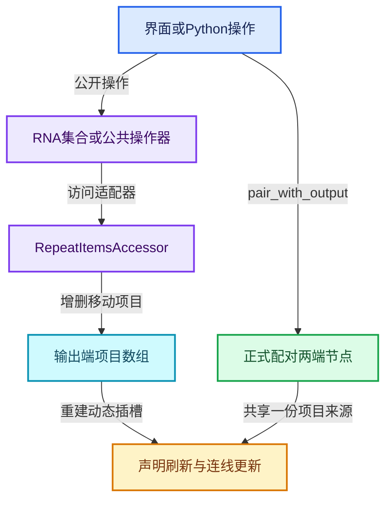

# RZ-09 编辑操作RNA与Python构建

[返回总入口](../README.md) · [本组导航](README.md) · [源码与版本](../00-课程指南/源码版本与覆盖索引.md)

> 源码基准提交：`e2e58a974edb3a5e949aa273d7ff940b5c5797c8`。具体文件内容以证据清单的 SHA-256 为准。

## 先回答一个具体问题

界面增删状态项、拖线添加与Python创建区域如何汇合到相同数据模型？

从操作器、RNA集合和Accessor追到项目更新与两端声明刷新。

## 阅读前需要的概念

1. **`repeat_items`**：公开RNA集合，映射到输出端的项目数组。

2. **`pair_with_output`**：把区域输入边界与输出边界正式配对的公开操作。

3. **`NODE_OT_repeat_zone_item_add`**：Repeat适配器提供的新增项目操作器名称。

4. **`RNA`**：把内部数据和操作暴露给属性系统及Python的描述层。

5. **`NodeAddZoneOperator`**：创建区域两端、配对并建立默认连线的公共操作器基类。

6. **`insert_link`**：插入连线时可处理Extend并建立真实项目的节点回调。

7. **`active_item`**：根据活动位置取得或设置当前项目的RNA属性。

8. **`节点树更新`**：在配置变更后刷新声明、拓扑和相关求值状态的机制。

## 本篇的机制地图



图中连线标签区分状态流、接口、拥有与观察关系；它不是线程调度记录，也不表示未声明的类型继承关系。

## 核心机制与设计推导

### 01 · 界面操作通过Accessor复用

RepeatItemsAccessor 提供项目类型、节点标识、操作器名称和数组访问方式。

共享 ops 工具据此生成增加、删除和移动操作。

公共工具并不硬编码 Repeat 的存储布局，而是调用适配器取得引用。

理解这层分工后，才能定位应改公共行为还是某个区域专属行为。

### 02 · RNA集合不是另一份数组

repeat_items 的 RNA 定义映射到 storage.items 和 items_num，并挂接集合专用函数。

界面与 Python 都经这一公开接口访问项目。

不要在文档中把 RNA 集合理解成执行时临时复制的项目数组。

活动项属性则围绕活动位置提供选中项目访问。

### 03 · 类型支持取决于树

supports_socket_type 委托节点树类型的静态支持查询。

当前代码不在 RepeatItemsAccessor 中写死一份几何节点时代的短列表。

不同树环境支持的类型可能不同，用户教程应基于当前树实际可用接口。

遇到类型被拒绝，应检查树能力而不是强制写入一个枚举数。

### 04 · 拖线扩展会触发项目创建

两端 insert_link 都调用共享的 extend socket 工具，但输入端先找到持有项目的输出节点。

工具必须为新增项目建立身份并把连线指向真实插槽。

一次 UI 拖线跨越了编辑事件、项目存储、声明刷新与连线更新多个层次。

只在其中一层增加列表元素不足以保证有效节点树。

### 05 · 创建区域必须配对

NodeAddZoneOperator 创建输入输出节点、应用设置，然后调用 pair_with_output。

默认几何连线还会按插槽类型寻找端点，避免依赖本地化显示名称。

脚本应采用同样的结构性步骤，不能仅创建两个名字相近的节点并摆在一起。

配对之后再创建或查询动态状态插槽更清晰。

### 06 · 按标识选择插槽

节点显示名称、状态项名称和插槽 identifier 有不同稳定性。

C++通过项目内部标识生成Item_数字，但实测Blender 5.2的Python RepeatItem没有公开identifier属性，不能照搬内部字段。

示例在创建时用脚本控制的唯一项目名定位动态插槽，再可从插槽自身读取identifier；项目重名与后续更名必须另行处理。

操作器默认几何连线示例强调按类型查找，也体现了这个问题。

### 07 · 活动项更新与求值更新不同

RNA 的 active_index 设置了不触发 depsgraph 更新的标志，并使用界面通知。

这是因为切换列表选中项通常不改变求值语义。

inspection_index 则使用节点更新回调，涉及观察上下文。

不能把所有面板属性统一视为只影响界面，也不能统一视为改变算法输入。

### 08 · 批量脚本先构建后验证

先创建唯一命名节点组，建立正式接口和两端配对，再配置状态项、体节点与连线。

最后打印项目标识、关键插槽和结果，以便发现接口失配。

本文附带的 Blender 脚本会创建专属演示对象和节点组，可在干净文件中运行。

源码文档生成与该脚本的实际 Blender 运行验证分别记录，不能互相替代。

## 小数据推演与反例实验

以下预期来自明确的输入和模型推导。未附 Blender 运行记录的案例属于待执行实验，不把手算结果当作后端实测。

### 实验 01 · 两端节点未关联

**输入与操作**

脚本new两个Repeat节点但省略pair_with_output

**预期与判据**

区域不具备完整正式配对

**为什么这个案例有辨别力**

位置与名称不能代替配对。

**执行时记录**

- 保留输入、轮数与状态项身份，避免只保存截图。
- 将实际观察和上述预期对照；不一致时先定位本实验涉及的边界。

### 实验 02 · 非英文界面

**输入与操作**

默认Geometry显示名被翻译

**预期与判据**

按插槽类型查找更稳妥

**为什么这个案例有辨别力**

固定UI文字不宜成为公共自动化协议。

**执行时记录**

- 保留输入、轮数与状态项身份，避免只保存截图。
- 将实际观察和上述预期对照；不一致时先定位本实验涉及的边界。

### 实验 03 · 活动项目切换

**输入与操作**

列表选中从项目0换成项目1

**预期与判据**

更新界面活动项

**为什么这个案例有辨别力**

没有修改状态递推公式。

**执行时记录**

- 保留输入、轮数与状态项身份，避免只保存截图。
- 将实际观察和上述预期对照；不一致时先定位本实验涉及的边界。

### 实验 04 · 重命名后连线

**输入与操作**

先连Item_4，再更名项目

**预期与判据**

应继续按稳定标识识别

**为什么这个案例有辨别力**

若脚本用旧显示名二次查询则可能失败。

**执行时记录**

- 保留输入、轮数与状态项身份，避免只保存截图。
- 将实际观察和上述预期对照；不一致时先定位本实验涉及的边界。

### 实验 05 · 类型不支持

**输入与操作**

某树不支持请求的socket_type

**预期与判据**

经树能力检查拒绝

**为什么这个案例有辨别力**

不要绕过Accessor强改内部结构。

**执行时记录**

- 保留输入、轮数与状态项身份，避免只保存截图。
- 将实际观察和上述预期对照；不一致时先定位本实验涉及的边界。

### 实验 06 · 重复运行示例

**输入与操作**

运行两次演示构建脚本

**预期与判据**

脚本使用自有前缀并复用清理演示资源

**为什么这个案例有辨别力**

不应批量删除用户所有节点组。

**执行时记录**

- 保留输入、轮数与状态项身份，避免只保存截图。
- 将实际观察和上述预期对照；不一致时先定位本实验涉及的边界。

## 连续源码与定向阅读批注

以下代码逐字摘自本地源码，保留原始空行、注释和条件编译。
文件头中的许可证以源文件为准；本教程的说明文字不改变上游源码的授权。
区间摘录不保证从函数边界开始；标题明确标明连续区间时，应结合所链接源文件查看外围声明。
每个块的原始文件、起止行和哈希记入 `_evidence/source-excerpts.json`，校验脚本会逐块比较。

### 源码 01 · 动态项目操作器公共实现

来源：[source/blender/nodes/NOD_socket_items_ops.hh](../../../../../source/blender/nodes/NOD_socket_items_ops.hh)，连续区间 L1—L456。

<!-- source:ops:1:456 -->

```cpp
/* SPDX-FileCopyrightText: 2023 Blender Authors
 *
 * SPDX-License-Identifier: GPL-2.0-or-later */

/** \file
 * \ingroup nodes
 */

#pragma once

#include "BLT_translation.hh"

#include "NOD_rna_define.hh"
#include "NOD_socket_items.hh"

#include "WM_api.hh"

#include "BKE_context.hh"
#include "BKE_library.hh"
#include "BKE_main_invariants.hh"
#include "BKE_node_tree_update.hh"
#include "BKE_node_tree_zones.hh"

#include "RNA_access.hh"
#include "RNA_define.hh"
#include "RNA_enum_types.hh"
#include "RNA_prototypes.hh"

#include "ED_node.hh"

#include "UI_interface.hh"
#include "UI_resources.hh"

#include "DNA_space_types.h"

namespace blender::nodes::socket_items::ops {

inline PointerRNA get_active_node_to_operate_on(bContext *C,
                                                wmOperator *op,
                                                const StringRef node_idname)
{
  SpaceNode *snode = CTX_wm_space_node(C);
  if (!snode) {
    return {};
  }
  if (!snode->edittree) {
    return {};
  }
  if (!ID_IS_EDITABLE(snode->edittree)) {
    return {};
  }

  bNode *node = nullptr;
  if (RNA_struct_property_is_set(op->ptr, "node_identifier")) {
    const int id = RNA_int_get(op->ptr, "node_identifier");
    node = snode->edittree->node_by_id(id);
  }
  else {
    node = bke::node_get_active(*snode->edittree);
  }
  if (!node) {
    return {};
  }

  if (bke::zone_type_by_node_type(node->type_legacy) != nullptr) {
    const bke::bNodeTreeZones *zones = snode->edittree->zones();
    if (!zones) {
      return {};
    }
    if (const bke::bNodeTreeZone *zone = zones->get_zone_by_node(node->identifier)) {
      if (zone->input_node() == node) {
        /* Assume the data is generally stored on the output and not the input node. */
        node = const_cast<bNode *>(zone->output_node());
      }
    }
  }

  if (node->idname != node_idname) {
    return {};
  }
  return RNA_pointer_create_discrete(&snode->edittree->id, RNA_Node, node);
}

inline void update_after_node_change(bContext *C, const PointerRNA node_ptr)
{
  bNode *node = static_cast<bNode *>(node_ptr.data);
  bNodeTree *ntree = reinterpret_cast<bNodeTree *>(node_ptr.owner_id);

  BKE_ntree_update_tag_node_property(ntree, node);
  BKE_main_ensure_invariants(*CTX_data_main(C), ntree->id);
  WM_main_add_notifier(NC_NODE | NA_EDITED, ntree);
}

template<typename Accessor> inline bool editable_node_active_poll(bContext *C)
{
  SpaceNode *snode = CTX_wm_space_node(C);
  if (!snode) {
    return false;
  }
  if (!snode->edittree) {
    return false;
  }
  if (!ID_IS_EDITABLE(snode->edittree)) {
    return false;
  }
  return true;
}

inline void add_node_identifier_property(wmOperatorType *ot)
{
  RNA_def_int(ot->srna,
              "node_identifier",
              0,
              0,
              INT32_MAX,
              "Node Identifier",
              "Optional identifier of the node to operate on",
              0,
              INT32_MAX);
}

template<typename Accessor>
inline void remove_active_item(wmOperatorType *ot,
                               const char *name,
                               const char *idname,
                               const char *description)
{
  ot->name = name;
  ot->idname = idname;
  ot->description = description;
  ot->poll = editable_node_active_poll<Accessor>;
  ot->flag = OPTYPE_UNDO;

  ot->exec = [](bContext *C, wmOperator *op) -> wmOperatorStatus {
    PointerRNA node_ptr = get_active_node_to_operate_on(C, op, Accessor::node_idname);
    if (!node_ptr) {
      return OPERATOR_CANCELLED;
    }
    bNode &node = *static_cast<bNode *>(node_ptr.data);
    SocketItemsRef ref = Accessor::get_items_from_node(node);
    if (*ref.items_num > 0 && ref.active_index) {
      dna::array::remove_index(
          ref.items, ref.items_num, ref.active_index, *ref.active_index, Accessor::destruct_item);
      update_after_node_change(C, node_ptr);
    }
    return OPERATOR_FINISHED;
  };

  add_node_identifier_property(ot);
}

template<typename Accessor>
inline void remove_item_by_index(wmOperatorType *ot,
                                 const char *name,
                                 const char *idname,
                                 const char *description)
{
  ot->name = name;
  ot->idname = idname;
  ot->description = description;
  ot->poll = editable_node_active_poll<Accessor>;
  ot->flag = OPTYPE_UNDO;

  ot->exec = [](bContext *C, wmOperator *op) -> wmOperatorStatus {
    PointerRNA node_ptr = get_active_node_to_operate_on(C, op, Accessor::node_idname);
    if (!node_ptr) {
      return OPERATOR_CANCELLED;
    }
    bNode &node = *static_cast<bNode *>(node_ptr.data);
    const int index_to_remove = RNA_int_get(op->ptr, "index");
    SocketItemsRef ref = Accessor::get_items_from_node(node);
    dna::array::remove_index(
        ref.items, ref.items_num, ref.active_index, index_to_remove, Accessor::destruct_item);

    update_after_node_change(C, node_ptr);
    return OPERATOR_FINISHED;
  };

  RNA_def_int(ot->srna, "index", 0, 0, INT32_MAX, "Index", "Index to remove", 0, INT32_MAX);
}

template<typename Accessor>
inline void add_item(wmOperatorType *ot,
                     const char *name,
                     const char *idname,
                     const char *description)
{
  ot->name = name;
  ot->idname = idname;
  ot->description = description;
  ot->poll = editable_node_active_poll<Accessor>;
  ot->flag = OPTYPE_REGISTER | OPTYPE_UNDO;

  static const char *socket_type_id = "socket_type";
  static const char *item_name_id = "item_name";

  ot->invoke = [](bContext *C, wmOperator *op, const wmEvent *event) {
    const bool show_dialog = RNA_boolean_get(op->ptr, "show_dialog");
    const bool needs_dialog = Accessor::has_type || Accessor::has_name;
    if (show_dialog && needs_dialog) {
      return WM_operator_props_popup_confirm_ex(C, op, event, IFACE_("Add Item"));
    }
    return op->type->exec(C, op);
  };

  ot->ui = [](bContext * /*C*/, wmOperator *op) {
    ui::Layout &layout = *op->layout;
    if constexpr (Accessor::has_name) {
      PropertyRNA *prop = RNA_struct_find_property(op->ptr, item_name_id);
      ui::Layout &row = layout.row(true);
      row.activate_init_set(true);
      row.prop(op->ptr, prop, RNA_NO_INDEX, 0, UI_ITEM_NONE, "", ICON_NONE, IFACE_("Name"));
    }
    if constexpr (Accessor::has_type) {
      layout.prop(op->ptr, socket_type_id, UI_ITEM_NONE, "", ICON_NONE);
    }
  };

  ot->exec = [](bContext *C, wmOperator *op) -> wmOperatorStatus {
    PointerRNA node_ptr = get_active_node_to_operate_on(C, op, Accessor::node_idname);
    if (!node_ptr) {
      return OPERATOR_CANCELLED;
    }
    bNodeTree *ntree = reinterpret_cast<bNodeTree *>(node_ptr.owner_id);
    bNode &node = *static_cast<bNode *>(node_ptr.data);
    SocketItemsRef ref = Accessor::get_items_from_node(node);
    const typename Accessor::ItemT *active_item = nullptr;
    int dst_index = *ref.items_num;
    if (ref.active_index) {
      const int old_active_index = *ref.active_index;
      if (old_active_index >= 0 && old_active_index < *ref.items_num) {
        active_item = &(*ref.items)[old_active_index];
        dst_index = active_item ? old_active_index + 1 : *ref.items_num;
      }
    }

    /* Determine name if necessary. */
    const bool init_from_active = RNA_boolean_get(op->ptr, "init_from_active");
    std::optional<std::string> name;
    if constexpr (Accessor::has_name) {
      if (!init_from_active) {
        name = RNA_string_get(op->ptr, item_name_id);
      }
      else {
        name = active_item ? active_item->name : "";
        if constexpr (Accessor::has_custom_initial_name) {
          name = Accessor::custom_initial_name(node, *name);
        }
      }
    }

    /* Determine socket type if necessary. */
    std::optional<eNodeSocketDatatype> socket_type;
    if constexpr (Accessor::has_type) {
      if (!init_from_active) {
        socket_type = eNodeSocketDatatype(RNA_enum_get(op->ptr, socket_type_id));
      }
      else if (active_item) {
        socket_type = Accessor::get_socket_type(*active_item);
      }
      else {
        socket_type = Accessor::supports_socket_type(SOCK_GEOMETRY, ntree->type) ? SOCK_GEOMETRY :
                                                                                   SOCK_FLOAT;
      }
    }

    if constexpr (Accessor::has_type && Accessor::has_name) {
      socket_items::add_item_with_socket_type_and_name<Accessor>(
          *ntree, node, *socket_type, name->c_str());
    }
    else if constexpr (!Accessor::has_type && Accessor::has_name) {
      socket_items::add_item_with_name<Accessor>(node, name->c_str());
    }
    else if constexpr (!Accessor::has_type && !Accessor::has_name) {
      socket_items::add_item<Accessor>(node);
    }
    else {
      BLI_assert_unreachable();
    }

    dna::array::move_index(*ref.items, *ref.items_num, *ref.items_num - 1, dst_index);
    if (ref.active_index) {
      *ref.active_index = dst_index;
    }

    update_after_node_change(C, node_ptr);
    return OPERATOR_FINISHED;
  };

  add_node_identifier_property(ot);

  PropertyRNA *prop;
  prop = RNA_def_boolean(ot->srna,
                         "show_dialog",
                         false,
                         "Show Dialog",
                         "Show a dialog to edit the initial properties");
  RNA_def_property_flag(prop, PROP_SKIP_SAVE);

  prop = RNA_def_boolean(
      ot->srna,
      "init_from_active",
      true,
      "Init from Active",
      "Instead of using the provided name or type, copy the state of the active item");
  RNA_def_property_flag(prop, PROP_SKIP_SAVE);

  if constexpr (Accessor::has_type) {
    prop = RNA_def_enum(ot->srna,
                        socket_type_id,
                        rna_enum_node_socket_data_type_items,
                        SOCK_FLOAT,
                        "Socket Type",
                        "Type of the new socket item");
    RNA_def_property_enum_funcs_runtime(
        prop,
        nullptr,
        nullptr,
        [](bContext *C, PointerRNA * /*ptr*/, PropertyRNA * /*prop*/, bool *r_free) {
          if (!C) {
            *r_free = false;
            return rna_enum_node_socket_data_type_items;
          }
          *r_free = true;
          SpaceNode *snode = CTX_wm_space_node(C);
          return enum_items_filter(rna_enum_node_socket_data_type_items,
                                   [&](const EnumPropertyItem &item) -> bool {
                                     return Accessor::supports_socket_type(
                                         eNodeSocketDatatype(item.value), snode->edittree->type);
                                   });
        },
        nullptr,
        nullptr);
  }
  if constexpr (Accessor::has_name) {
    RNA_def_string(ot->srna, item_name_id, nullptr, 0, "Item Name", "Name of the new socket item");
  }
}

enum class MoveDirection {
  Up = 0,
  Down = 1,
};

template<typename Accessor>
inline void move_active_item(wmOperatorType *ot,
                             const char *name,
                             const char *idname,
                             const char *description)
{
  ot->name = name;
  ot->idname = idname;
  ot->description = description;
  ot->poll = editable_node_active_poll<Accessor>;
  ot->flag = OPTYPE_UNDO;

  ot->exec = [](bContext *C, wmOperator *op) -> wmOperatorStatus {
    PointerRNA node_ptr = get_active_node_to_operate_on(C, op, Accessor::node_idname);
    if (!node_ptr) {
      return OPERATOR_CANCELLED;
    }
    bNode &node = *static_cast<bNode *>(node_ptr.data);
    const MoveDirection direction = MoveDirection(RNA_enum_get(op->ptr, "direction"));

    SocketItemsRef ref = Accessor::get_items_from_node(node);
    const int old_active_index = *ref.active_index;
    if (direction == MoveDirection::Up && old_active_index > 0) {
      dna::array::move_index(*ref.items, *ref.items_num, old_active_index, old_active_index - 1);
      *ref.active_index -= 1;
    }
    else if (direction == MoveDirection::Down && old_active_index < *ref.items_num - 1) {
      dna::array::move_index(*ref.items, *ref.items_num, old_active_index, old_active_index + 1);
      *ref.active_index += 1;
    }

    update_after_node_change(C, node_ptr);
    return OPERATOR_FINISHED;
  };

  static const EnumPropertyItem direction_items[] = {
      {int(MoveDirection::Up), "UP", 0, "Up", ""},
      {int(MoveDirection::Down), "DOWN", 0, "Down", ""},
      {0, nullptr, 0, nullptr, nullptr},
  };

  RNA_def_enum(ot->srna, "direction", direction_items, 0, "Direction", "Move direction");
  add_node_identifier_property(ot);
}

/**
 * Creates operator to add a node item.
 * The idname is passed in explicitly, so that it is more searchable compared to when it would be
 * computed automatically.
 */
template<typename Accessor> inline void make_add_item_operator()
{
  WM_operatortype_append([](wmOperatorType *ot) {
    socket_items::ops::add_item<Accessor>(ot,
                                          "Add Item",
                                          Accessor::operator_idnames::add_item.c_str(),
                                          "Add item below active item");
  });
}

/**
 * Creates operator to remove the active item.
 * The idname is passed in explicitly, so that it is more searchable compared to when it would be
 * computed automatically.
 */
template<typename Accessor> inline void make_remove_active_item_operator()
{
  WM_operatortype_append([](wmOperatorType *ot) {
    socket_items::ops::remove_active_item<Accessor>(
        ot, "Remove Item", Accessor::operator_idnames::remove_item.c_str(), "Remove active item");
  });
}

/**
 * Creates operator to remove an item by index.
 * The idname is passed in explicitly, so that it is more searchable compared to when it would be
 * computed automatically.
 */
template<typename Accessor> inline void make_remove_item_by_index_operator()
{
  WM_operatortype_append([](wmOperatorType *ot) {
    socket_items::ops::remove_item_by_index<Accessor>(
        ot, "Remove Item", Accessor::operator_idnames::remove_item.c_str(), "Remove active item");
  });
}

/**
 * Creates operator to move a node item.
 * The idname is passed in explicitly, so that it is more searchable compared to when it would be
 * computed automatically.
 */
template<typename Accessor> inline void make_move_item_operator()
{
  WM_operatortype_append([](wmOperatorType *ot) {
    socket_items::ops::move_active_item<Accessor>(
        ot, "Move Item", Accessor::operator_idnames::move_item.c_str(), "Move active item");
  });
}

/**
 * Creates simple operators for adding, removing and moving items.
 * The idnames are passed in explicitly, so that they are more searchable compared to when they
 * would be computed automatically.
 */
template<typename Accessor> inline void make_common_operators()
{
  make_add_item_operator<Accessor>();
  make_remove_active_item_operator<Accessor>();
  make_move_item_operator<Accessor>();
}

}  // namespace blender::nodes::socket_items::ops
```

**读完这段后回到本篇问题**

- 对照“界面操作通过Accessor复用”，明确这段代码是定义存储、建立接口还是执行已有结构。
- 结合“两端节点未关联”重画输入到输出的关系，区分源码事实与例子的推导。
- 保留失败分支、默认值、析构和条件编译；不要仅摘取看起来像主算法的几行。

### 源码 02 · 项目面板绘制公共实现

来源：[source/blender/nodes/NOD_socket_items_ui.hh](../../../../../source/blender/nodes/NOD_socket_items_ui.hh)，连续区间 L1—L140。

<!-- source:ui:1:140 -->

```cpp
/* SPDX-FileCopyrightText: 2024 Blender Authors
 *
 * SPDX-License-Identifier: GPL-2.0-or-later */

/** \file
 * \ingroup nodes
 */

#pragma once

#include "DNA_node_types.h"

#include "WM_api.hh"

#include "UI_interface.hh"
#include "UI_interface_layout.hh"

#include "RNA_access.hh"
#include "RNA_prototypes.hh"

#include "BLI_function_ref.hh"
#include "BLI_string_utf8.hh"

#include "BKE_screen.hh"

#include "NOD_node_declaration.hh"
#include "NOD_socket_items.hh"

namespace blender::nodes::socket_items::ui {

template<typename Accessor>
static void draw_item_in_list(uiList * /*ui_list*/,
                              const bContext *C,
                              blender::ui::Layout &layout,
                              PointerRNA * /*idataptr*/,
                              PointerRNA *itemptr,
                              int /*icon*/,
                              PointerRNA * /*active_dataptr*/,
                              const char * /*active_propname*/,
                              int /*index*/,
                              int /*flt_flag*/)
{
  blender::ui::Layout &row = layout.row(true);
  if constexpr (Accessor::has_type) {
    float4 color;
    RNA_float_get_array(itemptr, "color", color);
    template_node_socket(&row, const_cast<bContext *>(C), color);
  }
  row.emboss_set(blender::ui::EmbossType::None);
  row.prop(itemptr, "name", blender::UI_ITEM_NONE, "", ICON_NONE);
}

/**
 * Draws a ui-list that contains the items. The list also has operators to add, remove and reorder
 * items.
 */
template<typename Accessor>
static void draw_items_list_with_operators(const bContext *C,
                                           blender::ui::Layout *layout,
                                           const bNodeTree &tree,
                                           const bNode &node)
{
  BLI_assert(Accessor::node_idname == node.idname);
  PointerRNA node_ptr = RNA_pointer_create_discrete(
      const_cast<ID *>(&tree.id), RNA_Node, const_cast<bNode *>(&node));

  static const uiListType *items_list = []() {
    uiListType *list = MEM_new_zeroed<uiListType>(Accessor::ui_idnames::list.c_str());
    STRNCPY_UTF8(list->idname, Accessor::ui_idnames::list.c_str());
    list->draw_item = draw_item_in_list<Accessor>;
    WM_uilisttype_add(list);
    return list;
  }();

  blender::ui::Layout *row = &layout->row(false);
  template_uilist(row,
                  C,
                  items_list->idname,
                  "",
                  &node_ptr,
                  Accessor::rna_names::items,
                  &node_ptr,
                  Accessor::rna_names::active_index.c_str(),
                  nullptr,
                  3,
                  5,
                  UILST_LAYOUT_DEFAULT,
                  blender::ui::TEMPLATE_LIST_FLAG_NONE);

  blender::ui::Layout *ops_col = &row->column(false);
  {
    blender::ui::Layout *add_remove_col = &ops_col->column(true);
    add_remove_col->op(Accessor::operator_idnames::add_item, "", ICON_ADD);
    add_remove_col->op(Accessor::operator_idnames::remove_item, "", ICON_REMOVE);
  }
  {
    blender::ui::Layout *up_down_col = &ops_col->column(true);
    PointerRNA op_ptr = up_down_col->op(Accessor::operator_idnames::move_item, "", ICON_TRIA_UP);
    RNA_enum_set(&op_ptr, "direction", 0);
    op_ptr = up_down_col->op(Accessor::operator_idnames::move_item, "", ICON_TRIA_DOWN);
    RNA_enum_set(&op_ptr, "direction", 1);
  }
}

/** Draw properties of the active item if there is any. */
template<typename Accessor>
static void draw_active_item_props(const bNodeTree &tree,
                                   const bNode &node,
                                   const FunctionRef<void(PointerRNA *item_ptr)> draw_item)
{
  using ItemT = typename Accessor::ItemT;
  BLI_assert(Accessor::node_idname == node.idname);

  SocketItemsRef<ItemT> ref = Accessor::get_items_from_node(const_cast<bNode &>(node));
  if (*ref.active_index < 0) {
    return;
  }
  if (*ref.active_index >= *ref.items_num) {
    return;
  }

  ItemT &item = (*ref.items)[*ref.active_index];
  PointerRNA item_ptr = RNA_pointer_create_discrete(
      const_cast<ID *>(&tree.id), *Accessor::item_srna, &item);
  draw_item(&item_ptr);
}

template<typename Accessor> static auto draw_extend_socket_fn()
{
  return [](CustomSocketDrawParams &params) {
    ::blender::ui::Layout &layout = params.layout;
    layout.emboss_set(::blender::ui::EmbossType::None);
    PointerRNA op_ptr = layout.op(Accessor::operator_idnames::add_item, "", ICON_ADD);
    RNA_int_set(&op_ptr, "node_identifier", params.node.identifier);
    RNA_boolean_set(&op_ptr, "show_dialog", true);
    RNA_boolean_set(&op_ptr, "init_from_active", false);
  };
}

}  // namespace blender::nodes::socket_items::ui
```

**读完这段后回到本篇问题**

- 对照“RNA集合不是另一份数组”，明确这段代码是定义存储、建立接口还是执行已有结构。
- 结合“非英文界面”重画输入到输出的关系，区分源码事实与例子的推导。
- 保留失败分支、默认值、析构和条件编译；不要仅摘取看起来像主算法的几行。

### 源码 03 · Repeat编辑接口适配器

来源：[source/blender/nodes/geometry/include/NOD_geo_repeat.hh](../../../../../source/blender/nodes/geometry/include/NOD_geo_repeat.hh)，连续区间 L1—L89。

<!-- source:access:1:89 -->

```cpp
/* SPDX-FileCopyrightText: 2024 Blender Authors
 *
 * SPDX-License-Identifier: GPL-2.0-or-later */

#pragma once

#include "DNA_node_types.h"

#include "NOD_socket_items.hh"

namespace blender::nodes {

/**
 * Makes it possible to use various functions (e.g. the ones in `NOD_socket_items.hh`) with
 * repeat items.
 */
struct RepeatItemsAccessor : public socket_items::SocketItemsAccessorDefaults {
  using ItemT = NodeRepeatItem;
  static StructRNA **item_srna;
  static int node_type;
  static constexpr StringRefNull node_idname = "GeometryNodeRepeatOutput";
  static constexpr bool has_type = true;
  static constexpr bool has_name = true;
  struct operator_idnames {
    static constexpr StringRefNull add_item = "NODE_OT_repeat_zone_item_add";
    static constexpr StringRefNull remove_item = "NODE_OT_repeat_zone_item_remove";
    static constexpr StringRefNull move_item = "NODE_OT_repeat_zone_item_move";
  };
  struct ui_idnames {
    static constexpr StringRefNull list = "DATA_UL_repeat_zone_state";
  };
  struct rna_names {
    static constexpr StringRefNull items = "repeat_items";
    static constexpr StringRefNull active_index = "active_index";
  };

  static socket_items::SocketItemsRef<NodeRepeatItem> get_items_from_node(bNode &node)
  {
    auto *storage = static_cast<NodeGeometryRepeatOutput *>(node.storage);
    return {&storage->items, &storage->items_num, &storage->active_index};
  }

  static void copy_item(const NodeRepeatItem &src, NodeRepeatItem &dst)
  {
    dst = src;
    dst.name = BLI_strdup_null(dst.name);
  }

  static void destruct_item(NodeRepeatItem *item)
  {
    MEM_SAFE_DELETE(item->name);
  }

  static void blend_write_item(BlendWriter *writer, const ItemT &item);
  static void blend_read_data_item(BlendDataReader *reader, ItemT &item);

  static eNodeSocketDatatype get_socket_type(const NodeRepeatItem &item)
  {
    return item.socket_type;
  }

  static char **get_name(NodeRepeatItem &item)
  {
    return &item.name;
  }

  static bool supports_socket_type(const eNodeSocketDatatype socket_type, const int ntree_type)
  {
    return bke::node_tree_type_supports_socket_type_static(ntree_type, socket_type);
  }

  static void init_with_socket_type_and_name(bNode &node,
                                             NodeRepeatItem &item,
                                             const eNodeSocketDatatype socket_type,
                                             const char *name)
  {
    auto *storage = static_cast<NodeGeometryRepeatOutput *>(node.storage);
    item.socket_type = socket_type;
    item.identifier = storage->next_identifier++;
    socket_items::set_item_name_and_make_unique<RepeatItemsAccessor>(node, item, name);
  }

  static std::string socket_identifier_for_item(const NodeRepeatItem &item)
  {
    return "Item_" + std::to_string(item.identifier);
  }
};

}  // namespace blender::nodes
```

**读完这段后回到本篇问题**

- 对照“类型支持取决于树”，明确这段代码是定义存储、建立接口还是执行已有结构。
- 结合“活动项目切换”重画输入到输出的关系，区分源码事实与例子的推导。
- 保留失败分支、默认值、析构和条件编译；不要仅摘取看起来像主算法的几行。

### 源码 04 · Repeat RNA集合与属性

来源：[source/blender/makesrna/intern/rna_nodetree.cc](../../../../../source/blender/makesrna/intern/rna_nodetree.cc)，连续区间 L8033—L8100。

<!-- source:rna:8033:8100 -->

```cpp
static void rna_def_geo_repeat_item(BlenderRNA *brna)
{
  StructRNA *srna = RNA_def_struct(brna, "RepeatItem", nullptr);
  RNA_def_struct_ui_text(srna, "Repeat Item", "");
  RNA_def_struct_sdna(srna, "NodeRepeatItem");

  rna_def_node_item_array_socket_item_common(srna, "RepeatItemsAccessor", true);
}

static void rna_def_geo_repeat_items(BlenderRNA *brna)
{
  StructRNA *srna;

  srna = RNA_def_struct(brna, "NodeGeometryRepeatOutputItems", nullptr);
  RNA_def_struct_sdna(srna, "bNode");
  RNA_def_struct_ui_text(srna, "Items", "Collection of repeat items");

  rna_def_node_item_array_new_with_socket_and_name(srna, "RepeatItem", "RepeatItemsAccessor");
  rna_def_node_item_array_common_functions(srna, "RepeatItem", "RepeatItemsAccessor");
}

static void def_geo_repeat_output(BlenderRNA *brna, StructRNA *srna)
{
  PropertyRNA *prop;

  rna_def_geo_repeat_item(brna);
  rna_def_geo_repeat_items(brna);

  RNA_def_struct_sdna_from(srna, "NodeGeometryRepeatOutput", "storage");

  prop = RNA_def_property(srna, "repeat_items", PROP_COLLECTION, PROP_NONE);
  RNA_def_property_collection_sdna(prop, nullptr, "items", "items_num");
  RNA_def_property_struct_type(prop, "RepeatItem");
  RNA_def_property_ui_text(prop, "Items", "");
  RNA_def_property_srna(prop, "NodeGeometryRepeatOutputItems");

  prop = RNA_def_property(srna, "active_index", PROP_INT, PROP_UNSIGNED);
  RNA_def_property_int_sdna(prop, nullptr, "active_index");
  RNA_def_property_ui_text(prop, "Active Item Index", "Index of the active item");
  RNA_def_property_clear_flag(prop, PROP_ANIMATABLE);
  RNA_def_property_flag(prop, PROP_NO_DEG_UPDATE);
  RNA_def_property_update(prop, NC_NODE, nullptr);

  prop = RNA_def_property(srna, "active_item", PROP_POINTER, PROP_NONE);
  RNA_def_property_struct_type(prop, "RepeatItem");
  RNA_def_property_pointer_funcs(prop,
                                 "rna_Node_ItemArray_active_get<RepeatItemsAccessor>",
                                 "rna_Node_ItemArray_active_set<RepeatItemsAccessor>",
                                 nullptr,
                                 nullptr);
  RNA_def_property_flag(prop, PROP_EDITABLE | PROP_NO_DEG_UPDATE);
  RNA_def_property_ui_text(prop, "Active Item Index", "Index of the active item");
  RNA_def_property_update(prop, NC_NODE, nullptr);

  prop = RNA_def_property(srna, "inspection_index", PROP_INT, PROP_NONE);
  RNA_def_property_ui_range(prop, 0, INT32_MAX, 1, -1);
  RNA_def_property_ui_text(prop,
                           "Inspection Index",
                           "Iteration index that is used by inspection features like the viewer "
                           "node or socket inspection");
  RNA_def_property_update(prop, NC_NODE, "rna_Node_update");
}

static void rna_def_geo_viewer_item(BlenderRNA *brna)
{
  PropertyRNA *prop;

  StructRNA *srna = RNA_def_struct(brna, "NodeGeometryViewerItem", nullptr);
```

**读完这段后回到本篇问题**

- 对照“拖线扩展会触发项目创建”，明确这段代码是定义存储、建立接口还是执行已有结构。
- 结合“重命名后连线”重画输入到输出的关系，区分源码事实与例子的推导。
- 保留失败分支、默认值、析构和条件编译；不要仅摘取看起来像主算法的几行。

### 源码 05 · 通用区域创建操作

来源：[scripts/startup/bl_operators/node.py](../../../../../scripts/startup/bl_operators/node.py)，连续区间 L855—L895。

<!-- source:python:855:895 -->

```python

class NodeAddZoneOperator(ZoneOperator, NodeAddOperator):
    add_default_geometry_link = True

    def execute(self, context):
        space = context.space_data
        tree = space.edit_tree

        self.deselect_nodes(context)
        input_node = self.create_node(context, self.input_node_type)
        output_node = self.create_node(context, self.output_node_type)

        self.apply_node_settings(input_node)
        self.apply_node_settings(output_node)

        if input_node is None or output_node is None:
            return {'CANCELLED'}

        # Simulation input must be paired with the output.
        input_node.pair_with_output(output_node)

        input_node.location -= Vector(self.offset)
        output_node.location += Vector(self.offset)

        if tree.type == "GEOMETRY" and self.add_default_geometry_link:
            # Connect geometry sockets by default if available.
            # Get the sockets by their types, because the name is not guaranteed due to i18n.
            from_socket = next(s for s in input_node.outputs if s.type == 'GEOMETRY')
            to_socket = next(s for s in output_node.inputs if s.type == 'GEOMETRY')
            tree.links.new(to_socket, from_socket)

        return {'FINISHED'}


class NODE_OT_add_zone(NodeAddZoneOperator, Operator):
    bl_idname = "node.add_zone"
    bl_label = "Add Zone"
    bl_options = {'REGISTER', 'UNDO'}

    input_node_type: StringProperty(
        name="Input Node",
```

**读完这段后回到本篇问题**

- 对照“创建区域必须配对”，明确这段代码是定义存储、建立接口还是执行已有结构。
- 结合“类型不支持”重画输入到输出的关系，区分源码事实与例子的推导。
- 保留失败分支、默认值、析构和条件编译；不要仅摘取看起来像主算法的几行。

### 源码 06 · Repeat创建操作器声明

来源：[scripts/startup/bl_operators/node.py](../../../../../scripts/startup/bl_operators/node.py)，连续区间 L1080—L1093。

<!-- source:python:1080:1093 -->

```python
class NODE_OT_add_repeat_zone(NodeAddZoneOperator, Operator):
    """Add a repeat zone that allows executing nodes a dynamic number of times"""
    bl_idname = "node.add_repeat_zone"
    bl_label = "Add Repeat Zone"
    bl_options = {'REGISTER', 'UNDO'}

    input_node_type = "GeometryNodeRepeatInput"
    output_node_type = "GeometryNodeRepeatOutput"


class NODE_OT_add_foreach_geometry_element_zone(NodeAddZoneOperator, Operator):
    """Add a For Each Geometry Element zone that allows executing nodes e.g. for each vertex separately"""
    bl_idname = "node.add_foreach_geometry_element_zone"
    bl_label = "Add For Each Geometry Element Zone"
```

**读完这段后回到本篇问题**

- 对照“按标识选择插槽”，明确这段代码是定义存储、建立接口还是执行已有结构。
- 结合“重复运行示例”重画输入到输出的关系，区分源码事实与例子的推导。
- 保留失败分支、默认值、析构和条件编译；不要仅摘取看起来像主算法的几行。

## 练习与参考答案

### 练习 01 · 解释“界面操作通过Accessor复用”

**题目**

不看代码，说明“界面操作通过Accessor复用”解决的具体问题，并给出一个会违背其约束的错误实现。

**参考答案的核心**

RepeatItemsAccessor 提供项目类型、节点标识、操作器名称和数组访问方式。

**验收追问**

理解这层分工后，才能定位应改公共行为还是某个区域专属行为。

**自查方法**

回到上面的源码区间和本篇实验，找出支持该回答的实际字段、调用或分支；若答案是设计推论，应明确写为推论。

### 练习 02 · 解释“RNA集合不是另一份数组”

**题目**

不看代码，说明“RNA集合不是另一份数组”解决的具体问题，并给出一个会违背其约束的错误实现。

**参考答案的核心**

repeat_items 的 RNA 定义映射到 storage.items 和 items_num，并挂接集合专用函数。

**验收追问**

活动项属性则围绕活动位置提供选中项目访问。

**自查方法**

回到上面的源码区间和本篇实验，找出支持该回答的实际字段、调用或分支；若答案是设计推论，应明确写为推论。

### 练习 03 · 解释“类型支持取决于树”

**题目**

不看代码，说明“类型支持取决于树”解决的具体问题，并给出一个会违背其约束的错误实现。

**参考答案的核心**

supports_socket_type 委托节点树类型的静态支持查询。

**验收追问**

遇到类型被拒绝，应检查树能力而不是强制写入一个枚举数。

**自查方法**

回到上面的源码区间和本篇实验，找出支持该回答的实际字段、调用或分支；若答案是设计推论，应明确写为推论。

### 练习 04 · 解释“拖线扩展会触发项目创建”

**题目**

不看代码，说明“拖线扩展会触发项目创建”解决的具体问题，并给出一个会违背其约束的错误实现。

**参考答案的核心**

两端 insert_link 都调用共享的 extend socket 工具，但输入端先找到持有项目的输出节点。

**验收追问**

只在其中一层增加列表元素不足以保证有效节点树。

**自查方法**

回到上面的源码区间和本篇实验，找出支持该回答的实际字段、调用或分支；若答案是设计推论，应明确写为推论。

### 练习 05 · 解释“创建区域必须配对”

**题目**

不看代码，说明“创建区域必须配对”解决的具体问题，并给出一个会违背其约束的错误实现。

**参考答案的核心**

NodeAddZoneOperator 创建输入输出节点、应用设置，然后调用 pair_with_output。

**验收追问**

配对之后再创建或查询动态状态插槽更清晰。

**自查方法**

回到上面的源码区间和本篇实验，找出支持该回答的实际字段、调用或分支；若答案是设计推论，应明确写为推论。

### 练习 06 · 解释“按标识选择插槽”

**题目**

不看代码，说明“按标识选择插槽”解决的具体问题，并给出一个会违背其约束的错误实现。

**参考答案的核心**

节点显示名称、状态项名称和插槽 identifier 有不同稳定性。

**验收追问**

操作器默认几何连线示例强调按类型查找，也体现了这个问题。

**自查方法**

回到上面的源码区间和本篇实验，找出支持该回答的实际字段、调用或分支；若答案是设计推论，应明确写为推论。

### 练习 07 · 解释“活动项更新与求值更新不同”

**题目**

不看代码，说明“活动项更新与求值更新不同”解决的具体问题，并给出一个会违背其约束的错误实现。

**参考答案的核心**

RNA 的 active_index 设置了不触发 depsgraph 更新的标志，并使用界面通知。

**验收追问**

不能把所有面板属性统一视为只影响界面，也不能统一视为改变算法输入。

**自查方法**

回到上面的源码区间和本篇实验，找出支持该回答的实际字段、调用或分支；若答案是设计推论，应明确写为推论。

### 练习 08 · 解释“批量脚本先构建后验证”

**题目**

不看代码，说明“批量脚本先构建后验证”解决的具体问题，并给出一个会违背其约束的错误实现。

**参考答案的核心**

先创建唯一命名节点组，建立正式接口和两端配对，再配置状态项、体节点与连线。

**验收追问**

源码文档生成与该脚本的实际 Blender 运行验证分别记录，不能互相替代。

**自查方法**

回到上面的源码区间和本篇实验，找出支持该回答的实际字段、调用或分支；若答案是设计推论，应明确写为推论。

## 本篇完成标准

- 能直接回答：界面增删状态项、拖线添加与Python创建区域如何汇合到相同数据模型？
- 能解释本篇目标：从操作器、RNA集合和Accessor追到项目更新与两端声明刷新。
- 能手算至少一个正轮数案例和一个边界案例，并说明各自验证的错误类型。
- 能沿源码链接区分配置、构图、求值和观察各阶段。
- 能陈述本篇实际证据的范围，不把静态摘录核对写成后端运行通过。

## 继续阅读

- 上一篇：[08-轮次上下文日志Viewer与副作用](../03-值寿命与观察机制/08-轮次上下文日志Viewer与副作用.md)
- 下一篇：[10-复制保存加载与版本边界](../03-值寿命与观察机制/10-复制保存加载与版本边界.md)
- [练习脚本与运行范围](../示例/README.md)
- [验收记录与尚未执行的集成检查](../00-课程指南/验收报告.md)
