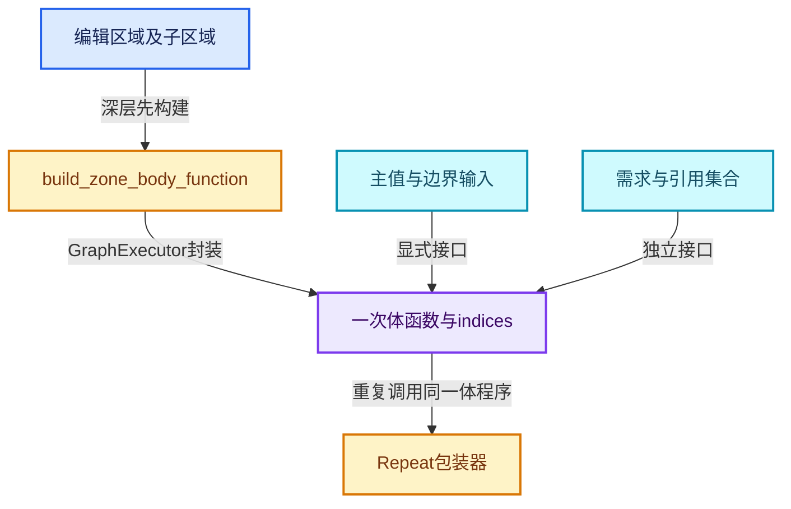

# RZ-04 循环体提取与Zone接口协议

[返回总入口](../README.md) · [本组导航](README.md) · [源码与版本](../00-课程指南/源码版本与覆盖索引.md)

> 源码基准提交：`e2e58a974edb3a5e949aa273d7ff940b5c5797c8`。具体文件内容以证据清单的 SHA-256 为准。

## 先回答一个具体问题

一个区域如何被编译成能反复调用的LazyFunction？

掌握体函数、包装器、数据输入输出、使用需求和引用集合的接口布局。

## 阅读前需要的概念

1. **`ZoneBodyFunction`**：表示一次体求值的函数对象和接口索引。

2. **`ZoneBuildInfo`**：表示整个区域函数及其对外接口位置。

3. **`ZoneFunctionIndices`**：记录main、需求和引用集合各类参数位置，避免依赖猜测布局。

4. **`main`**：接口中的主值通道，相对于body和wrapper含义需要分别判断。

5. **`output_usages`**：作为输入传入的输出需求标志，告知哪些结果被需要。

6. **`input_usages`**：作为输出返回的输入使用信息，传回上游需求。

7. **`reference_sets`**：由引用集合索引映射到参数位置的接口，不是属性值数组。

8. **`GraphExecutor`**：把一张LF图包装成可执行LazyFunction的执行器。

## 本篇的机制地图



图中连线标签区分状态流、接口、拥有与观察关系；它不是线程调度记录，也不表示未声明的类型继承关系。

## 核心机制与设计推导

### 01 · 体函数只描述一次调用

build_zone_body_function 创建体图，插入区域直接节点与子区域，并建立边界接口。

它不知道最终会重复几次，轮数由包装器解释。

这样多个调用点可以复用同一份体程序结构。

复用的是程序描述，执行状态则由各调用及执行器存储管理。

### 02 · 输入端输出成为体输入

区域内看到的 Repeat Input 输出，包括 Iteration 和状态项，成为体函数的主输入。

它们在编辑图中叫输出，但相对于提取后的体函数却是输入。

名称方向取决于观察边界，不是矛盾。

阅读索引代码时必须先固定参照系。

### 03 · 输出端输入成为体输出

Repeat Output 在区域内接收的状态项成为体函数主输出。

外层包装器再把多轮体结果接到区域对外输出。

这解释了为什么 body_fn 与 zone_info 都有 main，却不能用相同数组下标含义来理解。

两者的接口边界不同，前导 Iteration 与 Iterations 也各处于不同角色。

### 04 · 值和需求双通道

主值通常向结果方向流动，而是否需要某输入的信息以 bool 输出回传。

输出是否被使用又作为体函数的输入传入，以支持按需求值。

输入和输出命名不意味着这条通道传的是几何数据。

将 bool 需求通道当成普通布尔状态项会导致索引与类型同时出错。

### 05 · 跨界输入成为显式参数

build_zone_border_links_inputs 为每条被识别的跨界连线添加体输入。

对应使用需求输出由单独函数建立，并在后续连接到内部消费者。

体函数由此具备相对完整的显式边界，不需要在执行时任意访问编辑图外部数据。

这个步骤类似子程序提取时显式化自由变量。

### 06 · 引用集合也是接口

在体图中创建的引用可以在内部提取，但外部创建且内部需要的引用集合必须作为体输入。

引用集合使用独立索引键记录，不能当成某个普通状态项的位置。

后续包装器把区域侧集合映射到所有体调用。

它服务于引用寿命分析，不是所有顶点属性值的复制列表。

### 07 · 默认值与循环修复阶段

构图还会添加默认输入、连接引用集合并处理使用需求相关的循环问题，最后更新图节点索引。

读取局部 add_link 不能代表已经完成一个可执行图。

一个节点的编辑插槽默认值和 LF 输入默认存储也需要按具体转换代码理解。

建立执行器之前必须完成其依赖的图布局。

### 08 · 两级执行器

体图本身可以由 GraphExecutor 作为 LazyFunction 执行，Repeat 包装器的展开图又有一个执行器。

两级图的日志与包装职责不同，调试时要明确当前看到的是体图还是轮次展开图。

debug_zone_body_graphs 保存的是体图线索，logged_zone_graphs 对应运行时区域图的调试路径。

仅凭图名包含 Repeat 不能确定层级。

## 小数据推演与反例实验

以下预期来自明确的输入和模型推导。未附 Blender 运行记录的案例属于待执行实验，不把手算结果当作后端实测。

### 实验 01 · 一个整数状态

**输入与操作**

输入端输出为 Iteration 与 x

**预期与判据**

体 main 输入至少区分轮次和 x

**为什么这个案例有辨别力**

Iterations 不应作为每一轮的轮次值直接传入。

**执行时记录**

- 保留输入、轮数与状态项身份，避免只保存截图。
- 将实际观察和上述预期对照；不一致时先定位本实验涉及的边界。

### 实验 02 · 两个最终输出

**输入与操作**

外部只需要 y，不需要 x

**预期与判据**

output_usages分别表达需要程度

**为什么这个案例有辨别力**

不能用一个区域总开关替代所有输出需求。

**执行时记录**

- 保留输入、轮数与状态项身份，避免只保存截图。
- 将实际观察和上述预期对照；不一致时先定位本实验涉及的边界。

### 实验 03 · 外部系数

**输入与操作**

b由根级节点连接体内Multiply

**预期与判据**

b进入border_links接口

**为什么这个案例有辨别力**

b不自动拥有跨轮更新功能。

**执行时记录**

- 保留输入、轮数与状态项身份，避免只保存截图。
- 将实际观察和上述预期对照；不一致时先定位本实验涉及的边界。

### 实验 04 · 引用来自外部

**输入与操作**

区域内字段引用区域外已捕获数据

**预期与判据**

可能需要外部reference set接口

**为什么这个案例有辨别力**

仅传递字段表达式不等于证明底层数据始终存活。

**执行时记录**

- 保留输入、轮数与状态项身份，避免只保存截图。
- 将实际观察和上述预期对照；不一致时先定位本实验涉及的边界。

### 实验 05 · 有子区域

**输入与操作**

外层体含一个已构建Repeat调用

**预期与判据**

外层插入子区域函数节点

**为什么这个案例有辨别力**

不要再次展开内层编辑节点到同一体图。

**执行时记录**

- 保留输入、轮数与状态项身份，避免只保存截图。
- 将实际观察和上述预期对照；不一致时先定位本实验涉及的边界。

### 实验 06 · 接口映射失配

**输入与操作**

把body input[0]当成初始状态项

**预期与判据**

轮次被错误接到状态位置

**为什么这个案例有辨别力**

使用命名索引集合定位而不是猜连续位置。

**执行时记录**

- 保留输入、轮数与状态项身份，避免只保存截图。
- 将实际观察和上述预期对照；不一致时先定位本实验涉及的边界。

## 连续源码与定向阅读批注

以下代码逐字摘自本地源码，保留原始空行、注释和条件编译。
文件头中的许可证以源文件为准；本教程的说明文字不改变上游源码的授权。
区间摘录不保证从函数边界开始；标题明确标明连续区间时，应结合所链接源文件查看外围声明。
每个块的原始文件、起止行和哈希记入 `_evidence/source-excerpts.json`，校验脚本会逐块比较。

### 源码 01 · 包装接口与名称解释

来源：[source/blender/nodes/intern/geometry_nodes_lazy_function.cc](../../../../../source/blender/nodes/intern/geometry_nodes_lazy_function.cc)，连续区间 L1692—L1810。

<!-- source:builder:1692:1810 -->

```cpp
static bool ignore_zone_bsocket(const bNodeSocket &bsocket)
{
  if (!bsocket.is_available()) {
    return true;
  }
  if (!bsocket.typeinfo->geometry_nodes_default_value) {
    /* These are typically extend sockets. */
    return true;
  }
  return false;
}

void initialize_zone_wrapper(const bNodeTreeZone &zone,
                             ZoneBuildInfo &zone_info,
                             const ZoneBodyFunction &body_fn,
                             const bool expose_all_reference_sets,
                             Vector<lf::Input> &r_inputs,
                             Vector<lf::Output> &r_outputs)
{
  for (const bNodeSocket *socket : zone.input_node()->input_sockets()) {
    if (ignore_zone_bsocket(*socket)) {
      continue;
    }
    zone_info.indices.inputs.main.append(r_inputs.append_and_get_index_as(
        socket->name, CPPType::get<SocketValueVariant>(), lf::ValueUsage::Maybe));
  }

  for (const bNodeLink *link : zone.border_links) {
    zone_info.indices.inputs.border_links.append(r_inputs.append_and_get_index_as(
        link->fromsock->name, CPPType::get<SocketValueVariant>(), lf::ValueUsage::Maybe));
  }

  for (const bNodeSocket *socket : zone.output_node()->output_sockets()) {
    if (ignore_zone_bsocket(*socket)) {
      continue;
    }
    zone_info.indices.inputs.output_usages.append(
        r_inputs.append_and_get_index_as("Usage", CPPType::get<bool>(), lf::ValueUsage::Maybe));
    zone_info.indices.outputs.main.append(
        r_outputs.append_and_get_index_as(socket->name, CPPType::get<SocketValueVariant>()));
  }

  for ([[maybe_unused]] const bNodeSocket *socket : zone.input_node()->input_sockets()) {
    if (ignore_zone_bsocket(*socket)) {
      continue;
    }
    zone_info.indices.outputs.input_usages.append(
        r_outputs.append_and_get_index_as("Usage", CPPType::get<bool>()));
  }

  for ([[maybe_unused]] const bNodeLink *link : zone.border_links) {
    zone_info.indices.outputs.border_link_usages.append(
        r_outputs.append_and_get_index_as("Border Link Usage", CPPType::get<bool>()));
  }

  /* Some zone types (e.g. the closure zone) do not expose all reference sets. */
  if (expose_all_reference_sets) {
    for (const auto item : body_fn.indices.inputs.reference_sets.items()) {
      zone_info.indices.inputs.reference_sets.add_new(
          item.key,
          r_inputs.append_and_get_index_as(
              "Reference Set", CPPType::get<GeometryNodesReferenceSet>(), lf::ValueUsage::Maybe));
    }
  }
}

std::string zone_wrapper_input_name(const ZoneBuildInfo &zone_info,
                                    const bNodeTreeZone &zone,
                                    const Span<lf::Input> inputs,
                                    const int lf_socket_i)
{
  if (zone_info.indices.inputs.output_usages.contains(lf_socket_i)) {
    const int output_usage_i = lf_socket_i - zone_info.indices.inputs.output_usages.first();
    int current_valid_i = 0;
    for (const bNodeSocket *bsocket : zone.output_node()->output_sockets()) {
      if (ignore_zone_bsocket(*bsocket)) {
        continue;
      }
      if (current_valid_i == output_usage_i) {
        return "Usage: " + StringRef(bsocket->name);
      }
      current_valid_i++;
    }
  }
  return inputs[lf_socket_i].debug_name;
}

std::string zone_wrapper_output_name(const ZoneBuildInfo &zone_info,
                                     const bNodeTreeZone &zone,
                                     const Span<lf::Output> outputs,
                                     const int lf_socket_i)
{
  if (zone_info.indices.outputs.input_usages.contains(lf_socket_i)) {
    const int input_usage_i = lf_socket_i - zone_info.indices.outputs.input_usages.first();
    int current_valid_i = 0;
    for (const bNodeSocket *bsocket : zone.input_node()->input_sockets()) {
      if (ignore_zone_bsocket(*bsocket)) {
        continue;
      }
      if (current_valid_i == input_usage_i) {
        return "Usage: " + StringRef(bsocket->name);
      }
      current_valid_i++;
    }
  }
  return outputs[lf_socket_i].debug_name;
}

/**
 * Logs intermediate values from the lazy-function graph evaluation into #NodesEvalLog based on
 * the mapping between the lazy-function graph and the corresponding #bNodeTree.
 */
class GeometryNodesLazyFunctionLogger : public lf::GraphExecutor::Logger {
 private:
  const GeometryNodesLazyFunctionGraphInfo &lf_graph_info_;

 public:
  GeometryNodesLazyFunctionLogger(const GeometryNodesLazyFunctionGraphInfo &lf_graph_info)
      : lf_graph_info_(lf_graph_info)
```

**读完这段后回到本篇问题**

- 对照“体函数只描述一次调用”，明确这段代码是定义存储、建立接口还是执行已有结构。
- 结合“一个整数状态”重画输入到输出的关系，区分源码事实与例子的推导。
- 保留失败分支、默认值、析构和条件编译；不要仅摘取看起来像主算法的几行。

### 源码 02 · 区域体与跨界引用构建

来源：[source/blender/nodes/intern/geometry_nodes_lazy_function.cc](../../../../../source/blender/nodes/intern/geometry_nodes_lazy_function.cc)，连续区间 L2243—L2490。

<!-- source:builder:2243:2490 -->

```cpp
  void build_repeat_zone_function(const bNodeTreeZone &zone)
  {
    ZoneBuildInfo &zone_info = zone_build_infos_[zone.index];
    /* Build a function for the loop body. */
    ZoneBodyFunction &body_fn = this->build_zone_body_function(
        zone, "Repeat Body", &scope_.construct<GeometryNodesLazyFunctionSideEffectProvider>());
    /* Wrap the loop body by another function that implements the repeat behavior. */
    auto &zone_fn = build_repeat_zone_lazy_function(scope_, btree_, zone, zone_info, body_fn);
    zone_info.lazy_function = &zone_fn;
  }

  void build_foreach_geometry_element_zone_function(const bNodeTreeZone &zone)
  {
    ZoneBuildInfo &zone_info = zone_build_infos_[zone.index];
    /* Build a function for the loop body. */
    ZoneBodyFunction &body_fn = this->build_zone_body_function(
        zone, "Foreach Body", &scope_.construct<GeometryNodesLazyFunctionSideEffectProvider>());
    /* Wrap the loop body in another function that implements the foreach behavior. */
    auto &zone_fn = build_foreach_geometry_element_zone_lazy_function(
        scope_, btree_, zone, zone_info, body_fn);
    zone_info.lazy_function = &zone_fn;
  }

  void build_closure_zone_function(const bNodeTreeZone &zone)
  {
    ZoneBuildInfo &zone_info = zone_build_infos_[zone.index];
    /* Build a function for the closure body. */
    ZoneBodyFunction &body_fn = this->build_zone_body_function(
        zone, "Closure Body", &scope_.construct<GeometryNodesLazyFunctionSideEffectProvider>());
    auto &zone_fn = build_closure_zone_lazy_function(
        scope_, btree_, zone, zone_info, body_fn, lf_graph_info_);
    zone_info.lazy_function = &zone_fn;
  }

  /**
   * Build a lazy-function for the "body" of a zone, i.e. for all the nodes within the zone.
   */
  ZoneBodyFunction &build_zone_body_function(
      const bNodeTreeZone &zone,
      const StringRef name,
      const lf::GraphExecutorSideEffectProvider *side_effect_provider)
  {
    lf::Graph &lf_body_graph = scope_.construct<lf::Graph>(name);

    BuildGraphParams graph_params{lf_body_graph};

    Vector<lf::GraphInputSocket *> lf_body_inputs;
    Vector<lf::GraphOutputSocket *> lf_body_outputs;
    ZoneBodyFunction &body_fn = scope_.construct<ZoneBodyFunction>();

    for (const bNodeSocket *bsocket : zone.input_node()->output_sockets()) {
      if (ignore_zone_bsocket(*bsocket)) {
        continue;
      }
      lf::GraphInputSocket &lf_input = lf_body_graph.add_input(CPPType::get<SocketValueVariant>(),
                                                               bsocket->name);
      lf::GraphOutputSocket &lf_input_usage = lf_body_graph.add_output(
          CPPType::get<bool>(), "Usage: " + StringRef(bsocket->name));
      body_fn.indices.inputs.main.append(lf_body_inputs.append_and_get_index(&lf_input));
      body_fn.indices.outputs.input_usages.append(
          lf_body_outputs.append_and_get_index(&lf_input_usage));
      graph_params.lf_output_by_bsocket.add_new(bsocket, &lf_input);
    }

    this->build_zone_border_links_inputs(
        zone, lf_body_graph, lf_body_inputs, body_fn.indices.inputs.border_links);
    this->build_zone_border_link_input_usages(
        zone, lf_body_graph, lf_body_outputs, body_fn.indices.outputs.border_link_usages);

    for (const bNodeSocket *bsocket : zone.output_node()->input_sockets()) {
      if (ignore_zone_bsocket(*bsocket)) {
        continue;
      }
      lf::GraphOutputSocket &lf_output = lf_body_graph.add_output(
          CPPType::get<SocketValueVariant>(), bsocket->name);
      lf::GraphInputSocket &lf_output_usage = lf_body_graph.add_input(
          CPPType::get<bool>(), "Usage: " + StringRef(bsocket->name));
      graph_params.lf_inputs_by_bsocket.add(bsocket, &lf_output);
      graph_params.usage_by_bsocket.add(bsocket, &lf_output_usage);
      body_fn.indices.outputs.main.append(lf_body_outputs.append_and_get_index(&lf_output));
      body_fn.indices.inputs.output_usages.append(
          lf_body_inputs.append_and_get_index(&lf_output_usage));
    }

    this->insert_nodes_and_zones(zone.child_nodes(), zone.child_zones, graph_params);

    this->build_output_socket_usages(*zone.input_node(), graph_params);

    {
      int valid_socket_i = 0;
      for (const bNodeSocket *bsocket : zone.input_node()->output_sockets()) {
        if (ignore_zone_bsocket(*bsocket)) {
          continue;
        }
        lf::OutputSocket *lf_usage = graph_params.usage_by_bsocket.lookup_default(bsocket,
                                                                                  nullptr);
        lf::GraphOutputSocket &lf_usage_output =
            *lf_body_outputs[body_fn.indices.outputs.input_usages[valid_socket_i]];
        if (lf_usage) {
          lf_body_graph.add_link(*lf_usage, lf_usage_output);
        }
        else {
          static const bool static_false = false;
          lf_usage_output.set_default_value(&static_false);
        }
        valid_socket_i++;
      }
    }

    for (const auto item : graph_params.lf_output_by_bsocket.items()) {
      this->insert_links_from_socket(*item.key, *item.value, graph_params);
    }

    this->link_border_link_inputs_and_usages(zone,
                                             lf_body_inputs,
                                             body_fn.indices.inputs.border_links,
                                             lf_body_outputs,
                                             body_fn.indices.outputs.border_link_usages,
                                             graph_params);

    this->add_default_inputs(graph_params);

    Map<int, lf::OutputSocket *> lf_reference_sets;
    this->build_reference_set_for_zone(graph_params, lf_reference_sets);
    for (const auto item : lf_reference_sets.items()) {
      lf::OutputSocket &lf_attribute_set_socket = *item.value;
      if (lf_attribute_set_socket.node().is_interface()) {
        body_fn.indices.inputs.reference_sets.add_new(
            item.key, lf_body_inputs.append_and_get_index(&lf_attribute_set_socket));
      }
    }
    this->link_reference_sets(graph_params, lf_reference_sets);
    this->fix_link_cycles(lf_body_graph, graph_params.socket_usage_inputs);

    lf_body_graph.update_node_indices();

    auto &logger = scope_.construct<GeometryNodesLazyFunctionLogger>(*lf_graph_info_);

    body_fn.function = &scope_.construct<lf::GraphExecutor>(lf_body_graph,
                                                            lf_body_inputs.as_span(),
                                                            lf_body_outputs.as_span(),
                                                            &logger,
                                                            side_effect_provider,
                                                            nullptr);

    lf_graph_info_->debug_zone_body_graphs.add(zone.output_node()->identifier, &lf_body_graph);

    // std::cout << "\n\n" << lf_body_graph.to_dot() << "\n\n";

    return body_fn;
  }

  void build_zone_border_links_inputs(const bNodeTreeZone &zone,
                                      lf::Graph &lf_graph,
                                      Vector<lf::GraphInputSocket *> &r_lf_graph_inputs,
                                      Vector<int> &r_indices)
  {
    for (const bNodeLink *border_link : zone.border_links) {
      r_indices.append(r_lf_graph_inputs.append_and_get_index(
          &lf_graph.add_input(CPPType::get<SocketValueVariant>(),
                              StringRef("Link from ") + border_link->fromsock->name)));
    }
  }

  void build_zone_border_link_input_usages(const bNodeTreeZone &zone,
                                           lf::Graph &lf_graph,
                                           Vector<lf::GraphOutputSocket *> &r_lf_graph_outputs,
                                           Vector<int> &r_indices)
  {
    for (const bNodeLink *border_link : zone.border_links) {
      r_indices.append(r_lf_graph_outputs.append_and_get_index(&lf_graph.add_output(
          CPPType::get<bool>(), StringRef("Usage: Link from ") + border_link->fromsock->name)));
    }
  }

  void build_reference_set_for_zone(BuildGraphParams &graph_params,
                                    Map<ReferenceSetIndex, lf::OutputSocket *> &lf_reference_sets)
  {
    const Vector<ReferenceSetIndex> all_required_reference_sets =
        this->find_all_required_reference_sets(graph_params.lf_reference_set_input_by_output,
                                               graph_params.lf_reference_set_inputs);

    auto add_reference_set_zone_input = [&](const ReferenceSetIndex reference_set_i) {
      lf::GraphInputSocket &lf_graph_input = graph_params.lf_graph.add_input(
          CPPType::get<GeometryNodesReferenceSet>(), "Reference Set");
      lf_reference_sets.add(reference_set_i, &lf_graph_input);
    };

    VectorSet<ReferenceSetIndex> input_reference_sets;
    for (const ReferenceSetIndex reference_set_i : all_required_reference_sets) {
      const ReferenceSetInfo &reference_set = reference_lifetimes_.reference_sets[reference_set_i];
      switch (reference_set.type) {
        case ReferenceSetType::GroupOutputData:
        case ReferenceSetType::GroupInputReferenceSet: {
          add_reference_set_zone_input(reference_set_i);
          break;
        }
        case ReferenceSetType::LocalReferenceSet:
        case ReferenceSetType::ClosureOutputData:
        case ReferenceSetType::ClosureInputReferenceSet: {
          const bNodeSocket &bsocket = *reference_set.socket;
          if (lf::OutputSocket *lf_socket = graph_params.lf_output_by_bsocket.lookup_default(
                  &bsocket, nullptr))
          {
            lf::OutputSocket *lf_usage_socket = graph_params.usage_by_bsocket.lookup_default(
                &bsocket, nullptr);
            lf::OutputSocket &lf_reference_set_socket = this->get_extracted_reference_set(
                *lf_socket, lf_usage_socket, graph_params);
            lf_reference_sets.add(reference_set_i, &lf_reference_set_socket);
          }
          else {
            /* The reference was not created in the zone, so it needs to come from the input. */
            add_reference_set_zone_input(reference_set_i);
          }
          break;
        }
      }
    }
  }

  /**
   * Build the graph that contains all nodes that are not contained in any zone. This graph is
   * called when this geometry nodes node group is evaluated.
   */
  void build_root_graph()
  {
    lf::Graph &lf_graph = lf_graph_info_->graph;

    this->build_main_group_inputs(lf_graph);
    if (btree_.group_output_node() == nullptr) {
      this->build_fallback_group_outputs(lf_graph);
    }

    for (const bNodeTreeInterfaceSocket *interface_input : btree_.interface_inputs()) {
      lf::GraphOutputSocket &lf_socket = lf_graph.add_output(
          CPPType::get<bool>(), StringRef("Usage: ") + interface_input->name());
      group_input_usage_sockets_.append(&lf_socket);
    }

    Vector<lf::GraphInputSocket *> lf_output_usages;
    for (const bNodeTreeInterfaceSocket *interface_output : btree_.interface_outputs()) {
      lf::GraphInputSocket &lf_socket = lf_graph.add_input(
          CPPType::get<bool>(), StringRef("Usage: ") + interface_output->name());
      group_output_used_sockets_.append(&lf_socket);
      lf_output_usages.append(&lf_socket);
    }

    BuildGraphParams &graph_params = root_graph_build_params_.emplace(lf_graph);
```

**读完这段后回到本篇问题**

- 对照“输入端输出成为体输入”，明确这段代码是定义存储、建立接口还是执行已有结构。
- 结合“两个最终输出”重画输入到输出的关系，区分源码事实与例子的推导。
- 保留失败分支、默认值、析构和条件编译；不要仅摘取看起来像主算法的几行。

### 源码 03 · 接口索引定义

来源：[source/blender/nodes/NOD_geometry_nodes_lazy_function.hh](../../../../../source/blender/nodes/NOD_geometry_nodes_lazy_function.hh)，连续区间 L591—L677。

<!-- source:buildh:591:677 -->

```cpp
struct ZoneFunctionIndices {
  struct {
    Vector<int> main;
    Vector<int> border_links;
    Vector<int> output_usages;
    Map<ReferenceSetIndex, int> reference_sets;
  } inputs;
  struct {
    Vector<int> main;
    Vector<int> border_link_usages;
    Vector<int> input_usages;
  } outputs;
};

struct ZoneBuildInfo {
  /** The lazy function that contains the zone. */
  const LazyFunction *lazy_function = nullptr;

  /** Information about what the various inputs and outputs of the lazy-function are. */
  ZoneFunctionIndices indices;
};

/**
 * Contains the lazy-function for the "body" of a zone. It contains all the nodes inside of the
 * zone. The "body" function is wrapped by another lazy-function which represents the zone as a
 * hole. The wrapper function might invoke the zone body multiple times (like for repeat zones).
 */
struct ZoneBodyFunction {
  const LazyFunction *function = nullptr;
  ZoneFunctionIndices indices;
};

LazyFunction &build_repeat_zone_lazy_function(ResourceScope &scope,
                                              const bNodeTree &btree,
                                              const bke::bNodeTreeZone &zone,
                                              ZoneBuildInfo &zone_info,
                                              const ZoneBodyFunction &body_fn);

LazyFunction &build_foreach_geometry_element_zone_lazy_function(ResourceScope &scope,
                                                                const bNodeTree &btree,
                                                                const bke::bNodeTreeZone &zone,
                                                                ZoneBuildInfo &zone_info,
                                                                const ZoneBodyFunction &body_fn);

LazyFunction &build_closure_zone_lazy_function(
    ResourceScope &scope,
    const bNodeTree &btree,
    const bke::bNodeTreeZone &zone,
    ZoneBuildInfo &zone_info,
    const ZoneBodyFunction &body_fn,
    std::shared_ptr<GeometryNodesLazyFunctionGraphInfo> &lf_graph_info);

struct EvaluateClosureFunctionIndices {
  struct {
    Vector<int> main;
    Vector<int> output_usages;
    Map<int, int> reference_set_by_output;
  } inputs;
  struct {
    Vector<int> main;
    Vector<int> input_usages;
  } outputs;
};

struct EvaluateClosureFunction {
  const LazyFunction *lazy_function = nullptr;
  EvaluateClosureFunctionIndices indices;
};

EvaluateClosureFunction build_evaluate_closure_node_lazy_function(ResourceScope &scope,
                                                                  const bNode &bnode);

void initialize_zone_wrapper(const bke::bNodeTreeZone &zone,
                             ZoneBuildInfo &zone_info,
                             const ZoneBodyFunction &body_fn,
                             bool expose_all_reference_sets,
                             Vector<lf::Input> &r_inputs,
                             Vector<lf::Output> &r_outputs);

std::string zone_wrapper_input_name(const ZoneBuildInfo &zone_info,
                                    const bke::bNodeTreeZone &zone,
                                    const Span<lf::Input> inputs,
                                    const int lf_socket_i);

std::string zone_wrapper_output_name(const ZoneBuildInfo &zone_info,
                                     const bke::bNodeTreeZone &zone,
                                     const Span<lf::Output> outputs,
```

**读完这段后回到本篇问题**

- 对照“输出端输入成为体输出”，明确这段代码是定义存储、建立接口还是执行已有结构。
- 结合“外部系数”重画输入到输出的关系，区分源码事实与例子的推导。
- 保留失败分支、默认值、析构和条件编译；不要仅摘取看起来像主算法的几行。

### 源码 04 · 图插槽与节点的基础契约

来源：[source/blender/functions/FN_lazy_function_graph.hh](../../../../../source/blender/functions/FN_lazy_function_graph.hh)，连续区间 L1—L350。

<!-- source:graph:1:350 -->

```cpp
/* SPDX-FileCopyrightText: 2023 Blender Authors
 *
 * SPDX-License-Identifier: GPL-2.0-or-later */

#pragma once

/** \file
 * \ingroup fn
 *
 * This file contains a graph data structure that allows composing multiple lazy-functions into a
 * combined lazy-function.
 *
 * There are two types of nodes in the graph:
 * - #FunctionNode: Corresponds to a #LazyFunction. The inputs and outputs of the function become
 *   input and output sockets of the node.
 * - #InterfaceNode: Is used to indicate inputs and outputs of the entire graph. It can have an
 *   arbitrary number of sockets.
 */

#include "BLI_linear_allocator.hh"

#include "FN_lazy_function.hh"

namespace blender {

namespace dot_export {
class DirectedEdge;
}

namespace fn::lazy_function {

class Socket;
class InputSocket;
class OutputSocket;
class Node;
class Graph;

/**
 * A #Socket is the interface of a #Node. Every #Socket is either an #InputSocket or #OutputSocket.
 * Links can be created from output sockets to input sockets.
 */
class Socket : NonCopyable, NonMovable {
 protected:
  /**
   * The node the socket belongs to.
   */
  Node *node_;
  /**
   * Data type of the socket. Only sockets with the same type can be linked.
   */
  const CPPType *type_;
  /**
   * Indicates whether this is an #InputSocket or #OutputSocket.
   */
  bool is_input_;
  /**
   * Index of the socket. E.g. 0 for the first input and the first output socket.
   */
  int index_in_node_;
  /**
   * Index of the socket in the entire graph. Every socket has a different index.
   */
  int index_in_graph_;

  friend Graph;

 public:
  bool is_input() const;
  bool is_output() const;

  int index() const;
  int index_in_graph() const;

  InputSocket &as_input();
  OutputSocket &as_output();
  const InputSocket &as_input() const;
  const OutputSocket &as_output() const;

  const Node &node() const;
  Node &node();

  const CPPType &type() const;

  std::string name() const;
  std::string detailed_name() const;
};

class InputSocket : public Socket {
 private:
  /**
   * An input can have at most one link connected to it. The linked socket is the "origin" because
   * it's where the data is coming from. The type of the origin must be the same as the type of
   * this socket.
   */
  OutputSocket *origin_;
  /**
   * Can be null or a non-owning pointer to a value of the type of the socket. This value will be
   * used when the input is used but not linked.
   *
   * This is technically not needed, because one could just create a separate node that just
   * outputs the value, but that would have more overhead. Especially because it's commonly the
   * case that most inputs are unlinked.
   */
  const void *default_value_ = nullptr;

  friend Graph;

 public:
  OutputSocket *origin();
  const OutputSocket *origin() const;

  const void *default_value() const;
  void set_default_value(const void *value);
};

class OutputSocket : public Socket {
 private:
  /**
   * An output can be linked to an arbitrary number of inputs of the same type.
   */
  Vector<InputSocket *> targets_;

  friend Graph;

 public:
  Span<InputSocket *> targets();
  Span<const InputSocket *> targets() const;
};

/**
 * A #Node has input and output sockets. Every node is either a #FunctionNode or an #InterfaceNode.
 */
class Node : NonCopyable, NonMovable {
 protected:
  /**
   * The function this node corresponds to. If this is null, the node is an #InterfaceNode.
   * The function is not owned by this #Node nor by the #Graph.
   */
  const LazyFunction *fn_ = nullptr;
  /**
   * Input sockets of the node.
   */
  Span<InputSocket *> inputs_;
  /**
   * Output sockets of the node.
   */
  Span<OutputSocket *> outputs_;
  /**
   * An index that is set when calling #Graph::update_node_indices. This can be used to create
   * efficient mappings from nodes to other data using just an array instead of a hash map.
   *
   * This is technically not necessary but has better performance than always using hash maps.
   */
  int index_in_graph_ = -1;

  friend Graph;

 public:
  bool is_interface() const;
  bool is_function() const;
  int index_in_graph() const;

  Span<const InputSocket *> inputs() const;
  Span<const OutputSocket *> outputs() const;
  Span<InputSocket *> inputs();
  Span<OutputSocket *> outputs();

  const InputSocket &input(int index) const;
  const OutputSocket &output(int index) const;
  InputSocket &input(int index);
  OutputSocket &output(int index);

  std::string name() const;
};

/**
 * A #Node that corresponds to a specific #LazyFunction.
 */
class FunctionNode final : public Node {
 public:
  const LazyFunction &function() const;
};

/**
 * A #Node that does *not* correspond to a #LazyFunction. Instead it can be used to indicate inputs
 * and outputs of the entire graph. It can have an arbitrary number of inputs and outputs.
 */
class InterfaceNode final : public Node {
 private:
  friend Node;
  friend Socket;
  friend Graph;

  Vector<std::string> socket_names_;
};

/**
 * Interface input sockets are actually output sockets on the input node. This renaming makes the
 * code less confusing.
 */
using GraphInputSocket = OutputSocket;
using GraphOutputSocket = InputSocket;

/**
 * A container for an arbitrary number of nodes and links between their sockets.
 */
class Graph : NonCopyable, NonMovable {
 private:
  /**
   * Used to allocate nodes and sockets in the graph.
   */
  LinearAllocator<> allocator_;
  /**
   * Name of the graph for debugging purposes.
   */
  StringRefNull name_;
  /**
   * Contains all nodes in the graph so that it is efficient to iterate over them.
   * The first two nodes are the interface input and output nodes.
   */
  Vector<Node *> nodes_;

  InterfaceNode *graph_input_node_ = nullptr;
  InterfaceNode *graph_output_node_ = nullptr;

  Vector<GraphInputSocket *> graph_inputs_;
  Vector<GraphOutputSocket *> graph_outputs_;

  /**
   * Number of sockets in the graph. Can be used as array size when indexing using
   * `Socket::index_in_graph`.
   */
  int socket_num_ = 0;

 public:
  Graph(StringRef name = "unknown");
  ~Graph();

  StringRefNull name() const;

  /**
   * Get all nodes in the graph. The index in the span corresponds to #Node::index_in_graph.
   */
  Span<const Node *> nodes() const;
  Span<Node *> nodes();

  Span<const FunctionNode *> function_nodes() const;
  Span<FunctionNode *> function_nodes();

  Span<GraphInputSocket *> graph_inputs();
  Span<GraphOutputSocket *> graph_outputs();

  Span<const GraphInputSocket *> graph_inputs() const;
  Span<const GraphOutputSocket *> graph_outputs() const;

  /**
   * Add a new function node with sockets that match the passed in #LazyFunction.
   */
  FunctionNode &add_function(const LazyFunction &fn);

  /**
   * Add inputs and outputs to the graph.
   */
  GraphInputSocket &add_input(const CPPType &type, std::string name = "");
  GraphOutputSocket &add_output(const CPPType &type, std::string name = "");

  /**
   * Add a link between the two given sockets.
   * This has undefined behavior when the input is linked to something else already.
   */
  void add_link(OutputSocket &from, InputSocket &to);

  /**
   * If the socket is linked, remove the link.
   */
  void clear_origin(InputSocket &socket);

  /**
   * Make sure that #Node::index_in_graph is up to date.
   */
  void update_node_indices();
  /**
   * Make sure that #Socket::index_in_graph is up to date.
   */
  void update_socket_indices();

  /**
   * Number of sockets in the graph.
   */
  int socket_num() const;

  /**
   * Can be used to assert that #update_node_indices has been called.
   */
  bool node_indices_are_valid() const;

  /**
   * Optional configuration options for the dot graph generation. This allows creating
   * visualizations for specific purposes.
   */
  class ToDotOptions {
   public:
    virtual std::string socket_name(const Socket &socket) const;
    virtual std::optional<std::string> socket_font_color(const Socket &socket) const;
    virtual void add_edge_attributes(const OutputSocket &from,
                                     const InputSocket &to,
                                     dot_export::DirectedEdge &dot_edge) const;
  };

  /**
   * Utility to generate a dot graph string for the graph. This can be used for debugging.
   */
  std::string to_dot(const ToDotOptions &options = {}) const;
};

/* -------------------------------------------------------------------- */
/** \name #Socket Inline Methods
 * \{ */

inline bool Socket::is_input() const
{
  return is_input_;
}

inline bool Socket::is_output() const
{
  return !is_input_;
}

inline int Socket::index() const
{
  return index_in_node_;
}

inline int Socket::index_in_graph() const
{
  return index_in_graph_;
}

inline InputSocket &Socket::as_input()
{
  BLI_assert(this->is_input());
  return *static_cast<InputSocket *>(this);
}

inline OutputSocket &Socket::as_output()
{
  BLI_assert(this->is_output());
  return *static_cast<OutputSocket *>(this);
}
```

**读完这段后回到本篇问题**

- 对照“值和需求双通道”，明确这段代码是定义存储、建立接口还是执行已有结构。
- 结合“引用来自外部”重画输入到输出的关系，区分源码事实与例子的推导。
- 保留失败分支、默认值、析构和条件编译；不要仅摘取看起来像主算法的几行。

## 练习与参考答案

### 练习 01 · 解释“体函数只描述一次调用”

**题目**

不看代码，说明“体函数只描述一次调用”解决的具体问题，并给出一个会违背其约束的错误实现。

**参考答案的核心**

build_zone_body_function 创建体图，插入区域直接节点与子区域，并建立边界接口。

**验收追问**

复用的是程序描述，执行状态则由各调用及执行器存储管理。

**自查方法**

回到上面的源码区间和本篇实验，找出支持该回答的实际字段、调用或分支；若答案是设计推论，应明确写为推论。

### 练习 02 · 解释“输入端输出成为体输入”

**题目**

不看代码，说明“输入端输出成为体输入”解决的具体问题，并给出一个会违背其约束的错误实现。

**参考答案的核心**

区域内看到的 Repeat Input 输出，包括 Iteration 和状态项，成为体函数的主输入。

**验收追问**

阅读索引代码时必须先固定参照系。

**自查方法**

回到上面的源码区间和本篇实验，找出支持该回答的实际字段、调用或分支；若答案是设计推论，应明确写为推论。

### 练习 03 · 解释“输出端输入成为体输出”

**题目**

不看代码，说明“输出端输入成为体输出”解决的具体问题，并给出一个会违背其约束的错误实现。

**参考答案的核心**

Repeat Output 在区域内接收的状态项成为体函数主输出。

**验收追问**

两者的接口边界不同，前导 Iteration 与 Iterations 也各处于不同角色。

**自查方法**

回到上面的源码区间和本篇实验，找出支持该回答的实际字段、调用或分支；若答案是设计推论，应明确写为推论。

### 练习 04 · 解释“值和需求双通道”

**题目**

不看代码，说明“值和需求双通道”解决的具体问题，并给出一个会违背其约束的错误实现。

**参考答案的核心**

主值通常向结果方向流动，而是否需要某输入的信息以 bool 输出回传。

**验收追问**

将 bool 需求通道当成普通布尔状态项会导致索引与类型同时出错。

**自查方法**

回到上面的源码区间和本篇实验，找出支持该回答的实际字段、调用或分支；若答案是设计推论，应明确写为推论。

### 练习 05 · 解释“跨界输入成为显式参数”

**题目**

不看代码，说明“跨界输入成为显式参数”解决的具体问题，并给出一个会违背其约束的错误实现。

**参考答案的核心**

build_zone_border_links_inputs 为每条被识别的跨界连线添加体输入。

**验收追问**

这个步骤类似子程序提取时显式化自由变量。

**自查方法**

回到上面的源码区间和本篇实验，找出支持该回答的实际字段、调用或分支；若答案是设计推论，应明确写为推论。

### 练习 06 · 解释“引用集合也是接口”

**题目**

不看代码，说明“引用集合也是接口”解决的具体问题，并给出一个会违背其约束的错误实现。

**参考答案的核心**

在体图中创建的引用可以在内部提取，但外部创建且内部需要的引用集合必须作为体输入。

**验收追问**

它服务于引用寿命分析，不是所有顶点属性值的复制列表。

**自查方法**

回到上面的源码区间和本篇实验，找出支持该回答的实际字段、调用或分支；若答案是设计推论，应明确写为推论。

### 练习 07 · 解释“默认值与循环修复阶段”

**题目**

不看代码，说明“默认值与循环修复阶段”解决的具体问题，并给出一个会违背其约束的错误实现。

**参考答案的核心**

构图还会添加默认输入、连接引用集合并处理使用需求相关的循环问题，最后更新图节点索引。

**验收追问**

建立执行器之前必须完成其依赖的图布局。

**自查方法**

回到上面的源码区间和本篇实验，找出支持该回答的实际字段、调用或分支；若答案是设计推论，应明确写为推论。

### 练习 08 · 解释“两级执行器”

**题目**

不看代码，说明“两级执行器”解决的具体问题，并给出一个会违背其约束的错误实现。

**参考答案的核心**

体图本身可以由 GraphExecutor 作为 LazyFunction 执行，Repeat 包装器的展开图又有一个执行器。

**验收追问**

仅凭图名包含 Repeat 不能确定层级。

**自查方法**

回到上面的源码区间和本篇实验，找出支持该回答的实际字段、调用或分支；若答案是设计推论，应明确写为推论。

## 本篇完成标准

- 能直接回答：一个区域如何被编译成能反复调用的LazyFunction？
- 能解释本篇目标：掌握体函数、包装器、数据输入输出、使用需求和引用集合的接口布局。
- 能手算至少一个正轮数案例和一个边界案例，并说明各自验证的错误类型。
- 能沿源码链接区分配置、构图、求值和观察各阶段。
- 能陈述本篇实际证据的范围，不把静态摘录核对写成后端运行通过。

## 继续阅读

- 上一篇：[03-区域发现嵌套关系与跨界连线](../01-语义与编辑表示/03-区域发现嵌套关系与跨界连线.md)
- 下一篇：[05-按轮数展开执行图与零轮分支](../02-构图与按需执行/05-按轮数展开执行图与零轮分支.md)
- [练习脚本与运行范围](../示例/README.md)
- [验收记录与尚未执行的集成检查](../00-课程指南/验收报告.md)
