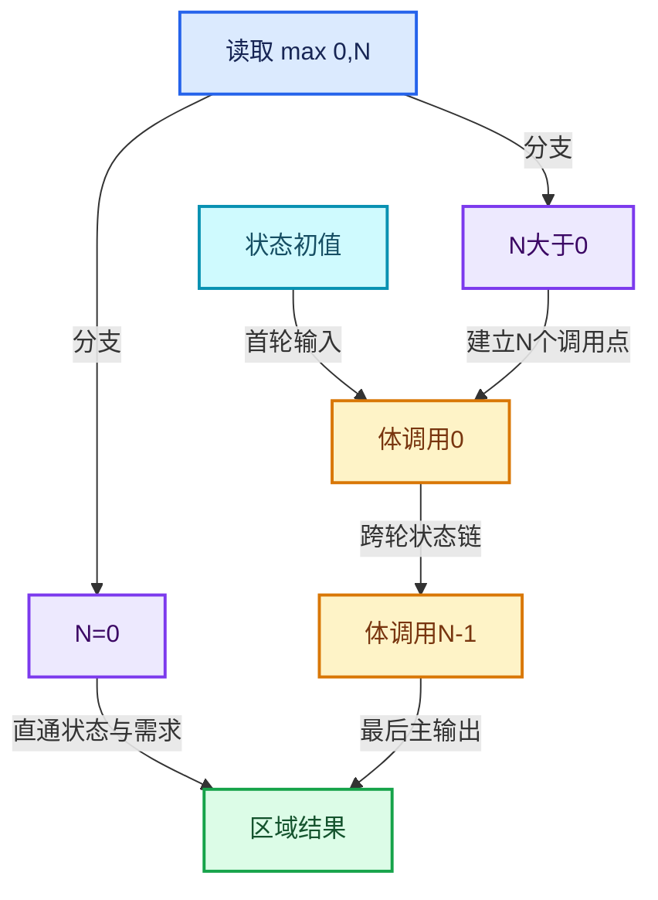

# RZ-05 按轮数展开执行图与零轮分支

[返回总入口](../README.md) · [本组导航](README.md) · [源码与版本](../00-课程指南/源码版本与覆盖索引.md)

> 源码基准提交：`e2e58a974edb3a5e949aa273d7ff940b5c5797c8`。具体文件内容以证据清单的 SHA-256 为准。

## 先回答一个具体问题

当前Repeat执行器为何构建N个体调用节点，而不是在execute里写一个普通for循环？

能逐条画出主值、轮次、边界输入和需求通道在展开图中的连接。

## 阅读前需要的概念

1. **`initialize_execution_graph`**：按当前实际轮数建立Repeat展开图的方法。

2. **`lf_body_nodes`**：按轮次顺序记录体调用节点的VectorSet。

3. **`index_values`**：求值存储中为被使用轮次建立的SocketValueVariant数组。

4. **`main_inputs_offset`**：跳过区域输入中前导Iterations的状态起始偏移。

5. **`body_inputs_offset`**：跳过体输入中前导Iteration的状态起始偏移。

6. **`static_true`**：拥有静态寿命的真值默认存储，当前用于部分保守需求。

7. **`GraphInputSocket`**：图的输入接口节点，向内部消费者提供输入值。

8. **`GraphOutputSocket`**：图的输出接口节点，从内部接收对外结果。

## 本篇的机制地图



图中连线标签区分状态流、接口、拥有与观察关系；它不是线程调度记录，也不表示未声明的类型继承关系。

## 核心机制与设计推导

### 01 · 第一次求值才知道轮数

包装器在 execute_impl 中检查 graph_executor 是否已经建立。

首次执行读取 Iterations，取 max(0,N)，再创建展开图。

之后同一次求值的恢复调用使用存储中的执行器。

源码注释没有实现按所有历史轮数共享的全局展开图缓存，不能把本次存储复用扩大解释为跨对象永久缓存。

### 02 · 每轮一个调用点

循环使用 add_function(*body_fn_.function) 创建 N 个 FunctionNode，再按创建顺序存入 VectorSet。

所有节点引用同一个体函数对象，但节点身份不同。

wrapper 可以从节点在 VectorSet 中的位置反查 iteration。

这个顺序是日志身份的一部分，不是可任意打乱的无关布局。

### 03 · 两个前导偏移

区域主输入第零项是 Iterations，体主输入第零项是 Iteration，所以两个接口在接状态时都跳过一项。

main_inputs_offset 与 body_inputs_offset 分别表示这两个跳过动作。

虽然当前值都为一，也不应将它们视为同一种索引。

增删接口时应逐条复核偏移来源。

### 04 · 首轮和相邻轮连接

首轮状态接区域初始输入；相邻两轮把前体主输出接到后体状态主输入。

这个连接把递推式中的 S_i 实现为数据依赖。

体节点存在并不表示它们能不考虑状态链同时执行。

某些独立计算可能并行，但跨轮依赖仍由图边约束。

### 05 · 末轮成为区域输出

最后体节点的主输出连接到区域主输出。

外部输出需求被传入最后体的对应 output_usages。

中间体的输出需求当前保守设为 true，源码明确保留反向需求连线的 TODO。

文档中的理想需求图必须与这一实际实现分开。

### 06 · 轮次值的条件物化

只有 Iteration 输出被直接连线时，执行器才为每轮建立整数 SocketValueVariant。

值数组放在 eval_storage，确保默认值指针在求值期间有效。

未用轮次时用静态 -1 占位，不代表用户可以观察到正常循环从 -1 开始。

该值是未使用输入的内部默认载体。

### 07 · 零轮走直通路径

没有体节点时，所有状态主输入直接链接到输出，需求标记也直接映射。

边界输入的使用标志默认为 false，因为体没有执行。

主输入的 Iterations 仍被使用，因为必须先知道轮数才能选择图结构。

这个区别能解释为何空循环仍要读取轮数。

### 08 · 执行器建立后的资源约束

更新节点索引之后构造 GraphExecutor，并把执行器的动态 storage 放进区域分配器。

默认值指针、图节点和包装器都必须在执行期间保持稳定。

运行时调试图导出使用原始树的日志存储并加锁。

日志记录是调试路径，不能当作实际执行图的唯一拥有者。

## 小数据推演与反例实验

以下预期来自明确的输入和模型推导。未附 Blender 运行记录的案例属于待执行实验，不把手算结果当作后端实测。

### 实验 01 · 零轮两状态

**输入与操作**

x=3、y=5，N=0

**预期与判据**

输出x=3、y=5

**为什么这个案例有辨别力**

体节点数量为零但区域接口仍然完整。

**执行时记录**

- 保留输入、轮数与状态项身份，避免只保存截图。
- 将实际观察和上述预期对照；不一致时先定位本实验涉及的边界。

### 实验 02 · 一轮偏移

**输入与操作**

N=1，x初值7，体输出x+Iteration

**预期与判据**

输出7

**为什么这个案例有辨别力**

体输入轮次0，状态7，不能接成轮数1。

**执行时记录**

- 保留输入、轮数与状态项身份，避免只保存截图。
- 将实际观察和上述预期对照；不一致时先定位本实验涉及的边界。

### 实验 03 · 三轮链

**输入与操作**

N=3，x每轮乘2，初始1

**预期与判据**

1 → 2 → 4 → 8

**为什么这个案例有辨别力**

状态数据必须经前一轮结果再进入后一轮。

**执行时记录**

- 保留输入、轮数与状态项身份，避免只保存截图。
- 将实际观察和上述预期对照；不一致时先定位本实验涉及的边界。

### 实验 04 · 未连接Iteration

**输入与操作**

N=100，体不读取轮次

**预期与判据**

无需建立100个真实轮次值

**为什么这个案例有辨别力**

仍有100个体调用节点，不能混淆两项优化。

**执行时记录**

- 保留输入、轮数与状态项身份，避免只保存截图。
- 将实际观察和上述预期对照；不一致时先定位本实验涉及的边界。

### 实验 05 · 负轮数

**输入与操作**

内部收到整数-4

**预期与判据**

被钳制到零轮并直通

**为什么这个案例有辨别力**

界面最小值不是运行时防御的全部。

**执行时记录**

- 保留输入、轮数与状态项身份，避免只保存截图。
- 将实际观察和上述预期对照；不一致时先定位本实验涉及的边界。

### 实验 06 · 图缓存误解

**输入与操作**

先求N=2，另一次独立求值N=5

**预期与判据**

不能假定直接复用旧N=2展开图

**为什么这个案例有辨别力**

共享体函数与共享当前展开图是不同机制。

**执行时记录**

- 保留输入、轮数与状态项身份，避免只保存截图。
- 将实际观察和上述预期对照；不一致时先定位本实验涉及的边界。

## 连续源码与定向阅读批注

以下代码逐字摘自本地源码，保留原始空行、注释和条件编译。
文件头中的许可证以源文件为准；本教程的说明文字不改变上游源码的授权。
区间摘录不保证从函数边界开始；标题明确标明连续区间时，应结合所链接源文件查看外围声明。
每个块的原始文件、起止行和哈希记入 `_evidence/source-excerpts.json`，校验脚本会逐块比较。

### 源码 01 · Repeat展开图完整实现

来源：[source/blender/nodes/intern/geometry_nodes_repeat_zone.cc](../../../../../source/blender/nodes/intern/geometry_nodes_repeat_zone.cc)，连续区间 L1—L432。

<!-- source:repeat:1:432 -->

```cpp
/* SPDX-FileCopyrightText: 2024 Blender Authors
 *
 * SPDX-License-Identifier: GPL-2.0-or-later */

/** \file
 * \ingroup nodes
 */

#include "NOD_geometry_nodes_lazy_function.hh"

#include "BKE_compute_contexts.hh"
#include "BKE_node_runtime.hh"
#include "BKE_node_socket_value.hh"

#include "FN_lazy_function_execute.hh"

#include "BLT_translation.hh"

#include "BLI_array_utils.hh"

#include "DEG_depsgraph_query.hh"

#include "FN_lazy_function_graph_executor.hh"

namespace blender::nodes {

using bke::SocketValueVariant;

/**
 * Wraps the execution of a repeat loop body. The purpose is to setup the correct #ComputeContext
 * inside of the loop body. This is necessary to support correct logging inside of a repeat zone.
 * An alternative would be to use a separate `LazyFunction` for every iteration, but that would
 * have higher overhead.
 */
class RepeatBodyNodeExecuteWrapper : public lf::GraphExecutorNodeExecuteWrapper {
 public:
  const bNode *repeat_output_bnode_ = nullptr;
  VectorSet<lf::FunctionNode *> *lf_body_nodes_ = nullptr;

  void execute_node(const lf::FunctionNode &node,
                    lf::Params &params,
                    const lf::Context &context) const override
  {
    GeoNodesUserData &user_data = *static_cast<GeoNodesUserData *>(context.user_data);
    const int iteration = lf_body_nodes_->index_of_try(const_cast<lf::FunctionNode *>(&node));
    const LazyFunction &fn = node.function();
    if (iteration == -1) {
      /* The node is not a loop body node, just execute it normally. */
      fn.execute(params, context);
      return;
    }

    /* Setup context for the loop body evaluation. */
    bke::RepeatZoneComputeContext body_compute_context{
        user_data.compute_context, *repeat_output_bnode_, iteration};
    GeoNodesUserData body_user_data = user_data;
    body_user_data.compute_context = &body_compute_context;
    body_user_data.verbose_log = should_log_verbose_in_context(user_data,
                                                               body_compute_context.hash());

    GeoNodesLocalUserData body_local_user_data{body_user_data};
    lf::Context body_context{context.storage, &body_user_data, &body_local_user_data};
    fn.execute(params, body_context);
  }
};

/**
 * Knows which iterations of the loop evaluation have side effects.
 */
class RepeatZoneSideEffectProvider : public lf::GraphExecutorSideEffectProvider {
 public:
  const bNode *repeat_output_bnode_ = nullptr;
  Span<lf::FunctionNode *> lf_body_nodes_;

  Vector<const lf::FunctionNode *> get_nodes_with_side_effects(
      const lf::Context &context) const override
  {
    GeoNodesUserData &user_data = *static_cast<GeoNodesUserData *>(context.user_data);
    const GeoNodesCallData &call_data = *user_data.call_data;
    if (!call_data.side_effect_nodes) {
      return {};
    }
    const ComputeContextHash &context_hash = user_data.compute_context->hash();
    const Span<int> iterations_with_side_effects =
        call_data.side_effect_nodes->iterations_by_iteration_zone.lookup(
            {context_hash, repeat_output_bnode_->identifier});

    Vector<const lf::FunctionNode *> lf_nodes;
    for (const int i : iterations_with_side_effects) {
      if (i >= 0 && i < lf_body_nodes_.size()) {
        lf_nodes.append(lf_body_nodes_[i]);
      }
    }
    return lf_nodes;
  }
};

struct RepeatEvalStorage {
  LinearAllocator<> allocator;
  VectorSet<lf::FunctionNode *> lf_body_nodes;
  lf::Graph graph;
  std::optional<LazyFunctionForLogicalOr> or_function;
  std::optional<RepeatZoneSideEffectProvider> side_effect_provider;
  std::optional<RepeatBodyNodeExecuteWrapper> body_execute_wrapper;
  std::optional<lf::GraphExecutor> graph_executor;
  Array<SocketValueVariant> index_values;
  void *graph_executor_storage = nullptr;
  bool multi_threading_enabled = false;
  Vector<int> input_index_map;
  Vector<int> output_index_map;
};

class LazyFunctionForRepeatZone : public LazyFunction {
 private:
  const bNodeTree &btree_;
  const bke::bNodeTreeZone &zone_;
  const bNode &repeat_output_bnode_;
  const ZoneBuildInfo &zone_info_;
  const ZoneBodyFunction &body_fn_;

 public:
  LazyFunctionForRepeatZone(const bNodeTree &btree,
                            const bke::bNodeTreeZone &zone,
                            ZoneBuildInfo &zone_info,
                            const ZoneBodyFunction &body_fn)
      : btree_(btree),
        zone_(zone),
        repeat_output_bnode_(*zone.output_node()),
        zone_info_(zone_info),
        body_fn_(body_fn)
  {
    debug_name_ = "Repeat Zone";

    initialize_zone_wrapper(zone, zone_info, body_fn, true, inputs_, outputs_);
    /* Iterations input is always used. */
    inputs_[zone_info.indices.inputs.main[0]].usage = lf::ValueUsage::Used;
  }

  void *init_storage(LinearAllocator<> &allocator) const override
  {
    return allocator.construct<RepeatEvalStorage>().release();
  }

  void destruct_storage(void *storage) const override
  {
    RepeatEvalStorage *s = static_cast<RepeatEvalStorage *>(storage);
    if (s->graph_executor_storage) {
      s->graph_executor->destruct_storage(s->graph_executor_storage);
    }
    std::destroy_at(s);
  }

  void execute_impl(lf::Params &params, const lf::Context &context) const override
  {
    const ScopedNodeTimer node_timer{context, repeat_output_bnode_};

    auto &user_data = *static_cast<GeoNodesUserData *>(context.user_data);
    auto &local_user_data = *static_cast<GeoNodesLocalUserData *>(context.local_user_data);

    const NodeGeometryRepeatOutput &node_storage = *static_cast<const NodeGeometryRepeatOutput *>(
        repeat_output_bnode_.storage);
    RepeatEvalStorage &eval_storage = *static_cast<RepeatEvalStorage *>(context.storage);

    const int iterations_usage_index = zone_info_.indices.outputs.input_usages[0];
    if (!params.output_was_set(iterations_usage_index)) {
      /* The iterations input is always used. */
      params.set_output(iterations_usage_index, true);
    }

    if (!eval_storage.graph_executor) {
      /* Create the execution graph in the first evaluation. */
      this->initialize_execution_graph(
          params, eval_storage, node_storage, user_data, local_user_data);
    }

    /* Execute the graph for the repeat zone. */
    lf::RemappedParams eval_graph_params{*eval_storage.graph_executor,
                                         params,
                                         eval_storage.input_index_map,
                                         eval_storage.output_index_map,
                                         eval_storage.multi_threading_enabled};
    lf::Context eval_graph_context{
        eval_storage.graph_executor_storage, context.user_data, context.local_user_data};
    eval_storage.graph_executor->execute(eval_graph_params, eval_graph_context);
  }

  /**
   * Generate a lazy-function graph that contains the loop body (`body_fn_`) as many times
   * as there are iterations. Since this graph depends on the number of iterations, it can't be
   * reused in general. We could consider caching a version of this graph per number of iterations,
   * but right now that doesn't seem worth it. In practice, it takes much less time to create the
   * graph than to execute it (for intended use cases of this generic implementation, more special
   * case repeat loop evaluations could be implemented separately).
   */
  void initialize_execution_graph(lf::Params &params,
                                  RepeatEvalStorage &eval_storage,
                                  const NodeGeometryRepeatOutput &node_storage,
                                  GeoNodesUserData &user_data,
                                  GeoNodesLocalUserData &local_user_data) const
  {
    const int num_repeat_items = node_storage.items_num;
    const int num_border_links = body_fn_.indices.inputs.border_links.size();

    /* Number of iterations to evaluate. */
    const int iterations = std::max<int>(
        0,
        params.get_input<SocketValueVariant>(zone_info_.indices.inputs.main[0])
            .ensure_type<int>());

    if (iterations >= 10) {
      /* Constructing and running the repeat zone has some overhead so that it's probably worth
       * trying to do something else in the meantime already. */
      lazy_threading::send_hint();
    }

    /* Show a warning when the inspection index is out of range. */
    if (node_storage.inspection_index > 0) {
      if (node_storage.inspection_index >= iterations) {
        if (eval_log::NodeTreeLogger *tree_logger = local_user_data.try_get_tree_logger(user_data))
        {
          tree_logger->node_warnings.append(
              *tree_logger->allocator,
              {repeat_output_bnode_.identifier,
               {NodeWarningType::Info, N_("Inspection index is out of range")}});
        }
      }
    }

    /* Take iterations input into account. */
    const int main_inputs_offset = 1;
    const int body_inputs_offset = 1;

    lf::Graph &lf_graph = eval_storage.graph;

    Vector<lf::GraphInputSocket *> lf_inputs;
    Vector<lf::GraphOutputSocket *> lf_outputs;

    for (const int i : inputs_.index_range()) {
      const lf::Input &input = inputs_[i];
      lf_inputs.append(&lf_graph.add_input(*input.type, this->input_name(i)));
    }
    for (const int i : outputs_.index_range()) {
      const lf::Output &output = outputs_[i];
      lf_outputs.append(&lf_graph.add_output(*output.type, this->output_name(i)));
    }

    /* Create body nodes. */
    VectorSet<lf::FunctionNode *> &lf_body_nodes = eval_storage.lf_body_nodes;
    for ([[maybe_unused]] const int i : IndexRange(iterations)) {
      lf::FunctionNode &lf_node = lf_graph.add_function(*body_fn_.function);
      lf_body_nodes.add_new(&lf_node);
    }

    /* Create nodes for combining border link usages. A border link is used when any of the loop
     * bodies uses the border link, so an "or" node is necessary. */
    Array<lf::FunctionNode *> lf_border_link_usage_or_nodes(num_border_links);
    eval_storage.or_function.emplace(iterations);
    for (const int i : IndexRange(num_border_links)) {
      lf::FunctionNode &lf_node = lf_graph.add_function(*eval_storage.or_function);
      lf_border_link_usage_or_nodes[i] = &lf_node;
    }

    const bool use_index_values = zone_.input_node()->output_socket(0).is_directly_linked();

    if (use_index_values) {
      eval_storage.index_values.reinitialize(iterations);
      threading::parallel_for(IndexRange(iterations), 1024, [&](const IndexRange range) {
        for (const int i : range) {
          eval_storage.index_values[i].emplace<int>(i);
        }
      });
    }

    /* Handle body nodes one by one. */
    static const SocketValueVariant static_unused_index{-1};
    for (const int iter_i : lf_body_nodes.index_range()) {
      lf::FunctionNode &lf_node = *lf_body_nodes[iter_i];
      const SocketValueVariant *index_value = use_index_values ?
                                                  &eval_storage.index_values[iter_i] :
                                                  &static_unused_index;
      lf_node.input(body_fn_.indices.inputs.main[0]).set_default_value(index_value);
      for (const int i : IndexRange(num_border_links)) {
        lf_graph.add_link(*lf_inputs[zone_info_.indices.inputs.border_links[i]],
                          lf_node.input(body_fn_.indices.inputs.border_links[i]));
        lf_graph.add_link(lf_node.output(body_fn_.indices.outputs.border_link_usages[i]),
                          lf_border_link_usage_or_nodes[i]->input(iter_i));
      }

      /* Handle reference sets. */
      for (const auto &item : body_fn_.indices.inputs.reference_sets.items()) {
        lf_graph.add_link(*lf_inputs[zone_info_.indices.inputs.reference_sets.lookup(item.key)],
                          lf_node.input(item.value));
      }
    }

    static bool static_true = true;

    /* Handle body nodes pair-wise. */
    for (const int iter_i : lf_body_nodes.index_range().drop_back(1)) {
      lf::FunctionNode &lf_node = *lf_body_nodes[iter_i];
      lf::FunctionNode &lf_next_node = *lf_body_nodes[iter_i + 1];
      for (const int i : IndexRange(num_repeat_items)) {
        lf_graph.add_link(
            lf_node.output(body_fn_.indices.outputs.main[i]),
            lf_next_node.input(body_fn_.indices.inputs.main[i + body_inputs_offset]));
        /* TODO: Add back-link after being able to check for cyclic dependencies. */
        // lf_graph.add_link(lf_next_node.output(body_fn_.indices.outputs.input_usages[i]),
        //                   lf_node.input(body_fn_.indices.inputs.output_usages[i]));
        lf_node.input(body_fn_.indices.inputs.output_usages[i]).set_default_value(&static_true);
      }
    }

    /* Handle border link usage outputs. */
    for (const int i : IndexRange(num_border_links)) {
      lf_graph.add_link(lf_border_link_usage_or_nodes[i]->output(0),
                        *lf_outputs[zone_info_.indices.outputs.border_link_usages[i]]);
    }

    if (iterations > 0) {
      {
        /* Link first body node to input/output nodes. */
        lf::FunctionNode &lf_first_body_node = *lf_body_nodes[0];
        for (const int i : IndexRange(num_repeat_items)) {
          lf_graph.add_link(
              *lf_inputs[zone_info_.indices.inputs.main[i + main_inputs_offset]],
              lf_first_body_node.input(body_fn_.indices.inputs.main[i + body_inputs_offset]));
          lf_graph.add_link(
              lf_first_body_node.output(
                  body_fn_.indices.outputs.input_usages[i + body_inputs_offset]),
              *lf_outputs[zone_info_.indices.outputs.input_usages[i + main_inputs_offset]]);
        }
      }
      {
        /* Link last body node to input/output nodes. */
        lf::FunctionNode &lf_last_body_node = *lf_body_nodes.as_span().last();
        for (const int i : IndexRange(num_repeat_items)) {
          lf_graph.add_link(lf_last_body_node.output(body_fn_.indices.outputs.main[i]),
                            *lf_outputs[zone_info_.indices.outputs.main[i]]);
          lf_graph.add_link(*lf_inputs[zone_info_.indices.inputs.output_usages[i]],
                            lf_last_body_node.input(body_fn_.indices.inputs.output_usages[i]));
        }
      }
    }
    else {
      /* There are no iterations, just link the input directly to the output. */
      for (const int i : IndexRange(num_repeat_items)) {
        lf_graph.add_link(*lf_inputs[zone_info_.indices.inputs.main[i + main_inputs_offset]],
                          *lf_outputs[zone_info_.indices.outputs.main[i]]);
        lf_graph.add_link(
            *lf_inputs[zone_info_.indices.inputs.output_usages[i]],
            *lf_outputs[zone_info_.indices.outputs.input_usages[i + main_inputs_offset]]);
      }
      for (const int i : IndexRange(num_border_links)) {
        static bool static_false = false;
        lf_outputs[zone_info_.indices.outputs.border_link_usages[i]]->set_default_value(
            &static_false);
      }
    }

    lf_outputs[zone_info_.indices.outputs.input_usages[0]]->set_default_value(&static_true);

    /* The graph is ready, update the node indices which are required by the executor. */
    lf_graph.update_node_indices();

    // std::cout << "\n\n" << lf_graph.to_dot() << "\n\n";

    /* Create a mapping from parameter indices inside of this graph to parameters of the repeat
     * zone. The main complexity below stems from the fact that the iterations input is handled
     * outside of this graph. */
    eval_storage.output_index_map.reinitialize(outputs_.size() - 1);
    eval_storage.input_index_map.resize(inputs_.size() - 1);
    array_utils::fill_index_range<int>(eval_storage.input_index_map, 1);

    Vector<const lf::GraphInputSocket *> lf_graph_inputs = lf_inputs.as_span().drop_front(1);

    const int iteration_usage_index = zone_info_.indices.outputs.input_usages[0];
    array_utils::fill_index_range<int>(
        eval_storage.output_index_map.as_mutable_span().take_front(iteration_usage_index));
    array_utils::fill_index_range<int>(
        eval_storage.output_index_map.as_mutable_span().drop_front(iteration_usage_index),
        iteration_usage_index + 1);

    Vector<const lf::GraphOutputSocket *> lf_graph_outputs = lf_outputs.as_span().take_front(
        iteration_usage_index);
    lf_graph_outputs.extend(lf_outputs.as_span().drop_front(iteration_usage_index + 1));

    eval_storage.body_execute_wrapper.emplace();
    eval_storage.body_execute_wrapper->repeat_output_bnode_ = &repeat_output_bnode_;
    eval_storage.body_execute_wrapper->lf_body_nodes_ = &lf_body_nodes;
    eval_storage.side_effect_provider.emplace();
    eval_storage.side_effect_provider->repeat_output_bnode_ = &repeat_output_bnode_;
    eval_storage.side_effect_provider->lf_body_nodes_ = lf_body_nodes;

    eval_storage.graph_executor.emplace(lf_graph,
                                        std::move(lf_graph_inputs),
                                        std::move(lf_graph_outputs),
                                        nullptr,
                                        &*eval_storage.side_effect_provider,
                                        &*eval_storage.body_execute_wrapper);
    eval_storage.graph_executor_storage = eval_storage.graph_executor->init_storage(
        eval_storage.allocator);

    /* Log graph for debugging purposes. */
    const bNodeTree &btree_orig = *DEG_get_original(&btree_);
    if (btree_orig.runtime->logged_zone_graphs) {
      std::lock_guard lock{btree_orig.runtime->logged_zone_graphs->mutex};
      btree_orig.runtime->logged_zone_graphs->graph_by_zone_id.lookup_or_add_cb(
          repeat_output_bnode_.identifier, [&]() { return lf_graph.to_dot(); });
    }
  }

  std::string input_name(const int i) const override
  {
    return zone_wrapper_input_name(zone_info_, zone_, inputs_, i);
  }

  std::string output_name(const int i) const override
  {
    return zone_wrapper_output_name(zone_info_, zone_, outputs_, i);
  }
};

LazyFunction &build_repeat_zone_lazy_function(ResourceScope &scope,
                                              const bNodeTree &btree,
                                              const bke::bNodeTreeZone &zone,
                                              ZoneBuildInfo &zone_info,
                                              const ZoneBodyFunction &body_fn)
{
  return scope.construct<LazyFunctionForRepeatZone>(btree, zone, zone_info, body_fn);
}

}  // namespace blender::nodes
```

**读完这段后回到本篇问题**

- 对照“第一次求值才知道轮数”，明确这段代码是定义存储、建立接口还是执行已有结构。
- 结合“零轮两状态”重画输入到输出的关系，区分源码事实与例子的推导。
- 保留失败分支、默认值、析构和条件编译；不要仅摘取看起来像主算法的几行。

### 源码 02 · 图节点插槽和链接接口

来源：[source/blender/functions/FN_lazy_function_graph.hh](../../../../../source/blender/functions/FN_lazy_function_graph.hh)，连续区间 L1—L554。

<!-- source:graph:1:554 -->

```cpp
/* SPDX-FileCopyrightText: 2023 Blender Authors
 *
 * SPDX-License-Identifier: GPL-2.0-or-later */

#pragma once

/** \file
 * \ingroup fn
 *
 * This file contains a graph data structure that allows composing multiple lazy-functions into a
 * combined lazy-function.
 *
 * There are two types of nodes in the graph:
 * - #FunctionNode: Corresponds to a #LazyFunction. The inputs and outputs of the function become
 *   input and output sockets of the node.
 * - #InterfaceNode: Is used to indicate inputs and outputs of the entire graph. It can have an
 *   arbitrary number of sockets.
 */

#include "BLI_linear_allocator.hh"

#include "FN_lazy_function.hh"

namespace blender {

namespace dot_export {
class DirectedEdge;
}

namespace fn::lazy_function {

class Socket;
class InputSocket;
class OutputSocket;
class Node;
class Graph;

/**
 * A #Socket is the interface of a #Node. Every #Socket is either an #InputSocket or #OutputSocket.
 * Links can be created from output sockets to input sockets.
 */
class Socket : NonCopyable, NonMovable {
 protected:
  /**
   * The node the socket belongs to.
   */
  Node *node_;
  /**
   * Data type of the socket. Only sockets with the same type can be linked.
   */
  const CPPType *type_;
  /**
   * Indicates whether this is an #InputSocket or #OutputSocket.
   */
  bool is_input_;
  /**
   * Index of the socket. E.g. 0 for the first input and the first output socket.
   */
  int index_in_node_;
  /**
   * Index of the socket in the entire graph. Every socket has a different index.
   */
  int index_in_graph_;

  friend Graph;

 public:
  bool is_input() const;
  bool is_output() const;

  int index() const;
  int index_in_graph() const;

  InputSocket &as_input();
  OutputSocket &as_output();
  const InputSocket &as_input() const;
  const OutputSocket &as_output() const;

  const Node &node() const;
  Node &node();

  const CPPType &type() const;

  std::string name() const;
  std::string detailed_name() const;
};

class InputSocket : public Socket {
 private:
  /**
   * An input can have at most one link connected to it. The linked socket is the "origin" because
   * it's where the data is coming from. The type of the origin must be the same as the type of
   * this socket.
   */
  OutputSocket *origin_;
  /**
   * Can be null or a non-owning pointer to a value of the type of the socket. This value will be
   * used when the input is used but not linked.
   *
   * This is technically not needed, because one could just create a separate node that just
   * outputs the value, but that would have more overhead. Especially because it's commonly the
   * case that most inputs are unlinked.
   */
  const void *default_value_ = nullptr;

  friend Graph;

 public:
  OutputSocket *origin();
  const OutputSocket *origin() const;

  const void *default_value() const;
  void set_default_value(const void *value);
};

class OutputSocket : public Socket {
 private:
  /**
   * An output can be linked to an arbitrary number of inputs of the same type.
   */
  Vector<InputSocket *> targets_;

  friend Graph;

 public:
  Span<InputSocket *> targets();
  Span<const InputSocket *> targets() const;
};

/**
 * A #Node has input and output sockets. Every node is either a #FunctionNode or an #InterfaceNode.
 */
class Node : NonCopyable, NonMovable {
 protected:
  /**
   * The function this node corresponds to. If this is null, the node is an #InterfaceNode.
   * The function is not owned by this #Node nor by the #Graph.
   */
  const LazyFunction *fn_ = nullptr;
  /**
   * Input sockets of the node.
   */
  Span<InputSocket *> inputs_;
  /**
   * Output sockets of the node.
   */
  Span<OutputSocket *> outputs_;
  /**
   * An index that is set when calling #Graph::update_node_indices. This can be used to create
   * efficient mappings from nodes to other data using just an array instead of a hash map.
   *
   * This is technically not necessary but has better performance than always using hash maps.
   */
  int index_in_graph_ = -1;

  friend Graph;

 public:
  bool is_interface() const;
  bool is_function() const;
  int index_in_graph() const;

  Span<const InputSocket *> inputs() const;
  Span<const OutputSocket *> outputs() const;
  Span<InputSocket *> inputs();
  Span<OutputSocket *> outputs();

  const InputSocket &input(int index) const;
  const OutputSocket &output(int index) const;
  InputSocket &input(int index);
  OutputSocket &output(int index);

  std::string name() const;
};

/**
 * A #Node that corresponds to a specific #LazyFunction.
 */
class FunctionNode final : public Node {
 public:
  const LazyFunction &function() const;
};

/**
 * A #Node that does *not* correspond to a #LazyFunction. Instead it can be used to indicate inputs
 * and outputs of the entire graph. It can have an arbitrary number of inputs and outputs.
 */
class InterfaceNode final : public Node {
 private:
  friend Node;
  friend Socket;
  friend Graph;

  Vector<std::string> socket_names_;
};

/**
 * Interface input sockets are actually output sockets on the input node. This renaming makes the
 * code less confusing.
 */
using GraphInputSocket = OutputSocket;
using GraphOutputSocket = InputSocket;

/**
 * A container for an arbitrary number of nodes and links between their sockets.
 */
class Graph : NonCopyable, NonMovable {
 private:
  /**
   * Used to allocate nodes and sockets in the graph.
   */
  LinearAllocator<> allocator_;
  /**
   * Name of the graph for debugging purposes.
   */
  StringRefNull name_;
  /**
   * Contains all nodes in the graph so that it is efficient to iterate over them.
   * The first two nodes are the interface input and output nodes.
   */
  Vector<Node *> nodes_;

  InterfaceNode *graph_input_node_ = nullptr;
  InterfaceNode *graph_output_node_ = nullptr;

  Vector<GraphInputSocket *> graph_inputs_;
  Vector<GraphOutputSocket *> graph_outputs_;

  /**
   * Number of sockets in the graph. Can be used as array size when indexing using
   * `Socket::index_in_graph`.
   */
  int socket_num_ = 0;

 public:
  Graph(StringRef name = "unknown");
  ~Graph();

  StringRefNull name() const;

  /**
   * Get all nodes in the graph. The index in the span corresponds to #Node::index_in_graph.
   */
  Span<const Node *> nodes() const;
  Span<Node *> nodes();

  Span<const FunctionNode *> function_nodes() const;
  Span<FunctionNode *> function_nodes();

  Span<GraphInputSocket *> graph_inputs();
  Span<GraphOutputSocket *> graph_outputs();

  Span<const GraphInputSocket *> graph_inputs() const;
  Span<const GraphOutputSocket *> graph_outputs() const;

  /**
   * Add a new function node with sockets that match the passed in #LazyFunction.
   */
  FunctionNode &add_function(const LazyFunction &fn);

  /**
   * Add inputs and outputs to the graph.
   */
  GraphInputSocket &add_input(const CPPType &type, std::string name = "");
  GraphOutputSocket &add_output(const CPPType &type, std::string name = "");

  /**
   * Add a link between the two given sockets.
   * This has undefined behavior when the input is linked to something else already.
   */
  void add_link(OutputSocket &from, InputSocket &to);

  /**
   * If the socket is linked, remove the link.
   */
  void clear_origin(InputSocket &socket);

  /**
   * Make sure that #Node::index_in_graph is up to date.
   */
  void update_node_indices();
  /**
   * Make sure that #Socket::index_in_graph is up to date.
   */
  void update_socket_indices();

  /**
   * Number of sockets in the graph.
   */
  int socket_num() const;

  /**
   * Can be used to assert that #update_node_indices has been called.
   */
  bool node_indices_are_valid() const;

  /**
   * Optional configuration options for the dot graph generation. This allows creating
   * visualizations for specific purposes.
   */
  class ToDotOptions {
   public:
    virtual std::string socket_name(const Socket &socket) const;
    virtual std::optional<std::string> socket_font_color(const Socket &socket) const;
    virtual void add_edge_attributes(const OutputSocket &from,
                                     const InputSocket &to,
                                     dot_export::DirectedEdge &dot_edge) const;
  };

  /**
   * Utility to generate a dot graph string for the graph. This can be used for debugging.
   */
  std::string to_dot(const ToDotOptions &options = {}) const;
};

/* -------------------------------------------------------------------- */
/** \name #Socket Inline Methods
 * \{ */

inline bool Socket::is_input() const
{
  return is_input_;
}

inline bool Socket::is_output() const
{
  return !is_input_;
}

inline int Socket::index() const
{
  return index_in_node_;
}

inline int Socket::index_in_graph() const
{
  return index_in_graph_;
}

inline InputSocket &Socket::as_input()
{
  BLI_assert(this->is_input());
  return *static_cast<InputSocket *>(this);
}

inline OutputSocket &Socket::as_output()
{
  BLI_assert(this->is_output());
  return *static_cast<OutputSocket *>(this);
}

inline const InputSocket &Socket::as_input() const
{
  BLI_assert(this->is_input());
  return *static_cast<const InputSocket *>(this);
}

inline const OutputSocket &Socket::as_output() const
{
  BLI_assert(this->is_output());
  return *static_cast<const OutputSocket *>(this);
}

inline const Node &Socket::node() const
{
  return *node_;
}

inline Node &Socket::node()
{
  return *node_;
}

inline const CPPType &Socket::type() const
{
  return *type_;
}

/** \} */

/* -------------------------------------------------------------------- */
/** \name #InputSocket Inline Methods
 * \{ */

inline const OutputSocket *InputSocket::origin() const
{
  return origin_;
}

inline OutputSocket *InputSocket::origin()
{
  return origin_;
}

inline const void *InputSocket::default_value() const
{
  return default_value_;
}

inline void InputSocket::set_default_value(const void *value)
{
  default_value_ = value;
}

/** \} */

/* -------------------------------------------------------------------- */
/** \name #OutputSocket Inline Methods
 * \{ */

inline Span<const InputSocket *> OutputSocket::targets() const
{
  return targets_;
}

inline Span<InputSocket *> OutputSocket::targets()
{
  return targets_;
}

/** \} */

/* -------------------------------------------------------------------- */
/** \name #Node Inline Methods
 * \{ */

inline bool Node::is_interface() const
{
  return fn_ == nullptr;
}

inline bool Node::is_function() const
{
  return fn_ != nullptr;
}

inline int Node::index_in_graph() const
{
  return index_in_graph_;
}

inline Span<const InputSocket *> Node::inputs() const
{
  return inputs_;
}

inline Span<const OutputSocket *> Node::outputs() const
{
  return outputs_;
}

inline Span<InputSocket *> Node::inputs()
{
  return inputs_;
}

inline Span<OutputSocket *> Node::outputs()
{
  return outputs_;
}

inline const InputSocket &Node::input(const int index) const
{
  return *inputs_[index];
}

inline const OutputSocket &Node::output(const int index) const
{
  return *outputs_[index];
}

inline InputSocket &Node::input(const int index)
{
  return *inputs_[index];
}

inline OutputSocket &Node::output(const int index)
{
  return *outputs_[index];
}

/** \} */

/* -------------------------------------------------------------------- */
/** \name #FunctionNode Inline Methods
 * \{ */

inline const LazyFunction &FunctionNode::function() const
{
  BLI_assert(fn_ != nullptr);
  return *fn_;
}

/** \} */

/* -------------------------------------------------------------------- */
/** \name #Graph Inline Methods
 * \{ */

inline StringRefNull Graph::name() const
{
  return name_;
}

inline Span<const Node *> Graph::nodes() const
{
  return nodes_;
}

inline Span<Node *> Graph::nodes()
{
  return nodes_;
}

inline Span<const FunctionNode *> Graph::function_nodes() const
{
  return nodes_.as_span().drop_front(2).cast<const FunctionNode *>();
}

inline Span<FunctionNode *> Graph::function_nodes()
{
  return nodes_.as_span().drop_front(2).cast<FunctionNode *>();
}

inline Span<GraphInputSocket *> Graph::graph_inputs()
{
  return graph_inputs_;
}

inline Span<GraphOutputSocket *> Graph::graph_outputs()
{
  return graph_outputs_;
}

inline Span<const GraphInputSocket *> Graph::graph_inputs() const
{
  return graph_inputs_;
}

inline Span<const GraphOutputSocket *> Graph::graph_outputs() const
{
  return graph_outputs_;
}

inline int Graph::socket_num() const
{
  return socket_num_;
}

/** \} */

}  // namespace fn::lazy_function

}  // namespace blender
```

**读完这段后回到本篇问题**

- 对照“每轮一个调用点”，明确这段代码是定义存储、建立接口还是执行已有结构。
- 结合“一轮偏移”重画输入到输出的关系，区分源码事实与例子的推导。
- 保留失败分支、默认值、析构和条件编译；不要仅摘取看起来像主算法的几行。

### 源码 03 · 执行器对图和扩展对象的借用契约

来源：[source/blender/functions/FN_lazy_function_graph_executor.hh](../../../../../source/blender/functions/FN_lazy_function_graph_executor.hh)，连续区间 L1—L155。

<!-- source:executor:1:155 -->

```cpp
/* SPDX-FileCopyrightText: 2023 Blender Authors
 *
 * SPDX-License-Identifier: GPL-2.0-or-later */

#pragma once

/** \file
 * \ingroup fn
 *
 * This file provides means to create a #LazyFunction from #Graph (which could then e.g. be used in
 * another #Graph again).
 */

#include "BLI_generic_pointer.hh"
#include "BLI_vector.hh"

#include "FN_lazy_function_graph.hh"
#include "FN_lazy_function_graph_executor_generic.hh"

namespace blender::fn::lazy_function {

/**
 * Can be implemented to log values produced during graph evaluation.
 */
class GraphExecutorLogger {
 public:
  virtual ~GraphExecutorLogger() = default;

  struct LoggingEnabledState {
    bool socket_values = true;
    bool before_node_execute = true;
    bool after_node_execute = true;

    explicit LoggingEnabledState(const bool enabled)
        : socket_values(enabled), before_node_execute(enabled), after_node_execute(enabled)
    {
    }
  };

  virtual LoggingEnabledState get_logging_enabled_state(const Context &context) const;

  virtual void log_socket_value(const Socket &socket,
                                GPointer value,
                                const Context &context) const;

  virtual void log_before_node_execute(const FunctionNode &node,
                                       const Params &params,
                                       const Context &context) const;

  virtual void log_after_node_execute(const FunctionNode &node,
                                      const Params &params,
                                      const Context &context) const;

  virtual void dump_when_outputs_are_missing(const FunctionNode &node,
                                             Span<const OutputSocket *> missing_sockets,
                                             const Context &context) const;
  virtual void dump_when_input_is_set_twice(const InputSocket &target_socket,
                                            const OutputSocket &from_socket,
                                            const Context &context) const;
};

/**
 * Has to be implemented when some of the nodes in the graph may have side effects. The
 * #GraphExecutor has to know about that to make sure that these nodes will be executed even though
 * their outputs are not needed.
 */
class GraphExecutorSideEffectProvider {
 public:
  virtual ~GraphExecutorSideEffectProvider() = default;
  virtual Vector<const FunctionNode *> get_nodes_with_side_effects(const Context &context) const;
};

/**
 * Can be used to pass extra context into the execution of a function. The main alternative to this
 * is to create a wrapper `LazyFunction` for the `FunctionNode`s. Using this light weight wrapper
 * is preferable if possible.
 */
class GraphExecutorNodeExecuteWrapper {
 public:
  virtual ~GraphExecutorNodeExecuteWrapper() = default;

  /**
   * Is expected to run `node.function().execute(params, context)` but might do some extra work,
   * like adjusting the context.
   */
  virtual void execute_node(const FunctionNode &node,
                            Params &params,
                            const Context &context) const = 0;
};

class GraphExecutor : public LazyFunction {
 public:
  using Logger = GraphExecutorLogger;
  using SideEffectProvider = GraphExecutorSideEffectProvider;
  using NodeExecuteWrapper = GraphExecutorNodeExecuteWrapper;
  using GenericExecutor = generic_graph_executor::GenericGraphExecutor;

 private:
  /**
   * The graph that is evaluated.
   */
  const Graph &graph_;
  /**
   * Input and output sockets of the entire graph.
   */
  Vector<const GraphInputSocket *> graph_inputs_;
  Vector<const GraphOutputSocket *> graph_outputs_;
  Array<int> graph_input_index_by_socket_index_;
  Array<int> graph_output_index_by_socket_index_;
  /**
   * Optional logger for events that happen during execution.
   */
  const Logger *logger_;
  /**
   * Optional side effect provider. It knows which nodes have side effects based on the context
   * during evaluation.
   */
  const SideEffectProvider *side_effect_provider_;
  /**
   * Optional wrapper for node execution functions.
   */
  const NodeExecuteWrapper *node_execute_wrapper_;

  /**
   * The graph executor implementation does some preprocessing for the graph. This only has to be
   * done once even if the graph is executed multiple times.
   */
  generic_graph_executor::PreprocessData preprocess_data_;

  friend GenericExecutor;

 public:
  GraphExecutor(const Graph &graph,
                const Logger *logger,
                const SideEffectProvider *side_effect_provider,
                const NodeExecuteWrapper *node_execute_wrapper);

  GraphExecutor(const Graph &graph,
                Vector<const GraphInputSocket *> graph_inputs,
                Vector<const GraphOutputSocket *> graph_outputs,
                const Logger *logger,
                const SideEffectProvider *side_effect_provider,
                const NodeExecuteWrapper *node_execute_wrapper);

  void *init_storage(LinearAllocator<> &allocator) const override;
  void destruct_storage(void *storage) const override;

  std::string input_name(int index) const override;
  std::string output_name(int index) const override;

 private:
  void execute_impl(Params &params, const Context &context) const override;
};

}  // namespace blender::fn::lazy_function
```

**读完这段后回到本篇问题**

- 对照“两个前导偏移”，明确这段代码是定义存储、建立接口还是执行已有结构。
- 结合“三轮链”重画输入到输出的关系，区分源码事实与例子的推导。
- 保留失败分支、默认值、析构和条件编译；不要仅摘取看起来像主算法的几行。

## 练习与参考答案

### 练习 01 · 解释“第一次求值才知道轮数”

**题目**

不看代码，说明“第一次求值才知道轮数”解决的具体问题，并给出一个会违背其约束的错误实现。

**参考答案的核心**

包装器在 execute_impl 中检查 graph_executor 是否已经建立。

**验收追问**

源码注释没有实现按所有历史轮数共享的全局展开图缓存，不能把本次存储复用扩大解释为跨对象永久缓存。

**自查方法**

回到上面的源码区间和本篇实验，找出支持该回答的实际字段、调用或分支；若答案是设计推论，应明确写为推论。

### 练习 02 · 解释“每轮一个调用点”

**题目**

不看代码，说明“每轮一个调用点”解决的具体问题，并给出一个会违背其约束的错误实现。

**参考答案的核心**

循环使用 add_function(*body_fn_.function) 创建 N 个 FunctionNode，再按创建顺序存入 VectorSet。

**验收追问**

这个顺序是日志身份的一部分，不是可任意打乱的无关布局。

**自查方法**

回到上面的源码区间和本篇实验，找出支持该回答的实际字段、调用或分支；若答案是设计推论，应明确写为推论。

### 练习 03 · 解释“两个前导偏移”

**题目**

不看代码，说明“两个前导偏移”解决的具体问题，并给出一个会违背其约束的错误实现。

**参考答案的核心**

区域主输入第零项是 Iterations，体主输入第零项是 Iteration，所以两个接口在接状态时都跳过一项。

**验收追问**

增删接口时应逐条复核偏移来源。

**自查方法**

回到上面的源码区间和本篇实验，找出支持该回答的实际字段、调用或分支；若答案是设计推论，应明确写为推论。

### 练习 04 · 解释“首轮和相邻轮连接”

**题目**

不看代码，说明“首轮和相邻轮连接”解决的具体问题，并给出一个会违背其约束的错误实现。

**参考答案的核心**

首轮状态接区域初始输入；相邻两轮把前体主输出接到后体状态主输入。

**验收追问**

某些独立计算可能并行，但跨轮依赖仍由图边约束。

**自查方法**

回到上面的源码区间和本篇实验，找出支持该回答的实际字段、调用或分支；若答案是设计推论，应明确写为推论。

### 练习 05 · 解释“末轮成为区域输出”

**题目**

不看代码，说明“末轮成为区域输出”解决的具体问题，并给出一个会违背其约束的错误实现。

**参考答案的核心**

最后体节点的主输出连接到区域主输出。

**验收追问**

文档中的理想需求图必须与这一实际实现分开。

**自查方法**

回到上面的源码区间和本篇实验，找出支持该回答的实际字段、调用或分支；若答案是设计推论，应明确写为推论。

### 练习 06 · 解释“轮次值的条件物化”

**题目**

不看代码，说明“轮次值的条件物化”解决的具体问题，并给出一个会违背其约束的错误实现。

**参考答案的核心**

只有 Iteration 输出被直接连线时，执行器才为每轮建立整数 SocketValueVariant。

**验收追问**

该值是未使用输入的内部默认载体。

**自查方法**

回到上面的源码区间和本篇实验，找出支持该回答的实际字段、调用或分支；若答案是设计推论，应明确写为推论。

### 练习 07 · 解释“零轮走直通路径”

**题目**

不看代码，说明“零轮走直通路径”解决的具体问题，并给出一个会违背其约束的错误实现。

**参考答案的核心**

没有体节点时，所有状态主输入直接链接到输出，需求标记也直接映射。

**验收追问**

这个区别能解释为何空循环仍要读取轮数。

**自查方法**

回到上面的源码区间和本篇实验，找出支持该回答的实际字段、调用或分支；若答案是设计推论，应明确写为推论。

### 练习 08 · 解释“执行器建立后的资源约束”

**题目**

不看代码，说明“执行器建立后的资源约束”解决的具体问题，并给出一个会违背其约束的错误实现。

**参考答案的核心**

更新节点索引之后构造 GraphExecutor，并把执行器的动态 storage 放进区域分配器。

**验收追问**

日志记录是调试路径，不能当作实际执行图的唯一拥有者。

**自查方法**

回到上面的源码区间和本篇实验，找出支持该回答的实际字段、调用或分支；若答案是设计推论，应明确写为推论。

## 本篇完成标准

- 能直接回答：当前Repeat执行器为何构建N个体调用节点，而不是在execute里写一个普通for循环？
- 能解释本篇目标：能逐条画出主值、轮次、边界输入和需求通道在展开图中的连接。
- 能手算至少一个正轮数案例和一个边界案例，并说明各自验证的错误类型。
- 能沿源码链接区分配置、构图、求值和观察各阶段。
- 能陈述本篇实际证据的范围，不把静态摘录核对写成后端运行通过。

## 继续阅读

- 上一篇：[04-循环体提取与Zone接口协议](../02-构图与按需执行/04-循环体提取与Zone接口协议.md)
- 下一篇：[06-需求传播跨界输入与参数重映射](../02-构图与按需执行/06-需求传播跨界输入与参数重映射.md)
- [练习脚本与运行范围](../示例/README.md)
- [验收记录与尚未执行的集成检查](../00-课程指南/验收报告.md)
