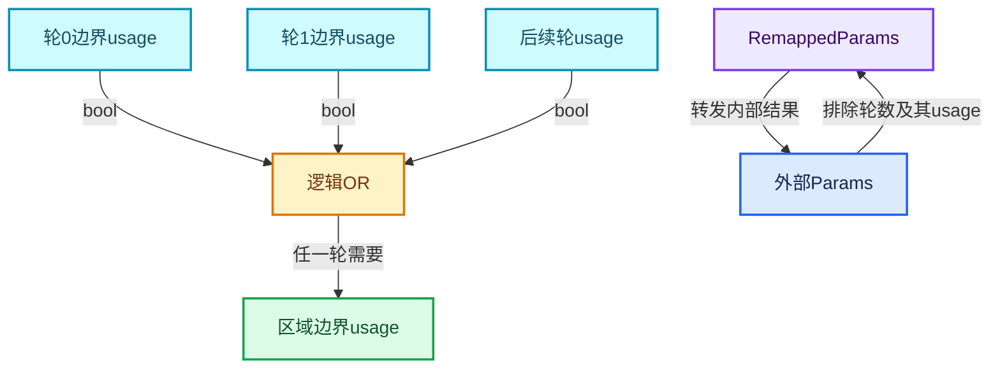

# RZ-06 需求传播跨界输入与参数重映射

[返回总入口](../README.md) · [本组导航](README.md) · [源码与版本](../00-课程指南/源码版本与覆盖索引.md)

> 源码基准提交：`e2e58a974edb3a5e949aa273d7ff940b5c5797c8`。具体文件内容以证据清单的 SHA-256 为准。

## 先回答一个具体问题

结果没有被使用时，哪些输入可以省略，哪些输入仍必须取得？

理解Maybe与Used、跨轮保守需求、OR聚合以及RemappedParams的具体映射。

## 阅读前需要的概念

1. **`ValueUsage`**：执行器中的使用程度描述，与数据本身的值分开。

2. **`Maybe`**：输入是否需要尚未固定，允许进一步按需求决定。

3. **`Used`**：确定会使用的输入，例如Repeat包装器的Iterations。

4. **`LazyFunctionForLogicalOr`**：对各轮跨界输入需求做逻辑OR聚合的辅助函数。

5. **`RemappedParams`**：把内部函数参数索引转发到外层Params的适配器。

6. **`input_index_map`**：内部输入位置到外部输入位置的映射。

7. **`output_index_map`**：内部输出位置到外部输出位置的映射。

8. **`output_was_set`**：查询输出是否已设置，用于避免恢复调用重复设置。

## 本篇的机制地图



图中连线标签区分状态流、接口、拥有与观察关系；它不是线程调度记录，也不表示未声明的类型继承关系。

## 核心机制与设计推导

### 01 · Iterations是确定使用的输入

构造函数把轮数对应输入标记为 Used，execute_impl 还输出其 input usage 为 true。

因为运行时图结构依赖轮数，这个需求在展开图外层处理。

并不是区域每个状态初始值都被同样强制读取。

状态输入的需求仍有独立传递路径。

### 02 · Maybe表达尚待分析

通用区域包装器将很多数据输入声明为 Maybe，允许执行器在后续依据消费者决定是否请求。

Maybe 不能直接等同于 Unused，也不能等同于已经拿到值。

函数可能因输入尚不可用而分阶段被调用。

必须看 Params 的请求接口和执行器调度契约。

### 03 · 边界需求按轮聚合

同一个边界输入连接到所有体调用，其使用标志收集到一个按轮数设置输入数量的 OR 函数。

任意一轮需要它，区域就需要该外部输入。

这个 OR 聚合的是需求布尔值，不是把各轮的几何结果合并。

零轮分支直接给 false，符合不存在体消费者的含义。

### 04 · 中间轮保守处理

相邻体主状态虽然向前连接，但反向 usage 连线被注释并标为 TODO。

当前中间体 output_usages 默认 true，避免未经循环依赖分析就加入可能有问题的需求边。

保守处理可能保留更多工作，但不能因此直接认定数值结果错误。

性能评估要以实际求值量测定。

### 05 · 内部接口排除轮数

展开图执行器不会再次处理已经由包装器消费的 Iterations 主输入。

因此 input_index_map 从外部索引一开始连续映射。

展开图的输入选择也 drop_front(1)，两者必须保持一致。

只更新映射却保留旧执行器输入列表会形成接口数量失配。

### 06 · 输出映射跳过使用标记

包装器已经写入 Iterations 的 usage 输出，内部执行器输出列表需要跳过这一项。

代码以 iteration_usage_index 将列表分成前后两段，建立新的 output_index_map。

这个索引不应被硬编码为零，因为 usage 输出位于整个输出布局中的专门位置。

手算一个双状态示例最容易发现错误假设。

### 07 · RemappedParams是转发适配

RemappedParams 保存底层 Params 引用和输入输出映射，再把查询、输出设置与使用信息转发到对应位置。

它不创建一份独立的所有数据值副本。

多线程启用状态也以引用形式传递。

正确性依赖映射数组和底层参数在调用期间有效。

### 08 · 设置输出的幂等边界

execute_impl 在写 Iterations usage 前检查 output_was_set，体现恢复调用不能重复无条件设置同一输出。

LazyFunction 的 execute 不应被直觉当成一次普通函数调用就永远结束。

调试时应同时记录调用次数、已设置输出和等待输入。

否则容易把正常恢复误判为重复迭代。

## 小数据推演与反例实验

以下预期来自明确的输入和模型推导。未附 Blender 运行记录的案例属于待执行实验，不把手算结果当作后端实测。

### 实验 01 · 跨界值只在一轮需要

**输入与操作**

N=3，需求序列为false、true、false

**预期与判据**

OR结果true

**为什么这个案例有辨别力**

外部值不能因第零轮不用就被提前裁掉。

**执行时记录**

- 保留输入、轮数与状态项身份，避免只保存截图。
- 将实际观察和上述预期对照；不一致时先定位本实验涉及的边界。

### 实验 02 · 所有轮都不用

**输入与操作**

N=3，边界需求全false

**预期与判据**

OR结果false

**为什么这个案例有辨别力**

这一结论来自需求通道，不能仅凭线存在判断。

**执行时记录**

- 保留输入、轮数与状态项身份，避免只保存截图。
- 将实际观察和上述预期对照；不一致时先定位本实验涉及的边界。

### 实验 03 · 空循环边界需求

**输入与操作**

N=0，体内连接昂贵外部输入

**预期与判据**

边界usage=false

**为什么这个案例有辨别力**

仍要取得Iterations以决定空循环。

**执行时记录**

- 保留输入、轮数与状态项身份，避免只保存截图。
- 将实际观察和上述预期对照；不一致时先定位本实验涉及的边界。

### 实验 04 · 恢复调用

**输入与操作**

第一次调用已设置轮数使用输出，后续再进入execute_impl

**预期与判据**

不重复设置同一输出

**为什么这个案例有辨别力**

检查output_was_set承担这项局部保护。

**执行时记录**

- 保留输入、轮数与状态项身份，避免只保存截图。
- 将实际观察和上述预期对照；不一致时先定位本实验涉及的边界。

### 实验 05 · 中间输出未用

**输入与操作**

末轮只消费一个状态，而中间体有多个状态输出

**预期与判据**

当前保守true可能保留额外需求

**为什么这个案例有辨别力**

不要在文档中画出不存在的完全精确剪枝。

**执行时记录**

- 保留输入、轮数与状态项身份，避免只保存截图。
- 将实际观察和上述预期对照；不一致时先定位本实验涉及的边界。

### 实验 06 · 重映射跳项

**输入与操作**

外部输出布局中轮数usage位于中间

**预期与判据**

映射跨过该位置

**为什么这个案例有辨别力**

数值输出和usage输出不能混为同一连续列表。

**执行时记录**

- 保留输入、轮数与状态项身份，避免只保存截图。
- 将实际观察和上述预期对照；不一致时先定位本实验涉及的边界。

## 连续源码与定向阅读批注

以下代码逐字摘自本地源码，保留原始空行、注释和条件编译。
文件头中的许可证以源文件为准；本教程的说明文字不改变上游源码的授权。
区间摘录不保证从函数边界开始；标题明确标明连续区间时，应结合所链接源文件查看外围声明。
每个块的原始文件、起止行和哈希记入 `_evidence/source-excerpts.json`，校验脚本会逐块比较。

### 源码 01 · 需求默认值与索引映射

来源：[source/blender/nodes/intern/geometry_nodes_repeat_zone.cc](../../../../../source/blender/nodes/intern/geometry_nodes_repeat_zone.cc)，连续区间 L110—L410。

<!-- source:repeat:110:410 -->

```cpp
  Vector<int> output_index_map;
};

class LazyFunctionForRepeatZone : public LazyFunction {
 private:
  const bNodeTree &btree_;
  const bke::bNodeTreeZone &zone_;
  const bNode &repeat_output_bnode_;
  const ZoneBuildInfo &zone_info_;
  const ZoneBodyFunction &body_fn_;

 public:
  LazyFunctionForRepeatZone(const bNodeTree &btree,
                            const bke::bNodeTreeZone &zone,
                            ZoneBuildInfo &zone_info,
                            const ZoneBodyFunction &body_fn)
      : btree_(btree),
        zone_(zone),
        repeat_output_bnode_(*zone.output_node()),
        zone_info_(zone_info),
        body_fn_(body_fn)
  {
    debug_name_ = "Repeat Zone";

    initialize_zone_wrapper(zone, zone_info, body_fn, true, inputs_, outputs_);
    /* Iterations input is always used. */
    inputs_[zone_info.indices.inputs.main[0]].usage = lf::ValueUsage::Used;
  }

  void *init_storage(LinearAllocator<> &allocator) const override
  {
    return allocator.construct<RepeatEvalStorage>().release();
  }

  void destruct_storage(void *storage) const override
  {
    RepeatEvalStorage *s = static_cast<RepeatEvalStorage *>(storage);
    if (s->graph_executor_storage) {
      s->graph_executor->destruct_storage(s->graph_executor_storage);
    }
    std::destroy_at(s);
  }

  void execute_impl(lf::Params &params, const lf::Context &context) const override
  {
    const ScopedNodeTimer node_timer{context, repeat_output_bnode_};

    auto &user_data = *static_cast<GeoNodesUserData *>(context.user_data);
    auto &local_user_data = *static_cast<GeoNodesLocalUserData *>(context.local_user_data);

    const NodeGeometryRepeatOutput &node_storage = *static_cast<const NodeGeometryRepeatOutput *>(
        repeat_output_bnode_.storage);
    RepeatEvalStorage &eval_storage = *static_cast<RepeatEvalStorage *>(context.storage);

    const int iterations_usage_index = zone_info_.indices.outputs.input_usages[0];
    if (!params.output_was_set(iterations_usage_index)) {
      /* The iterations input is always used. */
      params.set_output(iterations_usage_index, true);
    }

    if (!eval_storage.graph_executor) {
      /* Create the execution graph in the first evaluation. */
      this->initialize_execution_graph(
          params, eval_storage, node_storage, user_data, local_user_data);
    }

    /* Execute the graph for the repeat zone. */
    lf::RemappedParams eval_graph_params{*eval_storage.graph_executor,
                                         params,
                                         eval_storage.input_index_map,
                                         eval_storage.output_index_map,
                                         eval_storage.multi_threading_enabled};
    lf::Context eval_graph_context{
        eval_storage.graph_executor_storage, context.user_data, context.local_user_data};
    eval_storage.graph_executor->execute(eval_graph_params, eval_graph_context);
  }

  /**
   * Generate a lazy-function graph that contains the loop body (`body_fn_`) as many times
   * as there are iterations. Since this graph depends on the number of iterations, it can't be
   * reused in general. We could consider caching a version of this graph per number of iterations,
   * but right now that doesn't seem worth it. In practice, it takes much less time to create the
   * graph than to execute it (for intended use cases of this generic implementation, more special
   * case repeat loop evaluations could be implemented separately).
   */
  void initialize_execution_graph(lf::Params &params,
                                  RepeatEvalStorage &eval_storage,
                                  const NodeGeometryRepeatOutput &node_storage,
                                  GeoNodesUserData &user_data,
                                  GeoNodesLocalUserData &local_user_data) const
  {
    const int num_repeat_items = node_storage.items_num;
    const int num_border_links = body_fn_.indices.inputs.border_links.size();

    /* Number of iterations to evaluate. */
    const int iterations = std::max<int>(
        0,
        params.get_input<SocketValueVariant>(zone_info_.indices.inputs.main[0])
            .ensure_type<int>());

    if (iterations >= 10) {
      /* Constructing and running the repeat zone has some overhead so that it's probably worth
       * trying to do something else in the meantime already. */
      lazy_threading::send_hint();
    }

    /* Show a warning when the inspection index is out of range. */
    if (node_storage.inspection_index > 0) {
      if (node_storage.inspection_index >= iterations) {
        if (eval_log::NodeTreeLogger *tree_logger = local_user_data.try_get_tree_logger(user_data))
        {
          tree_logger->node_warnings.append(
              *tree_logger->allocator,
              {repeat_output_bnode_.identifier,
               {NodeWarningType::Info, N_("Inspection index is out of range")}});
        }
      }
    }

    /* Take iterations input into account. */
    const int main_inputs_offset = 1;
    const int body_inputs_offset = 1;

    lf::Graph &lf_graph = eval_storage.graph;

    Vector<lf::GraphInputSocket *> lf_inputs;
    Vector<lf::GraphOutputSocket *> lf_outputs;

    for (const int i : inputs_.index_range()) {
      const lf::Input &input = inputs_[i];
      lf_inputs.append(&lf_graph.add_input(*input.type, this->input_name(i)));
    }
    for (const int i : outputs_.index_range()) {
      const lf::Output &output = outputs_[i];
      lf_outputs.append(&lf_graph.add_output(*output.type, this->output_name(i)));
    }

    /* Create body nodes. */
    VectorSet<lf::FunctionNode *> &lf_body_nodes = eval_storage.lf_body_nodes;
    for ([[maybe_unused]] const int i : IndexRange(iterations)) {
      lf::FunctionNode &lf_node = lf_graph.add_function(*body_fn_.function);
      lf_body_nodes.add_new(&lf_node);
    }

    /* Create nodes for combining border link usages. A border link is used when any of the loop
     * bodies uses the border link, so an "or" node is necessary. */
    Array<lf::FunctionNode *> lf_border_link_usage_or_nodes(num_border_links);
    eval_storage.or_function.emplace(iterations);
    for (const int i : IndexRange(num_border_links)) {
      lf::FunctionNode &lf_node = lf_graph.add_function(*eval_storage.or_function);
      lf_border_link_usage_or_nodes[i] = &lf_node;
    }

    const bool use_index_values = zone_.input_node()->output_socket(0).is_directly_linked();

    if (use_index_values) {
      eval_storage.index_values.reinitialize(iterations);
      threading::parallel_for(IndexRange(iterations), 1024, [&](const IndexRange range) {
        for (const int i : range) {
          eval_storage.index_values[i].emplace<int>(i);
        }
      });
    }

    /* Handle body nodes one by one. */
    static const SocketValueVariant static_unused_index{-1};
    for (const int iter_i : lf_body_nodes.index_range()) {
      lf::FunctionNode &lf_node = *lf_body_nodes[iter_i];
      const SocketValueVariant *index_value = use_index_values ?
                                                  &eval_storage.index_values[iter_i] :
                                                  &static_unused_index;
      lf_node.input(body_fn_.indices.inputs.main[0]).set_default_value(index_value);
      for (const int i : IndexRange(num_border_links)) {
        lf_graph.add_link(*lf_inputs[zone_info_.indices.inputs.border_links[i]],
                          lf_node.input(body_fn_.indices.inputs.border_links[i]));
        lf_graph.add_link(lf_node.output(body_fn_.indices.outputs.border_link_usages[i]),
                          lf_border_link_usage_or_nodes[i]->input(iter_i));
      }

      /* Handle reference sets. */
      for (const auto &item : body_fn_.indices.inputs.reference_sets.items()) {
        lf_graph.add_link(*lf_inputs[zone_info_.indices.inputs.reference_sets.lookup(item.key)],
                          lf_node.input(item.value));
      }
    }

    static bool static_true = true;

    /* Handle body nodes pair-wise. */
    for (const int iter_i : lf_body_nodes.index_range().drop_back(1)) {
      lf::FunctionNode &lf_node = *lf_body_nodes[iter_i];
      lf::FunctionNode &lf_next_node = *lf_body_nodes[iter_i + 1];
      for (const int i : IndexRange(num_repeat_items)) {
        lf_graph.add_link(
            lf_node.output(body_fn_.indices.outputs.main[i]),
            lf_next_node.input(body_fn_.indices.inputs.main[i + body_inputs_offset]));
        /* TODO: Add back-link after being able to check for cyclic dependencies. */
        // lf_graph.add_link(lf_next_node.output(body_fn_.indices.outputs.input_usages[i]),
        //                   lf_node.input(body_fn_.indices.inputs.output_usages[i]));
        lf_node.input(body_fn_.indices.inputs.output_usages[i]).set_default_value(&static_true);
      }
    }

    /* Handle border link usage outputs. */
    for (const int i : IndexRange(num_border_links)) {
      lf_graph.add_link(lf_border_link_usage_or_nodes[i]->output(0),
                        *lf_outputs[zone_info_.indices.outputs.border_link_usages[i]]);
    }

    if (iterations > 0) {
      {
        /* Link first body node to input/output nodes. */
        lf::FunctionNode &lf_first_body_node = *lf_body_nodes[0];
        for (const int i : IndexRange(num_repeat_items)) {
          lf_graph.add_link(
              *lf_inputs[zone_info_.indices.inputs.main[i + main_inputs_offset]],
              lf_first_body_node.input(body_fn_.indices.inputs.main[i + body_inputs_offset]));
          lf_graph.add_link(
              lf_first_body_node.output(
                  body_fn_.indices.outputs.input_usages[i + body_inputs_offset]),
              *lf_outputs[zone_info_.indices.outputs.input_usages[i + main_inputs_offset]]);
        }
      }
      {
        /* Link last body node to input/output nodes. */
        lf::FunctionNode &lf_last_body_node = *lf_body_nodes.as_span().last();
        for (const int i : IndexRange(num_repeat_items)) {
          lf_graph.add_link(lf_last_body_node.output(body_fn_.indices.outputs.main[i]),
                            *lf_outputs[zone_info_.indices.outputs.main[i]]);
          lf_graph.add_link(*lf_inputs[zone_info_.indices.inputs.output_usages[i]],
                            lf_last_body_node.input(body_fn_.indices.inputs.output_usages[i]));
        }
      }
    }
    else {
      /* There are no iterations, just link the input directly to the output. */
      for (const int i : IndexRange(num_repeat_items)) {
        lf_graph.add_link(*lf_inputs[zone_info_.indices.inputs.main[i + main_inputs_offset]],
                          *lf_outputs[zone_info_.indices.outputs.main[i]]);
        lf_graph.add_link(
            *lf_inputs[zone_info_.indices.inputs.output_usages[i]],
            *lf_outputs[zone_info_.indices.outputs.input_usages[i + main_inputs_offset]]);
      }
      for (const int i : IndexRange(num_border_links)) {
        static bool static_false = false;
        lf_outputs[zone_info_.indices.outputs.border_link_usages[i]]->set_default_value(
            &static_false);
      }
    }

    lf_outputs[zone_info_.indices.outputs.input_usages[0]]->set_default_value(&static_true);

    /* The graph is ready, update the node indices which are required by the executor. */
    lf_graph.update_node_indices();

    // std::cout << "\n\n" << lf_graph.to_dot() << "\n\n";

    /* Create a mapping from parameter indices inside of this graph to parameters of the repeat
     * zone. The main complexity below stems from the fact that the iterations input is handled
     * outside of this graph. */
    eval_storage.output_index_map.reinitialize(outputs_.size() - 1);
    eval_storage.input_index_map.resize(inputs_.size() - 1);
    array_utils::fill_index_range<int>(eval_storage.input_index_map, 1);

    Vector<const lf::GraphInputSocket *> lf_graph_inputs = lf_inputs.as_span().drop_front(1);

    const int iteration_usage_index = zone_info_.indices.outputs.input_usages[0];
    array_utils::fill_index_range<int>(
        eval_storage.output_index_map.as_mutable_span().take_front(iteration_usage_index));
    array_utils::fill_index_range<int>(
        eval_storage.output_index_map.as_mutable_span().drop_front(iteration_usage_index),
        iteration_usage_index + 1);

    Vector<const lf::GraphOutputSocket *> lf_graph_outputs = lf_outputs.as_span().take_front(
        iteration_usage_index);
    lf_graph_outputs.extend(lf_outputs.as_span().drop_front(iteration_usage_index + 1));

    eval_storage.body_execute_wrapper.emplace();
    eval_storage.body_execute_wrapper->repeat_output_bnode_ = &repeat_output_bnode_;
    eval_storage.body_execute_wrapper->lf_body_nodes_ = &lf_body_nodes;
    eval_storage.side_effect_provider.emplace();
    eval_storage.side_effect_provider->repeat_output_bnode_ = &repeat_output_bnode_;
    eval_storage.side_effect_provider->lf_body_nodes_ = lf_body_nodes;

    eval_storage.graph_executor.emplace(lf_graph,
                                        std::move(lf_graph_inputs),
                                        std::move(lf_graph_outputs),
                                        nullptr,
                                        &*eval_storage.side_effect_provider,
                                        &*eval_storage.body_execute_wrapper);
    eval_storage.graph_executor_storage = eval_storage.graph_executor->init_storage(
        eval_storage.allocator);

    /* Log graph for debugging purposes. */
    const bNodeTree &btree_orig = *DEG_get_original(&btree_);
    if (btree_orig.runtime->logged_zone_graphs) {
      std::lock_guard lock{btree_orig.runtime->logged_zone_graphs->mutex};
      btree_orig.runtime->logged_zone_graphs->graph_by_zone_id.lookup_or_add_cb(
          repeat_output_bnode_.identifier, [&]() { return lf_graph.to_dot(); });
    }
  }
```

**读完这段后回到本篇问题**

- 对照“Iterations是确定使用的输入”，明确这段代码是定义存储、建立接口还是执行已有结构。
- 结合“跨界值只在一轮需要”重画输入到输出的关系，区分源码事实与例子的推导。
- 保留失败分支、默认值、析构和条件编译；不要仅摘取看起来像主算法的几行。

### 源码 02 · 参数包装完整接口

来源：[source/blender/functions/FN_lazy_function_execute.hh](../../../../../source/blender/functions/FN_lazy_function_execute.hh)，连续区间 L1—L158。

<!-- source:params:1:158 -->

```cpp
/* SPDX-FileCopyrightText: 2023 Blender Authors
 *
 * SPDX-License-Identifier: GPL-2.0-or-later */

#pragma once

/** \file
 * \ingroup fn
 *
 * This file contains common utilities for actually executing a lazy-function.
 */

#include "BLI_generic_pointer.hh"

#include "FN_lazy_function.hh"

namespace blender::fn::lazy_function {

/**
 * Most basic implementation of #Params. It does not actually implement any logic for how to
 * retrieve inputs or set outputs. Instead, code using #BasicParams has to implement that.
 */
class BasicParams : public Params {
 private:
  const Span<GMutablePointer> inputs_;
  const Span<GMutablePointer> outputs_;
  MutableSpan<std::optional<ValueUsage>> input_usages_;
  Span<ValueUsage> output_usages_;
  MutableSpan<bool> set_outputs_;

 public:
  BasicParams(const LazyFunction &fn,
              Span<GMutablePointer> inputs,
              Span<GMutablePointer> outputs,
              MutableSpan<std::optional<ValueUsage>> input_usages,
              Span<ValueUsage> output_usages,
              MutableSpan<bool> set_outputs);

  void *try_get_input_data_ptr_impl(const int index) const override;
  void *try_get_input_data_ptr_or_request_impl(const int index) override;
  void *get_output_data_ptr_impl(const int index) override;
  void output_set_impl(const int index) override;
  bool output_was_set_impl(const int index) const override;
  ValueUsage get_output_usage_impl(const int index) const override;
  void set_input_unused_impl(const int index) override;
  bool try_enable_multi_threading_impl() override;
};

/**
 * Wraps an existing #Params. This should be used when a lazy-function internally contains another
 * lazy-function that handles a subset or the inputs and outputs.
 */
class RemappedParams : public Params {
 private:
  Params &base_params_;
  Span<int> input_map_;
  Span<int> output_map_;
  bool &multi_threading_enabled_;

 public:
  RemappedParams(const LazyFunction &fn,
                 Params &base_params,
                 Span<int> input_map,
                 Span<int> output_map,
                 bool &multi_threading_enabled);

  void *try_get_input_data_ptr_impl(const int index) const override;
  void *try_get_input_data_ptr_or_request_impl(const int index) override;
  void *get_output_data_ptr_impl(const int index) override;
  void output_set_impl(const int index) override;
  bool output_was_set_impl(const int index) const override;
  ValueUsage get_output_usage_impl(const int index) const override;
  void set_input_unused_impl(const int index) override;
  bool try_enable_multi_threading_impl() override;
};

namespace detail {

/**
 * Utility to implement #execute_lazy_function_eagerly.
 */
template<typename... Inputs, typename... Outputs, size_t... InIndices, size_t... OutIndices>
inline void execute_lazy_function_eagerly_impl(const LazyFunction &fn,
                                               UserData *user_data,
                                               LocalUserData *local_user_data,
                                               std::tuple<Inputs...> &inputs,
                                               std::tuple<Outputs *...> &outputs,
                                               std::index_sequence<InIndices...> /*in_indices*/,
                                               std::index_sequence<OutIndices...> /*out_indices*/)
{
  constexpr size_t InputsNum = sizeof...(Inputs);
  constexpr size_t OutputsNum = sizeof...(Outputs);
  std::array<GMutablePointer, InputsNum> input_pointers;
  std::array<GMutablePointer, OutputsNum> output_pointers;
  std::array<std::optional<ValueUsage>, InputsNum> input_usages;
  std::array<ValueUsage, OutputsNum> output_usages;
  std::array<bool, OutputsNum> set_outputs;
  (
      [&]() {
        constexpr size_t I = InIndices;
        /* Use `typedef` instead of `using` to work around a compiler bug. */
        using T = Inputs;
        const CPPType &type = CPPType::get<T>();
        input_pointers[I] = {type, &std::get<I>(inputs)};
      }(),
      ...);
  (
      [&]() {
        constexpr size_t I = OutIndices;
        /* Use `typedef` instead of `using` to work around a compiler bug. */
        using T = Outputs;
        const CPPType &type = CPPType::get<T>();
        output_pointers[I] = {type, std::get<I>(outputs)};
      }(),
      ...);
  output_usages.fill(ValueUsage::Used);
  set_outputs.fill(false);
  LinearAllocator<> allocator;
  Context context(fn.init_storage(allocator), user_data, local_user_data);
  BasicParams params{
      fn, input_pointers, output_pointers, input_usages, output_usages, set_outputs};
  fn.execute(params, context);
  fn.destruct_storage(context.storage);

  /* Make sure all outputs have been computed. */
  BLI_assert(!Span<bool>(set_outputs).contains(false));
}

}  // namespace detail

/**
 * In some cases (mainly for tests), the set of inputs and outputs for a lazy-function is known at
 * compile time and one just wants to compute the outputs based on the inputs, without any
 * laziness.
 *
 * This function does exactly that. It takes all inputs in a tuple and writes the outputs to points
 * provided in a second tuple. Since all inputs have to be provided, the lazy-function has to
 * compute all outputs.
 */
template<typename... Inputs, typename... Outputs>
inline void execute_lazy_function_eagerly(const LazyFunction &fn,
                                          UserData *user_data,
                                          LocalUserData *local_user_data,
                                          std::tuple<Inputs...> inputs,
                                          std::tuple<Outputs *...> outputs)
{
  BLI_assert(fn.inputs().size() == sizeof...(Inputs));
  BLI_assert(fn.outputs().size() == sizeof...(Outputs));
  detail::execute_lazy_function_eagerly_impl(fn,
                                             user_data,
                                             local_user_data,
                                             inputs,
                                             outputs,
                                             std::make_index_sequence<sizeof...(Inputs)>(),
                                             std::make_index_sequence<sizeof...(Outputs)>());
}

}  // namespace blender::fn::lazy_function
```

**读完这段后回到本篇问题**

- 对照“Maybe表达尚待分析”，明确这段代码是定义存储、建立接口还是执行已有结构。
- 结合“所有轮都不用”重画输入到输出的关系，区分源码事实与例子的推导。
- 保留失败分支、默认值、析构和条件编译；不要仅摘取看起来像主算法的几行。

### 源码 03 · 参数查询与索引转发实现

来源：[source/blender/functions/intern/lazy_function_execute.cc](../../../../../source/blender/functions/intern/lazy_function_execute.cc)，连续区间 L1—L144。

<!-- source:paramsimpl:1:144 -->

```cpp
/* SPDX-FileCopyrightText: 2023 Blender Authors
 *
 * SPDX-License-Identifier: GPL-2.0-or-later */

/** \file
 * \ingroup fn
 */

#include "FN_lazy_function_execute.hh"

namespace blender::fn::lazy_function {

/* -------------------------------------------------------------------- */
/** \name BasicParams.
 * \{ */

BasicParams::BasicParams(const LazyFunction &fn,
                         const Span<GMutablePointer> inputs,
                         const Span<GMutablePointer> outputs,
                         MutableSpan<std::optional<ValueUsage>> input_usages,
                         Span<ValueUsage> output_usages,
                         MutableSpan<bool> set_outputs)
    : Params(fn, true),
      inputs_(inputs),
      outputs_(outputs),
      input_usages_(input_usages),
      output_usages_(output_usages),
      set_outputs_(set_outputs)
{
}

void *BasicParams::try_get_input_data_ptr_impl(const int index) const
{
  return inputs_[index].get();
}

void *BasicParams::try_get_input_data_ptr_or_request_impl(const int index)
{
  void *value = inputs_[index].get();
  if (value == nullptr) {
    input_usages_[index] = ValueUsage::Used;
  }
  return value;
}

void *BasicParams::get_output_data_ptr_impl(const int index)
{
  return outputs_[index].get();
}

void BasicParams::output_set_impl(const int index)
{
  set_outputs_[index] = true;
}

bool BasicParams::output_was_set_impl(const int index) const
{
  return set_outputs_[index];
}

ValueUsage BasicParams::get_output_usage_impl(const int index) const
{
  return output_usages_[index];
}

void BasicParams::set_input_unused_impl(const int index)
{
  input_usages_[index] = ValueUsage::Unused;
}

bool BasicParams::try_enable_multi_threading_impl()
{
  return true;
}

/** \} */

/* -------------------------------------------------------------------- */
/** \name RemappedParams.
 * \{ */

RemappedParams::RemappedParams(const LazyFunction &fn,
                               Params &base_params,
                               const Span<int> input_map,
                               const Span<int> output_map,
                               bool &multi_threading_enabled)
    : Params(fn, multi_threading_enabled),
      base_params_(base_params),
      input_map_(input_map),
      output_map_(output_map),
      multi_threading_enabled_(multi_threading_enabled)
{
}

void *RemappedParams::try_get_input_data_ptr_impl(const int index) const
{
  return base_params_.try_get_input_data_ptr(input_map_[index]);
}

void *RemappedParams::try_get_input_data_ptr_or_request_impl(const int index)
{
  return base_params_.try_get_input_data_ptr_or_request(input_map_[index]);
}

void *RemappedParams::get_output_data_ptr_impl(const int index)
{
  return base_params_.get_output_data_ptr(output_map_[index]);
}

void RemappedParams::output_set_impl(const int index)
{
  base_params_.output_set(output_map_[index]);
}

bool RemappedParams::output_was_set_impl(const int index) const
{
  return base_params_.output_was_set(output_map_[index]);
}

lf::ValueUsage RemappedParams::get_output_usage_impl(const int index) const
{
  return base_params_.get_output_usage(output_map_[index]);
}

void RemappedParams::set_input_unused_impl(const int index)
{
  base_params_.set_input_unused(input_map_[index]);
}

bool RemappedParams::try_enable_multi_threading_impl()
{
  if (multi_threading_enabled_) {
    return true;
  }
  if (base_params_.try_enable_multi_threading()) {
    multi_threading_enabled_ = true;
    return true;
  }
  return false;
}

/** \} */

}  // namespace blender::fn::lazy_function
```

**读完这段后回到本篇问题**

- 对照“边界需求按轮聚合”，明确这段代码是定义存储、建立接口还是执行已有结构。
- 结合“空循环边界需求”重画输入到输出的关系，区分源码事实与例子的推导。
- 保留失败分支、默认值、析构和条件编译；不要仅摘取看起来像主算法的几行。

### 源码 04 · 按需输入输出及状态契约

来源：[source/blender/functions/FN_lazy_function.hh](../../../../../source/blender/functions/FN_lazy_function.hh)，连续区间 L1—L479。

<!-- source:lf:1:479 -->

```cpp
/* SPDX-FileCopyrightText: 2023 Blender Authors
 *
 * SPDX-License-Identifier: GPL-2.0-or-later */

#pragma once

/** \file
 * \ingroup fn
 *
 * A `LazyFunction` encapsulates a computation which has inputs, outputs and potentially side
 * effects. Most importantly, a `LazyFunction` supports laziness in its inputs and outputs:
 * - Only outputs that are actually used have to be computed.
 * - Inputs can be requested lazily based on which outputs are used or what side effects the
 *   function has.
 *
 * A lazy-function that uses laziness may be executed more than once. The most common example is
 * the geometry nodes switch node. Depending on a condition input, it decides which one of the
 * other inputs is actually used. From the perspective of the switch node, its execution works as
 * follows:
 * 1. The switch node is first executed. It sees that the output is used. Now it requests the
 *    condition input from the caller and exits.
 * 2. Once the caller is able to provide the condition input the switch node is executed again.
 *    This time it retrieves the condition and requests one of the other inputs. Then the node
 *    exits again, giving back control to the caller.
 * 3. When the caller computed the second requested input the switch node executes a last time.
 *    This time it retrieves the new input and forwards it to the output.
 *
 * In some sense, a lazy-function can be thought of like a state machine. Every time it is
 * executed, it advances its state until all required outputs are ready.
 *
 * The lazy-function interface is designed to support composition of many such functions into a new
 * lazy-functions, all while keeping the laziness working. For example, in geometry nodes a switch
 * node in a node group should still be able to decide whether a node in the parent group will be
 * executed or not. This is essential to avoid doing unnecessary work.
 *
 * The lazy-function system consists of multiple core components:
 * - The interface of a lazy-function itself including its calling convention.
 * - A graph data structure that allows composing many lazy-functions by connecting their inputs
 *   and outputs.
 * - An executor that allows multi-threaded execution or such a graph.
 */

#include "BLI_cpp_type.hh"
#include "BLI_function_ref.hh"
#include "BLI_linear_allocator.hh"
#include "BLI_vector.hh"

#include "PRF_profile.hh"

#include "FN_user_data.hh"

#ifndef NDEBUG
#  include <atomic>
#  include <thread>
#  define FN_LAZY_FUNCTION_DEBUG_THREADS
#endif

namespace blender {
namespace fn::lazy_function {

enum class ValueUsage : uint8_t {
  /**
   * The value is definitely used and therefore has to be computed.
   */
  Used,
  /**
   * It's unknown whether this value will be used or not. Computing it is ok but the result may be
   * discarded.
   */
  Maybe,
  /**
   * The value will definitely not be used. It can still be computed but the result will be
   * discarded in all cases.
   */
  Unused,
};

class LazyFunction;

/**
 * Passed to the lazy-function when it is executed.
 */
struct Context {
  /**
   * If the lazy-function has some state (which only makes sense when it is executed more than once
   * to finish its job), the state is stored here. This points to memory returned from
   * #LazyFunction::init_storage.
   */
  void *storage;
  /**
   * Custom user data that can be used in the function.
   */
  UserData *user_data;
  /**
   * Custom user data that is local to the thread that executes the lazy-function.
   */
  LocalUserData *local_user_data;

  Context(void *storage, UserData *user_data, LocalUserData *local_user_data)
      : storage(storage), user_data(user_data), local_user_data(local_user_data)
  {
  }
};

/**
 * Defines the calling convention for a lazy-function. During execution, a lazy-function retrieves
 * its inputs and sets the outputs through #Params.
 */
class Params {
 public:
  /**
   * The lazy-function this #Params has been prepared for.
   */
  const LazyFunction &fn_;
#ifdef FN_LAZY_FUNCTION_DEBUG_THREADS
  std::thread::id main_thread_id_;
  std::atomic<bool> allow_multi_threading_;
#endif

  Params(const LazyFunction &fn, bool allow_multi_threading_initially);

  /**
   * Get a pointer to an input value if the value is available already. Otherwise null is returned.
   *
   * The #LazyFunction must leave returned object in an initialized state, but can move from it.
   */
  void *try_get_input_data_ptr(int index) const;

  /**
   * Same as #try_get_input_data_ptr, but if the data is not yet available, request it. This makes
   * sure that the data will be available in a future execution of the #LazyFunction.
   */
  void *try_get_input_data_ptr_or_request(int index);

  /**
   * Get a pointer to where the output value should be stored.
   * The value at the pointer is in an uninitialized state at first.
   * The #LazyFunction is responsible for initializing the value.
   * After the output has been initialized to its final value, #output_set has to be called.
   */
  void *get_output_data_ptr(int index);

  /**
   * Call this after the output value is initialized. After this is called, the value must not be
   * touched anymore. It may be moved or destructed immediately.
   */
  void output_set(int index);

  /**
   * Allows the #LazyFunction to check whether an output was computed already without keeping
   * track of it itself.
   */
  bool output_was_set(int index) const;

  /**
   * Can be used to detect which outputs have to be computed.
   */
  ValueUsage get_output_usage(int index) const;

  /**
   * Tell the caller of the #LazyFunction that a specific input will definitely not be used.
   * Only an input that was not #ValueUsage::Used can become unused.
   */
  void set_input_unused(int index);

  /**
   * Typed utility methods that wrap the methods above.
   */
  template<typename T> T extract_input(int index);
  template<typename T> T &get_input(int index) const;
  template<typename T> T *try_get_input_data_ptr(int index) const;
  template<typename T> T *try_get_input_data_ptr_or_request(int index);
  template<typename T> void set_output(int index, T &&value);

  /**
   * Returns true when the lazy-function is now allowed to use multi-threading when interacting
   * with this #Params. That means, it is allowed to call non-const methods from different threads.
   */
  bool try_enable_multi_threading();

 private:
  void assert_valid_thread() const;

  /**
   * Methods that need to be implemented by subclasses. Those are separate from the non-virtual
   * methods above to make it easy to insert additional debugging logic on top of the
   * implementations.
   */
  virtual void *try_get_input_data_ptr_impl(int index) const = 0;
  virtual void *try_get_input_data_ptr_or_request_impl(int index) = 0;
  virtual void *get_output_data_ptr_impl(int index) = 0;
  virtual void output_set_impl(int index) = 0;
  virtual bool output_was_set_impl(int index) const = 0;
  virtual ValueUsage get_output_usage_impl(int index) const = 0;
  virtual void set_input_unused_impl(int index) = 0;
  virtual bool try_enable_multi_threading_impl();
};

/**
 * Describes an input of a #LazyFunction.
 */
struct Input {
  /**
   * Name used for debugging purposes. The string has to be static or has to be owned by something
   * else.
   */
  const char *debug_name;
  /**
   * Data type of this input.
   */
  const CPPType *type;
  /**
   * Can be used to indicate a caller or this function if this input is used statically before
   * executing it the first time. This is technically not needed but can improve efficiency because
   * a round-trip through the `execute` method can be avoided.
   *
   * When this is #ValueUsage::Used, the caller has to ensure that the input is definitely
   * available when the #execute method is first called. The #execute method does not have to check
   * whether the value is actually available.
   */
  ValueUsage usage;

  Input(const char *debug_name, const CPPType &type, const ValueUsage usage = ValueUsage::Used)
      : debug_name(debug_name), type(&type), usage(usage)
  {
  }
};

struct Output {
  /**
   * Name used for debugging purposes. The string has to be static or has to be owned by something
   * else.
   */
  const char *debug_name;
  /**
   * Data type of this output.
   */
  const CPPType *type = nullptr;

  Output(const char *debug_name, const CPPType &type) : debug_name(debug_name), type(&type) {}
};

/**
 * A function that can compute outputs and request inputs lazily. For more details see the comment
 * at the top of the file.
 */
class LazyFunction {
 protected:
  const char *debug_name_ = "unknown";
  Vector<Input> inputs_;
  Vector<Output> outputs_;
  /**
   * Allow executing the function even if previously requested values are not yet available.
   */
  bool allow_missing_requested_inputs_ = false;

 public:
  virtual ~LazyFunction() = default;

  /**
   * Get a name of the function or an input or output. This is mainly used for debugging.
   * These are virtual functions because the names are often not used outside of debugging
   * workflows. This way the names are only generated when they are actually needed.
   */
  virtual std::string name() const;
  virtual std::string input_name(int index) const;
  virtual std::string output_name(int index) const;

  /**
   * Allocates storage for this function. The storage will be passed to every call to #execute.
   * If the function does not keep track of any state, this does not have to be implemented.
   */
  virtual void *init_storage(LinearAllocator<> &allocator) const;

  /**
   * Destruct the storage created in #init_storage.
   */
  virtual void destruct_storage(void *storage) const;

  /**
   * Calls `fn` with the input indices that the given `output_index` may depend on. By default
   * every output depends on every input.
   */
  virtual void possible_output_dependencies(int output_index,
                                            FunctionRef<void(Span<int>)> fn) const;

  /**
   * Inputs of the function.
   */
  Span<Input> inputs() const;
  /**
   * Outputs of the function.
   */
  Span<Output> outputs() const;

  /**
   * During execution the function retrieves inputs and sets outputs in #params. For some
   * functions, this method is called more than once. After execution, the function either has
   * computed all required outputs or is waiting for more inputs.
   */
  void execute(Params &params, const Context &context) const;

  /**
   * Utility to check that the guarantee by #Input::usage is followed.
   */
  bool always_used_inputs_available(const Params &params) const;

  /**
   * If true, the function can be executed even when some requested inputs are not available yet.
   * This allows the function to make some progress and maybe to compute some outputs that are
   * passed into this function again (lazy-function graphs may contain cycles as long as there
   * aren't actually data dependencies).
   */
  bool allow_missing_requested_inputs() const
  {
    return allow_missing_requested_inputs_;
  }

 private:
  /**
   * Needs to be implemented by subclasses. This is separate from #execute so that additional
   * debugging logic can be implemented in #execute.
   */
  virtual void execute_impl(Params &params, const Context &context) const = 0;
};

/* -------------------------------------------------------------------- */
/** \name #LazyFunction Inline Methods
 * \{ */

inline Span<Input> LazyFunction::inputs() const
{
  return inputs_;
}

inline Span<Output> LazyFunction::outputs() const
{
  return outputs_;
}

inline void LazyFunction::execute(Params &params, const Context &context) const
{
  PRF_scope_with_name("LazyFunction", ProfileCategory::Default);
  PRF_scope_set_dynamic_name("%s", debug_name_);
  BLI_assert(this->always_used_inputs_available(params));
  this->execute_impl(params, context);
}

/** \} */

/* -------------------------------------------------------------------- */
/** \name #Params Inline Methods
 * \{ */

inline Params::Params(const LazyFunction &fn,
                      [[maybe_unused]] bool allow_multi_threading_initially)
    : fn_(fn)
#ifdef FN_LAZY_FUNCTION_DEBUG_THREADS
      ,
      main_thread_id_(std::this_thread::get_id()),
      allow_multi_threading_(allow_multi_threading_initially)
#endif
{
}

inline void *Params::try_get_input_data_ptr(const int index) const
{
  BLI_assert(index >= 0 && index < fn_.inputs().size());
  return this->try_get_input_data_ptr_impl(index);
}

inline void *Params::try_get_input_data_ptr_or_request(const int index)
{
  BLI_assert(index >= 0 && index < fn_.inputs().size());
  this->assert_valid_thread();
  return this->try_get_input_data_ptr_or_request_impl(index);
}

inline void *Params::get_output_data_ptr(const int index)
{
  BLI_assert(index >= 0 && index < fn_.outputs().size());
  this->assert_valid_thread();
  return this->get_output_data_ptr_impl(index);
}

inline void Params::output_set(const int index)
{
  BLI_assert(index >= 0 && index < fn_.outputs().size());
  this->assert_valid_thread();
  this->output_set_impl(index);
}

inline bool Params::output_was_set(const int index) const
{
  BLI_assert(index >= 0 && index < fn_.outputs().size());
  return this->output_was_set_impl(index);
}

inline ValueUsage Params::get_output_usage(const int index) const
{
  BLI_assert(index >= 0 && index < fn_.outputs().size());
  return this->get_output_usage_impl(index);
}

inline void Params::set_input_unused(const int index)
{
  BLI_assert(index >= 0 && index < fn_.inputs().size());
  this->assert_valid_thread();
  this->set_input_unused_impl(index);
}

template<typename T> inline T Params::extract_input(const int index)
{
  this->assert_valid_thread();
  void *data = this->try_get_input_data_ptr(index);
  BLI_assert(data != nullptr);
  T return_value = std::move(*static_cast<T *>(data));
  return return_value;
}

template<typename T> inline T &Params::get_input(const int index) const
{
  void *data = this->try_get_input_data_ptr(index);
  BLI_assert(data != nullptr);
  return *static_cast<T *>(data);
}

template<typename T> inline T *Params::try_get_input_data_ptr(const int index) const
{
  this->assert_valid_thread();
  return static_cast<T *>(this->try_get_input_data_ptr(index));
}

template<typename T> inline T *Params::try_get_input_data_ptr_or_request(const int index)
{
  this->assert_valid_thread();
  return static_cast<T *>(this->try_get_input_data_ptr_or_request(index));
}

template<typename T> inline void Params::set_output(const int index, T &&value)
{
  using DecayT = std::decay_t<T>;
  this->assert_valid_thread();
  void *data = this->get_output_data_ptr(index);
  new (data) DecayT(std::forward<T>(value));
  this->output_set(index);
}

inline bool Params::try_enable_multi_threading()
{
  this->assert_valid_thread();
  const bool success = this->try_enable_multi_threading_impl();
#ifdef FN_LAZY_FUNCTION_DEBUG_THREADS
  if (success) {
    allow_multi_threading_ = true;
  }
#endif
  return success;
}

inline void Params::assert_valid_thread() const
{
#ifdef FN_LAZY_FUNCTION_DEBUG_THREADS
  if (allow_multi_threading_) {
    return;
  }
  if (main_thread_id_ != std::this_thread::get_id()) {
    BLI_assert_unreachable();
  }
#endif
}

/** \} */

}  // namespace fn::lazy_function

namespace lf = fn::lazy_function;

}  // namespace blender
```

**读完这段后回到本篇问题**

- 对照“中间轮保守处理”，明确这段代码是定义存储、建立接口还是执行已有结构。
- 结合“恢复调用”重画输入到输出的关系，区分源码事实与例子的推导。
- 保留失败分支、默认值、析构和条件编译；不要仅摘取看起来像主算法的几行。

## 练习与参考答案

### 练习 01 · 解释“Iterations是确定使用的输入”

**题目**

不看代码，说明“Iterations是确定使用的输入”解决的具体问题，并给出一个会违背其约束的错误实现。

**参考答案的核心**

构造函数把轮数对应输入标记为 Used，execute_impl 还输出其 input usage 为 true。

**验收追问**

状态输入的需求仍有独立传递路径。

**自查方法**

回到上面的源码区间和本篇实验，找出支持该回答的实际字段、调用或分支；若答案是设计推论，应明确写为推论。

### 练习 02 · 解释“Maybe表达尚待分析”

**题目**

不看代码，说明“Maybe表达尚待分析”解决的具体问题，并给出一个会违背其约束的错误实现。

**参考答案的核心**

通用区域包装器将很多数据输入声明为 Maybe，允许执行器在后续依据消费者决定是否请求。

**验收追问**

必须看 Params 的请求接口和执行器调度契约。

**自查方法**

回到上面的源码区间和本篇实验，找出支持该回答的实际字段、调用或分支；若答案是设计推论，应明确写为推论。

### 练习 03 · 解释“边界需求按轮聚合”

**题目**

不看代码，说明“边界需求按轮聚合”解决的具体问题，并给出一个会违背其约束的错误实现。

**参考答案的核心**

同一个边界输入连接到所有体调用，其使用标志收集到一个按轮数设置输入数量的 OR 函数。

**验收追问**

零轮分支直接给 false，符合不存在体消费者的含义。

**自查方法**

回到上面的源码区间和本篇实验，找出支持该回答的实际字段、调用或分支；若答案是设计推论，应明确写为推论。

### 练习 04 · 解释“中间轮保守处理”

**题目**

不看代码，说明“中间轮保守处理”解决的具体问题，并给出一个会违背其约束的错误实现。

**参考答案的核心**

相邻体主状态虽然向前连接，但反向 usage 连线被注释并标为 TODO。

**验收追问**

性能评估要以实际求值量测定。

**自查方法**

回到上面的源码区间和本篇实验，找出支持该回答的实际字段、调用或分支；若答案是设计推论，应明确写为推论。

### 练习 05 · 解释“内部接口排除轮数”

**题目**

不看代码，说明“内部接口排除轮数”解决的具体问题，并给出一个会违背其约束的错误实现。

**参考答案的核心**

展开图执行器不会再次处理已经由包装器消费的 Iterations 主输入。

**验收追问**

只更新映射却保留旧执行器输入列表会形成接口数量失配。

**自查方法**

回到上面的源码区间和本篇实验，找出支持该回答的实际字段、调用或分支；若答案是设计推论，应明确写为推论。

### 练习 06 · 解释“输出映射跳过使用标记”

**题目**

不看代码，说明“输出映射跳过使用标记”解决的具体问题，并给出一个会违背其约束的错误实现。

**参考答案的核心**

包装器已经写入 Iterations 的 usage 输出，内部执行器输出列表需要跳过这一项。

**验收追问**

手算一个双状态示例最容易发现错误假设。

**自查方法**

回到上面的源码区间和本篇实验，找出支持该回答的实际字段、调用或分支；若答案是设计推论，应明确写为推论。

### 练习 07 · 解释“RemappedParams是转发适配”

**题目**

不看代码，说明“RemappedParams是转发适配”解决的具体问题，并给出一个会违背其约束的错误实现。

**参考答案的核心**

RemappedParams 保存底层 Params 引用和输入输出映射，再把查询、输出设置与使用信息转发到对应位置。

**验收追问**

正确性依赖映射数组和底层参数在调用期间有效。

**自查方法**

回到上面的源码区间和本篇实验，找出支持该回答的实际字段、调用或分支；若答案是设计推论，应明确写为推论。

### 练习 08 · 解释“设置输出的幂等边界”

**题目**

不看代码，说明“设置输出的幂等边界”解决的具体问题，并给出一个会违背其约束的错误实现。

**参考答案的核心**

execute_impl 在写 Iterations usage 前检查 output_was_set，体现恢复调用不能重复无条件设置同一输出。

**验收追问**

否则容易把正常恢复误判为重复迭代。

**自查方法**

回到上面的源码区间和本篇实验，找出支持该回答的实际字段、调用或分支；若答案是设计推论，应明确写为推论。

## 本篇完成标准

- 能直接回答：结果没有被使用时，哪些输入可以省略，哪些输入仍必须取得？
- 能解释本篇目标：理解Maybe与Used、跨轮保守需求、OR聚合以及RemappedParams的具体映射。
- 能手算至少一个正轮数案例和一个边界案例，并说明各自验证的错误类型。
- 能沿源码链接区分配置、构图、求值和观察各阶段。
- 能陈述本篇实际证据的范围，不把静态摘录核对写成后端运行通过。

## 继续阅读

- 上一篇：[05-按轮数展开执行图与零轮分支](../02-构图与按需执行/05-按轮数展开执行图与零轮分支.md)
- 下一篇：[07-状态值Field引用与内存寿命](../03-值寿命与观察机制/07-状态值Field引用与内存寿命.md)
- [练习脚本与运行范围](../示例/README.md)
- [验收记录与尚未执行的集成检查](../00-课程指南/验收报告.md)
