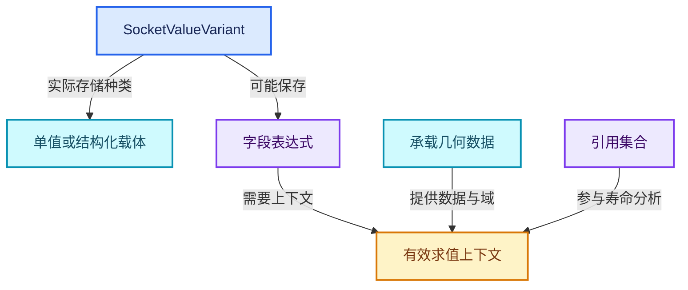

# RZ-07 状态值Field引用与内存寿命

[返回总入口](../README.md) · [本组导航](README.md) · [源码与版本](../00-课程指南/源码版本与覆盖索引.md)

> 源码基准提交：`e2e58a974edb3a5e949aa273d7ff940b5c5797c8`。具体文件内容以证据清单的 SHA-256 为准。

## 先回答一个具体问题

跨轮传递的是已经算出的数组，还是可以延迟求值的表达式与共享数据？

区分值载体、字段表达式、几何数据、引用集合与求值临时存储的寿命。

## 阅读前需要的概念

1. **`SocketValueVariant`**：保存节点间异构值及其实际存储类型的载体。

2. **`GField`**：在具体上下文中求值的泛型字段表达式。

3. **`Single`**：异构值的一种存储种类，表示单值形态。

4. **`List`**：异构值的一种列表存储形态，不能当作已逐点求值的字段。

5. **`Grid`**：体积网格相关存储形态，受相应构建能力约束。

6. **`GeometrySet`**：组合各类几何组件的值容器，其共享和写入协议需在类型层分析。

7. **`ReferenceSetIndex`**：引用寿命分析中引用集合的键，不是普通状态项下标。

8. **`RepeatEvalStorage`**：一次区域求值使用的图、执行器、索引和临时拥有资源。

## 本篇的机制地图



图中连线标签区分状态流、接口、拥有与观察关系；它不是线程调度记录，也不表示未声明的类型继承关系。

## 核心机制与设计推导

### 01 · 插槽颜色不确定存储形态

SocketValueVariant 的类型信息记录实际类型、转换函数与存储种类。

某个整数插槽可以承载单值，也可能涉及字段等结构，具体由声明和推断约束。

看到 Int 声明不能直接推导每个顶点都有一份已物化整数。

要看实际 carrier 与消费节点要求。

### 02 · 字段表达式与采样值

字段描述在几何上下文中求值的规则，几何值则承载具体数据。

把 Position 字段跨轮传递，不能自动解释为保存了每轮某个时刻所有点的位置快照。

若算法需要固定旧值，应在合适几何和域上显式捕获或存储，并随状态传递。

是否得到快照取决于实际节点和引用寿命。

### 03 · 引用集合负责可达性

区域构图会为必需引用集合建立额外接口，Repeat 包装器将这些集合连接到每轮体调用。

集合不是状态主值的替身，也不负责替算法选择属性域。

理解引用集合要同时追踪创建引用的节点、持有数据的值以及最终消费者。

只沿字段线看图可能遗漏承载匿名数据的几何。

### 04 · 状态值转交不等于深拷贝

主状态经 LF 链传递，具体复制移动与共享行为由值类型和执行器控制。

GeometrySet 等类型可以共享底层数据，写入时再依据其拥有协议处理。

不能从图上有 N 个调用点就断言几何数组必然被深拷贝 N 次。

也不能从共享推导体内写入永远零开销。

### 05 · eval_storage拥有动态结构

RepeatEvalStorage 聚合分配器、图、函数对象、包装器、执行器与轮次值数组。

graph_executor_storage 是执行器状态的指针，不是整个存储对象本身。

destruct_storage 先显式销毁执行器状态，再销毁 RepeatEvalStorage。

分配器释放原始内存与调用对象析构是两个需要配套考虑的责任。

### 06 · 默认值地址必须有效

图输入的 set_default_value 接收指向已有值的地址，因此轮次值不能放在构图循环内随即销毁的局部变量里。

源码选择存入 eval_storage.index_values，未使用索引与布尔默认值使用静态对象。

分析一条默认值边时，应同时标记地址拥有者和有效期。

不能只看数值正确就忽略悬空指针风险。

### 07 · 函数对象借用关系

区域包装器借用 btree、zone、zone_info 和 body_fn，体调用又借用函数对象。

它们不是每次执行都被复制进独立拥有容器。

构图 scope 和树缓存的寿命必须覆盖调用。

若修改缓存销毁策略，应先画出这条借用链再调整对象成员顺序。

### 08 · 数据增长比迭代数更重要

每轮把当前累计结果和它自身再次 Join，大小可以快速增长；每轮只更新固定点数的位置，则拓扑规模可能保持不变。

状态项数量不等于底层数据量。

衡量内存时应分别记录体调用结构、执行状态和几何数据峰值。

只监视最终输出大小也可能漏掉中间峰值。

## 小数据推演与反例实验

以下预期来自明确的输入和模型推导。未附 Blender 运行记录的案例属于待执行实验，不把手算结果当作后端实测。

### 实验 01 · 字段快照误解

**输入与操作**

把Position字段保存在状态，却继续修改承载几何

**预期与判据**

不能据此保证保存了原位置数组

**为什么这个案例有辨别力**

显式设计捕获时机和承载数据。

**执行时记录**

- 保留输入、轮数与状态项身份，避免只保存截图。
- 将实际观察和上述预期对照；不一致时先定位本实验涉及的边界。

### 实验 02 · 局部默认值

**输入与操作**

构图时用循环局部int地址作为所有轮次默认值

**预期与判据**

存在寿命与类型载体错误

**为什么这个案例有辨别力**

使用稳定的SocketValueVariant存储。

**执行时记录**

- 保留输入、轮数与状态项身份，避免只保存截图。
- 将实际观察和上述预期对照；不一致时先定位本实验涉及的边界。

### 实验 03 · 共享几何读取

**输入与操作**

多轮只读取同一外部几何

**预期与判据**

不能凭轮数断言发生同等次数深拷贝

**为什么这个案例有辨别力**

在具体类型层核查共享协议。

**执行时记录**

- 保留输入、轮数与状态项身份，避免只保存截图。
- 将实际观察和上述预期对照；不一致时先定位本实验涉及的边界。

### 实验 04 · 匿名属性遗漏

**输入与操作**

传出了字段但未传承载该属性的几何

**预期与判据**

字段引用并不足以保证可读值

**为什么这个案例有辨别力**

把引用寿命与几何传播一起分析。

**执行时记录**

- 保留输入、轮数与状态项身份，避免只保存截图。
- 将实际观察和上述预期对照；不一致时先定位本实验涉及的边界。

### 实验 05 · 指数累计

**输入与操作**

S_(i+1)=Join(S_i,S_i)，初始一份几何

**预期与判据**

理想规模为2^N份

**为什么这个案例有辨别力**

实例与实现化策略还会影响实际内存。

**执行时记录**

- 保留输入、轮数与状态项身份，避免只保存截图。
- 将实际观察和上述预期对照；不一致时先定位本实验涉及的边界。

### 实验 06 · 独立销毁

**输入与操作**

执行器storage含有需析构状态

**预期与判据**

必须先调用其destruct_storage

**为什么这个案例有辨别力**

释放分配器块不能替代非平凡对象析构。

**执行时记录**

- 保留输入、轮数与状态项身份，避免只保存截图。
- 将实际观察和上述预期对照；不一致时先定位本实验涉及的边界。

## 连续源码与定向阅读批注

以下代码逐字摘自本地源码，保留原始空行、注释和条件编译。
文件头中的许可证以源文件为准；本教程的说明文字不改变上游源码的授权。
区间摘录不保证从函数边界开始；标题明确标明连续区间时，应结合所链接源文件查看外围声明。
每个块的原始文件、起止行和哈希记入 `_evidence/source-excerpts.json`，校验脚本会逐块比较。

### 源码 01 · 异构值载体完整声明与模板实现

来源：[source/blender/blenkernel/BKE_node_socket_value.hh](../../../../../source/blender/blenkernel/BKE_node_socket_value.hh)，连续区间 L1—L434。

<!-- source:value:1:434 -->

```cpp
/* SPDX-FileCopyrightText: 2026 Blender Authors
 *
 * SPDX-License-Identifier: GPL-2.0-or-later */

#pragma once

#include <type_traits>
#include <utility>

#include "BLI_any.hh"
#include "BLI_cpp_type.hh"
#include "BLI_generic_pointer.hh"
#include "BLI_memory_counter_fwd.hh"

#include "BKE_list_fwd.hh"
#include "BKE_node_socket_value_fwd.hh"

namespace blender {

namespace fn {
class GField;
}
namespace bke::volume_grid {
class GVolumeGrid;
}

namespace bke {

class SocketValueVariant;

namespace detail {

enum class SocketValueStorageKind : uint8_t {
  Single,
  Field,
  List,
  Grid,
};

template<typename T>
inline constexpr SocketValueStorageKind socket_value_storage_kind =
    std::is_same_v<T, fn::GField> ? SocketValueStorageKind::Field :
    std::is_same_v<T, GListPtr>   ? SocketValueStorageKind::List :
#ifdef WITH_OPENVDB
    std::is_same_v<T, volume_grid::GVolumeGrid> ? SocketValueStorageKind::Grid :
#endif
                                                  SocketValueStorageKind::Single;

struct SocketValueVariantTypeInfo;
using SocketValueVariantAny = Any<SocketValueVariantTypeInfo, 32, 16>;

struct SocketValueVariantTypeInfo {
  const CPPType &type;
  bool (*convert_to)(const CPPType &dst_type, SocketValueVariantAny &value);
  bool (*is_interpretable_as)(const CPPType &dst_type, const SocketValueVariantAny &value);
  SocketValueStorageKind storage_kind;

  template<typename T> static SocketValueVariantTypeInfo get()
  {
    return SocketValueVariantTypeInfo{
        .type = *CPPType::get_pre_register<T>(),
        .convert_to = try_convert_fn<T>,
        .is_interpretable_as = is_interpretable_as_fn<T>,
        .storage_kind = socket_value_storage_kind<T>,
    };
  }

  template<typename T>
  static bool try_convert_fn(const CPPType &dst_type, SocketValueVariantAny &value);

  template<typename T>
  static bool is_interpretable_as_fn(const CPPType &dst_type, const SocketValueVariantAny &value);
};

template<typename T>
concept has_generic_type = requires { typename T::generic_type; };
template<typename T> struct storage_type {
  using type = T;
};
template<has_generic_type T> struct storage_type<T> {
  using type = typename T::generic_type;
};

inline const CPPType &to_storage_type(const CPPType &type)
{
  if (type.generic_type) {
    return *type.generic_type;
  }
  return type;  // NOLINT
}

};  // namespace detail

/**
 * #SocketValueVariant is used to pass data between nodes, e.g. by geometry nodes in the lazy
 * function evaluator. Specifically, it is the container type for the following socket types: bool,
 * float, integer, vector, rotation, color and string.
 *
 * The data passed through e.g. an integer socket can be a single value, a field or a grid (and in
 * the lists and images). Each of those is stored differently, but this container can store them
 * all.
 *
 * A key requirement for this container is that it is type-erased, i.e. not all code that uses it
 * has to include all the headers required to process the other storage types. This is achieved by
 * using the #Any type and by providing templated accessors that are implemented outside of a
 * header.
 *
 * This container is also able to do implicit conversions between the different types, with the
 * #ensure_type() methods.
 */
class SocketValueVariant {
 private:
  using Info = detail::SocketValueVariantTypeInfo;

  detail::SocketValueVariantAny value_;

  /**
   * Some types have a generic and compile-time version. For example, there is #GField and
   * #Field<T>. Those are expected to have the same memory layout so that references can be cast
   * between them. The #Any always stores the generic version if it exists.
   */
  template<typename T> using to_storage_type = typename detail::storage_type<T>::type;

 public:
  /**
   * Create an empty variant. This is not valid for any socket type yet.
   */
  SocketValueVariant() = default;

  /**
   * Create a variant based on the given value. This works for primitive types. For more complex
   * types, one can use the #from or #construct_in utilities.
   */
  template<typename T>
  explicit SocketValueVariant(T &&value)
      /* Required to avoid overriding the copy/move-constructors. */
    requires(std::is_trivial_v<std::decay_t<T>> || is_same_any_v<std::decay_t<T>, std::string>);

  /** Construct a #SocketValueVariant at the given pointer from the given value. */
  template<typename T> static SocketValueVariant &construct_in(void *ptr, T &&value);

  /** Create a new #SocketValueVariant from the given value. */
  template<typename T> static SocketValueVariant from(T &&value);

  /** Replace the stored value by constructing the given type in the storage. */
  template<typename T, typename... Args> T &emplace(Args &&...args);

  /**
   * Try to convert the stored value to the given type, returning null if the implicit conversion
   * does not exist.
   */
  template<typename T> T *try_convert();
  void *try_convert(const CPPType &type);

  /**
   * Try to convert the stored value to the given type, creating the type's default value if the
   * conversion does not exist.
   */
  template<typename T> T &ensure_type();
  void *ensure_type(const CPPType &type);

  /** Equivalent to calling #extract<T>() on a copy of this value. */
  template<typename T> T copy_as() const;

  /**
   * Get the stored value as a specific type. For convenience this allows accessing the stored type
   * as a different type, using implicit conversions as possible.
   *
   * This method may leave the variant empty, in a moved from state or unchanged. Therefore, this
   * should only be called once.
   */
  template<typename T> T extract();

  /**
   * Return a pointer to the stored value if it is of the given type. Otherwise return null.
   */
  template<typename T> const T *get_if() const;
  template<typename T> T *get_if();
  const void *get_if(const CPPType &type) const;
  void *get_if(const CPPType &type);

  /** Get the stored value as a #GPointer. */
  GPointer get() const;
  GMutablePointer get();

  /**
   * If true, the stored value cannot be converted to a single value without loss of information.
   */
  bool is_context_dependent_field() const;

  /**
   * If true, the value is stored as a #GField.
   */
  bool is_field() const;

  /**
   * The stored value is a volume grid.
   */
  bool is_volume_grid() const;

  /**
   * The stored value is a single value.
   */
  bool is_single() const;

  /**
   * The stored value is a list.
   */
  bool is_list() const;

  /** Also see GeomtrySet::ensure_owns_direct_data. */
  void ensure_owns_direct_data();
  bool owns_direct_data() const;

  /**
   * Replaces the stored value with a new uninitialized single value for the given socket type. The
   * caller is responsible to construct the value in the returned memory before it is used.
   */
  void *allocate_single(const CPPType &type);

  void count_memory(MemoryCounter &memory) const;

 private:
  template<typename T> T &init_default();
  void *init_default(const CPPType &type);

 public:
  template<typename T> static T &init_default(detail::SocketValueVariantAny &value);
  static void *init_default(const CPPType &type, detail::SocketValueVariantAny &value);
  static void *allocate(const CPPType &type, detail::SocketValueVariantAny &value);
};

template<typename T>
inline SocketValueVariant::SocketValueVariant(T &&value)
  requires(std::is_trivial_v<std::decay_t<T>> || is_same_any_v<std::decay_t<T>, std::string>)
    : value_(std::in_place_type<to_storage_type<std::decay_t<T>>>, std::forward<T>(value))
{
}

template<typename T>
inline SocketValueVariant &SocketValueVariant::construct_in(void *ptr, T &&value)
{
  SocketValueVariant *value_variant = new (ptr) SocketValueVariant();
  value_variant->emplace<std::decay_t<T>>(std::forward<T>(value));
  return *value_variant;
}

template<typename T> inline SocketValueVariant SocketValueVariant::from(T &&value)
{
  SocketValueVariant value_variant;
  value_variant.emplace<std::decay_t<T>>(std::forward<T>(value));
  return value_variant;
}

template<typename T, typename... Args> inline T &SocketValueVariant::emplace(Args &&...args)
{
  using StorageT = to_storage_type<T>;
  StorageT &value = value_.emplace<StorageT>(T(std::forward<Args>(args)...));
  static_assert(sizeof(T) == sizeof(StorageT));
  return reinterpret_cast<T &>(value);
}

template<typename T> inline T *SocketValueVariant::try_convert()
{
  using StorageT = to_storage_type<T>;
  if (!value_.has_value()) {
    return nullptr;
  }
  if (value_.is<StorageT>()) {
    if constexpr (detail::has_generic_type<T>) {
      /* Same generic storage (e.g. #GField), but the base type may still differ. */
      if (value_.extra_info().is_interpretable_as(CPPType::get<T>(), value_)) {
        return &reinterpret_cast<T &>(value_.get<StorageT>());
      }
    }
    else {
      return &reinterpret_cast<T &>(value_.get<StorageT>());
    }
  }
  const Info &info = value_.extra_info();
  const CPPType &requested_type = CPPType::get<T>();
  if (!info.convert_to(requested_type, value_)) {
    return nullptr;
  }
  BLI_assert(value_.extra_info().is_interpretable_as(requested_type, value_));
  return &reinterpret_cast<T &>(value_.get<StorageT>());
}

inline void *SocketValueVariant::try_convert(const CPPType &type)
{
  if (!value_.has_value()) {
    return nullptr;
  }
  const Info &info = value_.extra_info();
  if (info.type == type) {
    return value_.get();
  }
  if (!info.convert_to(type, value_)) {
    return nullptr;
  }
  return value_.get();
}

template<typename T> inline T &SocketValueVariant::ensure_type()
{
  if (T *ptr = this->try_convert<T>()) {
    return *ptr;
  }
  return this->init_default<T>();
}

inline void *SocketValueVariant::ensure_type(const CPPType &type)
{
  if (void *ptr = this->try_convert(type)) {
    return ptr;
  }
  return this->init_default(type);
}

template<typename T> inline T SocketValueVariant::copy_as() const
{
  if (const T *value = this->get_if<T>()) {
    return *value;
  }
  SocketValueVariant copy(*this);
  return copy.extract<T>();
}

template<typename T> inline const T *SocketValueVariant::get_if() const
{
  using StorageT = to_storage_type<T>;
  if (!value_.has_value()) {
    return nullptr;
  }
  /* Compare #Any type-info pointers directly instead of going through #CPPType. */
  if (!value_.is<StorageT>()) {
    return nullptr;
  }
  if constexpr (detail::has_generic_type<T>) {
    const Info &info = value_.extra_info();
    if (!info.is_interpretable_as(CPPType::get<T>(), value_)) {
      return nullptr;
    }
    return reinterpret_cast<const T *>(&value_.get<StorageT>());
  }
  else {
    return &value_.get<StorageT>();
  }
}

template<typename T> inline T *SocketValueVariant::get_if()
{
  return const_cast<T *>(std::as_const(*this).get_if<T>());
}

inline const void *SocketValueVariant::get_if(const CPPType &type) const
{
  if (!value_) {
    return nullptr;
  }
  const Info &info = value_.extra_info();
  if (info.type == type) {
    return value_.get();
  }
  if (info.is_interpretable_as(type, value_)) {
    return value_.get();
  }
  return nullptr;
}

inline void *SocketValueVariant::get_if(const CPPType &type)
{
  return const_cast<void *>(std::as_const(*this).get_if(type));
}

inline GPointer SocketValueVariant::get() const
{
  if (!value_) {
    return {};
  }
  const Info &info = value_.extra_info();
  return {info.type, value_.get()};
}

inline GMutablePointer SocketValueVariant::get()
{
  if (!value_) {
    return {};
  }
  const Info &info = value_.extra_info();
  return {info.type, value_.get()};
}

inline bool SocketValueVariant::is_single() const
{
  return value_.has_value() &&
         value_.extra_info().storage_kind == detail::SocketValueStorageKind::Single;
}

inline bool SocketValueVariant::is_field() const
{
  return value_.has_value() &&
         value_.extra_info().storage_kind == detail::SocketValueStorageKind::Field;
}

inline bool SocketValueVariant::is_list() const
{
  return value_.has_value() &&
         value_.extra_info().storage_kind == detail::SocketValueStorageKind::List;
}

inline bool SocketValueVariant::is_volume_grid() const
{
  return value_.has_value() &&
         value_.extra_info().storage_kind == detail::SocketValueStorageKind::Grid;
}

template<typename T> inline T &SocketValueVariant::init_default()
{
  return SocketValueVariant::init_default<T>(value_);
}

inline void *SocketValueVariant::init_default(const CPPType &type)
{
  return SocketValueVariant::init_default(type, value_);
}

template<typename T> inline T SocketValueVariant::extract()
{
  return std::move(this->ensure_type<T>());
}

}  // namespace bke
}  // namespace blender
```

**读完这段后回到本篇问题**

- 对照“插槽颜色不确定存储形态”，明确这段代码是定义存储、建立接口还是执行已有结构。
- 结合“字段快照误解”重画输入到输出的关系，区分源码事实与例子的推导。
- 保留失败分支、默认值、析构和条件编译；不要仅摘取看起来像主算法的几行。

### 源码 02 · 求值存储与显式析构

来源：[source/blender/nodes/intern/geometry_nodes_repeat_zone.cc](../../../../../source/blender/nodes/intern/geometry_nodes_repeat_zone.cc)，连续区间 L98—L195。

<!-- source:repeat:98:195 -->

```cpp
struct RepeatEvalStorage {
  LinearAllocator<> allocator;
  VectorSet<lf::FunctionNode *> lf_body_nodes;
  lf::Graph graph;
  std::optional<LazyFunctionForLogicalOr> or_function;
  std::optional<RepeatZoneSideEffectProvider> side_effect_provider;
  std::optional<RepeatBodyNodeExecuteWrapper> body_execute_wrapper;
  std::optional<lf::GraphExecutor> graph_executor;
  Array<SocketValueVariant> index_values;
  void *graph_executor_storage = nullptr;
  bool multi_threading_enabled = false;
  Vector<int> input_index_map;
  Vector<int> output_index_map;
};

class LazyFunctionForRepeatZone : public LazyFunction {
 private:
  const bNodeTree &btree_;
  const bke::bNodeTreeZone &zone_;
  const bNode &repeat_output_bnode_;
  const ZoneBuildInfo &zone_info_;
  const ZoneBodyFunction &body_fn_;

 public:
  LazyFunctionForRepeatZone(const bNodeTree &btree,
                            const bke::bNodeTreeZone &zone,
                            ZoneBuildInfo &zone_info,
                            const ZoneBodyFunction &body_fn)
      : btree_(btree),
        zone_(zone),
        repeat_output_bnode_(*zone.output_node()),
        zone_info_(zone_info),
        body_fn_(body_fn)
  {
    debug_name_ = "Repeat Zone";

    initialize_zone_wrapper(zone, zone_info, body_fn, true, inputs_, outputs_);
    /* Iterations input is always used. */
    inputs_[zone_info.indices.inputs.main[0]].usage = lf::ValueUsage::Used;
  }

  void *init_storage(LinearAllocator<> &allocator) const override
  {
    return allocator.construct<RepeatEvalStorage>().release();
  }

  void destruct_storage(void *storage) const override
  {
    RepeatEvalStorage *s = static_cast<RepeatEvalStorage *>(storage);
    if (s->graph_executor_storage) {
      s->graph_executor->destruct_storage(s->graph_executor_storage);
    }
    std::destroy_at(s);
  }

  void execute_impl(lf::Params &params, const lf::Context &context) const override
  {
    const ScopedNodeTimer node_timer{context, repeat_output_bnode_};

    auto &user_data = *static_cast<GeoNodesUserData *>(context.user_data);
    auto &local_user_data = *static_cast<GeoNodesLocalUserData *>(context.local_user_data);

    const NodeGeometryRepeatOutput &node_storage = *static_cast<const NodeGeometryRepeatOutput *>(
        repeat_output_bnode_.storage);
    RepeatEvalStorage &eval_storage = *static_cast<RepeatEvalStorage *>(context.storage);

    const int iterations_usage_index = zone_info_.indices.outputs.input_usages[0];
    if (!params.output_was_set(iterations_usage_index)) {
      /* The iterations input is always used. */
      params.set_output(iterations_usage_index, true);
    }

    if (!eval_storage.graph_executor) {
      /* Create the execution graph in the first evaluation. */
      this->initialize_execution_graph(
          params, eval_storage, node_storage, user_data, local_user_data);
    }

    /* Execute the graph for the repeat zone. */
    lf::RemappedParams eval_graph_params{*eval_storage.graph_executor,
                                         params,
                                         eval_storage.input_index_map,
                                         eval_storage.output_index_map,
                                         eval_storage.multi_threading_enabled};
    lf::Context eval_graph_context{
        eval_storage.graph_executor_storage, context.user_data, context.local_user_data};
    eval_storage.graph_executor->execute(eval_graph_params, eval_graph_context);
  }

  /**
   * Generate a lazy-function graph that contains the loop body (`body_fn_`) as many times
   * as there are iterations. Since this graph depends on the number of iterations, it can't be
   * reused in general. We could consider caching a version of this graph per number of iterations,
   * but right now that doesn't seem worth it. In practice, it takes much less time to create the
   * graph than to execute it (for intended use cases of this generic implementation, more special
   * case repeat loop evaluations could be implemented separately).
   */
  void initialize_execution_graph(lf::Params &params,
```

**读完这段后回到本篇问题**

- 对照“字段表达式与采样值”，明确这段代码是定义存储、建立接口还是执行已有结构。
- 结合“局部默认值”重画输入到输出的关系，区分源码事实与例子的推导。
- 保留失败分支、默认值、析构和条件编译；不要仅摘取看起来像主算法的几行。

### 源码 03 · 引用集合接口的创建

来源：[source/blender/nodes/intern/geometry_nodes_lazy_function.cc](../../../../../source/blender/nodes/intern/geometry_nodes_lazy_function.cc)，连续区间 L2380—L2490。

<!-- source:builder:2380:2490 -->

```cpp

    body_fn.function = &scope_.construct<lf::GraphExecutor>(lf_body_graph,
                                                            lf_body_inputs.as_span(),
                                                            lf_body_outputs.as_span(),
                                                            &logger,
                                                            side_effect_provider,
                                                            nullptr);

    lf_graph_info_->debug_zone_body_graphs.add(zone.output_node()->identifier, &lf_body_graph);

    // std::cout << "\n\n" << lf_body_graph.to_dot() << "\n\n";

    return body_fn;
  }

  void build_zone_border_links_inputs(const bNodeTreeZone &zone,
                                      lf::Graph &lf_graph,
                                      Vector<lf::GraphInputSocket *> &r_lf_graph_inputs,
                                      Vector<int> &r_indices)
  {
    for (const bNodeLink *border_link : zone.border_links) {
      r_indices.append(r_lf_graph_inputs.append_and_get_index(
          &lf_graph.add_input(CPPType::get<SocketValueVariant>(),
                              StringRef("Link from ") + border_link->fromsock->name)));
    }
  }

  void build_zone_border_link_input_usages(const bNodeTreeZone &zone,
                                           lf::Graph &lf_graph,
                                           Vector<lf::GraphOutputSocket *> &r_lf_graph_outputs,
                                           Vector<int> &r_indices)
  {
    for (const bNodeLink *border_link : zone.border_links) {
      r_indices.append(r_lf_graph_outputs.append_and_get_index(&lf_graph.add_output(
          CPPType::get<bool>(), StringRef("Usage: Link from ") + border_link->fromsock->name)));
    }
  }

  void build_reference_set_for_zone(BuildGraphParams &graph_params,
                                    Map<ReferenceSetIndex, lf::OutputSocket *> &lf_reference_sets)
  {
    const Vector<ReferenceSetIndex> all_required_reference_sets =
        this->find_all_required_reference_sets(graph_params.lf_reference_set_input_by_output,
                                               graph_params.lf_reference_set_inputs);

    auto add_reference_set_zone_input = [&](const ReferenceSetIndex reference_set_i) {
      lf::GraphInputSocket &lf_graph_input = graph_params.lf_graph.add_input(
          CPPType::get<GeometryNodesReferenceSet>(), "Reference Set");
      lf_reference_sets.add(reference_set_i, &lf_graph_input);
    };

    VectorSet<ReferenceSetIndex> input_reference_sets;
    for (const ReferenceSetIndex reference_set_i : all_required_reference_sets) {
      const ReferenceSetInfo &reference_set = reference_lifetimes_.reference_sets[reference_set_i];
      switch (reference_set.type) {
        case ReferenceSetType::GroupOutputData:
        case ReferenceSetType::GroupInputReferenceSet: {
          add_reference_set_zone_input(reference_set_i);
          break;
        }
        case ReferenceSetType::LocalReferenceSet:
        case ReferenceSetType::ClosureOutputData:
        case ReferenceSetType::ClosureInputReferenceSet: {
          const bNodeSocket &bsocket = *reference_set.socket;
          if (lf::OutputSocket *lf_socket = graph_params.lf_output_by_bsocket.lookup_default(
                  &bsocket, nullptr))
          {
            lf::OutputSocket *lf_usage_socket = graph_params.usage_by_bsocket.lookup_default(
                &bsocket, nullptr);
            lf::OutputSocket &lf_reference_set_socket = this->get_extracted_reference_set(
                *lf_socket, lf_usage_socket, graph_params);
            lf_reference_sets.add(reference_set_i, &lf_reference_set_socket);
          }
          else {
            /* The reference was not created in the zone, so it needs to come from the input. */
            add_reference_set_zone_input(reference_set_i);
          }
          break;
        }
      }
    }
  }

  /**
   * Build the graph that contains all nodes that are not contained in any zone. This graph is
   * called when this geometry nodes node group is evaluated.
   */
  void build_root_graph()
  {
    lf::Graph &lf_graph = lf_graph_info_->graph;

    this->build_main_group_inputs(lf_graph);
    if (btree_.group_output_node() == nullptr) {
      this->build_fallback_group_outputs(lf_graph);
    }

    for (const bNodeTreeInterfaceSocket *interface_input : btree_.interface_inputs()) {
      lf::GraphOutputSocket &lf_socket = lf_graph.add_output(
          CPPType::get<bool>(), StringRef("Usage: ") + interface_input->name());
      group_input_usage_sockets_.append(&lf_socket);
    }

    Vector<lf::GraphInputSocket *> lf_output_usages;
    for (const bNodeTreeInterfaceSocket *interface_output : btree_.interface_outputs()) {
      lf::GraphInputSocket &lf_socket = lf_graph.add_input(
          CPPType::get<bool>(), StringRef("Usage: ") + interface_output->name());
      group_output_used_sockets_.append(&lf_socket);
      lf_output_usages.append(&lf_socket);
    }

    BuildGraphParams &graph_params = root_graph_build_params_.emplace(lf_graph);
```

**读完这段后回到本篇问题**

- 对照“引用集合负责可达性”，明确这段代码是定义存储、建立接口还是执行已有结构。
- 结合“共享几何读取”重画输入到输出的关系，区分源码事实与例子的推导。
- 保留失败分支、默认值、析构和条件编译；不要仅摘取看起来像主算法的几行。

### 源码 04 · 值、上下文及storage协议

来源：[source/blender/functions/FN_lazy_function.hh](../../../../../source/blender/functions/FN_lazy_function.hh)，连续区间 L1—L479。

<!-- source:lf:1:479 -->

```cpp
/* SPDX-FileCopyrightText: 2023 Blender Authors
 *
 * SPDX-License-Identifier: GPL-2.0-or-later */

#pragma once

/** \file
 * \ingroup fn
 *
 * A `LazyFunction` encapsulates a computation which has inputs, outputs and potentially side
 * effects. Most importantly, a `LazyFunction` supports laziness in its inputs and outputs:
 * - Only outputs that are actually used have to be computed.
 * - Inputs can be requested lazily based on which outputs are used or what side effects the
 *   function has.
 *
 * A lazy-function that uses laziness may be executed more than once. The most common example is
 * the geometry nodes switch node. Depending on a condition input, it decides which one of the
 * other inputs is actually used. From the perspective of the switch node, its execution works as
 * follows:
 * 1. The switch node is first executed. It sees that the output is used. Now it requests the
 *    condition input from the caller and exits.
 * 2. Once the caller is able to provide the condition input the switch node is executed again.
 *    This time it retrieves the condition and requests one of the other inputs. Then the node
 *    exits again, giving back control to the caller.
 * 3. When the caller computed the second requested input the switch node executes a last time.
 *    This time it retrieves the new input and forwards it to the output.
 *
 * In some sense, a lazy-function can be thought of like a state machine. Every time it is
 * executed, it advances its state until all required outputs are ready.
 *
 * The lazy-function interface is designed to support composition of many such functions into a new
 * lazy-functions, all while keeping the laziness working. For example, in geometry nodes a switch
 * node in a node group should still be able to decide whether a node in the parent group will be
 * executed or not. This is essential to avoid doing unnecessary work.
 *
 * The lazy-function system consists of multiple core components:
 * - The interface of a lazy-function itself including its calling convention.
 * - A graph data structure that allows composing many lazy-functions by connecting their inputs
 *   and outputs.
 * - An executor that allows multi-threaded execution or such a graph.
 */

#include "BLI_cpp_type.hh"
#include "BLI_function_ref.hh"
#include "BLI_linear_allocator.hh"
#include "BLI_vector.hh"

#include "PRF_profile.hh"

#include "FN_user_data.hh"

#ifndef NDEBUG
#  include <atomic>
#  include <thread>
#  define FN_LAZY_FUNCTION_DEBUG_THREADS
#endif

namespace blender {
namespace fn::lazy_function {

enum class ValueUsage : uint8_t {
  /**
   * The value is definitely used and therefore has to be computed.
   */
  Used,
  /**
   * It's unknown whether this value will be used or not. Computing it is ok but the result may be
   * discarded.
   */
  Maybe,
  /**
   * The value will definitely not be used. It can still be computed but the result will be
   * discarded in all cases.
   */
  Unused,
};

class LazyFunction;

/**
 * Passed to the lazy-function when it is executed.
 */
struct Context {
  /**
   * If the lazy-function has some state (which only makes sense when it is executed more than once
   * to finish its job), the state is stored here. This points to memory returned from
   * #LazyFunction::init_storage.
   */
  void *storage;
  /**
   * Custom user data that can be used in the function.
   */
  UserData *user_data;
  /**
   * Custom user data that is local to the thread that executes the lazy-function.
   */
  LocalUserData *local_user_data;

  Context(void *storage, UserData *user_data, LocalUserData *local_user_data)
      : storage(storage), user_data(user_data), local_user_data(local_user_data)
  {
  }
};

/**
 * Defines the calling convention for a lazy-function. During execution, a lazy-function retrieves
 * its inputs and sets the outputs through #Params.
 */
class Params {
 public:
  /**
   * The lazy-function this #Params has been prepared for.
   */
  const LazyFunction &fn_;
#ifdef FN_LAZY_FUNCTION_DEBUG_THREADS
  std::thread::id main_thread_id_;
  std::atomic<bool> allow_multi_threading_;
#endif

  Params(const LazyFunction &fn, bool allow_multi_threading_initially);

  /**
   * Get a pointer to an input value if the value is available already. Otherwise null is returned.
   *
   * The #LazyFunction must leave returned object in an initialized state, but can move from it.
   */
  void *try_get_input_data_ptr(int index) const;

  /**
   * Same as #try_get_input_data_ptr, but if the data is not yet available, request it. This makes
   * sure that the data will be available in a future execution of the #LazyFunction.
   */
  void *try_get_input_data_ptr_or_request(int index);

  /**
   * Get a pointer to where the output value should be stored.
   * The value at the pointer is in an uninitialized state at first.
   * The #LazyFunction is responsible for initializing the value.
   * After the output has been initialized to its final value, #output_set has to be called.
   */
  void *get_output_data_ptr(int index);

  /**
   * Call this after the output value is initialized. After this is called, the value must not be
   * touched anymore. It may be moved or destructed immediately.
   */
  void output_set(int index);

  /**
   * Allows the #LazyFunction to check whether an output was computed already without keeping
   * track of it itself.
   */
  bool output_was_set(int index) const;

  /**
   * Can be used to detect which outputs have to be computed.
   */
  ValueUsage get_output_usage(int index) const;

  /**
   * Tell the caller of the #LazyFunction that a specific input will definitely not be used.
   * Only an input that was not #ValueUsage::Used can become unused.
   */
  void set_input_unused(int index);

  /**
   * Typed utility methods that wrap the methods above.
   */
  template<typename T> T extract_input(int index);
  template<typename T> T &get_input(int index) const;
  template<typename T> T *try_get_input_data_ptr(int index) const;
  template<typename T> T *try_get_input_data_ptr_or_request(int index);
  template<typename T> void set_output(int index, T &&value);

  /**
   * Returns true when the lazy-function is now allowed to use multi-threading when interacting
   * with this #Params. That means, it is allowed to call non-const methods from different threads.
   */
  bool try_enable_multi_threading();

 private:
  void assert_valid_thread() const;

  /**
   * Methods that need to be implemented by subclasses. Those are separate from the non-virtual
   * methods above to make it easy to insert additional debugging logic on top of the
   * implementations.
   */
  virtual void *try_get_input_data_ptr_impl(int index) const = 0;
  virtual void *try_get_input_data_ptr_or_request_impl(int index) = 0;
  virtual void *get_output_data_ptr_impl(int index) = 0;
  virtual void output_set_impl(int index) = 0;
  virtual bool output_was_set_impl(int index) const = 0;
  virtual ValueUsage get_output_usage_impl(int index) const = 0;
  virtual void set_input_unused_impl(int index) = 0;
  virtual bool try_enable_multi_threading_impl();
};

/**
 * Describes an input of a #LazyFunction.
 */
struct Input {
  /**
   * Name used for debugging purposes. The string has to be static or has to be owned by something
   * else.
   */
  const char *debug_name;
  /**
   * Data type of this input.
   */
  const CPPType *type;
  /**
   * Can be used to indicate a caller or this function if this input is used statically before
   * executing it the first time. This is technically not needed but can improve efficiency because
   * a round-trip through the `execute` method can be avoided.
   *
   * When this is #ValueUsage::Used, the caller has to ensure that the input is definitely
   * available when the #execute method is first called. The #execute method does not have to check
   * whether the value is actually available.
   */
  ValueUsage usage;

  Input(const char *debug_name, const CPPType &type, const ValueUsage usage = ValueUsage::Used)
      : debug_name(debug_name), type(&type), usage(usage)
  {
  }
};

struct Output {
  /**
   * Name used for debugging purposes. The string has to be static or has to be owned by something
   * else.
   */
  const char *debug_name;
  /**
   * Data type of this output.
   */
  const CPPType *type = nullptr;

  Output(const char *debug_name, const CPPType &type) : debug_name(debug_name), type(&type) {}
};

/**
 * A function that can compute outputs and request inputs lazily. For more details see the comment
 * at the top of the file.
 */
class LazyFunction {
 protected:
  const char *debug_name_ = "unknown";
  Vector<Input> inputs_;
  Vector<Output> outputs_;
  /**
   * Allow executing the function even if previously requested values are not yet available.
   */
  bool allow_missing_requested_inputs_ = false;

 public:
  virtual ~LazyFunction() = default;

  /**
   * Get a name of the function or an input or output. This is mainly used for debugging.
   * These are virtual functions because the names are often not used outside of debugging
   * workflows. This way the names are only generated when they are actually needed.
   */
  virtual std::string name() const;
  virtual std::string input_name(int index) const;
  virtual std::string output_name(int index) const;

  /**
   * Allocates storage for this function. The storage will be passed to every call to #execute.
   * If the function does not keep track of any state, this does not have to be implemented.
   */
  virtual void *init_storage(LinearAllocator<> &allocator) const;

  /**
   * Destruct the storage created in #init_storage.
   */
  virtual void destruct_storage(void *storage) const;

  /**
   * Calls `fn` with the input indices that the given `output_index` may depend on. By default
   * every output depends on every input.
   */
  virtual void possible_output_dependencies(int output_index,
                                            FunctionRef<void(Span<int>)> fn) const;

  /**
   * Inputs of the function.
   */
  Span<Input> inputs() const;
  /**
   * Outputs of the function.
   */
  Span<Output> outputs() const;

  /**
   * During execution the function retrieves inputs and sets outputs in #params. For some
   * functions, this method is called more than once. After execution, the function either has
   * computed all required outputs or is waiting for more inputs.
   */
  void execute(Params &params, const Context &context) const;

  /**
   * Utility to check that the guarantee by #Input::usage is followed.
   */
  bool always_used_inputs_available(const Params &params) const;

  /**
   * If true, the function can be executed even when some requested inputs are not available yet.
   * This allows the function to make some progress and maybe to compute some outputs that are
   * passed into this function again (lazy-function graphs may contain cycles as long as there
   * aren't actually data dependencies).
   */
  bool allow_missing_requested_inputs() const
  {
    return allow_missing_requested_inputs_;
  }

 private:
  /**
   * Needs to be implemented by subclasses. This is separate from #execute so that additional
   * debugging logic can be implemented in #execute.
   */
  virtual void execute_impl(Params &params, const Context &context) const = 0;
};

/* -------------------------------------------------------------------- */
/** \name #LazyFunction Inline Methods
 * \{ */

inline Span<Input> LazyFunction::inputs() const
{
  return inputs_;
}

inline Span<Output> LazyFunction::outputs() const
{
  return outputs_;
}

inline void LazyFunction::execute(Params &params, const Context &context) const
{
  PRF_scope_with_name("LazyFunction", ProfileCategory::Default);
  PRF_scope_set_dynamic_name("%s", debug_name_);
  BLI_assert(this->always_used_inputs_available(params));
  this->execute_impl(params, context);
}

/** \} */

/* -------------------------------------------------------------------- */
/** \name #Params Inline Methods
 * \{ */

inline Params::Params(const LazyFunction &fn,
                      [[maybe_unused]] bool allow_multi_threading_initially)
    : fn_(fn)
#ifdef FN_LAZY_FUNCTION_DEBUG_THREADS
      ,
      main_thread_id_(std::this_thread::get_id()),
      allow_multi_threading_(allow_multi_threading_initially)
#endif
{
}

inline void *Params::try_get_input_data_ptr(const int index) const
{
  BLI_assert(index >= 0 && index < fn_.inputs().size());
  return this->try_get_input_data_ptr_impl(index);
}

inline void *Params::try_get_input_data_ptr_or_request(const int index)
{
  BLI_assert(index >= 0 && index < fn_.inputs().size());
  this->assert_valid_thread();
  return this->try_get_input_data_ptr_or_request_impl(index);
}

inline void *Params::get_output_data_ptr(const int index)
{
  BLI_assert(index >= 0 && index < fn_.outputs().size());
  this->assert_valid_thread();
  return this->get_output_data_ptr_impl(index);
}

inline void Params::output_set(const int index)
{
  BLI_assert(index >= 0 && index < fn_.outputs().size());
  this->assert_valid_thread();
  this->output_set_impl(index);
}

inline bool Params::output_was_set(const int index) const
{
  BLI_assert(index >= 0 && index < fn_.outputs().size());
  return this->output_was_set_impl(index);
}

inline ValueUsage Params::get_output_usage(const int index) const
{
  BLI_assert(index >= 0 && index < fn_.outputs().size());
  return this->get_output_usage_impl(index);
}

inline void Params::set_input_unused(const int index)
{
  BLI_assert(index >= 0 && index < fn_.inputs().size());
  this->assert_valid_thread();
  this->set_input_unused_impl(index);
}

template<typename T> inline T Params::extract_input(const int index)
{
  this->assert_valid_thread();
  void *data = this->try_get_input_data_ptr(index);
  BLI_assert(data != nullptr);
  T return_value = std::move(*static_cast<T *>(data));
  return return_value;
}

template<typename T> inline T &Params::get_input(const int index) const
{
  void *data = this->try_get_input_data_ptr(index);
  BLI_assert(data != nullptr);
  return *static_cast<T *>(data);
}

template<typename T> inline T *Params::try_get_input_data_ptr(const int index) const
{
  this->assert_valid_thread();
  return static_cast<T *>(this->try_get_input_data_ptr(index));
}

template<typename T> inline T *Params::try_get_input_data_ptr_or_request(const int index)
{
  this->assert_valid_thread();
  return static_cast<T *>(this->try_get_input_data_ptr_or_request(index));
}

template<typename T> inline void Params::set_output(const int index, T &&value)
{
  using DecayT = std::decay_t<T>;
  this->assert_valid_thread();
  void *data = this->get_output_data_ptr(index);
  new (data) DecayT(std::forward<T>(value));
  this->output_set(index);
}

inline bool Params::try_enable_multi_threading()
{
  this->assert_valid_thread();
  const bool success = this->try_enable_multi_threading_impl();
#ifdef FN_LAZY_FUNCTION_DEBUG_THREADS
  if (success) {
    allow_multi_threading_ = true;
  }
#endif
  return success;
}

inline void Params::assert_valid_thread() const
{
#ifdef FN_LAZY_FUNCTION_DEBUG_THREADS
  if (allow_multi_threading_) {
    return;
  }
  if (main_thread_id_ != std::this_thread::get_id()) {
    BLI_assert_unreachable();
  }
#endif
}

/** \} */

}  // namespace fn::lazy_function

namespace lf = fn::lazy_function;

}  // namespace blender
```

**读完这段后回到本篇问题**

- 对照“状态值转交不等于深拷贝”，明确这段代码是定义存储、建立接口还是执行已有结构。
- 结合“匿名属性遗漏”重画输入到输出的关系，区分源码事实与例子的推导。
- 保留失败分支、默认值、析构和条件编译；不要仅摘取看起来像主算法的几行。

## 练习与参考答案

### 练习 01 · 解释“插槽颜色不确定存储形态”

**题目**

不看代码，说明“插槽颜色不确定存储形态”解决的具体问题，并给出一个会违背其约束的错误实现。

**参考答案的核心**

SocketValueVariant 的类型信息记录实际类型、转换函数与存储种类。

**验收追问**

要看实际 carrier 与消费节点要求。

**自查方法**

回到上面的源码区间和本篇实验，找出支持该回答的实际字段、调用或分支；若答案是设计推论，应明确写为推论。

### 练习 02 · 解释“字段表达式与采样值”

**题目**

不看代码，说明“字段表达式与采样值”解决的具体问题，并给出一个会违背其约束的错误实现。

**参考答案的核心**

字段描述在几何上下文中求值的规则，几何值则承载具体数据。

**验收追问**

是否得到快照取决于实际节点和引用寿命。

**自查方法**

回到上面的源码区间和本篇实验，找出支持该回答的实际字段、调用或分支；若答案是设计推论，应明确写为推论。

### 练习 03 · 解释“引用集合负责可达性”

**题目**

不看代码，说明“引用集合负责可达性”解决的具体问题，并给出一个会违背其约束的错误实现。

**参考答案的核心**

区域构图会为必需引用集合建立额外接口，Repeat 包装器将这些集合连接到每轮体调用。

**验收追问**

只沿字段线看图可能遗漏承载匿名数据的几何。

**自查方法**

回到上面的源码区间和本篇实验，找出支持该回答的实际字段、调用或分支；若答案是设计推论，应明确写为推论。

### 练习 04 · 解释“状态值转交不等于深拷贝”

**题目**

不看代码，说明“状态值转交不等于深拷贝”解决的具体问题，并给出一个会违背其约束的错误实现。

**参考答案的核心**

主状态经 LF 链传递，具体复制移动与共享行为由值类型和执行器控制。

**验收追问**

也不能从共享推导体内写入永远零开销。

**自查方法**

回到上面的源码区间和本篇实验，找出支持该回答的实际字段、调用或分支；若答案是设计推论，应明确写为推论。

### 练习 05 · 解释“eval_storage拥有动态结构”

**题目**

不看代码，说明“eval_storage拥有动态结构”解决的具体问题，并给出一个会违背其约束的错误实现。

**参考答案的核心**

RepeatEvalStorage 聚合分配器、图、函数对象、包装器、执行器与轮次值数组。

**验收追问**

分配器释放原始内存与调用对象析构是两个需要配套考虑的责任。

**自查方法**

回到上面的源码区间和本篇实验，找出支持该回答的实际字段、调用或分支；若答案是设计推论，应明确写为推论。

### 练习 06 · 解释“默认值地址必须有效”

**题目**

不看代码，说明“默认值地址必须有效”解决的具体问题，并给出一个会违背其约束的错误实现。

**参考答案的核心**

图输入的 set_default_value 接收指向已有值的地址，因此轮次值不能放在构图循环内随即销毁的局部变量里。

**验收追问**

不能只看数值正确就忽略悬空指针风险。

**自查方法**

回到上面的源码区间和本篇实验，找出支持该回答的实际字段、调用或分支；若答案是设计推论，应明确写为推论。

### 练习 07 · 解释“函数对象借用关系”

**题目**

不看代码，说明“函数对象借用关系”解决的具体问题，并给出一个会违背其约束的错误实现。

**参考答案的核心**

区域包装器借用 btree、zone、zone_info 和 body_fn，体调用又借用函数对象。

**验收追问**

若修改缓存销毁策略，应先画出这条借用链再调整对象成员顺序。

**自查方法**

回到上面的源码区间和本篇实验，找出支持该回答的实际字段、调用或分支；若答案是设计推论，应明确写为推论。

### 练习 08 · 解释“数据增长比迭代数更重要”

**题目**

不看代码，说明“数据增长比迭代数更重要”解决的具体问题，并给出一个会违背其约束的错误实现。

**参考答案的核心**

每轮把当前累计结果和它自身再次 Join，大小可以快速增长；每轮只更新固定点数的位置，则拓扑规模可能保持不变。

**验收追问**

只监视最终输出大小也可能漏掉中间峰值。

**自查方法**

回到上面的源码区间和本篇实验，找出支持该回答的实际字段、调用或分支；若答案是设计推论，应明确写为推论。

## 本篇完成标准

- 能直接回答：跨轮传递的是已经算出的数组，还是可以延迟求值的表达式与共享数据？
- 能解释本篇目标：区分值载体、字段表达式、几何数据、引用集合与求值临时存储的寿命。
- 能手算至少一个正轮数案例和一个边界案例，并说明各自验证的错误类型。
- 能沿源码链接区分配置、构图、求值和观察各阶段。
- 能陈述本篇实际证据的范围，不把静态摘录核对写成后端运行通过。

## 继续阅读

- 上一篇：[06-需求传播跨界输入与参数重映射](../02-构图与按需执行/06-需求传播跨界输入与参数重映射.md)
- 下一篇：[08-轮次上下文日志Viewer与副作用](../03-值寿命与观察机制/08-轮次上下文日志Viewer与副作用.md)
- [练习脚本与运行范围](../示例/README.md)
- [验收记录与尚未执行的集成检查](../00-课程指南/验收报告.md)
