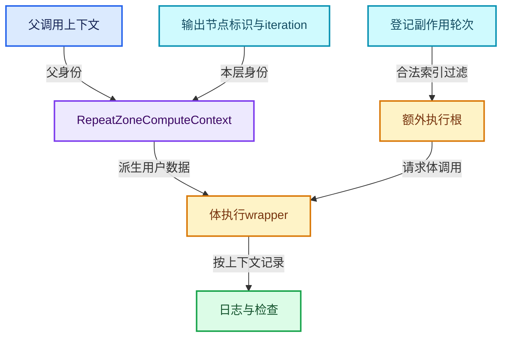

# RZ-08 轮次上下文日志Viewer与副作用

[返回总入口](../README.md) · [本组导航](README.md) · [源码与版本](../00-课程指南/源码版本与覆盖索引.md)

> 源码基准提交：`e2e58a974edb3a5e949aa273d7ff940b5c5797c8`。具体文件内容以证据清单的 SHA-256 为准。

## 先回答一个具体问题

同一个体节点运行多轮，Viewer和日志如何知道当前观察的是哪一轮？

理解轮次身份、父上下文、体调用包装、检查索引和副作用需求根。

## 阅读前需要的概念

1. **`RepeatZoneComputeContext`**：由父上下文、区域输出节点和轮次建立调用身份。

2. **`ComputeContextHash`**：上下文路径的哈希表示，用于按调用区分日志等数据。

3. **`inspection_index`**：检查功能选择的轮次，不改变实际请求迭代次数。

4. **`RepeatBodyNodeExecuteWrapper`**：执行体调用前派生轮次上下文的轻量包装器。

5. **`SideEffectProvider`**：向执行器补充需要执行的副作用节点根。

6. **`verbose_log`**：是否在当前上下文记录详细日志的控制信息。

7. **`GeoNodesUserData`**：携带调用上下文、调用数据及日志选择等信息的用户数据。

8. **`NodeTreeLogger`**：在具体树调用上下文中记录节点值、警告和执行信息。

## 本篇的机制地图



图中连线标签区分状态流、接口、拥有与观察关系；它不是线程调度记录，也不表示未声明的类型继承关系。

## 核心机制与设计推导

### 01 · 节点身份不足以区分调用

体内编辑节点的 identifier 在多轮中不变，所以日志需要额外的调用上下文。

RepeatZoneComputeContext 将父上下文、输出边界节点标识和 iteration 共同纳入哈希计算。

不同外层调用中的内层第零轮因此能形成不同上下文。

轮次数字相同不表示同一次程序调用。

### 02 · wrapper反查体调用位置

RepeatBodyNodeExecuteWrapper 根据 FunctionNode 在 lf_body_nodes 中的位置取得 iteration。

对于不是体节点的辅助节点，直接使用原上下文执行。

这样 OR 等辅助计算不会被错误地赋予某个体轮次身份。

包装器改变的是调用上下文，并不改变体函数的数学结果定义。

### 03 · 用户数据按调用派生

体执行先从外层 GeoNodesUserData 建立局部副本，再替换 compute_context 并重新决定 verbose_log。

随后创建本地用户数据并构造新的 lf::Context。

storage 沿当前执行器提供的上下文继续传入，不是随手新建一个全局日志状态。

每条指针的作用域都应和同步调用范围一起理解。

### 04 · 栈上上下文的边界

body_compute_context 和 body_user_data 是 execute_node 内局部对象。

当前调用在它们存活时执行 fn.execute，执行器协议负责相应工作。

若今后把这些指针捕获到脱离调用寿命的异步任务，就必须重新设计拥有方式。

不能仅通过把 fn.execute 移入后台队列完成异步化。

### 05 · 检查索引不是循环次数

inspection_index 选择 Viewer 或插槽检查等观察功能所用的轮次。

改变它不会把 N 次迭代变成 inspection_index 次迭代。

当前包装器仅在 inspection_index>0 且超出轮数时追加信息级提示。

因此检查索引零与零轮组合的提示行为不能按普通范围检查直觉推断。

### 06 · 副作用另有需求入口

正常结果未被使用时，按需执行可能不访问某些体调用。

RepeatZoneSideEffectProvider 从调用数据取得指定上下文和区域下需要副作用的轮次，再返回对应体节点。

返回节点成为额外执行需求根。

这里描述的是执行器显式登记的副作用，不能推导任意节点隐式产生外部行为。

### 07 · 越界副作用轮次会过滤

提供者遍历登记轮次，只接受大于等于零且小于体节点数量的索引。

零轮图没有合法体节点可返回。

这个过滤与检查索引提示是两条不同逻辑。

调试时应分别记录观察选择与 side_effect_nodes 中实际登记的内容。

### 08 · 日志分层与性能解释

体图可以记录节点值与执行事件，外层 ScopedNodeTimer 以 Repeat Output 作为区域计时对象。

嵌套日志不能在未理解计时口径时简单相加当作总墙钟时间。

verbose_log 还可能受上下文选择控制，缺少某条详细日志不直接证明体没有执行。

需要结合需求根、最终输出和实际日志开关判断。

## 小数据推演与反例实验

以下预期来自明确的输入和模型推导。未附 Blender 运行记录的案例属于待执行实验，不把手算结果当作后端实测。

### 实验 01 · 同节点不同轮

**输入与操作**

同一数学节点分别运行在轮0和轮1

**预期与判据**

编辑identifier相同，上下文不同

**为什么这个案例有辨别力**

日志键需要完整调用身份。

**执行时记录**

- 保留输入、轮数与状态项身份，避免只保存截图。
- 将实际观察和上述预期对照；不一致时先定位本实验涉及的边界。

### 实验 02 · 嵌套同轮次

**输入与操作**

外层轮0与轮1都调用内层轮0

**预期与判据**

内层两个轮0不应合并为同一记录

**为什么这个案例有辨别力**

父上下文参与身份。

**执行时记录**

- 保留输入、轮数与状态项身份，避免只保存截图。
- 将实际观察和上述预期对照；不一致时先定位本实验涉及的边界。

### 实验 03 · 只观察末轮

**输入与操作**

N=4，inspection_index=3

**预期与判据**

观察第四次体调用

**为什么这个案例有辨别力**

这仍然是从0计数。

**执行时记录**

- 保留输入、轮数与状态项身份，避免只保存截图。
- 将实际观察和上述预期对照；不一致时先定位本实验涉及的边界。

### 实验 04 · 检查越界

**输入与操作**

N=2，inspection_index=7

**预期与判据**

追加越界信息提示

**为什么这个案例有辨别力**

不应声称执行器会为观察自动新增五轮。

**执行时记录**

- 保留输入、轮数与状态项身份，避免只保存截图。
- 将实际观察和上述预期对照；不一致时先定位本实验涉及的边界。

### 实验 05 · 无结果但有Viewer需求

**输入与操作**

体结果外部未用，某合法轮次被登记副作用

**预期与判据**

对应体节点仍成为执行根

**为什么这个案例有辨别力**

需求图不能只从最终数值输出倒推。

**执行时记录**

- 保留输入、轮数与状态项身份，避免只保存截图。
- 将实际观察和上述预期对照；不一致时先定位本实验涉及的边界。

### 实验 06 · 副作用索引非法

**输入与操作**

登记-1、0、99，而体只有2轮

**预期与判据**

提供者只返回轮0节点

**为什么这个案例有辨别力**

过滤逻辑不负责解释为何登记错误。

**执行时记录**

- 保留输入、轮数与状态项身份，避免只保存截图。
- 将实际观察和上述预期对照；不一致时先定位本实验涉及的边界。

## 连续源码与定向阅读批注

以下代码逐字摘自本地源码，保留原始空行、注释和条件编译。
文件头中的许可证以源文件为准；本教程的说明文字不改变上游源码的授权。
区间摘录不保证从函数边界开始；标题明确标明连续区间时，应结合所链接源文件查看外围声明。
每个块的原始文件、起止行和哈希记入 `_evidence/source-excerpts.json`，校验脚本会逐块比较。

### 源码 01 · 体调用包装器与副作用提供者

来源：[source/blender/nodes/intern/geometry_nodes_repeat_zone.cc](../../../../../source/blender/nodes/intern/geometry_nodes_repeat_zone.cc)，连续区间 L1—L110。

<!-- source:repeat:1:110 -->

```cpp
/* SPDX-FileCopyrightText: 2024 Blender Authors
 *
 * SPDX-License-Identifier: GPL-2.0-or-later */

/** \file
 * \ingroup nodes
 */

#include "NOD_geometry_nodes_lazy_function.hh"

#include "BKE_compute_contexts.hh"
#include "BKE_node_runtime.hh"
#include "BKE_node_socket_value.hh"

#include "FN_lazy_function_execute.hh"

#include "BLT_translation.hh"

#include "BLI_array_utils.hh"

#include "DEG_depsgraph_query.hh"

#include "FN_lazy_function_graph_executor.hh"

namespace blender::nodes {

using bke::SocketValueVariant;

/**
 * Wraps the execution of a repeat loop body. The purpose is to setup the correct #ComputeContext
 * inside of the loop body. This is necessary to support correct logging inside of a repeat zone.
 * An alternative would be to use a separate `LazyFunction` for every iteration, but that would
 * have higher overhead.
 */
class RepeatBodyNodeExecuteWrapper : public lf::GraphExecutorNodeExecuteWrapper {
 public:
  const bNode *repeat_output_bnode_ = nullptr;
  VectorSet<lf::FunctionNode *> *lf_body_nodes_ = nullptr;

  void execute_node(const lf::FunctionNode &node,
                    lf::Params &params,
                    const lf::Context &context) const override
  {
    GeoNodesUserData &user_data = *static_cast<GeoNodesUserData *>(context.user_data);
    const int iteration = lf_body_nodes_->index_of_try(const_cast<lf::FunctionNode *>(&node));
    const LazyFunction &fn = node.function();
    if (iteration == -1) {
      /* The node is not a loop body node, just execute it normally. */
      fn.execute(params, context);
      return;
    }

    /* Setup context for the loop body evaluation. */
    bke::RepeatZoneComputeContext body_compute_context{
        user_data.compute_context, *repeat_output_bnode_, iteration};
    GeoNodesUserData body_user_data = user_data;
    body_user_data.compute_context = &body_compute_context;
    body_user_data.verbose_log = should_log_verbose_in_context(user_data,
                                                               body_compute_context.hash());

    GeoNodesLocalUserData body_local_user_data{body_user_data};
    lf::Context body_context{context.storage, &body_user_data, &body_local_user_data};
    fn.execute(params, body_context);
  }
};

/**
 * Knows which iterations of the loop evaluation have side effects.
 */
class RepeatZoneSideEffectProvider : public lf::GraphExecutorSideEffectProvider {
 public:
  const bNode *repeat_output_bnode_ = nullptr;
  Span<lf::FunctionNode *> lf_body_nodes_;

  Vector<const lf::FunctionNode *> get_nodes_with_side_effects(
      const lf::Context &context) const override
  {
    GeoNodesUserData &user_data = *static_cast<GeoNodesUserData *>(context.user_data);
    const GeoNodesCallData &call_data = *user_data.call_data;
    if (!call_data.side_effect_nodes) {
      return {};
    }
    const ComputeContextHash &context_hash = user_data.compute_context->hash();
    const Span<int> iterations_with_side_effects =
        call_data.side_effect_nodes->iterations_by_iteration_zone.lookup(
            {context_hash, repeat_output_bnode_->identifier});

    Vector<const lf::FunctionNode *> lf_nodes;
    for (const int i : iterations_with_side_effects) {
      if (i >= 0 && i < lf_body_nodes_.size()) {
        lf_nodes.append(lf_body_nodes_[i]);
      }
    }
    return lf_nodes;
  }
};

struct RepeatEvalStorage {
  LinearAllocator<> allocator;
  VectorSet<lf::FunctionNode *> lf_body_nodes;
  lf::Graph graph;
  std::optional<LazyFunctionForLogicalOr> or_function;
  std::optional<RepeatZoneSideEffectProvider> side_effect_provider;
  std::optional<RepeatBodyNodeExecuteWrapper> body_execute_wrapper;
  std::optional<lf::GraphExecutor> graph_executor;
  Array<SocketValueVariant> index_values;
  void *graph_executor_storage = nullptr;
  bool multi_threading_enabled = false;
  Vector<int> input_index_map;
  Vector<int> output_index_map;
```

**读完这段后回到本篇问题**

- 对照“节点身份不足以区分调用”，明确这段代码是定义存储、建立接口还是执行已有结构。
- 结合“同节点不同轮”重画输入到输出的关系，区分源码事实与例子的推导。
- 保留失败分支、默认值、析构和条件编译；不要仅摘取看起来像主算法的几行。

### 源码 02 · 完整上下文类型体系

来源：[source/blender/blenkernel/BKE_compute_contexts.hh](../../../../../source/blender/blenkernel/BKE_compute_contexts.hh)，连续区间 L1—L283。

<!-- source:context:1:283 -->

```cpp
/* SPDX-FileCopyrightText: 2023 Blender Authors
 *
 * SPDX-License-Identifier: GPL-2.0-or-later */

/** \file
 * \ingroup bke
 */

#pragma once

/**
 * This file implements some specific compute contexts for concepts in Blender.
 *
 * All compute contexts have to store the data that's required to uniquely identify them and to
 * compute its hash. Some compute contexts contain some optional additional data that provides more
 * information to code that uses the contexts.
 */

#include <optional>

#include "BLI_compute_context.hh"

#include "NOD_geometry_nodes_closure_location.hh"

namespace blender {

struct bNode;
struct bNodeTree;
struct NodesModifierData;
struct SceneCompositorEffect;
struct ID;

namespace nodes {
class Closure;
}

namespace bke {

class DataBlockComputeContext : public ComputeContext {
 private:
  uint32_t orig_session_uid_;
  const ID *id_ = nullptr;

 public:
  DataBlockComputeContext(const ComputeContext *parent, const ID &id);
  DataBlockComputeContext(const ComputeContext *parent,
                          uint32_t orig_session_uid,
                          const ID *id = nullptr);

  uint32_t orig_session_uid() const
  {
    return orig_session_uid_;
  }

  const ID *id() const
  {
    return id_;
  }

 private:
  ComputeContextHash compute_hash() const override;
  void print_current_in_line(std::ostream &stream) const override;
};

class GeometryNodesModifierComputeContext : public ComputeContext {
 private:
  /** #ModifierData.persistent_uid. */
  int modifier_uid_;
  /** The geometry nodes modifier data that this context is for. This may be null. */
  const NodesModifierData *nmd_ = nullptr;

 public:
  GeometryNodesModifierComputeContext(const ComputeContext *parent, const NodesModifierData &nmd);
  GeometryNodesModifierComputeContext(const ComputeContext *parent, int modifier_uid);

  int modifier_uid() const
  {
    return modifier_uid_;
  }

  const NodesModifierData *nmd() const
  {
    return nmd_;
  }

 private:
  ComputeContextHash compute_hash() const override;
  void print_current_in_line(std::ostream &stream) const override;
};

class SceneCompositorEffectComputeContext : public ComputeContext {
 private:
  /** The effect data that this context is for. */
  const SceneCompositorEffect &effect_;

 public:
  SceneCompositorEffectComputeContext(const ComputeContext *parent,
                                      const SceneCompositorEffect &effect);

  const SceneCompositorEffect &effect() const
  {
    return effect_;
  }

 private:
  ComputeContextHash compute_hash() const override;
  void print_current_in_line(std::ostream &stream) const override;
};

class NodeComputeContext : public ComputeContext {
 private:
  int32_t node_id_;

  /** This is optional and may not be known always when the compute context is created. */
  const bNodeTree *tree_ = nullptr;

 public:
  NodeComputeContext(const ComputeContext *parent,
                     int32_t node_id,
                     const bNodeTree *tree = nullptr);

  int32_t node_id() const
  {
    return node_id_;
  }

  const bNodeTree *tree() const
  {
    return tree_;
  }

  const bNode *node() const;

 private:
  ComputeContextHash compute_hash() const override;
  void print_current_in_line(std::ostream &stream) const override;
};

class GroupNodeComputeContext : public NodeComputeContext {
 public:
  using NodeComputeContext::NodeComputeContext;
};

class SimulationZoneComputeContext : public ComputeContext {
 private:
  int32_t output_node_id_;

 public:
  SimulationZoneComputeContext(const ComputeContext *parent, int output_node_id);
  SimulationZoneComputeContext(const ComputeContext *parent, const bNode &node);

  int32_t output_node_id() const
  {
    return output_node_id_;
  }

 private:
  ComputeContextHash compute_hash() const override;
  void print_current_in_line(std::ostream &stream) const override;
};

class RepeatZoneComputeContext : public ComputeContext {
 private:
  int32_t output_node_id_;
  int iteration_;

 public:
  RepeatZoneComputeContext(const ComputeContext *parent, int32_t output_node_id, int iteration);
  RepeatZoneComputeContext(const ComputeContext *parent, const bNode &node, int iteration);

  int32_t output_node_id() const
  {
    return output_node_id_;
  }

  int iteration() const
  {
    return iteration_;
  }

 private:
  ComputeContextHash compute_hash() const override;
  void print_current_in_line(std::ostream &stream) const override;
};

class ForeachGeometryElementZoneComputeContext : public ComputeContext {
 private:
  int32_t output_node_id_;
  int index_;

 public:
  ForeachGeometryElementZoneComputeContext(const ComputeContext *parent,
                                           int32_t output_node_id,
                                           int index);
  ForeachGeometryElementZoneComputeContext(const ComputeContext *parent,
                                           const bNode &node,
                                           int index);

  int32_t output_node_id() const
  {
    return output_node_id_;
  }

  int index() const
  {
    return index_;
  }

 private:
  ComputeContextHash compute_hash() const override;
  void print_current_in_line(std::ostream &stream) const override;
};

class EvaluateClosureComputeContext : public NodeComputeContext {
 private:
  std::optional<nodes::ClosureSourceLocation> closure_source_location_;

 public:
  EvaluateClosureComputeContext(
      const ComputeContext *parent,
      int32_t node_id,
      const bNodeTree *tree = nullptr,
      const std::optional<nodes::ClosureSourceLocation> &closure_source_location = std::nullopt);

  std::optional<nodes::ClosureSourceLocation> closure_source_location() const
  {
    return closure_source_location_;
  }

  /**
   * True if there is a parent context that evaluates the same closure already. This can only be
   * used when the #ClosureSourceLocation is available.
   */
  bool is_recursive() const;
};

class ClosureToListComputeContext : public NodeComputeContext {
 private:
  int32_t node_id_;
  int list_index_;

 public:
  ClosureToListComputeContext(const ComputeContext *parent, int32_t node_id, int list_index);

 private:
  ComputeContextHash compute_hash() const override;
  void print_current_in_line(std::ostream &stream) const override;
};

class OperatorComputeContext : public ComputeContext {
 private:
  /** The tree that is executed. May be null. */
  const bNodeTree *tree_ = nullptr;

 public:
  OperatorComputeContext();
  OperatorComputeContext(const ComputeContext *parent);
  OperatorComputeContext(const ComputeContext *parent, const bNodeTree &tree);

  const bNodeTree *tree() const
  {
    return tree_;
  }

 private:
  ComputeContextHash compute_hash() const override;
  void print_current_in_line(std::ostream &stream) const override;
};

class ShaderComputeContext : public ComputeContext {
 private:
  const bNodeTree *tree_ = nullptr;

 public:
  ShaderComputeContext(const ComputeContext *parent = nullptr, const bNodeTree *tree = nullptr);

 private:
  ComputeContextHash compute_hash() const override;
  void print_current_in_line(std::ostream &stream) const override;
};

}  // namespace bke
}  // namespace blender
```

**读完这段后回到本篇问题**

- 对照“wrapper反查体调用位置”，明确这段代码是定义存储、建立接口还是执行已有结构。
- 结合“嵌套同轮次”重画输入到输出的关系，区分源码事实与例子的推导。
- 保留失败分支、默认值、析构和条件编译；不要仅摘取看起来像主算法的几行。

### 源码 03 · 上下文哈希与缓存

来源：[source/blender/blenkernel/intern/compute_contexts.cc](../../../../../source/blender/blenkernel/intern/compute_contexts.cc)，连续区间 L1—L430。

<!-- source:contextimpl:1:430 -->

```cpp
/* SPDX-FileCopyrightText: 2023 Blender Authors
 *
 * SPDX-License-Identifier: GPL-2.0-or-later */

/** \file
 * \ingroup bke
 */

#include <ostream>

#include "DEG_depsgraph_query.hh"

#include "DNA_modifier_types.h"
#include "DNA_node_types.h"

#include "BKE_compute_context_cache.hh"
#include "BKE_compute_contexts.hh"
#include "BKE_lib_id.hh"
#include "BKE_node.hh"
#include "BKE_node_runtime.hh"

namespace blender::bke {

DataBlockComputeContext::DataBlockComputeContext(const ComputeContext *parent, const ID &id)
    : ComputeContext(parent), id_(&id)
{
  if (DEG_is_original(&id)) {
    orig_session_uid_ = id.session_uid;
  }
  else if (const ID *orig_id = DEG_get_original_id(&id)) {
    orig_session_uid_ = orig_id->session_uid;
  }
  else {
    BLI_assert_unreachable();
  }
}

DataBlockComputeContext::DataBlockComputeContext(const ComputeContext *parent,
                                                 const uint32_t orig_session_uid,
                                                 const ID *id)
    : ComputeContext(parent), orig_session_uid_(orig_session_uid), id_(id)
{
  BLI_assert(!id || id->session_uid == orig_session_uid ||
             DEG_get_original(id)->session_uid == orig_session_uid);
}

ComputeContextHash DataBlockComputeContext::compute_hash() const
{
  return ComputeContextHash::from(parent_, "DATABLOCK", orig_session_uid_);
}

void DataBlockComputeContext::print_current_in_line(std::ostream &stream) const
{
  stream << "DataBlock: " << orig_session_uid_;
  if (id_) {
    stream << " " << id_->name;
  }
}

GeometryNodesModifierComputeContext::GeometryNodesModifierComputeContext(
    const ComputeContext *parent, const NodesModifierData &nmd)
    : GeometryNodesModifierComputeContext(parent, nmd.modifier.persistent_uid)
{
  nmd_ = &nmd;
}

GeometryNodesModifierComputeContext::GeometryNodesModifierComputeContext(
    const ComputeContext *parent, const int modifier_uid)
    : ComputeContext(parent), modifier_uid_(std::move(modifier_uid))
{
}

ComputeContextHash GeometryNodesModifierComputeContext::compute_hash() const
{
  return ComputeContextHash::from(parent_, "MODIFIER", modifier_uid_);
}

void GeometryNodesModifierComputeContext::print_current_in_line(std::ostream &stream) const
{
  if (nmd_) {
    stream << "Modifier: " << nmd_->modifier.name;
  }
}

SceneCompositorEffectComputeContext::SceneCompositorEffectComputeContext(
    const ComputeContext *parent, const SceneCompositorEffect &effect)
    : ComputeContext(parent), effect_(effect)
{
}

ComputeContextHash SceneCompositorEffectComputeContext::compute_hash() const
{
  return ComputeContextHash::from(parent_, "SCENE_COMPOSITOR_EFFECT", effect_.name);
}

void SceneCompositorEffectComputeContext::print_current_in_line(std::ostream &stream) const
{
  stream << "Scene Compositor Effect: " << effect_.name;
}

NodeComputeContext::NodeComputeContext(const ComputeContext *parent,
                                       int32_t node_id,
                                       const bNodeTree *tree)
    : ComputeContext(parent), node_id_(node_id), tree_(tree)
{
}

ComputeContextHash NodeComputeContext::compute_hash() const
{
  return ComputeContextHash::from(parent_, "NODE", node_id_);
}

const bNode *NodeComputeContext::node() const
{
  if (tree_) {
    return tree_->node_by_id(node_id_);
  }
  return nullptr;
}

void NodeComputeContext::print_current_in_line(std::ostream &stream) const
{
  if (tree_) {
    if (const bNode *node = tree_->node_by_id(node_id_)) {
      stream << "Node: " << node_label(*tree_, *node);
      return;
    }
  }
  stream << "Node ID: " << node_id_;
}

SimulationZoneComputeContext::SimulationZoneComputeContext(const ComputeContext *parent,
                                                           const int32_t output_node_id)
    : ComputeContext(parent), output_node_id_(output_node_id)
{
}

SimulationZoneComputeContext::SimulationZoneComputeContext(const ComputeContext *parent,
                                                           const bNode &node)
    : SimulationZoneComputeContext(parent, node.identifier)
{
}

ComputeContextHash SimulationZoneComputeContext::compute_hash() const
{
  return ComputeContextHash::from(parent_, "SIM_ZONE", output_node_id_);
}

void SimulationZoneComputeContext::print_current_in_line(std::ostream &stream) const
{
  stream << "Simulation Zone ID: " << output_node_id_;
}

RepeatZoneComputeContext::RepeatZoneComputeContext(const ComputeContext *parent,
                                                   const int32_t output_node_id,
                                                   const int iteration)
    : ComputeContext(parent), output_node_id_(output_node_id), iteration_(iteration)
{
}

RepeatZoneComputeContext::RepeatZoneComputeContext(const ComputeContext *parent,
                                                   const bNode &node,
                                                   const int iteration)
    : RepeatZoneComputeContext(parent, node.identifier, iteration)
{
}

ComputeContextHash RepeatZoneComputeContext::compute_hash() const
{
  return ComputeContextHash::from(parent_, "REPEAT_ZONE", output_node_id_, iteration_);
}

void RepeatZoneComputeContext::print_current_in_line(std::ostream &stream) const
{
  stream << "Repeat Zone ID: " << output_node_id_ << ", Iteration: " << iteration_;
}

ForeachGeometryElementZoneComputeContext::ForeachGeometryElementZoneComputeContext(
    const ComputeContext *parent, const int32_t output_node_id, const int index)
    : ComputeContext(parent), output_node_id_(output_node_id), index_(index)
{
}

ForeachGeometryElementZoneComputeContext::ForeachGeometryElementZoneComputeContext(
    const ComputeContext *parent, const bNode &node, const int index)
    : ForeachGeometryElementZoneComputeContext(parent, node.identifier, index)
{
}

ComputeContextHash ForeachGeometryElementZoneComputeContext::compute_hash() const
{
  return ComputeContextHash::from(parent_, "FOREACH_GEOMETRY_ELEMENT", output_node_id_, index_);
}

void ForeachGeometryElementZoneComputeContext::print_current_in_line(std::ostream &stream) const
{
  stream << "Foreach Geometry Element Zone ID: " << output_node_id_;
}

EvaluateClosureComputeContext::EvaluateClosureComputeContext(
    const ComputeContext *parent,
    int32_t node_id,
    const bNodeTree *tree,
    const std::optional<nodes::ClosureSourceLocation> &closure_source_location)
    : NodeComputeContext(parent, node_id, tree), closure_source_location_(closure_source_location)
{
}

bool EvaluateClosureComputeContext::is_recursive() const
{
  if (!closure_source_location_) {
    /* Can't determine recursiveness in this case. */
    return false;
  }
  for (const ComputeContext *parent = parent_; parent; parent = parent->parent()) {
    if (const auto *evaluate_closure_compute_context =
            dynamic_cast<const EvaluateClosureComputeContext *>(parent))
    {
      if (!evaluate_closure_compute_context->closure_source_location_) {
        continue;
      }
      if (evaluate_closure_compute_context->closure_source_location_->tree ==
              closure_source_location_->tree &&
          evaluate_closure_compute_context->closure_source_location_->closure_output_node_id ==
              closure_source_location_->closure_output_node_id)
      {
        return true;
      }
    }
  }
  return false;
}

ClosureToListComputeContext::ClosureToListComputeContext(const ComputeContext *parent,
                                                         const int32_t node_id,
                                                         const int list_index)
    : NodeComputeContext(parent, node_id, nullptr), list_index_(list_index)
{
}

ComputeContextHash ClosureToListComputeContext::compute_hash() const
{
  return ComputeContextHash::from(parent_, "CLOSURE_TO_LIST", node_id_, list_index_);
}

void ClosureToListComputeContext::print_current_in_line(std::ostream &stream) const
{
  stream << "Closure to List ID: " << node_id_ << ", List Index: " << list_index_;
}

OperatorComputeContext::OperatorComputeContext() : OperatorComputeContext(nullptr) {}

OperatorComputeContext::OperatorComputeContext(const ComputeContext *parent)
    : ComputeContext(parent)
{
}

OperatorComputeContext::OperatorComputeContext(const ComputeContext *parent, const bNodeTree &tree)
    : OperatorComputeContext(parent)
{
  tree_ = &tree;
}

ComputeContextHash OperatorComputeContext::compute_hash() const
{
  return ComputeContextHash::from(parent_, "OPERATOR");
}

void OperatorComputeContext::print_current_in_line(std::ostream &stream) const
{
  stream << "Operator";
}

ShaderComputeContext::ShaderComputeContext(const ComputeContext *parent, const bNodeTree *tree)
    : ComputeContext(parent), tree_(tree)
{
}

ComputeContextHash ShaderComputeContext::compute_hash() const
{
  return ComputeContextHash::from(parent_, "SHADER");
}

void ShaderComputeContext::print_current_in_line(std::ostream &stream) const
{
  stream << "Shader ";
  if (tree_) {
    stream << BKE_id_name(tree_->id);
  }
}

const DataBlockComputeContext &ComputeContextCache::for_data_block(const ComputeContext *parent,
                                                                   const uint32_t orig_session_uid,
                                                                   const ID *id)
{
  return *data_block_contexts_cache_.lookup_or_add_cb(std::pair{parent, orig_session_uid}, [&]() {
    return &this->for_any_uncached<DataBlockComputeContext>(parent, orig_session_uid, id);
  });
}

const DataBlockComputeContext &ComputeContextCache::for_data_block(const ComputeContext *parent,
                                                                   const ID &id)
{
  uint32_t orig_session_uid = 0;
  if (DEG_is_original(&id)) {
    orig_session_uid = id.session_uid;
  }
  else {
    orig_session_uid = DEG_get_original(&id)->session_uid;
  }
  return this->for_data_block(parent, orig_session_uid, &id);
}

const GeometryNodesModifierComputeContext &ComputeContextCache::for_geometry_nodes_modifier(
    const ComputeContext *parent, const NodesModifierData &nmd)
{
  return *geometry_nodes_modifier_contexts_cache_.lookup_or_add_cb(
      std::pair{parent, nmd.modifier.persistent_uid},
      [&]() { return &this->for_any_uncached<GeometryNodesModifierComputeContext>(parent, nmd); });
}

const GeometryNodesModifierComputeContext &ComputeContextCache::for_geometry_nodes_modifier(
    const ComputeContext *parent, const int modifier_uid)
{
  return *geometry_nodes_modifier_contexts_cache_.lookup_or_add_cb(
      std::pair{parent, modifier_uid}, [&]() {
        return &this->for_any_uncached<GeometryNodesModifierComputeContext>(parent, modifier_uid);
      });
}

const SceneCompositorEffectComputeContext &ComputeContextCache::for_scene_compositor_effect(
    const ComputeContext *parent, const SceneCompositorEffect &effect)
{
  return *scene_compositor_effect_contexts_cache_.lookup_or_add_cb(
      std::pair{parent, effect.name}, [&]() {
        return &this->for_any_uncached<SceneCompositorEffectComputeContext>(parent, effect);
      });
}

const OperatorComputeContext &ComputeContextCache::for_operator(const ComputeContext *parent)
{
  return *operator_contexts_cache_.lookup_or_add_cb(
      parent, [&]() { return &this->for_any_uncached<OperatorComputeContext>(parent); });
}

const OperatorComputeContext &ComputeContextCache::for_operator(const ComputeContext *parent,
                                                                const bNodeTree &tree)
{
  return *operator_contexts_cache_.lookup_or_add_cb(
      parent, [&]() { return &this->for_any_uncached<OperatorComputeContext>(parent, tree); });
}

const ShaderComputeContext &ComputeContextCache::for_shader(const ComputeContext *parent,
                                                            const bNodeTree *tree)
{
  return *shader_contexts_cache_.lookup_or_add_cb(
      parent, [&]() { return &this->for_any_uncached<ShaderComputeContext>(parent, tree); });
}

const GroupNodeComputeContext &ComputeContextCache::for_group_node(const ComputeContext *parent,
                                                                   const int32_t node_id,
                                                                   const bNodeTree *tree)
{
  return *group_node_contexts_cache_.lookup_or_add_cb(std::pair{parent, node_id}, [&]() {
    return &this->for_any_uncached<GroupNodeComputeContext>(parent, node_id, tree);
  });
}

const SimulationZoneComputeContext &ComputeContextCache::for_simulation_zone(
    const ComputeContext *parent, int output_node_id)
{
  return *simulation_zone_contexts_cache_.lookup_or_add_cb(
      std::pair{parent, output_node_id}, [&]() {
        return &this->for_any_uncached<SimulationZoneComputeContext>(parent, output_node_id);
      });
}

const SimulationZoneComputeContext &ComputeContextCache::for_simulation_zone(
    const ComputeContext *parent, const bNode &output_node)
{
  return *simulation_zone_contexts_cache_.lookup_or_add_cb(
      std::pair{parent, output_node.identifier}, [&]() {
        return &this->for_any_uncached<SimulationZoneComputeContext>(parent, output_node);
      });
}

const RepeatZoneComputeContext &ComputeContextCache::for_repeat_zone(const ComputeContext *parent,
                                                                     int32_t output_node_id,
                                                                     int iteration)
{
  return *repeat_zone_contexts_cache_.lookup_or_add_cb(
      std::pair{parent, std::pair{output_node_id, iteration}}, [&]() {
        return &this->for_any_uncached<RepeatZoneComputeContext>(
            parent, output_node_id, iteration);
      });
}

const RepeatZoneComputeContext &ComputeContextCache::for_repeat_zone(const ComputeContext *parent,
                                                                     const bNode &output_node,
                                                                     int iteration)
{
  return *repeat_zone_contexts_cache_.lookup_or_add_cb(
      std::pair{parent, std::pair{output_node.identifier, iteration}}, [&]() {
        return &this->for_any_uncached<RepeatZoneComputeContext>(parent, output_node, iteration);
      });
}

const ForeachGeometryElementZoneComputeContext &ComputeContextCache::
    for_foreach_geometry_element_zone(const ComputeContext *parent,
                                      int32_t output_node_id,
                                      int index)
{
  return *foreach_geometry_element_zone_contexts_cache_.lookup_or_add_cb(
      std::pair{parent, std::pair{output_node_id, index}}, [&]() {
        return &this->for_any_uncached<ForeachGeometryElementZoneComputeContext>(
            parent, output_node_id, index);
      });
}

const ForeachGeometryElementZoneComputeContext &ComputeContextCache::
    for_foreach_geometry_element_zone(const ComputeContext *parent,
                                      const bNode &output_node,
                                      int index)
{
  return *foreach_geometry_element_zone_contexts_cache_.lookup_or_add_cb(
      std::pair{parent, std::pair{output_node.identifier, index}}, [&]() {
        return &this->for_any_uncached<ForeachGeometryElementZoneComputeContext>(
            parent, output_node, index);
      });
}
```

**读完这段后回到本篇问题**

- 对照“用户数据按调用派生”，明确这段代码是定义存储、建立接口还是执行已有结构。
- 结合“只观察末轮”重画输入到输出的关系，区分源码事实与例子的推导。
- 保留失败分支、默认值、析构和条件编译；不要仅摘取看起来像主算法的几行。

### 源码 04 · 调用数据及用户数据

来源：[source/blender/nodes/NOD_geometry_nodes_lazy_function.hh](../../../../../source/blender/nodes/NOD_geometry_nodes_lazy_function.hh)，连续区间 L149—L330。

<!-- source:buildh:149:330 -->

```cpp
struct GeoNodesSideEffectNodes {
  MultiValueMap<ComputeContextHash, const lf::FunctionNode *> nodes_by_context;
  /**
   * The repeat/foreach zone is identified by the compute context of the parent and the identifier
   * of the repeat output node.
   */
  MultiValueMap<std::pair<ComputeContextHash, int32_t>, int> iterations_by_iteration_zone;
};

/**
 * Data that is passed into geometry nodes evaluation from the modifier.
 */
struct GeoNodesModifierData {
  /** Object that is currently evaluated. */
  const Object *self_object = nullptr;
  /** Depsgraph that is evaluating the modifier. */
  Depsgraph *depsgraph = nullptr;
};

struct GeoNodesOperatorDepsgraphs {
  /** Current evaluated depsgraph from the viewport. Shouldn't be null. */
  const Depsgraph *active = nullptr;
  /**
   * Depsgraph containing IDs referenced by the node tree and the node tree itself and from node
   * group inputs (the redo panel).
   */
  Depsgraph *extra = nullptr;

  ~GeoNodesOperatorDepsgraphs();

  /**
   * The evaluated data-block might be in the scene's active depsgraph, in that case we should use
   * it directly. Otherwise retrieve it from the extra depsgraph that was built for all other
   * data-blocks. Return null if it isn't found, generally geometry nodes can handle null ID
   * pointers.
   */
  const ID *get_evaluated_id(const ID &id_orig) const;
};

struct GeoNodesOperatorData {
  eObjectMode mode;
  /** The object currently effected by the operator. */
  const Object *self_object_orig = nullptr;
  const GeoNodesOperatorDepsgraphs *depsgraphs = nullptr;
  /**
   * Map from names of data-block node group input RNA properties to original data-blocks.
   */
  const Map<std::string, ID *> *input_ids = {};
  Scene *scene_orig = nullptr;
  int2 mouse_position;
  int2 region_size;

  float3 cursor_position;
  math::Quaternion cursor_rotation;

  float4x4 viewport_winmat;
  float4x4 viewport_viewmat;
  bool viewport_is_perspective;

  int active_point_index = -1;
  int active_edge_index = -1;
  int active_face_index = -1;
  int active_layer_index = -1;
};

struct GeoNodesCallData {
  /**
   * Top-level node tree of the current evaluation.
   */
  const bNodeTree *root_ntree = nullptr;
  /**
   * Optional logger that keeps track of data generated during evaluation to allow for better
   * debugging afterwards.
   */
  eval_log::NodesEvalLog *eval_log = nullptr;
  /**
   * Optional injected behavior for simulations.
   */
  GeoNodesSimulationParams *simulation_params = nullptr;
  /**
   * Optional injected behavior for bake nodes.
   */
  GeoNodesBakeParams *bake_params = nullptr;
  /**
   * Some nodes should be executed even when their output is not used (e.g. active viewer nodes and
   * the node groups they are contained in).
   */
  const GeoNodesSideEffectNodes *side_effect_nodes = nullptr;
  /**
   * Controls in which compute contexts we want to log information like socket values. Logging them
   * in all contexts has significant overhead. In the majority of cases, the logged values are
   * freed without being looked at anyway.
   *
   * If this is null, it is assumed that all compute contexts should be logged.
   */
  const Set<ComputeContextHash> *verbose_log_contexts = nullptr;

  /**
   * Data from the modifier that is being evaluated.
   */
  GeoNodesModifierData *modifier_data = nullptr;
  /**
   * Data from execution as operator in 3D viewport.
   */
  GeoNodesOperatorData *operator_data = nullptr;

  /**
   * Stack limit at which Geometry Nodes should stop the evaluation. This is a preventative measure
   * to avoid crashes caused by running out of stack space.
   */
  int call_depth_limit = 100;

  /**
   * Self object has slightly different semantics depending on how geometry nodes is called.
   * Therefore, it is not stored directly in the global data.
   */
  const Object *self_object() const;
};

/**
 * Custom user data that can be passed to every geometry nodes related evaluation.
 */
struct GeoNodesUserData : public fn::UserData {
  /**
   * Data provided by the root caller of geometry nodes.
   */
  const GeoNodesCallData *call_data = nullptr;
  /**
   * Current compute context. This is different depending in the (nested) node group that is being
   * evaluated.
   */
  const ComputeContext *compute_context = nullptr;
  /**
   * Log "more" data in the current compute context. If true, the user is likely looking at nodes
   * in this context and expects detailed inspection information. If false, only necessary data
   * like warnings should be logged but not e.g. socket values.
   *
   * Child contexts might use logging again even if the current compute context does not.
   */
  bool verbose_log = true;

  destruct_ptr<fn::LocalUserData> get_local(LinearAllocator<> &allocator) override;

  bool is_stack_limit_reached() const
  {
    return this->compute_context->parents_num() >= this->call_data->call_depth_limit;
  }
};

struct GeoNodesLocalUserData : public fn::LocalUserData {
 private:
  /**
   * Thread-local logger for the current node tree in the current compute context. It is only
   * instantiated when it is actually used and then cached for the current thread.
   */
  mutable std::optional<eval_log::NodeTreeLogger *> tree_logger_;

 public:
  GeoNodesLocalUserData(GeoNodesUserData & /*user_data*/) {}

  /**
   * Get the current tree logger. This method is not thread-safe, each thread is supposed to have
   * a separate logger.
   */
  eval_log::NodeTreeLogger *try_get_tree_logger(const GeoNodesUserData &user_data) const
  {
    if (!tree_logger_.has_value()) {
      this->ensure_tree_logger(user_data);
    }
    return *tree_logger_;
  }

 private:
  void ensure_tree_logger(const GeoNodesUserData &user_data) const;
};

/**
 * In the general case, this is #DynamicSocket. That means that to determine if a node group will
 * use a particular input, it has to be partially executed.
 *
 * In other cases, it's not necessary to look into the node group to determine if an input is
 * necessary.
```

**读完这段后回到本篇问题**

- 对照“栈上上下文的边界”，明确这段代码是定义存储、建立接口还是执行已有结构。
- 结合“检查越界”重画输入到输出的关系，区分源码事实与例子的推导。
- 保留失败分支、默认值、析构和条件编译；不要仅摘取看起来像主算法的几行。

### 源码 05 · 检查索引RNA定义

来源：[source/blender/makesrna/intern/rna_nodetree.cc](../../../../../source/blender/makesrna/intern/rna_nodetree.cc)，连续区间 L8054—L8100。

<!-- source:rna:8054:8100 -->

```cpp
static void def_geo_repeat_output(BlenderRNA *brna, StructRNA *srna)
{
  PropertyRNA *prop;

  rna_def_geo_repeat_item(brna);
  rna_def_geo_repeat_items(brna);

  RNA_def_struct_sdna_from(srna, "NodeGeometryRepeatOutput", "storage");

  prop = RNA_def_property(srna, "repeat_items", PROP_COLLECTION, PROP_NONE);
  RNA_def_property_collection_sdna(prop, nullptr, "items", "items_num");
  RNA_def_property_struct_type(prop, "RepeatItem");
  RNA_def_property_ui_text(prop, "Items", "");
  RNA_def_property_srna(prop, "NodeGeometryRepeatOutputItems");

  prop = RNA_def_property(srna, "active_index", PROP_INT, PROP_UNSIGNED);
  RNA_def_property_int_sdna(prop, nullptr, "active_index");
  RNA_def_property_ui_text(prop, "Active Item Index", "Index of the active item");
  RNA_def_property_clear_flag(prop, PROP_ANIMATABLE);
  RNA_def_property_flag(prop, PROP_NO_DEG_UPDATE);
  RNA_def_property_update(prop, NC_NODE, nullptr);

  prop = RNA_def_property(srna, "active_item", PROP_POINTER, PROP_NONE);
  RNA_def_property_struct_type(prop, "RepeatItem");
  RNA_def_property_pointer_funcs(prop,
                                 "rna_Node_ItemArray_active_get<RepeatItemsAccessor>",
                                 "rna_Node_ItemArray_active_set<RepeatItemsAccessor>",
                                 nullptr,
                                 nullptr);
  RNA_def_property_flag(prop, PROP_EDITABLE | PROP_NO_DEG_UPDATE);
  RNA_def_property_ui_text(prop, "Active Item Index", "Index of the active item");
  RNA_def_property_update(prop, NC_NODE, nullptr);

  prop = RNA_def_property(srna, "inspection_index", PROP_INT, PROP_NONE);
  RNA_def_property_ui_range(prop, 0, INT32_MAX, 1, -1);
  RNA_def_property_ui_text(prop,
                           "Inspection Index",
                           "Iteration index that is used by inspection features like the viewer "
                           "node or socket inspection");
  RNA_def_property_update(prop, NC_NODE, "rna_Node_update");
}

static void rna_def_geo_viewer_item(BlenderRNA *brna)
{
  PropertyRNA *prop;

  StructRNA *srna = RNA_def_struct(brna, "NodeGeometryViewerItem", nullptr);
```

**读完这段后回到本篇问题**

- 对照“检查索引不是循环次数”，明确这段代码是定义存储、建立接口还是执行已有结构。
- 结合“无结果但有Viewer需求”重画输入到输出的关系，区分源码事实与例子的推导。
- 保留失败分支、默认值、析构和条件编译；不要仅摘取看起来像主算法的几行。

## 练习与参考答案

### 练习 01 · 解释“节点身份不足以区分调用”

**题目**

不看代码，说明“节点身份不足以区分调用”解决的具体问题，并给出一个会违背其约束的错误实现。

**参考答案的核心**

体内编辑节点的 identifier 在多轮中不变，所以日志需要额外的调用上下文。

**验收追问**

轮次数字相同不表示同一次程序调用。

**自查方法**

回到上面的源码区间和本篇实验，找出支持该回答的实际字段、调用或分支；若答案是设计推论，应明确写为推论。

### 练习 02 · 解释“wrapper反查体调用位置”

**题目**

不看代码，说明“wrapper反查体调用位置”解决的具体问题，并给出一个会违背其约束的错误实现。

**参考答案的核心**

RepeatBodyNodeExecuteWrapper 根据 FunctionNode 在 lf_body_nodes 中的位置取得 iteration。

**验收追问**

包装器改变的是调用上下文，并不改变体函数的数学结果定义。

**自查方法**

回到上面的源码区间和本篇实验，找出支持该回答的实际字段、调用或分支；若答案是设计推论，应明确写为推论。

### 练习 03 · 解释“用户数据按调用派生”

**题目**

不看代码，说明“用户数据按调用派生”解决的具体问题，并给出一个会违背其约束的错误实现。

**参考答案的核心**

体执行先从外层 GeoNodesUserData 建立局部副本，再替换 compute_context 并重新决定 verbose_log。

**验收追问**

每条指针的作用域都应和同步调用范围一起理解。

**自查方法**

回到上面的源码区间和本篇实验，找出支持该回答的实际字段、调用或分支；若答案是设计推论，应明确写为推论。

### 练习 04 · 解释“栈上上下文的边界”

**题目**

不看代码，说明“栈上上下文的边界”解决的具体问题，并给出一个会违背其约束的错误实现。

**参考答案的核心**

body_compute_context 和 body_user_data 是 execute_node 内局部对象。

**验收追问**

不能仅通过把 fn.execute 移入后台队列完成异步化。

**自查方法**

回到上面的源码区间和本篇实验，找出支持该回答的实际字段、调用或分支；若答案是设计推论，应明确写为推论。

### 练习 05 · 解释“检查索引不是循环次数”

**题目**

不看代码，说明“检查索引不是循环次数”解决的具体问题，并给出一个会违背其约束的错误实现。

**参考答案的核心**

inspection_index 选择 Viewer 或插槽检查等观察功能所用的轮次。

**验收追问**

因此检查索引零与零轮组合的提示行为不能按普通范围检查直觉推断。

**自查方法**

回到上面的源码区间和本篇实验，找出支持该回答的实际字段、调用或分支；若答案是设计推论，应明确写为推论。

### 练习 06 · 解释“副作用另有需求入口”

**题目**

不看代码，说明“副作用另有需求入口”解决的具体问题，并给出一个会违背其约束的错误实现。

**参考答案的核心**

正常结果未被使用时，按需执行可能不访问某些体调用。

**验收追问**

这里描述的是执行器显式登记的副作用，不能推导任意节点隐式产生外部行为。

**自查方法**

回到上面的源码区间和本篇实验，找出支持该回答的实际字段、调用或分支；若答案是设计推论，应明确写为推论。

### 练习 07 · 解释“越界副作用轮次会过滤”

**题目**

不看代码，说明“越界副作用轮次会过滤”解决的具体问题，并给出一个会违背其约束的错误实现。

**参考答案的核心**

提供者遍历登记轮次，只接受大于等于零且小于体节点数量的索引。

**验收追问**

调试时应分别记录观察选择与 side_effect_nodes 中实际登记的内容。

**自查方法**

回到上面的源码区间和本篇实验，找出支持该回答的实际字段、调用或分支；若答案是设计推论，应明确写为推论。

### 练习 08 · 解释“日志分层与性能解释”

**题目**

不看代码，说明“日志分层与性能解释”解决的具体问题，并给出一个会违背其约束的错误实现。

**参考答案的核心**

体图可以记录节点值与执行事件，外层 ScopedNodeTimer 以 Repeat Output 作为区域计时对象。

**验收追问**

需要结合需求根、最终输出和实际日志开关判断。

**自查方法**

回到上面的源码区间和本篇实验，找出支持该回答的实际字段、调用或分支；若答案是设计推论，应明确写为推论。

## 本篇完成标准

- 能直接回答：同一个体节点运行多轮，Viewer和日志如何知道当前观察的是哪一轮？
- 能解释本篇目标：理解轮次身份、父上下文、体调用包装、检查索引和副作用需求根。
- 能手算至少一个正轮数案例和一个边界案例，并说明各自验证的错误类型。
- 能沿源码链接区分配置、构图、求值和观察各阶段。
- 能陈述本篇实际证据的范围，不把静态摘录核对写成后端运行通过。

## 继续阅读

- 上一篇：[07-状态值Field引用与内存寿命](../03-值寿命与观察机制/07-状态值Field引用与内存寿命.md)
- 下一篇：[09-编辑操作RNA与Python构建](../01-语义与编辑表示/09-编辑操作RNA与Python构建.md)
- [练习脚本与运行范围](../示例/README.md)
- [验收记录与尚未执行的集成检查](../00-课程指南/验收报告.md)
