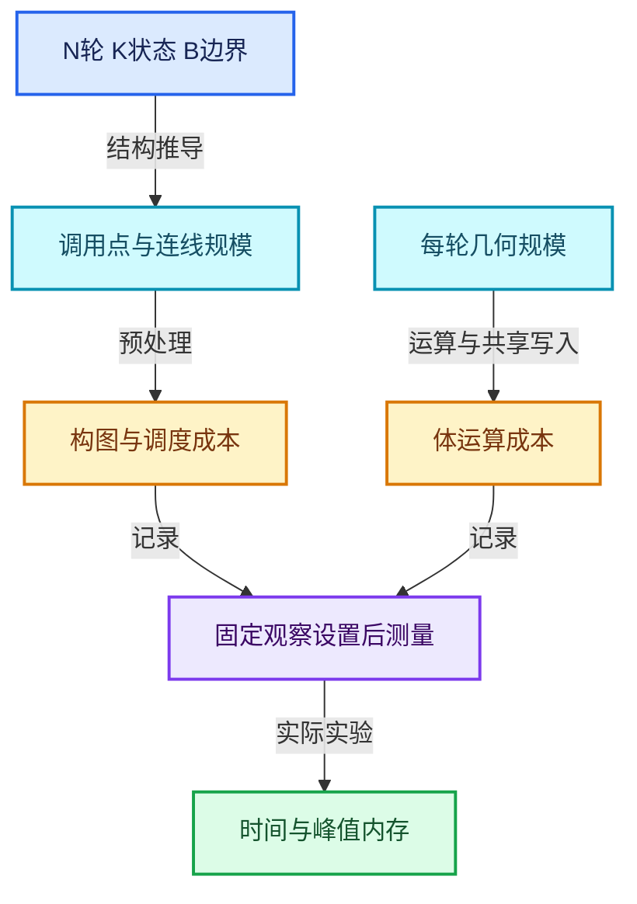

# RZ-11 性能模型并行边界与调试方法

[返回总入口](../README.md) · [本组导航](README.md) · [源码与版本](../00-课程指南/源码版本与覆盖索引.md)

> 源码基准提交：`e2e58a974edb3a5e949aa273d7ff940b5c5797c8`。具体文件内容以证据清单的 SHA-256 为准。

## 先回答一个具体问题

为什么有时提高轮数很便宜，有时几轮就会消耗大量内存和时间？

分别分析构图开销、调度开销、状态依赖与几何规模，建立可复现的性能实验。

## 阅读前需要的概念

1. **`构图成本`**：创建调用点、连线、默认值和执行器预处理的开销。

2. **`体求值成本`**：执行实际节点运算的开销，受每轮数据规模影响。

3. **`关键路径`**：真实依赖决定的最长完成链，并行调度不能越过它。

4. **`lazy_threading::send_hint`**：提示任务系统可能安排其他工作，不承诺固定线程数。

5. **`parallel_for`**：源码中用于轮次值初始化的并行工具，不等于体循环无依赖。

6. **`multi_threading_enabled`**：在参数包装和执行协议中共享的多线程启用状态。

7. **`峰值内存`**：同时存活资源的最高占用，不能只用最终输出大小代替。

8. **`logged_zone_graphs`**：记录运行时区域调试图的存储入口。

## 本篇的机制地图



图中连线标签区分状态流、接口、拥有与观察关系；它不是线程调度记录，也不表示未声明的类型继承关系。

## 核心机制与设计推导

### 01 · 拆开两类图成本

通用节点组图与体函数构建可以由上层缓存机制复用，而按具体 N 展开的区域图在求值存储中初始化。

当前实现注释明确指出没有一般性复用所有 N 的展开图缓存。

小体和大 N 的组合容易让构图与调度占比较大。

不能只测总体时间就断言体内某一个数学节点慢。

### 02 · 结构规模有多种维度

设 N 为轮数、K 为状态项数、B 为边界输入数，体调用节点数为 N，边界需求 OR 节点数为 B。

跨轮状态连接数量随 (N-1)K 增长，边界到体的连线随 NB 增长。

引用集合、接口和执行器预处理还增加成本。

这些是结构推导，不是对总体毫秒数或字节数的承诺。

### 03 · 状态链限制关键路径

S_(i+1) 依赖 S_i 时，后轮状态不能在前轮状态产生前完成。

执行器具备多线程能力也不能消除真实数据依赖。

体内独立分支、跨界输入计算和其他图任务可能仍有并行机会。

应讨论图中的可用并行性，而不是给整个 Repeat 贴上必然完全串行或完全并行的标签。

### 04 · parallel_for的位置

Repeat 源码中的 parallel_for 用于条件建立轮次 SocketValueVariant 数组。

它不是把每一轮的全部体求值无条件并行执行。

数组初始化粒度参数 1024 也不是用户算法的批大小。

阅读性能代码时，先明确并行循环处理的是何种数据。

### 05 · 线程提示不是固定线程数

当轮数至少为十时，源码发出 lazy_threading::send_hint，提示在构建和运行成本期间安排其他工作可能有益。

该调用不承诺开启十个线程，也不是性能分段的稳定公开 API。

multi_threading_enabled 则参与参数包装的执行协议。

不要仅凭变量名推导实际任务系统行为。

### 06 · 几何增长决定体成本

固定拓扑上的位置更新可以近似按点数乘轮数估算，而每轮复制并合并现有几何可能让规模增长。

实例化与实现化会改变内存结构和后续消费者成本。

必须同时记录点面数量、实例数量和是否发生实现化。

一个快的最终显示不能证明上游没有大量临时数据。

### 07 · 测量要控制观察开销

Viewer、详细日志、检查索引和图导出会改变观察路径和相关工作。

比较优化前后时应固定这些设置以及输入规模。

先做短轮数基线，再增加 N，记录冷启动与后续求值差异。

未运行真实 Blender 基准前，不在文档中给出虚构的速度倍率。

### 08 · 从症状定位层级

构图慢先查 N、K、B 和图缓存边界；体慢查几何规模和具体节点；内存增长查累计状态与临时数据；错误轮次日志查上下文身份。

导出的体图与展开图要分别观察。

源码中 to_dot 调试路径提供结构证据，但不能替代数值回归与计时。

优化后应先证明输出语义一致。

## 小数据推演与反例实验

以下预期来自明确的输入和模型推导。未附 Blender 运行记录的案例属于待执行实验，不把手算结果当作后端实测。

### 实验 01 · 空体大轮数

**输入与操作**

N很大，体只直通一个整数

**预期与判据**

构图与调度可能占主要部分

**为什么这个案例有辨别力**

这是待测假设，文档不提供虚构耗时。

**执行时记录**

- 保留输入、轮数与状态项身份，避免只保存截图。
- 将实际观察和上述预期对照；不一致时先定位本实验涉及的边界。

### 实验 02 · 固定几何变换

**输入与操作**

N增加，点数保持P

**预期与判据**

体计算通常受N与P共同影响

**为什么这个案例有辨别力**

还要考虑共享写入和具体节点内核。

**执行时记录**

- 保留输入、轮数与状态项身份，避免只保存截图。
- 将实际观察和上述预期对照；不一致时先定位本实验涉及的边界。

### 实验 03 · 几何倍增

**输入与操作**

每轮将当前几何复制一遍并合并

**预期与判据**

规模增长可能压倒调度成本

**为什么这个案例有辨别力**

减少OR节点不会解决根本数据膨胀。

**执行时记录**

- 保留输入、轮数与状态项身份，避免只保存截图。
- 将实际观察和上述预期对照；不一致时先定位本实验涉及的边界。

### 实验 04 · 边界输入很多

**输入与操作**

N固定，B显著增加

**预期与判据**

边界连线与需求聚合结构增长

**为什么这个案例有辨别力**

应确认能否合理复用外部计算。

**执行时记录**

- 保留输入、轮数与状态项身份，避免只保存截图。
- 将实际观察和上述预期对照；不一致时先定位本实验涉及的边界。

### 实验 05 · 误读并行初始化

**输入与操作**

看到parallel_for(IndexRange(iterations))

**预期与判据**

这里只初始化轮次值数组

**为什么这个案例有辨别力**

不能当作轮次体独立运行的证据。

**执行时记录**

- 保留输入、轮数与状态项身份，避免只保存截图。
- 将实际观察和上述预期对照；不一致时先定位本实验涉及的边界。

### 实验 06 · 不公平性能对比

**输入与操作**

优化前开详细Viewer日志，优化后关闭

**预期与判据**

耗时不可直接归因于算法优化

**为什么这个案例有辨别力**

固定观察设置再重复测量。

**执行时记录**

- 保留输入、轮数与状态项身份，避免只保存截图。
- 将实际观察和上述预期对照；不一致时先定位本实验涉及的边界。

## 连续源码与定向阅读批注

以下代码逐字摘自本地源码，保留原始空行、注释和条件编译。
文件头中的许可证以源文件为准；本教程的说明文字不改变上游源码的授权。
区间摘录不保证从函数边界开始；标题明确标明连续区间时，应结合所链接源文件查看外围声明。
每个块的原始文件、起止行和哈希记入 `_evidence/source-excerpts.json`，校验脚本会逐块比较。

### 源码 01 · 构图规模线程提示与调试图记录

来源：[source/blender/nodes/intern/geometry_nodes_repeat_zone.cc](../../../../../source/blender/nodes/intern/geometry_nodes_repeat_zone.cc)，连续区间 L190—L432。

<!-- source:repeat:190:432 -->

```cpp
   * reused in general. We could consider caching a version of this graph per number of iterations,
   * but right now that doesn't seem worth it. In practice, it takes much less time to create the
   * graph than to execute it (for intended use cases of this generic implementation, more special
   * case repeat loop evaluations could be implemented separately).
   */
  void initialize_execution_graph(lf::Params &params,
                                  RepeatEvalStorage &eval_storage,
                                  const NodeGeometryRepeatOutput &node_storage,
                                  GeoNodesUserData &user_data,
                                  GeoNodesLocalUserData &local_user_data) const
  {
    const int num_repeat_items = node_storage.items_num;
    const int num_border_links = body_fn_.indices.inputs.border_links.size();

    /* Number of iterations to evaluate. */
    const int iterations = std::max<int>(
        0,
        params.get_input<SocketValueVariant>(zone_info_.indices.inputs.main[0])
            .ensure_type<int>());

    if (iterations >= 10) {
      /* Constructing and running the repeat zone has some overhead so that it's probably worth
       * trying to do something else in the meantime already. */
      lazy_threading::send_hint();
    }

    /* Show a warning when the inspection index is out of range. */
    if (node_storage.inspection_index > 0) {
      if (node_storage.inspection_index >= iterations) {
        if (eval_log::NodeTreeLogger *tree_logger = local_user_data.try_get_tree_logger(user_data))
        {
          tree_logger->node_warnings.append(
              *tree_logger->allocator,
              {repeat_output_bnode_.identifier,
               {NodeWarningType::Info, N_("Inspection index is out of range")}});
        }
      }
    }

    /* Take iterations input into account. */
    const int main_inputs_offset = 1;
    const int body_inputs_offset = 1;

    lf::Graph &lf_graph = eval_storage.graph;

    Vector<lf::GraphInputSocket *> lf_inputs;
    Vector<lf::GraphOutputSocket *> lf_outputs;

    for (const int i : inputs_.index_range()) {
      const lf::Input &input = inputs_[i];
      lf_inputs.append(&lf_graph.add_input(*input.type, this->input_name(i)));
    }
    for (const int i : outputs_.index_range()) {
      const lf::Output &output = outputs_[i];
      lf_outputs.append(&lf_graph.add_output(*output.type, this->output_name(i)));
    }

    /* Create body nodes. */
    VectorSet<lf::FunctionNode *> &lf_body_nodes = eval_storage.lf_body_nodes;
    for ([[maybe_unused]] const int i : IndexRange(iterations)) {
      lf::FunctionNode &lf_node = lf_graph.add_function(*body_fn_.function);
      lf_body_nodes.add_new(&lf_node);
    }

    /* Create nodes for combining border link usages. A border link is used when any of the loop
     * bodies uses the border link, so an "or" node is necessary. */
    Array<lf::FunctionNode *> lf_border_link_usage_or_nodes(num_border_links);
    eval_storage.or_function.emplace(iterations);
    for (const int i : IndexRange(num_border_links)) {
      lf::FunctionNode &lf_node = lf_graph.add_function(*eval_storage.or_function);
      lf_border_link_usage_or_nodes[i] = &lf_node;
    }

    const bool use_index_values = zone_.input_node()->output_socket(0).is_directly_linked();

    if (use_index_values) {
      eval_storage.index_values.reinitialize(iterations);
      threading::parallel_for(IndexRange(iterations), 1024, [&](const IndexRange range) {
        for (const int i : range) {
          eval_storage.index_values[i].emplace<int>(i);
        }
      });
    }

    /* Handle body nodes one by one. */
    static const SocketValueVariant static_unused_index{-1};
    for (const int iter_i : lf_body_nodes.index_range()) {
      lf::FunctionNode &lf_node = *lf_body_nodes[iter_i];
      const SocketValueVariant *index_value = use_index_values ?
                                                  &eval_storage.index_values[iter_i] :
                                                  &static_unused_index;
      lf_node.input(body_fn_.indices.inputs.main[0]).set_default_value(index_value);
      for (const int i : IndexRange(num_border_links)) {
        lf_graph.add_link(*lf_inputs[zone_info_.indices.inputs.border_links[i]],
                          lf_node.input(body_fn_.indices.inputs.border_links[i]));
        lf_graph.add_link(lf_node.output(body_fn_.indices.outputs.border_link_usages[i]),
                          lf_border_link_usage_or_nodes[i]->input(iter_i));
      }

      /* Handle reference sets. */
      for (const auto &item : body_fn_.indices.inputs.reference_sets.items()) {
        lf_graph.add_link(*lf_inputs[zone_info_.indices.inputs.reference_sets.lookup(item.key)],
                          lf_node.input(item.value));
      }
    }

    static bool static_true = true;

    /* Handle body nodes pair-wise. */
    for (const int iter_i : lf_body_nodes.index_range().drop_back(1)) {
      lf::FunctionNode &lf_node = *lf_body_nodes[iter_i];
      lf::FunctionNode &lf_next_node = *lf_body_nodes[iter_i + 1];
      for (const int i : IndexRange(num_repeat_items)) {
        lf_graph.add_link(
            lf_node.output(body_fn_.indices.outputs.main[i]),
            lf_next_node.input(body_fn_.indices.inputs.main[i + body_inputs_offset]));
        /* TODO: Add back-link after being able to check for cyclic dependencies. */
        // lf_graph.add_link(lf_next_node.output(body_fn_.indices.outputs.input_usages[i]),
        //                   lf_node.input(body_fn_.indices.inputs.output_usages[i]));
        lf_node.input(body_fn_.indices.inputs.output_usages[i]).set_default_value(&static_true);
      }
    }

    /* Handle border link usage outputs. */
    for (const int i : IndexRange(num_border_links)) {
      lf_graph.add_link(lf_border_link_usage_or_nodes[i]->output(0),
                        *lf_outputs[zone_info_.indices.outputs.border_link_usages[i]]);
    }

    if (iterations > 0) {
      {
        /* Link first body node to input/output nodes. */
        lf::FunctionNode &lf_first_body_node = *lf_body_nodes[0];
        for (const int i : IndexRange(num_repeat_items)) {
          lf_graph.add_link(
              *lf_inputs[zone_info_.indices.inputs.main[i + main_inputs_offset]],
              lf_first_body_node.input(body_fn_.indices.inputs.main[i + body_inputs_offset]));
          lf_graph.add_link(
              lf_first_body_node.output(
                  body_fn_.indices.outputs.input_usages[i + body_inputs_offset]),
              *lf_outputs[zone_info_.indices.outputs.input_usages[i + main_inputs_offset]]);
        }
      }
      {
        /* Link last body node to input/output nodes. */
        lf::FunctionNode &lf_last_body_node = *lf_body_nodes.as_span().last();
        for (const int i : IndexRange(num_repeat_items)) {
          lf_graph.add_link(lf_last_body_node.output(body_fn_.indices.outputs.main[i]),
                            *lf_outputs[zone_info_.indices.outputs.main[i]]);
          lf_graph.add_link(*lf_inputs[zone_info_.indices.inputs.output_usages[i]],
                            lf_last_body_node.input(body_fn_.indices.inputs.output_usages[i]));
        }
      }
    }
    else {
      /* There are no iterations, just link the input directly to the output. */
      for (const int i : IndexRange(num_repeat_items)) {
        lf_graph.add_link(*lf_inputs[zone_info_.indices.inputs.main[i + main_inputs_offset]],
                          *lf_outputs[zone_info_.indices.outputs.main[i]]);
        lf_graph.add_link(
            *lf_inputs[zone_info_.indices.inputs.output_usages[i]],
            *lf_outputs[zone_info_.indices.outputs.input_usages[i + main_inputs_offset]]);
      }
      for (const int i : IndexRange(num_border_links)) {
        static bool static_false = false;
        lf_outputs[zone_info_.indices.outputs.border_link_usages[i]]->set_default_value(
            &static_false);
      }
    }

    lf_outputs[zone_info_.indices.outputs.input_usages[0]]->set_default_value(&static_true);

    /* The graph is ready, update the node indices which are required by the executor. */
    lf_graph.update_node_indices();

    // std::cout << "\n\n" << lf_graph.to_dot() << "\n\n";

    /* Create a mapping from parameter indices inside of this graph to parameters of the repeat
     * zone. The main complexity below stems from the fact that the iterations input is handled
     * outside of this graph. */
    eval_storage.output_index_map.reinitialize(outputs_.size() - 1);
    eval_storage.input_index_map.resize(inputs_.size() - 1);
    array_utils::fill_index_range<int>(eval_storage.input_index_map, 1);

    Vector<const lf::GraphInputSocket *> lf_graph_inputs = lf_inputs.as_span().drop_front(1);

    const int iteration_usage_index = zone_info_.indices.outputs.input_usages[0];
    array_utils::fill_index_range<int>(
        eval_storage.output_index_map.as_mutable_span().take_front(iteration_usage_index));
    array_utils::fill_index_range<int>(
        eval_storage.output_index_map.as_mutable_span().drop_front(iteration_usage_index),
        iteration_usage_index + 1);

    Vector<const lf::GraphOutputSocket *> lf_graph_outputs = lf_outputs.as_span().take_front(
        iteration_usage_index);
    lf_graph_outputs.extend(lf_outputs.as_span().drop_front(iteration_usage_index + 1));

    eval_storage.body_execute_wrapper.emplace();
    eval_storage.body_execute_wrapper->repeat_output_bnode_ = &repeat_output_bnode_;
    eval_storage.body_execute_wrapper->lf_body_nodes_ = &lf_body_nodes;
    eval_storage.side_effect_provider.emplace();
    eval_storage.side_effect_provider->repeat_output_bnode_ = &repeat_output_bnode_;
    eval_storage.side_effect_provider->lf_body_nodes_ = lf_body_nodes;

    eval_storage.graph_executor.emplace(lf_graph,
                                        std::move(lf_graph_inputs),
                                        std::move(lf_graph_outputs),
                                        nullptr,
                                        &*eval_storage.side_effect_provider,
                                        &*eval_storage.body_execute_wrapper);
    eval_storage.graph_executor_storage = eval_storage.graph_executor->init_storage(
        eval_storage.allocator);

    /* Log graph for debugging purposes. */
    const bNodeTree &btree_orig = *DEG_get_original(&btree_);
    if (btree_orig.runtime->logged_zone_graphs) {
      std::lock_guard lock{btree_orig.runtime->logged_zone_graphs->mutex};
      btree_orig.runtime->logged_zone_graphs->graph_by_zone_id.lookup_or_add_cb(
          repeat_output_bnode_.identifier, [&]() { return lf_graph.to_dot(); });
    }
  }

  std::string input_name(const int i) const override
  {
    return zone_wrapper_input_name(zone_info_, zone_, inputs_, i);
  }

  std::string output_name(const int i) const override
  {
    return zone_wrapper_output_name(zone_info_, zone_, outputs_, i);
  }
};

LazyFunction &build_repeat_zone_lazy_function(ResourceScope &scope,
                                              const bNodeTree &btree,
                                              const bke::bNodeTreeZone &zone,
                                              ZoneBuildInfo &zone_info,
                                              const ZoneBodyFunction &body_fn)
{
  return scope.construct<LazyFunctionForRepeatZone>(btree, zone, zone_info, body_fn);
}

}  // namespace blender::nodes
```

**读完这段后回到本篇问题**

- 对照“拆开两类图成本”，明确这段代码是定义存储、建立接口还是执行已有结构。
- 结合“空体大轮数”重画输入到输出的关系，区分源码事实与例子的推导。
- 保留失败分支、默认值、析构和条件编译；不要仅摘取看起来像主算法的几行。

### 源码 02 · 执行器接口与预处理

来源：[source/blender/functions/FN_lazy_function_graph_executor.hh](../../../../../source/blender/functions/FN_lazy_function_graph_executor.hh)，连续区间 L1—L155。

<!-- source:executor:1:155 -->

```cpp
/* SPDX-FileCopyrightText: 2023 Blender Authors
 *
 * SPDX-License-Identifier: GPL-2.0-or-later */

#pragma once

/** \file
 * \ingroup fn
 *
 * This file provides means to create a #LazyFunction from #Graph (which could then e.g. be used in
 * another #Graph again).
 */

#include "BLI_generic_pointer.hh"
#include "BLI_vector.hh"

#include "FN_lazy_function_graph.hh"
#include "FN_lazy_function_graph_executor_generic.hh"

namespace blender::fn::lazy_function {

/**
 * Can be implemented to log values produced during graph evaluation.
 */
class GraphExecutorLogger {
 public:
  virtual ~GraphExecutorLogger() = default;

  struct LoggingEnabledState {
    bool socket_values = true;
    bool before_node_execute = true;
    bool after_node_execute = true;

    explicit LoggingEnabledState(const bool enabled)
        : socket_values(enabled), before_node_execute(enabled), after_node_execute(enabled)
    {
    }
  };

  virtual LoggingEnabledState get_logging_enabled_state(const Context &context) const;

  virtual void log_socket_value(const Socket &socket,
                                GPointer value,
                                const Context &context) const;

  virtual void log_before_node_execute(const FunctionNode &node,
                                       const Params &params,
                                       const Context &context) const;

  virtual void log_after_node_execute(const FunctionNode &node,
                                      const Params &params,
                                      const Context &context) const;

  virtual void dump_when_outputs_are_missing(const FunctionNode &node,
                                             Span<const OutputSocket *> missing_sockets,
                                             const Context &context) const;
  virtual void dump_when_input_is_set_twice(const InputSocket &target_socket,
                                            const OutputSocket &from_socket,
                                            const Context &context) const;
};

/**
 * Has to be implemented when some of the nodes in the graph may have side effects. The
 * #GraphExecutor has to know about that to make sure that these nodes will be executed even though
 * their outputs are not needed.
 */
class GraphExecutorSideEffectProvider {
 public:
  virtual ~GraphExecutorSideEffectProvider() = default;
  virtual Vector<const FunctionNode *> get_nodes_with_side_effects(const Context &context) const;
};

/**
 * Can be used to pass extra context into the execution of a function. The main alternative to this
 * is to create a wrapper `LazyFunction` for the `FunctionNode`s. Using this light weight wrapper
 * is preferable if possible.
 */
class GraphExecutorNodeExecuteWrapper {
 public:
  virtual ~GraphExecutorNodeExecuteWrapper() = default;

  /**
   * Is expected to run `node.function().execute(params, context)` but might do some extra work,
   * like adjusting the context.
   */
  virtual void execute_node(const FunctionNode &node,
                            Params &params,
                            const Context &context) const = 0;
};

class GraphExecutor : public LazyFunction {
 public:
  using Logger = GraphExecutorLogger;
  using SideEffectProvider = GraphExecutorSideEffectProvider;
  using NodeExecuteWrapper = GraphExecutorNodeExecuteWrapper;
  using GenericExecutor = generic_graph_executor::GenericGraphExecutor;

 private:
  /**
   * The graph that is evaluated.
   */
  const Graph &graph_;
  /**
   * Input and output sockets of the entire graph.
   */
  Vector<const GraphInputSocket *> graph_inputs_;
  Vector<const GraphOutputSocket *> graph_outputs_;
  Array<int> graph_input_index_by_socket_index_;
  Array<int> graph_output_index_by_socket_index_;
  /**
   * Optional logger for events that happen during execution.
   */
  const Logger *logger_;
  /**
   * Optional side effect provider. It knows which nodes have side effects based on the context
   * during evaluation.
   */
  const SideEffectProvider *side_effect_provider_;
  /**
   * Optional wrapper for node execution functions.
   */
  const NodeExecuteWrapper *node_execute_wrapper_;

  /**
   * The graph executor implementation does some preprocessing for the graph. This only has to be
   * done once even if the graph is executed multiple times.
   */
  generic_graph_executor::PreprocessData preprocess_data_;

  friend GenericExecutor;

 public:
  GraphExecutor(const Graph &graph,
                const Logger *logger,
                const SideEffectProvider *side_effect_provider,
                const NodeExecuteWrapper *node_execute_wrapper);

  GraphExecutor(const Graph &graph,
                Vector<const GraphInputSocket *> graph_inputs,
                Vector<const GraphOutputSocket *> graph_outputs,
                const Logger *logger,
                const SideEffectProvider *side_effect_provider,
                const NodeExecuteWrapper *node_execute_wrapper);

  void *init_storage(LinearAllocator<> &allocator) const override;
  void destruct_storage(void *storage) const override;

  std::string input_name(int index) const override;
  std::string output_name(int index) const override;

 private:
  void execute_impl(Params &params, const Context &context) const override;
};

}  // namespace blender::fn::lazy_function
```

**读完这段后回到本篇问题**

- 对照“结构规模有多种维度”，明确这段代码是定义存储、建立接口还是执行已有结构。
- 结合“固定几何变换”重画输入到输出的关系，区分源码事实与例子的推导。
- 保留失败分支、默认值、析构和条件编译；不要仅摘取看起来像主算法的几行。

### 源码 03 · 图执行器适配实现

来源：[source/blender/functions/intern/lazy_function_graph_executor.cc](../../../../../source/blender/functions/intern/lazy_function_graph_executor.cc)，连续区间 L1—L145。

<!-- source:execimpl:1:145 -->

```cpp
/* SPDX-FileCopyrightText: 2023 Blender Authors
 *
 * SPDX-License-Identifier: GPL-2.0-or-later */

/** \file
 * \ingroup fn
 */

#include "FN_lazy_function_graph_executor.hh"

/* The entire executor is included here. Otherwise an additional indirection using forward
 * declarations of #GenericGraphExecutor would be needed. However, there isn't really a point in
 * having that because it's tightly coupled to #GraphExecutor anyway. It's only defined in a
 * separate file for code organization purposes. */
#include "lazy_function_graph_executor_generic.hh"

namespace blender::fn::lazy_function {

GraphExecutor::GraphExecutor(const Graph &graph,
                             const Logger *logger,
                             const SideEffectProvider *side_effect_provider,
                             const NodeExecuteWrapper *node_execute_wrapper)
    : GraphExecutor(graph,
                    Vector<const GraphInputSocket *>(graph.graph_inputs()),
                    Vector<const GraphOutputSocket *>(graph.graph_outputs()),
                    logger,
                    side_effect_provider,
                    node_execute_wrapper)
{
}

GraphExecutor::GraphExecutor(const Graph &graph,
                             Vector<const GraphInputSocket *> graph_inputs,
                             Vector<const GraphOutputSocket *> graph_outputs,
                             const Logger *logger,
                             const SideEffectProvider *side_effect_provider,
                             const NodeExecuteWrapper *node_execute_wrapper)
    : graph_(graph),
      graph_inputs_(std::move(graph_inputs)),
      graph_outputs_(std::move(graph_outputs)),
      graph_input_index_by_socket_index_(graph.graph_inputs().size(), -1),
      graph_output_index_by_socket_index_(graph.graph_outputs().size(), -1),
      logger_(logger),
      side_effect_provider_(side_effect_provider),
      node_execute_wrapper_(node_execute_wrapper)
{
  debug_name_ = graph.name().c_str();

  /* The graph executor can handle partial execution when there are still missing inputs. */
  allow_missing_requested_inputs_ = true;

  for (const int i : graph_inputs_.index_range()) {
    const OutputSocket &socket = *graph_inputs_[i];
    BLI_assert(socket.node().is_interface());
    inputs_.append({"In", socket.type(), ValueUsage::Maybe});
    graph_input_index_by_socket_index_[socket.index()] = i;
  }
  for (const int i : graph_outputs_.index_range()) {
    const InputSocket &socket = *graph_outputs_[i];
    BLI_assert(socket.node().is_interface());
    outputs_.append({"Out", socket.type()});
    graph_output_index_by_socket_index_[socket.index()] = i;
  }

  GenericExecutor::preprocess_graph(*this);
}

void GraphExecutor::execute_impl(Params &params, const Context &context) const
{
  GenericExecutor &executor = *static_cast<GenericExecutor *>(context.storage);
  executor.execute(params, context);
}

void *GraphExecutor::init_storage(LinearAllocator<> &allocator) const
{
  GenericExecutor &executor = *allocator.construct<GenericExecutor>(*this).release();
  return &executor;
}

void GraphExecutor::destruct_storage(void *storage) const
{
  std::destroy_at(static_cast<GenericExecutor *>(storage));
}

std::string GraphExecutor::input_name(const int index) const
{
  const lf::OutputSocket &socket = *graph_inputs_[index];
  return socket.name();
}

std::string GraphExecutor::output_name(const int index) const
{
  const lf::InputSocket &socket = *graph_outputs_[index];
  return socket.name();
}

GraphExecutorLogger::LoggingEnabledState GraphExecutorLogger::get_logging_enabled_state(
    const Context & /*context*/) const
{
  return LoggingEnabledState{true};
}

void GraphExecutorLogger::log_socket_value(const Socket &socket,
                                           const GPointer value,
                                           const Context &context) const
{
  UNUSED_VARS(socket, value, context);
}

void GraphExecutorLogger::log_before_node_execute(const FunctionNode &node,
                                                  const Params &params,
                                                  const Context &context) const
{
  UNUSED_VARS(node, params, context);
}

void GraphExecutorLogger::log_after_node_execute(const FunctionNode &node,
                                                 const Params &params,
                                                 const Context &context) const
{
  UNUSED_VARS(node, params, context);
}

Vector<const FunctionNode *> GraphExecutorSideEffectProvider::get_nodes_with_side_effects(
    const Context &context) const
{
  UNUSED_VARS(context);
  return {};
}

void GraphExecutorLogger::dump_when_outputs_are_missing(const FunctionNode &node,
                                                        Span<const OutputSocket *> missing_sockets,
                                                        const Context &context) const
{
  UNUSED_VARS(node, missing_sockets, context);
}

void GraphExecutorLogger::dump_when_input_is_set_twice(const InputSocket &target_socket,
                                                       const OutputSocket &from_socket,
                                                       const Context &context) const
{
  UNUSED_VARS(target_socket, from_socket, context);
}

}  // namespace blender::fn::lazy_function
```

**读完这段后回到本篇问题**

- 对照“状态链限制关键路径”，明确这段代码是定义存储、建立接口还是执行已有结构。
- 结合“几何倍增”重画输入到输出的关系，区分源码事实与例子的推导。
- 保留失败分支、默认值、析构和条件编译；不要仅摘取看起来像主算法的几行。

### 源码 04 · 多线程状态和参数重映射

来源：[source/blender/functions/FN_lazy_function_execute.hh](../../../../../source/blender/functions/FN_lazy_function_execute.hh)，连续区间 L1—L158。

<!-- source:params:1:158 -->

```cpp
/* SPDX-FileCopyrightText: 2023 Blender Authors
 *
 * SPDX-License-Identifier: GPL-2.0-or-later */

#pragma once

/** \file
 * \ingroup fn
 *
 * This file contains common utilities for actually executing a lazy-function.
 */

#include "BLI_generic_pointer.hh"

#include "FN_lazy_function.hh"

namespace blender::fn::lazy_function {

/**
 * Most basic implementation of #Params. It does not actually implement any logic for how to
 * retrieve inputs or set outputs. Instead, code using #BasicParams has to implement that.
 */
class BasicParams : public Params {
 private:
  const Span<GMutablePointer> inputs_;
  const Span<GMutablePointer> outputs_;
  MutableSpan<std::optional<ValueUsage>> input_usages_;
  Span<ValueUsage> output_usages_;
  MutableSpan<bool> set_outputs_;

 public:
  BasicParams(const LazyFunction &fn,
              Span<GMutablePointer> inputs,
              Span<GMutablePointer> outputs,
              MutableSpan<std::optional<ValueUsage>> input_usages,
              Span<ValueUsage> output_usages,
              MutableSpan<bool> set_outputs);

  void *try_get_input_data_ptr_impl(const int index) const override;
  void *try_get_input_data_ptr_or_request_impl(const int index) override;
  void *get_output_data_ptr_impl(const int index) override;
  void output_set_impl(const int index) override;
  bool output_was_set_impl(const int index) const override;
  ValueUsage get_output_usage_impl(const int index) const override;
  void set_input_unused_impl(const int index) override;
  bool try_enable_multi_threading_impl() override;
};

/**
 * Wraps an existing #Params. This should be used when a lazy-function internally contains another
 * lazy-function that handles a subset or the inputs and outputs.
 */
class RemappedParams : public Params {
 private:
  Params &base_params_;
  Span<int> input_map_;
  Span<int> output_map_;
  bool &multi_threading_enabled_;

 public:
  RemappedParams(const LazyFunction &fn,
                 Params &base_params,
                 Span<int> input_map,
                 Span<int> output_map,
                 bool &multi_threading_enabled);

  void *try_get_input_data_ptr_impl(const int index) const override;
  void *try_get_input_data_ptr_or_request_impl(const int index) override;
  void *get_output_data_ptr_impl(const int index) override;
  void output_set_impl(const int index) override;
  bool output_was_set_impl(const int index) const override;
  ValueUsage get_output_usage_impl(const int index) const override;
  void set_input_unused_impl(const int index) override;
  bool try_enable_multi_threading_impl() override;
};

namespace detail {

/**
 * Utility to implement #execute_lazy_function_eagerly.
 */
template<typename... Inputs, typename... Outputs, size_t... InIndices, size_t... OutIndices>
inline void execute_lazy_function_eagerly_impl(const LazyFunction &fn,
                                               UserData *user_data,
                                               LocalUserData *local_user_data,
                                               std::tuple<Inputs...> &inputs,
                                               std::tuple<Outputs *...> &outputs,
                                               std::index_sequence<InIndices...> /*in_indices*/,
                                               std::index_sequence<OutIndices...> /*out_indices*/)
{
  constexpr size_t InputsNum = sizeof...(Inputs);
  constexpr size_t OutputsNum = sizeof...(Outputs);
  std::array<GMutablePointer, InputsNum> input_pointers;
  std::array<GMutablePointer, OutputsNum> output_pointers;
  std::array<std::optional<ValueUsage>, InputsNum> input_usages;
  std::array<ValueUsage, OutputsNum> output_usages;
  std::array<bool, OutputsNum> set_outputs;
  (
      [&]() {
        constexpr size_t I = InIndices;
        /* Use `typedef` instead of `using` to work around a compiler bug. */
        using T = Inputs;
        const CPPType &type = CPPType::get<T>();
        input_pointers[I] = {type, &std::get<I>(inputs)};
      }(),
      ...);
  (
      [&]() {
        constexpr size_t I = OutIndices;
        /* Use `typedef` instead of `using` to work around a compiler bug. */
        using T = Outputs;
        const CPPType &type = CPPType::get<T>();
        output_pointers[I] = {type, std::get<I>(outputs)};
      }(),
      ...);
  output_usages.fill(ValueUsage::Used);
  set_outputs.fill(false);
  LinearAllocator<> allocator;
  Context context(fn.init_storage(allocator), user_data, local_user_data);
  BasicParams params{
      fn, input_pointers, output_pointers, input_usages, output_usages, set_outputs};
  fn.execute(params, context);
  fn.destruct_storage(context.storage);

  /* Make sure all outputs have been computed. */
  BLI_assert(!Span<bool>(set_outputs).contains(false));
}

}  // namespace detail

/**
 * In some cases (mainly for tests), the set of inputs and outputs for a lazy-function is known at
 * compile time and one just wants to compute the outputs based on the inputs, without any
 * laziness.
 *
 * This function does exactly that. It takes all inputs in a tuple and writes the outputs to points
 * provided in a second tuple. Since all inputs have to be provided, the lazy-function has to
 * compute all outputs.
 */
template<typename... Inputs, typename... Outputs>
inline void execute_lazy_function_eagerly(const LazyFunction &fn,
                                          UserData *user_data,
                                          LocalUserData *local_user_data,
                                          std::tuple<Inputs...> inputs,
                                          std::tuple<Outputs *...> outputs)
{
  BLI_assert(fn.inputs().size() == sizeof...(Inputs));
  BLI_assert(fn.outputs().size() == sizeof...(Outputs));
  detail::execute_lazy_function_eagerly_impl(fn,
                                             user_data,
                                             local_user_data,
                                             inputs,
                                             outputs,
                                             std::make_index_sequence<sizeof...(Inputs)>(),
                                             std::make_index_sequence<sizeof...(Outputs)>());
}

}  // namespace blender::fn::lazy_function
```

**读完这段后回到本篇问题**

- 对照“parallel_for的位置”，明确这段代码是定义存储、建立接口还是执行已有结构。
- 结合“边界输入很多”重画输入到输出的关系，区分源码事实与例子的推导。
- 保留失败分支、默认值、析构和条件编译；不要仅摘取看起来像主算法的几行。

### 源码 05 · 图连接的结构基础

来源：[source/blender/functions/FN_lazy_function_graph.hh](../../../../../source/blender/functions/FN_lazy_function_graph.hh)，连续区间 L1—L260。

<!-- source:graph:1:260 -->

```cpp
/* SPDX-FileCopyrightText: 2023 Blender Authors
 *
 * SPDX-License-Identifier: GPL-2.0-or-later */

#pragma once

/** \file
 * \ingroup fn
 *
 * This file contains a graph data structure that allows composing multiple lazy-functions into a
 * combined lazy-function.
 *
 * There are two types of nodes in the graph:
 * - #FunctionNode: Corresponds to a #LazyFunction. The inputs and outputs of the function become
 *   input and output sockets of the node.
 * - #InterfaceNode: Is used to indicate inputs and outputs of the entire graph. It can have an
 *   arbitrary number of sockets.
 */

#include "BLI_linear_allocator.hh"

#include "FN_lazy_function.hh"

namespace blender {

namespace dot_export {
class DirectedEdge;
}

namespace fn::lazy_function {

class Socket;
class InputSocket;
class OutputSocket;
class Node;
class Graph;

/**
 * A #Socket is the interface of a #Node. Every #Socket is either an #InputSocket or #OutputSocket.
 * Links can be created from output sockets to input sockets.
 */
class Socket : NonCopyable, NonMovable {
 protected:
  /**
   * The node the socket belongs to.
   */
  Node *node_;
  /**
   * Data type of the socket. Only sockets with the same type can be linked.
   */
  const CPPType *type_;
  /**
   * Indicates whether this is an #InputSocket or #OutputSocket.
   */
  bool is_input_;
  /**
   * Index of the socket. E.g. 0 for the first input and the first output socket.
   */
  int index_in_node_;
  /**
   * Index of the socket in the entire graph. Every socket has a different index.
   */
  int index_in_graph_;

  friend Graph;

 public:
  bool is_input() const;
  bool is_output() const;

  int index() const;
  int index_in_graph() const;

  InputSocket &as_input();
  OutputSocket &as_output();
  const InputSocket &as_input() const;
  const OutputSocket &as_output() const;

  const Node &node() const;
  Node &node();

  const CPPType &type() const;

  std::string name() const;
  std::string detailed_name() const;
};

class InputSocket : public Socket {
 private:
  /**
   * An input can have at most one link connected to it. The linked socket is the "origin" because
   * it's where the data is coming from. The type of the origin must be the same as the type of
   * this socket.
   */
  OutputSocket *origin_;
  /**
   * Can be null or a non-owning pointer to a value of the type of the socket. This value will be
   * used when the input is used but not linked.
   *
   * This is technically not needed, because one could just create a separate node that just
   * outputs the value, but that would have more overhead. Especially because it's commonly the
   * case that most inputs are unlinked.
   */
  const void *default_value_ = nullptr;

  friend Graph;

 public:
  OutputSocket *origin();
  const OutputSocket *origin() const;

  const void *default_value() const;
  void set_default_value(const void *value);
};

class OutputSocket : public Socket {
 private:
  /**
   * An output can be linked to an arbitrary number of inputs of the same type.
   */
  Vector<InputSocket *> targets_;

  friend Graph;

 public:
  Span<InputSocket *> targets();
  Span<const InputSocket *> targets() const;
};

/**
 * A #Node has input and output sockets. Every node is either a #FunctionNode or an #InterfaceNode.
 */
class Node : NonCopyable, NonMovable {
 protected:
  /**
   * The function this node corresponds to. If this is null, the node is an #InterfaceNode.
   * The function is not owned by this #Node nor by the #Graph.
   */
  const LazyFunction *fn_ = nullptr;
  /**
   * Input sockets of the node.
   */
  Span<InputSocket *> inputs_;
  /**
   * Output sockets of the node.
   */
  Span<OutputSocket *> outputs_;
  /**
   * An index that is set when calling #Graph::update_node_indices. This can be used to create
   * efficient mappings from nodes to other data using just an array instead of a hash map.
   *
   * This is technically not necessary but has better performance than always using hash maps.
   */
  int index_in_graph_ = -1;

  friend Graph;

 public:
  bool is_interface() const;
  bool is_function() const;
  int index_in_graph() const;

  Span<const InputSocket *> inputs() const;
  Span<const OutputSocket *> outputs() const;
  Span<InputSocket *> inputs();
  Span<OutputSocket *> outputs();

  const InputSocket &input(int index) const;
  const OutputSocket &output(int index) const;
  InputSocket &input(int index);
  OutputSocket &output(int index);

  std::string name() const;
};

/**
 * A #Node that corresponds to a specific #LazyFunction.
 */
class FunctionNode final : public Node {
 public:
  const LazyFunction &function() const;
};

/**
 * A #Node that does *not* correspond to a #LazyFunction. Instead it can be used to indicate inputs
 * and outputs of the entire graph. It can have an arbitrary number of inputs and outputs.
 */
class InterfaceNode final : public Node {
 private:
  friend Node;
  friend Socket;
  friend Graph;

  Vector<std::string> socket_names_;
};

/**
 * Interface input sockets are actually output sockets on the input node. This renaming makes the
 * code less confusing.
 */
using GraphInputSocket = OutputSocket;
using GraphOutputSocket = InputSocket;

/**
 * A container for an arbitrary number of nodes and links between their sockets.
 */
class Graph : NonCopyable, NonMovable {
 private:
  /**
   * Used to allocate nodes and sockets in the graph.
   */
  LinearAllocator<> allocator_;
  /**
   * Name of the graph for debugging purposes.
   */
  StringRefNull name_;
  /**
   * Contains all nodes in the graph so that it is efficient to iterate over them.
   * The first two nodes are the interface input and output nodes.
   */
  Vector<Node *> nodes_;

  InterfaceNode *graph_input_node_ = nullptr;
  InterfaceNode *graph_output_node_ = nullptr;

  Vector<GraphInputSocket *> graph_inputs_;
  Vector<GraphOutputSocket *> graph_outputs_;

  /**
   * Number of sockets in the graph. Can be used as array size when indexing using
   * `Socket::index_in_graph`.
   */
  int socket_num_ = 0;

 public:
  Graph(StringRef name = "unknown");
  ~Graph();

  StringRefNull name() const;

  /**
   * Get all nodes in the graph. The index in the span corresponds to #Node::index_in_graph.
   */
  Span<const Node *> nodes() const;
  Span<Node *> nodes();

  Span<const FunctionNode *> function_nodes() const;
  Span<FunctionNode *> function_nodes();

  Span<GraphInputSocket *> graph_inputs();
  Span<GraphOutputSocket *> graph_outputs();

  Span<const GraphInputSocket *> graph_inputs() const;
  Span<const GraphOutputSocket *> graph_outputs() const;

  /**
   * Add a new function node with sockets that match the passed in #LazyFunction.
   */
  FunctionNode &add_function(const LazyFunction &fn);

```

**读完这段后回到本篇问题**

- 对照“线程提示不是固定线程数”，明确这段代码是定义存储、建立接口还是执行已有结构。
- 结合“误读并行初始化”重画输入到输出的关系，区分源码事实与例子的推导。
- 保留失败分支、默认值、析构和条件编译；不要仅摘取看起来像主算法的几行。

## 练习与参考答案

### 练习 01 · 解释“拆开两类图成本”

**题目**

不看代码，说明“拆开两类图成本”解决的具体问题，并给出一个会违背其约束的错误实现。

**参考答案的核心**

通用节点组图与体函数构建可以由上层缓存机制复用，而按具体 N 展开的区域图在求值存储中初始化。

**验收追问**

不能只测总体时间就断言体内某一个数学节点慢。

**自查方法**

回到上面的源码区间和本篇实验，找出支持该回答的实际字段、调用或分支；若答案是设计推论，应明确写为推论。

### 练习 02 · 解释“结构规模有多种维度”

**题目**

不看代码，说明“结构规模有多种维度”解决的具体问题，并给出一个会违背其约束的错误实现。

**参考答案的核心**

设 N 为轮数、K 为状态项数、B 为边界输入数，体调用节点数为 N，边界需求 OR 节点数为 B。

**验收追问**

这些是结构推导，不是对总体毫秒数或字节数的承诺。

**自查方法**

回到上面的源码区间和本篇实验，找出支持该回答的实际字段、调用或分支；若答案是设计推论，应明确写为推论。

### 练习 03 · 解释“状态链限制关键路径”

**题目**

不看代码，说明“状态链限制关键路径”解决的具体问题，并给出一个会违背其约束的错误实现。

**参考答案的核心**

S_(i+1) 依赖 S_i 时，后轮状态不能在前轮状态产生前完成。

**验收追问**

应讨论图中的可用并行性，而不是给整个 Repeat 贴上必然完全串行或完全并行的标签。

**自查方法**

回到上面的源码区间和本篇实验，找出支持该回答的实际字段、调用或分支；若答案是设计推论，应明确写为推论。

### 练习 04 · 解释“parallel_for的位置”

**题目**

不看代码，说明“parallel_for的位置”解决的具体问题，并给出一个会违背其约束的错误实现。

**参考答案的核心**

Repeat 源码中的 parallel_for 用于条件建立轮次 SocketValueVariant 数组。

**验收追问**

阅读性能代码时，先明确并行循环处理的是何种数据。

**自查方法**

回到上面的源码区间和本篇实验，找出支持该回答的实际字段、调用或分支；若答案是设计推论，应明确写为推论。

### 练习 05 · 解释“线程提示不是固定线程数”

**题目**

不看代码，说明“线程提示不是固定线程数”解决的具体问题，并给出一个会违背其约束的错误实现。

**参考答案的核心**

当轮数至少为十时，源码发出 lazy_threading::send_hint，提示在构建和运行成本期间安排其他工作可能有益。

**验收追问**

不要仅凭变量名推导实际任务系统行为。

**自查方法**

回到上面的源码区间和本篇实验，找出支持该回答的实际字段、调用或分支；若答案是设计推论，应明确写为推论。

### 练习 06 · 解释“几何增长决定体成本”

**题目**

不看代码，说明“几何增长决定体成本”解决的具体问题，并给出一个会违背其约束的错误实现。

**参考答案的核心**

固定拓扑上的位置更新可以近似按点数乘轮数估算，而每轮复制并合并现有几何可能让规模增长。

**验收追问**

一个快的最终显示不能证明上游没有大量临时数据。

**自查方法**

回到上面的源码区间和本篇实验，找出支持该回答的实际字段、调用或分支；若答案是设计推论，应明确写为推论。

### 练习 07 · 解释“测量要控制观察开销”

**题目**

不看代码，说明“测量要控制观察开销”解决的具体问题，并给出一个会违背其约束的错误实现。

**参考答案的核心**

Viewer、详细日志、检查索引和图导出会改变观察路径和相关工作。

**验收追问**

未运行真实 Blender 基准前，不在文档中给出虚构的速度倍率。

**自查方法**

回到上面的源码区间和本篇实验，找出支持该回答的实际字段、调用或分支；若答案是设计推论，应明确写为推论。

### 练习 08 · 解释“从症状定位层级”

**题目**

不看代码，说明“从症状定位层级”解决的具体问题，并给出一个会违背其约束的错误实现。

**参考答案的核心**

构图慢先查 N、K、B 和图缓存边界；体慢查几何规模和具体节点；内存增长查累计状态与临时数据；错误轮次日志查上下文身份。

**验收追问**

优化后应先证明输出语义一致。

**自查方法**

回到上面的源码区间和本篇实验，找出支持该回答的实际字段、调用或分支；若答案是设计推论，应明确写为推论。

## 本篇完成标准

- 能直接回答：为什么有时提高轮数很便宜，有时几轮就会消耗大量内存和时间？
- 能解释本篇目标：分别分析构图开销、调度开销、状态依赖与几何规模，建立可复现的性能实验。
- 能手算至少一个正轮数案例和一个边界案例，并说明各自验证的错误类型。
- 能沿源码链接区分配置、构图、求值和观察各阶段。
- 能陈述本篇实际证据的范围，不把静态摘录核对写成后端运行通过。

## 继续阅读

- 上一篇：[10-复制保存加载与版本边界](../03-值寿命与观察机制/10-复制保存加载与版本边界.md)
- 下一篇：[12-数值几何与嵌套算法实战](../04-实战后端与验收/12-数值几何与嵌套算法实战.md)
- [练习脚本与运行范围](../示例/README.md)
- [验收记录与尚未执行的集成检查](../00-课程指南/验收报告.md)
