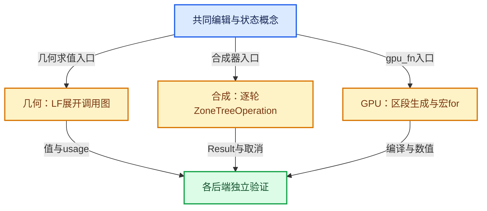

# RZ-13 合成器与GPU重复区域实现

[返回总入口](../README.md) · [本组导航](README.md) · [源码与版本](../00-课程指南/源码版本与覆盖索引.md)

> 源码基准提交：`e2e58a974edb3a5e949aa273d7ff940b5c5797c8`。具体文件内容以证据清单的 SHA-256 为准。

## 先回答一个具体问题

相同的Repeat界面概念，为什么在几何节点与合成器中对应不同的执行机制？

掌握合成器逐轮操作、Result共享、取消清理与GPU宏路径，避免跨后端误用结论。

## 阅读前需要的概念

1. **`RepeatZoneOperation`**：合成器中驱动Repeat逐轮求值的操作。

2. **`ZoneTreeOperation`**：合成器中执行一份区域体并映射输入的操作。

3. **`Result`**：合成器结果载体，带类型、精度和共享资源协议。

4. **`share_data`**：按Result协议共享底层数据，不等于逐像素深拷贝。

5. **`map_inputs`**：把首轮初始状态或后续前轮结果映射为本轮输入。

6. **`map_external_inputs`**：将合成器区域的外部输入映射到体，并按源输出去重。

7. **`REPEAT_BEGIN`**：GPU_SHADER分支生成for循环起始区段的宏。

8. **`REPEAT_END`**：关闭GPU重复区段的宏。

## 本篇的机制地图



图中连线标签区分状态流、接口、拥有与观察关系；它不是线程调度记录，也不表示未声明的类型继承关系。

## 核心机制与设计推导

### 01 · 按后端选择证据

几何节点路径使用 LazyFunctionForRepeatZone 展开体调用图，合成器路径进入 RepeatZoneOperation::execute。

二者共享状态递推概念，但内部存储和调度协议不同。

节点类名中带 GeometryNode 不足以证明只有几何节点使用相关声明。

应以注册能力、树类型和后端回调为准。

### 02 · 合成器直接逐轮驱动

execute 先读取单值 Iterations，小于等于零时按正式输出标识分享输入数据。

正轮数分支在 for 中建立本轮 ZoneTreeOperation、轮次 Result 和上下文。

随后映射状态与外部输入并 evaluate。

不能把几何节点的 N 个 FunctionNode 展开描述直接套到这一段实现。

### 03 · 第一轮与后轮状态源不同

map_inputs 在没有 last operation 时从区域初始输入建立临时 Result；有前轮时从前轮输出建立。

每个临时 Result 按源类型和精度创建并 share_data，再映射到本轮入口。

临时容器需要覆盖本轮 evaluate 的有效期。

函数返回这些拥有对象正是为了让调用者维持它们的寿命。

### 04 · 共享数据与引用计数

share_data 表达结果存储共享，不等于把图像像素逐个复制。

末轮设置引用计数以匹配区域最终结果是否被需要，写出时分享数据并释放体内结果。

具体底层存储释放仍由 Result 协议管理。

脱离该协议把 release 理解成随意释放原始指针会误读代码。

### 05 · 外部输入按源去重

map_external_inputs 遍历 border_links，追踪实际连接输出，并用 Set 避免同一源输出被多次考虑。

它通过 external input identifier 映射到体操作。

这个去重与几何节点按边界列表建立需求 OR 的实现不同。

后端接口可以保持相似语义而采取不同内部表示。

### 06 · 取消是明确分支

每轮 evaluate 后检查 context.is_canceled。

取消路径为剩余输出分配默认结果，并释放需要处理的末轮区域结果。

正常写出最终结果与取消清理是两条不同出口。

阅读性能或资源问题时，不能只检查正常 for 循环结束后的状态。

### 07 · GPU生成走宏与区段协议

节点 gpu_fn 分别调用 GPU_stack_link_zone，标记 REPEAT_BEGIN 与 REPEAT_END 并传递区域标识。

GPU_SHADER 分支中的宏实际产生一个整数 for 循环并把本轮索引赋给变量。

非 GPU_SHADER 分支的同名空函数用于依赖反射，不代表着色器真正执行空循环。

理解这点需要同时看条件编译两侧。

### 08 · 相同语义不同验证

几何节点测试应关注 SocketValueVariant、主状态和 LF 需求；合成器测试关注 Result 类型、精度、引用计数与取消；GPU验证还需编译生成的合法程序并比较结果。

一个纯Python递推模型可以提供数值预期，但不能验证任何后端的资源管理。

本文记录源码路径，不声称已运行所有硬件后端。

## 小数据推演与反例实验

以下预期来自明确的输入和模型推导。未附 Blender 运行记录的案例属于待执行实验，不把手算结果当作后端实测。

### 实验 01 · 合成器零轮

**输入与操作**

Iterations=0，输入图像已存在

**预期与判据**

区域结果分享对应输入数据

**为什么这个案例有辨别力**

不建立正轮数体操作链。

**执行时记录**

- 保留输入、轮数与状态项身份，避免只保存截图。
- 将实际观察和上述预期对照；不一致时先定位本实验涉及的边界。

### 实验 02 · 合成器三轮

**输入与操作**

初始图像每轮做同一变换，N=3

**预期与判据**

本轮输入来自上一轮Result

**为什么这个案例有辨别力**

每轮都读取原始图像会改变算法。

**执行时记录**

- 保留输入、轮数与状态项身份，避免只保存截图。
- 将实际观察和上述预期对照；不一致时先定位本实验涉及的边界。

### 实验 03 · 共享源跨界

**输入与操作**

一个外部输出连接到体内多个输入

**预期与判据**

map_external_inputs按源去重考虑

**为什么这个案例有辨别力**

不能从连线数推导必有等量独立像素副本。

**执行时记录**

- 保留输入、轮数与状态项身份，避免只保存截图。
- 将实际观察和上述预期对照；不一致时先定位本实验涉及的边界。

### 实验 04 · 中途取消

**输入与操作**

第二轮后context变为canceled

**预期与判据**

进入cancel_evaluation并返回

**为什么这个案例有辨别力**

正常write_outputs路径不再执行。

**执行时记录**

- 保留输入、轮数与状态项身份，避免只保存截图。
- 将实际观察和上述预期对照；不一致时先定位本实验涉及的边界。

### 实验 05 · 宏条件编译

**输入与操作**

同一文件在GPU_SHADER定义与未定义两种环境下读取

**预期与判据**

一侧生成for，另一侧提供反射函数

**为什么这个案例有辨别力**

空函数不能证明GPU循环没有实现。

**执行时记录**

- 保留输入、轮数与状态项身份，避免只保存截图。
- 将实际观察和上述预期对照；不一致时先定位本实验涉及的边界。

### 实验 06 · 错误后端类比

**输入与操作**

用几何节点的index_values数组解释合成器轮次

**预期与判据**

不符合合成器真实实现

**为什么这个案例有辨别力**

合成器本轮索引用单值Result映射。

**执行时记录**

- 保留输入、轮数与状态项身份，避免只保存截图。
- 将实际观察和上述预期对照；不一致时先定位本实验涉及的边界。

## 连续源码与定向阅读批注

以下代码逐字摘自本地源码，保留原始空行、注释和条件编译。
文件头中的许可证以源文件为准；本教程的说明文字不改变上游源码的授权。
区间摘录不保证从函数边界开始；标题明确标明连续区间时，应结合所链接源文件查看外围声明。
每个块的原始文件、起止行和哈希记入 `_evidence/source-excerpts.json`，校验脚本会逐块比较。

### 源码 01 · 合成器Repeat操作完整实现

来源：[source/blender/compositor/intern/repeat_zone_operation.cc](../../../../../source/blender/compositor/intern/repeat_zone_operation.cc)，连续区间 L1—L184。

<!-- source:compositor:1:184 -->

```cpp
/* SPDX-FileCopyrightText: 2026 Blender Authors
 *
 * SPDX-License-Identifier: GPL-2.0-or-later */

#include "DNA_node_types.h"

#include "BKE_compute_context_cache.hh"
#include "BKE_compute_contexts.hh"
#include "BKE_node.hh"
#include "BKE_node_runtime.hh"
#include "BKE_node_tree_zones.hh"

#include "COM_node_tree_evaluator.hh"
#include "COM_repeat_zone_operation.hh"
#include "COM_result.hh"
#include "COM_scheduler.hh"
#include "COM_utilities.hh"
#include "COM_zone_tree_operation.hh"

namespace blender::compositor {

void RepeatZoneOperation::execute()
{
  const int iterations_count = this->get_input("Iterations").get_single_value_default<int>();
  if (iterations_count <= 0) {
    /* Pass the inputs to the outputs directly. */
    for (const bNodeSocket *output : this->zone().output_node()->output_sockets()) {
      if (!is_socket_available(output)) {
        continue;
      }

      Result &result = this->get_result(output->identifier);
      if (result.should_compute()) {
        const Result &input = this->get_input(output->identifier);
        result.share_data(input);
      }
    }
    return;
  }

  std::unique_ptr<ZoneTreeOperation> last_operation;
  const IndexRange iterations_range = IndexRange(iterations_count);
  for (const int64_t i : iterations_range) {
    const bke::RepeatZoneComputeContext &compute_context =
        this->context().compute_context_cache().for_repeat_zone(
            &compute_context_, *this->zone().output_node(), i);
    ZoneTreeOperation *zone_tree_operation = new ZoneTreeOperation(
        this->context(), this->zone(), compute_context);

    Result iteration_input = this->context().create_result(ResultType::Int);
    iteration_input.allocate_single_value();
    iteration_input.set_single_value(int(i));
    zone_tree_operation->map_input_to_result("Iteration", &iteration_input);

    if (i == iterations_range.last()) {
      this->set_reference_counts(*zone_tree_operation);
    }
    Vector<std::unique_ptr<Result>> inputs = this->map_inputs(*zone_tree_operation,
                                                              last_operation.get());
    Vector<std::unique_ptr<Result>> border_inputs = this->map_external_inputs(
        *zone_tree_operation);
    zone_tree_operation->evaluate();

    last_operation.reset(zone_tree_operation);

    if (this->context().is_canceled()) {
      this->cancel_evaluation(*last_operation);
      return;
    }
  }

  this->write_outputs(*last_operation);
}

void RepeatZoneOperation::set_reference_counts(ZoneTreeOperation &zone_tree_operation)
{
  for (const bNodeSocket *output : this->zone().output_node()->output_sockets()) {
    if (!is_socket_available(output)) {
      continue;
    }

    Result &zone_result = zone_tree_operation.get_result(output->identifier);
    Result &repeat_zone_result = this->get_result(output->identifier);
    zone_result.set_reference_count(repeat_zone_result.should_compute() ? 1 : 0);
  }
}

Vector<std::unique_ptr<Result>> RepeatZoneOperation::map_inputs(
    ZoneTreeOperation &zone_tree_operation, ZoneTreeOperation *last_zone_tree_operation)
{
  Vector<std::unique_ptr<Result>> temporary_inputs;
  /* If a last operation exist, map inputs to the outputs of the last iteration instead. */
  if (last_zone_tree_operation) {
    for (const bNodeSocket *output : this->zone().output_node()->output_sockets()) {
      if (!is_socket_available(output)) {
        continue;
      }

      Result &last_result = last_zone_tree_operation->get_result(output->identifier);
      std::unique_ptr<Result> temporary_input = std::make_unique<Result>(
          this->context().create_result(last_result.type(), last_result.precision()));
      temporary_input->share_data(last_result);
      temporary_inputs.append(std::move(temporary_input));
      zone_tree_operation.map_input_to_result(output->identifier, temporary_inputs.last().get());
    }
    return temporary_inputs;
  }

  /* Otherwise, map the initial inputs of the operation. */
  for (const bNodeSocket *output : this->zone().output_node()->output_sockets()) {
    if (!is_socket_available(output)) {
      continue;
    }

    const Result &input_result = this->get_input(output->identifier);
    std::unique_ptr<Result> temporary_input = std::make_unique<Result>(
        this->context().create_result(input_result.type(), input_result.precision()));
    temporary_input->share_data(input_result);
    temporary_inputs.append(std::move(temporary_input));
    zone_tree_operation.map_input_to_result(output->identifier, temporary_inputs.last().get());
  }
  return temporary_inputs;
}

Vector<std::unique_ptr<Result>> RepeatZoneOperation::map_external_inputs(
    ZoneTreeOperation &zone_tree_operation)
{
  Vector<std::unique_ptr<Result>> temporary_inputs;
  Set<const bNodeSocket *> outputs_already_considered;
  for (const bNodeLink *link : this->zone().border_links) {
    const bNodeSocket *output = get_output_linked_to_input(*link->tosock);
    if (!output) {
      continue;
    }

    if (outputs_already_considered.contains(output)) {
      continue;
    }
    outputs_already_considered.add_new(output);

    const std::string input_identifier = ZoneTreeOperation::get_external_input_identifier(*output);
    const Result &input_result = this->get_input(input_identifier);
    std::unique_ptr<Result> temporary_input = std::make_unique<Result>(
        this->context().create_result(input_result.type(), input_result.precision()));
    temporary_input->share_data(input_result);
    temporary_inputs.append(std::move(temporary_input));
    zone_tree_operation.map_input_to_result(input_identifier, temporary_inputs.last().get());
  }
  return temporary_inputs;
}

void RepeatZoneOperation::write_outputs(ZoneTreeOperation &zone_tree_operation)
{
  for (const bNodeSocket *output : this->zone().output_node()->output_sockets()) {
    if (!is_socket_available(output)) {
      continue;
    }

    Result &zone_tree_result = zone_tree_operation.get_result(output->identifier);
    Result &repeat_zone_result = this->get_result(output->identifier);
    if (repeat_zone_result.should_compute()) {
      repeat_zone_result.share_data(zone_tree_result);
      zone_tree_result.release();
    }
  }
}

void RepeatZoneOperation::cancel_evaluation(ZoneTreeOperation &last_zone_tree_operation)
{
  this->allocate_default_remaining_outputs();

  for (const bNodeSocket *output : this->zone().output_node()->output_sockets()) {
    if (!is_socket_available(output)) {
      continue;
    }

    Result &zone_tree_result = last_zone_tree_operation.get_result(output->identifier);
    if (zone_tree_result.should_compute()) {
      zone_tree_result.release();
    }
  }
}

}  // namespace blender::compositor
```

**读完这段后回到本篇问题**

- 对照“按后端选择证据”，明确这段代码是定义存储、建立接口还是执行已有结构。
- 结合“合成器零轮”重画输入到输出的关系，区分源码事实与例子的推导。
- 保留失败分支、默认值、析构和条件编译；不要仅摘取看起来像主算法的几行。

### 源码 02 · Repeat操作公开职责

来源：[source/blender/compositor/COM_repeat_zone_operation.hh](../../../../../source/blender/compositor/COM_repeat_zone_operation.hh)，连续区间 L1—L58。

<!-- source:comph:1:58 -->

```cpp
/* SPDX-FileCopyrightText: 2026 Blender Authors
 *
 * SPDX-License-Identifier: GPL-2.0-or-later */

#pragma once

#include "COM_zone_operation.hh"

namespace blender {
class ComputeContext;
namespace bke {
class bNodeTreeZone;
}
}  // namespace blender

namespace blender::compositor {

class Context;
class ZoneTreeOperation;

/* ------------------------------------------------------------------------------------------------
 * Repeat Zone Operation
 *
 * The repeat zone operation is a zone operation that evaluates a zone a certain number of times,
 * with the output of one evaluation being the inputs of the next. */
class RepeatZoneOperation : public ZoneOperation {
 public:
  using ZoneOperation::ZoneOperation;

  void execute() override;

 private:
  /* Sets the reference counts of the zone tree operation according to the needed status of the
   * outputs of the zone output node. This is only called for the last iteration, since the other
   * iterations supply their outputs back to the inputs of the next iteration. */
  void set_reference_counts(ZoneTreeOperation &zone_tree_operation);

  /* Maps the input results of the zone tree operation to the inputs of the repeat zone operation
   * through temporary results that share their data. The given last_zone_tree_operation is the
   * zone tree operation of the last iteration, which will be nullptr for the first iteration. For
   * any iteration other than the first one, the inputs will be taken from the outputs of the last
   * zone tree operation instead. */
  Vector<std::unique_ptr<Result>> map_inputs(ZoneTreeOperation &zone_tree_operation,
                                             ZoneTreeOperation *last_zone_tree_operation);

  /* Maps the inputs that cross the border of the zone. */
  Vector<std::unique_ptr<Result>> map_external_inputs(ZoneTreeOperation &zone_tree_operation);

  /* Writes the output results of the zone tree operation of the last iteration to this repeat zone
   * operation by sharing its data and freeing the results. */
  void write_outputs(ZoneTreeOperation &zone_tree_operation);

  /* Cancel evaluation by allocating default values for the outputs and freeing the results of the
   * last zone tree operation. */
  void cancel_evaluation(ZoneTreeOperation &last_zone_tree_operation);
};

}  // namespace blender::compositor
```

**读完这段后回到本篇问题**

- 对照“合成器直接逐轮驱动”，明确这段代码是定义存储、建立接口还是执行已有结构。
- 结合“合成器三轮”重画输入到输出的关系，区分源码事实与例子的推导。
- 保留失败分支、默认值、析构和条件编译；不要仅摘取看起来像主算法的几行。

### 源码 03 · 区域树操作与输入映射

来源：[source/blender/compositor/intern/zone_tree_operation.cc](../../../../../source/blender/compositor/intern/zone_tree_operation.cc)，连续区间 L1—L100。

<!-- source:comptree:1:100 -->

```cpp
/* SPDX-FileCopyrightText: 2026 Blender Authors
 *
 * SPDX-License-Identifier: GPL-2.0-or-later */

#include "DNA_node_types.h"

#include "BKE_compute_contexts.hh"
#include "BKE_node.hh"
#include "BKE_node_runtime.hh"
#include "BKE_node_tree_zones.hh"

#include "COM_node_tree_evaluator.hh"
#include "COM_operation.hh"
#include "COM_result.hh"
#include "COM_scheduler.hh"
#include "COM_utilities.hh"
#include "COM_zone_tree_operation.hh"

namespace blender::compositor {

ZoneTreeOperation::ZoneTreeOperation(Context &context,
                                     const bke::bNodeTreeZone &zone,
                                     const ComputeContext &compute_context)
    : Operation(context), zone_(zone), compute_context_(compute_context)
{
  /* Declare inputs. */
  for (const bNodeSocket *output : zone_.input_node()->output_sockets()) {
    if (!is_socket_available(output)) {
      continue;
    }

    const InputDescriptor input_descriptor = InputDescriptor{get_node_socket_result_type(output),
                                                             InputRealizationMode::None};
    this->declare_input_descriptor(output->identifier, input_descriptor);
  }

  /* Declare inputs for border links. */
  Set<const bNodeSocket *> outputs_already_considered;
  for (const bNodeLink *link : zone_.border_links) {
    const bNodeSocket *output = get_output_linked_to_input(*link->tosock);
    if (!output) {
      continue;
    }

    if (outputs_already_considered.contains(output)) {
      continue;
    }
    outputs_already_considered.add_new(output);

    const InputDescriptor input_descriptor = InputDescriptor{get_node_socket_result_type(output),
                                                             InputRealizationMode::None};
    const std::string input_identifier = ZoneTreeOperation::get_external_input_identifier(*output);
    this->declare_input_descriptor(input_identifier, input_descriptor);
  }

  /* Declare outputs. */
  for (const bNodeSocket *input : zone_.output_node()->input_sockets()) {
    if (!is_socket_available(input)) {
      continue;
    }

    this->populate_result(input->identifier, get_node_socket_result_type(input));
  }
}

/* Get the results associated with sockets in the zone prior to its evaluation. */
static Result *get_zone_result_for_socket(ZoneTreeOperation &operation,
                                          const bke::bNodeTreeZone &zone,
                                          const bNodeSocket &socket)
{
  if (zone.input_node() == &socket.owner_node()) {
    return &operation.get_input(socket.identifier);
  }
  if (zone.output_node() == &socket.owner_node()) {
    return &operation.get_result(socket.identifier);
  }
  return nullptr;
}

void ZoneTreeOperation::execute()
{
  auto socket_result_fn = [&](const bNodeSocket &socket) {
    return get_zone_result_for_socket(*this, zone_, socket);
  };
  const Schedule schedule = compute_schedule(
      this->context(), *zone_.owner->tree, compute_context_, socket_result_fn, &zone_);
  NodeTreeEvaluator node_tree_evaluator(this->context(), schedule, *this, compute_context_);
  node_tree_evaluator.evaluate();

  /* Some of the needed outputs might not be allocated even after execution. This could happen for
   * instance when the evaluation gets canceled before the output is written. */
  this->allocate_default_remaining_outputs();
}

std::string ZoneTreeOperation::get_external_input_identifier(const bNodeSocket &output)
{
  return std::string("External Input: ") + output.owner_node().name + ":" + output.identifier;
}

}  // namespace blender::compositor
```

**读完这段后回到本篇问题**

- 对照“第一轮与后轮状态源不同”，明确这段代码是定义存储、建立接口还是执行已有结构。
- 结合“共享源跨界”重画输入到输出的关系，区分源码事实与例子的推导。
- 保留失败分支、默认值、析构和条件编译；不要仅摘取看起来像主算法的几行。

### 源码 04 · GPU宏与依赖反射分支

来源：[source/blender/gpu/shaders/material/gpu_shader_material_repeat_zone.bsl.hh](../../../../../source/blender/gpu/shaders/material/gpu_shader_material_repeat_zone.bsl.hh)，连续区间 L1—L30。

<!-- source:gpu:1:30 -->

```cpp
/* SPDX-FileCopyrightText: 2025 Blender Authors
 *
 * SPDX-License-Identifier: GPL-2.0-or-later */

#pragma once

#ifdef GPU_SHADER

#  define REPEAT_BEGIN(count, var) \
    for (int var##_i = 0; var##_i < count; var##_i++) { \
      var = var##_i;

#  define REPEAT_END() }

#else

/**
 * Dummy functions for gpu_shader_dependency.
 * Functions need parameters to be reflected, but we don't really rely on the reflection data.
 */
[[node]]
void REPEAT_BEGIN(int dummy)
{
}
[[node]]
void REPEAT_END(float dummy)
{
}

#endif
```

**读完这段后回到本篇问题**

- 对照“共享数据与引用计数”，明确这段代码是定义存储、建立接口还是执行已有结构。
- 结合“中途取消”重画输入到输出的关系，区分源码事实与例子的推导。
- 保留失败分支、默认值、析构和条件编译；不要仅摘取看起来像主算法的几行。

### 源码 05 · 输入端GPU区段连接与注册

来源：[source/blender/nodes/geometry/nodes/node_geo_repeat.cc](../../../../../source/blender/nodes/geometry/nodes/node_geo_repeat.cc)，连续区间 L139—L168。

<!-- source:node:139:168 -->

```cpp
static int node_shader_fn(GPUMaterial *mat,
                          bNode *node,
                          bNodeExecData * /*execdata*/,
                          GPUNodeStack *in,
                          GPUNodeStack *out)
{
  int zone_id = node_storage(*node).output_node_id;
  return GPU_stack_link_zone(mat, node, "REPEAT_BEGIN", in, out, zone_id, false, 1, 1);
}

static void node_register()
{
  static bke::bNodeType ntype;
  common_node_type_base(&ntype, "GeometryNodeRepeatInput"_ustr, GEO_NODE_REPEAT_INPUT);
  ntype.ui_name = "Repeat Input";
  ntype.enum_name_legacy = "REPEAT_INPUT";
  ntype.nclass = NODE_CLASS_INTERFACE;
  ntype.initfunc = node_init;
  ntype.declare = node_declare;
  ntype.labelfunc = node_label;
  ntype.gather_link_search_ops = nullptr;
  ntype.insert_link = node_insert_link;
  ntype.no_muting = true;
  ntype.draw_buttons_ex = node_layout_ex;
  ntype.gpu_fn = node_shader_fn;
  bke::node_type_storage(
      ntype, "NodeGeometryRepeatInput", node_free_standard_storage, node_copy_standard_storage);
  bke::node_register_type(ntype);
}
NOD_REGISTER_NODE(node_register)
```

**读完这段后回到本篇问题**

- 对照“外部输入按源去重”，明确这段代码是定义存储、建立接口还是执行已有结构。
- 结合“宏条件编译”重画输入到输出的关系，区分源码事实与例子的推导。
- 保留失败分支、默认值、析构和条件编译；不要仅摘取看起来像主算法的几行。

### 源码 06 · 输出端GPU区段连接与注册

来源：[source/blender/nodes/geometry/nodes/node_geo_repeat.cc](../../../../../source/blender/nodes/geometry/nodes/node_geo_repeat.cc)，连续区间 L309—L340。

<!-- source:node:309:340 -->

```cpp
static int node_shader_fn(GPUMaterial *mat,
                          bNode *node,
                          bNodeExecData * /*execdata*/,
                          GPUNodeStack *in,
                          GPUNodeStack *out)
{
  int zone_id = node->identifier;
  return GPU_stack_link_zone(mat, node, "REPEAT_END", in, out, zone_id, true, 0, 0);
}

static void node_register()
{
  static bke::bNodeType ntype;
  common_node_type_base(&ntype, "GeometryNodeRepeatOutput"_ustr, GEO_NODE_REPEAT_OUTPUT);
  ntype.ui_name = "Repeat Output";
  ntype.enum_name_legacy = "REPEAT_OUTPUT";
  ntype.nclass = NODE_CLASS_INTERFACE;
  ntype.initfunc = node_init;
  ntype.declare = node_declare;
  ntype.labelfunc = repeat_input_node::node_label;
  ntype.insert_link = node_insert_link;
  ntype.gather_link_search_ops = node_gather_link_searches;
  ntype.no_muting = true;
  ntype.draw_buttons_ex = node_layout_ex;
  ntype.register_operators = node_operators;
  ntype.blend_write_storage_content = node_blend_write;
  ntype.blend_data_read_storage_content = node_blend_read;
  ntype.gpu_fn = node_shader_fn;
  bke::node_type_storage(ntype, "NodeGeometryRepeatOutput", node_free_storage, node_copy_storage);
  bke::node_register_type(ntype);
}
NOD_REGISTER_NODE(node_register)
```

**读完这段后回到本篇问题**

- 对照“取消是明确分支”，明确这段代码是定义存储、建立接口还是执行已有结构。
- 结合“错误后端类比”重画输入到输出的关系，区分源码事实与例子的推导。
- 保留失败分支、默认值、析构和条件编译；不要仅摘取看起来像主算法的几行。

### 源码 07 · 对照：几何节点展开图与合成器逐轮操作的差异

来源：[source/blender/nodes/intern/geometry_nodes_repeat_zone.cc](../../../../../source/blender/nodes/intern/geometry_nodes_repeat_zone.cc)，连续区间 L190—L432。

<!-- source:repeat:190:432 -->

```cpp
   * reused in general. We could consider caching a version of this graph per number of iterations,
   * but right now that doesn't seem worth it. In practice, it takes much less time to create the
   * graph than to execute it (for intended use cases of this generic implementation, more special
   * case repeat loop evaluations could be implemented separately).
   */
  void initialize_execution_graph(lf::Params &params,
                                  RepeatEvalStorage &eval_storage,
                                  const NodeGeometryRepeatOutput &node_storage,
                                  GeoNodesUserData &user_data,
                                  GeoNodesLocalUserData &local_user_data) const
  {
    const int num_repeat_items = node_storage.items_num;
    const int num_border_links = body_fn_.indices.inputs.border_links.size();

    /* Number of iterations to evaluate. */
    const int iterations = std::max<int>(
        0,
        params.get_input<SocketValueVariant>(zone_info_.indices.inputs.main[0])
            .ensure_type<int>());

    if (iterations >= 10) {
      /* Constructing and running the repeat zone has some overhead so that it's probably worth
       * trying to do something else in the meantime already. */
      lazy_threading::send_hint();
    }

    /* Show a warning when the inspection index is out of range. */
    if (node_storage.inspection_index > 0) {
      if (node_storage.inspection_index >= iterations) {
        if (eval_log::NodeTreeLogger *tree_logger = local_user_data.try_get_tree_logger(user_data))
        {
          tree_logger->node_warnings.append(
              *tree_logger->allocator,
              {repeat_output_bnode_.identifier,
               {NodeWarningType::Info, N_("Inspection index is out of range")}});
        }
      }
    }

    /* Take iterations input into account. */
    const int main_inputs_offset = 1;
    const int body_inputs_offset = 1;

    lf::Graph &lf_graph = eval_storage.graph;

    Vector<lf::GraphInputSocket *> lf_inputs;
    Vector<lf::GraphOutputSocket *> lf_outputs;

    for (const int i : inputs_.index_range()) {
      const lf::Input &input = inputs_[i];
      lf_inputs.append(&lf_graph.add_input(*input.type, this->input_name(i)));
    }
    for (const int i : outputs_.index_range()) {
      const lf::Output &output = outputs_[i];
      lf_outputs.append(&lf_graph.add_output(*output.type, this->output_name(i)));
    }

    /* Create body nodes. */
    VectorSet<lf::FunctionNode *> &lf_body_nodes = eval_storage.lf_body_nodes;
    for ([[maybe_unused]] const int i : IndexRange(iterations)) {
      lf::FunctionNode &lf_node = lf_graph.add_function(*body_fn_.function);
      lf_body_nodes.add_new(&lf_node);
    }

    /* Create nodes for combining border link usages. A border link is used when any of the loop
     * bodies uses the border link, so an "or" node is necessary. */
    Array<lf::FunctionNode *> lf_border_link_usage_or_nodes(num_border_links);
    eval_storage.or_function.emplace(iterations);
    for (const int i : IndexRange(num_border_links)) {
      lf::FunctionNode &lf_node = lf_graph.add_function(*eval_storage.or_function);
      lf_border_link_usage_or_nodes[i] = &lf_node;
    }

    const bool use_index_values = zone_.input_node()->output_socket(0).is_directly_linked();

    if (use_index_values) {
      eval_storage.index_values.reinitialize(iterations);
      threading::parallel_for(IndexRange(iterations), 1024, [&](const IndexRange range) {
        for (const int i : range) {
          eval_storage.index_values[i].emplace<int>(i);
        }
      });
    }

    /* Handle body nodes one by one. */
    static const SocketValueVariant static_unused_index{-1};
    for (const int iter_i : lf_body_nodes.index_range()) {
      lf::FunctionNode &lf_node = *lf_body_nodes[iter_i];
      const SocketValueVariant *index_value = use_index_values ?
                                                  &eval_storage.index_values[iter_i] :
                                                  &static_unused_index;
      lf_node.input(body_fn_.indices.inputs.main[0]).set_default_value(index_value);
      for (const int i : IndexRange(num_border_links)) {
        lf_graph.add_link(*lf_inputs[zone_info_.indices.inputs.border_links[i]],
                          lf_node.input(body_fn_.indices.inputs.border_links[i]));
        lf_graph.add_link(lf_node.output(body_fn_.indices.outputs.border_link_usages[i]),
                          lf_border_link_usage_or_nodes[i]->input(iter_i));
      }

      /* Handle reference sets. */
      for (const auto &item : body_fn_.indices.inputs.reference_sets.items()) {
        lf_graph.add_link(*lf_inputs[zone_info_.indices.inputs.reference_sets.lookup(item.key)],
                          lf_node.input(item.value));
      }
    }

    static bool static_true = true;

    /* Handle body nodes pair-wise. */
    for (const int iter_i : lf_body_nodes.index_range().drop_back(1)) {
      lf::FunctionNode &lf_node = *lf_body_nodes[iter_i];
      lf::FunctionNode &lf_next_node = *lf_body_nodes[iter_i + 1];
      for (const int i : IndexRange(num_repeat_items)) {
        lf_graph.add_link(
            lf_node.output(body_fn_.indices.outputs.main[i]),
            lf_next_node.input(body_fn_.indices.inputs.main[i + body_inputs_offset]));
        /* TODO: Add back-link after being able to check for cyclic dependencies. */
        // lf_graph.add_link(lf_next_node.output(body_fn_.indices.outputs.input_usages[i]),
        //                   lf_node.input(body_fn_.indices.inputs.output_usages[i]));
        lf_node.input(body_fn_.indices.inputs.output_usages[i]).set_default_value(&static_true);
      }
    }

    /* Handle border link usage outputs. */
    for (const int i : IndexRange(num_border_links)) {
      lf_graph.add_link(lf_border_link_usage_or_nodes[i]->output(0),
                        *lf_outputs[zone_info_.indices.outputs.border_link_usages[i]]);
    }

    if (iterations > 0) {
      {
        /* Link first body node to input/output nodes. */
        lf::FunctionNode &lf_first_body_node = *lf_body_nodes[0];
        for (const int i : IndexRange(num_repeat_items)) {
          lf_graph.add_link(
              *lf_inputs[zone_info_.indices.inputs.main[i + main_inputs_offset]],
              lf_first_body_node.input(body_fn_.indices.inputs.main[i + body_inputs_offset]));
          lf_graph.add_link(
              lf_first_body_node.output(
                  body_fn_.indices.outputs.input_usages[i + body_inputs_offset]),
              *lf_outputs[zone_info_.indices.outputs.input_usages[i + main_inputs_offset]]);
        }
      }
      {
        /* Link last body node to input/output nodes. */
        lf::FunctionNode &lf_last_body_node = *lf_body_nodes.as_span().last();
        for (const int i : IndexRange(num_repeat_items)) {
          lf_graph.add_link(lf_last_body_node.output(body_fn_.indices.outputs.main[i]),
                            *lf_outputs[zone_info_.indices.outputs.main[i]]);
          lf_graph.add_link(*lf_inputs[zone_info_.indices.inputs.output_usages[i]],
                            lf_last_body_node.input(body_fn_.indices.inputs.output_usages[i]));
        }
      }
    }
    else {
      /* There are no iterations, just link the input directly to the output. */
      for (const int i : IndexRange(num_repeat_items)) {
        lf_graph.add_link(*lf_inputs[zone_info_.indices.inputs.main[i + main_inputs_offset]],
                          *lf_outputs[zone_info_.indices.outputs.main[i]]);
        lf_graph.add_link(
            *lf_inputs[zone_info_.indices.inputs.output_usages[i]],
            *lf_outputs[zone_info_.indices.outputs.input_usages[i + main_inputs_offset]]);
      }
      for (const int i : IndexRange(num_border_links)) {
        static bool static_false = false;
        lf_outputs[zone_info_.indices.outputs.border_link_usages[i]]->set_default_value(
            &static_false);
      }
    }

    lf_outputs[zone_info_.indices.outputs.input_usages[0]]->set_default_value(&static_true);

    /* The graph is ready, update the node indices which are required by the executor. */
    lf_graph.update_node_indices();

    // std::cout << "\n\n" << lf_graph.to_dot() << "\n\n";

    /* Create a mapping from parameter indices inside of this graph to parameters of the repeat
     * zone. The main complexity below stems from the fact that the iterations input is handled
     * outside of this graph. */
    eval_storage.output_index_map.reinitialize(outputs_.size() - 1);
    eval_storage.input_index_map.resize(inputs_.size() - 1);
    array_utils::fill_index_range<int>(eval_storage.input_index_map, 1);

    Vector<const lf::GraphInputSocket *> lf_graph_inputs = lf_inputs.as_span().drop_front(1);

    const int iteration_usage_index = zone_info_.indices.outputs.input_usages[0];
    array_utils::fill_index_range<int>(
        eval_storage.output_index_map.as_mutable_span().take_front(iteration_usage_index));
    array_utils::fill_index_range<int>(
        eval_storage.output_index_map.as_mutable_span().drop_front(iteration_usage_index),
        iteration_usage_index + 1);

    Vector<const lf::GraphOutputSocket *> lf_graph_outputs = lf_outputs.as_span().take_front(
        iteration_usage_index);
    lf_graph_outputs.extend(lf_outputs.as_span().drop_front(iteration_usage_index + 1));

    eval_storage.body_execute_wrapper.emplace();
    eval_storage.body_execute_wrapper->repeat_output_bnode_ = &repeat_output_bnode_;
    eval_storage.body_execute_wrapper->lf_body_nodes_ = &lf_body_nodes;
    eval_storage.side_effect_provider.emplace();
    eval_storage.side_effect_provider->repeat_output_bnode_ = &repeat_output_bnode_;
    eval_storage.side_effect_provider->lf_body_nodes_ = lf_body_nodes;

    eval_storage.graph_executor.emplace(lf_graph,
                                        std::move(lf_graph_inputs),
                                        std::move(lf_graph_outputs),
                                        nullptr,
                                        &*eval_storage.side_effect_provider,
                                        &*eval_storage.body_execute_wrapper);
    eval_storage.graph_executor_storage = eval_storage.graph_executor->init_storage(
        eval_storage.allocator);

    /* Log graph for debugging purposes. */
    const bNodeTree &btree_orig = *DEG_get_original(&btree_);
    if (btree_orig.runtime->logged_zone_graphs) {
      std::lock_guard lock{btree_orig.runtime->logged_zone_graphs->mutex};
      btree_orig.runtime->logged_zone_graphs->graph_by_zone_id.lookup_or_add_cb(
          repeat_output_bnode_.identifier, [&]() { return lf_graph.to_dot(); });
    }
  }

  std::string input_name(const int i) const override
  {
    return zone_wrapper_input_name(zone_info_, zone_, inputs_, i);
  }

  std::string output_name(const int i) const override
  {
    return zone_wrapper_output_name(zone_info_, zone_, outputs_, i);
  }
};

LazyFunction &build_repeat_zone_lazy_function(ResourceScope &scope,
                                              const bNodeTree &btree,
                                              const bke::bNodeTreeZone &zone,
                                              ZoneBuildInfo &zone_info,
                                              const ZoneBodyFunction &body_fn)
{
  return scope.construct<LazyFunctionForRepeatZone>(btree, zone, zone_info, body_fn);
}

}  // namespace blender::nodes
```

**读完这段后回到本篇问题**

- 对照“GPU生成走宏与区段协议”，明确这段代码是定义存储、建立接口还是执行已有结构。
- 结合“合成器零轮”重画输入到输出的关系，区分源码事实与例子的推导。
- 保留失败分支、默认值、析构和条件编译；不要仅摘取看起来像主算法的几行。

## 练习与参考答案

### 练习 01 · 解释“按后端选择证据”

**题目**

不看代码，说明“按后端选择证据”解决的具体问题，并给出一个会违背其约束的错误实现。

**参考答案的核心**

几何节点路径使用 LazyFunctionForRepeatZone 展开体调用图，合成器路径进入 RepeatZoneOperation::execute。

**验收追问**

应以注册能力、树类型和后端回调为准。

**自查方法**

回到上面的源码区间和本篇实验，找出支持该回答的实际字段、调用或分支；若答案是设计推论，应明确写为推论。

### 练习 02 · 解释“合成器直接逐轮驱动”

**题目**

不看代码，说明“合成器直接逐轮驱动”解决的具体问题，并给出一个会违背其约束的错误实现。

**参考答案的核心**

execute 先读取单值 Iterations，小于等于零时按正式输出标识分享输入数据。

**验收追问**

不能把几何节点的 N 个 FunctionNode 展开描述直接套到这一段实现。

**自查方法**

回到上面的源码区间和本篇实验，找出支持该回答的实际字段、调用或分支；若答案是设计推论，应明确写为推论。

### 练习 03 · 解释“第一轮与后轮状态源不同”

**题目**

不看代码，说明“第一轮与后轮状态源不同”解决的具体问题，并给出一个会违背其约束的错误实现。

**参考答案的核心**

map_inputs 在没有 last operation 时从区域初始输入建立临时 Result；有前轮时从前轮输出建立。

**验收追问**

函数返回这些拥有对象正是为了让调用者维持它们的寿命。

**自查方法**

回到上面的源码区间和本篇实验，找出支持该回答的实际字段、调用或分支；若答案是设计推论，应明确写为推论。

### 练习 04 · 解释“共享数据与引用计数”

**题目**

不看代码，说明“共享数据与引用计数”解决的具体问题，并给出一个会违背其约束的错误实现。

**参考答案的核心**

share_data 表达结果存储共享，不等于把图像像素逐个复制。

**验收追问**

脱离该协议把 release 理解成随意释放原始指针会误读代码。

**自查方法**

回到上面的源码区间和本篇实验，找出支持该回答的实际字段、调用或分支；若答案是设计推论，应明确写为推论。

### 练习 05 · 解释“外部输入按源去重”

**题目**

不看代码，说明“外部输入按源去重”解决的具体问题，并给出一个会违背其约束的错误实现。

**参考答案的核心**

map_external_inputs 遍历 border_links，追踪实际连接输出，并用 Set 避免同一源输出被多次考虑。

**验收追问**

后端接口可以保持相似语义而采取不同内部表示。

**自查方法**

回到上面的源码区间和本篇实验，找出支持该回答的实际字段、调用或分支；若答案是设计推论，应明确写为推论。

### 练习 06 · 解释“取消是明确分支”

**题目**

不看代码，说明“取消是明确分支”解决的具体问题，并给出一个会违背其约束的错误实现。

**参考答案的核心**

每轮 evaluate 后检查 context.is_canceled。

**验收追问**

阅读性能或资源问题时，不能只检查正常 for 循环结束后的状态。

**自查方法**

回到上面的源码区间和本篇实验，找出支持该回答的实际字段、调用或分支；若答案是设计推论，应明确写为推论。

### 练习 07 · 解释“GPU生成走宏与区段协议”

**题目**

不看代码，说明“GPU生成走宏与区段协议”解决的具体问题，并给出一个会违背其约束的错误实现。

**参考答案的核心**

节点 gpu_fn 分别调用 GPU_stack_link_zone，标记 REPEAT_BEGIN 与 REPEAT_END 并传递区域标识。

**验收追问**

理解这点需要同时看条件编译两侧。

**自查方法**

回到上面的源码区间和本篇实验，找出支持该回答的实际字段、调用或分支；若答案是设计推论，应明确写为推论。

### 练习 08 · 解释“相同语义不同验证”

**题目**

不看代码，说明“相同语义不同验证”解决的具体问题，并给出一个会违背其约束的错误实现。

**参考答案的核心**

几何节点测试应关注 SocketValueVariant、主状态和 LF 需求；合成器测试关注 Result 类型、精度、引用计数与取消；GPU验证还需编译生成的合法程序并比较结果。

**验收追问**

本文记录源码路径，不声称已运行所有硬件后端。

**自查方法**

回到上面的源码区间和本篇实验，找出支持该回答的实际字段、调用或分支；若答案是设计推论，应明确写为推论。

## 本篇完成标准

- 能直接回答：相同的Repeat界面概念，为什么在几何节点与合成器中对应不同的执行机制？
- 能解释本篇目标：掌握合成器逐轮操作、Result共享、取消清理与GPU宏路径，避免跨后端误用结论。
- 能手算至少一个正轮数案例和一个边界案例，并说明各自验证的错误类型。
- 能沿源码链接区分配置、构图、求值和观察各阶段。
- 能陈述本篇实际证据的范围，不把静态摘录核对写成后端运行通过。

## 继续阅读

- 上一篇：[12-数值几何与嵌套算法实战](../04-实战后端与验收/12-数值几何与嵌套算法实战.md)
- 下一篇：[14-故障诊断回归与独立实现训练](../04-实战后端与验收/14-故障诊断回归与独立实现训练.md)
- [练习脚本与运行范围](../示例/README.md)
- [验收记录与尚未执行的集成检查](../00-课程指南/验收报告.md)
