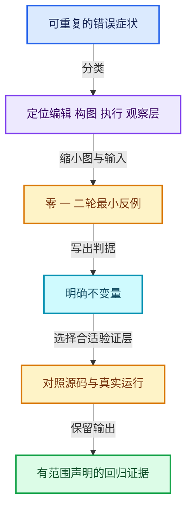

# RZ-14 故障诊断回归与独立实现训练

[返回总入口](../README.md) · [本组导航](README.md) · [源码与版本](../00-课程指南/源码版本与覆盖索引.md)

> 源码基准提交：`e2e58a974edb3a5e949aa273d7ff940b5c5797c8`。具体文件内容以证据清单的 SHA-256 为准。

## 先回答一个具体问题

如何证明自己理解了Repeat，而不是只记住几个类名和一张流程图？

建立由症状到层级的排查法，并用不变量、反例和最小执行器训练检验理解。

## 阅读前需要的概念

1. **`最小复现`**：只保留足以区分正确与错误实现的最小图和输入。

2. **`状态不变量`**：对初始、跨轮或最终状态的明确可验证条件。

3. **`零轮回归`**：验证不执行体且直接返回初始状态的专门案例。

4. **`索引漂移`**：接口或数组重排后仍误用旧位置假设。

5. **`生命周期`**：值、默认存储、上下文和资源从创建到销毁的有效范围。

6. **`需求根`**：使节点必须求值的最终结果需求或显式副作用需求。

7. **`参考模型`**：独立实现数学语义，用作预期值来源，不代替后端集成测试。

8. **`证据范围`**：实际运行或检查过的内容及其未覆盖边界。

## 本篇的机制地图



图中连线标签区分状态流、接口、拥有与观察关系；它不是线程调度记录，也不表示未声明的类型继承关系。

## 核心机制与设计推导

### 01 · 先定位错误层

两端缺状态项先查配对与声明；结果每轮不累计先查状态回传；轮次日志串在一起先查上下文；保存后项目损坏先查序列化与标识。

相同画面症状可能来自不同层，因此先用零、一、二轮数值案例缩小范围。

不要在未证明数值正确前做复杂性能优化。

也不要把所有异常统一归因于缓存。

### 02 · 把不变量写成可判定条件

零轮输出等于初始状态；加一体运行 N 轮输出 initial+max(0,N)；双状态同时更新保持指定递推；稳定标识在重排后仍指向原项目。

每条条件都应明确输入域与观察值。

对浮点、图像和几何则需要合理误差或结构比较。

笼统写正常工作无法构成回归测试。

### 03 · 测试要能击中真实错误

只测N=1无法发现跨轮连线错误；只测一个状态无法发现项目索引交换；只测英文唯一名称无法覆盖显示名变化；只测正常退出无法覆盖取消清理。

案例的价值在于能排除一个具体错误实现。

每个测试应能说出如果哪条连线或拥有关系错了，它会怎样失败。

### 04 · 需求测试不能只看最终值

两个实现都返回同一个整数，其中一个却请求了不必要的昂贵输入，最终值断言不能发现差异。

应另外观察请求次数、usage标记和副作用登记。

当前保守中间需求是实现事实，不应写测试强制要求尚未实现的精确裁剪。

规范与优化目标要分别表达。

### 05 · 资源测试需要覆盖拥有者

复制后修改名称、保存重开、反复创建销毁以及合成器中途取消分别覆盖不同资源路径。

纯Python数值测试没有 C++ 析构和图像Result引用计数，因此不能代替这些回归。

静态源码摘录校验只能保证文档与文件一致。

验收报告应清楚区分这些层次。

### 06 · 独立实现先做顺序版本

先写一个只处理整数元组的repeat函数，支持负轮数视零与轮次从零开始。

再加入外部输入、可观察trace和双状态同时更新。

这个版本用于验证语义，不能冒充 Blender 的 LF 执行器。

只有基础递推正确后，再尝试建立每轮一个调用节点的图表示。

### 07 · 再做最小按需图

为值通道和使用通道设计独立编号，标记每个节点是否已产生输出和正在等待的输入。

加入副作用根后，测试没有结果消费者但仍需观察的情形。

最后考虑图展开、默认值寿命与跨轮需求循环。

不要在最初实验中同时实现全套字段、共享几何和并行调度。

### 08 · 验收以证据陈述为准

本套文档保存源码区间、文件哈希、章节统计与本地脚本输出。

通过静态链接和摘录检查，不等于运行过 Blender 整体回归；通过参考模型，不等于 GPU 像素一致。

未完成的集成检查保留为可执行步骤。

这样的边界可以帮助未来维护者知道需要补哪种证据。

## 小数据推演与反例实验

以下预期来自明确的输入和模型推导。未附 Blender 运行记录的案例属于待执行实验，不把手算结果当作后端实测。

### 实验 01 · 跨轮链被断开

**输入与操作**

每轮都读取初始x，体为x+1，初始0，N=3

**预期与判据**

错误实现返回1，正确结果3

**为什么这个案例有辨别力**

N=1无法区分这两种实现。

**执行时记录**

- 保留输入、轮数与状态项身份，避免只保存截图。
- 将实际观察和上述预期对照；不一致时先定位本实验涉及的边界。

### 实验 02 · 状态位置交换

**输入与操作**

双状态(a,b)=(2,7)，体保持原值

**预期与判据**

正确结果仍是(2,7)

**为什么这个案例有辨别力**

若输出变成(7,2)，检查项目映射与接口顺序。

**执行时记录**

- 保留输入、轮数与状态项身份，避免只保存截图。
- 将实际观察和上述预期对照；不一致时先定位本实验涉及的边界。

### 实验 03 · 轮次偏一

**输入与操作**

体把sum加Iteration，N=3

**预期与判据**

正确结果3

**为什么这个案例有辨别力**

若结果6，可能把轮次从1开始。

**执行时记录**

- 保留输入、轮数与状态项身份，避免只保存截图。
- 将实际观察和上述预期对照；不一致时先定位本实验涉及的边界。

### 实验 04 · 显示名变更

**输入与操作**

创建状态后重命名并再次查找连线

**预期与判据**

稳定identifier仍识别原项目

**为什么这个案例有辨别力**

依赖旧显示名的脚本会暴露问题。

**执行时记录**

- 保留输入、轮数与状态项身份，避免只保存截图。
- 将实际观察和上述预期对照；不一致时先定位本实验涉及的边界。

### 实验 05 · 副作用遗漏

**输入与操作**

无主输出需求，只登记合法轮次Viewer观察

**预期与判据**

目标轮次仍应成为执行需求根

**为什么这个案例有辨别力**

单纯数值测试不会覆盖这个行为。

**执行时记录**

- 保留输入、轮数与状态项身份，避免只保存截图。
- 将实际观察和上述预期对照；不一致时先定位本实验涉及的边界。

### 实验 06 · 证据夸大

**输入与操作**

只跑reference_models.py却宣称Blender后端验证通过

**预期与判据**

验收应判定证据不充分

**为什么这个案例有辨别力**

报告需要按实际运行的工具与范围写明。

**执行时记录**

- 保留输入、轮数与状态项身份，避免只保存截图。
- 将实际观察和上述预期对照；不一致时先定位本实验涉及的边界。

## 连续源码与定向阅读批注

以下代码逐字摘自本地源码，保留原始空行、注释和条件编译。
文件头中的许可证以源文件为准；本教程的说明文字不改变上游源码的授权。
区间摘录不保证从函数边界开始；标题明确标明连续区间时，应结合所链接源文件查看外围声明。
每个块的原始文件、起止行和哈希记入 `_evidence/source-excerpts.json`，校验脚本会逐块比较。

### 源码 01 · 真实LazyFunction测试体系用于迁移测试方法

来源：[source/blender/functions/tests/FN_lazy_function_test.cc](../../../../../source/blender/functions/tests/FN_lazy_function_test.cc)，连续区间 L1—L185。

<!-- source:tests:1:185 -->

```cpp
/* SPDX-FileCopyrightText: 2023 Blender Authors
 *
 * SPDX-License-Identifier: Apache-2.0 */

#include "testing/testing.h"

#include "FN_lazy_function_execute.hh"
#include "FN_lazy_function_graph.hh"
#include "FN_lazy_function_graph_executor.hh"

#include "BLI_task_c.hh"

#include "BKE_gtest_base.hh"

namespace blender::fn::lazy_function::tests {

class LazyFunctionTest : public bke::BlenderGTestBase {};

class AddLazyFunction : public LazyFunction {
 public:
  AddLazyFunction()
  {
    debug_name_ = "Add";
    inputs_.append({"A", CPPType::get<int>()});
    inputs_.append({"B", CPPType::get<int>()});
    outputs_.append({"Result", CPPType::get<int>()});
  }

  void execute_impl(Params &params, const Context & /*context*/) const override
  {
    const int a = params.get_input<int>(0);
    const int b = params.get_input<int>(1);
    params.set_output(0, a + b);
  }
};

class StoreValueFunction : public LazyFunction {
 private:
  int *dst1_;
  int *dst2_;

 public:
  StoreValueFunction(int *dst1, int *dst2) : dst1_(dst1), dst2_(dst2)
  {
    debug_name_ = "Store Value";
    inputs_.append({"A", CPPType::get<int>()});
    inputs_.append({"B", CPPType::get<int>(), ValueUsage::Maybe});
  }

  void execute_impl(Params &params, const Context & /*context*/) const override
  {
    *dst1_ = params.get_input<int>(0);
    if (int *value = params.try_get_input_data_ptr_or_request<int>(1)) {
      *dst2_ = *value;
    }
  }
};

class SimpleSideEffectProvider : public GraphExecutor::SideEffectProvider {
 private:
  Vector<const FunctionNode *> side_effect_nodes_;

 public:
  SimpleSideEffectProvider(Span<const FunctionNode *> side_effect_nodes)
      : side_effect_nodes_(side_effect_nodes)
  {
  }

  Vector<const FunctionNode *> get_nodes_with_side_effects(
      const Context & /*context*/) const override
  {
    return side_effect_nodes_;
  }
};

TEST_F(LazyFunctionTest, SimpleAdd)
{
  const AddLazyFunction add_fn;
  int result = 0;
  execute_lazy_function_eagerly(
      add_fn, nullptr, nullptr, std::make_tuple(30, 5), std::make_tuple(&result));
  EXPECT_EQ(result, 35);
}

TEST_F(LazyFunctionTest, SideEffects)
{
  BLI_task_scheduler_init();
  int dst1 = 0;
  int dst2 = 0;

  const AddLazyFunction add_fn;
  const StoreValueFunction store_fn{&dst1, &dst2};

  Graph graph;
  FunctionNode &add_node_1 = graph.add_function(add_fn);
  FunctionNode &add_node_2 = graph.add_function(add_fn);
  FunctionNode &store_node = graph.add_function(store_fn);
  GraphInputSocket &graph_input = graph.add_input(CPPType::get<int>());

  graph.add_link(graph_input, add_node_1.input(0));
  graph.add_link(graph_input, add_node_2.input(0));
  graph.add_link(add_node_1.output(0), store_node.input(0));
  graph.add_link(add_node_2.output(0), store_node.input(1));

  const int value_10 = 10;
  const int value_100 = 100;
  add_node_1.input(1).set_default_value(&value_10);
  add_node_2.input(1).set_default_value(&value_100);

  graph.update_node_indices();

  SimpleSideEffectProvider side_effect_provider{{&store_node}};

  GraphExecutor executor_fn{graph, {&graph_input}, {}, nullptr, &side_effect_provider, nullptr};
  execute_lazy_function_eagerly(
      executor_fn, nullptr, nullptr, std::make_tuple(5), std::make_tuple());

  EXPECT_EQ(dst1, 15);
  EXPECT_EQ(dst2, 105);
}

class PartialEvaluationTestFunction : public LazyFunction {
 public:
  PartialEvaluationTestFunction()
  {
    debug_name_ = "Partial Evaluation";
    allow_missing_requested_inputs_ = true;

    inputs_.append_as("A", CPPType::get<int>(), ValueUsage::Used);
    inputs_.append_as("B", CPPType::get<int>(), ValueUsage::Used);

    outputs_.append_as("A*2", CPPType::get<int>());
    outputs_.append_as("B*5", CPPType::get<int>());
  }

  void execute_impl(Params &params, const Context & /*context*/) const override
  {
    if (!params.output_was_set(0)) {
      if (int *a = params.try_get_input_data_ptr<int>(0)) {
        params.set_output(0, *a * 2);
      }
    }
    if (!params.output_was_set(1)) {
      if (int *b = params.try_get_input_data_ptr<int>(1)) {
        params.set_output(1, *b * 5);
      }
    }
  }

  void possible_output_dependencies(const int output_index,
                                    FunctionRef<void(Span<int>)> fn) const override
  {
    /* Each output only depends on the input with the same index. */
    const int input_index = output_index;
    fn({input_index});
  }
};

TEST_F(LazyFunctionTest, GraphWithCycle)
{
  const PartialEvaluationTestFunction fn;

  Graph graph;
  FunctionNode &fn_node = graph.add_function(fn);

  GraphInputSocket &input_socket = graph.add_input(CPPType::get<int>());
  GraphOutputSocket &output_socket = graph.add_output(CPPType::get<int>());

  graph.add_link(input_socket, fn_node.input(0));
  /* NOTE: This creates a cycle in the graph. However, it should still be possible to evaluate it,
   * because there is no actual data dependency in the cycle. */
  graph.add_link(fn_node.output(0), fn_node.input(1));
  graph.add_link(fn_node.output(1), output_socket);

  graph.update_node_indices();

  GraphExecutor executor_fn{graph, {&input_socket}, {&output_socket}, nullptr, nullptr, nullptr};
  int result = 0;
  execute_lazy_function_eagerly(
      executor_fn, nullptr, nullptr, std::make_tuple(10), std::make_tuple(&result));

  EXPECT_EQ(result, 10 * 2 * 5);
}

}  // namespace blender::fn::lazy_function::tests
```

**读完这段后回到本篇问题**

- 对照“先定位错误层”，明确这段代码是定义存储、建立接口还是执行已有结构。
- 结合“跨轮链被断开”重画输入到输出的关系，区分源码事实与例子的推导。
- 保留失败分支、默认值、析构和条件编译；不要仅摘取看起来像主算法的几行。

### 源码 02 · Repeat边界分支与协议完整对照

来源：[source/blender/nodes/intern/geometry_nodes_repeat_zone.cc](../../../../../source/blender/nodes/intern/geometry_nodes_repeat_zone.cc)，连续区间 L1—L432。

<!-- source:repeat:1:432 -->

```cpp
/* SPDX-FileCopyrightText: 2024 Blender Authors
 *
 * SPDX-License-Identifier: GPL-2.0-or-later */

/** \file
 * \ingroup nodes
 */

#include "NOD_geometry_nodes_lazy_function.hh"

#include "BKE_compute_contexts.hh"
#include "BKE_node_runtime.hh"
#include "BKE_node_socket_value.hh"

#include "FN_lazy_function_execute.hh"

#include "BLT_translation.hh"

#include "BLI_array_utils.hh"

#include "DEG_depsgraph_query.hh"

#include "FN_lazy_function_graph_executor.hh"

namespace blender::nodes {

using bke::SocketValueVariant;

/**
 * Wraps the execution of a repeat loop body. The purpose is to setup the correct #ComputeContext
 * inside of the loop body. This is necessary to support correct logging inside of a repeat zone.
 * An alternative would be to use a separate `LazyFunction` for every iteration, but that would
 * have higher overhead.
 */
class RepeatBodyNodeExecuteWrapper : public lf::GraphExecutorNodeExecuteWrapper {
 public:
  const bNode *repeat_output_bnode_ = nullptr;
  VectorSet<lf::FunctionNode *> *lf_body_nodes_ = nullptr;

  void execute_node(const lf::FunctionNode &node,
                    lf::Params &params,
                    const lf::Context &context) const override
  {
    GeoNodesUserData &user_data = *static_cast<GeoNodesUserData *>(context.user_data);
    const int iteration = lf_body_nodes_->index_of_try(const_cast<lf::FunctionNode *>(&node));
    const LazyFunction &fn = node.function();
    if (iteration == -1) {
      /* The node is not a loop body node, just execute it normally. */
      fn.execute(params, context);
      return;
    }

    /* Setup context for the loop body evaluation. */
    bke::RepeatZoneComputeContext body_compute_context{
        user_data.compute_context, *repeat_output_bnode_, iteration};
    GeoNodesUserData body_user_data = user_data;
    body_user_data.compute_context = &body_compute_context;
    body_user_data.verbose_log = should_log_verbose_in_context(user_data,
                                                               body_compute_context.hash());

    GeoNodesLocalUserData body_local_user_data{body_user_data};
    lf::Context body_context{context.storage, &body_user_data, &body_local_user_data};
    fn.execute(params, body_context);
  }
};

/**
 * Knows which iterations of the loop evaluation have side effects.
 */
class RepeatZoneSideEffectProvider : public lf::GraphExecutorSideEffectProvider {
 public:
  const bNode *repeat_output_bnode_ = nullptr;
  Span<lf::FunctionNode *> lf_body_nodes_;

  Vector<const lf::FunctionNode *> get_nodes_with_side_effects(
      const lf::Context &context) const override
  {
    GeoNodesUserData &user_data = *static_cast<GeoNodesUserData *>(context.user_data);
    const GeoNodesCallData &call_data = *user_data.call_data;
    if (!call_data.side_effect_nodes) {
      return {};
    }
    const ComputeContextHash &context_hash = user_data.compute_context->hash();
    const Span<int> iterations_with_side_effects =
        call_data.side_effect_nodes->iterations_by_iteration_zone.lookup(
            {context_hash, repeat_output_bnode_->identifier});

    Vector<const lf::FunctionNode *> lf_nodes;
    for (const int i : iterations_with_side_effects) {
      if (i >= 0 && i < lf_body_nodes_.size()) {
        lf_nodes.append(lf_body_nodes_[i]);
      }
    }
    return lf_nodes;
  }
};

struct RepeatEvalStorage {
  LinearAllocator<> allocator;
  VectorSet<lf::FunctionNode *> lf_body_nodes;
  lf::Graph graph;
  std::optional<LazyFunctionForLogicalOr> or_function;
  std::optional<RepeatZoneSideEffectProvider> side_effect_provider;
  std::optional<RepeatBodyNodeExecuteWrapper> body_execute_wrapper;
  std::optional<lf::GraphExecutor> graph_executor;
  Array<SocketValueVariant> index_values;
  void *graph_executor_storage = nullptr;
  bool multi_threading_enabled = false;
  Vector<int> input_index_map;
  Vector<int> output_index_map;
};

class LazyFunctionForRepeatZone : public LazyFunction {
 private:
  const bNodeTree &btree_;
  const bke::bNodeTreeZone &zone_;
  const bNode &repeat_output_bnode_;
  const ZoneBuildInfo &zone_info_;
  const ZoneBodyFunction &body_fn_;

 public:
  LazyFunctionForRepeatZone(const bNodeTree &btree,
                            const bke::bNodeTreeZone &zone,
                            ZoneBuildInfo &zone_info,
                            const ZoneBodyFunction &body_fn)
      : btree_(btree),
        zone_(zone),
        repeat_output_bnode_(*zone.output_node()),
        zone_info_(zone_info),
        body_fn_(body_fn)
  {
    debug_name_ = "Repeat Zone";

    initialize_zone_wrapper(zone, zone_info, body_fn, true, inputs_, outputs_);
    /* Iterations input is always used. */
    inputs_[zone_info.indices.inputs.main[0]].usage = lf::ValueUsage::Used;
  }

  void *init_storage(LinearAllocator<> &allocator) const override
  {
    return allocator.construct<RepeatEvalStorage>().release();
  }

  void destruct_storage(void *storage) const override
  {
    RepeatEvalStorage *s = static_cast<RepeatEvalStorage *>(storage);
    if (s->graph_executor_storage) {
      s->graph_executor->destruct_storage(s->graph_executor_storage);
    }
    std::destroy_at(s);
  }

  void execute_impl(lf::Params &params, const lf::Context &context) const override
  {
    const ScopedNodeTimer node_timer{context, repeat_output_bnode_};

    auto &user_data = *static_cast<GeoNodesUserData *>(context.user_data);
    auto &local_user_data = *static_cast<GeoNodesLocalUserData *>(context.local_user_data);

    const NodeGeometryRepeatOutput &node_storage = *static_cast<const NodeGeometryRepeatOutput *>(
        repeat_output_bnode_.storage);
    RepeatEvalStorage &eval_storage = *static_cast<RepeatEvalStorage *>(context.storage);

    const int iterations_usage_index = zone_info_.indices.outputs.input_usages[0];
    if (!params.output_was_set(iterations_usage_index)) {
      /* The iterations input is always used. */
      params.set_output(iterations_usage_index, true);
    }

    if (!eval_storage.graph_executor) {
      /* Create the execution graph in the first evaluation. */
      this->initialize_execution_graph(
          params, eval_storage, node_storage, user_data, local_user_data);
    }

    /* Execute the graph for the repeat zone. */
    lf::RemappedParams eval_graph_params{*eval_storage.graph_executor,
                                         params,
                                         eval_storage.input_index_map,
                                         eval_storage.output_index_map,
                                         eval_storage.multi_threading_enabled};
    lf::Context eval_graph_context{
        eval_storage.graph_executor_storage, context.user_data, context.local_user_data};
    eval_storage.graph_executor->execute(eval_graph_params, eval_graph_context);
  }

  /**
   * Generate a lazy-function graph that contains the loop body (`body_fn_`) as many times
   * as there are iterations. Since this graph depends on the number of iterations, it can't be
   * reused in general. We could consider caching a version of this graph per number of iterations,
   * but right now that doesn't seem worth it. In practice, it takes much less time to create the
   * graph than to execute it (for intended use cases of this generic implementation, more special
   * case repeat loop evaluations could be implemented separately).
   */
  void initialize_execution_graph(lf::Params &params,
                                  RepeatEvalStorage &eval_storage,
                                  const NodeGeometryRepeatOutput &node_storage,
                                  GeoNodesUserData &user_data,
                                  GeoNodesLocalUserData &local_user_data) const
  {
    const int num_repeat_items = node_storage.items_num;
    const int num_border_links = body_fn_.indices.inputs.border_links.size();

    /* Number of iterations to evaluate. */
    const int iterations = std::max<int>(
        0,
        params.get_input<SocketValueVariant>(zone_info_.indices.inputs.main[0])
            .ensure_type<int>());

    if (iterations >= 10) {
      /* Constructing and running the repeat zone has some overhead so that it's probably worth
       * trying to do something else in the meantime already. */
      lazy_threading::send_hint();
    }

    /* Show a warning when the inspection index is out of range. */
    if (node_storage.inspection_index > 0) {
      if (node_storage.inspection_index >= iterations) {
        if (eval_log::NodeTreeLogger *tree_logger = local_user_data.try_get_tree_logger(user_data))
        {
          tree_logger->node_warnings.append(
              *tree_logger->allocator,
              {repeat_output_bnode_.identifier,
               {NodeWarningType::Info, N_("Inspection index is out of range")}});
        }
      }
    }

    /* Take iterations input into account. */
    const int main_inputs_offset = 1;
    const int body_inputs_offset = 1;

    lf::Graph &lf_graph = eval_storage.graph;

    Vector<lf::GraphInputSocket *> lf_inputs;
    Vector<lf::GraphOutputSocket *> lf_outputs;

    for (const int i : inputs_.index_range()) {
      const lf::Input &input = inputs_[i];
      lf_inputs.append(&lf_graph.add_input(*input.type, this->input_name(i)));
    }
    for (const int i : outputs_.index_range()) {
      const lf::Output &output = outputs_[i];
      lf_outputs.append(&lf_graph.add_output(*output.type, this->output_name(i)));
    }

    /* Create body nodes. */
    VectorSet<lf::FunctionNode *> &lf_body_nodes = eval_storage.lf_body_nodes;
    for ([[maybe_unused]] const int i : IndexRange(iterations)) {
      lf::FunctionNode &lf_node = lf_graph.add_function(*body_fn_.function);
      lf_body_nodes.add_new(&lf_node);
    }

    /* Create nodes for combining border link usages. A border link is used when any of the loop
     * bodies uses the border link, so an "or" node is necessary. */
    Array<lf::FunctionNode *> lf_border_link_usage_or_nodes(num_border_links);
    eval_storage.or_function.emplace(iterations);
    for (const int i : IndexRange(num_border_links)) {
      lf::FunctionNode &lf_node = lf_graph.add_function(*eval_storage.or_function);
      lf_border_link_usage_or_nodes[i] = &lf_node;
    }

    const bool use_index_values = zone_.input_node()->output_socket(0).is_directly_linked();

    if (use_index_values) {
      eval_storage.index_values.reinitialize(iterations);
      threading::parallel_for(IndexRange(iterations), 1024, [&](const IndexRange range) {
        for (const int i : range) {
          eval_storage.index_values[i].emplace<int>(i);
        }
      });
    }

    /* Handle body nodes one by one. */
    static const SocketValueVariant static_unused_index{-1};
    for (const int iter_i : lf_body_nodes.index_range()) {
      lf::FunctionNode &lf_node = *lf_body_nodes[iter_i];
      const SocketValueVariant *index_value = use_index_values ?
                                                  &eval_storage.index_values[iter_i] :
                                                  &static_unused_index;
      lf_node.input(body_fn_.indices.inputs.main[0]).set_default_value(index_value);
      for (const int i : IndexRange(num_border_links)) {
        lf_graph.add_link(*lf_inputs[zone_info_.indices.inputs.border_links[i]],
                          lf_node.input(body_fn_.indices.inputs.border_links[i]));
        lf_graph.add_link(lf_node.output(body_fn_.indices.outputs.border_link_usages[i]),
                          lf_border_link_usage_or_nodes[i]->input(iter_i));
      }

      /* Handle reference sets. */
      for (const auto &item : body_fn_.indices.inputs.reference_sets.items()) {
        lf_graph.add_link(*lf_inputs[zone_info_.indices.inputs.reference_sets.lookup(item.key)],
                          lf_node.input(item.value));
      }
    }

    static bool static_true = true;

    /* Handle body nodes pair-wise. */
    for (const int iter_i : lf_body_nodes.index_range().drop_back(1)) {
      lf::FunctionNode &lf_node = *lf_body_nodes[iter_i];
      lf::FunctionNode &lf_next_node = *lf_body_nodes[iter_i + 1];
      for (const int i : IndexRange(num_repeat_items)) {
        lf_graph.add_link(
            lf_node.output(body_fn_.indices.outputs.main[i]),
            lf_next_node.input(body_fn_.indices.inputs.main[i + body_inputs_offset]));
        /* TODO: Add back-link after being able to check for cyclic dependencies. */
        // lf_graph.add_link(lf_next_node.output(body_fn_.indices.outputs.input_usages[i]),
        //                   lf_node.input(body_fn_.indices.inputs.output_usages[i]));
        lf_node.input(body_fn_.indices.inputs.output_usages[i]).set_default_value(&static_true);
      }
    }

    /* Handle border link usage outputs. */
    for (const int i : IndexRange(num_border_links)) {
      lf_graph.add_link(lf_border_link_usage_or_nodes[i]->output(0),
                        *lf_outputs[zone_info_.indices.outputs.border_link_usages[i]]);
    }

    if (iterations > 0) {
      {
        /* Link first body node to input/output nodes. */
        lf::FunctionNode &lf_first_body_node = *lf_body_nodes[0];
        for (const int i : IndexRange(num_repeat_items)) {
          lf_graph.add_link(
              *lf_inputs[zone_info_.indices.inputs.main[i + main_inputs_offset]],
              lf_first_body_node.input(body_fn_.indices.inputs.main[i + body_inputs_offset]));
          lf_graph.add_link(
              lf_first_body_node.output(
                  body_fn_.indices.outputs.input_usages[i + body_inputs_offset]),
              *lf_outputs[zone_info_.indices.outputs.input_usages[i + main_inputs_offset]]);
        }
      }
      {
        /* Link last body node to input/output nodes. */
        lf::FunctionNode &lf_last_body_node = *lf_body_nodes.as_span().last();
        for (const int i : IndexRange(num_repeat_items)) {
          lf_graph.add_link(lf_last_body_node.output(body_fn_.indices.outputs.main[i]),
                            *lf_outputs[zone_info_.indices.outputs.main[i]]);
          lf_graph.add_link(*lf_inputs[zone_info_.indices.inputs.output_usages[i]],
                            lf_last_body_node.input(body_fn_.indices.inputs.output_usages[i]));
        }
      }
    }
    else {
      /* There are no iterations, just link the input directly to the output. */
      for (const int i : IndexRange(num_repeat_items)) {
        lf_graph.add_link(*lf_inputs[zone_info_.indices.inputs.main[i + main_inputs_offset]],
                          *lf_outputs[zone_info_.indices.outputs.main[i]]);
        lf_graph.add_link(
            *lf_inputs[zone_info_.indices.inputs.output_usages[i]],
            *lf_outputs[zone_info_.indices.outputs.input_usages[i + main_inputs_offset]]);
      }
      for (const int i : IndexRange(num_border_links)) {
        static bool static_false = false;
        lf_outputs[zone_info_.indices.outputs.border_link_usages[i]]->set_default_value(
            &static_false);
      }
    }

    lf_outputs[zone_info_.indices.outputs.input_usages[0]]->set_default_value(&static_true);

    /* The graph is ready, update the node indices which are required by the executor. */
    lf_graph.update_node_indices();

    // std::cout << "\n\n" << lf_graph.to_dot() << "\n\n";

    /* Create a mapping from parameter indices inside of this graph to parameters of the repeat
     * zone. The main complexity below stems from the fact that the iterations input is handled
     * outside of this graph. */
    eval_storage.output_index_map.reinitialize(outputs_.size() - 1);
    eval_storage.input_index_map.resize(inputs_.size() - 1);
    array_utils::fill_index_range<int>(eval_storage.input_index_map, 1);

    Vector<const lf::GraphInputSocket *> lf_graph_inputs = lf_inputs.as_span().drop_front(1);

    const int iteration_usage_index = zone_info_.indices.outputs.input_usages[0];
    array_utils::fill_index_range<int>(
        eval_storage.output_index_map.as_mutable_span().take_front(iteration_usage_index));
    array_utils::fill_index_range<int>(
        eval_storage.output_index_map.as_mutable_span().drop_front(iteration_usage_index),
        iteration_usage_index + 1);

    Vector<const lf::GraphOutputSocket *> lf_graph_outputs = lf_outputs.as_span().take_front(
        iteration_usage_index);
    lf_graph_outputs.extend(lf_outputs.as_span().drop_front(iteration_usage_index + 1));

    eval_storage.body_execute_wrapper.emplace();
    eval_storage.body_execute_wrapper->repeat_output_bnode_ = &repeat_output_bnode_;
    eval_storage.body_execute_wrapper->lf_body_nodes_ = &lf_body_nodes;
    eval_storage.side_effect_provider.emplace();
    eval_storage.side_effect_provider->repeat_output_bnode_ = &repeat_output_bnode_;
    eval_storage.side_effect_provider->lf_body_nodes_ = lf_body_nodes;

    eval_storage.graph_executor.emplace(lf_graph,
                                        std::move(lf_graph_inputs),
                                        std::move(lf_graph_outputs),
                                        nullptr,
                                        &*eval_storage.side_effect_provider,
                                        &*eval_storage.body_execute_wrapper);
    eval_storage.graph_executor_storage = eval_storage.graph_executor->init_storage(
        eval_storage.allocator);

    /* Log graph for debugging purposes. */
    const bNodeTree &btree_orig = *DEG_get_original(&btree_);
    if (btree_orig.runtime->logged_zone_graphs) {
      std::lock_guard lock{btree_orig.runtime->logged_zone_graphs->mutex};
      btree_orig.runtime->logged_zone_graphs->graph_by_zone_id.lookup_or_add_cb(
          repeat_output_bnode_.identifier, [&]() { return lf_graph.to_dot(); });
    }
  }

  std::string input_name(const int i) const override
  {
    return zone_wrapper_input_name(zone_info_, zone_, inputs_, i);
  }

  std::string output_name(const int i) const override
  {
    return zone_wrapper_output_name(zone_info_, zone_, outputs_, i);
  }
};

LazyFunction &build_repeat_zone_lazy_function(ResourceScope &scope,
                                              const bNodeTree &btree,
                                              const bke::bNodeTreeZone &zone,
                                              ZoneBuildInfo &zone_info,
                                              const ZoneBodyFunction &body_fn)
{
  return scope.construct<LazyFunctionForRepeatZone>(btree, zone, zone_info, body_fn);
}

}  // namespace blender::nodes
```

**读完这段后回到本篇问题**

- 对照“把不变量写成可判定条件”，明确这段代码是定义存储、建立接口还是执行已有结构。
- 结合“状态位置交换”重画输入到输出的关系，区分源码事实与例子的推导。
- 保留失败分支、默认值、析构和条件编译；不要仅摘取看起来像主算法的几行。

### 源码 03 · 立即执行测试工具

来源：[source/blender/functions/FN_lazy_function_execute.hh](../../../../../source/blender/functions/FN_lazy_function_execute.hh)，连续区间 L1—L158。

<!-- source:params:1:158 -->

```cpp
/* SPDX-FileCopyrightText: 2023 Blender Authors
 *
 * SPDX-License-Identifier: GPL-2.0-or-later */

#pragma once

/** \file
 * \ingroup fn
 *
 * This file contains common utilities for actually executing a lazy-function.
 */

#include "BLI_generic_pointer.hh"

#include "FN_lazy_function.hh"

namespace blender::fn::lazy_function {

/**
 * Most basic implementation of #Params. It does not actually implement any logic for how to
 * retrieve inputs or set outputs. Instead, code using #BasicParams has to implement that.
 */
class BasicParams : public Params {
 private:
  const Span<GMutablePointer> inputs_;
  const Span<GMutablePointer> outputs_;
  MutableSpan<std::optional<ValueUsage>> input_usages_;
  Span<ValueUsage> output_usages_;
  MutableSpan<bool> set_outputs_;

 public:
  BasicParams(const LazyFunction &fn,
              Span<GMutablePointer> inputs,
              Span<GMutablePointer> outputs,
              MutableSpan<std::optional<ValueUsage>> input_usages,
              Span<ValueUsage> output_usages,
              MutableSpan<bool> set_outputs);

  void *try_get_input_data_ptr_impl(const int index) const override;
  void *try_get_input_data_ptr_or_request_impl(const int index) override;
  void *get_output_data_ptr_impl(const int index) override;
  void output_set_impl(const int index) override;
  bool output_was_set_impl(const int index) const override;
  ValueUsage get_output_usage_impl(const int index) const override;
  void set_input_unused_impl(const int index) override;
  bool try_enable_multi_threading_impl() override;
};

/**
 * Wraps an existing #Params. This should be used when a lazy-function internally contains another
 * lazy-function that handles a subset or the inputs and outputs.
 */
class RemappedParams : public Params {
 private:
  Params &base_params_;
  Span<int> input_map_;
  Span<int> output_map_;
  bool &multi_threading_enabled_;

 public:
  RemappedParams(const LazyFunction &fn,
                 Params &base_params,
                 Span<int> input_map,
                 Span<int> output_map,
                 bool &multi_threading_enabled);

  void *try_get_input_data_ptr_impl(const int index) const override;
  void *try_get_input_data_ptr_or_request_impl(const int index) override;
  void *get_output_data_ptr_impl(const int index) override;
  void output_set_impl(const int index) override;
  bool output_was_set_impl(const int index) const override;
  ValueUsage get_output_usage_impl(const int index) const override;
  void set_input_unused_impl(const int index) override;
  bool try_enable_multi_threading_impl() override;
};

namespace detail {

/**
 * Utility to implement #execute_lazy_function_eagerly.
 */
template<typename... Inputs, typename... Outputs, size_t... InIndices, size_t... OutIndices>
inline void execute_lazy_function_eagerly_impl(const LazyFunction &fn,
                                               UserData *user_data,
                                               LocalUserData *local_user_data,
                                               std::tuple<Inputs...> &inputs,
                                               std::tuple<Outputs *...> &outputs,
                                               std::index_sequence<InIndices...> /*in_indices*/,
                                               std::index_sequence<OutIndices...> /*out_indices*/)
{
  constexpr size_t InputsNum = sizeof...(Inputs);
  constexpr size_t OutputsNum = sizeof...(Outputs);
  std::array<GMutablePointer, InputsNum> input_pointers;
  std::array<GMutablePointer, OutputsNum> output_pointers;
  std::array<std::optional<ValueUsage>, InputsNum> input_usages;
  std::array<ValueUsage, OutputsNum> output_usages;
  std::array<bool, OutputsNum> set_outputs;
  (
      [&]() {
        constexpr size_t I = InIndices;
        /* Use `typedef` instead of `using` to work around a compiler bug. */
        using T = Inputs;
        const CPPType &type = CPPType::get<T>();
        input_pointers[I] = {type, &std::get<I>(inputs)};
      }(),
      ...);
  (
      [&]() {
        constexpr size_t I = OutIndices;
        /* Use `typedef` instead of `using` to work around a compiler bug. */
        using T = Outputs;
        const CPPType &type = CPPType::get<T>();
        output_pointers[I] = {type, std::get<I>(outputs)};
      }(),
      ...);
  output_usages.fill(ValueUsage::Used);
  set_outputs.fill(false);
  LinearAllocator<> allocator;
  Context context(fn.init_storage(allocator), user_data, local_user_data);
  BasicParams params{
      fn, input_pointers, output_pointers, input_usages, output_usages, set_outputs};
  fn.execute(params, context);
  fn.destruct_storage(context.storage);

  /* Make sure all outputs have been computed. */
  BLI_assert(!Span<bool>(set_outputs).contains(false));
}

}  // namespace detail

/**
 * In some cases (mainly for tests), the set of inputs and outputs for a lazy-function is known at
 * compile time and one just wants to compute the outputs based on the inputs, without any
 * laziness.
 *
 * This function does exactly that. It takes all inputs in a tuple and writes the outputs to points
 * provided in a second tuple. Since all inputs have to be provided, the lazy-function has to
 * compute all outputs.
 */
template<typename... Inputs, typename... Outputs>
inline void execute_lazy_function_eagerly(const LazyFunction &fn,
                                          UserData *user_data,
                                          LocalUserData *local_user_data,
                                          std::tuple<Inputs...> inputs,
                                          std::tuple<Outputs *...> outputs)
{
  BLI_assert(fn.inputs().size() == sizeof...(Inputs));
  BLI_assert(fn.outputs().size() == sizeof...(Outputs));
  detail::execute_lazy_function_eagerly_impl(fn,
                                             user_data,
                                             local_user_data,
                                             inputs,
                                             outputs,
                                             std::make_index_sequence<sizeof...(Inputs)>(),
                                             std::make_index_sequence<sizeof...(Outputs)>());
}

}  // namespace blender::fn::lazy_function
```

**读完这段后回到本篇问题**

- 对照“测试要能击中真实错误”，明确这段代码是定义存储、建立接口还是执行已有结构。
- 结合“轮次偏一”重画输入到输出的关系，区分源码事实与例子的推导。
- 保留失败分支、默认值、析构和条件编译；不要仅摘取看起来像主算法的几行。

## 练习与参考答案

### 练习 01 · 解释“先定位错误层”

**题目**

不看代码，说明“先定位错误层”解决的具体问题，并给出一个会违背其约束的错误实现。

**参考答案的核心**

两端缺状态项先查配对与声明；结果每轮不累计先查状态回传；轮次日志串在一起先查上下文；保存后项目损坏先查序列化与标识。

**验收追问**

也不要把所有异常统一归因于缓存。

**自查方法**

回到上面的源码区间和本篇实验，找出支持该回答的实际字段、调用或分支；若答案是设计推论，应明确写为推论。

### 练习 02 · 解释“把不变量写成可判定条件”

**题目**

不看代码，说明“把不变量写成可判定条件”解决的具体问题，并给出一个会违背其约束的错误实现。

**参考答案的核心**

零轮输出等于初始状态；加一体运行 N 轮输出 initial+max(0,N)；双状态同时更新保持指定递推；稳定标识在重排后仍指向原项目。

**验收追问**

笼统写正常工作无法构成回归测试。

**自查方法**

回到上面的源码区间和本篇实验，找出支持该回答的实际字段、调用或分支；若答案是设计推论，应明确写为推论。

### 练习 03 · 解释“测试要能击中真实错误”

**题目**

不看代码，说明“测试要能击中真实错误”解决的具体问题，并给出一个会违背其约束的错误实现。

**参考答案的核心**

只测N=1无法发现跨轮连线错误；只测一个状态无法发现项目索引交换；只测英文唯一名称无法覆盖显示名变化；只测正常退出无法覆盖取消清理。

**验收追问**

每个测试应能说出如果哪条连线或拥有关系错了，它会怎样失败。

**自查方法**

回到上面的源码区间和本篇实验，找出支持该回答的实际字段、调用或分支；若答案是设计推论，应明确写为推论。

### 练习 04 · 解释“需求测试不能只看最终值”

**题目**

不看代码，说明“需求测试不能只看最终值”解决的具体问题，并给出一个会违背其约束的错误实现。

**参考答案的核心**

两个实现都返回同一个整数，其中一个却请求了不必要的昂贵输入，最终值断言不能发现差异。

**验收追问**

规范与优化目标要分别表达。

**自查方法**

回到上面的源码区间和本篇实验，找出支持该回答的实际字段、调用或分支；若答案是设计推论，应明确写为推论。

### 练习 05 · 解释“资源测试需要覆盖拥有者”

**题目**

不看代码，说明“资源测试需要覆盖拥有者”解决的具体问题，并给出一个会违背其约束的错误实现。

**参考答案的核心**

复制后修改名称、保存重开、反复创建销毁以及合成器中途取消分别覆盖不同资源路径。

**验收追问**

验收报告应清楚区分这些层次。

**自查方法**

回到上面的源码区间和本篇实验，找出支持该回答的实际字段、调用或分支；若答案是设计推论，应明确写为推论。

### 练习 06 · 解释“独立实现先做顺序版本”

**题目**

不看代码，说明“独立实现先做顺序版本”解决的具体问题，并给出一个会违背其约束的错误实现。

**参考答案的核心**

先写一个只处理整数元组的repeat函数，支持负轮数视零与轮次从零开始。

**验收追问**

只有基础递推正确后，再尝试建立每轮一个调用节点的图表示。

**自查方法**

回到上面的源码区间和本篇实验，找出支持该回答的实际字段、调用或分支；若答案是设计推论，应明确写为推论。

### 练习 07 · 解释“再做最小按需图”

**题目**

不看代码，说明“再做最小按需图”解决的具体问题，并给出一个会违背其约束的错误实现。

**参考答案的核心**

为值通道和使用通道设计独立编号，标记每个节点是否已产生输出和正在等待的输入。

**验收追问**

不要在最初实验中同时实现全套字段、共享几何和并行调度。

**自查方法**

回到上面的源码区间和本篇实验，找出支持该回答的实际字段、调用或分支；若答案是设计推论，应明确写为推论。

### 练习 08 · 解释“验收以证据陈述为准”

**题目**

不看代码，说明“验收以证据陈述为准”解决的具体问题，并给出一个会违背其约束的错误实现。

**参考答案的核心**

本套文档保存源码区间、文件哈希、章节统计与本地脚本输出。

**验收追问**

这样的边界可以帮助未来维护者知道需要补哪种证据。

**自查方法**

回到上面的源码区间和本篇实验，找出支持该回答的实际字段、调用或分支；若答案是设计推论，应明确写为推论。

## 本篇完成标准

- 能直接回答：如何证明自己理解了Repeat，而不是只记住几个类名和一张流程图？
- 能解释本篇目标：建立由症状到层级的排查法，并用不变量、反例和最小执行器训练检验理解。
- 能手算至少一个正轮数案例和一个边界案例，并说明各自验证的错误类型。
- 能沿源码链接区分配置、构图、求值和观察各阶段。
- 能陈述本篇实际证据的范围，不把静态摘录核对写成后端运行通过。

## 继续阅读

- 上一篇：[13-合成器与GPU重复区域实现](../04-实战后端与验收/13-合成器与GPU重复区域实现.md)
- [练习脚本与运行范围](../示例/README.md)
- [验收记录与尚未执行的集成检查](../00-课程指南/验收报告.md)
