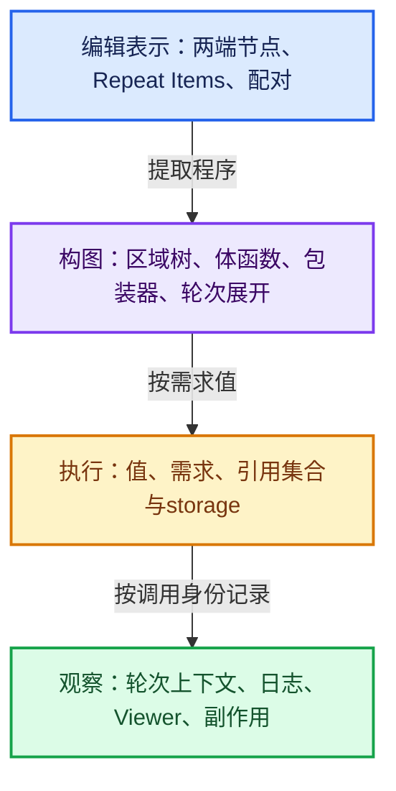

# Blender 重复区域源码学习

本套课程围绕 Repeat Zone，沿用“全面学习-codex”的组织方式：总入口、课程指南、主题分组、真实源码、机制推导、小数据反例、练习和校验证据。

正文共 **14 篇、19,513 行**，每篇 **1,202—1,611 行**。

行数包含说明文字、Mermaid 源码、练习和连续原始源码；没有把这些数量称为纯讲解文字行数。

源码摘录放在相关正文中，公共依赖会在不同专题中按问题重复引用，以便单篇可以独立阅读。

## 从这里开始

- [学习路线与阶段验收](00-课程指南/学习路线与阶段验收.md)：按使用、实现、调试三种目标进入。
- [阅读规范与图表约定](00-课程指南/阅读规范与图表约定.md)：分清源码事实、设计推导和运行证据。
- [源码版本与覆盖索引](00-课程指南/源码版本与覆盖索引.md)：本地源码基准、文件职责和摘录记录。
- [术语与符号速查](00-课程指南/术语与符号速查.md)：按编辑、构图、执行、观察和后端分层查找。
- [验收报告](00-课程指南/验收报告.md)：文档校验、参考模型与真实 Blender 测试的实际范围。
- [可运行示例](示例/README.md)：纯 Python 推演与 Blender 节点构建脚本。
- [证据与维护工具](_evidence/README.md)：源码哈希、摘录清单和校验工具。

## 四个主题分组

- [01 · 语义与编辑表示](01-语义与编辑表示/README.md)：全景、数据结构、区域发现和编辑脚本。
- [02 · 构图与按需执行](02-构图与按需执行/README.md)：循环体提取、按轮数展开和需求传播。
- [03 · 值寿命与观察机制](03-值寿命与观察机制/README.md)：字段引用、内存拥有、日志、副作用和持久化。
- [04 · 实战后端与验收](04-实战后端与验收/README.md)：性能、算法案例、合成器/GPU与回归训练。

编号表示推荐阅读顺序；09 归在编辑表示组，10 归在值寿命组，因此按目录遍历不等于编号顺序。

## 十四篇正文

- **RZ-01 [重复区域全景与状态递推](01-语义与编辑表示/01-重复区域全景与状态递推.md)** · 1,357 行。建立状态递推、区域边界、执行图和观察上下文四层模型，能够手算每一轮的输入输出。
- **RZ-02 [DNA存储配对与动态插槽](01-语义与编辑表示/02-DNA存储配对与动态插槽.md)** · 1,330 行。区分持久化状态项、节点配对标识、插槽稳定标识与运行时位置索引。
- **RZ-03 [区域发现嵌套关系与跨界连线](01-语义与编辑表示/03-区域发现嵌套关系与跨界连线.md)** · 1,291 行。理解配对发现、区域依赖关系、父子归属、边界插槽和合法跨界方向。
- **RZ-04 [循环体提取与Zone接口协议](02-构图与按需执行/04-循环体提取与Zone接口协议.md)** · 1,286 行。掌握体函数、包装器、数据输入输出、使用需求和引用集合的接口布局。
- **RZ-05 [按轮数展开执行图与零轮分支](02-构图与按需执行/05-按轮数展开执行图与零轮分支.md)** · 1,611 行。能逐条画出主值、轮次、边界输入和需求通道在展开图中的连接。
- **RZ-06 [需求传播跨界输入与参数重映射](02-构图与按需执行/06-需求传播跨界输入与参数重映射.md)** · 1,566 行。理解Maybe与Used、跨轮保守需求、OR聚合以及RemappedParams的具体映射。
- **RZ-07 [状态值Field引用与内存寿命](03-值寿命与观察机制/07-状态值Field引用与内存寿命.md)** · 1,604 行。区分值载体、字段表达式、几何数据、引用集合与求值临时存储的寿命。
- **RZ-08 [轮次上下文日志Viewer与副作用](03-值寿命与观察机制/08-轮次上下文日志Viewer与副作用.md)** · 1,551 行。理解轮次身份、父上下文、体调用包装、检查索引和副作用需求根。
- **RZ-09 [编辑操作RNA与Python构建](01-语义与编辑表示/09-编辑操作RNA与Python构建.md)** · 1,321 行。从操作器、RNA集合和Accessor追到项目更新与两端声明刷新。
- **RZ-10 [复制保存加载与版本边界](03-值寿命与观察机制/10-复制保存加载与版本边界.md)** · 1,452 行。把项目数组、字符串、配对标识与运行时求值图分开，明确持久化与临时资源边界。
- **RZ-11 [性能模型并行边界与调试方法](04-实战后端与验收/11-性能模型并行边界与调试方法.md)** · 1,460 行。分别分析构图开销、调度开销、状态依赖与几何规模，建立可复现的性能实验。
- **RZ-12 [数值几何与嵌套算法实战](04-实战后端与验收/12-数值几何与嵌套算法实战.md)** · 1,243 行。用小状态设计累计、仿射更新、斐波那契、收敛迭代、几何累计与嵌套循环。
- **RZ-13 [合成器与GPU重复区域实现](04-实战后端与验收/13-合成器与GPU重复区域实现.md)** · 1,202 行。掌握合成器逐轮操作、Result共享、取消清理与GPU宏路径，避免跨后端误用结论。
- **RZ-14 [故障诊断回归与独立实现训练](04-实战后端与验收/14-故障诊断回归与独立实现训练.md)** · 1,239 行。建立由症状到层级的排查法，并用不变量、反例和最小执行器训练检验理解。

## 四层理解模型

状态递推是 `S_(i+1)=F(S_i,i,B)`，最终结果是 `S_max(0,N)`。

`S` 是跨轮状态，`B` 是从区域外进入的输入，`i` 从零开始；`N=0` 不执行体，直接返回初始状态。

## 使用与证据边界

源码基准为 `e2e58a974edb3a5e949aa273d7ff940b5c5797c8`，具体字节内容由证据中的 SHA-256 记录。

本机已用独立安装的 Blender 5.2.0 LTS 验证附带仿射递推节点脚本；该可执行程序不是本仓库当前工作树的编译产物。

源码静态复核与二进制实测是互补证据，不声称二者版本相同，也不声称已运行合成器或 GPU 的完整回归。

本目录只编写课程和示例，没有修改 Blender C++ 实现。
