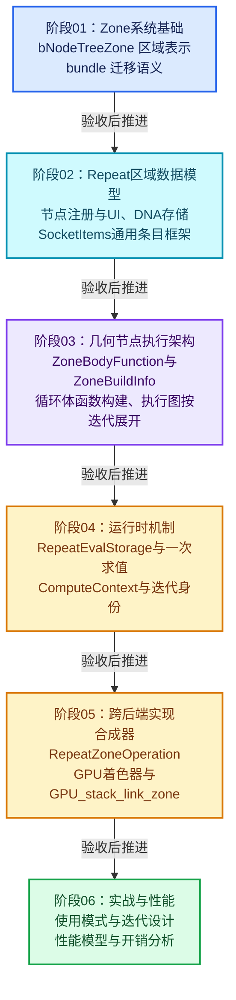
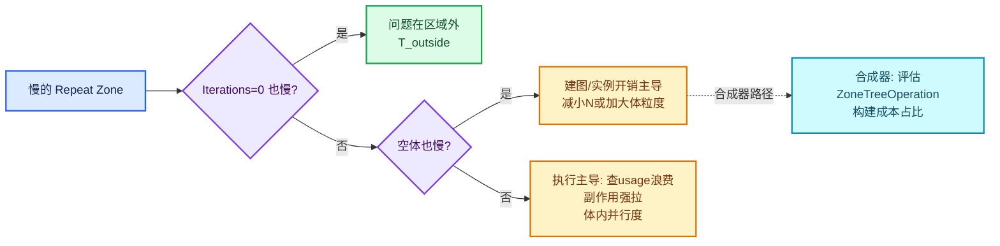

# 学习路线与阶段验收

> 阅读方式：本篇是"重复区域（Repeat Zone）全面学习"系列的课程指南，对应六个内容章节（01—06）。
> 建议按阶段推进：每阶段先读"学习目标"和"前置知识"，再带着"验收问题"去读对应章节与源码；
> 每个阶段交付一份可以手算核对或写成小代码验证的成果，完成阅读不等于完成训练。
> 源码链接均使用相对路径，从本文件所在目录出发即可直达仓库内真实实现。
> 验收问题的参考提示放在折叠块中，先自己作答，再展开核对。

本系列讨论的对象是 Blender 节点系统中的**重复区域（Repeat Zone）**：一对 `Repeat Input` / `Repeat Output` 节点围出来的区域，内部节点按"迭代次数"反复执行，上一次迭代的输出成为下一次迭代的输入。它既出现在几何节点中（完整实现），也出现在合成器与材质节点中（各自后端的简化实现）。理解它需要横跨四个层面：

1. **数据模型层**：节点如何声明、存储、序列化"任意数量的迭代条目"（`NodeRepeatItem` 与 SocketItems 框架）。
2. **表示层**：节点树如何被分析成"区域"（`bNodeTreeZone`），区域的边界链接如何收集。
3. **执行层**：区域如何被编译成惰性函数图（`ZoneBodyFunction` / `ZoneBuildInfo`），并按迭代展开执行。
4. **跨后端层**：合成器（`RepeatZoneOperation`）与 GPU（`GPU_stack_link_zone` + 着色器宏）如何用完全不同的策略实现同一个语义。

每个阶段都遵循同一个训练节奏：**先建立正确性对照，再构造边界和退化输入，最后讨论优化**。要求能解释拥有关系、状态变化和代价来源。

---

## 总路线



六个阶段的成果物：

| 阶段 | 章节 | 成果（动手产物） |
| --- | --- | --- |
| 01 | Zone系统基础 | 手绘一棵带嵌套区域的节点树的 `bNodeTreeZones` 分析结果（zones 数组、zone_by_node_id 映射、border_links 列表） |
| 02 | Repeat区域数据模型 | 一份"条目生命周期表"：增、删、改名、重排、保存、加载六个动作下 `NodeRepeatItem` 各字段与 socket identifier 的变化 |
| 03 | 几何节点执行架构 | 手工把一个 2 迭代、1 条区域条目、1 条边界链接的 Repeat Zone 展开成惰性函数图（节点与连线的文字描述或 DOT 图） |
| 04 | 运行时机制 | 追踪一次 3 迭代求值的 `ComputeContext` 链与副作用触发路径，写出每次迭代执行了哪些 lf 节点 |
| 05 | 跨后端实现 | 对照表：几何节点 / 合成器 / GPU 三种后端在"迭代次数来源""迭代间数据传递""并行性"上的差异 |
| 06 | 实战与性能 | 一个自制基准节点树的耗时拆解：图构建、逐迭代执行、边界链接 usage 归并各占多少 |

时间安排以实际掌握为准。前置不等式：**阶段02 依赖阶段01 的区域概念；阶段03/04 强耦合，建议连读；阶段05 可以在 01 之后平行读；阶段06 需要至少跑通一次几何节点求值**。

---

## 通用准备

在进入阶段01 之前，确认具备以下环境与习惯：

- 仓库根目录即当前 Blender 源码树；本文所有链接形如 `../../../source/...`，从本文件目录回退三级即仓库根。
- 能用 IDE 的"跳转到定义"跟踪 `bke::`、`nodes::`、`lf::` 三个命名空间的类型。`lf` 是 `blender::fn::lazy_function` 的惯用缩写，对应惰性函数框架。
- 准备一张纸或画图工具，本系列大量机制是"图变换"：节点树 → 区域树 → 惰性函数图 → 展开后的执行图。纸上画不出来，说明没读懂。
- 如果要实际运行：构建一次带调试信息的 Blender，几何节点求值日志（Node Tree 面板中的执行时间、警告）是最便宜的观察手段；阶段04 会用到 `logged_zone_graphs` 的 DOT 导出。

---

# 阶段01：Zone系统基础

对应章节：`01-Zone系统基础`。

## 学习目标

- 能说出"区域（Zone）"在 Blender 节点树中的表示方式：它不是一种节点，而是**一对接口节点 + 一组归属分析结果**。
- 掌握 `bNodeTreeZone` 的字段语义：`input_node_id` / `output_node_id` / `parent_zone` / `child_zones` / `child_node_ids` / `border_links`。
- 理解区域树的层级规则：链接只能进入区域、不能从内层区域跳到外层区域。
- 建立"bundle 迁移语义"的直觉：Repeat Output 的每条区域条目 socket，在 Repeat Input 上有同名同类型的一对输入/输出，值沿"输出条目 → 输入条目"跨迭代传递。

## 前置知识

- 节点树基础数据结构：`bNodeTree`、`bNode`、`bNodeSocket`、`bNodeLink`（见 `source/blender/makesdna/DNA_node_types.h`）。
- 拓扑缓存（topology cache）概念：`ensure_topology_cache()` 后，节点的上下游链接可 O(1) 查询。
- C++ 基础：`std::optional`、`Vector`、`Map`（Blender 自有容器）。

## 涉及源码

| 文件 | 关注点 |
| --- | --- |
| [BKE_node_tree_zones.hh](../../../source/blender/blenkernel/BKE_node_tree_zones.hh) | `bNodeTreeZone` 与 `bNodeTreeZones` 的完整类定义，本阶段的核心阅读对象 |
| [node_tree_zones.cc](../../../source/blender/blenkernel/intern/node_tree_zones.cc) | 区域分析的实现：如何划分 `child_node_ids`、如何收集 `border_links` |
| [DNA_node_types.h](../../../source/blender/makesdna/DNA_node_types.h) | `NodeGeometryRepeatInput` / `NodeGeometryRepeatOutput` 的 DNA 存储雏形（阶段02 展开） |
| [node_geo_repeat.cc](../../../source/blender/nodes/geometry/nodes/node_geo_repeat.cc) | 输入/输出节点的 socket 声明，观察"迭代条目"如何变成普通 socket |

## 知识点展开

### 1.1 区域是什么、不是什么

在 Blender 的节点树里，区域由两个**接口节点**（zone interface node）划定：Repeat Zone 的 `GeometryNodeRepeatInput` 与 `GeometryNodeRepeatOutput`。节点本身不执行计算；真正"区域"这个概念是**派生数据**：`bNodeTree::zones()` 返回的 `bNodeTreeZones`，在对树做修改后重新分析得到。

`bNodeTreeZone`（[BKE_node_tree_zones.hh](../../../source/blender/blenkernel/BKE_node_tree_zones.hh) 第 23—55 行）的字段逐个过：

- `index`：区域在树中所有区域数组里的下标。`ZoneBuildInfo` 等结构用这个下标做索引（阶段03）。
- `depth`：0 为顶层区域，嵌套一层加一。合成器与 GPU 后端对嵌套深度的支持不同（阶段05）。
- `input_node_id` / `output_node_id`：都是 `std::optional<int>`——一个区域可能只有输出节点没有输入节点（例如 For Each 区域在某些退化情况），接口是可选的。
- `parent_zone` / `child_zones`：直接父子，`child_zones` 不含递归后代；递归查询用 `contains_zone_recursively`。
- `child_node_ids`：**直接归属**本区域的节点，排除属于子区域的节点。注意边界节点（Repeat Input/Output 本身）也算"在区域内"。
- `border_links`：穿过区域边界且携带信息的链接。注释明确排除了静音链接、不可用链接和只挂在 reroute 上的悬空链接。这是阶段03"边界链接（border link）"机制的数据来源。

### 1.2 区域间的链接规则

`bNodeTreeZones::link_between_zones_is_allowed` 的语义：链接**只能向内进入区域，不能向外穿出**。具体地，从区域 A 到区域 B 的链接合法当且仅当 A 是 B 自身或 B 的祖先。这条规则决定了：

- Repeat Zone 内的节点可以把值送到外面的 Repeat Output，反之不行；
- 从 Repeat Zone 内部直接连到zone 外部是不允许的，必须经过 Output 节点的条目 socket；
- 嵌套时内层区域可以看到外层区域的一切（通过 border_links 逐层传递）。

`get_zones_to_enter` / `get_zones_to_enter_from_root` 回答"一条从外到内的链接要依次穿过哪些区域"，实现按 `depth` 逐层下降。这组 API 在惰性函数图构建时被用来给链接安插正确的区域包装（阶段03）。

### 1.3 zone_by_node_id 与 get_zone_by_socket

`bNodeTreeZones::zone_by_node_id` 是 `Map<int, int>`：节点 id → 区域 index。注释特别说明：**位于区域边界的节点（如 Repeat Input/Output）映射到它们所创建的区域**。而 `get_zone_by_socket` 更细：**Simulation Input 的输入 socket 与输出 socket 属于不同区域**——输入侧在区域外，输出侧在区域内。Repeat Input 同理：它的 `Iterations` 输入在区域外求值，`Iteration` 输出在区域内。这个细节决定了很多执行语义（比如 Iterations 值必须在进入循环前就确定）。

### 1.4 bundle 迁移语义

"bundle"在这里指 Repeat Output 上由 `NodeRepeatItem` 动态生成的一组 socket（每个条目一个输入+一个输出对）。Repeat Input 节点声明 socket 时（[node_geo_repeat.cc](../../../source/blender/nodes/geometry/nodes/node_geo_repeat.cc) 第 72—111 行）做了三件事：

1. 读取 `storage.output_node_id` 找到配对的 Repeat Output，遍历其 `items`，为每个条目添加**同名、同类型、同 identifier** 的输入与输出 socket；
2. 输出 socket 用 `propagate_all({input_decl.index()})` 声明：它的字段/属性沿输入 socket 传播（几何的域、命名属性等语义在几何节点系统里靠这个传递）；
3. 追加一个 `__extend__` 扩展 socket：把外部任意 socket 拖到节点体上时，`node_insert_link` 调用 `try_add_item_via_any_extend_socket` 自动新建条目。

"迁移语义"指：第 k 次迭代中，Repeat Input 条目 socket 上的值，等于第 k-1 次迭代中 Repeat Output 同名条目 socket 上产生的值；第 0 次迭代取的是区域外连进来的初值。这个语义在执行层被展开为"body 函数实例 k-1 的输出 → 实例 k 的输入"的连线（阶段03 第 299—311 行的 pair-wise 循环）。

## 阶段练习

**练习 A：手算区域分析**

画出这样一棵几何节点树（节点名即 id）：

```
Group Input ──→ Repeat Input(1) ─┬→ Transform ─┐
                                 │             ├→ Repeat Output(1) ──→ Group Output
   Noise ──→ Value to String ────┘(进入区域内)  │
                                              ├→ [内部再嵌套一对 Repeat Input(2)/Output(2)]
```

具体设定：

- Repeat Zone 1 内有 3 个普通节点：Transform、嵌套 Repeat Input(2)、嵌套 Repeat Output(2)；嵌套区域 2 内有 1 个节点 Scale。
- Repeat Output(1) 有一条条目 socket `Geometry`；树外有一条 `Group Input → Repeat Input(1)` 的链接。
- 噪声节点在区域 1 外，其输出经 Value to String 连到区域 1 内的某个文本输入。

要求写出：

1. `zones_ptrs` 数组（每项的 index、depth、input_node_id、output_node_id）；
2. `zone_by_node_id` 中每个节点的映射；
3. 区域 1 的 `child_node_ids` 与 `child_zones`；
4. 区域 1 的 `border_links` 有几条、各是什么；区域 2 的呢（噪声值要进入区域 2 需要穿过几层边界？）。

<details><summary>练习 A 提示</summary>

- zones_ptrs：两个区域。区域 1：depth 0，input/output 指向 Repeat Input(1)/Output(1)；区域 2：depth 1，父区域是区域 1。
- zone_by_node_id：Transform、Scale、四个接口节点都映射到所属区域；Group Input、Noise、Value to String、Group Output 不在映射中（在区域外）。注意 Repeat Input(1) 映射到区域 1 而不是"区域外"。
- 区域 1 的 child_node_ids：Transform + 两个嵌套接口节点（不含 Scale，它属于区域 2）；child_zones 含区域 2。
- 区域 1 的 border_links：Group Input→Repeat Input(1) 的初值链接 + 噪声字符串进入区域的链接（若 Value to String 在区域外）共 2 条。区域 2 若也接收该文本，则该链接同时是区域 1 的 border_link 与区域 2 的 border_link——"穿过边界"是按区域统计的。
</details>

**练习 B：bundle 迁移手算**

设 Repeat Zone 有一个整型条目 `Count`，Iterations=3，外部初值 5，循环体内节点链为 `Count → Add(1) → Repeat Output`（即每次迭代加 1）。写出每次迭代中 Repeat Input 的 `Count` 输入 socket 与 Repeat Output 的 `Count` 输出 socket 的值。

<details><summary>练习 B 提示</summary>

迭代 0：输入 5（外部初值），输出 6；迭代 1：输入 6，输出 7；迭代 2：输入 7，输出 8。区域输出值为 8。注意迭代次数是 3，一共执行 3 次 body，最后一步"输出"不额外执行。
</details>

**练习 C：链接合法性判断**

判断以下操作在 UI 中是否被允许，并用 `link_between_zones_is_allowed` 的规则解释：

1. Repeat Output(1) 的条目输出 → 区域外的 Group Output；
2. 区域 1 内普通节点 → 区域 2 内普通节点（区域 2 嵌套在区域 1 内）；
3. 区域 2 内普通节点 → 区域 1 内普通节点；
4. Repeat Input(1) 的 `Iteration` 输出 → 区域 1 内普通节点。

<details><summary>练习 C 提示</summary>

1. 允许：Output 节点的条目输出就是区域的对外出口（from_zone 视角是"从区域内到区域自身/外部经接口节点"）。2. 允许：向内进入子区域。3. 不允许：从内层区域直接跳到外层，必须经 Repeat Output(2) 的条目 socket 出来。4. 允许：接口节点的输出本来就在区域内。
</details>

## 验收问题

回答以下问题后再展开提示核对。目标：不翻源码能答出主干，翻源码能指出行号。

1. **区域（Zone）在节点树中的原始存储是什么？`bNodeTreeZone` 是原始数据还是派生数据？**

<details><summary>提示</summary>

原始存储只有一对节点类型（GeometryNodeRepeatInput/Output）及其 DNA storage。`bNodeTreeZone`/`bNodeTreeZones` 是运行时分析结果，由 `bNodeTree::zones()`（内部 `bke::get_tree_zones`）提供，树修改后失效重建。所有字段（parent_zone、child_node_ids、border_links）都是分析产物，不写进 .blend 文件。
</details>

2. **`border_links` 收集哪些链接、排除哪些链接？为什么排除那几类？**

<details><summary>提示</summary>

收集穿过区域边界且携带信息的链接；排除静音链接、不可用（unavailable）链接、以及只连到 reroute 链的悬空链接。排除原因：它们不会在执行时传输值，进入执行图只会引入无意义的依赖与开销。
</details>

3. **为什么 Repeat Input 的 `Iterations` 输入必须被视为"区域外"的输入？如果允许它依赖循环体内的节点会发生什么？**

<details><summary>提示</summary>

迭代次数决定循环体要实例化多少次（执行图按迭代展开），因此它必须在进入循环前已知。若允许其依赖体内节点则构成循环依赖：体先执行才知道要执行几次，逻辑上无定义。这也解释了 `link_between_sockets_is_allowed` 对 socket 所在区域的检查。
</details>

4. **`zone_by_node_id` 如何映射边界节点？`get_zone_by_socket` 与它有什么差别？**

<details><summary>提示</summary>

边界节点映射到它创建的区域。socket 级查询更细：接口节点的输入 socket 可能在区域外、输出 socket 在区域内（注释以 Simulation Input 为例；Repeat Input 同构——`Iterations` 在外、`Iteration` 在内）。
</details>

5. **bundle 迁移语义中，"第 0 次迭代取外部初值"由哪个机制保证？条目 socket 的 identifier 在其中起什么作用？**

<details><summary>提示</summary>

由执行图构建时的连线保证：第一个 body 实例的条目输入连到区域的外部输入，后续实例连到前一实例的输出（geometry_nodes_repeat_zone.cc 中 first/last body 的连线代码）。identifier（`Item_<id>`）是输入节点与输出节点 socket 配对的稳定键，改名或重排不破坏配对。
</details>

6. **两条进入同一区域的外部链接，最终会合并成区域的一条输入吗？`get_zones_to_enter` 解决什么问题？**

<details><summary>提示</summary>

区域包装函数的输入按"区域"组织而不是按链接：多条外部链接进入同一区域时对应同一组区域输入的不同条目。`get_zones_to_enter` 返回从外到内要依次进入的区域序列，惰性函数构建时据此把一条链接逐层"接入"每个途经区域的 border_link 输入。
</details>

7. **一个区域可能没有输入节点吗？代码里哪个字段的设计暗示了这一点？**

<details><summary>提示</summary>

可能。`bNodeTreeZone::input_node_id` 与 `output_node_id` 都是 `std::optional<int>`，且分析代码对两者独立处理。Light Iter（着色器区域）甚至在 `node_shader_tree.cc` 里有"只加了 INPUT 没加 OUTPUT"的兜底补齐逻辑。
</details>

8. **嵌套区域中，内层区域节点能看到外层循环的 `Iteration` 输出吗？机制是什么？**

<details><summary>提示</summary>

能。外层 `Iteration` 是区域 1 内的普通数据流，进入区域 2 时成为区域 2 的一条 border_link，再映射为区域 2 的外部输入。`get_zones_to_enter` 决定它穿过哪些层，每层的 body 函数都有一个对应的 border_link 输入参数。
</details>

---

# 阶段02：Repeat区域数据模型

对应章节：`02-Repeat区域数据模型`。

## 学习目标

- 掌握 `NodeRepeatItem` 的字段与生命周期，理解 `identifier` 的稳定键作用。
- 掌握 `RepeatItemsAccessor` 如何把 Repeat 条目接入通用 `socket_items` 框架，能列举框架要求的全部静态成员。
- 理解 DNA 存储的所有权：`items` 数组的分配、释放、拷贝，以及 .blend 读写路径。
- 能解释"动态 socket 声明"：条目如何变成 socket、socket 名字如何绑定到条目名字段、UI 列表如何联动。

## 前置知识

- 阶段01 的 bundle 概念。
- Blender 节点注册流程：`node_register`、`node_declare`、`node_type_storage`、`NODE_STORAGE_FUNCS`。
- RNA 基础：`StructRNA`、property 指针绑定（`socket_name_ptr`）。

## 涉及源码

| 文件 | 关注点 |
| --- | --- |
| [DNA_node_types.h](../../../source/blender/makesdna/DNA_node_types.h) | `NodeRepeatItem`（约 3543 行）、`NodeGeometryRepeatInput`、`NodeGeometryRepeatOutput` |
| [NOD_geo_repeat.hh](../../../source/blender/nodes/geometry/include/NOD_geo_repeat.hh) | `RepeatItemsAccessor` 全文，89 行，本阶段主文本 |
| [node_geo_repeat.cc](../../../source/blender/nodes/geometry/nodes/node_geo_repeat.cc) | 两个节点的 declare/init/free/copy/insert_link/blend_write/blend_read |
| [NOD_socket_items.hh](../../../source/blender/nodes/NOD_socket_items.hh) | 通用条目框架：add/remove/move/clear、blend 读写、ops |
| [rna_nodetree.cc](../../../source/blender/makesrna/intern/rna_nodetree.cc) | `RNA_RepeatItem` 的 SDNA 绑定（`RNA_def_struct_sdna(srna, "NodeRepeatItem")`） |

## 知识点展开

### 2.1 NodeRepeatItem：一条迭代条目长什么样

```cpp
struct NodeRepeatItem {
  char *name = nullptr;               // 条目名（=socket 显示名），堆上字符串
  eNodeSocketDatatype socket_type;    // socket 类型
  char _pad[2];
  int identifier = 0;                 // 稳定唯一 id，生成 socket identifier 用
};
```

三个要点：

- **identifier 的不变式**：由 `NodeGeometryRepeatOutput::next_identifier` 单调分配，永不复用。注释原文："Generated unique identifier for sockets which stays the same even when the item order or names change"。这保证 .blend 里按 identifier 建立的链接在重排/改名后仍有效。
- **name 的所有权**：`char*` 归条目所有，拷贝条目必须深拷贝（`copy_item` 里 `BLI_strdup_null`），析构必须 `MEM_SAFE_DELETE`。这是典型的"DNA 结构 + 手工内存管理"组合，漏掉任一边就是内存错误。
- **没有默认值字段**：条目只描述"通道"，值由链接决定；未链接时用 socket 类型默认值。对比 `NodeForeachGeometryElementInputItem`（同一文件稍后），可以看到不同区域条目各自增减字段。

### 2.2 两个节点的存储结构

- `NodeGeometryRepeatInput` 只有一个字段 `output_node_id`：指向配对 Output 节点的 `bNode.identifier`。**配对关系是存出来的，不是分析出来的**——所以 Output 被删除时 Input 会悬空，代码里到处是 `node_by_id(...) == nullptr` 的防御（如 declare 里 `tree->node_by_id(storage.output_node_id)`）。
- `NodeGeometryRepeatOutput` 持有条目数组：`items`（裸数组指针）+ `items_num` + `active_index`（UI 选中项）+ `next_identifier`（id 分配器）+ `inspection_index`（节点检查器聚焦第几次迭代，阶段04 会见到它产生越界警告）。

### 2.3 RepeatItemsAccessor：一个访问器适配整个框架

[NOD_geo_repeat.hh](../../../source/blender/nodes/geometry/include/NOD_geo_repeat.hh) 是"策略类"模式的教科书案例。`socket_items` 框架对"节点上有一组动态条目"这一模式做了泛化，具体类型差异由 Accessor 的静态成员提供。逐个过：

| 成员 | 语义 |
| --- | --- |
| `ItemT` | 条目类型 = `NodeRepeatItem` |
| `item_srna` | 条目的 RNA 类型（`RNA_RepeatItem`），socket 名字绑定到 RNA 属性用 |
| `node_type` / `node_idname` | 哪种节点持有条目（`GeometryNodeRepeatOutput`） |
| `has_type` / `has_name` | 条目是否有类型/名字字段（Repeat 都有） |
| `operator_idnames` | 增/删/移三个 UI 操作符的 idname |
| `ui_idnames` | 条目列表 UI 模板（`DATA_UL_repeat_zone_state`） |
| `rna_names` | RNA 属性名（`repeat_items`、`active_index`） |
| `get_items_from_node` | 从 `bNode` 取 `{&items, &items_num, &active_index}` 三元组 |
| `copy_item` / `destruct_item` | 深拷贝与释放（见上） |
| `blend_write_item` / `blend_read_data_item` | 条目的 .blend 序列化（只写 name 字符串，其余字段是 POD 直接落盘） |
| `get_socket_type` / `get_name` | 条目 → socket 类型/名字 |
| `supports_socket_type` | 该节点树类型是否支持该 socket 类型 |
| `init_with_socket_type_and_name` | 初始化：设类型、分配 identifier、去重命名 |
| `socket_identifier_for_item` | 返回 `"Item_" + identifier`——socket 的稳定 identifier |

框架侧（`NOD_socket_items.hh`）提供 `add_item_with_socket_type_and_name`、`try_add_item_via_any_extend_socket`、`clear`、`copy_array`、`destruct_array`、`blend_write/blend_read_data`、`make_common_operators` 等函数模板，全部以 Accessor 为参数。**一个新区域类型接入 = 写一个 Accessor**，Simulation、Foreach、Closure 条目都是这么接入的。

### 2.4 动态 socket 声明与 RNA 名字绑定

Repeat Output 的 `node_declare`（[node_geo_repeat.cc](../../../source/blender/nodes/geometry/nodes/node_geo_repeat.cc) 第 176—207 行）遍历条目生成 socket 对。关键调用 `.socket_name_ptr(&tree->id, *item_srna, &item, "name")`：socket 的显示名不是独立字符串，而是**指向条目的 `name` 字段**的 RNA 绑定——在节点面板上改 socket 名等于改条目名，UI 列表（`DATA_UL_repeat_zone_state`）里同步刷新。

`node_init`（第 209—224 行）的细节：新建 Output 节点时**只在几何节点树**里预置一个 `Geometry` 条目（`SOCK_GEOMETRY`），其他树类型（如合成器复用该节点类型时）不预置。`node_free_storage` / `node_copy_storage` 分别走 `destruct_array` / `copy_array`，保证 name 指针不双重释放、不浅拷贝。

### 2.5 从链接自动创建条目

两处 `node_insert_link` 都调 `try_add_item_via_any_extend_socket`：当用户把一条链接拖到 `__extend__` socket 上，框架按链接的 socket 类型新建条目并连上。Repeat Input 的版本先把目标 Output 节点找出来（条目统一存放在 Output 侧），失败则放行。`node_gather_link_searches`（第 252—297 行）则实现了"从搜索菜单拖一个 socket 类型进来就生成一对配好的 Input/Output 节点"，注意它先 `clear` 掉自动预置条目再按需 `add_item_with_socket_type_and_name`，最后手动补一条 Input→Output 的内部链接（`input_node.output_socket(1) → output_node.input_socket(0)`，即 Iterations 通道）。

### 2.6 序列化

`node_blend_write` / `node_blend_read` 只做一件事：委托 `socket_items::blend_write<RepeatItemsAccessor>` / `blend_read_data<...>`。框架对数组做整体读写，对每个条目调用 Accessor 的 `blend_write_item`（写 name 字符串）与 `blend_read_data_item`（读回并接管指针）。`_pad` 字段与 POD 部分由 DNA 系统处理。**identifier 与 next_identifier 原样落盘**——这就是"重开文件后链接不乱"的最终保障。

## 阶段练习

**练习 A：条目生命周期表**

针对一个有 2 条条目（`Geometry`/SOCK_GEOMETRY/id=0，`Count`/SOCK_INT/id=1，next_identifier=2）的 Repeat Output，填写下表（在纸上画）：

| 动作 | items 内容 | next_identifier | 受影响 socket identifier | 备注 |
| --- | --- | --- | --- | --- |
| 删除 Count | ? | ? | ? | active_index 如何修正？ |
| 在头部插入 Float 条目 | ? | ? | ? | 已有链接会断吗？ |
| Count 改名为 Amount | ? | ? | ? | |
| 把 Count 移到第一位 | ? | ? | ? | |
| undo 上述所有操作 | ? | ? | ? | 依赖什么机制？ |

<details><summary>练习 A 提示</summary>

- 删除 Count：items_num 1→（剩 Geometry），next_identifier 不变（2），socket `Item_1` 消失；active_index 若指向被删项要夹取（clamp）到合法范围。
- 插入 Float：id=2，next_identifier→3，socket `Item_2`；已有链接不受影响（identifier 不重排）。
- 改名：socket identifier 不变（仍是 `Item_1`），只是显示名经 `socket_name_ptr` 联动变 `Amount`。
- 移动：数组顺序变，identifier 不变；socket 在面板上的排列顺序跟随条目顺序。
- undo：依赖节点 storage 的完整拷贝/恢复机制，`copy_array` 保证深拷贝正确。
</details>

**练习 B：写一个最小 Accessor**

参照 `RepeatItemsAccessor`，在纸上（或真的写一个编译不过也没关系的头文件）为一个假想的 `NodeMyZoneItem` 写 Accessor。必须包含：ItemT、get_items_from_node、copy_item、destruct_item、socket_identifier_for_item、init_with_socket_type_and_name。标注每一处"如果漏写会发生什么"。

<details><summary>练习 B 提示</summary>

漏 `destruct_item` → name 泄漏；漏 `copy_item` 深拷贝 → 双重释放；`socket_identifier_for_item` 不稳定（例如用下标）→ 重排后链接错位；`get_items_from_node` 返回错误的 items_num → 越界。框架的默认值（`SocketItemsAccessorDefaults`）可覆盖一部分成员。
</details>

**练习 C：对比阅读**

打开 `NodeForeachGeometryElementInputItem`（DNA_node_types.h 中紧跟 Repeat 结构之后）与 `NodeSimulationItem`，列出它们与 `NodeRepeatItem` 的字段差异，并推测差异来源（例如 foreach 条目是否需要记录"是否使用"标志、simulation 条目是否需要缓冲区信息）。

<details><summary>练习 C 提示</summary>

Focus：foreach 的条目带 `ignore` 类标志；simulation 条目带差分/缓冲相关语义。共同点：都有 name + socket_type + identifier 三件套，都走 socket_items 框架——差异只体现在 Accessor 特化与少数字段。
</details>

## 验收问题

1. **`NodeRepeatItem::identifier` 与 `bNodeSocket::identifier` 分别由谁分配？为什么不能用数组下标代替？**

<details><summary>提示</summary>

条目 identifier 由 Output 存储的 `next_identifier` 单调分配并写进 socket identifier（`Item_<id>`）。下标会随增删/重排变化，导致 .blend 里按 identifier 存的链接与 UI 状态错位；单调 id 是"跨保存会话稳定"的最小要求。
</details>

2. **`copy_item` 为什么要 `BLI_strdup_null`？省掉它在哪两个操作路径上各爆出什么问题？**

<details><summary>提示</summary>

name 是堆上字符串，条目按位拷贝会让两个条目共享同一指针。路径一：节点拷贝（node_copy_storage → copy_array）后析构时双重释放；路径二：undo/redo 恢复 storage 时新旧条目共享指针，一方修改 name 内容影响另一方。
</details>

3. **Repeat Input 上没有任何条目数据，它如何知道该声明哪些 socket？这个设计的好处与代价各是什么？**

<details><summary>提示</summary>

声明时经 `storage.output_node_id` 反查配对 Output 的条目数组。好处：条目单点存储，两端天然一致；代价：存在悬空引用可能（Output 被删），所有读取处都要判空；且 Input 的声明依赖另一节点，文件加载顺序上要保证 storage 先就位。
</details>

4. **`socket_name_ptr` 绑定解决了什么 UI/数据一致性问题？如果不绑定、改socket 名时会发生什么？**

<details><summary>提示</summary>

它让 socket 显示名直接读写条目的 name 字段，"socket 面板改名"与"条目列表改名"是同一份数据。不绑定则出现两份名字：改 socket 不改条目（或反之），声明重建（declare 以条目名为准）后 UI 名字被打回，用户困惑。
</details>

5. **`__extend__` socket 与 `node_insert_link` 如何协作实现"拖链接自动加条目"？条目加在哪个节点上？**

<details><summary>提示</summary>

拖到 `__extend__` 触发 insert_link → `try_add_item_via_any_extend_socket<RepeatItemsAccessor>`。条目始终加在 Output 侧（Input 的实现先把配对 Output 找出来传入）。框架同时负责按链接类型设条目 socket_type、分配 identifier、生成唯一名。
</details>

6. **`node_gather_link_searches` 里为什么先 `clear` 再 `add_item_with_socket_type_and_name`？`node_init` 已经预置了一个 Geometry 条目，直接用行不行？**

<details><summary>提示</summary>

搜索菜单场景：用户拖的是一个具体类型/名字的 socket，预置的 Geometry 条目类型可能不匹配。clear 保证生成的一对节点只含所需条目；随后还要手动补 Iterations 内部链接与配对 id，因为这两样不是 add_item 的职责。
</details>

7. **.blend 读写中，哪些字段靠框架整体读写、哪些靠 Accessor 的 item 钩子？`next_identifier` 需要特殊处理吗？**

<details><summary>提示</summary>

数组骨架（items 指针/数量）与 POD 字段由 DNA/框架处理；name 字符串走 `blend_write_item`/`blend_read_data_item`（指针需要重定位）。next_identifier 是普通 int，随 storage 落盘，无需钩子——但若漏读会导致重开文件后分配重复 id，这是好的错误注入实验点。
</details>

8. **如果把 `socket_identifier_for_item` 改成 `"Item_" + 下标`，构造一个会出问题的具体用户操作序列。**

<details><summary>提示</summary>

建两条条目 A(id0)/B(id1) 并连好链接，删除 A：B 的下标从 1 变 0，socket identifier 变成 `Item_0`，而 .blend/undo 系统里指向 `Item_1` 的引用全部错位；同文件里甚至出现两个 `Item_0`（新加条目与 B）。
</details>

---

# 阶段03：几何节点执行架构

对应章节：`03-几何节点执行架构`。这是全系列的枢纽：阶段04 的运行时行为完全由本阶段的图构建决定。

## 学习目标

- 掌握 `ZoneFunctionIndices` / `ZoneBuildInfo` / `ZoneBodyFunction` 三个结构：区域包装函数与循环体函数如何用同一套索引描述各自参数。
- 理解 `build_zone_body_function` 如何把区域内部节点打包成一个惰性函数：main 输入输出、border_links、usage 通道三部分。
- **核心**：逐行理解 `LazyFunctionForRepeatZone::initialize_execution_graph` 的展开算法——迭代实例、pair-wise 串联、first/last 接线、border link usage 的 OR 归并、0 迭代直通。
- 理解 `RepeatEvalStorage` 里"为什么执行图要存到 storage 而不是成员变量"。

## 前置知识

- 阶段01 的 border_links 与 bundle 迁移。
- 惰性函数（LazyFunction）框架的基本概念：`LazyFunction::inputs_/outputs_`、`lf::Graph`、`lf::GraphExecutor`、`ValueUsage`（Used/Maybe/Unused）。
- `SocketValueVariant`：几何节点所有 socket 值的统一变体容器。

## 涉及源码

| 文件 | 关注点 |
| --- | --- |
| [NOD_geometry_nodes_lazy_function.hh](../../../source/blender/nodes/NOD_geometry_nodes_lazy_function.hh) | `ZoneFunctionIndices`（591 行起）、`ZoneBuildInfo`（605）、`ZoneBodyFunction`（618）、`initialize_zone_wrapper` 声明 |
| [geometry_nodes_lazy_function.cc](../../../source/blender/nodes/intern/geometry_nodes_lazy_function.cc) | `build_zone_body_function`（2280 行起）、`build_repeat_zone_function`（2243） |
| [geometry_nodes_repeat_zone.cc](../../../source/blender/nodes/intern/geometry_nodes_repeat_zone.cc) | 全文 432 行，本阶段主文本，`initialize_execution_graph` 在 195—410 行 |
| [FN_lazy_function_graph.hh](../../../source/blender/functions/FN_lazy_function_graph.hh) | `lf::Graph` 的 add_input/add_output/add_function/add_link 语义 |

## 知识点展开

### 3.1 三个结构：索引即接口

区域编译产物的核心问题是：包装函数（代表整个区域）与体函数（代表区域内全部节点）参数很多且语义各异（数据、usage、边界链接、引用集），靠什么对齐？答案是一份**索引表**：

```cpp
struct ZoneFunctionIndices {
  struct {  // inputs
    Vector<int> main;                     // 数据通道
    Vector<int> border_links;             // 穿边链接（只出现在体函数）
    Vector<int> output_usages;            // "这个输出还有没有人要" bool 通道
    Map<ReferenceSetIndex, int> reference_sets; // 引用集（属性传播相关）
  } inputs;
  struct {  // outputs
    Vector<int> main;
    Vector<int> border_link_usages;       // 体函数输出：第 i 条边界链接是否被用过
    Vector<int> input_usages;             // 包装函数输出：区域输入是否被用过
  } outputs;
};
```

- `ZoneBuildInfo { lazy_function, indices }`：包装函数 + 它的索引表。外部代码（比如上层图构建器）通过它把区域当普通节点接入大图。
- `ZoneBodyFunction { function, indices }`：体函数 + 它的索引表。注释说得直白：**"The 'body' function is wrapped by another lazy-function which represents the zone as a hole. The wrapper function might invoke the zone body multiple times (like for repeat zones)."** 这句话是整个 Repeat 实现的纲。

### 3.2 build_zone_body_function：把区域打包成函数

[geometry_nodes_lazy_function.cc](../../../source/blender/nodes/intern/geometry_nodes_lazy_function.cc) 第 2280 行起，五步：

1. **输入通道**：遍历 `zone.input_node()->output_sockets()`，每个可用 socket 生成体图的一个输入 + 一个 `Usage: <name>` 的 bool 输出，登记进 `body_fn.indices`。
2. **边界链接**：`build_zone_border_links_inputs` 为每条 `zone.border_links` 生成输入；`build_zone_border_link_input_usages` 生成对应的"用过没有"bool 输出。
3. **输出通道**：遍历 `zone.output_node()->input_sockets()`，生成体图输出 + "这个输出还要不要"bool 输入。
4. `insert_nodes_and_zones(zone.child_nodes(), zone.child_zones, ...)`：把区域内的节点与**嵌套子区域**递归插入体图。
5. 收尾：usage 传播、fix_link_cycles、构造 `GraphExecutor` 作为体函数。

注意 usage 通道的方向：**"输出是否被需要"从下游流向上游**，所以体函数的输出侧有 usage *输入*、输入侧有 usage *输出*。Repeat 场景下这组通道是"按需执行"的骨架（阶段04）。

### 3.3 LazyFunctionForRepeatZone 构造：包装函数长什么样

[geometry_nodes_repeat_zone.cc](../../../source/blender/nodes/intern/geometry_nodes_repeat_zone.cc) 第 113—137 行。构造函数只做两件事：

- `initialize_zone_wrapper(zone, zone_info, body_fn, true, inputs_, outputs_)`：按区域接口生成包装函数的输入输出列表（Iterations + 条目 + 边界链接 + usage 通道，顺序与 zone_info.indices 对齐）。
- 强制 `inputs_[...main[0]].usage = Used`：**Iterations 输入永远被需要**。这一行注释就是阶段01 验收问题 3 的代码落点——迭代次数是展开参数，没有惰性可言。

### 3.4 initialize_execution_graph：按迭代展开（核心）

第 195—410 行。执行时机：**第一次 `execute_impl` 时**（`if (!eval_storage.graph_executor)`），因为展开数量依赖运行期读到的 Iterations 值。算法逐步：

1. **读迭代数**：`max(0, params.get_input<int>(...))`——负数夹到 0。
2. **并行提示**：`iterations >= 10` 时 `lazy_threading::send_hint()`——建图本身有开销，提示调度器可以开新线程，别把当前线程卡死（阶段06 性能话题）。
3. **inspection 越界警告**：`inspection_index >= iterations` 时发 Info 级警告（第 217—227 行）。
4. **建体节点**：`for (i : IndexRange(iterations)) lf_graph.add_function(*body_fn_.function)`——同一个体函数实例化 iterations 次，存进 `lf_body_nodes`（VectorSet，兼作"节点→迭代号"的索引，阶段04 的 wrapper 依赖这一点）。
5. **OR 节点**：每条边界链接建一个 `LazyFunctionForLogicalOr(iterations)` 节点。语义：**"边界链接被用过" = 任一迭代用过它**。短路求值（LazyFunctionForLogicalOr 支持 short-circuit）保证前面的迭代已为真时不再检查后面的。
6. **Iteration 索引值**：只有当 Repeat Input 的 `Iteration` 输出真的被链接时（`is_directly_linked`）才生成 0..n-1 的值数组，否则统一给 `static_unused_index{-1}`——避免为没人读的索引分配/计算。
7. **逐实例接线**：
   - 边界链接：区域输入 → 每个实例的 border_link 输入；实例的 border_link_usage 输出 → OR 节点第 i 个输入。
   - 引用集：区域输入 → 每个实例对应输入。
8. **pair-wise 串联**（第 299—311 行）：对相邻实例 `(k, k+1)`，把实例 k 的每个条目输出连到实例 k+1 的对应条目输入；同时把实例 k 的 `output_usages` 输入**硬编码为 true**（`static_true`）——中间迭代的输出一定有"下游"（下一个迭代），usage 恒真。注意旁边被注释掉的回边 TODO：**usage 反向传播目前没实现**，即"下一个迭代不用某条目，上一个迭代也算它被用过"，这是一个保守近似。
9. **首尾接线**（第 319—343 行）：第一个实例的条目输入 ← 区域外部输入，其 input_usage 输出 → 区域输出 usage；最后一个实例的条目输出 → 区域输出，其 output_usage 输入 ← 区域的 output_usages 输入（**只有最后一次迭代尊重真实 usage**，按需执行链到这里才闭合）。
10. **0 迭代直通**（else 分支，第 344—358 行）：条目输入直连条目输出，input_usage 直通，border_link_usage 全部置 false。**零次迭代时区域退化为纯转发**。
11. **参数重映射**（第 367—385 行）：`input_index_map` / `output_index_map` 处理"Iterations 参数由包装函数自己消费，不进子图"的偏移错位——子图比包装函数少 1 个输入、输出里 Iterations 的 usage 槽位被挖掉。
12. **组装执行器**：`GraphExecutor` 携带 side_effect_provider 与 body_execute_wrapper（阶段04 的两位主角）。

最后有个彩蛋：`btree_orig.runtime->logged_zone_graphs`——如果启用了区域图日志，把 `lf_graph.to_dot()` 存起来，这就是用户可见的"Repeat Zone 展开图"调试功能。

### 3.5 RepeatEvalStorage 的字段分工

```cpp
struct RepeatEvalStorage {
  LinearAllocator<> allocator;          // 子执行器 storage 的宿主
  VectorSet<lf::FunctionNode *> lf_body_nodes; // 实例列表（兼迭代号索引）
  lf::Graph graph;                      // 展开后的图（必须活到执行结束）
  std::optional<LazyFunctionForLogicalOr> or_function; // 所有 OR 节点共享
  std::optional<RepeatZoneSideEffectProvider> side_effect_provider;
  std::optional<RepeatBodyNodeExecuteWrapper> body_execute_wrapper;
  std::optional<lf::GraphExecutor> graph_executor;
  Array<SocketValueVariant> index_values; // Iteration 索引值缓存
  void *graph_executor_storage = nullptr;
  bool multi_threading_enabled = false;
  Vector<int> input_index_map, output_index_map;
};
```

**为什么放 storage 而不是 LazyFunction 成员？** LazyFunction 实例在图构建期创建、同一节点树的所有求值共享（可能多线程同时用）；而展开图依赖**每次求值的 Iterations 值**，是 per-evaluation 状态。惰性函数框架的约定就是：可变状态放 `init_storage` 返回的 per-execution 结构里。`init_storage`/`destruct_storage`（第 139—151 行）负责创建与级联销毁（先销毁子执行器的 storage）。

## 阶段练习

**练习 A：手工展开 2 迭代图**

设定：Repeat Zone 有条目 `Geometry`，Iterations=2，Repeat Input 的 `Iteration` 输出未链接，有一条边界链接 `Noise → (区域内) Set Position`。请画出展开后的 lf 图，标出：每个节点（2 个 body 实例 + 1 个 OR 节点）、全部连线、哪条线传的是 bool。

<details><summary>练习 A 提示</summary>

节点：Body#0、Body#1、OR(border_link)。连线：
- 区域输入 Geometry → Body#0.main[1]（main[0] 是 Iteration，未用，给默认 -1）。
- Body#0.main[0] → Body#1.main[1]（pair-wise）。
- Body#1.main[0] → 区域输出 Geometry。
- 区域 border_link 输入 → Body#0.border_link 与 Body#1.border_link（同一来源分两路）。
- Body#0.border_link_usage → OR.in[0]；Body#1.border_link_usage → OR.in[1]；OR.out → 区域 border_link_usage 输出。
- Body#0 的 output_usage 输入 ← static_true；Body#1 的 output_usage 输入 ← 区域的 output_usages 输入。
- Body#0 的 input_usage 输出 → 区域 input_usage 输出。
</details>

**练习 B：0 与 1 次迭代的退化**

分别推导 Iterations=0 和 Iterations=1 时的图形状。1 次迭代时 pair-wise 循环体（`drop_back(1)`）执行了几次？first/last 接线是否作用在同一个实例上？

<details><summary>练习 B 提示</summary>

0 次：无 body 节点，条目直通、border usage 置 false（else 分支）。1 次：pair-wise 循环 `IndexRange(1).drop_back(1)` 为空，不执行；first 与 last 接线都作用于 Body#0——它的输入来自区域外部、输出直达区域输出，同时它的 output_usage 由区域 usage 驱动。即单迭代时行为最"诚实"。
</details>

**练习 C：usage 近似反例**

构造一个节点树，演示第 8 步的保守近似（中间迭代 output_usages 硬编码 true）导致"实际没人需要的计算仍被执行"。提示：循环体内放一个昂贵节点，其输出只有最后一次迭代的结果被外部使用，而中间迭代输出喂给一个"条件为假"的 Switch。

<details><summary>练习 C 提示</summary>

体：`Geometry → Switch(条件=false) → Repeat Output`。外部只用区域输出。因为 Body#k 的 output_usage 被钉成 true，Switch 在每次迭代都会真正求值（惰性框架认为"有人要"），即使最终结果被丢弃。当前实现里这正是文档化 TODO 的行为；如果想验证，对比同样结构放在区域外的求值时间。
</details>

**练习 D：读 DOT**

把 `geometry_nodes_repeat_zone.cc` 第 365 行的注释解开（或在调试器里调用 `lf_graph.to_dot()`），对一个 3 迭代、2 条目的区域导出 DOT，用 Graphviz 渲染，对照练习 A 的手绘。报告一处你手绘错了的地方。

## 验收问题

1. **`ZoneBuildInfo` 与 `ZoneBodyFunction` 都内嵌 `ZoneFunctionIndices`，两份索引的含义有何系统差异？**

<details><summary>提示</summary>

体函数多两类通道：inputs.border_links（外层值进来）与 outputs.border_link_usages（是否被用过）。包装函数多 outputs.input_usages（区域的输入被体内用过没有）并直接继承条目 usage 语义。同名向量（如 inputs.main）在两侧的长度可以不同（体函数 main 多一个 Iteration 输入）。
</details>

2. **为什么 Repeat 的展开图在第一次 execute 时构建，而不是随节点树编译一起构建？代价是什么？**

<details><summary>提示</summary>

Iterations 是运行期 socket 值，编译期不可知。代价：每次求值（只要 storage 新建）都要重付建图成本——源码注释明说"can't be reused in general"，也讨论过按迭代数缓存但"doesn't seem worth it"。多帧动画下每帧重复支付（阶段06 量化）。
</details>

3. **OR 节点为什么必要？不归并、直接把每个实例的 border_link_usage 输出接到区域输出会怎样？**

<details><summary>提示</summary>

区域输出只有一个 bool 槽位而实例有 N 个，必须归并。语义是"任一迭代用过就算用过"（因为该 bool 决定外层是否需要计算这个边界链接——只要有一个迭代消费它，源头就必须求值）。直接接会类型/数量都对不上；接错语义（如取最后一个）会在"仅早期迭代使用"时让源头被误判为不需要。
</details>

4. **pair-wise 串联时，为什么把实例 k 的 output_usages 硬编码为 true 是"正确但保守"的？写出它保守的具体场景。**

<details><summary>提示</summary>

正确性：实例 k 的输出无条件喂给实例 k+1，"被需要"恒成立。保守场景见练习 C——usage 本可沿迭代链反传（"实例 k+1 不用它 ⇒ 实例 k 也不必算"），代码中留有 TODO 注释，需要循环依赖检查支持后才能打开。
</details>

5. **Iterations≤0 时区域行为是什么？列出 else 分支做的三件事。**

<details><summary>提示</summary>

纯直通：①条目输入→条目输出；②区域 output_usages 输入→ input_usages 输出（usage 语义穿透）；③border_link_usage 输出置 false（没有任何体执行过，当然没用过）。另外输入侧的 Iterations 槽位被 input/output_index_map 挖掉，不参与子图。
</details>

6. **`use_index_values` 的判断依据是什么？为什么未链接时宁可给 -1 也不生成索引数组？**

<details><summary>提示</summary>

依据 Repeat Input 的 `Iteration` 输出 socket 是否被直接链接。未链接时每次迭代的索引值无人消费，生成 Array<SocketValueVariant>(iterations) 纯属浪费（大 iterations 下是不小的一块内存与构造时间）；统一 -1 是给"必须填个默认值"的输入槽一个占位。
</details>

7. **`input_index_map` / `output_index_map` 解决什么错位？以输出侧为例说明挖掉的是哪个槽位。**

<details><summary>提示</summary>

包装函数比子图多一个"Iterations"输入（子图不需要），输出侧包装函数有一个"Iterations 被用过"的 usage 输出槽（恒 true，见 360 行，在包装层直接置值），子图输出要跳过它映射。output_index_map 先填 `[0, iteration_usage_index)` 再接 `[iteration_usage_index+1, end)`，正好跳过该槽。
</details>

8. **`LazyFunctionForRepeatZone` 的实例与 `RepeatEvalStorage` 的实例分别被谁拥有、生命周期各是多长？若两个线程同时求值同一个 Repeat 节点会怎样？**

<details><summary>提示</summary>

LazyFunction 由 ResourceScope/图构建期拥有，跨求值共享只读；storage 由 GraphExecutor 在每次执行链上 init，per-evaluation 拥有。多线程同时求值同一节点：各自拿到各自 storage（init_storage 每次调用新建），展开图互不干扰——这正是把可变状态放进 storage 的理由。
</details>

---

# 阶段04：运行时机制

对应章节：`04-运行时机制`。承接阶段03：图已经展开，现在看它怎么被驱动。

## 学习目标

- 掌握一次求值中 `RepeatEvalStorage` 从 init 到 destruct 的完整时序。
- 掌握 `ComputeContext` 与 `RepeatZoneComputeContext`：迭代身份如何进入哈希、为什么这决定日志与副作用的正确性。
- 理解 `RepeatBodyNodeExecuteWrapper` 与 `RepeatZoneSideEffectProvider` 如何配合，实现"只执行被需要的迭代中的副作用节点"。
- 理解 `LazyFunctionForLogicalOr` 的短路语义与按需执行的联动。

## 前置知识

- 阶段03 的展开图与三个 per-evaluation 组件。
- 惰性函数执行模型：`lf::Context`（storage/user_data/local_user_data）、`GraphExecutorNodeExecuteWrapper`、`GraphExecutorSideEffectProvider` 钩子时机。
- `ComputeContextHash`：上下文路径的哈希链，是"哪个节点在哪个上下文里执行"的唯一身份。

## 涉及源码

| 文件 | 关注点 |
| --- | --- |
| [geometry_nodes_repeat_zone.cc](../../../source/blender/nodes/intern/geometry_nodes_repeat_zone.cc) | `RepeatBodyNodeExecuteWrapper`（35—65）、`RepeatZoneSideEffectProvider`（70—96）、`execute_impl`（153—185） |
| [BKE_compute_contexts.hh](../../../source/blender/blenkernel/BKE_compute_contexts.hh) | `RepeatZoneComputeContext`（162—184）：parent + output_node_id + iteration |
| [geometry_nodes_lazy_function.cc](../../../source/blender/nodes/intern/geometry_nodes_lazy_function.cc) | `LazyFunctionForLogicalOr::execute_impl`（短路实现） |
| [BKE_compute_contexts.hh](../../../source/blender/blenkernel/BKE_compute_contexts.hh) | `GeoNodesCallData::side_effect_nodes` 与 `iterations_by_iteration_zone` 的定义 |

## 知识点展开

### 4.1 一次求值的时序

1. 图执行器调到 Repeat 包装节点 → `init_storage` 构造空 `RepeatEvalStorage`。
2. `execute_impl`：先补上"Iterations usage 恒 true"的输出（第 164—168 行——包装层职责，对应阶段03 验收 7）。
3. 首次执行：`initialize_execution_graph` 完成展开（阶段03）。
4. 用 `RemappedParams`（重映射参数）+ 换上子执行器 storage 的 `lf::Context` 调 `graph_executor->execute`——**从这一刻起，控制流进入子图，N 个 body 实例按惰性需求被驱动**。
5. 子图执行期间，每个 body 实例的每个节点执行都要过 wrapper（见 4.2）。
6. 结束后控制流返回；storage 留待本次执行链结束由框架 destruct（级联销毁子执行器 storage）。

注意一个关键事实：**子图执行仍是一个大 `GraphExecutor::execute` 调用**，不是循环里 N 次小执行。迭代的串行顺序由子图的数据依赖（pair-wise 连线）自然产生：实例 k 依赖实例 k-1 的输出，惰性调度必然先算 k-1。

### 4.2 ComputeContext 与迭代身份

`RepeatZoneComputeContext{parent, output_node_id, iteration}` 是上下文链上的一环。`compute_hash()` 把 `output_node_id` 与 `iteration` 一起混入哈希——**第 3 次迭代里的同一个节点和第 5 次迭代里的同一个节点身份不同**。

为什么必须这样？两个消费者：

- **日志**：节点执行时间、警告、检查器的值监视都按 (context_hash, node_id) 记录。若所有迭代共享一个 hash，检查器"看第 2 次迭代里这个节点的值"就无法实现——三份值会互相覆盖。`inspection_index`（Repeat Output 面板）指定想看哪次迭代，警告"Inspection index is out of range"（阶段03 第 217 行）正是在这个机制上工作的。
- **副作用**：见 4.3。

wrapper 的实现（第 35—65 行）展示了注入点：`execute_node` 对每个即将执行的 lf 节点先查它是不是 body 节点（`lf_body_nodes_->index_of_try`），不是就原样放行；是就构造 `RepeatZoneComputeContext{user_data.compute_context, *repeat_output_bnode_, iteration}`，换掉 `GeoNodesUserData::compute_context`，再用新 context 执行。注释补充了设计权衡：**"An alternative would be to use a separate LazyFunction for every iteration, but that would have higher overhead"**——另一个方案是每次迭代克隆一份子图（合成器正是这么干的，阶段05），几何节点选择共享子图 + wrapper 注入上下文，省内存省建图时间。

### 4.3 副作用迭代与按需执行

几何节点的副作用（写 Named Attribute、Viewer 等）由"副作用节点"表达：用户标记某些节点必须执行，求值器保证它们在其上下文中运行。Repeat 引入新维度：**副作用发生在哪次迭代？**

机制分两层：

1. **收集**：某个外部机制（Viewer 点选等）把 (context_hash, zone output node id) → 迭代号列表写进 `call_data.side_effect_nodes->iterations_by_iteration_zone`。键里的 context_hash 正是 4.2 的哈希链——没有迭代身份就无从登记。
2. **供给**：`RepeatZoneSideEffectProvider::get_nodes_with_side_effects` 被子执行器在需要驱动副作用时回调：按当前 context hash + repeat 输出节点 id 查出迭代号列表，把每个合法迭代号映射回 `lf_body_nodes_[i]` 返回。于是子执行器把这些 body 实例的输出视为"被需要"，沿依赖链强制求值——**恰好是那些迭代被拉起，其他迭代仍按数据需求惰性决定**。

这就是"副作用迭代与按需执行"的完整含义：默认按需；用户显式要求某次迭代的副作用时，通过 provider 把该迭代标记为必需。注意第 89—93 行的边界检查（`i >= 0 && i < lf_body_nodes_.size()`）——登记的迭代号可能超出本次实际迭代数（比如用户登记后把 Iterations 改小了），直接忽略。

### 4.4 LogicalOr 的短路

`LazyFunctionForLogicalOr(iterations)`：N 入 1 出 bool。执行时按序取输入，遇到 true 即可停止请求后续输入（短路）。与按需执行的联动：OR 节点第 i 个输入连着 Body#i 的 border_link_usage 输出，"usage"本身是惰性信号——若 Body#0 已报 true，Body#1 的 border_link_usage 输出就不再被请求，进而 Body#1 里产生该 usage 的链路可能整体不必求值。**一个 bool 的归并节点成为裁剪执行的剪刀**。

### 4.5 线程模型

`multi_threading_enabled`（storage 字段）传给 `RemappedParams`。迭代之间因数据依赖天然串行，但**单次迭代内部**的节点图照常可并行；`send_hint()`（iterations≥10 时）让主调度器提前准备辅助线程。对照合成器实现（阶段05：循环里串行 new ZoneTreeOperation），几何节点的并行粒度是"迭代内"，合成器是"迭代间也串行、迭代内另有调度"。

## 阶段练习

**练习 A：上下文哈希链手写**

设树 T 内 Repeat 输出节点 id=17，其内嵌套 Repeat 输出节点 id=42。写出：外层第 2 次迭代中、内层第 0 次迭代里，某节点 N 的完整 ComputeContext 链（从根开始每层写类型与关键数据），以及哈希覆盖的字段序列。

<details><summary>练习 A 提示</summary>

链：RootGroup(T) → RepeatZone(node=17, iteration=2) → RepeatZone(node=42, iteration=0) → 节点 N。哈希按链逐层折叠，字段序列 = (17,2) 后接 (42,0)。同一 N 在 (17,2)/(42,1) 下是不同身份——两份日志值、两个副作用槽位。
</details>

**练习 B：副作用追踪**

设定：Iterations=4，用户只在第 1 次迭代放置了 Viewer（副作用）。列出：①登记表 `iterations_by_iteration_zone` 的键与值；②`get_nodes_with_side_effects` 返回什么；③随后哪些 body 实例被强制求值、哪些仍可能被跳过。

<details><summary>练习 B 提示</summary>

①键 {hash(T+17), 17} → 值 [1]。②返回 [lf_body_nodes[1]]。③Body#1 因 Viewer 链被强制求值；Body#0 是 Body#1 的数据上游也必然执行；Body#2/3 仅当区域输出（或别的需求）需要它们时才执行——副作用不连带执行后续迭代。
</details>

**练习 C：wrapper 命中率**

读 `RepeatBodyNodeExecuteWrapper::execute_node`。展开图里除了 body 实例还有什么节点会经过它？对非 body 节点它做了什么？`index_of_try` 的复杂度是多少、为什么这里可以接受？

<details><summary>提示</summary>

OR 节点（以及子图里其他辅助节点）也经过 wrapper；对它们 `iteration == -1`，直接 `fn.execute(params, context)` 原样放行。`index_of_try` 在 VectorSet 上是哈希查找 O(1)，且每个节点每次执行只查一次，相对节点本身的开销可忽略。
</details>

**练习 D：写一个观察脚本**

用 Blender Python：搭一个 Repeat Zone（Iterations 由整型输入驱动），循环体内放一个 Value to String + Viewer，设置 `inspection_index` 依次为 0、2、5，观察节点检查器显示值与 Info 警告的对应关系。记录：inspection_index=5 时警告文本是什么、出现在哪个节点上。

<details><summary>练习 D 提示</summary>

对应 geometry_nodes_repeat_zone.cc 第 217—227 行：inspection_index ≥ iterations 时在 repeat_output 节点上发 Info 级 "Inspection index is out of range"。检查器显示的是 (hash(T,17), inspection_index) 上下文里的日志值，改 inspection_index 即切换观察的迭代，无需重新求值之外的机制。
</details>

## 验收问题

1. **为什么迭代身份要进 ComputeContext 而不是让每次迭代用不同的 lf 节点天然区分？两种方案的开销对比。**

<details><summary>提示</summary>

两者都"区分"身份，但共享子图 + wrapper 只需一次建图、N 次函数调用前换 context；克隆子图方案要 N 份节点与连线（内存 + 建图时间），这正是源码注释里被否掉的替代方案。合成器因为其执行模型不同反而采用克隆式（阶段05），可以对照。
</details>

2. **`RepeatEvalStorage` 一次求值中哪几个字段在 execute_impl 首次调用时填充？第二次调用（同 storage 复用时）哪些步骤被跳过？**

<details><summary>提示</summary>

首次：graph、lf_body_nodes、or_function、index_values、两个 provider/wrapper、graph_executor、graph_executor_storage、两个 index_map。二次起只剩"构建 RemappedParams + 执行"——`if (!eval_storage.graph_executor)` 守卫跳过全部建图。注意：storage 生命周期绑定执行链，通常一次求值就一次，但框架允许复用。
</details>

3. **检查器如何做到"看第 k 次迭代中节点 X 的值"？列出从 UI 到日志记录的完整链路。**

<details><summary>提示</summary>

UI 设 inspection_index → 求值时 wrapper 为每次迭代构造带 iteration 的 context → 日志按 (context_hash, node_id) 记录值 → 检查器用 hash(树+17+inspection_index) 查询。越界时求值端发 Info 警告。两个方向（写日志/读日志）都靠同一个哈希身份对齐。
</details>

4. **`iterations_by_iteration_zone` 的键为什么是 (hash, node_id) 二元组而不是只有 node_id？**

<details><summary>提示</summary>

同一 Repeat 输出节点可能在不同调用上下文里出现（该树被多个 Group 实例化、或在别的 Repeat 体内）。副作用登记必须精确到"哪一次具体调用"，否则 A 组实例的 Viewer 会错误拉起 B 组实例的迭代。
</details>

5. **登记的迭代号越界时 provider 的行为是什么？这对应哪类真实用户操作？**

<details><summary>提示</summary>

`i >= 0 && i < size` 之外直接丢弃。对应：登记副作用后用户改小 Iterations（或登记来自旧一次求值的陈旧数据）。丢弃比报错好——副作用点已不存在，静默忽略是唯一合理动作。
</details>

6. **为什么"OR 节点短路"能裁剪执行而不是仅仅省一次 bool 计算？沿数据流写出完整传导。**

<details><summary>提示</summary>

OR 的第 i 个输入是 Body#i 的 usage *输出*。惰性框架里 usage 输出只在被请求时计算；Body#i 的 border_link_usage 输出不被请求 ⇒ 图构建时连到它的那路 border_link 输入亦无下游需求 ⇒ 区域的这条 border_link 输入 usage 变 Maybe/Unused ⇒ 产生该值的外部子树被跳过。usage 是逆向传播的"需求"，短路在源头剪枝。
</details>

7. **`multi_threading_enabled` 传给 RemappedParams 影响什么？为什么迭代间不能并行？**

<details><summary>提示</summary>

控制子执行器是否用多线程任务池跑节点。迭代间是严格的数据依赖链（k 吃 k-1 的输出），无并行余地；并行收益只在单迭代内部宽图。这也提示性能优化方向：让单次迭代的体尽可能"宽"。
</details>

8. **如果把 `body_execute_wrapper` 从 GraphExecutor 构造参数中去掉，哪些功能坏、哪些功能表面正常？**

<details><summary>提示</summary>

坏：所有迭代共享同一个 context hash ⇒ 日志按迭代区分失效（检查器看到最后一次写入的值）、副作用登记无法按迭代匹配（provider 仍会返回迭代号，但执行时身份错乱）。表面正常：纯几何数据流的输出值完全正确——context 不参与数值计算。这是"上下文只影响可观测性/副作用，不影响确定性数据"的绝佳例证。
</details>

---

# 阶段05：跨后端实现

对应章节：`05-跨后端实现`。同一个"Repeat"名字，三种后端三种实现。

## 学习目标

- 掌握合成器 `RepeatZoneOperation` 的执行循环：每次迭代新建 `ZoneTreeOperation`、迭代间结果传递、0 迭代直通、取消处理。
- 掌握 GPU 路径：`GPU_stack_link_zone` 如何把 zone 节点对标记进材质图，最终如何变成着色器里的 `for` 循环宏。
- 能对比三种后端在迭代展开策略上的根本差异：几何节点"共享体函数 + 运行期展开"，合成器"每迭代重建子树求值"，GPU"编译期文本展开"。

## 前置知识

- 阶段01/02 的公共数据模型（三个后端共用节点定义与 DNA）。
- 合成器执行模型：Result、ZoneTreeOperation、compute context cache。
- 材质节点 → 着色器代码生成的基本流程（`GPU_stack_link` 家族）。

## 涉及源码

| 文件 | 关注点 |
| --- | --- |
| [COM_repeat_zone_operation.hh](../../../source/blender/compositor/COM_repeat_zone_operation.hh) | 类注释与方法契约 |
| [repeat_zone_operation.cc](../../../source/blender/compositor/intern/repeat_zone_operation.cc) | 全文 184 行，`execute()` 是主文本 |
| [gpu_node_graph.cc](../../../source/blender/gpu/intern/gpu_node_graph.cc) | `GPU_stack_link_zone`（1076 行起） |
| [gpu_shader_material_repeat_zone.bsl.hh](../../../source/blender/gpu/shaders/material/gpu_shader_material_repeat_zone.bsl.hh) | REPEAT_BEGIN/END 宏（30 行，全文） |
| [node_geo_repeat.cc](../../../source/blender/nodes/geometry/nodes/node_geo_repeat.cc) | `node_shader_fn` 两处：REPEAT_BEGIN/REPEAT_END 的 GPU 侧注册（146、316 行） |
| [node_shader_light_iter_internal.cc](../../../source/blender/nodes/shader/nodes/node_shader_light_iter_internal.cc) | 另一个 GPU zone（light iter）作对照 |

## 知识点展开

### 5.1 合成器：每迭代一个子树求值

[repeat_zone_operation.cc](../../../source/blender/compositor/intern/repeat_zone_operation.cc) 的 `execute()`（第 22—73 行）结构非常直白：

1. 读 `Iterations` 单值；≤0 时**直接把输入 Result 的数据共享给输出**（`share_data`，引用计数式零拷贝）并返回。
2. 循环 `i ∈ [0, iterations)`：
   - 从 `compute_context_cache().for_repeat_zone(parent, node, i)` 取每迭代 compute context（缓存化构造，避免重复哈希）；
   - `new ZoneTreeOperation(context, zone, compute_context)` —— **为本次迭代完整构建一棵子树操作**；
   - 造一个 Int Result 装迭代号，映射到子树的 `Iteration` 输入；
   - **最后一次迭代**才调 `set_reference_counts`（把"区域输出是否被外部需要"的引用计数挂上——前面的迭代输出反正要喂给下一迭代，恒被需要）；
   - `map_inputs`：第一次迭代映射区域外部输入，之后映射**上一次 ZoneTreeOperation 的输出**（临时 Result 共享数据，`share_data` 语义又是零拷贝）；
   - `map_external_inputs`：把穿过边界的链接（去重后）映射为子树外部输入；
   - `evaluate()`，然后 `last_operation.reset(...)`——**上一次的子树被销毁**，只有它的输出 Result 被本次临时输入共享着。
3. 取消检查：每次迭代后 `is_canceled()` 则 `cancel_evaluation`（输出置默认值、释放最后一次的结果）并返回。
4. 全部完成：`write_outputs` 把最后一次的输出共享给区域输出并释放。

三句话总结语义对应：**"输出→下一次输入" = map_inputs 的 last_operation 分支；"迭代身份" = for_repeat_zone 的 compute context；"迭代数运行期确定" = 普通循环**。与几何节点对照：几何节点把 N 个迭代做成一个图一次驱动；合成器老老实实 N 次"建图-求值-弃图"。合成器子树小、单次构建便宜，这个策略是合理的；但注意 `new ZoneTreeOperation` 是**每迭代堆分配**，迭代数很大时分配/析构本身可测。

### 5.2 GPU：zone 节点对 + 文本宏

GPU 材质没有"运行时循环"的求值器——着色器是编译期产物。实现分三步：

1. **节点侧注册**：`node_geo_repeat.cc` 的 `node_shader_fn`（146、316 行）在生成材质节点图时插入两个 GPU 节点：`REPEAT_BEGIN`（带 1 入 1 出参数 + zone 标记）与 `REPEAT_END`，都带 `zone_id`（Input 用 `output_node_id`，Output 用 `node->identifier`——同一个值，配对键又出现了）。
2. **图侧标记**：`GPU_stack_link_zone`（[gpu_node_graph.cc](../../../source/blender/gpu/intern/gpu_node_graph.cc) 第 1076 行起）在 GPUNode 上记录 `zone_index` / `is_zone_end`，并把 `in_argument_count` 之后的输入标记为 `is_zone_io`（zone 边界 IO），zone end 的输入再标 `is_duplicate`（END 节点的输入是 BEGIN 输出的"重复引出"）。后续代码生成阶段据这些标记把 zone 内部节点包进循环体、把跨边界连线变成循环变量。
3. **代码侧宏**：[gpu_shader_material_repeat_zone.bsl.hh](../../../source/blender/gpu/shaders/material/gpu_shader_material_repeat_zone.bsl.hh) 在真着色器语境下就是一对宏：

```c
#define REPEAT_BEGIN(count, var) \
  for (int var##_i = 0; var##_i < count; var##_i++) { \
    var = var##_i;

#define REPEAT_END() }
```

`REPEAT_BEGIN(count, var)` 生成一个以 `var` 为循环变量的 for——**迭代次数编译进着色器文本前仍是运行期 uniform/变量**（count 是普通 int 参数），但循环体结构、循环变量名拼接在编译期确定。`#else` 分支的 `[[node]]` 空函数只是给依赖反射的离线工具占位。

对照 `node_shader_light_iter_internal.cc`：LIGHT_ITER_BEGIN/END 用同一套 `GPU_stack_link_zone` 机制（参数个数不同：0 入 1 出 vs Repeat 的 1 入 1 出），说明 GPU zone 机制是通用的，Repeat 只是它的一个用户。

### 5.3 三后端对比表

| 维度 | 几何节点 | 合成器 | GPU 材质 |
| --- | --- | --- | --- |
| 迭代次数来源 | 运行期 socket 值（int，负数夹 0） | 运行期单值 Result | 着色器 uniform/常量表达式 |
| 展开方式 | 首次求值构建 N 实例惰性图 | N 次独立 ZoneTreeOperation | 编译期宏展开成 for 循环 |
| 迭代间传递 | 图连线（pair-wise） | 临时 Result share_data | 循环变量（作用域内文本替换） |
| 副作用/按需 | usage 通道 + side effect provider | 最后迭代才挂引用计数 | 不适用（无惰性） |
| 并行 | 迭代内并行 | 迭代间串行、迭代内由调度器并行 | GPU 天然按像素并行（循环逐像素重复） |
| 嵌套 | 支持区域内嵌套区域 | ZoneTreeOperation 递归支持 | for 内嵌 for（文本级自然支持） |
| 0 迭代 | 图退化为直通连线 | share_data 直通 | for 循环 0 次，变量保持初值 |

### 5.4 bundle 类型在 GPU 侧的局限

`node_geo_repeat.cc` 的 GPU 声明只有 REPEAT_BEGIN 的 1 入 1 出（Iterations→无，Iteration→无；实际签名 `GPU_stack_link_zone(..., false, 1, 1)` 表示 1 个普通输入参数、1 个 zone IO 输出）——**GPU 侧不支持任意条目 bundle 的完整语义**，材质节点树里的 Repeat 主要服务于"重复子图结构"（配合 light iter 等内建循环）。合成器侧条目类型受 `CompositorInputRealizationMode::None` 等声明限制。这是"数据模型通用、执行语义按后端裁剪"的典型例子。

## 阶段练习

**练习 A：合成器结果流手推**

Iterations=3、一个 Geometry 条目、外部初值 G0。按 `repeat_zone_operation.cc` 写出每轮循环中：新建了什么、`map_inputs` 从哪共享、循环结束时谁活着谁死了。

<details><summary>练习 A 提示</summary>

i=0：new ZoneTreeOperation(0)，输入共享自区域外部输入 G0；求值后 last=op0。i=1：new op1，输入 = 临时 Result 共享 op0 的输出；op1 求值后 op0 析构（其输出被 op1 的临时输入引用计数保活，随临时输入一并释放）。i=2（最后一轮）：先 set_reference_counts，同上传递；结束后 write_outputs 把 op2 输出共享给区域输出并 release。任意时刻最多两棵子树的结果同时存在。
</details>

**练习 B：宏展开手写**

把下面"材质节点图"手工展开成 BSL 文本：`REPEAT_BEGIN(Iterations, I)` → `Mix(因子=I/10)` → `REPEAT_END()`。写出宏展开后的 for 循环体，标出 `var##_i` 拼出来的变量名。

<details><summary>练习 B 提示</summary>

展开为：`for (int I_i = 0; I_i < Iterations; I_i++) { I = I_i; Mix(因子 = I / 10.0); ... }`（REPEAT_END 提供收尾 `}`）。zone 内对 `I` 的引用就是循环变量；zone 外看不到 `I_i`。这就是 `is_zone_io`/`is_duplicate` 标记在文本层的最终归宿。
</details>

**练习 C：三后端语义差异实验（纸面）**

对同一个节点树逻辑（"把值累加 N 次"），分别在三种后端下回答：把 Iterations 从 10 改成 1000，哪些成本线性增加、哪些不变？

<details><summary>练习 C 提示</summary>

几何节点：建图成本（N 实例节点数、连线数）与执行成本都线性；1000 次时建图本身可测（阶段06）。合成器：N 次 new/evaluate/delete 线性；每次子树大小不变。GPU：着色器文本不变（count 是运行值），成本只是每像素循环次数线性——三种后端里唯一"改次数零重编译"的（若 count 走 uniform）。
</details>

## 验收问题

1. **合成器为什么迭代间不需要 usage/按需机制，只在最后一轮挂引用计数？**

<details><summary>提示</summary>

前 N-1 次迭代的输出无条件是下一轮的输入（数据依赖恒成立），无需惰性判断；只有最后一次的输出面向外部世界，才需要问"外面要不要"。几何节点里中间迭代的 usage 被硬编码 true 是同一个事实的另一种表达。
</details>

2. **`share_data` 在合成器里承担了哪两类传递？如果它是深拷贝，性能差在哪？**

<details><summary>提示</summary>

两类：0 迭代时输入→输出直通；迭代间 last_operation 输出→下一轮输入。深拷贝的话每迭代复制整张纹理/缓冲，分辨率大时是主要开销；共享 + 引用计数让"传递"接近零成本，只有真正原地修改时才发生物化（写时语义由各 Result 操作自行保证）。
</details>

3. **`RepeatZoneComputeContext` 在合成器侧由 cache 提供（`for_repeat_zone`），缓存了什么、为什么值得缓存？**

<details><summary>提示</summary>

缓存按 (parent, node, iteration) 构造的 context 对象及其哈希。几何节点里 wrapper 每节点执行都现造 context；合成器每迭代只造一次，且嵌套场景下父 context 复用——哈希链重算是主要动机（同 parent 的 N 个迭代共享前缀）。
</details>

4. **`GPU_stack_link_zone` 的 `is_duplicate` 标记什么？没有它，生成的着色器会出什么问题？**

<details><summary>提示</summary>

END 节点的 zone IO 输入是 BEGIN 输出的重复引出（同一循环变量在循环体尾再次可见）。若不标记，代码生成器会把 END 的输入当独立数据源，跨边界连线断裂或重复求值；文本层表现为循环变量出了 BEGIN 的"作用域"却仍被引用。
</details>

5. **REPEAT_BEGIN 宏里 `var##_i` 的 token 拼接解决什么命名冲突问题？**

<details><summary>提示</summary>

每个 zone 需要私有的循环计数器；用 `var##_i`（如 `I_i`）从用户变量名派生，避免固定名字在多个嵌套/并存的 zone 间冲突。嵌套时内外层 var 不同 ⇒ 计数器名不同，for 天然可嵌套。
</details>

6. **GPU 侧 Repeat Input 的 `zone_id` 用 `output_node_id` 而 Output 用 `node->identifier`，为什么两者必然相等？**

<details><summary>提示</summary>

`NodeGeometryRepeatInput::output_node_id` 存的就是配对 Output 节点的 `bNode.identifier`（阶段02）。同一配对键在 CPU 侧用于 socket 配对、GPU 侧用于 zone 配对——一个字段服务两个后端。
</details>

7. **合成器 `execute()` 里为什么在 `evaluate()` 之后才检查取消、且用 `last_operation`（已 reset 过）做取消清理？**

<details><summary>提示</summary>

ZoneTreeOperation::evaluate 内部可能耗时，取消信号只能在迭代边界响应（细粒度取消在子树内部处理）。清理要释放最后一次已求值的资源并给输出填默认值——此时 last_operation 指向刚 reset 进来的最后一棵子树，正好持有需要释放的结果。
</details>

8. **如果要求合成器支持"每次迭代次数不同嵌套循环的调度并行"，基于现在的结构说一个最小的改法方向。**

<details><summary>提示</summary>

当前外层 for 串行、内层 evaluate 自带调度。方向：把"迭代无数据依赖的 Repeat"（如纯外层输入驱动、不改条目值的）识别出来，并行启动多个 ZoneTreeOperation 再按序收集——需要先做"迭代间无依赖"分析，这正是几何节点 pair-wise 连线在图层面已有的信息（连了就有依赖）。
</details>

---

# 阶段06：实战与性能

对应章节：`06-实战与性能`。前五个阶段回答"怎么实现"，本阶段回答"什么时候该用、花在哪"。

## 学习目标

- 建立 Repeat Zone 的成本模型：固定开销（建图、storage）、线性开销（迭代）、隐性开销（usage 保守、副作用强制）。
- 掌握典型使用模式与反模式：迭代设计（次数来源、收敛循环的替代写法）、bundle 设计（条目数量与类型）。
- 能对一个慢的 Repeat Zone 做归因：先分"每帧固定"还是"随迭代数线性"，再定位到建图 / 求值 / 上下文注入。

## 前置知识

- 阶段03/04 的执行模型（没有它无法归因）。
- Blender 计时工具：节点面板执行时间（ScopedNodeTimer 的产物）、性能追踪（tracy/profiler 构建选项）。

## 涉及源码

| 文件 | 关注点 |
| --- | --- |
| [geometry_nodes_repeat_zone.cc](../../../source/blender/nodes/intern/geometry_nodes_repeat_zone.cc) | 210—214 行（send_hint 阈值）、365—409 行（建图与日志）、`ScopedNodeTimer`（NOD_geometry_nodes_lazy_function.hh） |
| [NOD_geometry_nodes_lazy_function.hh](../../../source/blender/nodes/NOD_geometry_nodes_lazy_function.hh) | `LazyFunctionForLogicalOr` 注释（短路语义） |
| [repeat_zone_operation.cc](../../../source/blender/compositor/intern/repeat_zone_operation.cc) | 每迭代 new/delete 的成本来源 |

## 知识点展开

### 6.1 成本模型

以几何节点为例，一次含 Repeat Zone 的求值成本可以拆成：

```
T_total = T_outside + T_build_graph(N) + T_execute(N) + T_overhead(N)
```

- **T_outside**：区域外节点，与 N 无关。
- **T_build_graph(N)**：展开图构建。每个迭代实例 = 体函数的一次 `add_function` + 每条目/边界链接/引用集若干条 `add_link`。源码注释的判断："In practice, it takes much less time to create the graph than to execute it"——但这是对"预期用途"而言；体很小（几个节点）而 N 很大时，建图占比会反转。**多帧动画下每帧重建**（storage 每帧新建），这是最容易被忽略的固定×帧数成本。
- **T_execute(N)**：N 次体执行，天然线性；惰性让"数据上不需要的迭代"可跳过，但 pair-wise 依赖意味着**只要最终输出被需要，从迭代 0 到 N-1 全链都会执行**——Repeat 没有惰性"提前退出"。
- **T_overhead(N)**：wrapper 每节点一次哈希查找、每次迭代构造 context、OR 短路省下的部分。量级小但节点极小、迭代极多时可见。

合成器额外有 **T_zone_tree(N)**：N 次 ZoneTreeOperation 构建+析构，子树大时每次都重复付出（无跨迭代缓存）。

### 6.2 usage 保守性的性能后果

阶段03 验收 4 / 练习 C 的展开：中间迭代 output_usage 硬编码 true ⇒ 循环体内"输出没人要"的分支在每次迭代都被求值。经验法则：**循环体内避免"只有部分迭代才需要"的昂贵分支**；目前无法靠 usage 自动裁剪，只能靠 Switch 的条件本身（数据流剪枝）或重构（把分支移出区域）。

反向利用：border_link_usage 的 OR 短路**可以**裁剪外部源头——如果某条边界链接只被第一次迭代使用，把"使用它的迭代"放前面没有用（顺序固定），但可以把源头改成 cheap+cache 的形式。

### 6.3 使用模式

- **固定次数的几何重复**：Iterations 来自常量或简单表达式。最健康：惰性图一次成型，迭代内并行好做。
- **迭代次数来自几何/属性**：注意 Iterations 是**单值 int**——不能"每个元素迭代不同次数"。需要按元素循环时考虑 For Each Geometry Element 区域（其条目模型不同，见 DNA 的 `NodeForeachGeometryElementInputItem`）。
- **收敛循环（"迭代直到收敛"）**：Repeat 不支持运行期提前退出——迭代数必须先算好。替代：外层用较少的固定迭代 + 体内用数学上等价的截断，或者接受固定上限。
- **嵌套循环**：内外 Repeat 组合，内层 body 函数在外层体内每次都完整展开——节点数是乘积级。N_outer × N_inner 很快爆炸，先想展平。
- **大 N + 小体**：最差场景（建图/实例开销占比最高）。合并迭代：把 10 次小迭代改成 1 次迭代处理 10 个元素的宽体。

### 6.4 归因流程

1. **看计时**：节点面板的执行时间（ScopedNodeTimer 记录，超过阈值或 verbose 时落日志）。Repeat Output 节点的时间 = 整个区域的执行（含建图）。
2. **分离建图与执行**：同一节点树，把 Iterations 从 N 改成 0：0 迭代走直通分支，时间≈T_outside+ε。再跑 N：差值即建图+执行。要单独看建图，可以用"体为空（只有接口直连）"的 Repeat Zone 测 T_build_graph(N)。
3. **检查 usage 浪费**：临时断开循环体内可疑的昂贵分支，对比耗时。
4. **检查副作用强拉**：有没有 Viewer/写属性节点在区域内？它们会强制拉起登记的迭代。
5. **合成器侧**：对比迭代数 1 与 2 的耗时差 ≈ 单次 ZoneTreeOperation 构建+求值成本，外推。

### 6.5 设计清单（写节点树时过一遍）

- Iterations 能否是常量？常量让一切开销在编辑期可预估。
- 体是否"宽"（可并行）而不是"深"（串行长链）？
- 有没有只在部分迭代需要的昂贵分支？（usage 保守性）
- 条目数是否最小？每条目每迭代一对连线 + 一组 usage。
- 是否真的需要 Repeat？（单次几何重复 → 普通节点；按元素 → For Each；捕获结构 → Closure 区域）
- 嵌套乘积是否可控？



## 阶段练习

**练习 A：测建图成本**

构建一个 Repeat Zone：体为空（Repeat Input 的 Geometry 直连 Repeat Output），Iterations 分别设 100 / 1000 / 10000。记录节点执行时间。回答：时间是否线性？每迭代建图成本大约多少（微秒级估算）？把 Iterations 表达式换成 `frame`（动画驱动），确认每帧都重付。

<details><summary>练习 A 提示</summary>

线性增长；用 (t1000 - t100) / 900 估单迭代建图成本。动画驱动时每帧 Iterations 值变化 → 每帧新建 storage → 每帧重建图。若 Iterations 恒定且同一求值内多次触达，storage 复用会跳过建图（`if (!eval_storage.graph_executor)`）。
</details>

**练习 B：usage 浪费量化**

体结构：`Geometry → Subdivision(级别3) → Switch(false) → Output`，外部只用区域输出。测 Iterations=50 的耗时；删掉 Switch 后面的 Subdivision（保留直连）再测。差值就是 usage 保守性付出的代价。把同样两个节点放到区域外重复实验，对比"区域外 usage 正确剪枝"的效果。

<details><summary>练习 B 提示</summary>

区域内：Switch 条件为假但中间迭代的 output_usage 恒 true，Subdivision 每迭代都算。区域外：Switch 条件假 ⇒ Subdivision 输出无人要 ⇒ 不算。差值 ≈ 50 × 单次 Subdivision 时间（若为线性关系即证实逐迭代执行）。
</details>

**练习 C：嵌套乘积**

外层 N=20、内层 M=10，体内各一个 Transform。估算展开图中 body 节点总数与连线数量级；然后把两层合并成一层（N×M=200 次单层迭代），估算对比。用空体验证节点数估计（数 DOT 图或用 A 的计时反推）。

<details><summary>练习 C 提示</summary>

嵌套：外层展开 20 个外层体实例，每个外层体里又是一个完整内层 Repeat（10 实例）——惰性图是嵌套构建的：内层 Repeat 的包装函数在外层体图里是一个节点，其展开发生在其自身首次 execute 时（内层 storage 各自持有），所以节点数不是简单 200 个平铺，而是 20 个内层执行器各自 10 实例。合并后：200 个单层实例。内存/建图总量相近，但合并版少一层 wrapper/context 注入与调度层级。
</details>

**练习 D：归因报告模板**

对一个真实卡顿的 Repeat Zone，按 6.4 流程写五步归因，每步给出"操作—数据—结论"三行。保存为你的复用模板。

## 验收问题

1. **Repeat Zone 的哪些成本是"每帧固定"的？动画场景下为什么它比表面看起来更贵？**

<details><summary>提示</summary>

每帧：storage 新建 → 展开图重建（T_build_graph(N)）+ 两个 provider/wrapper 构造 + index_values 生成。求值 N 次体本身通常才是大头，但体很小时建图占比反转。动画不改变这个结构，只是每帧重付一遍。
</details>

2. **为什么 Repeat 无法实现"迭代直到收敛"？要加这个功能，展开模型需要怎么改？**

<details><summary>提示</summary>

展开图在求值前按 N 实例化，N 必须先知。支持收敛需要把"成对展开"改成"按需生长"：执行到第 k 个实例时读条件决定是否再实例化——等于放弃"一次成图"，改成交互式图扩展（合成器的循环模型反而更接近，只需加条件判断）。当前源码连 usage 反传都是 TODO，收敛循环明显在路线图之外。
</details>

3. **"把 10 次小迭代合并成 1 次宽迭代"为什么几乎总是赢？从成本模型逐项说明。**

<details><summary>提示</summary>

建图：实例数 10→1。开销：wrapper/context 注入 10 次→1 次。执行：宽体内节点可并行（multi_threading_enabled 下任务池生效），10 次串行体变成 1 次可并行体。usage：剪枝机会不变甚至更好。唯一输的情况：迭代间真有数据依赖（合并后表达不了）。
</details>

4. **bundle 条目数对成本的影响是什么量级？什么时候值得把 3 个条目合并成一个几何/属性？**

<details><summary>提示</summary>

每条目：体函数一对 main 参数 + 一对 usage + 展开图每实例两条连线 + 首尾接线两条。线性小常数。值得合并的时机：条目语义上同构（都是"每迭代一个形状"之类）且数量随用户配置增长；不值得：类型异构、数量固定且小。
</details>

5. **border_link 的 OR 短路在什么场景下真的省了执行？构造一个具体场景。**

<details><summary>提示</summary>

场景：某外部值（如一张噪声纹理的求值链）经边界链接进入区域，但只有第一次迭代真正用到（后续迭代 Switch 掉了）。Body#0 的 border_link_usage=true ⇒ OR 短路 ⇒ Body#1..N-1 的 usage 输出不被请求 ⇒ 若后续迭代体内无人再消费该链路，外部源头可能整体跳过。注意这与"中间迭代 output_usage 恒 true"是两条不同的通路（border_link_usage 是体函数真实输出，没被硬编码）。
</details>

6. **合成器里"每迭代 new ZoneTreeOperation"除了分配成本，还有什么重复成本？什么情况下该考虑跨迭代缓存？**

<details><summary>提示</summary>

重复成本：子树的分析/调度/结果分配，以及 for_repeat_zone 之外的所有 per-iteration 准备。该考虑缓存的情况：体结构与迭代号无关（大多数情况）⇒ 理论上可复用"模板子树"只换 compute context 与输入映射——这恰是几何节点"共享体函数"方案的合成器版。
</details>

7. **为什么"迭代内并行"比"迭代间并行"现实？两者分别要求什么前提？**

<details><summary>提示</summary>

迭代间要求证明迭代 k 与 k>i 无数据依赖——pair-wise 连线一存在就没戏，且 Repeat 的语义核心恰是链式依赖。迭代内只要求体图本身有无关分支，惰性执行器的任务池本来就支持。前提差异：一个要改语义分析，一个免费。
</details>

8. **给出三条"看到这样的节点树就建议重构"的规则，每条附成本模型依据。**

<details><summary>提示</summary>

①大 N + 空壳/极小体 → 建图占比高（6.1）。②体内昂贵分支部分迭代才需要 → usage 保守性白算（6.2）。③嵌套乘积 N×M 大且内层不依赖外层值 → 展平降低层级开销（6.3）。可再加：条目数随用户输入增长 → 合并为几何承载。
</details>

---

# 综合验收

跨阶段问题，能在不翻源码的情况下讲清主干即算通过：

1. 从用户拖出两个节点到值被算出来，Repeat Zone 经过了哪几层表示变换？（树+DNA → zones 分析 → body/wrapper 惰性函数 → 展开图 → 执行）
2. `NodeRepeatItem.identifier` 在哪些彼此独立的子系统里被当作键使用？（socket 配对、.blend 链接、GPU zone_id 间接、日志上下文无关但节点 identifier 相关）
3. 三种后端对"迭代"这个词的三种物化方式，各自的根本约束是什么？
4. 如果要给几何节点 Repeat 加"迭代间 usage 反传"（解开那个 TODO），需要动哪些机制？风险是什么？（循环依赖检测；图是静态展开的，反传只能在同一次执行内动态生效）
5. 一次求值中同一个 Repeat 节点被执行两次（不同上下文），`RepeatEvalStorage` 有几份？`ZoneBodyFunction` 有几份？

<details><summary>综合提示</summary>

5：storage 每执行链一份 → 2 份；ZoneBodyFunction 在树编译时构建一次 → 1 份（只读共享）。这正是"静态结构共享、动态状态隔离"设计的收口。
</details>

---

# 与AI协作

与 AI 协作学习这套代码时，建议的工作方式：

1. **先提交自己的展开图，让 AI 找反例**。阶段03 的手工展开是最佳练习：把自己画的图（节点+连线清单）给 AI，要求它对照 `geometry_nodes_repeat_zone.cc` 的 `initialize_execution_graph` 逐条核对连线与顺序。错一条线就说明对某个通道（usage/border/引用集）的理解有洞。
2. **让 AI 扮演"边界输入生成器"**。每个阶段让它生成退化输入清单（Iterations=0/1/负数、inspection_index 越界、条目删除后 undo、嵌套区域链接反向等），你先预测行为，再读源码或实跑验证。预测错了的地方写进你的笔记——那才是真正的学习点。
3. **核心机制自己读，外围让 AI 总结**。`initialize_execution_graph`、`RepeatBodyNodeExecuteWrapper`、`RepeatZoneOperation::execute` 这三个函数必须逐行自己读；`socket_items` 框架、RNA 绑定这类模式化代码可以让 AI 先给摘要，你抽查关键函数。
4. **要求 AI 引用行号**。本系列所有结论都可以落到行号；AI 给出解释时要求它附文件与行号（如"pair-wise 串联在 geometry_nodes_repeat_zone.cc:299"），然后你抽查。引用错了的答案比没有答案更危险。
5. **需求变更推演**。能解释已有代码之后，练习回答"如果……哪里失效"：改 `socket_identifier_for_item` 的格式、去掉 OR 短路、把展开挪到编译期、让 Iterations 支持惰性——每个改动让 AI 列受影响的文件清单，你验证清单的完整性。
6. **用 AI 生成对照实验**。阶段06 的基准（空体、usage 浪费、嵌套乘积）让 AI 生成节点树搭建脚本（Python），你负责跑和解释数据。数据解读必须自己做——归因能力是这个阶段唯一的产出。

一条总原则：AI 擅长在你说清不变量之后找违反点，不擅长替你发现你不知道自己不懂的东西。所以每个阶段先写"我认为的机制描述"，再交给 AI 攻击，比直接问"Repeat Zone 是怎么工作的"有效得多。
