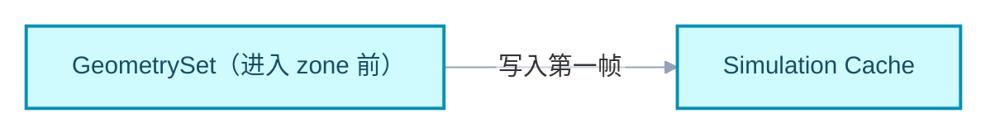
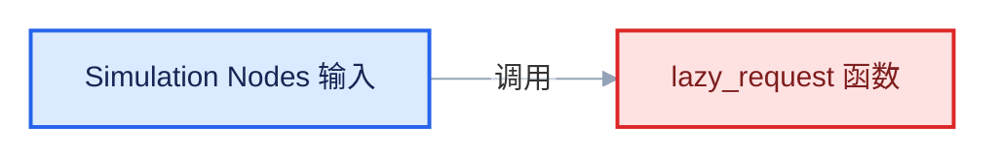
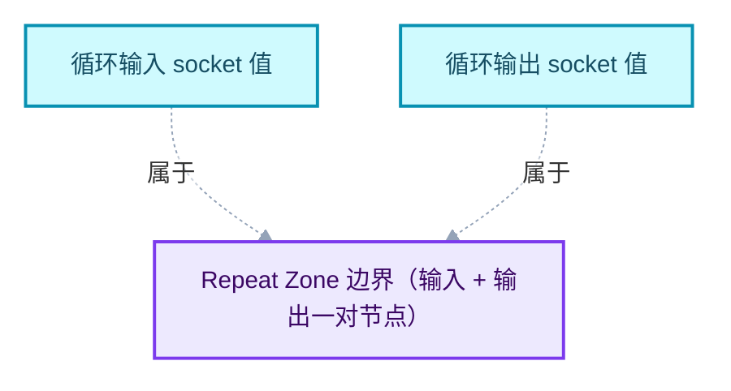
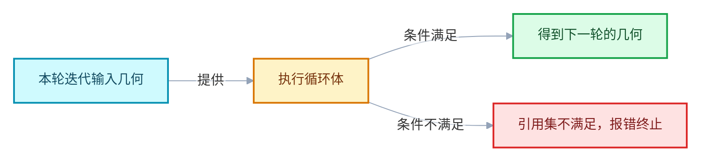
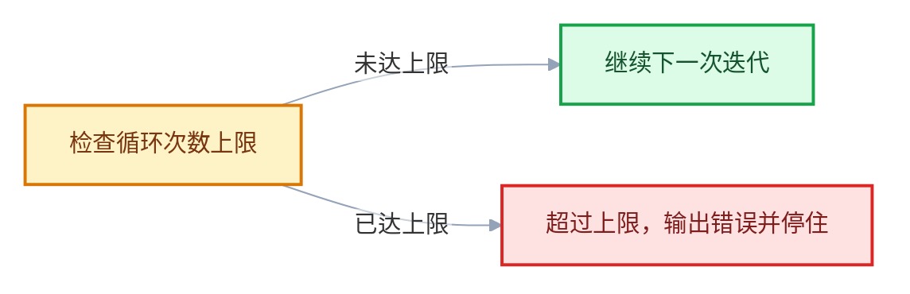
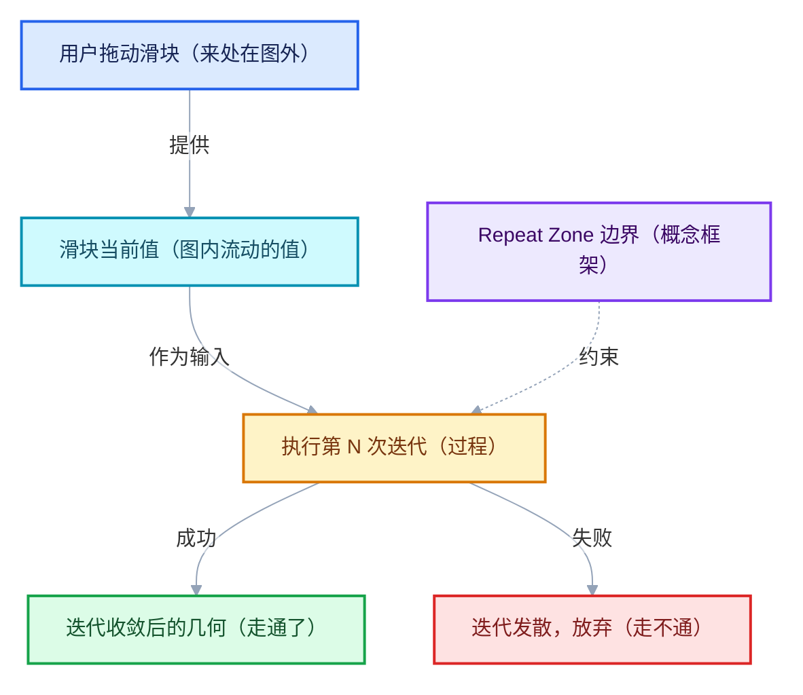
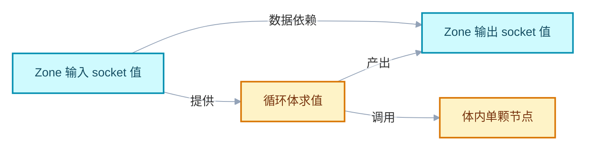
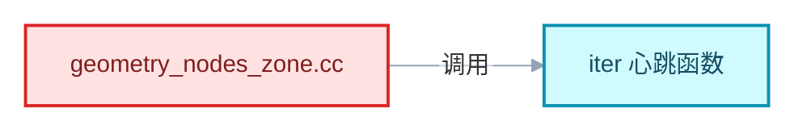
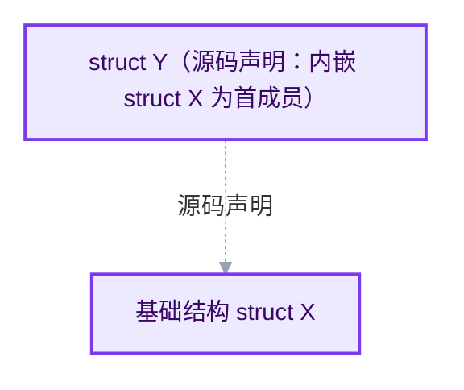
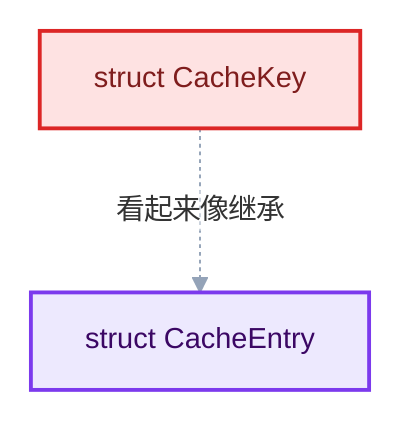

# 图表配色与阅读约定

<div style="font-family:'Segoe UI','Microsoft YaHei',system-ui,-apple-system,sans-serif;display:flex;flex-wrap:wrap;align-items:center;gap:8px;margin:16px 0 20px;padding:10px 14px;background:#F8FAFC;border:1px solid #E2E8F0;border-radius:12px">
<span style="font-size:11px;font-weight:700;letter-spacing:.1em;color:#64748B;margin-right:2px">导航</span>
<a href="../README.md" style="font-size:13px;color:#334155;background:#F1F5F9;border:1px solid #E2E8F0;border-radius:999px;padding:3px 12px;text-decoration:none;white-space:nowrap">总入口</a>
<a href="./README.md" style="font-size:13px;color:#2563EB;background:#EFF6FF;border:1px solid #BFDBFE;border-radius:999px;padding:3px 12px;text-decoration:none;white-space:nowrap">本章 00-课程指南</a>
<a href="./01-学习路线与阶段验收.md" style="font-size:13px;color:#2563EB;background:#EFF6FF;border:1px solid #BFDBFE;border-radius:999px;padding:3px 12px;text-decoration:none;white-space:nowrap">‹ 学习路线与阶段验收</a>
<a href="./03-符号与源码索引.md" style="font-size:13px;color:#7C3AED;background:#F5F3FF;border:1px solid #DDD6FE;border-radius:999px;padding:3px 12px;text-decoration:none;white-space:nowrap">符号与源码索引 ›</a>
</div>

<div style="font-family:'Segoe UI','Microsoft YaHei',system-ui,-apple-system,sans-serif;margin:18px 0 22px;padding:14px 18px;background:#F5F3FF;border-left:4px solid #7C3AED;border-radius:10px">

系列定位：本篇是《重复区域（Repeat Zone）全面学习》系列的图表与阅读约定篇。它不讲解 Repeat Zone 的任何机制本身，只规定：本系列所有篇目中的图怎么配色、箭头怎么读、源码链接怎么算层数、教学注释代码怎么核对、固定栏目怎么读、术语怎么对照。后续每一篇都以本篇为准，不再重复解释这些约定。

</div>

<hr style="border:none;height:1px;background:linear-gradient(90deg,#BFDBFE,#E2E8F0 55%,transparent);margin:34px 0">

## 0. 为什么要有一篇"约定"

### 0.1 图是一种有损压缩

概括图把几十行源码压缩成几个节点。压缩必然有损：控制流被拉直、分支被隐藏、参数被省略。如果不事先规定"什么信息被丢了、丢了之后去哪里找回来"，读者就会把图当成源码本身，把教学简化当成实现事实。

本系列的应对方式只有一条主线：

- 图负责**给方向**；
- 教学注释代码负责**给过程**；
- 原始源码（折叠区 + 链接）负责**给事实**；
- 三者不一致时，**以源码为准**，并在文中显式记录不一致。

### 0.2 本篇回答的八个问题

| 问题 | 对应章节 |
|---|---|
| 图里的颜色是什么意思？ | 第 1 章：六种 classDef 配色规范 |
| 图的字体、连线、间距是怎么统一的？ | 第 1.1.1 节：主题块 |
| 图里的箭头和箭头文字是什么意思？ | 第 2 章：箭头语义 |
| 源码链接里的 `../../../../` 是怎么算出来的？ | 第 3 章：源码链接格式 |
| `[讲解]`、`<details>`、`<!-- annotated -->` 是什么？ | 第 4 章：教学注释代码与原始源码 |
| 正文里的彩色卡片和导航条是怎么写的？为什么不用外部 CSS？ | 第 4A 章：HTML 装饰层约定 |
| 概括图是不是执行顺序？ | 第 5 章：概括图与代码的关系 |
| "用小数据走一遍"和"反例与边界"怎么读？ | 第 6 章：固定栏目读法 |
| zone、border link 这些词到底是什么？ | 第 7 章：术语表 |

### 0.3 三条全局原则

1. **颜色不单独承载语义**：颜色必须与节点文字、箭头文字共同表达含义。仅靠"绿色 = 对、红色 = 错"来判断，在本系列中不成立——绿色节点表示"有效结果"，红色节点表示"错误与失效"，这是**类别**，不是**评分**。
2. **连线不表示继承**：本系列图中没有任何一条连线表示类继承。只有源码中明确写了继承声明（`class A : public B` 或 Blender 风格的结构体内嵌/函数指针表复用）的地方，才允许在图上标注继承语义，且必须写明"源码声明"字样（详见第 2.4 节）。
3. **折叠区是契约**：每一段教学注释代码，都必须能通过折叠区和相对路径链接回到原始源码。读者不需要相信作者，只需要点开折叠区对照。

## 1. mermaid 配色规范：六种 classDef

### 1.1 确切写法

本系列所有 mermaid 图统一使用以下六个 classDef 定义。 **逐字符照抄**，包括大小写、颜色值和结尾的分号：

```text
classDef input       fill:#DBEAFE,stroke:#2563EB,color:#172554,stroke-width:2px;
classDef data        fill:#CFFAFE,stroke:#0891B2,color:#164E63,stroke-width:2px;
classDef abstraction fill:#EDE9FE,stroke:#7C3AED,color:#3B0764,stroke-width:2px;
classDef compute     fill:#FEF3C7,stroke:#D97706,color:#78350F,stroke-width:2px;
classDef result      fill:#DCFCE7,stroke:#16A34A,color:#14532D,stroke-width:2px;
classDef error       fill:#FEE2E2,stroke:#DC2626,color:#7F1D1D,stroke-width:2px;
```

六个 class 的对应关系总表：

| class 名 | 语义 | 填充 fill | 描边 stroke | 文字 color |
|---|---|---|---|---|
| `input` | 输入与接口 | `#DBEAFE`（淡蓝） | `#2563EB`（蓝） | `#172554`（深藏蓝） |
| `data` | 数据与存储 | `#CFFAFE`（淡青） | `#0891B2`（青） | `#164E63`（深青） |
| `abstraction` | 类型与抽象 | `#EDE9FE`（淡紫） | `#7C3AED`（紫） | `#3B0764`（深紫） |
| `compute` | 计算与调度 | `#FEF3C7`（淡琥珀） | `#D97706`（琥珀） | `#78350F`（深棕） |
| `result` | 有效结果 | `#DCFCE7`（淡绿） | `#16A34A`（绿） | `#14532D`（深绿） |
| `error` | 错误与失效 | `#FEE2E2`（淡红） | `#DC2626`（红） | `#7F1D1D`（深红） |

写法上的四个硬性要求：

1. 每张图**开头必须带一行主题块**（见 1.1.1），`classDef` 行必须在图的末尾。
2. 每张图**完整重复六个 classDef**（即使这张图只用到两三个 class）。这是刻意的冗余：读者扫一眼 classDef 块就知道全集，不必在图间来回对照。
3. `classDef` 行**必须写在图的末尾**，紧贴 ` ``` ` 结束之前，与下文所有示例一致。
4. 节点用 `:::class` 内联标注（如 `A["节点"]:::input`），不使用 `class A input` 分离写法——内联写法让"哪个节点属于哪类" 在源文本中一目了然。**唯一例外是 subgraph**：mermaid 不支持 `subgraph X["..."]:::class`，分组要标 class 只能另起一行 `class X abstraction;`（写在 `classDef` 块之前）。

### 1.1.1 主题块（每张图的第一行）

六色 classDef 只管节点配色，字体、连线颜色、节点间距这些"全局观感" 由主题块统一规定。**每张图的 ` ```mermaid ` 之后第一行**必须是：

```text
%%{init: {"theme":"base","themeVariables":{"fontFamily":"\"Segoe UI\",\"Microsoft YaHei\",sans-serif","fontSize":"15px","lineColor":"#94A3B8","edgeLabelBackground":"#FFFFFF","clusterBkg":"#F8FAFC","clusterBorder":"#CBD5E1"},"flowchart":{"htmlLabels":false,"curve":"basis","nodeSpacing":52,"rankSpacing":64,"padding":14,"diagramPadding":16,"useMaxWidth":true},"sequence":{"useMaxWidth":true,"wrap":true,"mirrorActors":false,"messageMargin":36}}}%%
```

各参数的作用与取值理由：

| 参数 | 取值 | 作用 |
|---|---|---|
| `theme` | `base` | 必须用 base。`default`/`forest` 主题会覆盖 classDef 的 fill/stroke |
| `fontFamily` | Segoe UI → Microsoft YaHei | 中西文分别落到系统自带的两个字体，避免方框字 |
| `fontSize` | `15px` | 中文在 14px 以下笔画会糊，16px 以上节点过宽 |
| `lineColor` | `#94A3B8` | 比默认黑色柔和，且不与六色语义冲突 |
| `edgeLabelBackground` | `#FFFFFF` | 箭头文字加白底，跨线时仍可读 |
| `clusterBkg` / `clusterBorder` | `#F8FAFC` / `#CBD5E1` | subgraph 用浅灰底区分"容器"与"节点" |
| `curve` | `basis` | 曲线连线；`linear` 在长链上会出现直角折角 |
| `nodeSpacing` / `rankSpacing` | `52` / `64` | 中文标签普遍较长，默认值会让节点贴在一起 |
| `htmlLabels` | `false` | 保持标签为纯 SVG 文本，避免部分预览器不注入 HTML |
| `wrap` + `mirrorActors:false`（sequence） | — | 长消息自动换行，且不重复画参与者头像 |

主题块是**一整行**，不要为了可读性折行——mermaid 的指令解析要求 `%%{init: ...}%%` 在一行内闭合。

### 1.2 input：输入与接口 —— 何时使用

`input` 表示**从外部进入本篇讨论范围的东西**。典型对象：

- 用户操作进入几何节点评估的入口；
- 上一阶段传下来的 GeometrySet 或 Field；
- 函数签名的输入参数（当该参数在图中作为"被消费的外部物"出现时）；
- 文件、缓冲区等边界外的资源。

**这个东西的"来处"不在本图的讨论范围内，就用 input。**

</div>

正例：


反例（常见错误）：把**图内部产生又传给下一个内部节点**的中间量标成 input。中间量的来处就在图内，它是 data，不是 input：


上图中 `A` 用 error 标注，是**刻意错误示例**的标法（本系列约定：错误示例中被标错的节点一律用 error class，并在图下写一行 "刻意错误：……"，指出错在哪里、正确应为哪个 class）。此处 A 应为 data。

### 1.3 data：数据与存储 —— 何时使用

`data` 表示**在本图讨论范围内流动或驻留的数据**。典型对象：

- GeometrySet、Field、socket 值；
- zone 内部的缓存、惰性请求队列；
- 结构体字段（当字段本身是讨论对象时）。

**讨论的是"东西"而不是"动作/类型"时，用 data。**

</div>

正例：



反例（刻意错误）：把**函数/算法本身**标成 data。函数是"做事情的东西"，属于 compute；如果函数代表的是"一种可复用的抽象机制"（如 zone 边界这个概念本身），则属于 abstraction：



`F` 是被调用的计算过程，应为 compute，不是 data。

</div>

### 1.4 abstraction：类型与抽象 —— 何时使用

`abstraction` 表示**概念、类型、边界、结构本身**——它不执行、不存储，它是"讨论得以进行的框架"。典型对象：

- Zone 边界这个概念本身；
- 结构体类型（如缓存条目的类型定义）；
- "迭代""引用集"这类机制名词被拟作一个节点时。

**如果这个节点描述的是"规则/形状/边界"，用 abstraction。**

</div>

正例：



注意上图的虚线 `-.->`：表达"属于/包含"这类**结构性关系**时，一律用虚线，与实线的"数据流动/调用"区分开（见第 2 章）。

反例（刻意错误）：把**一次具体的求值**标成 abstraction。"第 3 次迭代时把点位移"是一次具体计算，是 compute：


`N` 是一次运行中的计算，应为 compute。

</div>

### 1.5 compute：计算与调度 —— 何时使用

`compute` 表示**正在发生或将要发生的过程**：函数调用、求值步骤、调度决策、循环的一次执行。典型对象：

- 单颗几何节点的求值；
- "决定是否再迭代一次"的判断过程；
- 缓存写入/读取动作。

**有动词、有时态的过程，用 compute。**

</div>

正例（本系列最典型的形态——compute 居中，向 result 与 error 分叉）：



反例（刻意错误）：把**缓存的静态内容**标成 compute。缓存内容是驻留的数据，不执行任何动作：


有两处：其一，`K` 应为 data（静态快照，不是过程）；其二，注意第一行 classDef 故意写错了（`input` 的定义里混入了两个 stroke 属性）——这也是一个刻意示范：classDef 一旦抄错，渲染器会忽略坏属性甚至整行失效，**所以 classDef 必须逐字符照抄本章 1.1 的标准块**。本系列保证除刻意示范外不出现这种笔误。

</div>

### 1.6 result：有效结果 —— 何时使用

`result` 表示**一条正常路径的产物**。它强调"这一步走通了"，但不承诺"后续一定不失败"——失败可以在后面的图里出现。典型对象：

- 求值成功后的 GeometrySet；
- 一次迭代成功结束后的状态；
- zone 正常关闭时输出的值。

**这条边走通了、产出了可继续使用的东西，用 result。**

</div>

正例：


反例（刻意错误）：把**"尚未执行、只是计划中"的输出**标成 result。尚未发生的东西既不是 result 也不是 error，按其本性归类——计划的输出如果只是描述目标，用 data；如果整个节点表示"计划本身" 这个概念，用 abstraction：


`P` 描述的是尚未发生的计划，应为 abstraction。

</div>

### 1.7 error：错误与失效 —— 何时使用

`error` 表示**失败路径上的节点，或刻意错误示例中被标错的节点**。两种用途共用一个 class，靠图下方的说明文字区分：

1. **真实失败路径**：源码中确实存在的错误分支（如检查失败、参数非法、资源缺失）。图下不需要特别说明。
2. **刻意错误示例**：作者故意标错的节点，图下必须有一行 `刻意错误：……`，指出错误点与正确类别。第 1.2–1.6 节的反例全部是这种用法。

**走到这里系统就已经"不正常"了，用 error。**

</div>

正例（真实失败路径）：



反例（刻意错误）：把**用户正常的取消操作**标成 error。取消是被预期、被处理的正常分支，不是错误——它应按其产物归类（取消后恢复的旧状态是 data）：


取消不是错误路径，`X` 应为 data。

</div>

### 1.8 六类之间的辨析速查

容易混淆的对子，用两句话判定：

| 混淆对 | 判定句 |
|---|---|
| input vs data | 来处在图外→input；来处在图内→data |
| data vs abstraction | 说的是"东西"→data；说的是"边界/类型/规则"→abstraction |
| data vs compute | 驻留或流动的值→data；有动词的过程→compute |
| compute vs result | 过程本身→compute；过程的正常产物→result |
| result vs error | 走通了的产物→result；走不通的分支→error |
| abstraction vs compute | 概念框架→abstraction；框架的一次执行→compute |

再一张总览图，把六个 class 放进同一张图里对照（每个节点写明它为什么属于这一类）：



## 2. 箭头语义

### 2.1 箭头文字约定

本系列所有 mermaid 图，实线箭头上的文字**只能取自以下封闭词汇表** （或其明确的组合，如"检查后果与修正"可缩写为"检查/修正"）：

| 箭头文字 | 含义 | 典型场景 |
|---|---|---|
| `下一阶段` | 时间或流程上的先后关系，上一节点完成后进入下一节点 | 输入 → zone → 输出的主流程 |
| `推演` | 教学推演关系：从 A 的机制**推理出** B 的行为，B 不是 A 调用的 | 源码行为 → 教学模型的映射 |
| `检查后果与修正` | 反馈关系：后面的步骤发现前面的问题并回改 | 缓存失效 → 重新计算 |
| `拥有` | 所有权：A 拥有 B 的生命周期，A 销毁时 B 一并销毁 | GeometrySet 拥有其组件 |
| `借用` | 非拥有引用：B 只是临时指向 A，A 可能在 B 使用期间继续存在 | 函数借用传入的引用 |
| `调用` | 函数/节点执行关系：A 执行期间 B 被执行 | 循环体调用子图 |
| `数据依赖` | B 的值由 A 的值决定，但二者之间不发生"调用"动作 | 输出 socket 依赖输入 socket |

使用规则：

1. **箭头文字不可省略**。没有文字的实线箭头只允许出现在一种场合： `flowchart TB` 中表达"属于/包含"的结构虚线（`-.->`）。任何实线箭头必须带上述词汇之一。
2. **禁止自造同义词**。不写"走到""变成""输出到"这类口语箭头文字——每个词上面都有明确定义，图作者必须选择最贴切的那一个。
3. **一个箭头一个词**（或一个固定组合）。不写"A 且 B"式的复合文字；若一段关系同时是"调用"和"数据依赖"，拆成两条边分别标注。

### 2.2 两个词最容易混：`调用` vs `数据依赖`

- **调用**：控制流转移。A 执行到某一点，B 开始执行，B 结束后 A 继续。
- **数据依赖**：只有值的传递，没有控制流转移。B 的定义里引用了 A，但 A 不"进入"B。

正例（两者并存但分开画）：



图中刻意同时画出 `IN -->|数据依赖| OUT` 与 `IN -->|提供| BODY -->|产出| OUT` 两条路径：输出 socket 的值**依赖** 输入 socket，但中间经由循环体的求值过程传递，两者不是同一种关系，所以分两条边画。

反例（刻意错误）：把编译期的 `#include` 关系画成 `调用`：



（共两处）：其一，`#include` 是编译期文本包含，不是运行期调用，此关系不属于本系列七个箭头词中的任何一个，本系列规定 **include 关系不上图**，改用文字说明；其二，`B` 作为被引用的函数，若必须画节点应为 compute，画成 data 也是错的。这张图本身就是本系列 "include 不上图"约定的呈现方式。

</div>

### 2.3 `推演` 的专门说明

`推演` 是教学关系，不是运行时关系。它专用于：

- 从源码事实推理出教学模型中的某个结论；
- 从机制 A 的已知行为推理出机制 B 在特定输入下的行为。

推演边的两端**经常跨越类别**（如 data → result），这是允许的，因为推演边表达的是"论证"，不是"传递"。


读法示范："源码里有这个检查"是**事实**（data），"所以达到上限后不再执行"是**推论**（result），中间的推演边表示后者由前者论证得到，而不表示源码里存在一次函数调用。

### 2.4 连线不表示继承（重点约定）

本系列图的**任何连线都不表示面向对象意义上的继承**。这条约定来自两个现实：

1. Blender C/C++ 混合代码库中，多数"复用"通过结构体内嵌、函数指针表、显式包装函数实现，继承语义稀少且谨慎；
2. 图是压缩表达，一条写着"拥有"的线容易被误读成"isa"。

因此：

- 图中出现继承事实时，**必须**在节点文字里写明 `（源码声明：class X : public Y）`或 `（源码声明：内嵌 struct Y first 成员）`字样，并且该边仍须使用结构虚线 `-.->`，不使用实线；
- 没有源码声明背书的"看起来像继承"的关系（比如两个结构体字段相同），一律画成并列的 data 节点，不画任何边，或用 `相似` 之类的**文字注记** 写在图下方正文里——不占用箭头词汇表。

正例（有源码声明背书的结构关系）：



注意：即使有声明背书，边的文字也是"源码声明"而不是继承符号，且使用虚线。实线箭头词汇表（七个词）中**没有**"继承"这个词，这是刻意设计。

反例（刻意错误）：无声明地把两个仅字段相似的结构体画成继承：



字段相似不构成继承，且"看起来像继承"不在箭头词汇表内。正确做法是删掉这条边，在正文写一句"CacheKey 与 CacheEntry 字段相似，但源码中并无继承或内嵌关系"。`B` 用 error 标注表示整个画法是错的。

</div>

## 3. 源码链接格式

### 3.1 层数怎么算

本系列文档位于 `.markdown\重复区域-dsh\` 之下，各篇按章节分目录，例如：

- `.markdown\重复区域-dsh\00-课程指南\02-图表配色与阅读约定.md`（本篇）
- `.markdown\重复区域-dsh\01-基础\03-边界节点.md`
- `.markdown\重复区域-dsh\02-迭代机制\05-缓存与失效.md`

Blender 源码位于仓库根的 `source\` 目录下。从一篇 md 链接到一个源码文件，必须用**相对路径**，相对路径的 `../` 数量等于 **md 文件所在目录到仓库根的目录层数**。

计算方法（三步）：

1. 数出 md 文件**所在目录**下有几层目录（不含文件名本身）；
2. 每层贡献一个 `../`；
3. 加上从仓库根出发的源码路径 `source/...`。

示例一：本篇 `00-课程指南/02-图表配色与阅读约定.md`

- 所在目录：`.markdown/重复区域-dsh/00-课程指南/`
- 从这里到仓库根：`00-课程指南 → 重复区域-dsh → .markdown → 根`，共 3 层
- 所以前缀是 `../../../`（不是四个！本篇的源码链接以此为准）
- 完整示例：`../../../source/blender/nodes/geometry/nodes/` 下任意文件

示例二：`01-基础/03-边界节点.md`

- 所在目录：`.markdown/重复区域-dsh/01-基础/`
- 到仓库根：`01-基础 → 重复区域-dsh → .markdown → 根`，共 3 层
- 前缀同样是 `../../../`

示例三：假设未来出现更深的两级目录 `03-进阶/缓存/07-xxx.md`

- 所在目录：`03-进阶/缓存/`
- 到仓库根：`缓存 → 03-进阶 → 重复区域-dsh → .markdown → 根`，共 4 层
- 前缀是 `../../../../`

一句话记法：**`../` 的个数 = md 所在目录的深度（.markdown 算第 1 层）**。 `.markdown` 本身占一层，`重复区域-dsh` 占一层，其下的章节目录每层再 +1。写完链接后用"从 md 目录出发逐级回退"在脑内走一遍验证。

验证示例（以示例三为准走一遍）：

```text
起点：.markdown/重复区域-dsh/03-进阶/缓存/
  ../        → .markdown/重复区域-dsh/03-进阶/
  ../../     → .markdown/重复区域-dsh/
  ../../../  → .markdown/
  ../../../../ → 仓库根
拼上 source/... 即到达源码文件。 ✔
```

### 3.2 行号锚点写法

指向源码具体行时，采用 `文件路径#行号` 的纯文本形式（写在反引号或 Markdown 链接文字中），格式：

```text
source/blender/xxx/yyy.cc#123
```

约定细节：

1. 行号是**当前工作副本的行号**；若源码更新导致漂移，文中引用行号会被复核并更新（见第 4.4 节的复核记录约定）。
2. 引用一个函数时，优先给**函数定义行**而不是函数体内某行；需要指出体内具体语句时，另起一条引用并写明"体内"。
3. 同一文件多处引用时，每处都写完整路径，不做"同上"式省略——读者经常只读单段。
4. 行号锚点可以叠在相对路径上： `../../../source/blender/xxx/yyy.cc#123`（层数按 3.1 计算；系列正文都在 `.markdown/重复区域-dsh/<章节>/` 下，三层 `../` 回仓库根）。

### 3.3 链接的两种呈现

| 形式 | 用法 | 示例 |
|---|---|---|
| 行内代码 | 提及文件但非主要证据 | `source/blender/xxx/yyy.cc#123` |
| Markdown 链接 | 该处的主要证据，鼓励点开 | [yyy.cc#123](../../../source/blender/xxx/yyy.cc#123) |

本系列规定：**每篇正文的主要结论至少有一条 Markdown 链接形式的源码引用**；纯行内代码引用只用于背景性提及。

## 4. 教学注释代码与原始源码

### 4.1 `[讲解]` 注释约定

教学注释代码是把源码片段**原样抄出**后，插入教学注释得到的版本。规则：

1. **源码语句一行不动**。只允许**新增**注释行，不允许改写、删除、重排源码语句（空白与缩进可以规整）。
2. 新增教学注释统一以 `[讲解]` 开头，放在被讲解语句的**上方**，与源码注释（`/* ... */`、`// ...`）严格区分：

```cpp
/* 来源：source/blender/xxx/yyy.cc#40-52（教学注释版，语句未改动） */

[讲解] 这是循环的入口。真实源码里循环次数由外层条件决定。
for (int i = 0; i < total; i++) {
  [讲解] 每轮先做引用集检查，检查失败会提前退出。
  if (!check_reference_set(i)) {
    break;
  }
  [讲解] 体内计算只依赖上一轮的输出几何。
  compute_step(i);
}
```

3. `[讲解]` 注释**只出现在教学注释版代码块中**；原始源码折叠区里的代码**一个字都不能有 `[讲解]`**——它必须是能逐字符对上的原文。

### 4.2 `<details>` 折叠区约定

每段教学注释代码之后，紧跟一个折叠区，承载**原始源码**：

```html
<details>
<summary>核对原始源码（source/blender/xxx/yyy.cc#40-52）</summary>

```cpp
/* 以下为逐字符原文，未添加任何教学注释。 */ for (int i = 0; i < total; i++) { if (!check_reference_set(i)) { break; } compute_step(i); }
```

</details>
```

约定细节：

1. `<summary>` 的格式固定为 `核对原始源码（相对路径#起始行-结束行）`，路径按第 3 章规则计算层数。
2. 折叠区内除了原文代码块和一行来源说明，**不放任何解释**——解释只属于教学注释版。
3. 若教学注释版为了篇幅做了**截断**（例如省略了无关分支），必须在折叠区开头用一行 `<!-- truncated: 省略了 ... -->` 显式声明截断点；未声明截断的原文必须完整。

### 4.3 标记格式：`<!-- annotated:... -->` 与 `<!-- original:... -->`

在 Markdown 源文本层面（HTML 注释，渲染后不可见），每个"教学注释代码块 + 折叠区"组合前后用成对标记框定，便于工具与复核脚本定位：

```text
<!-- annotated: yyy.cc#40-52 -->
（教学注释版代码块）
（<details> 折叠区）
<!-- original: yyy.cc#40-52, rev=工作副本, checked=2024-xx-xx -->
```

字段含义：

- `annotated:` 后写**教学注释版覆盖的源码范围**，与 `<summary>` 一致；
- `original:` 后写**原始源码范围**，`rev` 说明行号基于哪个版本（工作副本 / 某次提交摘要），`checked` 是最近一次逐字符核对日期；
- 两个标记必须成对出现，且范围字符串一致；不一致视为编辑事故，由复核流程（4.4）负责抓出。

### 4.4 行号漂移与复核记录

源码会变，行号会漂移。本系列的约定：

1. 每篇文末可有一个"源码一致性检查"小节，记录：核对日期、核对范围、是否发现漂移；
2. 发现漂移时**当场更新**行号与 `checked` 日期，不留下"待更新"；
3. 若源码语义本身变了（不只是行号），在正文中插入一段 `> 源码更新备注（日期）：……`，说明新旧差异，然后更新教学注释版。

## 4A. HTML 装饰层约定

正文里的彩色卡片、导航条、图注、分隔线都是**内联 HTML**。之所以不用外部 CSS：本系列的 md 可能在 VS Code 预览、Typora、Obsidian、GitHub 四处打开，只有内联 `style` 能做到"四端同貌、零配置"。

### 4A.1 四条硬性规则

1. **只用内联 `style`，不用 `<style>` 标签、不用 class 依赖**。渲染器会过滤或隔离 `<style>`，class 则需要外部 CSS 注入才生效。
2. **容器内的 Markdown 必须用空行隔开**。`</div>
   ```

3. **链接一律写成 `<a href="...">`**，不要在 HTML 块内写 `[文字](链接)`。
   HTML 块内的行内 Markdown 不解析，链接会变成字面量。
4. **块前后各留一个空行**，避免与相邻段落或代码块粘连。

### 4A.2 五类装饰件与对应语义

| 装饰件 | 用在哪 | 视觉 |
|---|---|---|
| 导航条 | 每个文件 H1 之下 | 浅灰圆角条 + 胶囊按钮：总入口 / 本章 / 上一篇 / 下一篇 |
| 基准卡 | 每篇开头的 `>` 元信息块之后替换为卡片 | 紫色左边条 + 淡紫底 |
| 结论卡 / 口诀卡 / 反例卡 | `一句话总结`、`判断口诀`、`刻意错误` | 绿 / 蓝 / 红左边条 + 对应淡色底 |
| 图注卡 | mermaid 图下方的 `*图 N：...*` | 灰色左边条、小字号 |
| 分隔线 | 章内大节之间的 `---` | 蓝色到透明的渐变细线 |

各装饰件的标准写法（复制即用，颜色值不要改）：

```text
导航条（H1 下第一块）结论卡 / 口诀卡 / 反例卡（三色只换色值） **区域 = 推导结果，不是存储事实。**

</div>

分隔线

```

三张语义卡片的配色对照：

| 卡片 | 背景 | 左边条 | 标题色 | 用于 |
|---|---|---|---|---|
| 结论卡 | `#F0FDF4` | `#16A34A` | `#15803D` | 一句话总结 / 一句话记忆 |
| 口诀卡 | `#EFF6FF` | `#2563EB` | `#1D4ED8` | 判断口诀 |
| 反例卡 | `#FEF2F2` | `#DC2626` | `#B91C1C` | 刻意错误 |
| 基准卡 | `#F5F3FF` | `#7C3AED` | `#7C3AED` | 版本 / 行号 / 路径来源 |

### 4A.3 颜色与 classDef 的对应关系

HTML 装饰层刻意与 mermaid 的六色**同一套语义、不同的用途**：
圆点是图里节点的类别，左边条是正文段落的性质。两套颜色不混用——
正文里不要出现"蓝色 = input 类"这种图内语义。

## 5. 概括图与代码的关系

### 5.1 概括图不是无条件执行顺序

这是本系列最重要的读图规则：**图上的边不等于"必然发生"**。

一条 `A -->|下一阶段| B` 只说明"A 完成后轮到 B 这一步"，不说明
"B 每次都发生"。条件、分支、提前退出、异常路径都被概括图拉直了。
真实顺序以**源码**为准；图中只在"分支是该节核心内容"时才画出分支。

三种常见误读与正确读法：

```mermaid
%%{init: {"theme":"base","themeVariables":{"fontFamily":"\"Segoe UI\",\"Microsoft YaHei\",sans-serif","fontSize":"15px","lineColor":"#94A3B8","edgeLabelBackground":"#FFFFFF","clusterBkg":"#F8FAFC","clusterBorder":"#CBD5E1"},"flowchart":{"htmlLabels":false,"curve":"basis","nodeSpacing":52,"rankSpacing":64,"padding":14,"diagramPadding":16,"useMaxWidth":true},"sequence":{"useMaxWidth":true,"wrap":true,"mirrorActors":false,"messageMargin":36}}}%% flowchart LR A["进入 zone"]:::input B["第一轮迭代"]:::compute C["第二轮迭代"]:::compute R["输出"]:::result E["引用集检查失败，中途退出"]:::error A -->|"下一阶段"| B B -->|"下一阶段"| C C -->|"下一阶段"| R B -->|"检查后果与修正：失败回退"| E classDef input fill:#DBEAFE,stroke:#2563EB,color:#172554,stroke-width:2px; classDef data fill:#CFFAFE,stroke:#0891B2,color:#164E63,stroke-width:2px; classDef abstraction fill:#EDE9FE,stroke:#7C3AED,color:#3B0764,stroke-width:2px; classDef compute fill:#FEF3C7,stroke:#D97706,color:#78350F,stroke-width:2px; classDef result fill:#DCFCE7,stroke:#16A34A,color:#14532D,stroke-width:2px; classDef error fill:#FEE2E2,stroke:#DC2626,color:#7F1D1D,stroke-width:2px;
```

误读一：把 `B -->|下一阶段| C` 读成"C 必然发生"。
正确读法：B 之后**条件满足**才有 C；图中检查失败边
（`检查后果与修正`）就是那条被拉直前的岔路。

误读二：把节点顺序读成严格时序。
正确读法：mermaid 的节点排布是布局引擎决定的，左右上下不代表
时间先后；**只有箭头**表达先后，且箭头文字说了关系的性质。

误读三：把 result 节点读成"唯一出口"。
正确读法：error 节点同样是真实出口；概括图若未画 error 边，
说明该分支不是本节重点，**不代表它不存在**。

### 5.2 什么时候必须把分支画出来

满足任一条件，就必须在概括图中显式画出分支：

1. 该分支是该节要讲的核心机制（如"缓存失效检查"本身就是主题）；
2. 该分支影响读者对后续章节的理解；
3. 该分支是错误处理路径且读者可能踩到。

反之，与主题无关的错误路径可以省略，但省略处须在图下一行写明
"已省略……分支，见 yyy.cc#行号"。

### 5.3 图、注释代码、源码的三层对照

每一节的标准结构是三层：

```mermaid
%%{init: {"theme":"base","themeVariables":{"fontFamily":"\"Segoe UI\",\"Microsoft YaHei\",sans-serif","fontSize":"15px","lineColor":"#94A3B8","edgeLabelBackground":"#FFFFFF","clusterBkg":"#F8FAFC","clusterBorder":"#CBD5E1"},"flowchart":{"htmlLabels":false,"curve":"basis","nodeSpacing":52,"rankSpacing":64,"padding":14,"diagramPadding":16,"useMaxWidth":true},"sequence":{"useMaxWidth":true,"wrap":true,"mirrorActors":false,"messageMargin":36}}}%% flowchart TB G["概括图：给方向（有损）"]:::abstraction T["教学注释代码：给过程（语句未改动）"]:::compute S["原始源码：给事实（折叠区 + 链接）"]:::data G -->|"对应"| T T -->|"逐字符核对"| S classDef input fill:#DBEAFE,stroke:#2563EB,color:#172554,stroke-width:2px; classDef data fill:#CFFAFE,stroke:#0891B2,color:#164E63,stroke-width:2px; classDef abstraction fill:#EDE9FE,stroke:#7C3AED,color:#3B0764,stroke-width:2px; classDef compute fill:#FEF3C7,stroke:#D97706,color:#78350F,stroke-width:2px; classDef result fill:#DCFCE7,stroke:#16A34A,color:#14532D,stroke-width:2px; classDef error fill:#FEE2E2,stroke:#DC2626,color:#7F1D1D,stroke-width:2px;
```

读的顺序推荐：**先图（30 秒），再教学注释代码（3 分钟），
最后按需点开折叠区核对（按需）**。折叠区是契约，不是必读——
但结论若令你惊讶，必须核对。

## 6. 两个固定栏目的读法

本系列多数机制篇在正文主体之后设两个固定栏目：
**"用小数据走一遍"** 与 **"反例与边界"**。它们的读法不同。

### 6.1 "用小数据走一遍"

该栏目构造一个**能手工验算的最小例子**（例如 2 个点、3 次迭代），
然后逐轮列出每一步的真实中间值。读法：

1. **先不要看结果列**。遮住"本轮结果"，自己按前面章节的机制推一遍；
2. 推完再对照。对上了，说明机制模型正确；对不上，**回到教学注释
   代码**找自己漏掉的条件（多半是某个提前退出或引用集检查）；
3. 注意栏目开头的小数据规模声明。规模是刻意选小的，**不要**把
   小数据下成立的现象外推成一般规律——外推属于"推演"，必须回到
   源码找证据。

栏目中每个轮次的表格固定三列：`轮次 / 进入本轮的输入 / 本轮结果`。
若某轮触发了错误路径，"本轮结果"列写 `（错误：原因）` 并用
文字加粗，不依赖颜色。

### 6.2 "反例与边界"

该栏目枚举机制**不成立或行为改变**的情形：极限值、空输入、
刚好踩在阈值上、嵌套使用、重复触发等。读法：

1. 每条反例都是一条**可检验的断言**，不是吓唬人的警告——
   断言背后必须挂源码行号或行为描述；
2. 读反例时先问自己："为什么源码会这样？"——答案通常是一个
   `if` 的判断方向、一个上限检查、或一次缓存的失效标记；
3. 栏目结尾的"边界清单"是**逐条可验证**的，适合作为上手实验
   （在 Blender 里真的去构造那个边界情形）。

两个栏目的分工一句话：**"用小数据走一遍"验证机制在典型路径上
如何运转；"反例与边界"验证机制的适用范围在哪里结束。**

### 6.3 固定栏目与图的关系

两个栏目**可以**配图，但约定不同：

- "用小数据走一遍"的图通常是**逐轮快照**——每轮一张小图或
  一张带轮次标注的图，节点 class 按第 1 章正常标注；
- "反例与边界"的图通常包含 **error 节点表示真实失败分支**，
  且图下必须列出每条失败分支对应的源码依据。

## 7. 术语表

中英对照与一句话解释。解释力求**可在源码中找到对应物**；
纯教学概念（如"穿越连线"）标明"教学概念"。

### 7.1 核心结构

| 中文 | 英文 | 一句话解释 |
|---|---|---|
| 区域 | zone | 一对边界节点（如 Repeat Input/Output）圈出的节点子图，是本系列的研究对象。 |
| 循环区域 | repeat zone | 以 Repeat 节点对为边界的区域，内部子图按迭代次数重复执行。 |
| 边界节点 | zone border node | 标记区域起止的输入/输出节点对，负责 socket 的进出映射。 |
| 穿越连线 | border link（教学概念） | 从区域外直接连到区域内的连线，需要在评估时被显式识别与处理。 |
| 循环体 | body | 区域内每轮迭代实际执行的子图。 |
| 迭代 | iteration | 循环体的一次执行；迭代次数由输入参数或上游条件决定。 |
| 迭代次数 | iteration count | 决定循环体执行多少轮的量，通常有上限保护。 |
| 输入 socket | input socket | 节点或区域接收值的端点；区域级输入 socket 每轮迭代可重新取值。 |
| 输出 socket | output socket | 节点或区域产出值的端点。 |

### 7.2 数据与状态

| 中文 | 英文 | 一句话解释 |
|---|---|---|
| 几何集合 | GeometrySet | Blender 中携带点/线/面/实例等组件的核心数据容器。 |
| 字段 | field | 延迟求值的逐元素计算描述，可在评估时结合不同几何上下文实例化。 |
| 缓存 | cache | 为避免重复计算而保存的中间结果，是模拟/迭代正确性的关键状态。 |
| 缓存条目 | cache entry | 缓存中的一个快照单元，通常对应一次迭代或一帧。 |
| 缓存失效 | cache invalidation | 判定旧缓存不可再用并触发重算的过程。 |
| 引用集 | reference set | 被引用的组件/数据集合，用于判断某结果是否仍被需要。 |
| 使用标记 | usage flag | 标记"这个值被用到了"的记号，驱动惰性求值与缓存清理。 |
| 惰性求值 | lazy evaluation | 只在被真正请求时才执行的计算策略。 |
| 求值请求 | evaluation request | 一次"请给我这个输出"的具体请求，可携带字段上下文。 |

### 7.3 执行与上下文

| 中文 | 英文 | 一句话解释 |
|---|---|---|
| 计算上下文 | compute context | 求值时携带的环境信息（在哪个区域、第几轮、哪些字段被要求）。 |
| 评估 | evaluation | 把节点树从声明变成具体值的过程。 |
| 调度 | scheduling | 决定节点/子图以什么顺序、在什么线程上执行的过程。 |
| 副作用 | side effect | 求值过程中对外部状态（缓存、消息总线等）的修改，重放时必须可追溯。 |
| 重放 | replay | 依据缓存与副作用记录恢复或重演某帧结果的过程。 |
| 拓扑 | topology | 节点树中连线的结构；拓扑变化通常触发缓存失效。 |
| 提前退出 | early exit | 条件不满足时在循环中途停止执行的路径。 |
| 上限保护 | upper limit guard | 防止迭代次数或资源用量无限增长的检查。 |

### 7.4 关系与机制（教学概念为主）

| 中文 | 英文 | 一句话解释 |
|---|---|---|
| 所有权 | ownership | "拥有"关系：持有方负责被持有方的生命周期。 |
| 借用 | borrow | 非拥有的临时引用，被借用方生命周期由原持有方保证。 |
| 数据依赖 | data dependency | 一个值由另一个值决定的关系，不涉及控制流转移。 |
| 推演 | inference（教学概念） | 从已知源码事实推理出未直接写出的行为，属教学论证。 |
| 概括图 | summary diagram（教学概念） | 压缩展示机制方向的图，分支与条件以代码为准。 |
| 教学注释版 | annotated copy（教学概念） | 源码语句未改动、仅新增 `[讲解]` 注释的代码版本。 |

术语使用规则：正文首次出现术语时用"中文（English）"双写；
此后只用中文。表中标注"教学概念"的术语不得被表述成源码实体。

### 7.5 术语与 class 的对应速查

| 术语 | 图上通常标为 |
|---|---|
| 区域、边界节点、穿越连线 | abstraction |
| 几何集合、字段、缓存、缓存条目、引用集 | data |
| 使用标记 | data（它是一个记号值） |
| 迭代、循环体、调度、评估、重放 | compute |
| 求值请求 | data（一次具体的请求记录） |
| 缓存失效、提前退出、上限保护 | compute（判断/动作过程） |
| 副作用发生的那一刻 | compute；副作用改写后的状态 | data |
| 计算上下文 | data（随调用传递的记录）或 abstraction（概念本身），按图的主题定 |

## 附录 A. 图作者自查清单

发布前逐项过一遍：

1. 每张图的第一行是否有主题块（1.1.1）？`classDef` 是否在末尾？
2. 六个 classDef 是否逐字符照抄 1.1 的标准块？
3. 每个节点是否选对了 class？混淆对是否用 1.8 的判定句核过？
4. subgraph 要标 class 时，是否改用了独立的 `class X abstraction;` 行？
5. 所有实线箭头是否都带词汇表内的文字？虚线是否只用于结构关系？
6. 图中是否存在任何可能被读成继承的连线？若有，是否已有
   源码声明背书并改为虚线？
7. 刻意错误示例是否都在图下写了 `刻意错误：……`？
8. 概括图省略的分支是否写明了"已省略……见 行号"？
9. 主要结论是否至少有一条 Markdown 链接形式的源码引用？
10. 相对路径 `../` 层数是否按第 3 章口算并在脑内走查过一遍？
11. 教学注释代码是否做到"语句一行不动"？折叠区是否逐字符原文？
12. `<!-- annotated -->` 与 `<!-- original -->` 是否成对、范围一致？
13. HTML 装饰块是否只用内联 `style`？容器内 Markdown 是否用空行隔开？
14. HTML 块内的链接是否写成 `<a href="...">`，而不是 `[文字](链接)`？
15. 有没有在 HTML 块里写 `**加粗**` 或 `` `code` `` 却指望它被解析？

### 附录 A.1 批量自检脚本

装饰层全量改完后，用下面三条命令在本系列根目录跑一遍
（需要 `node`，以及任意可用的 mermaid 11 环境）：

```text
# 1) 所有 mermaid 块能否解析（最重要：语法错误会让整张图变成空白）
#    每个 ```mermaid 块单独喂给 mermaid.parse()，统计报错
# 2) 内部锚点是否都有对应的标题
grep -oE '\]\(#[^)]+\)' *.md | sort -u      # 列出所有页内锚点
# 3) 相对链接是否指向真实文件
grep -oE '\]\([^)#]+' *.md | sort -u        # 逐个确认目标存在
```

判定标准：**mermaid 报错数必须为 0**；锚点与相对链接允许存在
指向 `xxx/yyy.cc` 这类教学占位符的例外（第 3 章约定），其余必须命中。

## 附录 B. 读者自查清单

读到不确定处，按顺序问：

1. 这个结论的**源码依据**在哪？点开折叠区或链接核对了吗？
2. 我是否把概括图的边当成了"必然发生"？
3. 我是否把某个 class 的颜色当成了对错的评分？
4. 这个箭头文字在 2.1 的词汇表里吗？
5. 术语在 7 章的对照里能找到吗？找不到的，当作作者笔误并反馈。

## 附录 C. 与参考课程（全面学习-codex）约定的关系

本系列约定参考了仓库内另一课程系列的图表配色与阅读约定篇
（`.vscode/杂/markdown/全面学习-codex/00-课程指南/01-路线与规范/`），
沿用其六色配色体系与"图/教学/源码分层"思路；差异在于：

1. 本系列把箭头文字收敛为七个封闭词汇，参考系列为开放描述；
2. 本系列新增 `<!-- annotated -->` / `<!-- original -->` 成对标记，
   便于脚本化复核；
3. 本系列显式规定 include 关系不上图（参考系列以文字提醒，
   本系列升级为硬约定）；
4. 本系列固定栏目（"用小数据走一遍""反例与边界"）是本系列特有，
   参考系列无对应栏目。

两套课程的文档不互相引用源码行号；各自独立维护行号与复核记录。

## 附录 D. 常见问题速答（FAQ）

写作与阅读中反复出现的小问题，集中在此。每条答案都指向正文章节，
不引入新约定。

**Q1：一张图里可以只画两三个节点吗？**
可以。图的最小规模没有限制，但 classDef 块必须完整抄六个
（见 1.1 的硬性要求第 1 条）。

**Q2：同一个概念在不同图里必须用同一个 class 吗？**
原则上是的。同一术语在同一篇内应保持同一 class（参见 7.5 速查表）；
跨篇允许因主题不同而合理调整，但调整需在该篇内自洽。

**Q3：图中节点可以用 emoji 或图标吗？**
不使用。本系列图的全部信息由文字、class 颜色和箭头文字承载，
图标在部分渲染器中不可靠。

**Q4：`下一阶段` 和 `调用` 有什么区别？`下一阶段` 不也是某种执行吗？**
`下一阶段` 表达流程位置关系（做完这步轮到下步），不承诺"谁执行了谁"；
`调用` 表达具体的控制流转移。当 A 和 B 是同一次求值里的两个阶段，
用 `下一阶段`；当 A 的代码显式进入 B 的执行，用 `调用`。

**Q5：虚线 `-.->` 能带文字吗？**
能，且鼓励带。结构虚线的常用文字是"属于""约束""源码声明"，
这些词不在实线词汇表里，也不需要在其中——虚线自有一套结构性
用法，见 1.4、2.4 的示例。

**Q6：引用源码时路径用 `/` 还是 `\`？**
正文与链接一律用正斜杠 `/`（Markdown 链接与 URL 语义一致）；
只有在描述 Windows 文件位置时才用反斜杠。两种写法不要混在同一句里。

**Q7：行号漂移了但我暂时没时间核对全部引用怎么办？**
按 4.4 规则：已核对的更新 `checked` 日期，未核对的保持原样但
不要新加"疑似行号"；漂移核对是逐篇完成的，不做半篇混写。

**Q8：教学注释版可以合并相邻的两个函数吗？**
可以，前提是合并区间在 `annotated:` / `<summary>` 里写成一个
完整范围（如 `yyy.cc#40-70`），且折叠区给出同样范围的原文；
两个函数之间的空行与注释属于源码原文，同样不动。

**Q9："用小数据走一遍"里可以虚构源码里没有的字段名吗？**
不可以。小数据演算中出现的每个名字都应能在源码或前文术语表
（第 7 章）中找到；确需教学代号的，用 `教学代号：xxx` 前缀声明。

**Q10：反例与边界栏目必须配图吗？**
不必须。反例的价值在断言与源码依据；只有当边界行为本身有分支
结构、文字说不清时才配图，且配图须遵守 6.3 的约定。

**Q11：术语表里找不到的英文词怎么办？**
先在对应篇目正文中检索首次出现处（按 7.4 使用规则，首现必有
双写解释）；仍找不到则视为该篇的疏漏，向该篇维护者反馈，
同时本表在下次修订时收编该词。

**Q12：概括图能超过一屏吗？**
尽量避免。概括图的价值在"30 秒给方向"；超过约 15 个节点时
应拆成"总图 + 分步小图"，分步小图各自完整带 classDef 块。

**Q13：为什么 subgraph 不能写 `subgraph Z["..."]:::abstraction`？**
mermaid 的 subgraph 声明只接受 id 与标签，`:::class` 在这里是语法错误，
会让**整张图**解析失败（预览里表现为一片空白或报错）。正确写法是
`subgraph Z["..."]`，再另起一行 `class Z abstraction;`（写在 classDef
块之前）。本系列 06-01 篇的 16 张图曾因此全部失效，见附录 E。

**Q14：为什么 HTML 卡片里的 `[文字](链接)` 不生效？**
HTML 块（`