# 03 - 符号与源码索引（重复区域 / Repeat Zone）

<div style="font-family:'Segoe UI','Microsoft YaHei',system-ui,-apple-system,sans-serif;display:flex;flex-wrap:wrap;align-items:center;gap:8px;margin:16px 0 20px;padding:10px 14px;background:#F8FAFC;border:1px solid #E2E8F0;border-radius:12px">
<span style="font-size:11px;font-weight:700;letter-spacing:.1em;color:#64748B;margin-right:2px">导航</span>
<a href="../README.md" style="font-size:13px;color:#334155;background:#F1F5F9;border:1px solid #E2E8F0;border-radius:999px;padding:3px 12px;text-decoration:none;white-space:nowrap">总入口</a>
<a href="./README.md" style="font-size:13px;color:#2563EB;background:#EFF6FF;border:1px solid #BFDBFE;border-radius:999px;padding:3px 12px;text-decoration:none;white-space:nowrap">本章 00-课程指南</a>
<a href="./02-图表配色与阅读约定.md" style="font-size:13px;color:#2563EB;background:#EFF6FF;border:1px solid #BFDBFE;border-radius:999px;padding:3px 12px;text-decoration:none;white-space:nowrap">‹ 02-图表配色与阅读约定</a>
</div>

<div style="font-family:'Segoe UI','Microsoft YaHei',system-ui,-apple-system,sans-serif;margin:18px 0 22px;padding:14px 18px;background:#F5F3FF;border-left:4px solid #7C3AED;border-radius:10px">

系列定位：本篇是《重复区域（Repeat Zone）全面学习》系列的符号与源码索引篇。它把全系列出现的关键类、函数、DNA 结构按文件分组列出，并给出覆盖矩阵与逐符号追踪指南。

</div>

<hr style="border:none;height:1px;background:linear-gradient(90deg,#BFDBFE,#E2E8F0 55%,transparent);margin:34px 0">

## 目录

- [1. 使用说明](#1-使用说明)
- [2. 符号定位总表（按文件分组）](#2-符号定位总表按文件分组)
  - [2.1 几何节点 Repeat Zone 惰性函数实现](#21-几何节点-repeat-zone-惰性函数实现)
  - [2.2 Repeat 输入 / 输出节点定义](#22-repeat-输入--输出节点定义)
  - [2.3 Repeat Items 访问器](#23-repeat-items-访问器)
  - [2.4 DNA 数据结构](#24-dna-数据结构)
  - [2.5 计算上下文（Compute Context）](#25-计算上下文compute-context)
  - [2.6 惰性函数基础设施（Zone 通用）](#26-惰性函数基础设施zone-通用)
  - [2.7 Socket 用途推断](#27-socket-用途推断)
  - [2.8 修改器执行（MOD_nodes）](#28-修改器执行modnodes)
  - [2.9 合成器后端](#29-合成器后端)
  - [2.10 GPU 着色器宏](#210-gpu-着色器宏)
  - [2.11 Socket Items 通用框架](#211-socket-items-通用框架)
  - [2.12 Zone 类型注册](#212-zone-类型注册)
- [3. 关键类型关系图](#3-关键类型关系图)
- [4. 覆盖矩阵：源文件与系列章节的对应关系](#4-覆盖矩阵源文件与系列章节的对应关系)
- [5. 逐符号追踪指南](#5-逐符号追踪指南)
  - [5.1 执行层（geometry_nodes_repeat_zone.cc）](#51-执行层geometrynodesrepeatzonecc)
  - [5.2 节点定义层（node_geo_repeat.cc）](#52-节点定义层nodegeorepeatcc)
  - [5.3 数据模型层](#53-数据模型层)
  - [5.4 计算上下文层](#54-计算上下文层)
  - [5.5 Zone 构建基础设施层](#55-zone-构建基础设施层)
  - [5.6 用途推断与副作用层](#56-用途推断与副作用层)
  - [5.7 跨后端层](#57-跨后端层)
  - [5.8 通用框架层](#58-通用框架层)

## 1. 使用说明

### 1.1 行号的有效性

本文档中所有行号均基于**当前工作树**（本仓库的未提交 / 当前检出状态）。Blender 主干开发活跃，这些文件可能随上游更新而移动行号。因此：

1. **行号是"快照"**：它告诉你符号大致在文件的哪个区域，以及文档写作时的准确位置。
2. **符号名才是锚点**：上游 rebase 后行号可能漂移几十甚至上百行，但符号名通常稳定。
3. **核实方法见 1.3**：任何行号怀疑过期时，用一条 grep 命令重新定位。

### 1.2 链接的相对路径约定

本文档位于：

```
<仓库根>/.markdown/重复区域-dsh/00-课程指南/03-符号与源码索引.md
```

因此从本文档到仓库根的相对路径是 `../../../../`。文档内所有源码链接均按此计算，例如：

```markdown
[LazyFunctionForRepeatZone](../../../source/blender/nodes/intern/geometry_nodes_repeat_zone.cc#L113)
```

> 注意：GitHub / GitLab 上的行号锚点 `#L113` 基于该文件当前版本；本地 IDE（VSCode、CLion）打开后 Ctrl+点击即可直达。

### 1.3 如何用 grep 快速核实符号

在仓库根目录（或任意子目录）执行：

```bash
# 单文件内定位某个符号
grep -n "LazyFunctionForRepeatZone" source/blender/nodes/intern/geometry_nodes_repeat_zone.cc

# 全仓库定位一个符号（找定义与所有引用）
grep -rn "RepeatZoneComputeContext" source/blender/

# 只看声明（头文件）
grep -rn "class RepeatZoneComputeContext" source/blender/blenkernel/

# Windows PowerShell 等价命令
rg -n "RepeatZoneComputeContext" source/blender/
```

推荐的核实流程：

1. 打开本文档表格，找到符号与文件。
2. 如果 IDE 中跳转到的行不是该符号（例如是一个注释或别的函数），说明行号已过期。
3. 用上面的 grep 命令在**同一文件**内重新搜索符号名；符号几乎总是还在这个文件里。
4. 如果符号彻底消失（连 grep 都找不到），说明上游已重命名或删除——此时优先搜索新文件名（如 `repeat_zone` 关键字）或查看 git log。

### 1.4 阅读顺序建议

| 你的目标 | 建议阅读路径 |
| --- | --- |
| 理解"Repeat Zone 到底怎么被执行" | 2.1 → 3（图）→ 5.1 → 02 篇 |
| 理解"Repeat Items 怎么存、怎么序列化" | 2.3 → 2.4 → 5.2 / 5.3 |
| 理解"为什么每次迭代要有独立上下文（日志/查看器）" | 2.5 → 5.1 的 RepeatBodyNodeExecuteWrapper → 5.4 |
| 理解"合成分支怎么实现 Repeat" | 2.9 → 5.7 |
| 从零读整个功能 | 1 → 2（扫一遍表）→ 3（图）→ 5（逐符号） |

## 2. 符号定位总表（按文件分组）

> 表中"文件链接"列均从本文档位置出发的相对路径；"起始行"为当前工作树快照。

### 2.1 几何节点 Repeat Zone 惰性函数实现

文件：[`source/blender/nodes/intern/geometry_nodes_repeat_zone.cc`](../../../source/blender/nodes/intern/geometry_nodes_repeat_zone.cc)（全文约 432 行，是 Repeat Zone 执行核心，篇幅最小但密度最高）

| 符号 | 文件链接 | 起始行 | 一句话职责 |
| --- | --- | --- | --- |
| `RepeatBodyNodeExecuteWrapper` | [geometry_nodes_repeat_zone.cc#L35](../../../source/blender/nodes/intern/geometry_nodes_repeat_zone.cc#L35) | 35 | 包装循环体节点的执行，在执行前把 `ComputeContext` 切换为对应迭代的 `RepeatZoneComputeContext`，保证日志与查看器归属正确的迭代。 |
| `RepeatZoneSideEffectProvider` | [geometry_nodes_repeat_zone.cc#L70](../../../source/blender/nodes/intern/geometry_nodes_repeat_zone.cc#L70) | 70 | 告诉惰性函数图执行器：哪些"迭代"（body 节点）含有副作用节点（如 Viewer），只执行这些迭代。 |
| `RepeatEvalStorage` | [geometry_nodes_repeat_zone.cc#L98](../../../source/blender/nodes/intern/geometry_nodes_repeat_zone.cc#L98) | 98 | Repeat Zone 每次求值的持久存储：动态展开的循环体图、图执行器、索引映射、边链接用途 OR 节点等。 |
| `LazyFunctionForRepeatZone` | [geometry_nodes_repeat_zone.cc#L113](../../../source/blender/nodes/intern/geometry_nodes_repeat_zone.cc#L113) | 113 | Repeat Zone 的惰性函数包装器：第一次执行时按迭代次数展开 body 函数成一张图，随后执行该图。 |
| `initialize_execution_graph` | [geometry_nodes_repeat_zone.cc#L195](../../../source/blender/nodes/intern/geometry_nodes_repeat_zone.cc#L195) | 195 | `LazyFunctionForRepeatZone` 的成员方法：把 N 份 body 函数串成"流水线"图（上一迭代的输出接到下一迭代的输入），并处理 0 次迭代的直通情形。 |
| `execute_impl` | [geometry_nodes_repeat_zone.cc#L153](../../../source/blender/nodes/intern/geometry_nodes_repeat_zone.cc#L153) | 153 | `LazyFunctionForRepeatZone` 的执行入口：懒创建执行图（首次），然后用重映射的参数与上下文执行它。 |
| `build_repeat_zone_lazy_function` | [geometry_nodes_repeat_zone.cc#L423](../../../source/blender/nodes/intern/geometry_nodes_repeat_zone.cc#L423) | 423 | 工厂自由函数：在 `ResourceScope` 中构造 `LazyFunctionForRepeatZone` 并返回引用，供通用 Zone 构建流程调用。 |

### 2.2 Repeat 输入 / 输出节点定义

文件：[`source/blender/nodes/geometry/nodes/node_geo_repeat.cc`](../../../source/blender/nodes/geometry/nodes/node_geo_repeat.cc)（全文约 372 行；前 344 行分属两个匿名命名空间，末尾是访问器实现）

| 符号 | 文件链接 | 起始行 | 一句话职责 |
| --- | --- | --- | --- |
| `node_layout_ex`（共享） | [node_geo_repeat.cc#L34](../../../source/blender/nodes/geometry/nodes/node_geo_repeat.cc#L34) | 34 | 输入/输出节点共用的扩展 UI 绘制：渲染"Repeat Items"列表面板（增删移项）与 `inspection_index` 属性。 |
| `repeat_input_node::node_declare` | [node_geo_repeat.cc#L72](../../../source/blender/nodes/geometry/nodes/node_geo_repeat.cc#L72) | 72 | 声明输入节点套接字：`Iteration` 输出、`Iterations` 输入，并按输出节点的 items 动态生成成对输入/输出套接字与 Extend 套接字。 |
| `repeat_input_node::node_init` | [node_geo_repeat.cc#L113](../../../source/blender/nodes/geometry/nodes/node_geo_repeat.cc#L113) | 113 | 新建输入节点时分配 `NodeGeometryRepeatInput` 存储并把 `output_node_id` 初始化为 0。 |
| `repeat_input_node::node_insert_link` | [node_geo_repeat.cc#L129](../../../source/blender/nodes/geometry/nodes/node_geo_repeat.cc#L129) | 129 | 拖线连到输入节点时，通过 Extend 套接字机制在**输出节点**上自动新增 Repeat Item。 |
| `repeat_input_node::node_shader_fn` | [node_geo_repeat.cc#L139](../../../source/blender/nodes/geometry/nodes/node_geo_repeat.cc#L139) | 139 | 着色器（材质节点树）后端：发射 `REPEAT_BEGIN` 着色器图节点，携带 zone_id。 |
| `repeat_input_node::node_register` | [node_geo_repeat.cc#L149](../../../source/blender/nodes/geometry/nodes/node_geo_repeat.cc#L149) | 149 | 注册 `GeometryNodeRepeatInput` 节点类型：绑定上面所有回调与标准存储管理。 |
| `repeat_output_node::node_declare` | [node_geo_repeat.cc#L176](../../../source/blender/nodes/geometry/nodes/node_geo_repeat.cc#L176) | 176 | 声明输出节点套接字：按 items 生成成对输入/输出套接字（比输入节点少 Iteration/Iterations）。 |
| `repeat_output_node::node_init` | [node_geo_repeat.cc#L209](../../../source/blender/nodes/geometry/nodes/node_geo_repeat.cc#L209) | 209 | 新建输出节点时分配存储；几何节点树类型下默认创建一个名为 "Geometry" 的 Repeat Item。 |
| `repeat_output_node::node_free_storage` | [node_geo_repeat.cc#L226](../../../source/blender/nodes/geometry/nodes/node_geo_repeat.cc#L226) | 226 | 释放存储：先析构全部 items（含名字字符串），再删除存储结构。 |
| `repeat_output_node::node_copy_storage` | [node_geo_repeat.cc#L232](../../../source/blender/nodes/geometry/nodes/node_geo_repeat.cc#L232) | 232 | 复制存储：浅拷贝 DNA 结构后用 `socket_items::copy_array` 深拷贝 items 数组。 |
| `repeat_output_node::node_insert_link` | [node_geo_repeat.cc#L241](../../../source/blender/nodes/geometry/nodes/node_geo_repeat.cc#L241) | 241 | 拖线连到输出节点时同样通过 Extend 机制自动新增 item。 |
| `repeat_output_node::node_operators` | [node_geo_repeat.cc#L247](../../../source/blender/nodes/geometry/nodes/node_geo_repeat.cc#L247) | 247 | 为输出节点注册 item 列表的通用操作符（添加/删除/移动 item）。 |
| `repeat_output_node::node_gather_link_searches` | [node_geo_repeat.cc#L252](../../../source/blender/nodes/geometry/nodes/node_geo_repeat.cc#L252) | 252 | 搜索拖线菜单项：从普通套接字拖出时提供"Repeat"（建一对输入/输出节点并连接）与"Repeat → Iterations"两个快捷项。 |
| `repeat_output_node::node_blend_write` | [node_geo_repeat.cc#L299](../../../source/blender/nodes/geometry/nodes/node_geo_repeat.cc#L299) | 299 | .blend 写盘：委托 `socket_items::blend_write` 序列化 items。 |
| `repeat_output_node::node_blend_read` | [node_geo_repeat.cc#L304](../../../source/blender/nodes/geometry/nodes/node_geo_repeat.cc#L304) | 304 | .blend 读盘：委托 `socket_items::blend_read_data` 反序列化 items。 |
| `repeat_output_node::node_shader_fn` | [node_geo_repeat.cc#L309](../../../source/blender/nodes/geometry/nodes/node_geo_repeat.cc#L309) | 309 | 着色器后端：发射 `REPEAT_END` 着色器图节点，闭合 `REPEAT_BEGIN` 开始的循环。 |
| `repeat_output_node::node_register` | [node_geo_repeat.cc#L319](../../../source/blender/nodes/geometry/nodes/node_geo_repeat.cc#L319) | 319 | 注册 `GeometryNodeRepeatOutput` 节点类型，绑定存储序列化回调与 GPU 回调。 |
| `RepeatItemsAccessor::blend_write_item` | [node_geo_repeat.cc#L350](../../../source/blender/nodes/geometry/nodes/node_geo_repeat.cc#L350) | 350 | 访问器钩子：写单个 item 时序列化其 `name` 字符串（DNA 数组工具不感知指针成员）。 |
| `RepeatItemsAccessor::blend_read_data_item` | [node_geo_repeat.cc#L355](../../../source/blender/nodes/geometry/nodes/node_geo_repeat.cc#L355) | 355 | 访问器钩子：读单个 item 时读回 `name` 字符串。 |
| `NodeGeometryRepeatOutput::items_span()`（const） | [node_geo_repeat.cc#L362](../../../source/blender/nodes/geometry/nodes/node_geo_repeat.cc#L362) | 362 | DNA 结构的 C++ 方法：以只读 `Span` 视图暴露 items 数组。 |
| `NodeGeometryRepeatOutput::items_span()`（可变） | [node_geo_repeat.cc#L367](../../../source/blender/nodes/geometry/nodes/node_geo_repeat.cc#L367) | 367 | 同上，但返回 `MutableSpan`，供执行器就地修改。 |

### 2.3 Repeat Items 访问器

文件：[`source/blender/nodes/geometry/include/NOD_geo_repeat.hh`](../../../source/blender/nodes/geometry/include/NOD_geo_repeat.hh)（全文 89 行，纯头文件）

| 符号 | 文件链接 | 起始行 | 一句话职责 |
| --- | --- | --- | --- |
| `RepeatItemsAccessor`（结构定义） | [NOD_geo_repeat.hh#L17](../../../source/blender/nodes/geometry/include/NOD_geo_repeat.hh#L17) | 17 | 把 Repeat Items 接入 `socket_items` 通用框架的"特性表"：ItemT、节点 idname、操作符 idname、UI idname、RNA 名与全部静态钩子。 |
| `RepeatItemsAccessor::get_items_from_node` | [NOD_geo_repeat.hh#L37](../../../source/blender/nodes/geometry/include/NOD_geo_repeat.hh#L37) | 37 | 核心钩子：从节点存储取出 `SocketItemsRef{items, items_num, active_index}` 三指针引用。 |
| `RepeatItemsAccessor::init_with_socket_type_and_name` | [NOD_geo_repeat.hh#L72](../../../source/blender/nodes/geometry/include/NOD_geo_repeat.hh#L72) | 72 | 新 item 初始化：写入套接字类型、分配自增 `identifier`、生成唯一名字。 |
| `RepeatItemsAccessor::socket_identifier_for_item` | [NOD_geo_repeat.hh#L83](../../../source/blender/nodes/geometry/include/NOD_geo_repeat.hh#L83) | 83 | 生成套接字标识符 `"Item_<identifier>"`——items 与套接字之间的稳定桥梁。 |
| `RepeatItemsAccessor::item_srna`（定义处） | [node_geo_repeat.cc#L348](../../../source/blender/nodes/geometry/nodes/node_geo_repeat.cc#L348) | 348 | 静态成员定义：指向 `RNA_RepeatItem`，供 UI 属性指针绑定。 |

### 2.4 DNA 数据结构

文件：[`source/blender/makesdna/DNA_node_types.h`](../../../source/blender/makesdna/DNA_node_types.h)

| 符号 | 文件链接 | 起始行 | 一句话职责 |
| --- | --- | --- | --- |
| `NodeRepeatItem` | [DNA_node_types.h#L3543](../../../source/blender/makesdna/DNA_node_types.h#L3543) | 3543 | 单个 Repeat Item 的 DNA 结构：名字（char*）、套接字类型、稳定 `identifier`。 |
| `NodeGeometryRepeatInput` | [DNA_node_types.h#L3554](../../../source/blender/makesdna/DNA_node_types.h#L3554) | 3554 | 输入节点存储：仅一个 `output_node_id`，指回配对输出节点的 `bNode.identifier`。 |
| `NodeGeometryRepeatOutput` | [DNA_node_types.h#L3561](../../../source/blender/makesdna/DNA_node_types.h#L3561) | 3561 | 输出节点存储：items 数组指针、数量、激活索引、`next_identifier` 与 `inspection_index`；附 C++ `items_span()` 方法。 |

### 2.5 计算上下文（Compute Context）

文件：[`source/blender/blenkernel/BKE_compute_contexts.hh`](../../../source/blender/blenkernel/BKE_compute_contexts.hh) 与 [`source/blender/blenkernel/intern/compute_contexts.cc`](../../../source/blender/blenkernel/intern/compute_contexts.cc)

| 符号 | 文件链接 | 起始行 | 一句话职责 |
| --- | --- | --- | --- |
| `RepeatZoneComputeContext`（类声明） | [BKE_compute_contexts.hh#L162](../../../source/blender/blenkernel/BKE_compute_contexts.hh#L162) | 162 | 表示"处于某个 Repeat Zone 的第 N 次迭代"的上下文：父上下文 + 输出节点 id + 迭代号。 |
| `RepeatZoneComputeContext` 构造函数（id 版） | [compute_contexts.cc#L154](../../../source/blender/blenkernel/intern/compute_contexts.cc#L154) | 154 | 主构造：`(parent, output_node_id, iteration)`。 |
| `RepeatZoneComputeContext` 构造函数（bNode 版） | [compute_contexts.cc#L161](../../../source/blender/blenkernel/intern/compute_contexts.cc#L161) | 161 | 便捷构造：直接取 `node.identifier` 委托给主构造。 |
| `RepeatZoneComputeContext::compute_hash` | [compute_contexts.cc#L168](../../../source/blender/blenkernel/intern/compute_contexts.cc#L168) | 168 | 把 `"REPEAT_ZONE"` + 输出节点 id + 迭代号混入父哈希，得到该迭代的唯一上下文哈希。 |
| `RepeatZoneComputeContext::print_current_in_line` | [compute_contexts.cc#L173](../../../source/blender/blenkernel/intern/compute_contexts.cc#L173) | 173 | 调试输出：`Repeat Zone ID: <id>, Iteration: <n>`。 |
| `ComputeContextCache::for_repeat_zone`（声明） | [BKE_compute_context_cache.hh#L83](../../../source/blender/blenkernel/BKE_compute_context_cache.hh#L83) | 83 | 缓存声明：按 (parent, output_node_id, iteration) 查找/创建 `RepeatZoneComputeContext`。 |
| `ComputeContextCache::for_repeat_zone`（id 版实现） | [compute_contexts.cc#L387](../../../source/blender/blenkernel/intern/compute_contexts.cc#L387) | 387 | 实现一：以数值 id 为键查缓存，未命中则构造并入缓存。 |
| `ComputeContextCache::for_repeat_zone`（bNode 版实现） | [compute_contexts.cc#L398](../../../source/blender/blenkernel/intern/compute_contexts.cc#L398) | 398 | 实现二：以 `bNode&` 为参数的便捷重载。 |

### 2.6 惰性函数基础设施（Zone 通用）

文件：[`source/blender/nodes/NOD_geometry_nodes_lazy_function.hh`](../../../source/blender/nodes/NOD_geometry_nodes_lazy_function.hh)（声明）与 [`source/blender/nodes/intern/geometry_nodes_lazy_function.cc`](../../../source/blender/nodes/intern/geometry_nodes_lazy_function.cc)（实现，约 4400 行）

| 符号 | 文件链接 | 起始行 | 一句话职责 |
| --- | --- | --- | --- |
| `LazyFunctionForLogicalOr` | [NOD_geometry_nodes_lazy_function.hh#L584](../../../source/blender/nodes/NOD_geometry_nodes_lazy_function.hh#L584) | 584 | 支持短路求值的逻辑 OR 惰性函数；Repeat Zone 用它合并各迭代对边链接的使用标记。 |
| `ZoneFunctionIndices` | [NOD_geometry_nodes_lazy_function.hh#L591](../../../source/blender/nodes/NOD_geometry_nodes_lazy_function.hh#L591) | 591 | 描述一个 Zone 惰性函数各套接字的语义索引：main / border_links / output_usages / reference_sets 等。 |
| `ZoneBuildInfo` | [NOD_geometry_nodes_lazy_function.hh#L605](../../../source/blender/nodes/NOD_geometry_nodes_lazy_function.hh#L605) | 605 | 构建期记录：Zone 的包装惰性函数指针 + 它的 `ZoneFunctionIndices`。 |
| `ZoneBodyFunction` | [NOD_geometry_nodes_lazy_function.hh#L618](../../../source/blender/nodes/NOD_geometry_nodes_lazy_function.hh#L618) | 618 | Zone "体"的惰性函数（包含体内全部节点）+ 其索引；Repeat 包装器会多次调用它。 |
| `build_repeat_zone_lazy_function`（声明） | [NOD_geometry_nodes_lazy_function.hh#L623](../../../source/blender/nodes/NOD_geometry_nodes_lazy_function.hh#L623) | 623 | Repeat Zone 包装器工厂的公开声明。 |
| `initialize_zone_wrapper`（声明） | [NOD_geometry_nodes_lazy_function.hh#L663](../../../source/blender/nodes/NOD_geometry_nodes_lazy_function.hh#L663) | 663 | 通用辅助的公开声明：按 zone 结构填充包装器的输入/输出列表。 |
| `zone_wrapper_input_name`（声明） | [NOD_geometry_nodes_lazy_function.hh#L670](../../../source/blender/nodes/NOD_geometry_nodes_lazy_function.hh#L670) | 670 | 生成包装器输入套接字的调试名。 |
| `zone_wrapper_output_name`（声明） | [NOD_geometry_nodes_lazy_function.hh#L675](../../../source/blender/nodes/NOD_geometry_nodes_lazy_function.hh#L675) | 675 | 生成包装器输出套接字的调试名。 |
| `iterations_by_iteration_zone`（成员声明） | [NOD_geometry_nodes_lazy_function.hh#L155](../../../source/blender/nodes/NOD_geometry_nodes_lazy_function.hh#L155) | 155 | `SideEffectNodes` 中的多重映射：`(上下文哈希, zone 输出节点 id) → 有副作用的迭代号集合`。 |
| `ignore_zone_bsocket` | [geometry_nodes_lazy_function.cc#L1692](../../../source/blender/nodes/intern/geometry_nodes_lazy_function.cc#L1692) | 1692 | 判断一个节点树套接字是否该被 Zone 构建忽略（不可用套接字、Extend 等无默认值类型的套接字）。 |
| `initialize_zone_wrapper`（实现） | [geometry_nodes_lazy_function.cc#L1704](../../../source/blender/nodes/intern/geometry_nodes_lazy_function.cc#L1704) | 1704 | 实现：依次追加 main 输入、边链接输入、输出用途输入、main 输出、输入用途输出、边链接用途输出与引用集输入，并同步登记索引。 |
| `zone_wrapper_input_name`（实现） | [geometry_nodes_lazy_function.cc#L1758](../../../source/blender/nodes/intern/geometry_nodes_lazy_function.cc#L1758) | 1758 | 实现：用途类输入渲染为 `Usage: <套接字名>`，其余透传 debug_name。 |
| `zone_wrapper_output_name`（实现） | [geometry_nodes_lazy_function.cc#L1779](../../../source/blender/nodes/intern/geometry_nodes_lazy_function.cc#L1779) | 1779 | 实现：同上，针对输出侧的输入用途输出。 |
| `build_repeat_zone_function` | [geometry_nodes_lazy_function.cc#L2243](../../../source/blender/nodes/intern/geometry_nodes_lazy_function.cc#L2243) | 2243 | Zone 构建器里的 Repeat 分支：先建 body 函数（"Repeat Body"），再调用 `build_repeat_zone_lazy_function` 包装，登记进 `ZoneBuildInfo`。 |
| `build_zone_body_function` | [geometry_nodes_lazy_function.cc#L2280](../../../source/blender/nodes/intern/geometry_nodes_lazy_function.cc#L2280) | 2280 | 为 zone 体建一张惰性函数图：Zone 输入/边链接/Zone 输出分别映射为图的输入输出与用途套接字，然后递归插入体内节点与子 zone。 |
| `build_zone_border_links_inputs` | [geometry_nodes_lazy_function.cc#L2395](../../../source/blender/nodes/intern/geometry_nodes_lazy_function.cc#L2395) | 2395 | 为每条跨界链接在图上添加一个 `SocketValueVariant` 输入，登记索引。 |
| `build_zone_border_link_input_usages` | [geometry_nodes_lazy_function.cc#L2407](../../../source/blender/nodes/intern/geometry_nodes_lazy_function.cc#L2407) | 2407 | 为每条跨界链接再添加一个 bool "用途"输出，登记索引。 |
| `compute_zone_build_order` | [geometry_nodes_lazy_function.cc#L2096](../../../source/blender/nodes/intern/geometry_nodes_lazy_function.cc#L2096) | 2096 | 决定 zone 构建顺序：按嵌套深度降序排序，保证内层 zone 先于外层构建。 |
| `insert_child_zone_node` | [geometry_nodes_lazy_function.cc#L2810](../../../source/blender/nodes/intern/geometry_nodes_lazy_function.cc#L2810) | 2810 | 在父图中插入已完成构建的子 zone 节点，并把它与父图的套接字、用途、边链接、引用集全部接好线。 |

### 2.7 Socket 用途推断

文件：[`source/blender/nodes/intern/socket_usage_inference.cc`](../../../source/blender/nodes/intern/socket_usage_inference.cc)

| 符号 | 文件链接 | 起始行 | 一句话职责 |
| --- | --- | --- | --- |
| `usage_task__input__repeat_input_node`（分派处） | [socket_usage_inference.cc#L270](../../../source/blender/nodes/intern/socket_usage_inference.cc#L270) | 270 | 分派 switch 中 `GEO_NODE_REPEAT_INPUT` 分支，调用对应推断任务。 |
| `usage_task__input__repeat_input_node`（定义） | [socket_usage_inference.cc#L437](../../../source/blender/nodes/intern/socket_usage_inference.cc#L437) | 437 | 推断 Repeat 输入节点套接字的"是否被使用"：只要输入节点或配对输出节点的任一输出被使用，就假定所有 Repeat 输入被使用（保守近似）。 |

### 2.8 修改器执行（MOD_nodes）

文件：[`source/blender/modifiers/intern/MOD_nodes.cc`](../../../source/blender/modifiers/intern/MOD_nodes.cc)

| 符号 | 文件链接 | 起始行 | 一句话职责 |
| --- | --- | --- | --- |
| Repeat 分支（副作用节点收集） | [MOD_nodes.cc#L509](../../../source/blender/modifiers/intern/MOD_nodes.cc#L509) | 509 | 沿查看器路径解析计算上下文时遇到 `RepeatZoneComputeContext`：登记 zone 的 lf 节点为副作用节点，并把迭代号写入 `iterations_by_iteration_zone`。 |
| `iterations_by_iteration_zone` 汇总复制 | [MOD_nodes.cc#L650](../../../source/blender/modifiers/intern/MOD_nodes.cc#L650) | 650 | 查看器路径解析成功后，把本地收集的 `iterations_by_iteration_zone`（L653-L654）批量合并进最终结果 `r_side_effect_nodes`。 |

### 2.9 合成器后端

文件：[`source/blender/compositor/COM_repeat_zone_operation.hh`](../../../source/blender/compositor/COM_repeat_zone_operation.hh)、[`source/blender/compositor/intern/repeat_zone_operation.cc`](../../../source/blender/compositor/intern/repeat_zone_operation.cc)、[`source/blender/compositor/COM_zone_tree_operation.hh`](../../../source/blender/compositor/COM_zone_tree_operation.hh)

| 符号 | 文件链接 | 起始行 | 一句话职责 |
| --- | --- | --- | --- |
| `RepeatZoneOperation`（类声明） | [COM_repeat_zone_operation.hh#L26](../../../source/blender/compositor/COM_repeat_zone_operation.hh#L26) | 26 | 合成器中 Repeat Zone 的操作节点：循环求值 zone 内部树，上一迭代的输出喂给下一迭代的输入。 |
| `RepeatZoneOperation::execute` | [repeat_zone_operation.cc#L22](../../../source/blender/compositor/intern/repeat_zone_operation.cc#L22) | 22 | 主循环：读 `Iterations`；为 0 时直通；否则逐迭代创建 `ZoneTreeOperation`（带 `RepeatZoneComputeContext`），接好"上次输出→本次输入"。 |
| `RepeatZoneOperation::set_reference_counts` | [repeat_zone_operation.cc#L75](../../../source/blender/compositor/intern/repeat_zone_operation.cc#L75) | 75 | 仅对最后一次迭代设置内部结果的引用计数（其余迭代的输出直接回流给下一次输入）。 |
| `RepeatZoneOperation::map_inputs` | [repeat_zone_operation.cc#L88](../../../source/blender/compositor/intern/repeat_zone_operation.cc#L88) | 88 | 把外部输入（首迭代）或上一迭代的输出（后续迭代）经临时共享 Result 映射为本次迭代的输入。 |
| `RepeatZoneOperation::map_external_inputs` | [repeat_zone_operation.cc#L125](../../../source/blender/compositor/intern/repeat_zone_operation.cc#L125) | 125 | 把跨越 zone 边界的链接（外部输出→内部输入）映射为迭代的额外输入，去重后逐条共享数据。 |
| `RepeatZoneOperation::write_outputs` | [repeat_zone_operation.cc#L152](../../../source/blender/compositor/intern/repeat_zone_operation.cc#L152) | 152 | 最后一次迭代结束后，把内部树输出结果的所有权（共享数据）转交给 Repeat Zone 操作的输出。 |
| `RepeatZoneOperation::cancel_evaluation` | [repeat_zone_operation.cc#L168](../../../source/blender/compositor/intern/repeat_zone_operation.cc#L168) | 168 | 取消求值：为未完成输出填默认值，并释放最后一次迭代的内部结果。 |
| `ZoneTreeOperation` | [COM_zone_tree_operation.hh#L32](../../../source/blender/compositor/COM_zone_tree_operation.hh#L32) | 32 | 表示并求值"zone 的内部节点树"的操作：其输出对应 zone 输出节点的输入，其输入对应 zone 输入节点的输出，外加跨界链接输入。 |

### 2.10 GPU 着色器宏

文件：[`source/blender/gpu/shaders/material/gpu_shader_material_repeat_zone.bsl.hh`](../../../source/blender/gpu/shaders/material/gpu_shader_material_repeat_zone.bsl.hh)（全文 30 行）

| 符号 | 文件链接 | 起始行 | 一句话职责 |
| --- | --- | --- | --- |
| `REPEAT_BEGIN(count, var)` | [gpu_shader_material_repeat_zone.bsl.hh#L9](../../../source/blender/gpu/shaders/material/gpu_shader_material_repeat_zone.bsl.hh#L9) | 9 | 着色器侧宏：展开为 `for (int var_i = 0; var_i < count; var_i++) { var = var_i;`。 |
| `REPEAT_END()` | [gpu_shader_material_repeat_zone.bsl.hh#L13](../../../source/blender/gpu/shaders/material/gpu_shader_material_repeat_zone.bsl.hh#L13) | 13 | 着色器侧宏：展开为 `}`，闭合 `REPEAT_BEGIN`。 |
| `REPEAT_BEGIN(int dummy)`（依赖反射占位） | [gpu_shader_material_repeat_zone.bsl.hh#L22](../../../source/blender/gpu/shaders/material/gpu_shader_material_repeat_zone.bsl.hh#L22) | 22 | 非 `GPU_SHADER` 编译路径下的哑函数，供 gpu_shader_dependency 反射扫描。 |
| `REPEAT_END(float dummy)`（占位） | [gpu_shader_material_repeat_zone.bsl.hh#L26](../../../source/blender/gpu/shaders/material/gpu_shader_material_repeat_zone.bsl.hh#L26) | 26 | 同上，对应 END。 |

### 2.11 Socket Items 通用框架

文件：[`source/blender/nodes/NOD_socket_items.hh`](../../../source/blender/nodes/NOD_socket_items.hh)（约 419 行模板库；此处列 Repeat Zone 用到的核心件）

| 符号 | 文件链接 | 起始行 | 一句话职责 |
| --- | --- | --- | --- |
| `SocketItemsAccessorDefaults` | [NOD_socket_items.hh#L39](../../../source/blender/nodes/NOD_socket_items.hh#L39) | 39 | 访问器默认值集合（标识符格式、名字校验开关、唯一名分隔符等），`RepeatItemsAccessor` 继承它。 |
| `SocketItemsRef<T>` | [NOD_socket_items.hh#L52](../../../source/blender/nodes/NOD_socket_items.hh#L52) | 52 | 三指针引用 `{T** items; int* items_num; int* active_index;}`——比 Span 更强，可借此原地扩缩容。 |
| `find_node_by_item` | [NOD_socket_items.hh#L61](../../../source/blender/nodes/NOD_socket_items.hh#L61) | 61 | 遍历同类型节点，判断某个 item 属于哪个节点。 |
| `find_item_by_identifier` | [NOD_socket_items.hh#L75](../../../source/blender/nodes/NOD_socket_items.hh#L75) | 75 | 按（套接字）标识符查找 item。 |
| `destruct_array` | [NOD_socket_items.hh#L92](../../../source/blender/nodes/NOD_socket_items.hh#L92) | 92 | 析构全部 items 并释放数组（输出节点 `node_free_storage` 使用）。 |
| `clear` | [NOD_socket_items.hh#L106](../../../source/blender/nodes/NOD_socket_items.hh#L106) | 106 | 清空 items（搜索拖线新建 Repeat 对时使用）。 |
| `copy_array` | [NOD_socket_items.hh#L119](../../../source/blender/nodes/NOD_socket_items.hh#L119) | 119 | 深拷贝 items 数组（`node_copy_storage` 使用）。 |
| `get_validated_name` | [NOD_socket_items.hh#L134](../../../source/blender/nodes/NOD_socket_items.hh#L134) | 134 | 校验/规范化 item 名。 |
| `set_item_name_and_make_unique` | [NOD_socket_items.hh#L148](../../../source/blender/nodes/NOD_socket_items.hh#L148) | 148 | 设置 item 名并保证与既有 item 不重名（`init_with_socket_type_and_name` 使用）。 |
| `add_item_to_array` | [NOD_socket_items.hh#L194](../../../source/blender/nodes/NOD_socket_items.hh#L194) | 194 | 向数组追加一个新 item（处理 DNA 数组扩容）。 |
| `add_item_with_socket_type_and_name` | [NOD_socket_items.hh#L224](../../../source/blender/nodes/NOD_socket_items.hh#L224) | 224 | 按套接字类型与名字添加 item（搜索拖线用）。 |
| `add_item_with_name` / `add_item` | [NOD_socket_items.hh#L250](../../../source/blender/nodes/NOD_socket_items.hh#L250) | 250 / 262 | 添加 item 的另外两个便捷变体。 |
| `get_socket_identifier` | [NOD_socket_items.hh#L270](../../../source/blender/nodes/NOD_socket_items.hh#L270) | 270 | 取 item 对应套接字的标识符。 |
| `get_socket_item_type_to_add` | [NOD_socket_items.hh#L285](../../../source/blender/nodes/NOD_socket_items.hh#L285) | 285 | 决定通过 Extend 套接字拖线时应新增的 item 套接字类型。 |
| `try_add_item_via_extend_socket` | [NOD_socket_items.hh#L305](../../../source/blender/nodes/NOD_socket_items.hh#L305) | 305 | 拖线连到 Extend 套接字时尝试新增 item 并接线（`node_insert_link` 核心）。 |
| `try_add_item_via_any_extend_socket` | [NOD_socket_items.hh#L388](../../../source/blender/nodes/NOD_socket_items.hh#L388) | 388 | 同上，但对任意套接字生效的宽松版本。 |

### 2.12 Zone 类型注册

文件：[`source/blender/nodes/intern/node_register.cc`](../../../source/blender/nodes/intern/node_register.cc)

| 符号 | 文件链接 | 起始行 | 一句话职责 |
| --- | --- | --- | --- |
| `RepeatZoneType`（类） | [node_register.cc#L74](../../../source/blender/nodes/intern/node_register.cc#L74) | 74 | `bNodeZoneType` 的 Repeat 实现：登记输入/输出节点 idname、`GEO_NODE_REPEAT_INPUT/OUTPUT` 枚举值与主题色。 |
| 输入/输出类型配对赋值 | [node_register.cc#L80](../../../source/blender/nodes/intern/node_register.cc#L80) | 80 | `input_type = GEO_NODE_REPEAT_INPUT; output_type = GEO_NODE_REPEAT_OUTPUT;`——Zone 系统识别这对节点的依据。 |
| `get_corresponding_output_id` | [node_register.cc#L85](../../../source/blender/nodes/intern/node_register.cc#L85) | 85 | 从输入节点存储读 `output_node_id`，供 zone 配对（`bNodeTreeZones`）使用。 |

## 3. 关键类型关系图

下图展示 Repeat Zone 各关键类型如何协作。配色语义：

- 蓝（input）：节点与套接字接口层
- 青（data）：DNA 持久数据
- 紫（abstraction）：通用抽象 / 模板框架
- 橙（compute）：计算上下文与索引
- 绿（result）：执行结果 / 运行时
- 红（error）：错误与取消路径

```mermaid
%%{init: {"theme":"base","themeVariables":{"fontFamily":"\"Segoe UI\",\"Microsoft YaHei\",sans-serif","fontSize":"15px","lineColor":"#94A3B8","edgeLabelBackground":"#FFFFFF","clusterBkg":"#F8FAFC","clusterBorder":"#CBD5E1"},"flowchart":{"htmlLabels":false,"curve":"basis","nodeSpacing":52,"rankSpacing":64,"padding":14,"diagramPadding":16,"useMaxWidth":true},"sequence":{"useMaxWidth":true,"wrap":true,"mirrorActors":false,"messageMargin":36}}}%%
flowchart LR
    subgraph DNALayer["DNA 持久数据（.blend）"]
        NodeRepeatItem["NodeRepeatItem"]
        NodeGeometryRepeatInput["NodeGeometryRepeatInput output_node_id"]
        NodeGeometryRepeatOutput["NodeGeometryRepeatOutput items / items_num / inspection_index"]
    end

    subgraph NodeLayer["节点定义层"]
        RepeatInputNode["GeometryNodeRepeatInput (repeat_input_node 命名空间)"]
        RepeatOutputNode["GeometryNodeRepeatOutput 节点 (repeat_output_node 命名空间)"]
    end

    subgraph Framework["Socket Items 通用框架"]
        SocketItemsAccessorDefaults["SocketItemsAccessorDefaults"]
        SocketItemsRef["SocketItemsRef&lt;T&gt;"]
        RepeatItemsAccessor["RepeatItemsAccessor"]
    end

    subgraph ZoneRegistration["Zone 注册"]
        RepeatZoneType["RepeatZoneType (node_register.cc)"]
    end

    subgraph LFBuild["惰性函数构建（一次，树更新时）"]
        ZoneFunctionIndices["ZoneFunctionIndices"]
        ZoneBuildInfo["ZoneBuildInfo"]
        ZoneBodyFunction["ZoneBodyFunction"]
        build_zone_body_function["build_zone_body_function"]
        build_repeat_zone_function["build_repeat_zone_function"]
        build_repeat_zone_lazy_function["build_repeat_zone_lazy_function"]
        initialize_zone_wrapper["initialize_zone_wrapper"]
        LazyFunctionForRepeatZone["LazyFunctionForRepeatZone"]
    end

    subgraph LFRuntime["惰性函数运行时（每次求值）"]
        RepeatEvalStorage["RepeatEvalStorage"]
        initialize_execution_graph["initialize_execution_graph N 份 body 串成流水线图"]
        RepeatBodyNodeExecuteWrapper["RepeatBodyNodeExecuteWrapper"]
        RepeatZoneSideEffectProvider["RepeatZoneSideEffectProvider"]
        LazyFunctionForLogicalOr["LazyFunctionForLogicalOr"]
    end

    subgraph ComputeCtx["计算上下文"]
        RepeatZoneComputeContext["RepeatZoneComputeContext"]
        ComputeContextCache["ComputeContextCache::for_repeat_zone"]
    end

    subgraph SideEffect["副作用链路（查看器）"]
        MODNodes["MOD_nodes.cc iterations_by_iteration_zone"]
        usage_inference["usage_task__input__repeat_input_node"]
    end

    subgraph Compositor["合成器后端"]
        RepeatZoneOperation["RepeatZoneOperation"]
        ZoneTreeOperation["ZoneTreeOperation"]
    end

    subgraph Shader["着色器后端"]
        REPEAT_BEGIN["REPEAT_BEGIN / REPEAT_END"]
    end

    %% DNA 关系
    NodeGeometryRepeatOutput -- "items 数组" --> NodeRepeatItem
    NodeGeometryRepeatInput -- "output_node_id 指回" --> NodeGeometryRepeatOutput
    RepeatInputNode -- "NODE_STORAGE_FUNCS" --> NodeGeometryRepeatInput
    RepeatOutputNode -- "NODE_STORAGE_FUNCS" --> NodeGeometryRepeatOutput

    %% 框架关系
    RepeatItemsAccessor -- "继承默认值" --> SocketItemsAccessorDefaults
    RepeatItemsAccessor -- "get_items_from_node 返回" --> SocketItemsRef
    SocketItemsRef -- "引用" --> NodeGeometryRepeatOutput
    RepeatOutputNode -- "node_insert_link / blend_write / ui" --> RepeatItemsAccessor

    %% 注册
    RepeatZoneType -- "input_type/output_type 配对" --> RepeatInputNode
    RepeatZoneType --> RepeatOutputNode

    %% 构建链
    build_repeat_zone_function -- "先建 body" --> build_zone_body_function
    build_zone_body_function -- "产出" --> ZoneBodyFunction
    ZoneBodyFunction -- "内含" --> ZoneFunctionIndices
    build_repeat_zone_function -- "再包装" --> build_repeat_zone_lazy_function
    build_repeat_zone_lazy_function -- "构造" --> LazyFunctionForRepeatZone
    initialize_zone_wrapper -- "填充 inputs/outputs + 索引" --> LazyFunctionForRepeatZone
    ZoneBuildInfo -- "记录 zone 侧索引" --> ZoneFunctionIndices
    LazyFunctionForRepeatZone -- "持有引用" --> ZoneBuildInfo

    %% 运行时链
    LazyFunctionForRepeatZone -- "init_storage" --> RepeatEvalStorage
    RepeatEvalStorage -- "首次执行时填充" --> initialize_execution_graph
    initialize_execution_graph -- "安装" --> RepeatBodyNodeExecuteWrapper
    initialize_execution_graph -- "安装" --> RepeatZoneSideEffectProvider
    initialize_execution_graph -- "按边链接数创建" --> LazyFunctionForLogicalOr

    %% 上下文链
    RepeatBodyNodeExecuteWrapper -- "每次迭代构造" --> RepeatZoneComputeContext
    RepeatZoneComputeContext --> ComputeContextCache
    RepeatZoneOperation -- "每迭代经缓存获取" --> ComputeContextCache
    RepeatZoneOperation -- "每迭代创建" --> ZoneTreeOperation

    %% 副作用链
    MODNodes -- "填充" --> RepeatZoneSideEffectProvider
    usage_inference -- "决定 Usage 套接字" --> LazyFunctionForRepeatZone

    %% 着色器
    RepeatInputNode -- "node_shader_fn" --> REPEAT_BEGIN
    RepeatOutputNode -- "node_shader_fn" --> REPEAT_BEGIN

    classDef input fill:#DBEAFE,stroke:#2563EB,color:#172554;
    classDef data fill:#CFFAFE,stroke:#0891B2,color:#164E63;
    classDef abstraction fill:#EDE9FE,stroke:#7C3AED,color:#3B0764;
    classDef compute fill:#FEF3C7,stroke:#D97706,color:#78350F;
    classDef result fill:#DCFCE7,stroke:#16A34A,color:#14532D;
    classDef error fill:#FEE2E2,stroke:#DC2626,color:#7F1D1D;

    class RepeatInputNode,RepeatOutputNode input;
    class NodeRepeatItem,NodeGeometryRepeatInput,NodeGeometryRepeatOutput data;
    class SocketItemsAccessorDefaults,SocketItemsRef,RepeatItemsAccessor abstraction;
    class RepeatZoneType,ZoneFunctionIndices,ZoneBuildInfo,ZoneBodyFunction,build_zone_body_function,build_repeat_zone_function,build_repeat_zone_lazy_function,initialize_zone_wrapper,computeCtxOrder abstraction;
    class RepeatZoneComputeContext,ComputeContextCache compute;
    class LazyFunctionForRepeatZone,RepeatEvalStorage,initialize_execution_graph,RepeatBodyNodeExecuteWrapper,RepeatZoneSideEffectProvider,LazyFunctionForLogicalOr,RepeatZoneOperation,ZoneTreeOperation result;
    class MODNodes,usage_inference compute;
    class REPEAT_BEGIN input;
```



> 注：`computeCtxOrder` 是图内的占位类名，仅用于 classDef 归组，没有对应源码符号。若图中某条边在后续版本中消失，优先怀疑 Zone 构建流程重构（`geometry_nodes_lazy_function.cc` 的构建器类）。

## 4. 覆盖矩阵：源文件与系列章节的对应关系

系列文档章节：

- **01-Zone系统基础**：bNodeTreeZone、zone 配对、Zone UI 与注册
- **02-Repeat区域数据模型**：NodeRepeatItem、RepeatItemsAccessor、socket_items 框架、序列化
- **03-几何节点执行架构**：惰性函数图总体、Zone 构建（本文档的 2.6 大部分）
- **04-运行时机制**：RepeatEvalStorage、执行图展开、副作用、查看器（本文档 2.1 / 2.7 / 2.8）
- **05-跨后端实现**：合成器 RepeatZoneOperation、GPU 着色器宏（本文档 2.9 / 2.10）
- **06-实战与性能**：使用技巧、性能陷阱、调试方法
- **90-实现依赖专题**：socket_items 框架、ComputeContext 基础设施等横向依赖

| 源文件 | 01 | 02 | 03 | 04 | 05 | 06 | 90 | 本篇 |
| --- | :-: | :-: | :-: | :-: | :-: | :-: | :-: | :-: |
| `intern/geometry_nodes_repeat_zone.cc` |  |  | ◐ | ● |  | ◐ |  | ●（全符号索引） |
| `geometry/nodes/node_geo_repeat.cc` | ◐ | ● | ◐ | ◐ | ◐ | ◐ |  | ● |
| `geometry/include/NOD_geo_repeat.hh` |  | ● |  |  |  |  | ◐ | ● |
| `makesdna/DNA_node_types.h`（Repeat 相关） | ◐ | ● |  |  |  |  |  | ● |
| `blenkernel/BKE_compute_contexts.hh` | ◐ |  | ◐ | ◐ | ◐ |  | ◐ | ● |
| `blenkernel/intern/compute_contexts.cc`（Repeat 部分） |  |  | ◐ | ● | ◐ |  | ◐ | ● |
| `blenkernel/BKE_compute_context_cache.hh` |  |  | ◐ | ◐ | ◐ |  | ● | ● |
| `NOD_geometry_nodes_lazy_function.hh`（Zone/Repeat 部分） |  |  | ● | ◐ |  |  | ◐ | ● |
| `intern/geometry_nodes_lazy_function.cc`（Zone 通用部分） |  |  | ● | ◐ |  |  |  | ● |
| `intern/socket_usage_inference.cc`（repeat 任务） |  |  | ◐ | ● |  |  |  | ● |
| `modifiers/intern/MOD_nodes.cc`（副作用收集） |  |  |  | ● |  | ◐ |  | ● |
| `compositor/COM_repeat_zone_operation.hh` |  |  |  |  | ● |  |  | ● |
| `compositor/intern/repeat_zone_operation.cc` |  |  |  |  | ● |  |  | ● |
| `compositor/COM_zone_tree_operation.hh` |  |  |  |  | ● |  |  | ● |
| `gpu/shaders/material/gpu_shader_material_repeat_zone.bsl.hh` |  |  |  |  | ● | ◐ |  | ● |
| `nodes/NOD_socket_items.hh` |  | ◐ |  |  |  |  | ● | ● |
| `intern/node_register.cc`（RepeatZoneType） | ● |  |  |  |  |  |  | ● |

图例：● 深入讲解该文件；◐ 涉及/引用该文件的部分内容；空白 不涉及。

**矩阵解读**：

1. `geometry_nodes_repeat_zone.cc` 虽然只有约 430 行，却横跨 03（构建期如何接入）与 04（运行时如何展开循环）两章，是系列的重心文件。
2. `node_geo_repeat.cc` 的两个命名空间分别服务 02（存储与 items 管理）与 05（shader_fn 与 GPU 宏衔接）。
3. 合成器三件套（2.9）只被 05 覆盖——如果你只关心几何节点后端，可以跳过。
4. `NOD_socket_items.hh` 属于"实现依赖专题"（90），02 章只讲 Repeat 视角的使用方式。

## 5. 逐符号追踪指南

> 每个条目回答三个问题：想理解它**先读哪个函数**、**它和谁协作**、**有什么容易踩的坑**。

### 5.1 执行层（geometry_nodes_repeat_zone.cc）

#### `RepeatBodyNodeExecuteWrapper`

- **先读**：`execute_node`（[L40](../../../source/blender/nodes/intern/geometry_nodes_repeat_zone.cc#L40)）。
- **理解路径**：它是 `lf::GraphExecutorNodeExecuteWrapper` 的子类，由图执行器在执行每个节点前回调。先用 `lf_body_nodes_->index_of_try` 判断该节点是否是某次迭代的 body 实例：不是就照常执行；是则新建 `RepeatZoneComputeContext`（父上下文 = 当前用户数据里的上下文，迭代号 = body 节点在 `VectorSet` 里的下标），再用它替换 user_data 后执行。
- **协作对象**：`RepeatEvalStorage::lf_body_nodes`（提供"节点 → 迭代号"反查）、`GeoNodesUserData`（携带当前上下文）。
- **注意**：
  1. 迭代号与 body 节点下标的对应关系完全依赖 `initialize_execution_graph` 中 `lf_body_nodes.add_new(&lf_node)` 的插入顺序——重排这里就会让日志与查看器错位到错误迭代。
  2. `verbose_log` 的开关也在这里按迭代哈希决定，调试日志缺失时先检查这里。

#### `RepeatZoneSideEffectProvider`

- **先读**：`get_nodes_with_side_effects`（[L75](../../../source/blender/nodes/intern/geometry_nodes_repeat_zone.cc#L75)）。
- **理解路径**：查看器（Viewer）是副作用节点。几何节点求值默认是"惰性"的——没有副作用时，不必要迭代的 body 不该执行。该 Provider 从 `call_data.side_effect_nodes->iterations_by_iteration_zone` 里查出"当前 (上下文哈希, zone id) 下哪些迭代有副作用"，把这些迭代对应的 lf body 节点返回给执行器强制执行。
- **协作对象**：`MOD_nodes.cc` 的收集逻辑（[L509-L556](../../../source/blender/modifiers/intern/MOD_nodes.cc#L509)）、`GeoNodesCallData::side_effect_nodes`。
- **注意**：
  1. 查表键是 `(context_hash, output_node_identifier)` 二元组，与 `RepeatZoneComputeContext` 的哈希构成方式强耦合。
  2. 如果查看器在循环里"该亮不亮"，先怀疑 `MOD_nodes.cc` 侧的路径解析（`parent_zone != current_zone` 的提前返回）。

#### `RepeatEvalStorage`

- **先读**：结构体定义本身（[L98-L111](../../../source/blender/nodes/intern/geometry_nodes_repeat_zone.cc#L98)），然后是 `init_storage` / `destruct_storage`（[L139](../../../source/blender/nodes/intern/geometry_nodes_repeat_zone.cc#L139)）。
- **理解路径**：它是 Repeat Zone 包装函数的"每实例状态"。关键成员：`graph`（动态展开的循环图）、`graph_executor`（包装该图的执行器）、`input_index_map` / `output_index_map`（RemappedParams 用的参数重映射，核心复杂度在于 Iterations 输入不进入内部图）、`or_function`（边链接用途合并）、两个 wrapper/provider、`index_values`（Iteration 输出的常量表）。
- **注意**：
  1. 生命周期：`init_storage` 在线性分配器上构造一次，跨越整个节点求值过程；`destruct_storage` 负责先析构 graph_executor 的 storage 再销毁自身。
  2. 存储是按 (节点实例, 求值上下文) 组织的——同一次修改器求值里每个 Repeat Zone 节点各有一份。
  3. `multi_threading_enabled` 控制内部图执行是否允许再开线程（避免线程嵌套过深）。

#### `LazyFunctionForRepeatZone`

- **先读**：构造函数（[L122](../../../source/blender/nodes/intern/geometry_nodes_repeat_zone.cc#L122)）→ `execute_impl`（[L153](../../../source/blender/nodes/intern/geometry_nodes_repeat_zone.cc#L153)）→ `initialize_execution_graph`（[L195](../../../source/blender/nodes/intern/geometry_nodes_repeat_zone.cc#L195)）。
- **理解路径**：构造期只做两件事：调用共享的 `initialize_zone_wrapper` 生成输入/输出套接字布局，并把 Iterations 输入标记为 `Used`（它永远需要）。执行期：首次调用时读出迭代次数并展开图，之后每次调用都用 `RemappedParams` 转发参数执行内部图。
- **协作对象**：`ZoneBuildInfo`（索引）、`ZoneBodyFunction`（体内函数）、`NodeGeometryRepeatOutput` 存储（items 数量、inspection_index）。
- **注意**：
  1. **图按迭代次数展开**，不是"运行时循环"——这是理解性能特征（大迭代数 = 大图）的关键，06 章性能篇会展开。
  2. 迭代数 ≥ 10 时会 `lazy_threading::send_hint()` 提示调度器"这里可以释放工作线程"，防止饿死外层并行任务。
  3. `inspection_index` 越界时通过 tree_logger 发 Info 级警告。
  4. 0 次迭代走"输入直通输出"的特例分支（[L344-L358](../../../source/blender/nodes/intern/geometry_nodes_repeat_zone.cc#L344)），边链接用途输出置 false。

#### `initialize_execution_graph`

- **先读**：注释块（[L187-L194](../../../source/blender/nodes/intern/geometry_nodes_repeat_zone.cc#L187)），它解释了"为什么图不能复用"。
- **理解路径**（按代码顺序）：
  1. 读 `Iterations`，clamp 到 ≥ 0；
  2. 在图上为包装器的每个输入/输出建 GraphInput/Output；
  3. 建 `iterations` 份 body 函数节点（同一 `body_fn_.function` 多次实例化）；
  4. 为每条边链接建一个 `LazyFunctionForLogicalOr` 节点（任一迭代用到边链接 = 用到）；
  5. 逐对连接相邻 body：上一份的 main 输出 → 下一份的 main 输入（`i + body_inputs_offset`，偏移 1 来自 Iterations 占位）；
  6. 首份接外部输入、末份接外部输出；0 份时直通；
  7. 计算参数重映射（`input_index_map` / `output_index_map`，跳过 Iterations 与其用途输出）；
  8. 装配 wrapper 与 provider，构造 `lf::GraphExecutor`。
- **注意**：
  1. `use_index_values` 分支：只有 Iteration 输出被直接链接时才生成迭代号常量表，否则统一填 -1 的 `static_unused_index`——省掉大迭代数下的无谓分配。
  2. 有一段被注释掉的"反向用途链接"（[L306-L308](../../../source/blender/nodes/intern/geometry_nodes_repeat_zone.cc#L306)）：当前版本假定所有 body 都需要上一迭代的输出，改为按需会引入循环依赖检测问题。
  3. 图构建完成后会尝试把 DOT 图写进 `logged_zone_graphs`（调试面板可见），排查连线问题先看这里。

#### `execute_impl`

- **先读**：`initialize_execution_graph` 之后再读它，顺序反了会看不懂 `RemappedParams`。
- **理解路径**：设置 ScopedNodeTimer（剖析可见）→ 读存储 → 保证 Iterations 用途输出已置 true（它恒被使用，且不参与内部图）→ 懒初始化执行图 → 以重映射参数与"存储换成内部图 storage"的上下文执行内部图。
- **注意**：`eval_graph_context` 的第一参数是 `graph_executor_storage` 而不是外层 storage——内部图执行器看到的 storage 是它自己的，两套 storage 不能混用。

#### `build_repeat_zone_lazy_function`

- **先读**：`build_repeat_zone_function`（调用方，[geometry_nodes_lazy_function.cc#L2243](../../../source/blender/nodes/intern/geometry_nodes_lazy_function.cc#L2243)）。
- **理解路径**：一行工厂：在 `ResourceScope` 里 `construct<LazyFunctionForRepeatZone>`。`ResourceScope` 保证所有构建期对象（图、函数、索引）的生命周期覆盖整个惰性函数图的使用期，统一析构。
- **注意**：返回 `LazyFunction&`（基类引用），调用方无须知道具体类型；这是 Zone 系统三种 zone 包装器（repeat / foreach / closure）共用 `ZoneBuildInfo` 的前提。

### 5.2 节点定义层（node_geo_repeat.cc）

#### `node_layout_ex`（共享）

- **先读**：函数体（[L34-L66](../../../source/blender/nodes/geometry/nodes/node_geo_repeat.cc#L34)）。
- **理解路径**：无论绘制输入还是输出节点，都通过 `ntree.zones()->get_zone_by_node` 找到所属 zone，拿到**输出节点**，在其上绘制 items 列表（`socket_items::ui::draw_items_list_with_operators`）与 `inspection_index`。这就是为什么编辑 items 面板出现在两个节点上、但数据永远存在输出节点。
- **注意**：`zone->output_node_id == 0`（未配对）时直接返回——悬空的 Repeat 输入节点没有 items UI。

#### `repeat_input_node::node_declare`

- **先读**：`repeat_output_node::node_declare` 对照读——两者 items 部分几乎相同。
- **理解路径**：先声明固定的 `Iteration` 输出与 `Iterations` 输入，再遍历**配对输出节点的存储**，为每个 item 生成同名同类型的一对输入/输出套接字，标识符统一为 `Item_<identifier>`。最后是 `__extend__` 套接字（拖线自动加 item 的入口）。
- **注意**：
  1. 套接字动态生成意味着**每次 items 变化都要触发节点声明更新**（`update_node_declaration_and_sockets`），搜索拖线回调里能看到显式调用。
  2. `socket_name_ptr` 把套接字显示名绑定到 item 的 RNA 属性上，改名 items 会同步改名套接字。
  3. `structure_type(Dynamic)`：循环内的字段域是动态的（每次迭代可能不同）。

#### `repeat_input_node::node_init`

- **先读**：函数体（[L113-L119](../../../source/blender/nodes/geometry/nodes/node_geo_repeat.cc#L113)）。
- **理解路径**：`MEM_new` 一个 `NodeGeometryRepeatInput`，`output_node_id = 0` 表示尚未配对。注释强调"必须初始化"，因为 zone 配对逻辑会读这个字段。

#### `repeat_input_node::node_insert_link`

- **先读**：`try_add_item_via_any_extend_socket`（[NOD_socket_items.hh#L388](../../../source/blender/nodes/NOD_socket_items.hh#L388)）。
- **理解路径**：连线到输入节点时，先通过存储找配对输出节点，把"加 item + 接线"委托给输出节点执行。找不到输出节点（未配对）则放行原始连线。
- **注意**：返回 false 会阻止连线——Extend 机制接管后由框架自己完成接线。

#### `repeat_input_node::node_shader_fn`

- **先读**：`GPU_stack_link_zone` 调用（[L139-L147](../../../source/blender/nodes/geometry/nodes/node_geo_repeat.cc#L139)）与 2.10 的 `REPEAT_BEGIN` 宏。
- **理解路径**：把几何节点 Repeat Zone 翻译成着色器节点图：输入节点发射 `REPEAT_BEGIN`（携带 zone_id 与 1 个参数），输出节点发射 `REPEAT_END` 闭合。`zone_id` 用 `output_node_id` 保证 Begin/End 配对正确。
- **注意**：着色器后端的循环是真正的 GPU for 循环，与几何节点后端的"图展开"完全不同——这是 05 章的核心对比。

#### `repeat_input_node::node_register`

- **先读**：函数体（[L149-L168](../../../source/blender/nodes/geometry/nodes/node_geo_repeat.cc#L149)）。
- **理解路径**：标准 `bNodeType` 注册样板。要点：`NODE_CLASS_INTERFACE`（接口类节点）、`no_muting = true`（Zone 接口节点禁用静音）、`gather_link_search_ops = nullptr`（输入节点不提供搜索拖线项，由输出节点代理建对）、存储用 standard storage（无自定义释放需求）。

#### `repeat_output_node::node_declare`

- **先读**：与输入节点版本对照。
- **理解路径**：没有 Iteration/Iterations，只有 items 生成的成对套接字与 Extend 套接字。item 输入套接字同样标记 `compositor_realization_mode(None)`——合成器侧由 `RepeatZoneOperation` 自行管理数据实现。

#### `repeat_output_node::node_init`

- **先读**：函数体（[L209-L224](../../../source/blender/nodes/geometry/nodes/node_geo_repeat.cc#L209)）。
- **理解路径**：`next_identifier = 0` 后，若树类型是几何节点则预置一个 `SOCK_GEOMETRY` 类型、名为 "Geometry" 的 item（`identifier = next_identifier++`）。用户体验上"新建 Repeat Zone 自带一条 Geometry 通道"就来自这里。
- **注意**：非几何节点树（理论上 Repeat 只在几何树可用）不会预置 item。

#### `repeat_output_node::node_free_storage` / `node_copy_storage`

- **先读**：`socket_items::destruct_array` / `copy_array` 模板。
- **理解路径**：释放 = 逐 item 调 `destruct_item`（释放名字字符串）+ 释放数组 + 删除存储；复制 = 浅拷贝 DNA 结构 + 深拷贝 items（`copy_item` 里 `BLI_strdup_null` 名字）。手动 new/delete 的错配是此类节点崩溃的常见来源，务必走框架。

#### `repeat_output_node::node_insert_link` / `node_operators`

- **先读**：`make_common_operators`（`NOD_socket_items_ops.hh`）。
- **理解路径**：前者处理 Extend 拖线；后者注册 `NODE_OT_repeat_zone_item_add/remove/move`（idname 见 `RepeatItemsAccessor::operator_idnames`），UI 列表面板的按钮绑定这些操作符。

#### `repeat_output_node::node_gather_link_searches`

- **先读**：两个 `add_item_full_name` 回调（[L252-L297](../../../source/blender/nodes/geometry/nodes/node_geo_repeat.cc#L252)）。
- **理解路径**：从普通套接字拖出搜索线时提供两项：
  1. "Repeat"：创建一对输入/输出节点，`output_node_id` 互配，按拖出套接字的类型与名字加 item 并接线，最后补一条 Iterations 内部连线（`input.output_socket(1) → output.input_socket(0)`）。
  2. "Repeat → Iterations"：只建节点对并接 Iterations。
- **注意**：入口过滤 `supports_socket_type`，不支持的套接字类型不显示菜单；`clear` 先清空默认 Geometry item 再按需添加。

#### `repeat_output_node::node_blend_write` / `node_blend_read`

- **先读**：`socket_items::blend_write` / `blend_read_data`（`NOD_socket_items_blend.hh`）与 `RepeatItemsAccessor::blend_write_item` / `blend_read_data_item`。
- **理解路径**：items 是 `MEM` 分配的动态数组，DNA 无法自动处理，因此挂两个回调交给框架：框架写数组元数据（指针置空、数量），逐 item 调访问器钩子写内容（这里只有 `name` 字符串）。读回同理。`identifier` 与 `next_identifier` 是整数随 DNA 自动读写。

#### `RepeatItemsAccessor::blend_write_item` / `blend_read_data_item`

- **先读**：函数体（[L350-L358](../../../source/blender/nodes/geometry/nodes/node_geo_repeat.cc#L350)）。
- **理解路径**：`NodeRepeatItem` 唯一的指针成员是 `name`，所以这两个钩子只读写字符串。若未来 item 增加指针成员，必须同步扩这两个钩子，否则读盘内存错误。

#### `NodeGeometryRepeatOutput::items_span()`（两个重载）

- **先读**：DNA 头里的声明（[DNA_node_types.h#L3572](../../../source/blender/makesdna/DNA_node_types.h#L3572)）与这里的实现。
- **理解路径**：给 C++ 侧一个安全的 Span 视图，避免各处手写 `(items, items_num)`。执行器、UI、绘制代码都应优先用它。
- **注意**：const 版本在文件靠后位置（L362），可变版本在 L367——两处都在 `nodes` 命名空间内、`node_geo_repeat_cc` 之外，因为它们是实现 DNA 结构成员函数而非节点回调。

### 5.3 数据模型层

#### `NodeRepeatItem`

- **先读**：结构定义（[DNA_node_types.h#L3543](../../../source/blender/makesdna/DNA_node_types.h#L3543)）。
- **理解路径**：三个字段——`name`（char*，UI 名）、`socket_type`（eNodeSocketDatatype）、`identifier`（int）。注释强调 identifier 在**改名与重排后保持不变**，它是套接字标识 `Item_<identifier>` 与回放/日志稳定性的根基。
- **注意**：不要把数组下标当身份用；任何引用 item 的地方都应存 identifier。

#### `NodeGeometryRepeatInput`

- **先读**：定义（[L3554-L3559](../../../source/blender/makesdna/DNA_node_types.h#L3554)）。
- **理解路径**：唯一字段 `output_node_id` 是配对输出的 `bNode.identifier`。zone 拓扑构建（`bNodeTreeZones`）、`RepeatZoneType::get_corresponding_output_id`、`usage_task__input__repeat_input_node` 全靠它找到对端。
- **注意**：它是"指向 bNode.identifier"而非指针——DNA 文件重载后指针会失效，identifier 不会；这也是为什么所有配对都要经 `tree.node_by_id(...)` 间接查询并判空。

#### `NodeGeometryRepeatOutput`

- **先读**：定义（[L3561-L3575](../../../source/blender/makesdna/DNA_node_types.h#L3561)）。
- **理解路径**：items 动态数组 + `items_num` + `active_index`（UI 选中项）+ `next_identifier`（新 item 的 id 计数器）+ `inspection_index`（查看器检视第几次迭代）。C++ 方法 `items_span()` 提供视图。
- **注意**：`inspection_index` 与 04 章的"迭代检视"（`RepeatBodyNodeExecuteWrapper` 里 verbose_log、`LazyFunctionForRepeatZone` 里越界警告）直接相关。

### 5.4 计算上下文层

#### `RepeatZoneComputeContext`

- **先读**：类定义（[BKE_compute_contexts.hh#L162](../../../source/blender/blenkernel/BKE_compute_contexts.hh#L162)）→ `compute_hash` 实现（[compute_contexts.cc#L168](../../../source/blender/blenkernel/intern/compute_contexts.cc#L168)）。
- **理解路径**：继承 `ComputeContext`，新增 `output_node_id_` 与 `iteration_`。哈希 = 父哈希 ⊕ "REPEAT_ZONE" ⊕ 节点 id ⊕ 迭代号。所有按"哪个节点在哪次迭代"寻址的机制——日志、查看器路径、副作用表、合成器缓存——都以这个哈希为键。
- **注意**：
  1. 字符串字面量 `"REPEAT_ZONE"` 是哈希域分隔符，改它会使所有持久化的上下文键失效（如已保存的查看器路径）。
  2. 两个构造函数等价，bNode 版只是取 `node.identifier` 的语法糖。

#### `ComputeContextCache::for_repeat_zone`

- **先读**：声明（[BKE_compute_context_cache.hh#L83](../../../source/blender/blenkernel/BKE_compute_context_cache.hh#L83)）→ 实现（[compute_contexts.cc#L387](../../../source/blender/blenkernel/intern/compute_contexts.cc#L387)）。
- **理解路径**：`RepeatZoneComputeContext` 是纯值对象，构造廉价但哈希计算涉及父链；缓存按 `(parent, output_node_id, iteration)` 三元组去重，命中直接返回引用。合成器每迭代调用一次（见 `RepeatZoneOperation::execute` L44-L46），几何节点侧在 body wrapper 里**不走缓存**（栈上临时构造，见 `RepeatBodyNodeExecuteWrapper`）——两种策略并存，改代码时别混用假设。

### 5.5 Zone 构建基础设施层

#### `ZoneFunctionIndices`

- **先读**：结构定义（[NOD_geometry_nodes_lazy_function.hh#L591](../../../source/blender/nodes/NOD_geometry_nodes_lazy_function.hh#L591)）。
- **理解路径**：两组索引。inputs：`main`（zone 输入套接字）、`border_links`（跨界链接）、`output_usages`（"这个输出有人要吗"bool 输入）、`reference_sets`（引用集输入）。outputs：`main`（zone 输出）、`border_link_usages`、`input_usages`（"这个输入有人喂吗"bool 输出）。Repeat Zone 的 `input_usages[0]` 恒为 true（Iterations 恒被使用）。
- **注意**：索引是**按有效套接字过滤后**的连续编号（`ignore_zone_bsocket` 跳过的套接字不占位），所以从索引反查套接字时也要同样过滤——`zone_wrapper_input_name` 就是范例。

#### `ZoneBuildInfo` / `ZoneBodyFunction`

- **先读**：定义（[L605-L621](../../../source/blender/nodes/NOD_geometry_nodes_lazy_function.hh#L605)）与 `ZoneBodyFunction` 的文档注释（L613-L617）。
- **理解路径**：`ZoneBodyFunction` = 体内全部节点打包成的一个惰性函数；`ZoneBuildInfo` = zone 包装函数 + 其索引。Repeat 包装器持有 body 函数引用，在运行时把它实例化 N 次。这个"体 / 包装"二分是所有 Zone 类型共用的架构核心。

#### `build_repeat_zone_function`

- **先读**：函数体（[geometry_nodes_lazy_function.cc#L2243](../../../source/blender/nodes/intern/geometry_nodes_lazy_function.cc#L2243)）。
- **理解路径**：Zone 构建器分发到 Repeat 的入口：先 `build_zone_body_function(zone, "Repeat Body", side_effect_provider)`，再 `build_repeat_zone_lazy_function(...)` 包装，最后把包装函数指针写进 `zone_info.lazy_function`。与 simulation/foreach/closure 三个兄弟函数并排阅读，差异一目了然。

#### `build_zone_body_function`

- **先读**：函数体（[L2280-L2393](../../../source/blender/nodes/intern/geometry_nodes_lazy_function.cc#L2280)）。
- **理解路径**：为 zone 体建独立 lf 图：
  1. zone 输入节点的输出 → 图输入 + 对应"用途"图输出；
  2. 边链接 → 图输入 + "用途"图输出；
  3. zone 输出节点的输入 → 图输出 + "用途"图输入；
  4. 递归 `insert_nodes_and_zones` 放入体内节点与子 zone；
  5. 用 `lf::GraphExecutor` 包装（携带副作用 provider）。
- **注意**：body 函数的输入/输出布局是"zone 输入侧镜像"，`main` 索引在 body 与包装器之间相差 1（包装器多一个 Iterations 输入）——`initialize_execution_graph` 里的 `main_inputs_offset = 1` 就是在补这个差。

#### `build_zone_border_links_inputs` / `build_zone_border_link_input_usages`

- **先读**：两个小函数（[L2395-L2416](../../../source/blender/nodes/intern/geometry_nodes_lazy_function.cc#L2395)）。
- **理解路径**：纯登记式：每条 `zone.border_links` 添加一个 ValueVariant 输入（"Link from X"）或 bool 用途输出（"Usage: Link from X"），索引追加进调用者给的 Vector。Repeat 与 simulation 共用。

#### `compute_zone_build_order`

- **先读**：函数体（[L2096-L2105](../../../source/blender/nodes/intern/geometry_nodes_lazy_function.cc#L2096)）。
- **理解路径**：zone 按**深度降序**构建——最内层先构建，外层包装时子 zone 的 `lazy_function` 已就绪。`insert_child_zone_node` 正是消费这一前提。
- **注意**：改动 zone 嵌套语义（如允许 zone 交叉）必须重审此排序与 `build_zone_border_links_inputs` 的假设。

#### `insert_child_zone_node`

- **先读**：函数体（[L2810 起](../../../source/blender/nodes/intern/geometry_nodes_lazy_function.cc#L2810)）。
- **理解路径**：把已构建的子 zone 作为 lf FunctionNode 插入父图，并完成四类接线：子输入套接字 ↔ 父图数据（含用途输出回流）、子输出套接字 ↔ 父图（含用途输入，无来源时置 false 默认值）、边链接 ↔ `lf_input_by_border_link` 表、引用集输入。`zone_node_map` 登记后，`MOD_nodes.cc` 的副作用收集才能通过它找到 zone 节点。

#### `ignore_zone_bsocket`

- **先读**：函数体（[L1692-L1702](../../../source/blender/nodes/intern/geometry_nodes_lazy_function.cc#L1692)）。
- **理解路径**：两个忽略条件：套接字不可用（unavailable），或类型无几何节点默认值（典型如 Extend 套接字）。它是"有效套接字"的唯一定义点，`initialize_zone_wrapper`、body 构建、子 zone 插入、调试名生成全部复用。

#### `initialize_zone_wrapper`

- **先读**：实现（[L1704-L1756](../../../source/blender/nodes/intern/geometry_nodes_lazy_function.cc#L1704)）。
- **理解路径**：按固定顺序填充包装器套接字并登记索引：main 输入 → 边链接输入 → 输出用途输入（同时登记 outputs.main）→ 输入用途输出 → 边链接用途输出 →（可选）引用集输入。`expose_all_reference_sets=false` 时（closure 场景）跳过引用集，Repeat 恒传 true。
- **注意**：`LazyFunctionForRepeatZone` 构造里紧跟其后手动把 `inputs_.indices.inputs.main[0]`（Iterations）的 usage 改为 `Used`——这是 Repeat 特有的、写在包装器构造函数里的一行，检索行为差异时先看它。

#### `zone_wrapper_input_name` / `zone_wrapper_output_name`

- **先读**：实现（[L1758](../../../source/blender/nodes/intern/geometry_nodes_lazy_function.cc#L1758)、[L1779](../../../source/blender/nodes/intern/geometry_nodes_lazy_function.cc#L1779)）。
- **理解路径**：用途类索引号反查对应 bsocket 名，渲染成 `Usage: <name>`；其余透传 `lf::Input/Output` 的 debug_name。只影响调试显示（节点图检查器、日志），不影响语义；但读 DOT 转储时靠它对号入座。

#### `LazyFunctionForLogicalOr`

- **先读**：声明（[NOD_geometry_nodes_lazy_function.hh#L584](../../../source/blender/nodes/NOD_geometry_nodes_lazy_function.hh#L584)），实现可在同 .cc 内搜索。
- **理解路径**：N 进 1 出的 OR，支持短路：任一输入为 true 即可出 true。Repeat 用它汇总"各迭代是否用到边链接"——只要有一次迭代用到，外层就必须计算该边链接来源。
- **注意**：`RepeatEvalStorage` 为它留了 `std::optional` 槽位，每次 `initialize_execution_graph` 按当前迭代数 `emplace(iterations)`——迭代数变化（理论上每节点一次求值只建一次图）时槽位随之重建。

### 5.6 用途推断与副作用层

#### `usage_task__input__repeat_input_node`

- **先读**：定义（[socket_usage_inference.cc#L437](../../../source/blender/nodes/intern/socket_usage_inference.cc#L437)）。
- **理解路径**：推断 Repeat 输入节点输入套接字的 usage。策略（注释明说是保守近似）：找到配对输出节点；把输入节点全部输出 + 输出节点全部输出都列为"依赖套接字"，任一被使用 ⇒ 该输入被使用。找不到配对节点时直接判 false。
- **注意**：
  1. "更精确的推断"是注释里明说的未来工作——如果某天行为变化（如按 item 分别推断），从这里入手。
  2. 该任务在分派 switch（L270）处按 `GEO_NODE_REPEAT_INPUT` 注册。
  3. 推断结果决定包装器的 `Usage` 套接字真值，进而决定惰性执行是否跳过整条链路——修改器"未使用的输出不计算"对循环同样生效。

#### `MOD_nodes.cc` 的 Repeat 分支与汇总（L509-L556、L650-L655）

- **先读**：`find_side_effect_nodes` 类函数中遍历查看器路径上下文链的部分（从 [L509](../../../source/blender/modifiers/intern/MOD_nodes.cc#L509) 的 `dynamic_cast<const bke::RepeatZoneComputeContext*>` 开始）。
- **理解路径**：沿路径逐层下降：遇到 Repeat 上下文时——
  1. 由 `output_node_id()` 找 zone，校验 `parent_zone == current_zone`（路径必须连续）；
  2. 经 `zone_node_map` 找到 zone 的 lf 节点，登记进 `nodes_by_context`；
  3. 把 `iteration()` 记入 `iterations_by_iteration_zone[{parent_hash, zone_id}]`。全部层级解析成功后（L650-L655），把本地收集结果批量合并进 `r_side_effect_nodes`——失败则整体丢弃（避免半截路径污染）。
- **注意**：
  1. `iterations_by_iteration_zone` 的声明在 [NOD_geometry_nodes_lazy_function.hh#L155](../../../source/blender/nodes/NOD_geometry_nodes_lazy_function.hh#L155)，消费方是 `RepeatZoneSideEffectProvider` 与 foreach 的对应 Provider。
  2. 与 Simulation 分支结构几乎相同（Simulation 没有迭代号），对照读可加深理解。

### 5.7 跨后端层

#### `RepeatZoneOperation`

- **先读**：头文件注释（[COM_repeat_zone_operation.hh#L21](../../../source/blender/compositor/COM_repeat_zone_operation.hh#L21)）→ `execute`（[repeat_zone_operation.cc#L22](../../../source/blender/compositor/intern/repeat_zone_operation.cc#L22)）。
- **理解路径**：合成器把 zone 内部树抽象为 `ZoneTreeOperation`，Repeat 操作负责驱动它 N 次：
  1. `Iterations ≤ 0`：输出直接共享输入数据（直通）。
  2. 每迭代：经 `ComputeContextCache::for_repeat_zone` 取上下文 → 建 `ZoneTreeOperation` → 注入 "Iteration" 常量输入 → 末迭代才设引用计数 → `map_inputs`（首迭代用外部输入，之后用上一迭代输出）+ `map_external_inputs`（跨界链接）→ evaluate。
  3. 取消检查 → `write_outputs` 转交结果所有权。
- **注意**：
  1. 与几何节点后端的最大差异：这里是**真循环**，图不随迭代数膨胀；临时 Result 用 `share_data` 零拷贝传递。
  2. `cancel_evaluation`：取消时输出填默认值并释放最后一次迭代的内部结果，防止泄漏。
  3. `map_inputs` 返回 `Vector<unique_ptr<Result>>` 只是为了延长临时 Result 生命周期到迭代结束——RAII 细节。

#### `ZoneTreeOperation`

- **先读**：头文件注释（[COM_zone_tree_operation.hh#L23](../../../source/blender/compositor/COM_zone_tree_operation.hh#L23)）。
- **理解路径**：一个"以 zone 为边界的子图操作"：输出 = zone 输出节点的输入（按 identifier 命名），输入 = zone 输入节点的输出 + 跨界链接的外部输出（`get_external_input_identifier` 生成稳定标识）。Repeat 与 Simulation/Foreach 的 zone 操作共用它。
- **注意**："Iteration" 是特判的输入名（`RepeatZoneOperation::execute` 里 `map_input_to_result("Iteration", ...)`），zone 输入节点固定有该套接字。

#### `REPEAT_BEGIN` / `REPEAT_END`

- **先读**：宏定义（[gpu_shader_material_repeat_zone.bsl.hh#L9](../../../source/blender/gpu/shaders/material/gpu_shader_material_repeat_zone.bsl.hh#L9)）与两套定义的 `#ifdef GPU_SHADER` 分界。
- **理解路径**：着色器生成器把 Repeat Zone 翻译为一对图节点：`REPEAT_BEGIN(count, var)` 展开为 for 循环头并给迭代变量赋值，`REPEAT_END` 补右花括号。非 GPU 编译路径提供哑函数供依赖系统反射参数。
- **注意**：
  1. 两个宏必须成对出现且在同一作用域层级，`node_shader_fn` 用 `zone_id` 保证配对。
  2. `var` 拼接 `_i` 生成循环变量名——迭代变量名选择不当可能与用户变量冲突（生成器侧约定）。

### 5.8 通用框架层

#### `SocketItemsAccessorDefaults` / `SocketItemsRef<T>`

- **先读**：定义（[NOD_socket_items.hh#L39](../../../source/blender/nodes/NOD_socket_items.hh#L39)）。
- **理解路径**：前者是一组 `static constexpr` 开关（有无类型字段、名字校验、唯一名分隔符 `'.'` 等），特化访问器按需覆盖；后者是 `{items, items_num, active_index}` 三指针——框架通过它可以读、写甚至**扩缩容** DNA 数组（这正是它与 `MutableSpan` 的区别，注释原文有说明）。
- **注意**：`RepeatItemsAccessor` 只覆盖了 `has_type/has_name` 等少数开关，其余走默认——读框架模板函数时先确认默认行为是否适用于 Repeat。

#### `RepeatItemsAccessor`

- **先读**：结构定义（[NOD_geo_repeat.hh#L17](../../../source/blender/nodes/geometry/include/NOD_geo_repeat.hh#L17)）。
- **理解路径**：模板"特性表"模式：所有 `socket_items::*<Accessor>` 函数通过它取得类型与策略。核心成员——
  - `ItemT = NodeRepeatItem`；
  - `node_idname = "GeometryNodeRepeatOutput"`（items 只存输出节点）；
  - `get_items_from_node`：三指针来源；
  - `init_with_socket_type_and_name`：分配 identifier + 唯一化名字；
  - `socket_identifier_for_item`：`"Item_" + identifier`；
  - `blend_write_item` / `blend_read_data_item`：序列化钩子（定义在 node_geo_repeat.cc）。
- **注意**：
  1. `operator_idnames` / `ui_idnames` / `rna_names` 三个内嵌结构把操作符、UI 模板与 RNA 属性名集中声明，UI/操作符层零硬编码。
  2. 静态成员 `item_srna` 与 `node_type` 的**定义**（不是声明）在 node_geo_repeat.cc 末尾（L348 等）——加了新静态成员别忘了在那补定义。
  3. 与 `ForeachGeometryElementAccessor` 等兄弟访问器对照读，能快速掌握这套模式（90 章专题）。

#### `RepeatZoneType`（node_register.cc）

- **先读**：类定义（[node_register.cc#L74](../../../source/blender/nodes/intern/node_register.cc#L74)）。
- **理解路径**：向 Zone 系统（`bNodeZoneType`）登记：输入/输出节点的 idname 与枚举类型、主题色 id、以及 `get_corresponding_output_id`（从输入存储读配对 id）。`bNodeTreeZones` 构建拓扑、UI 绘制 zone 底色、其他后端识别 zone 都经这里。
- **注意**：枚举值 `GEO_NODE_REPEAT_INPUT/OUTPUT`（L80-L81）是 DNA 层的稳定标识，不可重排；`theme_id = TH_NODE_ZONE_REPEAT` 决定编辑器里 zone 的底色。

## 附录 A：符号快速检索（按字母序）

| 符号 | 所在文件 | 行号 |
| --- | --- | --- |
| `build_repeat_zone_function` | geometry_nodes_lazy_function.cc | 2243 |
| `build_repeat_zone_lazy_function`（声明） | NOD_geometry_nodes_lazy_function.hh | 623 |
| `build_repeat_zone_lazy_function`（实现） | geometry_nodes_repeat_zone.cc | 423 |
| `build_zone_body_function` | geometry_nodes_lazy_function.cc | 2280 |
| `build_zone_border_link_input_usages` | geometry_nodes_lazy_function.cc | 2407 |
| `build_zone_border_links_inputs` | geometry_nodes_lazy_function.cc | 2395 |
| `clear`（socket_items） | NOD_socket_items.hh | 106 |
| `compute_zone_build_order` | geometry_nodes_lazy_function.cc | 2096 |
| `copy_array`（socket_items） | NOD_socket_items.hh | 119 |
| `destruct_array`（socket_items） | NOD_socket_items.hh | 92 |
| `execute_impl`（Repeat） | geometry_nodes_repeat_zone.cc | 153 |
| `find_item_by_identifier` | NOD_socket_items.hh | 75 |
| `find_node_by_item` | NOD_socket_items.hh | 61 |
| `for_repeat_zone` | compute_contexts.cc / BKE_compute_context_cache.hh | 387 / 83 |
| `get_socket_item_type_to_add` | NOD_socket_items.hh | 285 |
| `get_socket_identifier` | NOD_socket_items.hh | 270 |
| `get_validated_name` | NOD_socket_items.hh | 134 |
| `ignore_zone_bsocket` | geometry_nodes_lazy_function.cc | 1692 |
| `initialize_execution_graph` | geometry_nodes_repeat_zone.cc | 195 |
| `initialize_zone_wrapper`（声明） | NOD_geometry_nodes_lazy_function.hh | 663 |
| `initialize_zone_wrapper`（实现） | geometry_nodes_lazy_function.cc | 1704 |
| `insert_child_zone_node` | geometry_nodes_lazy_function.cc | 2810 |
| `iterations_by_iteration_zone`（声明） | NOD_geometry_nodes_lazy_function.hh | 155 |
| `LazyFunctionForLogicalOr` | NOD_geometry_nodes_lazy_function.hh | 584 |
| `LazyFunctionForRepeatZone` | geometry_nodes_repeat_zone.cc | 113 |
| `node_layout_ex` | node_geo_repeat.cc | 34 |
| `repeat_input_node::node_declare` | node_geo_repeat.cc | 72 |
| `repeat_input_node::node_init` | node_geo_repeat.cc | 113 |
| `repeat_input_node::node_insert_link` | node_geo_repeat.cc | 129 |
| `repeat_input_node::node_register` | node_geo_repeat.cc | 149 |
| `repeat_input_node::node_shader_fn` | node_geo_repeat.cc | 139 |
| `repeat_output_node::node_blend_read` | node_geo_repeat.cc | 304 |
| `repeat_output_node::node_blend_write` | node_geo_repeat.cc | 299 |
| `repeat_output_node::node_copy_storage` | node_geo_repeat.cc | 232 |
| `repeat_output_node::node_declare` | node_geo_repeat.cc | 176 |
| `repeat_output_node::node_free_storage` | node_geo_repeat.cc | 226 |
| `repeat_output_node::node_gather_link_searches` | node_geo_repeat.cc | 252 |
| `repeat_output_node::node_init` | node_geo_repeat.cc | 209 |
| `repeat_output_node::node_insert_link` | node_geo_repeat.cc | 241 |
| `repeat_output_node::node_operators` | node_geo_repeat.cc | 247 |
| `repeat_output_node::node_register` | node_geo_repeat.cc | 319 |
| `repeat_output_node::node_shader_fn` | node_geo_repeat.cc | 309 |
| `NodeGeometryRepeatInput` | DNA_node_types.h | 3554 |
| `NodeGeometryRepeatOutput` | DNA_node_types.h | 3561 |
| `NodeGeometryRepeatOutput::items_span` | node_geo_repeat.cc | 362 / 367 |
| `NodeRepeatItem` | DNA_node_types.h | 3543 |
| `REPEAT_BEGIN` | gpu_shader_material_repeat_zone.bsl.hh | 9 |
| `REPEAT_END` | gpu_shader_material_repeat_zone.bsl.hh | 13 |
| `RepeatBodyNodeExecuteWrapper` | geometry_nodes_repeat_zone.cc | 35 |
| `RepeatEvalStorage` | geometry_nodes_repeat_zone.cc | 98 |
| `RepeatItemsAccessor` | NOD_geo_repeat.hh | 17 |
| `RepeatItemsAccessor::blend_read_data_item` | node_geo_repeat.cc | 355 |
| `RepeatItemsAccessor::blend_write_item` | node_geo_repeat.cc | 350 |
| `RepeatItemsAccessor::item_srna`（定义） | node_geo_repeat.cc | 348 |
| `RepeatZoneComputeContext` | BKE_compute_contexts.hh / compute_contexts.cc | 162 / 154 |
| `RepeatZoneComputeContext::compute_hash` | compute_contexts.cc | 168 |
| `RepeatZoneOperation` | COM_repeat_zone_operation.hh | 26 |
| `RepeatZoneOperation::cancel_evaluation` | repeat_zone_operation.cc | 168 |
| `RepeatZoneOperation::execute` | repeat_zone_operation.cc | 22 |
| `RepeatZoneOperation::map_external_inputs` | repeat_zone_operation.cc | 125 |
| `RepeatZoneOperation::map_inputs` | repeat_zone_operation.cc | 88 |
| `RepeatZoneOperation::set_reference_counts` | repeat_zone_operation.cc | 75 |
| `RepeatZoneOperation::write_outputs` | repeat_zone_operation.cc | 152 |
| `RepeatZoneSideEffectProvider` | geometry_nodes_repeat_zone.cc | 70 |
| `RepeatZoneType` | node_register.cc | 74 |
| `set_item_name_and_make_unique` | NOD_socket_items.hh | 148 |
| `SocketItemsAccessorDefaults` | NOD_socket_items.hh | 39 |
| `SocketItemsRef` | NOD_socket_items.hh | 52 |
| `try_add_item_via_any_extend_socket` | NOD_socket_items.hh | 388 |
| `try_add_item_via_extend_socket` | NOD_socket_items.hh | 305 |
| `usage_task__input__repeat_input_node` | socket_usage_inference.cc | 437（分派 270） |
| `ZoneBodyFunction` | NOD_geometry_nodes_lazy_function.hh | 618 |
| `ZoneBuildInfo` | NOD_geometry_nodes_lazy_function.hh | 605 |
| `ZoneFunctionIndices` | NOD_geometry_nodes_lazy_function.hh | 591 |
| `ZoneTreeOperation` | COM_zone_tree_operation.hh | 32 |
| `zone_wrapper_input_name` | geometry_nodes_lazy_function.cc | 1758（声明 670） |
| `zone_wrapper_output_name` | geometry_nodes_lazy_function.cc | 1779（声明 675） |

## 附录 B：常见追踪问题速查

| 现象 | 先查这里 |
| --- | --- |
| Repeat Zone 内的查看器不显示 / 显示错误迭代 | `RepeatBodyNodeExecuteWrapper`（上下文注入）→ `MOD_nodes.cc` L509（路径解析）→ `RepeatZoneSideEffectProvider`（强制执行） |
| 改动 items 后套接字没更新 | `node_declare` 是否触发重新声明；`update_node_declaration_and_sockets` 调用点 |
| 拖线到 Repeat 节点没有自动加 item | `try_add_item_via_any_extend_socket`、`__extend__` 套接字声明 |
| 保存后重开 items 名字丢失 | `blend_write_item` / `blend_read_data_item` 钩子 |
| 大迭代数时性能骤降 | `initialize_execution_graph`（图按迭代数展开）；06 章性能篇 |
| 着色器后端 Repeat 不生效 | `node_shader_fn` 的 Begin/End 配对、`REPEAT_BEGIN/END` 宏 |
| 合成器 Repeat 结果不对 | `RepeatZoneOperation::map_inputs`（迭代间数据传递）、`map_external_inputs`（跨界链接去重） |
| 日志上下文哈希对不上 | `RepeatZoneComputeContext::compute_hash` 的域分隔符与父链 |

## 附录 C：端到端数据流走查（一次修改器求值）

以"一个含 3 次迭代的 Repeat Zone 的几何节点修改器求值"为例，把第 2、5 节的符号串成一条时间线。读源码时按此顺序下断点，可完整观察生命周期。

### C.1 构建期（节点树加载 / 更新后，只发生一次）

1. **Zone 配对**：`bNodeTreeZones` 拓扑构建时经 `RepeatZoneType::get_corresponding_output_id`（node_register.cc L85）用 `NodeGeometryRepeatInput::output_node_id` 把输入/输出节点配成 zone。
2. **惰性函数图构建**：`GeometryNodesLazyFunctionGraphBuilder` 调 `compute_zone_build_order`（深度降序），对每个 Repeat zone 调 `build_repeat_zone_function`（L2243）。
3. **体函数**：`build_zone_body_function`（L2280）把 zone 体内节点打包成一张 body 图（"Repeat Body"），产出 `ZoneBodyFunction`。
4. **包装器**：`build_repeat_zone_lazy_function`（geometry_nodes_repeat_zone.cc L423）构造 `LazyFunctionForRepeatZone`；其构造函数调 `initialize_zone_wrapper` 生成套接字布局并把 Iterations 输入标记 `Used`。此刻迭代数还未知——包装器是"空壳"。
5. **用途推断**：`usage_task__input__repeat_input_node`（socket_usage_inference.cc L437）为各套接字算出 usage，供上一步的 `Usage` 套接字与惰性求值裁剪使用。

### C.2 求值期（每次修改器执行）

6. **副作用预收集**（有查看器时）：`MOD_nodes.cc` L509 起沿查看器路径解析上下文链，把 `(父哈希, zone_id) → 迭代号` 写入 `iterations_by_iteration_zone`。
7. **包装器首执行**：`LazyFunctionForRepeatZone::execute_impl`（L153）被调到——读 Iterations（=3），确认用途输出已置 true，随后首次调 `initialize_execution_graph`（L195）。
8. **图展开**：3 份 body 函数节点串成流水线；每条边链接配一个 `LazyFunctionForLogicalOr` 节点；计算参数重映射；安装 `RepeatBodyNodeExecuteWrapper` 与 `RepeatZoneSideEffectProvider`；构造 `lf::GraphExecutor`。全部状态存进 `RepeatEvalStorage`。
9. **执行**：`RemappedParams` 转发参数，内部图开始求值。
10. **每次 body 节点执行前**：wrapper 的 `execute_node`（L40）构造栈上 `RepeatZoneComputeContext{parent, output_bnode, iteration}`，日志与查看器因此归属正确迭代。
11. **副作用迭代强制执行**：`RepeatZoneSideEffectProvider::get_nodes_with_side_effects`（L75）查 `iterations_by_iteration_zone`，把含查看器的迭代号转成 lf body 节点交给执行器。

### C.3 收尾

12. **存储析构**：`destruct_storage`（L144）先析构内部图执行器的 storage，再销毁 `RepeatEvalStorage`；构建期对象由 `ResourceScope` 统一释放。
13. **结果回传**：末次 body 的 main 输出经包装器输出套接字流回外层图，Repeat Zone 对外就是一个普通惰性函数节点。

## 附录 D：Repeat Zone vs Simulation Zone 符号对照

两套 zone 共享大量基础设施，对照学习事半功倍。

| 维度 | Repeat Zone | Simulation Zone |
| --- | --- | --- |
| 输入节点存储 | `NodeGeometryRepeatInput` | `NodeGeometrySimulationInput` |
| 输出节点存储 | `NodeGeometryRepeatOutput`（items 数组） | `NodeGeometrySimulationOutput`（state 信息） |
| Zone 类型注册 | `RepeatZoneType`（node_register.cc L74） | `SimulationZoneType`（同文件 L56） |
| 计算上下文 | `RepeatZoneComputeContext`（+迭代号） | `SimulationZoneComputeContext`（无迭代号） |
| 包装器 | `LazyFunctionForRepeatZone`（按迭代数展开图） | 惰性状态缓存实现（复用上帧状态） |
| body 函数构建 | 同一个 `build_zone_body_function` | 同一个 |
| 副作用登记 | `iterations_by_iteration_zone` 记迭代号 | 只记 `nodes_by_context` |
| 节点定义文件 | node_geo_repeat.cc | node_geo_simulation_input.cc / node_geo_simulation_output.cc |
| 合成器操作 | `RepeatZoneOperation`（真循环） | Simulation 相关操作（跨帧状态） |
| 着色器宏 | `REPEAT_BEGIN/REPEAT_END`（可循环） | 无对应（材质树不支持仿真） |

关键差异一句话：**Repeat 的迭代数是本次求值内的运行时数据，所以图要按迭代数展开；Simulation 的状态跨求值存活，所以状态存进 DNA 并按上下文缓存。**

## 附录 E：术语表

| 术语 | 含义 | 首次出现 |
| --- | --- | --- |
| Zone（区域） | 由输入/输出节点对圈出的节点树子区域 | 01 篇 |
| Repeat Item | 输出节点上的一个"通道"条目：名字 + 套接字类型 + 稳定 identifier | 02 篇 |
| 边链接（Border Link） | 一端在 zone 内、另一端在 zone 外的节点树连线 | 03 篇 |
| body 函数 | zone 内全部节点打包成的单个惰性函数 | 2.6 |
| 包装器（Wrapper） | 实现 zone 语义（循环/缓存/枚举）的外层惰性函数 | 2.6 |
| 用途（Usage） | bool 型套接字，标记某数据是否被下游需要，支撑惰性求值 | 2.6 |
| 引用集（Reference Set） | 几何节点里描述数据所有权/可变性的机制，zone 需显式转发 | 03 篇 |
| 计算上下文（Compute Context） | 节点求值位置的链式标识（父哈希 + 本层信息），哈希用于日志/查看器/缓存寻址 | 2.5 |
| 副作用节点 | Viewer 等除输出外还有可观察效果的节点，惰性求值必须保证其执行 | 04 篇 |
| 展开图（Unrolled Graph） | `initialize_execution_graph` 按迭代数把 body 复制 N 份串成的流水线图 | 5.1 |
| 检视索引（inspection_index） | 输出节点存储里的整数字段，指定查看器检视哪一次迭代 | 2.4 |
| Extend 套接字 | 拖线自动新增 item 的特殊套接字（`__extend__`） | 2.2 |

## 附录 F：维护本文档

1. **何时更新**：上游合入涉及 `repeat` 相关文件的改动后；或本文档任何链接跳转失败时。
2. **更新流程**：grep 定位新行号（1.3 节）→ 用编辑工具修正表格对应行 → 无须改动其余内容。
3. **行号书写约定**：只写起始行；函数写签名行，类写 class 行，宏写 define 行。
4. **新增符号**：先判断属于哪个文件分组（第 2 节），同时补第 5 节追踪指南与附录 A 索引；关系图（第 3 节）只在类型级别变化时更新。
5. **系列联动**：若某符号的行为在正文某章有详细讲解，在追踪指南里保留指向该章的引用（如"见 04 章"），保持索引与正文一致。

## 附录 G：源码阅读命令速查

```bash
# G.1 定位 Repeat 相关的全部文件
ls source/blender/nodes/intern/ | grep -i repeat
ls source/blender/compositor/ | grep -i -E "repeat|zone"

# G.2 找一个符号的所有定义与引用（以 RepeatZoneComputeContext 为例）
grep -rn "RepeatZoneComputeContext" source/blender/ --include="*.cc" --include="*.hh" --include="*.h"

# G.3 查看某符号的历史演变（上游为何这么改）
git log --oneline -20 -- source/blender/nodes/intern/geometry_nodes_repeat_zone.cc
git log -L 113,137:source/blender/nodes/intern/geometry_nodes_repeat_zone.cc  # 追踪某函数的行级历史

# G.4 列出 Repeat Zone 的全部设计提交（初次实现通常是一个大 PR）
git log --oneline --grep="repeat zone" -i

# G.5 查看某次提交对本文档符号的影响
git show <commit> -- source/blender/nodes/intern/geometry_nodes_repeat_zone.cc

# G.6 统计各文件行数，评估阅读负担
wc -l source/blender/nodes/intern/geometry_nodes_repeat_zone.cc \
      source/blender/nodes/geometry/nodes/node_geo_repeat.cc \
      source/blender/compositor/intern/repeat_zone_operation.cc
```

IDE 技巧：

1. **VSCode**：`Ctrl+T` 按符号名全局搜索（工作区索引），比 grep 更快定位类/函数定义。
2. **CLion**：`Ctrl+B` 跳转定义、`Alt+F7` 查找用例——追踪"谁调用了 `build_repeat_zone_lazy_function`"首选。
3. **DOT 图调试**：`initialize_execution_graph` 末尾有被注释的 `lf_graph.to_dot()`（geometry_nodes_repeat_zone.cc L365 附近），取消注释即可把展开后的循环图导出为 Graphviz 文本，用在线渲染器可视化——这是理解"流水线接线"最直观的方式。
4. **运行时日志**：`RepeatZoneComputeContext::print_current_in_line`（compute_contexts.cc L173）会在调试输出中打印 `Repeat Zone ID / Iteration`，开启上下文打印可验证迭代归属。

*本篇完。行号快照基于当前工作树；如与实际不符，按第 1.3 节流程用 grep 重新核实后更新本表。*

