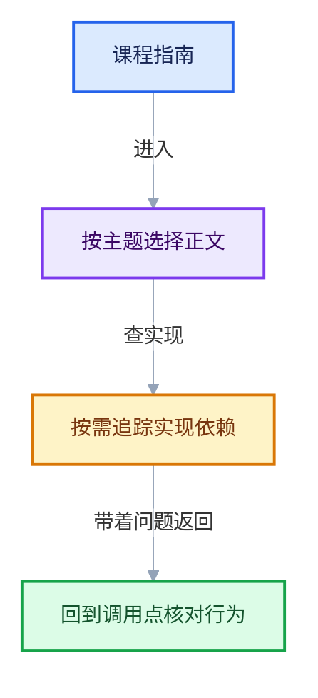

# 00-课程指南

[总入口](../README.md)

## [01-学习路线与阶段验收](01-学习路线与阶段验收.md)

五个阶段：Zone 基础 → 数据模型 → 执行架构 → 运行时 → 跨后端与实战。每阶段给出可手算核对的最小练习与验收问题。

## [02-图表配色与阅读约定](02-图表配色与阅读约定.md)

全系列统一的 mermaid 配色 classDef、源码链接格式、教学注释代码与原始源码折叠区的阅读方法。

## [03-符号与源码索引](03-符号与源码索引.md)

全部关键符号（类、结构、函数、DNA 结构）到源码文件的定位表，以及各文件被哪些文档覆盖的覆盖矩阵。

