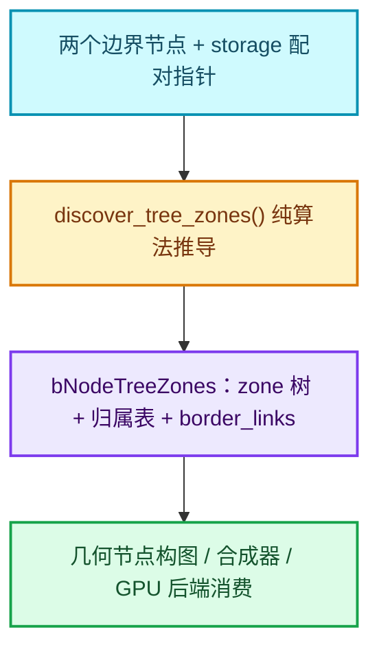
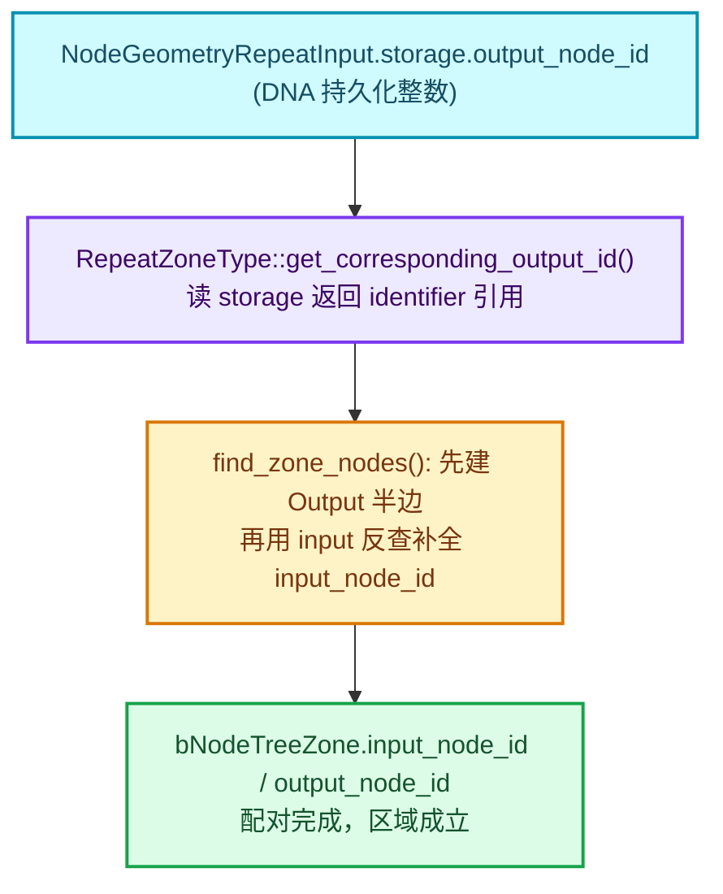
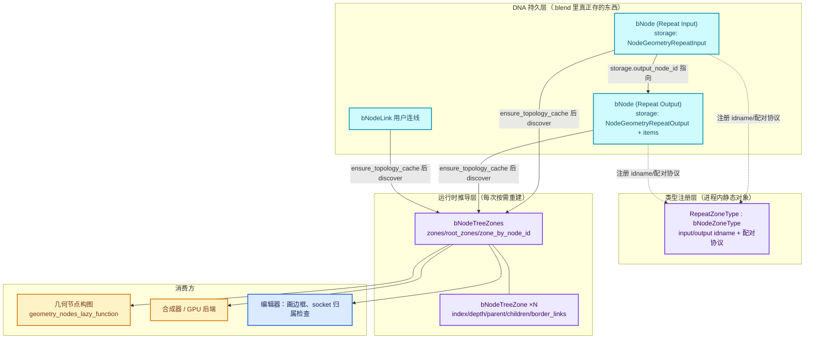
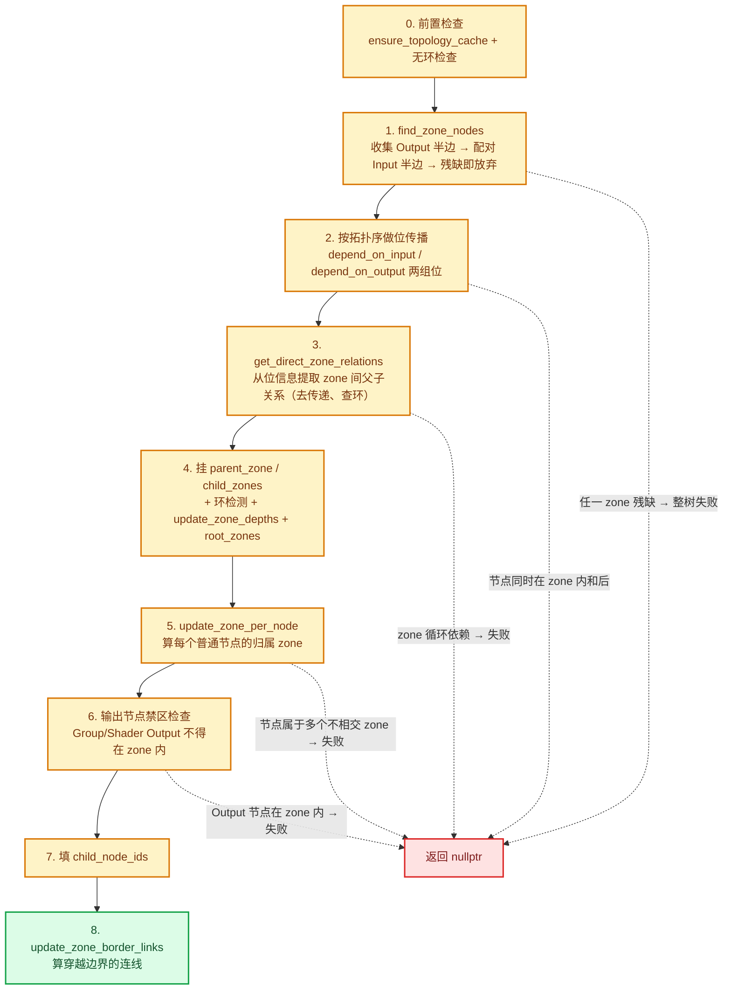
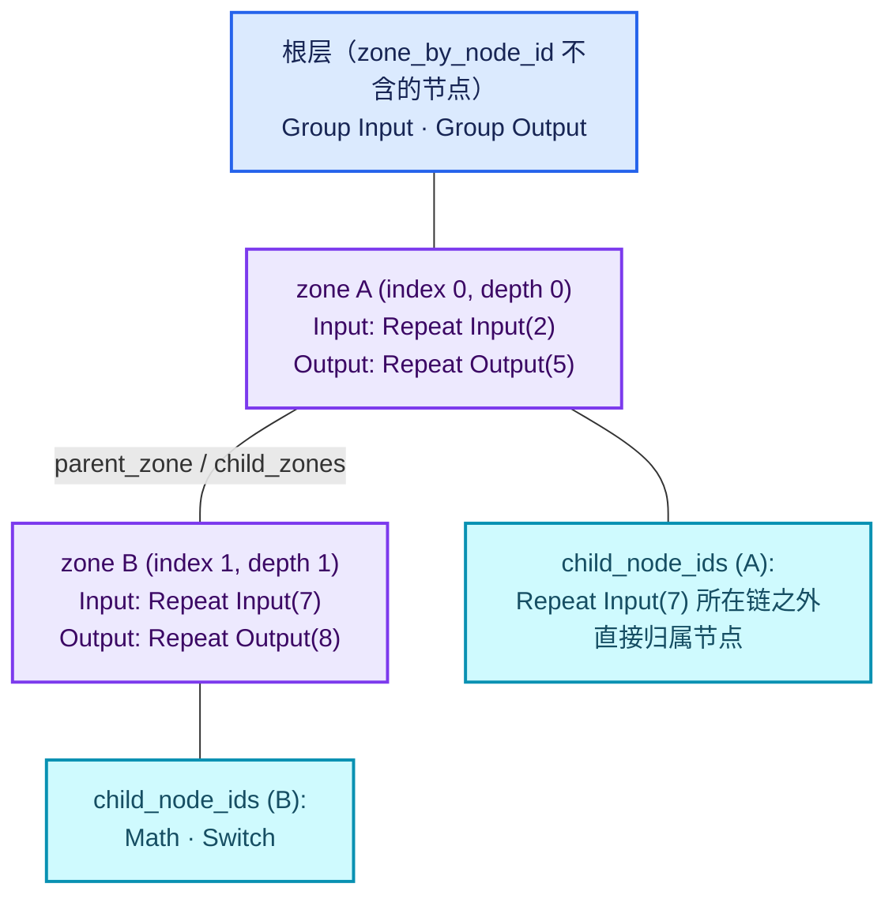
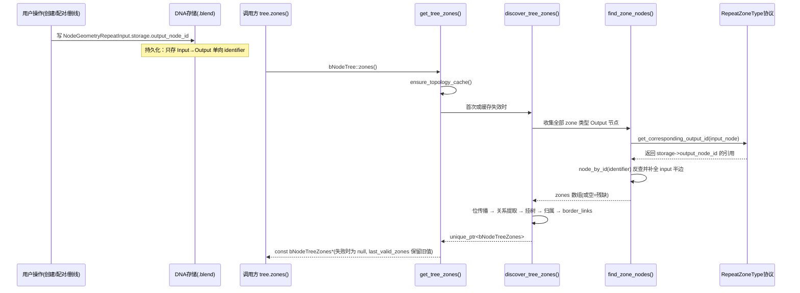
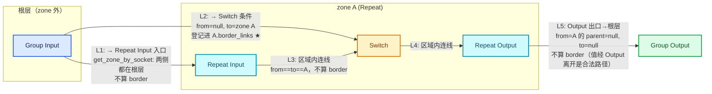
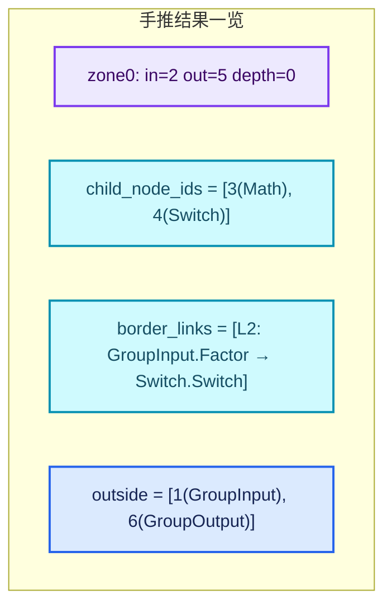

# 01-01 NodeTreeZone 区域表示与配对

[总入口](../README.md) · [本章README](README.md) · [下一篇：02-Zone输入输出与bundle迁移语义](02-Zone输入输出与bundle迁移语义.md)

> 基准源码：Blender `5.4.0-alpha` 工作树（`D:\Repository\blender-git\blender`）。
> 本文所有行号均为当前工作树实际内容，核心文件：
> [BKE_node_tree_zones.hh](../../../source/blender/blenkernel/BKE_node_tree_zones.hh)（122 行）与
> [node_tree_zones.cc](../../../source/blender/blenkernel/intern/node_tree_zones.cc)（653 行）。
> 图表配色遵循 [全系列配色约定](../00-课程指南/02-图表配色与阅读约定.md)。

---

## 0. 本章在系列中的位置

在阅读 Repeat Zone 的执行逻辑之前，必须先回答一个更底层的问题：**"区域"在 Blender 的节点树数据结构里到底是一个什么东西？**

在节点编辑器的 UI 里，Repeat Zone 表现为一块带边框的区域，用户把节点"画"在里面。但
Blender 内部**没有**任何"背景框"、"区域矩形"之类的持久数据。区域不是编辑器画出来的，
而是每次需要时，从"两个节点 + 一堆连线"中**推导（discover）**出来的：

- 两个边界节点：`GeometryNodeRepeatInput` 与 `GeometryNodeRepeatOutput`；
- 一条持久化的配对关系：Repeat Input 的 `storage->output_node_id` 指向 Repeat Output 的
  `bNode.identifier`；
- 一套纯算法：`discover_tree_zones()` 在运行时把上面两样东西展开成一棵
  **zone 树**，并算出每个节点的归属、每条穿越边界的连线。

本章就讲这套推导算法。它位于 `blenkernel`（核心数据层），被几何节点、合成器、着色器
三种节点树共享——因为 Simulation、Repeat、Foreach、Closure 四种区域全都走同一套代码。



一句话总结：**区域 = 推导结果，不是存储事实**。理解了这一点，后面所有"为什么改了节点
区域就变了"、"为什么孤立 Output 节点会导致整棵树没有区域"的问题都会豁然开朗。

---

## 1. 先回答一个具体问题

### 问题：Repeat Input 和 Repeat Output 是两个完全独立的节点，Blender 怎么知道它们属于同一个区域？

先把表象看清楚。在 `.blend` 文件里，Repeat Input 和 Repeat Output 就是两个普通的
`bNode`，各自有 identifier、location、storage。它们之间：

- **没有**一根连线直接相连（用户连的那根"内部回环线"是编辑时才出现的引导线，不是数据）；
- **没有**共享一个 "zone id" 之类的公共字段；
- **不靠名字**配对——你把两个节点都叫 "Repeat" 也没用，都叫别的名字也照样工作。

真正的答案是三层：

**第一层：持久化的单向指针（DNA 存储层）。**
Repeat Input 的 storage 是一个只有单个字段的小结构
[NodeGeometryRepeatInput](../../../source/blender/makesdna/DNA_node_types.h#L3554-L3559)：

```cpp
struct NodeGeometryRepeatInput {
  DNA_DEFINE_CXX_METHODS(NodeGeometryRepeatInput)

  /** bNode.identifier of the corresponding output node. */
  int32_t output_node_id = 0;
};
```

它存的是**对应 Repeat Output 节点的 `bNode.identifier`**。方向是 Input → Output 单向指针；
Repeat Output 的 storage（`NodeGeometryRepeatOutput`）存的是条目列表（items），**不反指**
Input。这个指针是在用户创建节点对的那一刻写进去的——比如从 Add 菜单搜索连线时，
[NodeGeometryRepeatInput 类型
](../../../source/blender/nodes/geometry/nodes/node_geo_repeat.cc#L252-L297)的
`node_gather_link_searches` 会同时创建两个节点并手动写入：

```cpp
auto &input_storage = *static_cast<NodeGeometryRepeatInput *>(input_node.storage);
input_storage.output_node_id = output_node.identifier;
```

**第二层：类型系统层面的"配对协议"（注册层）。**
每种区域在 [node_register.cc](../../../source/blender/nodes/intern/node_register.cc#L74-L90)
里注册成一个 `bNodeZoneType`，其中最关键的是一个虚函数
`get_corresponding_output_id(const bNode &input_bnode)`：它告诉通用算法
"给定一个 input 边界节点，去哪里读出它对应 output 节点的 identifier"。Repeat 的实现就是
直接读 storage：

```cpp
const int &get_corresponding_output_id(const bNode &input_bnode) const override
{
  BLI_assert(input_bnode.type_legacy == this->input_type);
  return static_cast<NodeGeometryRepeatInput *>(input_bnode.storage)->output_node_id;
}
```

**第三层：运行时的配对算法（推导层）。**
[node_tree_zones.cc](../../../source/blender/blenkernel/intern/node_tree_zones.cc#L34-L72)
的 `find_zone_nodes()` 先把树上**所有** zone 类型的 Output 节点收上来，每个 Output 节点
先创建一个 `bNodeTreeZone`（此时只有 output 半边），然后遍历所有 Input 节点，通过
`zone_type->get_corresponding_output(tree, *input_node)` 反查 Output 节点，查到且该
Output 已经属于某个 zone，就把 input 半边填进去。**配对的主键是
`bNode.identifier`（一个 DNA 持久化的整数），经由 storage 中转，而不是名字、不是位置、
更不是连线。**



还有一条**兜底规则**值得现在就说：配对是"全部成立或全部不成立"的。
[find_zone_nodes 结尾](../../../source/blender/blenkernel/intern/node_tree_zones.cc#L64-L70)
检查每个 zone 必须同时有 input 半边和 output 半边，任何一个 zone 残缺，
**整个树的 zones 直接返回空**——不是"忽略那个坏区域继续用别的"，而是整树放弃。
这就是为什么你删掉一个 Repeat Input 而留着 Repeat Output 时，依赖 zones 的所有
下游机制（构图、执行、trace）都拿不到区域信息。

---

## 2. 相关类与数据的职责

下面逐类过一遍参与"区域表示"的数据结构。每一条都给出真实源码链接（相对路径从本章
目录 `​.markdown/重复区域-dsh/01-Zone系统基础/​` 出发，`../../../../` 即仓库根）。

### 2.1 `bke::bNodeTreeZone` —— 一个推导出的区域

声明于 [BKE_node_tree_zones.hh L23-L55](../../../source/blender/blenkernel/BKE_node_tree_zones.hh#L23-L55)。

| 字段 | 类型 | 含义 | 备注 |
| --- | --- | --- | --- |
| `owner` | `bNodeTreeZones *` | 所属集合的反向指针 | zone 通过它访问 `owner->tree`，见 [input_node() 实现](../../../source/blender/blenkernel/intern/node_tree_zones.cc#L585-L591) |
| `index` | `int` | 在全树 zones 数组中的下标 | 构建顺序即"遇到 Output 节点的顺序"，见 L49 |
| `depth` | `int` | 嵌套深度 | 顶层为 0，由 [update_zone_depths](../../../source/blender/blenkernel/intern/node_tree_zones.cc#L21-L32) 递归得出；初始 -1 表示"未算" |
| `input_node_id` | `std::optional<int>` | 区域输入节点的 `bNode.identifier` | optional：推导过程中可能只有半边 |
| `output_node_id` | `std::optional<int>` | 区域输出节点的 identifier | 同上 |
| `parent_zone` | `bNodeTreeZone *` | 直接父区域 | 空指针 = 顶层区域 |
| `child_zones` | `Vector<bNodeTreeZone *>` | **直接**子区域 | 不含递归后代 |
| `child_node_ids` | `Vector<int>` | **直接**子节点 identifier | 排除了属于子区域的节点 |
| `border_links` | `Vector<const bNodeLink *>` | 穿越边界进入本区域的连线 | 有严格过滤，见 §6 |

三个便捷方法把 id 转回真实对象：

- [input_node() / output_node()](../../../source/blender/blenkernel/intern/node_tree_zones.cc#L585-L599)：
  `owner->tree->node_by_id(...)`，optional 为空时返回 `nullptr`；
- [child_nodes()](../../../source/blender/blenkernel/intern/node_tree_zones.cc#L610-L613)：
  把 `child_node_ids` 批量转成 `Vector<const bNode *>`；
- [contains_node_recursively()](../../../source/blender/blenkernel/intern/node_tree_zones.cc#L392-L405) /
  [contains_zone_recursively()](../../../source/blender/blenkernel/intern/node_tree_zones.cc#L407-L415)：
  沿 `parent_zone` 链向上走判断递归包含关系——注意它们**不遍历** `child_zones`，
  而是从被查询者往上爬，这是"只存直接关系、递归关系现算"的典型设计。

### 2.2 `bke::bNodeTreeZones` —— 一棵树所有区域的集合

声明于 [BKE_node_tree_zones.hh L57-L111](../../../source/blender/blenkernel/BKE_node_tree_zones.hh#L57-L111)。

| 字段/方法 | 含义 |
| --- | --- |
| `tree` | 所属节点树 |
| `zones_ptrs` | `Vector<std::unique_ptr<bNodeTreeZone>>`，zone 的**拥有者**（内存归它管） |
| `zones` | `zones_ptrs` 的裸指针视图，"通常更容易迭代"，见头文件 L62 注释 |
| `root_zones` | 所有 `depth == 0` 的顶层区域，见 [填充代码 L330-L334](../../../source/blender/blenkernel/intern/node_tree_zones.cc#L330-L334) |
| `node_ids_outside_zones` | 不属于任何区域的节点 identifier 列表 |
| `zone_by_node_id` | `Map<int, int>`：节点 identifier → zone index；**边界节点也映射到它们创建的 zone**（头文件 L65-L68 注释明确说了这点） |
| `nodes_outside_zones()` | 把上面的 id 列表转成节点指针，[实现 L615-L618](../../../source/blender/blenkernel/intern/node_tree_zones.cc#L615-L618) |

查询接口按"精度"分两档，这个区别是本章最重要的细节之一：

- **[get_zone_by_node(node_id)](../../../source/blender/blenkernel/intern/node_tree_zones.cc#L437-L444)**：
  查 `zone_by_node_id` 表，返回节点所在的**最深** zone。边界节点算"在 zone 里"。
- **[get_zone_by_socket(socket)](../../../source/blender/blenkernel/intern/node_tree_zones.cc#L417-L435)**：
  先查节点，再做** socket 侧修正**——如果节点是某个 zone 的 Input 节点，则它的
  **输入 socket 属于 `parent_zone`**（也就是区域外）；如果节点是 Output 节点，则它的
  **输出 socket 属于 `parent_zone`**。换句话说：*Repeat Input 的入线端在区域外，
  出线端在区域内；Repeat Output 的入线端在区域内，出线端在区域外*。
  头文件 L73-L76 的注释用 Simulation Input 举了同样的例子。

再往上是四个"合法性/导航"接口，执行图构建时会大量用到（03 章的主角）：

- [link_between_zones_is_allowed()](../../../source/blender/blenkernel/intern/node_tree_zones.cc#L446-L462)：
  同 zone 允许；从根（null）出发允许；到根（null）**不允许**（值不能逃出区域）；
  否则要求 `from_zone->contains_zone_recursively(*to_zone)`——**只能进不能出**。
- [link_between_sockets_is_allowed()](../../../source/blender/blenkernel/intern/node_tree_zones.cc#L464-L472)：
  先把两个 socket 各自解析成 zone（注意用的是 `get_zone_by_socket` 而非 node 版），
  再套上一条。
- [get_zones_to_enter()](../../../source/blender/blenkernel/intern/node_tree_zones.cc#L474-L484)：
  从 inner 沿 `parent_zone` 爬到 outer，收集路径后 `std::reverse`，
  得到"从外到内依次要进入的 zone 列表"。
- [get_zones_to_enter_from_root()](../../../source/blender/blenkernel/intern/node_tree_zones.cc#L486-L490)：
  上一个接口的 `outer_zone = nullptr` 特化。

### 2.3 入口：`bNodeTree::zones()` 与缓存

[BKE_node_tree_zones.hh L113-L120](../../../source/blender/blenkernel/BKE_node_tree_zones.hh#L117-L120)
提供了一个 inline 便捷入口：

```cpp
inline const bke::bNodeTreeZones *bNodeTree::zones() const
{
  return bke::get_tree_zones(*this);
}
```

[get_tree_zones()](../../../source/blender/blenkernel/intern/node_tree_zones.cc#L380-L390)
的实现值得逐行看：

```cpp
const bNodeTreeZones *get_tree_zones(const bNodeTree &tree)
{
  tree.ensure_topology_cache();
  tree.runtime->tree_zones_cache_mutex.ensure([&]() {
    tree.runtime->tree_zones = discover_tree_zones(tree);
    if (tree.runtime->tree_zones) {
      tree.runtime->last_valid_zones = tree.runtime->tree_zones;
    }
  });
  return tree.runtime->tree_zones.get();
}
```

三个要点：

1. **依赖拓扑缓存**：`ensure_topology_cache()` 先行，因为推导要用 `nodes_by_type`、
   `toposort_left_to_right`、`all_links` 这些缓存查询；
2. **mutex.ensure 单次构建**：多线程同时问 zones，只有第一个线程真正跑推导；
3. **失败也缓存**：`discover_tree_zones` 返回 `nullptr`（树里有环、zone 残缺等）时
   `tree_zones` 保持空，但 `last_valid_zones` 只在成功时更新——外部代码可以拿
   "上一次合法的区域"做降级处理（例如编辑器 UI 仍想画出边框）。

### 2.4 `bNode` 与边界节点的 storage

普通节点就是 [DNA_node_types.h](../../../source/blender/makesdna/DNA_node_types.h)
里的 `bNode`。对 zone 而言真正特殊的只有两个 storage 结构：

- [NodeGeometryRepeatInput（L3554-L3559）](../../../source/blender/makesdna/DNA_node_types.h#L3554-L3559)：
  单字段 `output_node_id`，配对主键的存放地；
- [NodeGeometryRepeatOutput（L3561-L3572）](../../../source/blender/makesdna/DNA_node_types.h#L3561-L3572)：
  `items/items_num/active_index/next_identifier/inspection_index`，
  是"重复条目"（Item_X socket）的存放地——第 02 章的主角，本章只关心它**不含**
  任何指向 Input 的字段（单向指针设计的证据）。

Repeat Input 节点创建时把这个字段初始化为 0
（[node_geo_repeat.cc L113-L119](../../../source/blender/nodes/geometry/nodes/node_geo_repeat.cc#L113-L119)，
注释原话是 "Needs to be initialized for the node to work."）。0 意味着"找不到
identifier 为 0 的节点"，于是 `get_corresponding_output` 返回 `nullptr`，
这个 Input 暂时不成对——直到用户把它和某个 Output 配上（编辑操作会写这个字段，
属于 02 章的编辑器内容）。

### 2.5 `bke::bNodeZoneType` —— 区域类型的"配对协议"

声明于 [BKE_node.hh L1304-L1332](../../../source/blender/blenkernel/BKE_node.hh#L1304-L1332)。

```cpp
class bNodeZoneType {
 public:
  UString input_idname;    // 如 "GeometryNodeRepeatInput"
  UString output_idname;   // 如 "GeometryNodeRepeatOutput"
  int input_type;          // 如 GEO_NODE_REPEAT_INPUT
  int output_type;         // 如 GEO_NODE_REPEAT_OUTPUT
  int theme_id;            // 主题色，如 TH_NODE_ZONE_REPEAT

  virtual const int &get_corresponding_output_id(const bNode &input_bnode) const = 0;
  ...
};
```

它的注释（BKE_node.hh L1304-L1308）说得非常直白：这个类存在的目的就是
**让所有区域相关代码对"区域种类"无感**——新增一种 zone（比如当年的 Closure）只需要
注册一个新的 `bNodeZoneType` 子类，`node_tree_zones.cc` 一行不用改。

配套的自由函数（[BKE_node.hh L1334-L1340](../../../source/blender/blenkernel/BKE_node.hh#L1334-L1340)，
[实现 node_tree_zones.cc L522-L583](../../../source/blender/blenkernel/intern/node_tree_zones.cc#L522-L583)）：

- `register_node_zone_type()`：把类型对象挂进全局 vector；
- `all_zone_types()`：全部注册的区域类型；
- `all_zone_input_node_types()` / `all_zone_output_node_types()` / `all_zone_node_types()`：
  三份缓存的静态类型 id 列表（惰性初始化，`static const Vector<int>` + 立即调用的
  lambda）；
- `zone_type_by_node_type(node_type)`：给定节点类型 id 反查区域类型，查不到返回
  `nullptr`。

### 2.6 `bNodeLink` 与 border_links 的过滤条件

`border_links` 的元素类型是 `const bNodeLink *`。过滤条件直接写在
[update_zone_border_links](../../../source/blender/blenkernel/intern/node_tree_zones.cc#L199-L224)：

- `!link->is_available()` 跳过（socket 被禁用时的不可用连线）；
- `link->is_muted()` 跳过（静音连线）；
- `link->fromnode->is_dangling_reroute()` 跳过（源头是"悬空 reroute"——即只连到
  reroute、最终没有真实数据来源的链）。

头文件 L40-L44 的注释原文总结为："Links that enter the zone through the zone border
and carry information"——**border_links 是"携带信息的跨界连线"，不是几何上穿过边框
的所有线段**。

### 2.7 职责总览图



---

## 3. 区域推导总流程：`discover_tree_zones()`

[discover_tree_zones（node_tree_zones.cc L226-L378）](../../../source/blender/blenkernel/intern/node_tree_zones.cc#L226-L378)
是整个机制的主函数，约 150 行，做了 8 件事。先看流程图，再逐段拆。



注意这张图里的五个**失败出口**：区域推导是一个"全有或全无"的验证型算法——它不是
尽力拼出一个近似树，而是任何一步发现不一致就整体放弃。这保证了只要
`tree.zones()` 返回非空，得到的就是一个**自洽**的区域树。

### 3.1 第 1 步：`find_zone_nodes()` —— 先有 Output，再有 Input

[完整源码 L34-L72](../../../source/blender/blenkernel/intern/node_tree_zones.cc#L34-L72)。

**[讲解] 版本（注释版）：**

```cpp
// 职责：从节点树里找出所有区域，填充 zones 数组和 r_zone_by_inout_node 反查表。
// 关键决策 1：以 Output 节点为"区域存在"的锚点。
static Vector<std::unique_ptr<bNodeTreeZone>> find_zone_nodes(
    const bNodeTree &tree,
    bNodeTreeZones &owner,
    Map<const bNode *, bNodeTreeZone *> &r_zone_by_inout_node)
{
  // all_zone_types() 返回注册表里的全部区域类型（Simulation/Repeat/Foreach/Closure/...）
  const Span<const bNodeZoneType *> zone_types = all_zone_types();

  Vector<std::unique_ptr<bNodeTreeZone>> zones;
  Vector<const bNode *> zone_output_nodes;
  // 第一遍：收集所有区域类型的所有 Output 节点。
  // 注意是"所有类型一起收"，所以 zones 的顺序是按类型注册顺序、再按树内顺序排列，
  // 与用户视觉布局完全无关。
  for (const bNodeZoneType *zone_type : zone_types) {
    zone_output_nodes.extend(tree.nodes_by_type(zone_type->output_idname));
  }
  // 每个 Output 节点先创建一个"只有半边"的 zone：
  // 此时 input_node_id 还是 std::nullopt，output_node_id 已填。
  for (const bNode *node : zone_output_nodes) {
    auto zone = std::make_unique<bNodeTreeZone>();
    zone->owner = &owner;
    zone->index = zones.size();              // index = 创建顺序
    zone->output_node_id = node->identifier; // 关联靠 identifier，不存指针
    r_zone_by_inout_node.add(node, zone.get());
    zones.append(std::move(zone));
  }
  // 第二遍：对每个区域类型的每个 Input 节点，问类型协议"你的 Output 是谁"。
  for (const bNodeZoneType *zone_type : zone_types) {
    for (const bNode *input_node : tree.nodes_by_type(zone_type->input_idname)) {
      // 内部走 get_corresponding_output_id(input) -> tree.node_by_id(...)
      if (const bNode *output_node = zone_type->get_corresponding_output(tree, *input_node)) {
        // 只有当那个 Output 已经建过 zone（即它在树上真实存在）才补半边。
        // 如果 storage 指向的 identifier 查不到节点，这里静默跳过——
        // 该 Input 成了孤儿，稍后由完整性检查统一处理。
        if (bNodeTreeZone *zone = r_zone_by_inout_node.lookup_default(output_node, nullptr)) {
          zone->input_node_id = input_node->identifier;
          r_zone_by_inout_node.add(input_node, zone);
        }
      }
    }
  }
  // 完整性检查：任何一个 zone 缺半边 => 整树没有 zones（返回空数组）。
  // 这就是"全有或全无"：不存在"残缺但可用"的区域。
  for (const std::unique_ptr<bNodeTreeZone> &zone : zones) {
    if (!zone->input_node_id || !zone->output_node_id) {
      r_zone_by_inout_node.clear();
      return {};
    }
  }
  return zones;
}
```

<details>
<summary>核对原始源码：source/blender/blenkernel/intern/node_tree_zones.cc · L34—L72</summary>

```cpp
static Vector<std::unique_ptr<bNodeTreeZone>> find_zone_nodes(
    const bNodeTree &tree,
    bNodeTreeZones &owner,
    Map<const bNode *, bNodeTreeZone *> &r_zone_by_inout_node)
{
  const Span<const bNodeZoneType *> zone_types = all_zone_types();

  Vector<std::unique_ptr<bNodeTreeZone>> zones;
  Vector<const bNode *> zone_output_nodes;
  for (const bNodeZoneType *zone_type : zone_types) {
    zone_output_nodes.extend(tree.nodes_by_type(zone_type->output_idname));
  }
  for (const bNode *node : zone_output_nodes) {
    auto zone = std::make_unique<bNodeTreeZone>();
    zone->owner = &owner;
    zone->index = zones.size();
    zone->output_node_id = node->identifier;
    r_zone_by_inout_node.add(node, zone.get());
    zones.append(std::move(zone));
  }
  for (const bNodeZoneType *zone_type : zone_types) {
    for (const bNode *input_node : tree.nodes_by_type(zone_type->input_idname)) {
      if (const bNode *output_node = zone_type->get_corresponding_output(tree, *input_node)) {
        if (bNodeTreeZone *zone = r_zone_by_inout_node.lookup_default(output_node, nullptr)) {
          zone->input_node_id = input_node->identifier;
          r_zone_by_inout_node.add(input_node, zone);
        }
      }
    }
  }
  /* Avoid incomplete zones, all zones must have a valid input and output node. */
  for (const std::unique_ptr<bNodeTreeZone> &zone : zones) {
    if (!zone->input_node_id || !zone->output_node_id) {
      r_zone_by_inout_node.clear();
      return {};
    }
  }
  return zones;
}
```

</details>

为什么选 Output 当锚点而不是 Input？两个实际原因：

1. **Output 节点存条目（items）**。对 Repeat 来说，socket 列表（Item_0, Item_1…）
   长在 Output 上（`NodeGeometryRepeatOutput::items`），Input 的动态 socket 是**借**
   Output 的条目生成的（[node_geo_repeat.cc L82-L103](../../../source/blender/nodes/geometry/nodes/node_geo_repeat.cc#L82-L103)
   中 Input 的 declare 是先查 `storage.output_node_id` 找到 Output 再遍历它的 items）。
   所以"Output 是信息更完整的那一端"。
2. **反查成本低**。Input → Output 是一次 `Map`/`node_by_id` 查表；若反过来
   Output → Input 则需要遍历所有 Input 节点比对 storage（`get_corresponding_input`
   就是这么做的，见 [L492-L502](../../../source/blender/blenkernel/intern/node_tree_zones.cc#L492-L502)，
   复杂度 O(输入节点数)）。以 Output 为锚，每个 Input 只需一次查表。

`get_corresponding_output` 的实现也顺带看一下（[L504-L508](../../../source/blender/blenkernel/intern/node_tree_zones.cc#L504-L508)）：

```cpp
const bNode *bNodeZoneType::get_corresponding_output(const bNodeTree &tree,
                                                     const bNode &input_bnode) const
{
  return tree.node_by_id(this->get_corresponding_output_id(input_bnode));
}
```

一行：读协议拿 identifier，然后查树。`node_by_id` 查不到返回 `nullptr`，
正好覆盖"storage 指向已被删除的节点"的情况。

### 3.2 第 2 步：位传播 —— 用"数据流"定义"在区域内"

这是整个算法最核心的思想转变：**"节点在不在区域内"不是靠几何位置判断的，而是靠
数据依赖判断的。** 一个节点"属于"某个 zone，当且仅当它的数据来自这个 zone 的
Input 节点、且还没经过 Output 节点。

为此 [discover_tree_zones L248-L252](../../../source/blender/blenkernel/intern/node_tree_zones.cc#L248-L252)
建立了两张位表：

```cpp
/* A bit for every node-zone-combination. The bit is set when the node is in the zone. */
BitGroupVector<> depend_on_input_flag_array(nodes_num, zones_num, false);
/* The bit is set when the node depends on the output of the zone. */
BitGroupVector<> depend_on_output_flag_array(nodes_num, zones_num, false);
```

每个节点 × 每个 zone 一个 bit。语义：

- `depend_on_input[z] = 1`：这个节点的值**来自** zone z 的 Input（它"在 z 里"或
  "从 z 里取过值"）；
- `depend_on_output[z] = 1`：这个节点的值**已经经过了** zone z 的 Output（它"在
  z 之后"）。

然后按 [拓扑序](../../../source/blender/blenkernel/intern/node_tree_zones.cc#L253)
（`tree.toposort_left_to_right()`）逐节点传播位，规则（L254-L298）：

1. **继承**：把所有输入 socket 直连来源节点的两张位表 OR 进来（跳过 muted 连线与
   不可用 socket）；
2. **进入 zone**：如果节点是某个 zone 的 **Input** 节点 → `depend_on_input[该zone] = 1`
   （源码注释："Now entering a zone, so set the corresponding bit."）；
3. **离开 zone**：如果节点是某个 zone 的 **Output** 节点 → 先把它的 **Input 节点**的
   位也 OR 进来（因为 Output 的输出隐式继承了 Input 的输出——循环体上一轮的值），
   然后 `depend_on_input[该zone] = 0`（清掉，"出了区域"），`depend_on_output[该zone] = 1`
   （"依赖了区域输出"）；
4. **一致性检查**：如果某节点 `depend_on_input` 与 `depend_on_output` 在同一个 zone 上
   同时为 1 → "A node can not be inside and after a zone at the same time"，整树失败。

第 3 条里的"隐式连接"值得展开：Repeat Output 内部并没有一根真实的连线连回 Repeat
Input，但**语义上** Output 的入口值就是 Input 的出口值（上一轮的结果或首轮的外部
输入）。算法用 "Output 节点继承 Input 节点的位" 来显式建模这条隐式边
（[L280-L292](../../../source/blender/blenkernel/intern/node_tree_zones.cc#L280-L292)）。

**[讲解] 版本（核心传播循环，有删节，只保留主干）：**

```cpp
const Span<const bNode *> sorted_nodes = tree.toposort_left_to_right();
for (const bNode *node : sorted_nodes) {
  // 取出该节点自己的两行位（可变引用）
  MutableBoundedBitSpan depend_on_input_flags = depend_on_input_flag_array[node_i];
  MutableBoundedBitSpan depend_on_output_flags = depend_on_output_flag_array[node_i];

  // 规则1：继承所有直接前驱的位
  for (const bNodeSocket *input_socket : node->input_sockets()) {
    for (const bNodeLink *link : input_socket->directly_linked_links()) {
      if (link->is_muted()) continue;
      depend_on_input_flags  |= depend_on_input_flag_array[link->fromnode->index()];
      depend_on_output_flags |= depend_on_output_flag_array[link->fromnode->index()];
    }
  }
  if (input_types.contains(node->type_legacy)) {
    // 规则2：进入区域
    depend_on_input_flags[zone->index].set();
  }
  else if (output_types.contains(node->type_legacy)) {
    // 规则3：Output 隐式继承 Input 的位（上一轮的值），然后"走出"区域
    depend_on_input_flags  |= depend_on_input_flag_array[input_node_i];
    depend_on_output_flags |= depend_on_output_flag_array[input_node_i];
    depend_on_input_flags[zone->index].reset();
    depend_on_output_flags[zone->index].set();
  }
  // 规则4：同一 zone 不允许"既在里面又在后面"
  if (bits::has_common_set_bits(depend_on_input_flags, depend_on_output_flags)) {
    return {};
  }
}
```

<details>
<summary>核对原始源码：source/blender/blenkernel/intern/node_tree_zones.cc · L253—L298</summary>

```cpp
  const Span<const bNode *> sorted_nodes = tree.toposort_left_to_right();
  for (const bNode *node : sorted_nodes) {
    const int node_i = node->index();
    MutableBoundedBitSpan depend_on_input_flags = depend_on_input_flag_array[node_i];
    MutableBoundedBitSpan depend_on_output_flags = depend_on_output_flag_array[node_i];

    /* Forward all bits from the nodes to the left. */
    for (const bNodeSocket *input_socket : node->input_sockets()) {
      if (!input_socket->is_available()) {
        continue;
      }
      for (const bNodeLink *link : input_socket->directly_linked_links()) {
        if (link->is_muted()) {
          continue;
        }
        const bNode &from_node = *link->fromnode;
        const int from_node_i = from_node.index();
        depend_on_input_flags |= depend_on_input_flag_array[from_node_i];
        depend_on_output_flags |= depend_on_output_flag_array[from_node_i];
      }
    }
    if (input_types.contains(node->type_legacy)) {
      if (const bNodeTreeZone *zone = zone_by_inout_node.lookup_default(node, nullptr)) {
        /* Now entering a zone, so set the corresponding bit. */
        depend_on_input_flags[zone->index].set();
      }
    }
    else if (output_types.contains(node->type_legacy)) {
      if (const bNodeTreeZone *zone = zone_by_inout_node.lookup_default(node, nullptr)) {
        /* The output is implicitly linked to the input, so also propagate the bits from there. */
        if (const bNode *zone_input_node = zone->input_node()) {
          const int input_node_i = zone_input_node->index();
          depend_on_input_flags |= depend_on_input_flag_array[input_node_i];
          depend_on_output_flags |= depend_on_output_flag_array[input_node_i];
        }
        /* Now exiting a zone, so change the bits accordingly. */
        depend_on_input_flags[zone->index].reset();
        depend_on_output_flags[zone->index].set();
      }
    }

    if (bits::has_common_set_bits(depend_on_input_flags, depend_on_output_flags)) {
      /* A node can not be inside and after a zone at the same time. */
      return {};
    }
  }
```

</details>

为什么用拓扑序 + 位传播而不是简单的"包围盒/DFS 进入-离开区间"？因为**位表能自然
表达合并语义**：一个 Switch 的两个输入分别来自 zone 内和 zone 外时，位 OR 之后
正确表达"它消费了 zone 的值"；一条数据流两次穿过同一个 zone（先出来又进去）时，
`depend_on_input` 和 `depend_on_output` 会在同一 zone 上同时置位，规则 4 立刻拒绝
——这正好是"区域不是子程序"的非法结构。区间法处理这些情况都需要额外特判。

### 3.3 第 3 步：`get_direct_zone_relations()` —— 从位表到父子关系

zone 之间的嵌套关系**同样**从位表里来：zone B 的 **Output 节点**如果
`depend_on_input` 里带着 zone A 的位，说明 B 的输出依赖 A 的输入 → B 在 A 里面。
[实现 L86-L142](../../../source/blender/blenkernel/intern/node_tree_zones.cc#L86-L142)。

算法分三小步：

1. **收集全部关系（含传递的）**：对每个 zone 的 Output 节点，枚举它位表中所有为 1
   的其他 zone i，生成关系 `{parent=zones[i], child=zone}`。如果 A 包 B、B 包 C，
   这里会同时得到 (A,B)、(B,C)、(A,C) 三条——最后一条是**传递**出来的。
2. **环检测**：如果某关系 (P,C) 与其反向 (C,P) 同时存在 → zone 循环依赖，
   `std::nullopt`，整树失败。
3. **去传递关系**：暴力双循环找"A→B 且 B→C，则 A→C 是传递关系"并把它们删掉
   （源码注释自嘲："This is a brute force algorithm currently."）。剩下的是
   **直接**父子关系。

**[讲解] 版本（主干）：**

```cpp
static std::optional<Vector<ZoneRelation>> get_direct_zone_relations(
    const Span<bNodeTreeZone *> all_zones, const BitGroupVector<> &depend_on_input_flag_array)
{
  VectorSet<ZoneRelation> all_zone_relations;

  /* 收集全部关系，包括传递出来的：B 的 Output 依赖 A 的输入 => B 嵌套在 A 里 */
  for (bNodeTreeZone *zone : all_zones) {
    const BoundedBitSpan flags = depend_on_input_flag_array[zone->output_node()->index()];
    bits::foreach_1_index(flags, [&](const int parent_zone_i) {
      if (parent_zone_i != zone->index) {
        all_zone_relations.add_new({all_zones[parent_zone_i], zone});
      }
    });
  }
  /* 环检测：出现 (P,C) 与 (C,P) 同时存在 => 循环依赖，整体失败 */
  for (const ZoneRelation &relation : all_zone_relations) {
    if (all_zone_relations.contains({relation.child, relation.parent})) {
      return std::nullopt;
    }
  }
  /* 去传递：A→B、B→C 都存在时，A→C 只是传递关系，删掉，留下的才是"直接"父子 */
  ...（暴力双循环，见原始源码）
  return zone_relations;
}
```

<details>
<summary>核对原始源码：source/blender/blenkernel/intern/node_tree_zones.cc · L86—L142</summary>

```cpp
static std::optional<Vector<ZoneRelation>> get_direct_zone_relations(
    const Span<bNodeTreeZone *> all_zones, const BitGroupVector<> &depend_on_input_flag_array)
{
  VectorSet<ZoneRelation> all_zone_relations;

  /* Gather all relations, even the transitive once. */
  for (bNodeTreeZone *zone : all_zones) {
    const int zone_i = zone->index;
    for (const bNode *node : {zone->output_node()}) {
      if (node == nullptr) {
        continue;
      }
      const BoundedBitSpan depend_on_input_flags = depend_on_input_flag_array[node->index()];
      bits::foreach_1_index(depend_on_input_flags, [&](const int parent_zone_i) {
        if (parent_zone_i != zone_i) {
          all_zone_relations.add_new({all_zones[parent_zone_i], zone});
        }
      });
    }
  }

  for (const ZoneRelation &relation : all_zone_relations) {
    const ZoneRelation reverse_relation{relation.child, relation.parent};
    if (all_zone_relations.contains(reverse_relation)) {
      /* There is a cyclic zone dependency. */
      return std::nullopt;
    }
  }

  /* Remove transitive relations. This is a brute force algorithm currently. */
  Vector<int> transitive_relations;
  for (const int a : all_zone_relations.index_range()) {
    const ZoneRelation &relation_a = all_zone_relations[a];
    for (const int b : all_zone_relations.index_range()) {
      if (a == b) {
        continue;
      }
      const ZoneRelation &relation_b = all_zone_relations[b];
      if (relation_a.child != relation_b.parent) {
        continue;
      }
      const ZoneRelation transitive_relation{relation_a.parent, relation_b.child};
      const int transitive_relation_i = all_zone_relations.index_of_try(transitive_relation);
      if (transitive_relation_i != -1) {
        transitive_relations.append_non_duplicates(transitive_relation_i);
      }
    }
  }
  std::ranges::sort(transitive_relations, std::greater<>());

  Vector<ZoneRelation> zone_relations = all_zone_relations.as_span();
  for (const int i : transitive_relations) {
    zone_relations.remove_and_reorder(i);
  }

  return zone_relations;
}
```

</details>

一个细节：关系收集时**只看每个 zone 的 Output 节点**的位表（`for (const bNode *node
: {zone->output_node()})` ——一个单元素初始化列表的 range-for，写法略炫但意思就是
"只处理这一个节点"）。为什么不需要看 zone 内其他节点？因为"zone B 整体在 A 里"
等价于"B 的 Output 在 A 里"——B 的输出值都要流经它的 Output 节点，Output 归属了，
整个 B 就归属了。

### 3.4 第 4-5 步：挂树、算深度、定归属

拿到直接关系后（[L307-L334](../../../source/blender/blenkernel/intern/node_tree_zones.cc#L307-L334)）：

```cpp
/* Set parent and child pointers in zones. */
for (const ZoneRelation &relation : *zone_relations) {
  relation.parent->child_zones.append(relation.child);
  BLI_assert(relation.child->parent_zone == nullptr);  // 断言每个 zone 只有一个父亲
  relation.child->parent_zone = relation.parent;
}
```

注意那个 `BLI_assert`：如果某个 child 出现两次（两个父亲），release 下会静默覆盖、
debug 下直接断言失败。去传递步骤保证了正常情况不会发生。

随后做了第二次环检测（[L314-L323](../../../source/blender/blenkernel/intern/node_tree_zones.cc#L314-L323)）：
对每个 zone 沿 `parent_zone` 走到头，用 `Set` 记录访问过的 zone，重复出现即循环
父子关系 → 失败。这与第 3 步的环检测互补：第 3 步查"关系集合"层面的环，
这里查"挂完指针"之后的实际链。

[update_zone_depths](../../../source/blender/blenkernel/intern/node_tree_zones.cc#L21-L32)
是标准的记忆化递归：

```cpp
static void update_zone_depths(bNodeTreeZone &zone)
{
  if (zone.depth >= 0) {          // 已经算过（初始 -1，顶层为 0，都不会重复进入）
    return;
  }
  if (zone.parent_zone == nullptr) {
    zone.depth = 0;               // 顶层区域
    return;
  }
  update_zone_depths(*zone.parent_zone);   // 先算父亲
  zone.depth = zone.parent_zone->depth + 1;
}
```

`depth` 的消费方在 03 章：构图器按深度**降序**处理，先构建内层 zone 的 body 函数，
外层才能引用它。

接着 [update_zone_per_node（L144-L197）](../../../source/blender/blenkernel/intern/node_tree_zones.cc#L144-L197)
回答"每个普通节点属于哪个 zone"：对每个节点，枚举它 `depend_on_input` 位表中所有
为 1 的 zone，用两条"沿 parent 链爬"的循环挑出**最深**的那个作为归属；如果发现
两个 zone 互不为祖先/后代（不相交却都含此节点）→ `found_node_in_multiple_zones`
→ 整树失败。边界节点（Input/Output）在循环里被 `ELEM(&node, zone->input_node(),
zone->output_node())` 显式跳过，最后统一由
`zone_by_inout_node`（L193-L195）`add_overwrite` 写进 `zone_by_node_id` ——
**所以边界节点永远归属它们创建的 zone，这条规则是最后强制写入的，优先级最高**。

### 3.5 第 6-7 步：禁区与 child_node_ids

[L347-L359](../../../source/blender/blenkernel/intern/node_tree_zones.cc#L347-L359)：
Group Output、材质/灯光/世界 Output、AOV Output 这些"树级输出节点"**不允许在任何
zone 内**——值流出到树级出口必须先通过 zone 的 Output 节点。这条检查是 per-tree
的最终否决。

[L361-L372](../../../source/blender/blenkernel/intern/node_tree_zones.cc#L361-L372)
填 `child_node_ids`：遍历所有节点，查 `zone_by_node_id`，属于某 zone 且**不是**该
zone 的 Input/Output 节点本身者，追加到该 zone 的直接孩子列表。

### 3.6 第 8 步：`update_zone_border_links()`

[完整源码 L199-L224](../../../source/blender/blenkernel/intern/node_tree_zones.cc#L199-L224)。

**[讲解] 版本：**

```cpp
static void update_zone_border_links(const bNodeTree &tree, bNodeTreeZones &tree_zones)
{
  tree.ensure_topology_cache();
  for (const bNodeLink *link : tree.all_links()) {
    // 过滤 1：socket 不可用的连线不携带信息
    if (!link->is_available()) continue;
    // 过滤 2：静音连线不携带信息
    if (link->is_muted()) continue;
    // 过滤 3：源头是悬空 reroute（后面没有真实数据）的连线
    if (link->fromnode->is_dangling_reroute()) continue;

    // 关键：用 socket 级归属（不是 node 级！）解析两端所在的 zone。
    // from 在区域外（null 表示根层）、to 在区域内 —— 这才是"进入"。
    bNodeTreeZone *from_zone = tree_zones.get_zone_by_socket(*link->fromsock);
    bNodeTreeZone *to_zone   = tree_zones.get_zone_by_socket(*link->tosock);
    if (from_zone == to_zone) continue;   // 两端同 zone：区域内普通连线，不是 border

    // 断言方向合法性：不允许"从内向外"的连线存在。
    // 合法情形只有两种：from 是 to 的祖先（或 from 是根 null）。
    BLI_assert(from_zone == nullptr || from_zone->contains_zone_recursively(*to_zone));

    // 从 to_zone 沿 parent 链爬到 from_zone 为止：
    // 爬过的每个 zone 都"被这条连线进入"，都要登记这条 border link。
    // 这意味着一条从根进入双层嵌套 zone 内部的连线，会同时出现在外层与内层
    // 两个 zone 的 border_links 里。
    for (bNodeTreeZone *zone = to_zone; zone != from_zone; zone = zone->parent_zone) {
      zone->border_links.append(link);
    }
  }
}
```

<details>
<summary>核对原始源码：source/blender/blenkernel/intern/node_tree_zones.cc · L199—L224</summary>

```cpp
static void update_zone_border_links(const bNodeTree &tree, bNodeTreeZones &tree_zones)
{
  tree.ensure_topology_cache();
  for (const bNodeLink *link : tree.all_links()) {
    if (!link->is_available()) {
      continue;
    }
    if (link->is_muted()) {
      continue;
    }
    if (link->fromnode->is_dangling_reroute()) {
      continue;
    }
    bNodeTreeZone *from_zone = const_cast<bNodeTreeZone *>(
        tree_zones.get_zone_by_socket(*link->fromsock));
    bNodeTreeZone *to_zone = const_cast<bNodeTreeZone *>(
        tree_zones.get_zone_by_socket(*link->tosock));
    if (from_zone == to_zone) {
      continue;
    }
    BLI_assert(from_zone == nullptr || from_zone->contains_zone_recursively(*to_zone));
    for (bNodeTreeZone *zone = to_zone; zone != from_zone; zone = zone->parent_zone) {
      zone->border_links.append(link);
    }
  }
}
```

</details>

三个必须吃透的点：

1. **为什么用 `get_zone_by_socket` 而不是 `get_zone_by_node`？**
   考虑连线 `Group Input → Repeat Input 的 Iterations 输入`。Repeat Input 节点本身
   归属它创建的 zone（zone_by_node_id 里有它），但它的**输入 socket** 按语义在
   区域外——`get_zone_by_socket` 对 Input 节点的输入 socket 返回 `parent_zone`（此处
   为 null）。若用节点级归属，这条连线会被误判为"跨过边界"。头文件 L73-L76 注释
   专门强调了这一点。

2. **border_links 是"进入"语义**。`for (zone = to_zone; zone != from_zone; ...)` 只在
   `to` 比 `from` 深时才会爬链；配合前面的 BLI_assert（非法方向根本不该存在），
   border_links 严格只记录"从外进入"的连线。值"出来"必须走 zone Output 节点，
   体现在构图层而不是 border_links 里。

3. **一条连线登记多次**。从根层连到双层嵌套 zone 内部的连线，会在外层和内层两个
   zone 的 border_links 里各出现一次（爬链爬两层）。03 章构图时外层 zone 会把它
   作为自己的额外输入，内层 zone 又会作为自己的额外输入，逐层传递下去——
   所以"每层都记"不是 bug 而是需求。

### 3.7 配对协议的注册端：`node_register.cc`

第 1 节说过协议，这里把注册全景补齐。
[node_register.cc L147-L158](../../../source/blender/nodes/intern/node_register.cc#L147-L158)：

```cpp
static void register_zone_types()
{
  static SimulationZoneType simulation_zone_type;
  static RepeatZoneType repeat_zone_type;
  static ForeachGeometryElementZoneType foreach_geometry_element_zone_type;
  static ClosureZoneType closure_zone_type;
  static LightIterInternalZoneType light_iter_internal_zone_type;
  bke::register_node_zone_type(simulation_zone_type);
  bke::register_node_zone_type(repeat_zone_type);
  bke::register_node_zone_type(foreach_geometry_element_zone_type);
  bke::register_node_zone_type(closure_zone_type);
  bke::register_node_zone_type(light_iter_internal_zone_type);
}
```

`register_nodes()`（[L161 起](../../../source/blender/nodes/intern/node_register.cc#L161-L183)）
最先调用 `register_zone_types()`，保证任何节点类型注册之前区域协议表已就绪。

**[讲解] 版本（RepeatZoneType，L74-L90）：**

```cpp
class RepeatZoneType : public bke::bNodeZoneType {
 public:
  RepeatZoneType()
  {
    this->input_idname = "GeometryNodeRepeatInput"_ustr;   // 输入边界节点的注册名
    this->output_idname = "GeometryNodeRepeatOutput"_ustr; // 输出边界节点的注册名
    this->input_type = GEO_NODE_REPEAT_INPUT;              // legacy 类型 id
    this->output_type = GEO_NODE_REPEAT_OUTPUT;
    this->theme_id = TH_NODE_ZONE_REPEAT;                  // 编辑器主题色
  }
  // 配对协议：从 Input 节点的 storage 里读出 Output 节点的 identifier。
  // 注意返回 const int& —— 引用，意味着调用方还可以通过非 const 重载
  // （BKE_node.hh L1321-L1325，内部 const_cast）反向写入这个字段！
  // 编辑器配对操作写 storage 就走的这条路。
  const int &get_corresponding_output_id(const bNode &input_bnode) const override
  {
    BLI_assert(input_bnode.type_legacy == this->input_type);
    return static_cast<NodeGeometryRepeatInput *>(input_bnode.storage)->output_node_id;
  }
};
```

<details>
<summary>核对原始源码：source/blender/nodes/intern/node_register.cc · L74—L90</summary>

```cpp
class RepeatZoneType : public bke::bNodeZoneType {
 public:
  RepeatZoneType()
  {
    this->input_idname = "GeometryNodeRepeatInput"_ustr;
    this->output_idname = "GeometryNodeRepeatOutput"_ustr;
    this->input_type = GEO_NODE_REPEAT_INPUT;
    this->output_type = GEO_NODE_REPEAT_OUTPUT;
    this->theme_id = TH_NODE_ZONE_REPEAT;
  }

  const int &get_corresponding_output_id(const bNode &input_bnode) const override
  {
    BLI_assert(input_bnode.type_legacy == this->input_type);
    return static_cast<NodeGeometryRepeatInput *>(input_bnode.storage)->output_node_id;
  }
};
```

</details>

五种注册的区域类型对照表（全部出自 node_register.cc 实读）：

| 区域类型 | input_idname | output_idname | 配对数据来源 | 行号 |
| --- | --- | --- | --- | --- |
| Simulation | `GeometryNodeSimulationInput` | `GeometryNodeSimulationOutput` | `NodeGeometrySimulationInput.storage->output_node_id` | L56-L72 |
| Repeat | `GeometryNodeRepeatInput` | `GeometryNodeRepeatOutput` | `NodeGeometryRepeatInput.storage->output_node_id` | L74-L90 |
| Foreach Geometry Element | `GeometryNodeForeachGeometryElementInput` | `GeometryNodeForeachGeometryElementOutput` | 同上模式 | L92-L109 |
| Closure | `NodeClosureInput` | `NodeClosureOutput` | `NodeClosureInput.storage->output_node_id` | L111-L127 |
| Light Iter Internal | `ShaderNodeLightIterInternalInput` | `ShaderNodeLightIterInternalOutput` | `*reinterpret_cast<const int *>(&input_bnode.custom3)`（用 custom3 字段存！） | L129-L145 |

最后这个 Light Iter Internal 是个绝妙的反例教材：它证明配对数据**只要能从
Input 节点上读出一个 int identifier，放哪里都行**——storage 是常规做法，
`custom3` 是就地取材。`bNodeZoneType` 抽象掉了这一切差异。

顺便补一句用户视角的配对来源：除了编辑器菜单创建节点对时写入 storage
（`node_gather_link_searches`，[L252-L297](../../../source/blender/nodes/geometry/nodes/node_geo_repeat.cc#L252-L297)），
Python API / 版本升级脚本也可能直接写 `input_node.storage.output_node_id`。
推导层完全不在乎是谁写的，只在乎"读出来能不能在树上查到节点"。

---

## 4. zone 树长什么样：嵌套示例

假设用户搭了这样一个树（节点下括号内是编造的 identifier，仅用于讲解）：

```
Group Input ──→ Repeat Input(2) ─┐
                                 │   [zone A, depth 0]
   Group Input ─────→  Repeat Input(7) ─┐
                                        │  [zone B, depth 1, 在 A 内]
                                        │  Math → Switch
                                 ┌──────┘
                                 └─→ Repeat Output(8)
                                 │
                                 └─→ Repeat Output(5) ──→ Group Output
```

（示意而已，实际连线见下文小节。）推导完成后的 zone 树：



为什么 B 会成为 A 的孩子？走一遍 §3.3：zone B 的 Output（Repeat Output(8)）的
`depend_on_input` 位表里有 zone A 的位（它的数据来自 A 的 Input），于是产生
传递关系 (A,B)；B 的 Output 位表里没有 zone C、A 的 Output 位表里没有 B 的位
（A 的 Output 在 B **外面**，其数据不经过 B 的 Input），所以没有 (B,A)、
没有传递歧义——(A,B) 就是直接父子关系。

反过来，如果用户把线连反——zone A 的数据来自 zone B 的内部（A 的 Output 节点的
`depend_on_input` 同时有 A 和 B 的位，B 的 Output 的位表里也有 A 的位）——
关系集合里会同时出现 (A,B) 与 (B,A)，环检测触发，**整树 zones 为空**。
这就是"zone 不能互相嵌套成环"在算法上的落点。

---

## 5. 配对流程全景（时序视角）



图里值得盯住的一条线是 `P-->>F`：协议函数返回的是 `const int &`（**引用**），而
`find_zone_nodes` 只用它的值去查表。引用在这里不是为了省一次拷贝——一个 int 的
拷贝毫无成本——而是为了配对**写入端**：`bNodeZoneType` 的非 const 重载
（[BKE_node.hh L1321-L1325](../../../source/blender/blenkernel/BKE_node.hh#L1321-L1325)）
就是靠这个引用实现"通过协议写 storage"的。读路径与写路径共用同一个协议函数，
保证读到的和写的永远是同一个字段。

---

## 6. border_links 图示



五条连线只有 L2 进入 `border_links`。用 `get_zone_by_socket` 逐条验算（规则：
Input 节点的输入 socket → parent；Output 节点的输出 socket → parent；其余按节点
归属）：

| 连线 | from 所在 zone | to 所在 zone | 是否 border | 理由 |
| --- | --- | --- | --- | --- |
| L1 | null（Group Input 在根层） | null（Repeat Input 的**输入** socket → parent_zone = null） | 否 | from == to |
| L2 | null | zone A（Switch 普通节点） | **是** | 爬链 `A → (parent=null)`，A 登记 |
| L3 | zone A（Repeat Input 的**输出** socket 按节点归属 = A） | zone A | 否 | from == to |
| L4 | zone A | zone A | 否 | from == to |
| L5 | null（Repeat Output 的**输出** socket → parent = null） | null | 否 | from == to |

注意 L1 的微妙之处：这条线在画布上"看起来"插进了区域边框，但它的终点是 Repeat
Input 的入口——`get_zone_by_socket` 把这个 socket 判到区域外，所以它不是 border
link。它的语义是"区域的外部输入"，由 Output 节点条目与 Input socket 的对应关系
（02 章）处理，不走 border_links 通道。**border_links 只收"绕过 Input 节点直接扎进
区域内部"的连线。**

---

## 7. 用小数据走一遍：Repeat zone 里套一个 Switch

构造一棵具体的最小树，手工执行整个推导。这是本章的"考试"，请先自己推再对照。

### 7.1 输入数据

节点表（identifier 为编造的连续值，符合 Blender 实际从 1 递增的习惯）：

| identifier | 节点 | 说明 |
| --- | --- | --- |
| 1 | Group Input | 树级输入 |
| 2 | Repeat Input | storage.output_node_id = 5 |
| 3 | Math (Add) | 区域内 |
| 4 | Switch | 区域内，条件来自区域外 |
| 5 | Repeat Output | items: [Item_0: Geometry] |
| 6 | Group Output | 树级输出 |

连线表：

| id | from | to | 备注 |
| --- | --- | --- | --- |
| L1 | Group Input.Geometry | Repeat Input.Item_0 入口 | 区域外部输入 |
| L2 | Group Input.Factor | Switch.Switch（条件） | **跨界直达** |
| L3 | Repeat Input.Iteration | Math.A | 区域内 |
| L4 | Repeat Input.Item_0 | Math.B | 区域内 |
| L5 | Math.Result | Switch.A | 区域内 |
| L6 | Switch.Output | Repeat Output.Item_0 | 区域内 |
| L7 | Repeat Output.Result | Group Output.Geometry | 区域后 |

（Repeat Input 的 Iteration 输出在 [node_geo_repeat.cc L76-L78](../../../source/blender/nodes/geometry/nodes/node_geo_repeat.cc#L76-L78)
声明；`Iterations` 是它的输入。）

### 7.2 第 1 步：配对

- 收集 Output 节点：只有 Repeat Output(5) → 创建 zone 0，`output_node_id=5`，
  `input_node_id=nullopt`。
- 遍历 Input 节点：Repeat Input(2)，协议读 storage 得 5，`node_by_id(5)` 查到
  Repeat Output → zone 0 补全：`input_node_id=2`。
- 完整性检查通过。结果：`zones = [zone0{in:2, out:5}]`，
  `zone_by_inout_node = {节点2 → zone0, 节点5 → zone0}`。

### 7.3 第 2 步：位传播

拓扑序（left-to-right toposort）：`1(GroupInput), 2(RepeatIn), 3(Math), 4(Switch),
5(RepeatOut), 6(GroupOutput)`。单个 zone，位表每行 1 位。记 `(in, out)` 表示
depend_on_input / depend_on_output 在 zone0 上的位。

| 节点 | 处理 | 结果 (in, out) |
| --- | --- | --- |
| 1 Group Input | 无输入来源 | (0, 0) |
| 2 Repeat Input | 是 zone input 节点 → set in | (1, 0) |
| 3 Math | 继承 L3/L4 来源（节点2）的位 | (1, 0) |
| 4 Switch | 继承 Math(1,0) 和 GroupInput(0,0)，OR 后 (1,0) | (1, 0) |
| 5 Repeat Output | 先继承来源（Switch）：(1,0)；再继承 zone Input 节点 2：(1,0)；然后 reset in、set out | (0, 1) |
| 6 Group Output | 继承节点5 | (0, 1) |

一致性检查：没有任何节点 `in` 与 `out` 同位——通过。

### 7.4 第 3-4 步：关系与树

- zone0 的 Output（节点5）位表 in = 空 → 没有 zone 间关系。
- 无环；`parent_zone = nullptr`；`root_zones = [zone0]`；
  `update_zone_depths` → `depth = 0`。

### 7.5 第 5 步：节点归属

- 节点 3 (Math)：in 位表 {zone0}，且它不是边界节点 → `zone_by_node_id[3] = 0`。
- 节点 4 (Switch)：同理 → `zone_by_node_id[4] = 0`。
- 节点 1、6：无 in 位，也不在 `zone_by_inout_node` → 进入
  `node_ids_outside_zones = [1, 6]`。
- 最后 `add_overwrite`：`zone_by_node_id[2] = 0`、`zone_by_node_id[5] = 0`
  （边界节点强制归属其创建的 zone）。

最终 `zone_by_node_id = {2:0, 3:0, 4:0, 5:0}`，`node_ids_outside_zones = [1, 6]`。

### 7.6 第 6 步：禁区检查

Group Output（节点6）不在任何 zone 内 → 通过。

### 7.7 第 7 步：child_node_ids

zone0 的 `child_node_ids = [3, 4]`（Math 和 Switch；2 和 5 是边界被排除）。

### 7.8 第 8 步：border_links

逐连线验算（规则同 §6）：

| 连线 | from zone | to zone | 结论 |
| --- | --- | --- | --- |
| L1 | null（→ 节点2 的输入 socket → parent） | null | 跳过 |
| L2 | null（Group Input） | zone0（Switch） | **zone0.border_links += L2** |
| L3 | zone0（节点2 的输出 socket） | zone0 | 跳过 |
| L4 | zone0 | zone0 | 跳过 |
| L5 | zone0 | zone0 | 跳过 |
| L6 | zone0 | zone0 | 跳过 |
| L7 | null（节点5 的输出 socket → parent） | null | 跳过 |

**最终结果**：

```
bNodeTreeZones {
  zones: [ zone0{ index=0, depth=0, in=2, out=5,
                 parent=null, children=[], child_node_ids=[3,4],
                 border_links=[L2] } ],
  root_zones: [zone0],
  zone_by_node_id: {2:0, 3:0, 4:0, 5:0},
  node_ids_outside_zones: [1, 6]
}
```

下游怎么用（预告 03 章）：构图器看到 zone0 有 1 条 border link（L2），会把
"Group Input.Factor" 变成 zone body 函数的一个额外输入；Switch 的条件 socket 在
body 内部改接这个额外输入；循环体每轮迭代都会收到同一个 Factor 值。



---

## 8. 反例与边界

以下每条都对应一个真实存在的误读，判定依据全部来自上面实读的源码。

### 反例 1："Input/Output 靠名字或顺序配对"

错。配对主键是 `NodeGeometryRepeatInput.storage->output_node_id`（一个
`bNode.identifier`），名字只是 UI 装饰。你可以把 Input 改名 "AAA"、Output 改名
"BBB"，配对不受影响；反过来，两个 Input 的 storage 指向同一个 Output 是**可能的
数据状态**（直接改 Python 时），此时谁后配谁生效——`find_zone_nodes` 第二遍循环里
`zone->input_node_id = input_node->identifier` 会被后遍历到的 Input 覆盖。编辑器
正常操作不会造成这种状态，但推导算法不负责防御它。

### 反例 2："zones 数组的顺序就是执行顺序 / 拓扑顺序"

错。`index` 是 **Output 节点的收集顺序**（[L49](../../../source/blender/blenkernel/intern/node_tree_zones.cc#L49)：
`zone->index = zones.size()`），按"区域类型注册顺序 × 树内节点顺序"排列，与嵌套
深度、执行先后都无关。执行顺序的确定发生在构图层（03 章），那里才用 toposort 和
`depth` 降序构建。读代码时看到 `zones[zone_i]` 永远只是"按下标取区域对象"，
**不要**赋予任何时序含义。

### 反例 3："节点画在区域边框里面就属于区域"

错。归属由位传播决定（§3.2），几何位置完全不参与。一个物理上放在边框外的节点，
只要它消费了 zone Input 的输出，就属于该 zone；反之，边框内的孤立节点（无任何
依赖 zone 数据的连线）属于 `node_ids_outside_zones`。同样，`border_links` 不看
线段是否穿过边框——它只做 socket 归属比较（§3.6）。Blender 节点编辑器本来也是
这个哲学：连线才是语义，摆放只是布局。

### 反例 4："zone Output 的输出 socket 还在 zone 里"

错。`get_zone_by_socket` 对 Output 节点的**输出 socket** 返回 `parent_zone`
（[L429-L433](../../../source/blender/blenkernel/intern/node_tree_zones.cc#L429-L433)）。
这正是 L5→Group Output 不算 border link 的原因。对称地，Input 节点的**输入 socket**
也在 parent zone。边界节点像一扇门：门框两边分属两个世界，节点 id 归属（
`get_zone_by_node` 返回 zone 本身）与 socket 归属（`get_zone_by_socket` 按侧别
修正）是两套答案，混用必错。

### 反例 5："残缺的 zone 会被跳过，其余区域照常工作"

错。`find_zone_nodes` 的完整性检查是**整树否决**（[L64-L70](../../../source/blender/blenkernel/intern/node_tree_zones.cc#L64-L70)）：
任何 zone 缺半边，整棵树的 zones 返回空。下游所有 `tree.zones()` 的调用方拿到
`nullptr`，必须走各自的降级路径。和"0 次迭代"要严格区分：`Iterations = 0` 的
**完整**区域是完全合法的，zones 照常推导成功（运行时才走空迭代路径）。

### 反例 6："border_links 包含所有视觉上穿过边框的线"

错。三条过滤（不可用、muted、悬空 reroute 来源）+ "只记进入方向" + "Input 节点
入口不算跨界"，多重收窄之后，border_links 是一个**语义概念**：执行器真正需要的
"额外输入"清单。把 UI 里的视觉交叠当成 border 集合去做推断，一定对不上。

### 反例 7："zone 关系是按节点包围关系算的"

错。zone 间的父子关系来自 zone Output 节点位表里的跨 zone 依赖位（§3.3），
不是任何几何/包含判断。极端例子：两个 zone 在画布上完全不重叠，但 B 的 Output
消费了 A 的 Input 的值——(A,B) 父子关系照样成立，zones 树照样嵌套。反过来说，
画布上 A 大圈套住 B 小圈但无数据往来，两个 zone 是**平级**的，都挂在 root_zones。

### 反例 8："配对信息存在 Output 的 storage 里"

反了。Repeat 的配对指针在 **Input** 的 storage 里（`NodeGeometryRepeatInput::
output_node_id`）；Output 的 storage 存的是 items。唯一例外般的对照是查找方向：
`get_corresponding_input`（Output 找 Input）要遍历全部 Input 节点比对
（[L492-L502](../../../source/blender/blenkernel/intern/node_tree_zones.cc#L492-L502)），
而 `get_corresponding_output`（Input 找 Output）一次查表——方向不对称正是存储
不对称的直接后果。

---

## 9. 调试小抄

- 打印整个 zones 树：`node_tree_zones.cc` 里留有现成的流输出
  （[operator<< L620-L651](../../../source/blender/blenkernel/intern/node_tree_zones.cc#L620-L651)），
  输出格式为 `index: Parent index: N; Input: 名字, Output: 名字; Border Links: {...}`。
  L376 有一个被注释掉的 `// std::cout << *tree_zones << std::endl;`，
  在 `discover_tree_zones` 返回前放开它即可看到推导结果。
- 怀疑 zone 没推导出来：先查 `tree.zones() == nullptr` 的三种来源——树有环
  （L229-L231）、zone 残缺（L64-L70）、各步一致性检查失败。`last_valid_zones`
  可用来对比"上次合法时的样子"。
- 怀疑归属错了：先分清问的是 node 还是 socket（§4 反例 4），再用 §7 的表格手推。

---

## 10. 继续阅读

- 下一篇：[02-Zone输入输出与bundle迁移语义](02-Zone输入输出与bundle迁移语义.md)
  —— Repeat Input/Output 的动态 socket（`Item_X`）如何声明、为什么改名不断链接、
  trace 值如何穿过区域边界（bundle 迁移）。
- [本章 README](README.md) —— 本章问题清单与阅读顺序。
- [02-Repeat区域数据模型/01-Repeat节点注册与UI](../02-Repeat区域数据模型/01-Repeat节点注册与UI.md)
  —— `node_geo_repeat.cc` 全文解析（本章只截取了与配对相关的片段）。
- [03-几何节点执行架构/01-ZoneBodyFunction与ZoneBuildInfo](../03-几何节点执行架构/01-ZoneBodyFunction与ZoneBuildInfo.md)
  —— zones 树的消费端：body 函数如何按 depth 降序构建、border_links 如何变成
  额外输入。
- [00-课程指南/03-符号与源码索引](../00-课程指南/03-符号与源码索引.md) —— 全部
  关键类型的定位表。

---

## 附：本章源码核对清单

| 文件 | 实读区间 | 用途 |
| --- | --- | --- |
| source/blender/blenkernel/BKE_node_tree_zones.hh | L1-L122（全文） | 两个核心类声明 |
| source/blender/blenkernel/intern/node_tree_zones.cc | L1-L653（全文） | 推导算法全部实现 |
| source/blender/blenkernel/BKE_node.hh | L1295-L1344 | bNodeZoneType 与注册接口 |
| source/blender/nodes/intern/node_register.cc | L40-L186 | 五种区域类型注册与配对协议 |
| source/blender/makesdna/DNA_node_types.h | L3548-L3572 | Repeat Input/Output storage |
| source/blender/nodes/geometry/nodes/node_geo_repeat.cc | L60-L140, L240-L349 | declare/init/insert_link/gather_link_searches/注册 |
