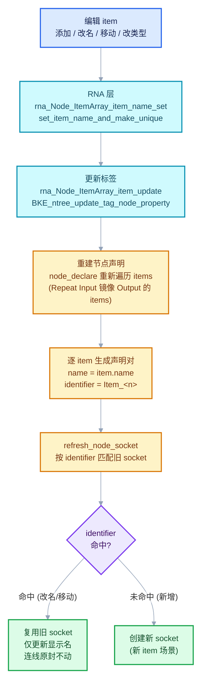
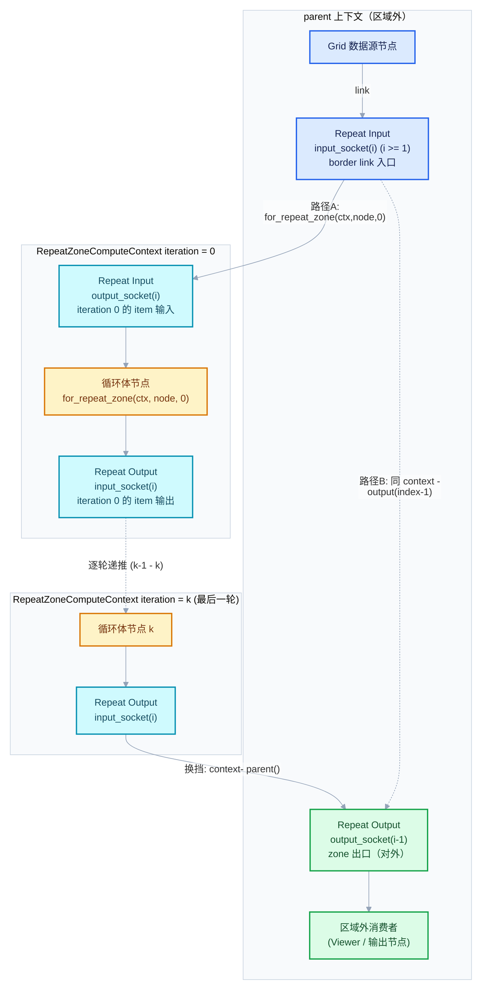
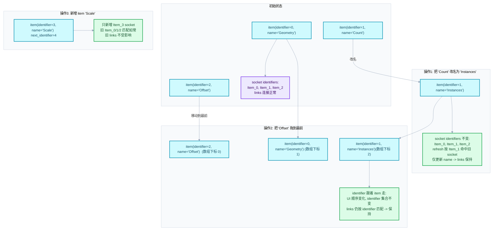

# 02 - Zone 输入输出与 bundle 迁移语义

<div style="font-family:'Segoe UI','Microsoft YaHei',system-ui,-apple-system,sans-serif;display:flex;flex-wrap:wrap;align-items:center;gap:8px;margin:16px 0 20px;padding:10px 14px;background:#F8FAFC;border:1px solid #E2E8F0;border-radius:12px">
<span style="font-size:11px;font-weight:700;letter-spacing:.1em;color:#64748B;margin-right:2px">导航</span>
<a href="../README.md" style="font-size:13px;color:#334155;background:#F1F5F9;border:1px solid #E2E8F0;border-radius:999px;padding:3px 12px;text-decoration:none;white-space:nowrap">总入口</a>
<a href="./README.md" style="font-size:13px;color:#2563EB;background:#EFF6FF;border:1px solid #BFDBFE;border-radius:999px;padding:3px 12px;text-decoration:none;white-space:nowrap">本章 01-Zone系统基础</a>
<a href="./01-NodeTreeZone区域表示与配对.md" style="font-size:13px;color:#2563EB;background:#EFF6FF;border:1px solid #BFDBFE;border-radius:999px;padding:3px 12px;text-decoration:none;white-space:nowrap">‹ NodeTreeZone区域表示与配对</a>
</div>

<div style="font-family:'Segoe UI','Microsoft YaHei',system-ui,-apple-system,sans-serif;margin:18px 0 22px;padding:14px 18px;background:#F5F3FF;border-left:4px solid #7C3AED;border-radius:10px">

基准说明：本文基于 Blender `5.4.0-alpha`（`BKE_blender_version.h` 中 `BLENDER_VERSION 504`、`BLENDER_VERSION_CYCLE alpha`），工作树 `D:\Repository\blender-git\blender`。
所有源码链接均为本地相对链接（本文位于 `.markdown/重复区域-dsh/01-Zone系统基础/`，三层 `../` 回到仓库根，如 [../../../source/blender/nodes/geometry/nodes/node_geo_repeat.cc](../../../source/blender/nodes/geometry/nodes/node_geo_repeat.cc)）。
行号以当前工作树为准；引用片段均来自实际读到的源码，不做臆测。

</div>

<hr style="border:none;height:1px;background:linear-gradient(90deg,#BFDBFE,#E2E8F0 55%,transparent);margin:34px 0">

## 先回答一个具体问题

**问：Repeat 区域的输入输出 socket 是怎么动态生成的？为什么给 item 改名、拖动顺序都不会断开链接？**

一句话答案：

1. **socket 不是节点类型自带的，而是在每次节点声明重建时，由 `node_declare` 遍历 `NodeGeometryRepeatOutput::items` 数组现场生成的**。每个 item 生成一对 input/output socket 声明，socket 的 `identifier` 由 [socket_identifier_for_item](../../../source/blender/nodes/geometry/include/NOD_geo_repeat.hh#L83) 计算为 `"Item_" + std::to_string(item.identifier)`。
2. **改名不断链接，靠的是"名字与身份分离"**：
   - item 的**名字**（`NodeRepeatItem.name`）只是 UI 显示标签，socket 声明把它作为 `name` 使用；
   - item 的**身份**（`NodeRepeatItem.identifier`，一个只增不减的整数）才是 socket 的 `identifier`，而节点刷新时 [refresh_node_socket](../../../source/blender/nodes/intern/node_socket.cc#L219) 是**按 identifier 匹配旧 socket** 的——名字随便改，匹配照样命中，旧 socket 连同它的所有连线被原样保留，只更新了显示名。
3. **拖动顺序不断链接**同理：移动 item 只是数组内元素换位，每个 item 携带自己的 `identifier` 一起走，声明重建后 identifier 集合不变，匹配结果不变。

这里有个反直觉的关键点：**socket 属于 Repeat Input 和 Repeat Output 两个节点，但 item 数组只存在 Repeat Output 节点的 storage 里**。Repeat Input 的 `node_declare` 要先通过自己 storage 里的 `output_node_id` 找到配对的输出节点，再去读它的 items（见 [node_geo_repeat.cc L80-L104](../../../source/blender/nodes/geometry/nodes/node_geo_repeat.cc#L80)）。这就是上一章讲的"配对"在 socket 层面的直接后果：**改 items 只改 Output 节点，Input 节点的 socket 是被动镜像**。

至于"bundle 迁移语义"，指编辑器在追踪一个值（比如 Viewer、节点警告、bundle 签名校验）时，如何把"某个 compute context 里的某个 socket"一路追溯到它的来源或去向——值穿过 Repeat 区域边界时，必须在 `RepeatZoneComputeContext`（携带 iteration 编号）之间正确换挡。这是本文后半部分 `trace_values.cc` 的主题。

<hr style="border:none;height:1px;background:linear-gradient(90deg,#BFDBFE,#E2E8F0 55%,transparent);margin:34px 0">

## 相关接口与数据

下面逐项列出本文涉及的核心接口。每一项都给出真实源码位置与"它到底负责什么"。

### NodeRepeatItem 与两个 storage 结构

DNA 定义在 [DNA_node_types.h L3543-L3575](../../../source/blender/makesdna/DNA_node_types.h#L3543)：

```cpp
struct NodeRepeatItem {
  char *name = nullptr;
  eNodeSocketDatatype socket_type = {};
  char _pad[2] = {};
  /**
   * Generated unique identifier for sockets which stays the same even when the item order or
   * names change.
   */
  int identifier = 0;
};

struct NodeGeometryRepeatInput {
  /** bNode.identifier of the corresponding output node. */
  int32_t output_node_id = 0;
};

struct NodeGeometryRepeatOutput {
  NodeRepeatItem *items = nullptr;
  int items_num = 0;
  int active_index = 0;
  /** Identifier to give to the next repeat item. */
  int next_identifier = 0;
  int inspection_index = 0;
  /* ... */
};
```

要点：

- `NodeRepeatItem.identifier` 的注释原话就是设计契约：**"生成的唯一标识符，即使 item 顺序或名字改变也保持不变"**。
- `next_identifier` 只在 Output 节点上，说明**身份分配权在 Output 节点**；Input 节点只存一个 `output_node_id` 指回它。
- `inspection_index` 是"检查第几轮迭代"，属于执行/日志侧（本文只顺带提及，第 04 章展开）。

### RepeatItemsAccessor 与 socket_identifier_for_item

[RepeatItemsAccessor](../../../source/blender/nodes/geometry/include/NOD_geo_repeat.hh#L17) 是 [NOD_socket_items.hh](../../../source/blender/nodes/NOD_socket_items.hh) 通用条目框架的"访问器"：告诉通用代码 items 数组放在哪、怎么增删、怎么命名。其中两个成员决定 socket 生成：

```cpp
static void init_with_socket_type_and_name(bNode &node,
                                           NodeRepeatItem &item,
                                           const eNodeSocketDatatype socket_type,
                                           const char *name)
{
  auto *storage = static_cast<NodeGeometryRepeatOutput *>(node.storage);
  item.socket_type = socket_type;
  item.identifier = storage->next_identifier++;   // 身份从这里分配，只增不减
  socket_items::set_item_name_and_make_unique<RepeatItemsAccessor>(node, item, name);
}

static std::string socket_identifier_for_item(const NodeRepeatItem &item)
{
  return "Item_" + std::to_string(item.identifier);   // 名字 -> socket identifier
}
```

- [socket_identifier_for_item 定义](../../../source/blender/nodes/geometry/include/NOD_geo_repeat.hh#L83)：`"Item_" + identifier`。
- [init_with_socket_type_and_name](../../../source/blender/nodes/geometry/include/NOD_geo_repeat.hh#L72)：新建 item 时分配 `identifier = next_identifier++`。
- `set_item_name_and_make_unique`（[NOD_socket_items.hh L148-L190](../../../source/blender/nodes/NOD_socket_items.hh#L148)）负责**名字唯一化**：同名 item 会被自动加 `.1`、`.2` 后缀。注意它改的只是 name，identifier 不动。

`Item_` 前缀 + 稳定整数的设计意义，在第 3 个 mermaid 图里用具体数据演示。这里先说结论：**UI 层一切可变（名字、顺序、甚至 socket 类型），数据层只认 `Item_<n>`**。这和 DNA 里 `identifier` 注释的承诺完全一致。

### `.socket_name_ptr`：把 socket 标签绑定到 item 的 RNA 属性

构建 API 在 [node_declaration.cc L996-L1014](../../../source/blender/nodes/intern/node_declaration.cc#L996)：

```cpp
BaseSocketDeclarationBuilder &BaseSocketDeclarationBuilder ::socket_name_ptr(
    const PointerRNA ptr, const StringRef property_name)
{
  decl_base_->socket_name_rna = std::make_unique<SocketNameRNA>();
  decl_base_->socket_name_rna->owner = ptr;
  decl_base_->socket_name_rna->property_name = property_name;
  return *this;
}
```

`SocketNameRNA` 定义在 [NOD_node_declaration.hh L138-L141](../../../source/blender/nodes/NOD_node_declaration.hh#L138)：一个 `PointerRNA owner` + 属性名。

它的消费端在节点编辑器的绘制代码 [drawnode.cc L1162-L1180](../../../source/blender/editors/space_node/drawnode.cc#L1162)：`draw_node_socket_name_editable` 发现声明带 `socket_name_rna` 时，不再画静态文本标签，而是直接画一个**绑定到 `item.name` 的可编辑文本框**。

语义总结：

- **socket 的显示名就是 item.name 的实时视图**。你在节点上双击 socket 标签改名，实际是在改 `NodeRepeatItem.name`（走 RNA 的 `rna_Node_ItemArray_item_name_set`，见 [rna_nodetree.cc L3948-L3957](../../../source/blender/makesrna/intern/rna_nodetree.cc#L3948)），改名后会触发 [rna_Node_ItemArray_item_update](../../../source/blender/makesrna/intern/rna_nodetree.cc#L3921) → `BKE_ntree_update_tag_node_property` → 节点声明重建。
- 换句话说，**名字的唯一事实源（source of truth）是 item，socket 只是投影**。这与 `socket_name_ptr(&tree->id, *RepeatItemsAccessor::item_srna, &item, "name")` 三个参数的含义一一对应：owner_id 是节点树 ID、srna 是 `RNA_RepeatItem`、data 是那个具体的 item、属性名是 `"name"`。

### `.propagate_all({input_decl.index()})`：引用与数据的传播关系

构建 API 在 [node_declaration.cc L605-L624](../../../source/blender/nodes/intern/node_declaration.cc#L605)：

```cpp
BaseSocketDeclarationBuilder &BaseSocketDeclarationBuilder::propagate_all(
    const Span<int> input_indices)
{
  rl::RelationsInNode &relations = node_decl_builder_->get_reference_lifetime_relations();
  for (const int from_input : input_indices) {
    {
      rl::DataPropagation relation;
      relation.from_input = from_input;
      relation.to_output = decl_base_->index;
      relations.data_propagations.append(relation);
    }
    {
      rl::ReferencePropagation relation;
      relation.from_input = from_input;
      relation.to_output = decl_base_->index;
      relations.reference_propagations.append(relation);
    }
  }
  return *this;
}
```

语义（关系类型的注释见 [NOD_node_declaration.hh L69-L89](../../../source/blender/nodes/NOD_node_declaration.hh#L69)）：

- `DataPropagation`：**属性可以从输入几何传播到输出几何**——"这个输出的属性域来自那个输入"。
- `ReferencePropagation`：**属性引用可以从输入 field 传播到输出 field**——field 里捕获的匿名属性引用，其寿命边界要沿着这条边追踪。

对 repeat zone item 来说，`propagate_all({input_decl.index()})` 声明"第 i 对 socket 的输出引用/数据来自同对的输入"。没有这条关系，zone 内捕获的匿名属性穿过区域边界时会被错误地判定为可释放。这是值寿命系统（`reference_lifetimes`）的输入之一，第 03 章的 07 篇会展开。

无参版本 [propagate_all()](../../../source/blender/nodes/intern/node_declaration.cc#L588) 则是"所有输入到本输出"的全量传播，本文不展开。

### `.inferred_structure_type({input_decl.index()})` 与 `.structure_type(StructureType::Dynamic)`

构建 API 在 [node_declaration.cc L548-L564](../../../source/blender/nodes/intern/node_declaration.cc#L548)：

```cpp
BaseSocketDeclarationBuilder &BaseSocketDeclarationBuilder::inferred_structure_type()
{
  BLI_assert(this->is_output());
  decl_base_->structure_type = StructureType::Dynamic;
  decl_base_->structure_type_output_dependency.variant = OutputStructureTypeDependency::All{};
  return *this;
}

BaseSocketDeclarationBuilder &BaseSocketDeclarationBuilder::inferred_structure_type(
    const Span<int> input_indices)
{
  BLI_assert(this->is_output());
  decl_base_->structure_type = StructureType::Dynamic;
  decl_base_->structure_type_output_dependency.variant = OutputStructureTypeDependency::Partial{
      input_indices};
  return *this;
}
```

`StructureType` 是 DNA 层的结构类型枚举（[DNA_node_tree_interface_types.h L89-L96](../../../source/blender/makesdna/DNA_node_tree_interface_types.h#L89)）：`Single / Dynamic / Field / Grid / List`。

语义拆解：

- `structure_type(StructureType::Dynamic)`：**这个 socket 承载的结构类型不固定**，由连线与上下文推断。zone item 可能连 Field（比如区域外传入一个 field，区域内每轮采样）、可能连 Grid、也可能就是普通值，所以必须声明为 Dynamic 而不是写死 Single。
- `inferred_structure_type({input_decl.index()})`：输出的 Dynamic 类型**从哪些输入推断**。这里 `Partial{input_indices}` 表示"本输出的结构类型 = 同对输入的结构类型"。`OutputStructureTypeDependency` 的三种变体（None/All/Partial）定义在 [NOD_node_declaration.hh L163-L170](../../../source/blender/nodes/NOD_node_declaration.hh#L163)。
- 在 repeat item 上，input 与 output 同时声明 Dynamic + 推断关系，保证"区域外是 field，区域内每轮看到的也是 field（针对各自 iteration 上下文）"这类语义在结构类型推断图里成立。

### `.compositor_realization_mode(CompositorInputRealizationMode::None)`

枚举定义在 [NOD_node_declaration.hh L45-L52](../../../source/blender/nodes/NOD_node_declaration.hh#L45)：

```cpp
/**
 * An enum that maps to the #compositor::InputRealizationMode.
 */
enum class CompositorInputRealizationMode : int8_t {
  None,
  Transforms,
  OperationDomain,
};
```

`SocketDeclaration` 里默认值是 `OperationDomain`（[NOD_node_declaration.hh L216-L218](../../../source/blender/nodes/NOD_node_declaration.hh#L216)）。合成器在执行前会把输入缓冲区"实现（realize）"到某个目标域（把变换烘焙进像素数据、归一化到算子域等），三种模式控制实现的激进程度。

Repeat zone item 声明 `None` 的含义：**进入循环体的数据不要被合成器预先实现/归一化**——循环体每轮迭代可能对同一份数据做不同处理，提前实现既浪费又可能破坏语义（例如区域内每轮把数据变换到不同位置）。同一个选择也出现在 `NodeCombineBundle`、`MenuSwitch`、`IndexSwitch` 等需要"原样转发"输入的节点上（如 [node_geo_combine_bundle.cc L63](../../../source/blender/nodes/geometry/nodes/node_geo_combine_bundle.cc#L63)、[node_geo_index_switch.cc L133](../../../source/blender/nodes/geometry/nodes/node_geo_index_switch.cc#L133)），可以互相印证。

### `__extend__` 扩展 socket

两个节点的 `node_declare` 末尾都有一条：

```cpp
b.add_input<decl::Extend>(""_ustr, "__extend__"_ustr)
    .structure_type(StructureType::Dynamic)
    .custom_draw(socket_items::ui::draw_extend_socket_fn<RepeatItemsAccessor>());
b.add_output<decl::Extend>(""_ustr, "__extend__"_ustr)
    .structure_type(StructureType::Dynamic)
    .align_with_previous();
```

- `decl::Extend` 类型的 socket，名字为空，identifier 固定为 `"__extend__"`。
- `custom_draw` 的实现是 [draw_extend_socket_fn](../../../source/blender/nodes/NOD_socket_items_ui.hh#L128)：不画普通 socket，而是画一个 **"+" 按钮**，点击触发 `NODE_OT_repeat_zone_item_add` 操作符。
- 它真正的魔法在**连线**侧：`node_insert_link`（input 节点 [L129-L137](../../../source/blender/nodes/geometry/nodes/node_geo_repeat.cc#L129)、output 节点 [L241-L245](../../../source/blender/nodes/geometry/nodes/node_geo_repeat.cc#L241)）调用 [try_add_item_via_any_extend_socket](../../../source/blender/nodes/NOD_socket_items.hh#L389)。当用户把一条连线拖到 `__extend__` 虚拟 socket 上时，通用代码会：
  1. 从连线的另一端读出 socket 类型与标签（[NOD_socket_items.hh L326-L353](../../../source/blender/nodes/NOD_socket_items.hh#L326)）；
  2. `add_item_with_socket_type_and_name` 新建一个 item（分配新 identifier）；
  3. `update_node_declaration_and_sockets` 让节点重建 socket；
  4. **把这条连线改接到新生成的 `Item_<n>` socket 上**（[NOD_socket_items.hh L367-L379](../../../source/blender/nodes/NOD_socket_items.hh#L367)）。

所以 `__extend__` 是一个"从不参与执行、只参与编辑"的入口 socket。第 03 节反例里会强调这一点。

### Iteration / Iterations 特殊 socket

在 repeat_input 节点的 `node_declare` 开头（[node_geo_repeat.cc L76-L78](../../../source/blender/nodes/geometry/nodes/node_geo_repeat.cc#L76)）：

```cpp
b.add_output<decl::Int>("Iteration"_ustr)
    .description("Index of the current iteration. Starts counting at zero");
b.add_input<decl::Int>("Iterations"_ustr).min(0).default_value(1);
```

- **`Iteration`（输出）**：当前迭代索引，从 0 开始。它**不是某个 item 生成的**，而是 Repeat Input 节点自带的固定输出，位于输出 socket 列表的 index 0。执行时由 zone 的 lazy function 直接喂入 `0, 1, 2, ...`（见 [geometry_nodes_repeat_zone.cc L263-L281](../../../source/blender/nodes/intern/geometry_nodes_repeat_zone.cc#L263)，`index_values[i].emplace<int>(i)`）。
- **`Iterations`（输入）**：循环总次数，最小 0、默认 1。它同样**不属于任何 item**，是 zone 的控制参数；执行图构建时 `params.get_input<int>(...)` 读它来决定复制多少个循环体节点（[geometry_nodes_repeat_zone.cc L204-L208](../../../source/blender/nodes/intern/geometry_nodes_repeat_zone.cc#L204)），并且它"永远被求值"（[geometry_nodes_repeat_zone.cc L135-L137](../../../source/blender/nodes/intern/geometry_nodes_repeat_zone.cc#L135)）。
- **它们只存在于 Repeat Input 节点**。Repeat Output 节点没有 Iteration/Iterations——控制权在区域入口。

正因为它们是"固定 socket"，`trace_values.cc` 里的 index 判断才会用 `index >= 1` / `index - 1` / `index + 1` 这类偏移来跳过它们，下一节会看到具体代码。

<hr style="border:none;height:1px;background:linear-gradient(90deg,#BFDBFE,#E2E8F0 55%,transparent);margin:34px 0">

## node_declare：动态 socket 生成的两份实现

### repeat_input_node::node_declare（教学注释版）

```cpp
// source/blender/nodes/geometry/nodes/node_geo_repeat.cc L72-L111（repeat_input_node 命名空间）
static void node_declare(NodeDeclarationBuilder &b)
{
  // [讲解] 自定义 socket 顺序：socket 声明的书写顺序就是 UI 顺序，
  //        并且允许 input/output 交错书写（allow_any_socket_order）。
  b.use_custom_socket_order();
  b.allow_any_socket_order();

  // [讲解] 两个"非 item"的固定 socket：
  //        - Iteration 输出：当前迭代索引（0 起），由执行器按轮次喂值；
  //        - Iterations 输入：循环次数，min(0) 默认 1。
  //        注意它们占据 index 0 的位置，后面所有 item socket 都从 index 1 开始——
  //        这正是 trace_values.cc 里 `index >= 1`、`index - 1` 等偏移的来源。
  b.add_output<decl::Int>("Iteration"_ustr)
      .description("Index of the current iteration. Starts counting at zero");
  b.add_input<decl::Int>("Iterations"_ustr).min(0).default_value(1);

  // [讲解] 动态部分：只有当 builder 能拿到"具体的节点和节点树"时才能生成 item socket。
  //        在类型注册/无上下文场景（node == nullptr）下，下面整段被跳过，
  //        节点只剩 Iteration/Iterations/extend 这几个固定 socket。
  const bNode *node = b.node_or_null();
  const bNodeTree *tree = b.tree_or_null();
  if (node && tree) {
    // [讲解] 关键：item 数组不在自己（Input 节点）的 storage 里！
    //        先通过 output_node_id 找到配对的 Repeat Output 节点，
    //        再读它的 NodeGeometryRepeatOutput::items。
    //        也就是说 Input 节点的 socket 是 Output 节点 items 的"镜像"。
    const NodeGeometryRepeatInput &storage = node_storage(*node);
    if (const bNode *output_node = tree->node_by_id(storage.output_node_id)) {
      const auto &output_storage = *static_cast<const NodeGeometryRepeatOutput *>(
          output_node->storage);
      // [讲解] 逐个 item 生成"一对"socket 声明（一个 input + 一个 output）。
      for (const int i : IndexRange(output_storage.items_num)) {
        const NodeRepeatItem &item = output_storage.items[i];
        const eNodeSocketDatatype socket_type = item.socket_type;   // 类型来自 item
        const UString name = item.name ? UString(item.name) : ""_ustr;  // 名字来自 item
        // [讲解] 身份来自 item.identifier，格式固定为 "Item_<n>"。
        //        这一条字符串是"改名/移动不断链"的全部秘密。
        const UString identifier(RepeatItemsAccessor::socket_identifier_for_item(item));
        // [讲解] input 声明：
        //  - socket_name_ptr：把 socket 标签绑定到 item.name 的 RNA 属性，
        //    节点上的标签变成可编辑文本框，编辑即改 item.name；
        //  - structure_type(Dynamic)：item 可能承载 field/grid/list/普通值；
        //  - compositor_realization_mode(None)：合成器不得预实现该输入。
        auto &input_decl = b.add_input(socket_type, name, identifier)
                               .socket_name_ptr(
                                   &tree->id, *RepeatItemsAccessor::item_srna, &item, "name")
                               .structure_type(StructureType::Dynamic)
                               .compositor_realization_mode(CompositorInputRealizationMode::None);
        // [讲解] output 声明：
        //  - align_with_previous()：UI 上与同对的 input 同行显示；
        //  - propagate_all({input_decl.index()})：属性数据 + field 引用
        //    都从同对 input 传播到本 output（值寿命关系）；
        //  - inferred_structure_type({input_decl.index()})：本输出的结构类型
        //    从同对 input 推断（Partial 依赖）。
        b.add_output(socket_type, name, identifier)
            .align_with_previous()
            .propagate_all({input_decl.index()})
            .inferred_structure_type({input_decl.index()})
            .structure_type(StructureType::Dynamic);
      }
    }
  }
  // [讲解] extend socket：identifier 固定 "__extend__"、名字为空。
  //  - 它是"添加 item"的编辑入口：UI 上画成 "+" 按钮；
  //  - 拖连线到它上面时 node_insert_link 会拦截并新建 item、改接连线；
  //  - 它从不参与数据执行。
  b.add_input<decl::Extend>(""_ustr, "__extend__"_ustr)
      .structure_type(StructureType::Dynamic)
      .custom_draw(socket_items::ui::draw_extend_socket_fn<RepeatItemsAccessor>());
  b.add_output<decl::Extend>(""_ustr, "__extend__"_ustr)
      .structure_type(StructureType::Dynamic)
      .align_with_previous();
}
```

<details>
<summary>原始源码（repeat_input_node::node_declare，L72-L111）</summary>

```cpp
static void node_declare(NodeDeclarationBuilder &b)
{
  b.use_custom_socket_order();
  b.allow_any_socket_order();
  b.add_output<decl::Int>("Iteration"_ustr)
      .description("Index of the current iteration. Starts counting at zero");
  b.add_input<decl::Int>("Iterations"_ustr).min(0).default_value(1);

  const bNode *node = b.node_or_null();
  const bNodeTree *tree = b.tree_or_null();
  if (node && tree) {
    const NodeGeometryRepeatInput &storage = node_storage(*node);
    if (const bNode *output_node = tree->node_by_id(storage.output_node_id)) {
      const auto &output_storage = *static_cast<const NodeGeometryRepeatOutput *>(
          output_node->storage);
      for (const int i : IndexRange(output_storage.items_num)) {
        const NodeRepeatItem &item = output_storage.items[i];
        const eNodeSocketDatatype socket_type = item.socket_type;
        const UString name = item.name ? UString(item.name) : ""_ustr;
        const UString identifier(RepeatItemsAccessor::socket_identifier_for_item(item));
        auto &input_decl = b.add_input(socket_type, name, identifier)
                               .socket_name_ptr(
                                   &tree->id, *RepeatItemsAccessor::item_srna, &item, "name")
                               .structure_type(StructureType::Dynamic)
                               .compositor_realization_mode(CompositorInputRealizationMode::None);
        b.add_output(socket_type, name, identifier)
            .align_with_previous()
            .propagate_all({input_decl.index()})
            .inferred_structure_type({input_decl.index()})
            .structure_type(StructureType::Dynamic);
      }
    }
  }
  b.add_input<decl::Extend>(""_ustr, "__extend__"_ustr)
      .structure_type(StructureType::Dynamic)
      .custom_draw(socket_items::ui::draw_extend_socket_fn<RepeatItemsAccessor>());
  b.add_output<decl::Extend>(""_ustr, "__extend__"_ustr)
      .structure_type(StructureType::Dynamic)
      .align_with_previous();
}
```

</details>

### repeat_output_node::node_declare（教学注释版）

```cpp
// source/blender/nodes/geometry/nodes/node_geo_repeat.cc L176-L207（repeat_output_node 命名空间）
static void node_declare(NodeDeclarationBuilder &b)
{
  b.use_custom_socket_order();
  b.allow_any_socket_order();

  const bNodeTree *tree = b.tree_or_null();
  const bNode *node = b.node_or_null();
  if (node) {
    // [讲解] 与 Input 版本最大的不同：items 就在自己的 storage 里，无需绕道配对节点。
    //        事实上的"数据主权"在 Output 节点——UI 面板 "Repeat Items" 也画在它上面
    //        （见 node_layout_ex L54-L63，draw_items_list_with_operators 传的是 output_node）。
    const NodeGeometryRepeatOutput &storage = node_storage(*node);
    for (const int i : IndexRange(storage.items_num)) {
      const NodeRepeatItem &item = storage.items[i];
      const eNodeSocketDatatype socket_type = item.socket_type;
      const UString name = item.name ? UString(item.name) : ""_ustr;
      const UString identifier(RepeatItemsAccessor::socket_identifier_for_item(item));
      // [讲解] 声明参数与 Input 版本逐项相同：socket_name_ptr / Dynamic / None。
      //        两边的一致性保证了同一 item 在区域两侧"长得一样、语义一样"。
      auto &input_decl = b.add_input(socket_type, name, identifier)
                             .socket_name_ptr(
                                 &tree->id, *RepeatItemsAccessor::item_srna, &item, "name")
                             .structure_type(StructureType::Dynamic)
                             .compositor_realization_mode(CompositorInputRealizationMode::None);
      b.add_output(socket_type, name, identifier)
          .align_with_previous()
          .propagate_all({input_decl.index()})
          .inferred_structure_type({input_decl.index()})
          .structure_type(StructureType::Dynamic);
    }
  }
  // [讲解] extend socket 同样存在（两侧都有），但注意没有 Iteration/Iterations——
  //        Output 节点没有控制 socket，它只负责"把最后一轮的值交出去"。
  b.add_input<decl::Extend>(""_ustr, "__extend__"_ustr)
      .structure_type(StructureType::Dynamic)
      .custom_draw(socket_items::ui::draw_extend_socket_fn<RepeatItemsAccessor>());
  b.add_output<decl::Extend>(""_ustr, "__extend__"_ustr)
      .structure_type(StructureType::Dynamic)
      .align_with_previous();
}
```

<details>
<summary>原始源码（repeat_output_node::node_declare，L176-L207）</summary>

```cpp
static void node_declare(NodeDeclarationBuilder &b)
{
  b.use_custom_socket_order();
  b.allow_any_socket_order();
  const bNodeTree *tree = b.tree_or_null();
  const bNode *node = b.node_or_null();
  if (node) {
    const NodeGeometryRepeatOutput &storage = node_storage(*node);
    for (const int i : IndexRange(storage.items_num)) {
      const NodeRepeatItem &item = storage.items[i];
      const eNodeSocketDatatype socket_type = item.socket_type;
      const UString name = item.name ? UString(item.name) : ""_ustr;
      const UString identifier(RepeatItemsAccessor::socket_identifier_for_item(item));
      auto &input_decl = b.add_input(socket_type, name, identifier)
                             .socket_name_ptr(
                                 &tree->id, *RepeatItemsAccessor::item_srna, &item, "name")
                             .structure_type(StructureType::Dynamic)
                             .compositor_realization_mode(CompositorInputRealizationMode::None);
      b.add_output(socket_type, name, identifier)
          .align_with_previous()
          .propagate_all({input_decl.index()})
          .inferred_structure_type({input_decl.index()})
          .structure_type(StructureType::Dynamic);
    }
  }
  b.add_input<decl::Extend>(""_ustr, "__extend__"_ustr)
      .structure_type(StructureType::Dynamic)
      .custom_draw(socket_items::ui::draw_extend_socket_fn<RepeatItemsAccessor>());
  b.add_output<decl::Extend>(""_ustr, "__extend__"_ustr)
      .structure_type(StructureType::Dynamic)
      .align_with_previous();
}
```

</details>

### 两个版本的差异速览

| 维度 | repeat_input 版 | repeat_output 版 |
| --- | --- | --- |
| items 来源 | 配对 Output 节点的 storage（`storage.output_node_id` 间接） | 自己的 storage |
| Iteration/Iterations | 有（固定 socket，占 index 0） | 无 |
| item socket 声明参数 | 完全相同 | 完全相同 |
| `__extend__` | 有 | 有 |
| items 编辑 UI | 无（`node_layout_ex` 把面板画到 output_node 上） | 有（"Repeat Items" 面板） |
| 默认 item | 无 | `node_init` 创建一个名为 "Geometry" 的 SOCK_GEOMETRY item（[L215-L221](../../../source/blender/nodes/geometry/nodes/node_geo_repeat.cc#L215)） |

### socket 是怎么"刷新"出来的：refresh_node_socket 按.identifier 匹配

声明重建只是产生了"想要的 socket 列表"；把旧 socket 列表变成新列表、且不破坏连线的是 [refresh_node_socket](../../../source/blender/nodes/intern/node_socket.cc#L219)。

```cpp
// source/blender/nodes/intern/node_socket.cc（节选，教学注释版）
static void refresh_node_socket(bNodeTree &ntree,
                                bNode &node,
                                const SocketDeclaration &socket_decl,
                                Vector<bNodeSocket *> &old_sockets,
                                VectorSet<bNodeSocket *> &new_sockets,
                                const bool hide_new_sockets)
{
  // [讲解] 第一步：在旧 socket 里找 identifier 相同的。
  //        注意：匹配键是 identifier（"Item_3"），不是 name（"My Value"）！
  bNodeSocket *old_socket_with_same_identifier = nullptr;
  for (const int i : old_sockets.index_range()) {
    bNodeSocket &old_socket = *old_sockets[i];
    if (old_socket.identifier == socket_decl.identifier) {
      old_sockets.remove_and_reorder(i);
      old_socket_with_same_identifier = &old_socket;
      break;
    }
  }
  bNodeSocket *new_socket = nullptr;
  if (old_socket_with_same_identifier == nullptr) {
    // [讲解] identifier 对不上（新 item）→ 全新创建。
    new_socket = &socket_decl.build(ntree, node);
    /* ... */
  }
  else {
    // [讲解] identifier 命中 → 旧 socket 直接复用，只更新显示名。
    //        改名操作走到这里：socket 对象没换、连线自然原封不动。
    STRNCPY_UTF8(old_socket_with_same_identifier->name, socket_decl.name.c_str());
    if (socket_decl.matches(*old_socket_with_same_identifier)) {
      /* ... 完全匹配，直接沿用 ... */
    }
    else {
      /* ... 类型不匹配才走 update_or_build，并搬运连线 ... */
    }
  }
  /* ... */
}
```

<details>
<summary>原始源码（refresh_node_socket，node_socket.cc L219-L283）</summary>

```cpp
static void refresh_node_socket(bNodeTree &ntree,
                                bNode &node,
                                const SocketDeclaration &socket_decl,
                                Vector<bNodeSocket *> &old_sockets,
                                VectorSet<bNodeSocket *> &new_sockets,
                                const bool hide_new_sockets)
{
  /* Try to find a socket that corresponds to the declaration. */
  bNodeSocket *old_socket_with_same_identifier = nullptr;
  for (const int i : old_sockets.index_range()) {
    bNodeSocket &old_socket = *old_sockets[i];
    if (old_socket.identifier == socket_decl.identifier) {
      old_sockets.remove_and_reorder(i);
      old_socket_with_same_identifier = &old_socket;
      break;
    }
  }
  bNodeSocket *new_socket = nullptr;
  if (old_socket_with_same_identifier == nullptr) {
    /* Create a completely new socket. */
    new_socket = &socket_decl.build(ntree, node);
    SET_FLAG_FROM_TEST(new_socket->flag, hide_new_sockets, SOCK_HIDDEN);
  }
  else {
    STRNCPY_UTF8(old_socket_with_same_identifier->name, socket_decl.name.c_str());
    if (socket_decl.matches(*old_socket_with_same_identifier)) {
      /* The existing socket matches exactly, just use it. */
      new_socket = old_socket_with_same_identifier;
    }
    else {
      /* Clear out identifier to avoid name collisions when a new socket is created. */
      old_socket_with_same_identifier->identifier[0] = '\0';
      new_socket = &socket_decl.update_or_build(ntree, node, *old_socket_with_same_identifier);

      if (new_socket == old_socket_with_same_identifier) {
        /* The existing socket has been updated, set the correct identifier again. */
        STRNCPY_UTF8(new_socket->identifier, socket_decl.identifier.c_str());
        new_socket->runtime->identifier_ustr = UString(new_socket->identifier);
      }
      else {
        /* Move links to new socket with same identifier. */
        for (bNodeLink &link : ntree.links) {
          if (link.fromsock == old_socket_with_same_identifier) {
            link.fromsock = new_socket;
          }
          else if (link.tosock == old_socket_with_same_identifier) {
            link.tosock = new_socket;
          }
        }
        for (bNodeInternalLink &internal_link : node.runtime->internal_links) {
          if (internal_link.in == old_socket_with_same_identifier) {
            internal_link.in = new_socket;
          }
          else if (internal_link.out == old_socket_with_same_identifier) {
            internal_link.out = new_socket;
          }
        }
      }
    }
    SET_FLAG_FROM_TEST(
        new_socket->flag, old_socket_with_same_identifier->is_user_hidden(), SOCK_HIDDEN);
  }
  new_sockets.add_new(new_socket);
  BKE_ntree_update_tag_socket_new(&ntree, new_socket);
}
```

</details>

把改名路径完整串起来（也是第一个 mermaid 图的内容）：

1. 用户在节点上编辑 socket 标签 → `draw_node_socket_name_editable` 画的 RNA 文本框写入 `item.name`；
2. RNA 的 name setter [rna_Node_ItemArray_item_name_set](../../../source/blender/makesrna/intern/rna_nodetree.cc#L3948) 调 `set_item_name_and_make_unique`（改名 + 唯一化）；
3. update 回调 [rna_Node_ItemArray_item_update](../../../source/blender/makesrna/intern/rna_nodetree.cc#L3921) 打 `BKE_ntree_update_tag_node_property` 标签；
4. 节点树更新系统重建该节点声明（`node_declare` 是 context-dependent 的，会重新读 items），生成新的声明列表——**名字变了，identifier 没变**；
5. `refresh_node` → `refresh_node_socket` 按 identifier 命中旧 socket → 只改 name 字段，连线零扰动。

### socket 生成流程图



<hr style="border:none;height:1px;background:linear-gradient(90deg,#BFDBFE,#E2E8F0 55%,transparent);margin:34px 0">

## trace_values：bundle 值如何穿过 Repeat 区域边界

[trace_values.cc](../../../source/blender/nodes/intern/trace_values.cc) 是编辑器"值追踪"的实现：给定"某个 compute context 里的某个 socket"，沿着连线与 zone 上下文向前找它流向哪里（`find_target_sockets_through_contexts`），或向后找它来自哪里（`find_origin_sockets_through_contexts`）。每个被追踪的对象是 `SocketInContext`——**socket + compute context 的组合**，同一个 socket 在不同迭代上下文里是不同的追踪对象（去重集合 `added_sockets` 就是 `Set<SocketInContext>`，见 [L80](../../../source/blender/nodes/intern/trace_values.cc#L80)）。

为什么需要 context？因为 Repeat 区域的循环体在执行图中被复制了 N 份（每轮迭代一份），日志/Viewer/警告必须能区分"第 3 轮的那个节点"。执行时，[RepeatBodyNodeExecuteWrapper](../../../source/blender/nodes/intern/geometry_nodes_repeat_zone.cc#L35) 为每轮构造 `bke::RepeatZoneComputeContext{parent, repeat_output_bnode, iteration}`；这个 context 类型携带 `output_node_id_` 与 `iteration_` 两个身份字段（[BKE_compute_contexts.hh L162-L184](../../../source/blender/blenkernel/BKE_compute_contexts.hh#L162)）。trace 侧用 `compute_context_cache.for_repeat_zone(parent_context, node, iteration)` 取得/构造同样的 context（缓存于 [ComputeContextCache]）。

### Repeat Input 的输出如何进入 for_repeat_zone 上下文（iteration 0）

前向追踪（一个值流向哪里）中命中 Repeat Input 的分支，[trace_values.cc L255-L269](../../../source/blender/nodes/intern/trace_values.cc#L255)：

```cpp
if (node->is_type("GeometryNodeRepeatInput"_ustr)) {
  const int index = socket->index();
  if (index >= 1) {   // [讲解] index 0 是 Iterations 输入 socket，跳过
    // [讲解] 路径 A：进入循环体的第 0 轮。
    //        for_repeat_zone(socket.context, *node, 0) 构造/取得
    //        RepeatZoneComputeContext{parent, 本 zone, iteration=0}，
    //        然后指向同一节点的 output_socket(index)——
    //        即同对 item 的"iteration 输入"socket。
    //        语义：外部来的值，先作为第 0 轮的输入。
    const ComputeContext &repeat_compute_context = compute_context_cache.for_repeat_zone(
        socket.context, *node, 0);
    add_if_new({&repeat_compute_context, &node->output_socket(index)}, bundle_path);
    // [讲解] 路径 B：zone 外的去向。
    //        找到配对的 Repeat Output 节点，指向其 output_socket(index - 1)，
    //        上下文保持 socket.context（parent 上下文，不在任何迭代里）。
    //        index 偏移 -1 是因为 Repeat Input 的输入列表比 Repeat Output 的
    //        输出列表多一个 Iterations（在 index 0）。
    //        语义：这个值也可能一路穿过循环体从未被改写，
    //        最终从 zone 出口出现在外部世界——trace 是保守的并集追踪。
    const auto &storage = *static_cast<NodeGeometryRepeatInput *>(node->storage);
    if (const bNode *repeat_output_node = node->owner_tree().node_by_id(
            storage.output_node_id))
    {
      add_if_new({socket.context, &repeat_output_node->output_socket(index - 1)},
                 bundle_path);
    }
  }
  continue;
}
```

注意 `index >= 1` 的不对称性：这里追踪的是 **Repeat Input 的输入 socket**（外部世界把值送进区域的入口），所以 index 0 是 `Iterations` 控制输入，不是 item。而同一个节点**输出侧**的 index 0 是 `Iteration`（当前迭代号），item 输出同样从 index 1 开始——`node->output_socket(index)` 在输入 index 与输出 index 之间恰好一一对应（`Iterations` 输入 ↔ `Iteration` 输出占位 index 0，item i 占位 index i+1）。

### Repeat Output 输出如何回到 parent 上下文

前向追踪命中 Repeat Output 的分支只有两行，[trace_values.cc L271-L275](../../../source/blender/nodes/intern/trace_values.cc#L271)：

```cpp
if (node->is_type("GeometryNodeRepeatOutput"_ustr)) {
  // [讲解] 断言：能追踪到这里，说明当前上下文已经是 RepeatZoneComputeContext
  //        （值在循环体内部，正流向 zone 出口）。
  BLI_assert(dynamic_cast<const bke::RepeatZoneComputeContext *>(socket.context));
  // [讲解] 唯一动作：换挡回 parent 上下文（离开所有迭代），
  //        指向同一节点同 index 的输出 socket——zone 外部看到的那个出口。
  add_if_new({socket.context->parent(), &node->output_socket(socket->index())}, bundle_path);
  continue;
}
```

语义：循环体最后一轮的值从 Repeat Output 的输入 socket 进入，出现在同 index 的输出 socket 上，而**输出 socket 的观察上下文是 parent（区域外）**——因为 zone 外的消费者不关心也不区分迭代。

### 反向追踪：Repeat Output 的输入来自哪里

后向追踪（值来自哪里）中 Repeat Output 的分支，[trace_values.cc L579-L591](../../../source/blender/nodes/intern/trace_values.cc#L579)：

```cpp
if (node->is_type("GeometryNodeRepeatOutput"_ustr)) {
  const int index = socket->index();
  // [讲解] 路径 A：来自第 0 轮的同一 item 输入（for_repeat_zone(..., 0)）。
  //        值在循环体里逐轮递推，但"最初的来源"可以追到第 0 轮的入口。
  const ComputeContext &repeat_compute_context = compute_context_cache.for_repeat_zone(
      socket.context, *node, 0);
  add_if_new({&repeat_compute_context, &node->input_socket(index)}, bundle_path);
  // [讲解] 路径 B：来自区域外的 border link。
  //        zone_type.get_corresponding_input 找到配对的 Repeat Input 节点，
  //        指向其 input_socket(index + 1)——
  //        +1 是因为 Repeat Input 的输入列表多一个 Iterations（index 0）。
  const bke::bNodeZoneType &zone_type = *bke::zone_type_by_node_type(node->type_legacy);
  if (const bNode *repeat_input_node = zone_type.get_corresponding_input(node->owner_tree(),
                                                                         *node))
  {
    add_if_new({socket.context, &repeat_input_node->input_socket(index + 1)}, bundle_path);
  }
  continue;
}
```

以及 Repeat Input 输入 socket 的反向分支（值从区域外追进区域内），[trace_values.cc L571-L578](../../../source/blender/nodes/intern/trace_values.cc#L571)：

```cpp
if (node->is_type("GeometryNodeRepeatInput"_ustr)) {
  const int index = socket->index();
  if (index >= 1) {   // [讲解] 同样跳过 Iterations（index 0）
    // [讲解] 此时上下文是 RepeatZoneComputeContext（正在循环体内回溯），
    //        穿过区域边界回到 parent 上下文的同 index 输入 socket——
    //        即 border link 在区域外的那一端。
    BLI_assert(dynamic_cast<const bke::RepeatZoneComputeContext *>(socket.context));
    add_if_new({socket.context->parent(), &node->input_socket(index)}, bundle_path);
  }
  continue;
}
```

<details>
<summary>原始源码（trace_values.cc 中 Repeat 相关的四个分支，前向 L255-L275 / 后向 L571-L591）</summary>

```cpp
// ---- find_target_sockets_through_contexts（前向），L255-L275 ----
if (node->is_type("GeometryNodeRepeatInput"_ustr)) {
  const int index = socket->index();
  if (index >= 1) {
    const ComputeContext &repeat_compute_context = compute_context_cache.for_repeat_zone(
        socket.context, *node, 0);
    add_if_new({&repeat_compute_context, &node->output_socket(index)}, bundle_path);
    const auto &storage = *static_cast<NodeGeometryRepeatInput *>(node->storage);
    if (const bNode *repeat_output_node = node->owner_tree().node_by_id(
            storage.output_node_id))
    {
      add_if_new({socket.context, &repeat_output_node->output_socket(index - 1)},
                 bundle_path);
    }
  }
  continue;
}
if (node->is_type("GeometryNodeRepeatOutput"_ustr)) {
  BLI_assert(dynamic_cast<const bke::RepeatZoneComputeContext *>(socket.context));
  add_if_new({socket.context->parent(), &node->output_socket(socket->index())}, bundle_path);
  continue;
}

// ---- find_origin_sockets_through_contexts（后向），L571-L591 ----
if (node->is_type("GeometryNodeRepeatInput"_ustr)) {
  const int index = socket->index();
  if (index >= 1) {
    BLI_assert(dynamic_cast<const bke::RepeatZoneComputeContext *>(socket.context));
    add_if_new({socket.context->parent(), &node->input_socket(index)}, bundle_path);
  }
  continue;
}
if (node->is_type("GeometryNodeRepeatOutput"_ustr)) {
  const int index = socket->index();
  const ComputeContext &repeat_compute_context = compute_context_cache.for_repeat_zone(
      socket.context, *node, 0);
  add_if_new({&repeat_compute_context, &node->input_socket(index)}, bundle_path);
  const bke::bNodeZoneType &zone_type = *bke::zone_type_by_node_type(node->type_legacy);
  if (const bNode *repeat_input_node = zone_type.get_corresponding_input(node->owner_tree(),
                                                                         *node))
  {
    add_if_new({socket.context, &repeat_input_node->input_socket(index + 1)}, bundle_path);
  }
  continue;
}
```

</details>

### 关于 "bundle" 与 BundlePath

`trace_values.cc` 里的 `bundle_path`（`Vector<std::string, 0>`，[L72](../../../source/blender/nodes/intern/trace_values.cc#L72)）是为 **Bundle（捆绑包）socket** 服务的：当追踪穿过 `NodeCombineBundle`（把多个 item 打包成 bundle）或 `NodeSeparateBundle`（按 key 拆包）时，路径上追加/弹出 key 字符串（如 [L151-L170](../../../source/blender/nodes/intern/trace_values.cc#L151)），使得"bundle 里的某个条目"能跨过打包/拆包节点继续追踪。Repeat zone 本身不产生 bundle，但当 bundle socket（同样声明 `structure_type(Dynamic)` 等）作为 item 连进 repeat zone 时，这套路径与 zone 换挡逻辑是叠加工作的。这也是本章标题里"bundle 迁移语义"的完整含义：**值（可能是 bundle，也可能是 field/grid/普通值）在"socket × context"空间中穿行，zone 边界是必须显式换挡的检查点**。

### bundle / zone 值追踪路径图

以"区域外一个 Grid 值经过 border link 进入 zone，循环体内被 Viewer 观察，最终从 Repeat Output 输出"为例，画前向（值流向）与后向（值来源）两条迹线：



读图要点：

- **实线是值的真实流向**：区域外 → Repeat Input 输入 → iteration 0 的 item 输入 → 循环体逐轮递推 → 最后一轮的 Repeat Output 输入 → 换挡回 parent 上下文 → zone 出口。
- **虚线是 trace 的并集近似**：前向追踪从 Repeat Input 的输入 socket 出发会同时记录"进入 iteration 0"与"直达 zone 出口"两条候选路径（后者对应值未被改写的情形）；去重靠 `Set<SocketInContext>`，所以同一条 (socket, context) 组合不会被重复访问。
- **每一步换挡都有明确的 context 变化**：进入 zone 时 `for_repeat_zone(parent, node, 0)`；离开 zone 时 `socket.context->parent()`。socket 本身的 index 偏移（`-1`、`+1`）完全来自 Iteration/Iterations 占据的 index 0。

<hr style="border:none;height:1px;background:linear-gradient(90deg,#BFDBFE,#E2E8F0 55%,transparent);margin:34px 0">

## `Item_` 标识符：为什么改名/移动不断链接

### 设计要点

- **身份与名字分离**：`NodeRepeatItem.identifier` 由 `next_identifier++` 分配，只增不减、永不复用（删除 item 后其 identifier 也随之消失，不会被新 item 复用——下一次分配仍取 `next_identifier`）。
- **identifier 直接成为 socket 的 `identifier`**：`"Item_" + std::to_string(item.identifier)`。而 `bNodeSocket.identifier` 正是 `refresh_node_socket` 匹配旧 socket 的键。
- **名字只是投影**：`socket_name_ptr` 把标签绑定到 `item.name`，改名走"改 item → 重建声明 → 按 identifier 复用 socket → 更新 name"的路径。
- **顺序无关**：item 在数组里的下标只影响 socket 的 UI 排列顺序；声明重建后 `refresh_node_sockets_and_panels` 按"声明的顺序 + identifier 匹配"重排 socket 列表（[node_socket.cc L581-L635](../../../source/blender/nodes/intern/node_socket.cc#L581)），连线始终跟着 socket 对象走。

这套机制不是 Repeat 独有的：模拟区（`NOD_geo_simulation.hh`）、Bake、Index Switch、Menu Switch、Capture Attribute、Foreach Geometry Element 等所有"动态 socket 节点"共用同一个 `socket_items` 框架（grep `socket_identifier_for_item` 可见约 90 处引用）。repeat 的特殊之处只在：**items 存在 Output 节点上、Input 节点镜像生成 socket**。

### 标识符稳定性演示图

假设一个 repeat zone 有三个 item（identifier 分别是 0、1、2），演示三种编辑操作：



<hr style="border:none;height:1px;background:linear-gradient(90deg,#BFDBFE,#E2E8F0 55%,transparent);margin:34px 0">

## 用小数据走一遍

<div style="font-family:'Segoe UI','Microsoft YaHei',system-ui,-apple-system,sans-serif;display:inline-block;margin:6px 0 14px;padding:3px 12px;font-size:12px;color:#0891B2;background:#ECFEFF;border:1px solid #A5F3FC;border-radius:999px">教学推演 · 手算中间值，逐轮核对</div>
手工模拟一次"添加 Float item → 改名 → 拖动顺序"的完整过程。我们不跑 Blender，只在纸面上扮演各层代码。

### 初始状态

Repeat Output 节点的 storage（由 `node_init` 创建，[node_geo_repeat.cc L209-L224](../../../source/blender/nodes/geometry/nodes/node_geo_repeat.cc#L209)）：

```text
NodeGeometryRepeatOutput {
  items = [ { name="Geometry", socket_type=SOCK_GEOMETRY, identifier=0 } ],
  items_num = 1,
  next_identifier = 1,
  active_index = 0,
}
```

当前 socket 状态（两个节点对称，只画 Output 节点）：

```text
Repeat Output:
  inputs : [Item_0 (Geometry, Geometry), __extend__]
  outputs: [Item_0 (Geometry, Geometry), __extend__]
外部链接: 某节点的 Mesh 输出 -> Repeat Output.Item_0（input 侧）
```

### 第 1 步：通过 extend socket 添加一个 Float item

用户把一个 Value 节点的 Float 输出拖到 Repeat Output 的 `__extend__` 输入 socket 上。

1. `node_insert_link` 触发 → `try_add_item_via_any_extend_socket<RepeatItemsAccessor>`；
2. 发现 `link.tosock` 是 `NodeSocketVirtual`（extend socket），进入 `try_add_item_via_extend_socket`；
3. 从连线另一端读出类型 `SOCK_FLOAT`、标签 `"Value"`；
4. `add_item_with_socket_type_and_name` → `init_with_socket_type_and_name`：
   - `item.identifier = storage->next_identifier++` → **identifier = 1**，`next_identifier` 变 2；
   - `set_item_name_and_make_unique` 把名字 "Value" 与现有 items 比对，无冲突，沿用；
5. `update_node_declaration_and_sockets` → `node_declare` 重跑 → items 数组两个元素 → 声明列表多出一对 `Item_1`；
6. `refresh_node_socket`：`Item_0`、`__extend__` 命中复用；`Item_1` 未命中 → 新建；
7. 通用代码把这条连线 `link.tosock` 改接到新建的 `Item_1` input socket 上。

状态：

```text
items = [ {Geometry, SOCK_GEOMETRY, id=0}, {Value, SOCK_FLOAT, id=1} ]
next_identifier = 2
Repeat Output inputs: [Item_0(Geometry), Item_1(Value), __extend__]
连线: Mesh -> Item_0 ; Value节点.Float -> Item_1
```

### 第 2 步：把 `Item_1` 改名为 "Factor"

用户在节点上双击 `Item_1` 的标签，输入 "Factor"。

1. 标签是 `socket_name_ptr` 绑定的 RNA 文本框，写入的是 `items[1].name`；
2. `rna_Node_ItemArray_item_name_set` → `set_item_name_and_make_unique` → `items[1].name = "Factor"`；
3. update 回调打节点属性更新标签 → 声明重建；
4. 新声明里 `Item_1` 的 `name` 变成 "Factor"，`identifier` 仍是 "Item_1"；
5. `refresh_node_socket`：`Item_1` 命中旧 socket → `STRNCPY_UTF8(socket->name, "Factor")`，socket 对象不变，**连线零扰动**。

状态：

```text
items = [ {Geometry, id=0}, {Factor, SOCK_FLOAT, id=1} ]
sockets: [Item_0(Geometry), Item_1(Factor), __extend__]   # identifier 未变
所有连线保持
```

### 第 3 步：把 "Factor" 拖动到列表最前

用户在 "Repeat Items" 面板里选中 Factor，点 ↑（`NODE_OT_repeat_zone_item_move`，最终走 `dna::array::move_index`）。

1. 数组换位：`items = [ {Factor, id=1}, {Geometry, id=0} ]`——**identifier 跟着 item 走**；
2. 声明重建：`node_declare` 按新数组顺序生成声明 → `Item_1(Factor)` 排在 `Item_0(Geometry)` 前面；
3. `refresh_node_sockets_and_panels` 按声明顺序逐个匹配 identifier：
   - `Item_1` ↔ 旧 `Item_1` socket（原下标 1，现在排到下标 0）；
   - `Item_0` ↔ 旧 `Item_0` socket；
4. socket 列表被重排（`node.inputs.clear_no_delete()` 后按新顺序重新插入），socket 对象与连线不变。

状态：

```text
items = [ {Factor, id=1}, {Geometry, id=0} ]
Repeat Output inputs: [Item_1(Factor), Item_0(Geometry), __extend__]  # 顺序变了
连线: Mesh -> Item_0 ; Value节点.Float -> Item_1                      # 都还在
```

### 第 4 步：验证追踪语义仍正确

现在在循环体内给 `Factor`（Item_1）接一个 Viewer：

- 后向追踪 Viewer 输入 → 循环体内节点 → Repeat Output `input_socket`（Factor 对应 index）→ 命中 `GeometryNodeRepeatOutput` 分支 → 两条候选 origin：`for_repeat_zone(ctx, node, 0)` 的同 index 输入（iteration 0 的入口）+ 配对 Repeat Input 的 `input_socket(index + 1)`（区域外的 border link 来源）；
- 全程只用了 socket index 与 context 换挡，**没有任何一步依赖 item 的名字或数组下标的原始值**——因为 index 偏移是按"当前声明"实时计算的。

结论：三种编辑（增、改名、移动）后，链接、结构类型推断、传播关系、值追踪全部保持一致。这不是巧合，而是 `identifier` 契约 + `refresh` 按 identifier 匹配 + `trace` 按 (socket, context) 寻址三者的合力。

<hr style="border:none;height:1px;background:linear-gradient(90deg,#BFDBFE,#E2E8F0 55%,transparent);margin:34px 0">

## 反例与边界

<div style="font-family:'Segoe UI','Microsoft YaHei',system-ui,-apple-system,sans-serif;display:inline-block;margin:6px 0 14px;padding:3px 12px;font-size:12px;color:#B45309;background:#FFFBEB;border:1px solid #FDE68A;border-radius:999px">边界情形 · 每条断言都可回到源码验证</div>
### 反例 1："identifier 是按数组下标分配/排列的"

错。`identifier` 是**创建顺序**上分配的整数（`next_identifier++`），与当前数组下标无关；移动 item 后，`Item_2` 完全可能排在 `Item_0` 前面。任何"按下标推 identifier"或"按 identifier 推下标"的假设都会在编辑过的节点树上翻车。真正的对应关系每时每刻都要通过遍历 `items` 数组现算（`trace_values.cc` 用的就是 socket index，而 socket index 是按当前声明顺序的——它等价于"当前数组下标 + 固定 socket 偏移"，而不是 identifier）。

### 反例 2："Iteration socket 是某个 item 生成的普通 socket"

错。`Iteration`（输出）与 `Iterations`（输入）是 `node_declare` 里**手写的固定 socket**，先于 item 循环声明，占据 index 0；item socket 从 index 1 开始。它们与 `NodeRepeatItem` 无关：items 删光后它们仍然存在。混淆它们的后果是把 `trace_values.cc` 里的 `index >= 1`、`index - 1`、`index + 1` 偏移搞反——这些偏移全部源于"Repeat Input 比 Repeat Output 多一个控制 socket"这一布局事实。

### 反例 3："extend socket 参与执行"

错。`__extend__` 是 `decl::Extend` 虚拟 socket，唯一用途是编辑入口：UI 上画成 "+"（`draw_extend_socket_fn`），连线落上去被 `node_insert_link` 拦截转换为"新建 item + 改接连线"。它不出现在任何执行图中——zone 的 lazy function 按声明的 item socket 建立参数映射，extend 从不进入 `main`/`border_links` 索引。如果你在 Python 里尝试读写 `__extend__` 的值，得到的是一个无意义的默认值。

### 反例 4："Repeat Input 和 Repeat Output 各存一份 items，需要手动同步"

错。items **只有一份**，存在 Repeat Output 节点的 storage。Repeat Input 的 storage 里只有 `output_node_id`；它的 socket 声明每次都从配对节点现读。所以不存在"同步"问题，但存在**配对失效**情形：若 Output 节点被删除，`node_by_id(storage.output_node_id)` 返回 null，Input 节点退化为只有 Iteration/Iterations/extend 的空壳（`node_declare` 的 `if (output_node)` 不成立）。这也解释了为什么移动/复制节点时必须保持 `output_node_id` 指向正确。

### 反例 5："改名后链接不断是因为链接存在 socket 名字上"

错。链接（`bNodeLink`）存储的是 socket 指针（`fromsock`/`tosock`），与名字毫无关系。改名不断链的真正原因是：**socket 对象根本没被替换**——refresh 按 identifier 命中后原地更新 name 字段。只有当 socket 类型不匹配需要 `update_or_build` 换新对象时，才会出现显式的"连线搬运"代码（`refresh_node_socket` 的 else 分支）。把这两层机制混为一谈，就无法解释"为什么改 socket 类型时连线会被丢弃/搬移，而改名时纹丝不动"。

### 边界 6："structure_type(Dynamic) 意味着执行时类型任意"

不准确。`Dynamic` 是**结构类型**（Single/Field/Grid/List 维度）层面的"由推断决定"，不是数据类型（float/vector/geometry…）层面的任意。item 的数据类型由 `item.socket_type` 固定声明（改类型会走 `update_or_build` 换 socket 对象并搬运/断开连线）。Dynamic 真正保证的是：同一个 zone item 可以这轮接 field、下个编辑接普通值，而结构类型推断图能随之更新。

### 边界 7：`compositor_realization_mode(None)` 只影响合成器后端

它是给合成器执行器的提示（枚举注释："maps to the #compositor::InputRealizationMode"），几何节点后端不消费它。在纯几何节点工作流里它无害但也不起作用；它的存在是因为 repeat zone 也被合成器节点树使用（GPU 侧对应 `GPU_stack_link_zone("REPEAT_BEGIN"/"REPEAT_END")`，见 [node_geo_repeat.cc L139-L147](../../../source/blender/nodes/geometry/nodes/node_geo_repeat.cc#L139) 与 [L309-L317](../../../source/blender/nodes/geometry/nodes/node_geo_repeat.cc#L309)）。

<hr style="border:none;height:1px;background:linear-gradient(90deg,#BFDBFE,#E2E8F0 55%,transparent);margin:34px 0">

## 继续阅读

- 上一篇：[01-NodeTreeZone区域表示与配对](01-NodeTreeZone区域表示与配对.md)——zone 如何被发现、`bNodeTreeZone` 的嵌套与配对规则（本文的 `output_node_id`、`get_corresponding_input` 都建立在它之上）。
- 下一篇（本章 README 的阅读顺序）：`02-Repeat区域数据模型` 三篇——[01-Repeat节点注册与UI](../02-Repeat区域数据模型/01-Repeat节点注册与UI.md)、[02-DNA存储与NodeRepeatItem](../02-Repeat区域数据模型/02-DNA存储与NodeRepeatItem.md)、[03-SocketItems通用条目框架](../02-Repeat区域数据模型/03-SocketItems通用条目框架.md)，把本文涉及的 accessor、RNA、操作符层完整展开。
- 值寿命与传播关系：`03-值寿命与观察机制`（`propagate_all` 生成的 `DataPropagation`/`ReferencePropagation` 关系如何被消费）。
- 执行侧对照：`03-几何节点执行架构/03-执行图按迭代展开`——本文的 `Iteration` socket 如何被 `index_values[i].emplace<int>(i)` 喂值，循环体如何成对串联。
- 关键源码索引（本文引用过的文件）：
  - [node_geo_repeat.cc](../../../source/blender/nodes/geometry/nodes/node_geo_repeat.cc)（node_declare 两个版本、node_init、insert_link、GPU 后端）
  - [NOD_geo_repeat.hh](../../../source/blender/nodes/geometry/include/NOD_geo_repeat.hh)（RepeatItemsAccessor 与 socket_identifier_for_item）
  - [NOD_socket_items.hh](../../../source/blender/nodes/NOD_socket_items.hh)（item 数组通用框架、extend socket 拦截）
  - [NOD_socket_items_ui.hh](../../../source/blender/nodes/NOD_socket_items_ui.hh)（"+" 按钮绘制）
  - [node_declaration.cc](../../../source/blender/nodes/intern/node_declaration.cc)（socket_name_ptr / propagate_all / inferred_structure_type / compositor_realization_mode 构建端）
  - [NOD_node_declaration.hh](../../../source/blender/nodes/NOD_node_declaration.hh)（SocketNameRNA、StructureType、依赖变体定义）
  - [node_socket.cc](../../../source/blender/nodes/intern/node_socket.cc)（refresh_node_socket 按 identifier 匹配的刷新机制）
  - [trace_values.cc](../../../source/blender/nodes/intern/trace_values.cc)（Repeat Input/Output 的前向与后向追踪分支）
  - [geometry_nodes_repeat_zone.cc](../../../source/blender/nodes/intern/geometry_nodes_repeat_zone.cc)（RepeatBodyNodeExecuteWrapper：iteration 上下文的执行侧来源）
  - [BKE_compute_contexts.hh](../../../source/blender/blenkernel/BKE_compute_contexts.hh)（RepeatZoneComputeContext 定义）
  - [DNA_node_types.h](../../../source/blender/makesdna/DNA_node_types.h)（NodeRepeatItem / NodeGeometryRepeatInput / NodeGeometryRepeatOutput）
  - [rna_nodetree.cc](../../../source/blender/makesrna/intern/rna_nodetree.cc)（item 名字的 RNA setter 与 update 回调）
  - [drawnode.cc](../../../source/blender/editors/space_node/drawnode.cc)（socket_name_rna 的消费端：可编辑 socket 标签）

<div style="font-family:'Segoe UI','Microsoft YaHei',system-ui,-apple-system,sans-serif;margin:38px 0 4px;padding:13px 16px;background:#F8FAFC;border:1px solid #E2E8F0;border-radius:12px;display:flex;flex-wrap:wrap;align-items:center;gap:8px">
<span style="font-size:11px;font-weight:700;letter-spacing:.1em;color:#64748B;margin-right:2px">继续阅读</span>
<a href="./01-NodeTreeZone区域表示与配对.md" style="font-size:13px;color:#2563EB;background:#EFF6FF;border:1px solid #BFDBFE;border-radius:999px;padding:3px 12px;text-decoration:none;white-space:nowrap">‹ NodeTreeZone区域表示与配对</a>
<span style="font-size:13px;color:#334155;background:#F1F5F9;border:1px solid #E2E8F0;border-radius:999px;padding:3px 12px;text-decoration:none;white-space:nowrap">回到顶部</span>
</div>
