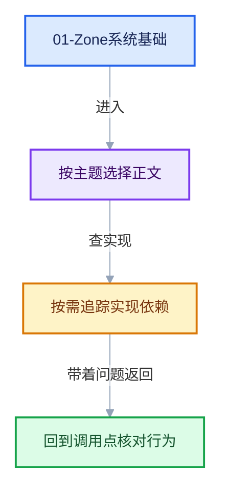

# 01-Zone系统基础

导航
<a href="../README.md" style="font-size:13px;color:#334155;background:#F1F5F9;border:1px solid #E2E8F0;border-radius:999px;padding:3px 12px;text-decoration:none;white-space:nowrap">总入口</a>
<a href="../00-课程指南/README.md" style="font-size:13px;color:#2563EB;background:#EFF6FF;border:1px solid #BFDBFE;border-radius:999px;padding:3px 12px;text-decoration:none;white-space:nowrap">‹ 00-课程指南</a>
<a href="../02-Repeat区域数据模型/README.md" style="font-size:13px;color:#7C3AED;background:#F5F3FF;border:1px solid #DDD6FE;border-radius:999px;padding:3px 12px;text-decoration:none;white-space:nowrap">02-Repeat区域数据模型 ›</a>

本章回答：Repeat 区域在节点树数据层面是什么？两个看起来独立的节点如何组成一个区域，区域内的 socket 与连线如何表示。

## 阅读顺序

- [01-01 NodeTreeZone区域表示与配对](01-NodeTreeZone区域表示与配对.md)
- [01-02 Zone输入输出与bundle迁移语义](02-Zone输入输出与bundle迁移语义.md)

## 本章问题

- `bNodeTreeZone` 如何表示一个区域，`parent_zone`/`child_zones` 如何形成嵌套树？
- Repeat Input 与 Repeat Output 如何配对？
- 区域的动态 socket（Item_X）如何生成、为何改名不断链接？
- 区域内的值在编辑器追踪（trace）时如何穿过区域边界？

继续阅读
<a href="../00-课程指南/README.md" style="font-size:13px;color:#2563EB;background:#EFF6FF;border:1px solid #BFDBFE;border-radius:999px;padding:3px 12px;text-decoration:none;white-space:nowrap">‹ 00-课程指南</a>
<a href="../02-Repeat区域数据模型/README.md" style="font-size:13px;color:#7C3AED;background:#F5F3FF;border:1px solid #DDD6FE;border-radius:999px;padding:3px 12px;text-decoration:none;white-space:nowrap">02-Repeat区域数据模型 ›</a>
回到顶部

