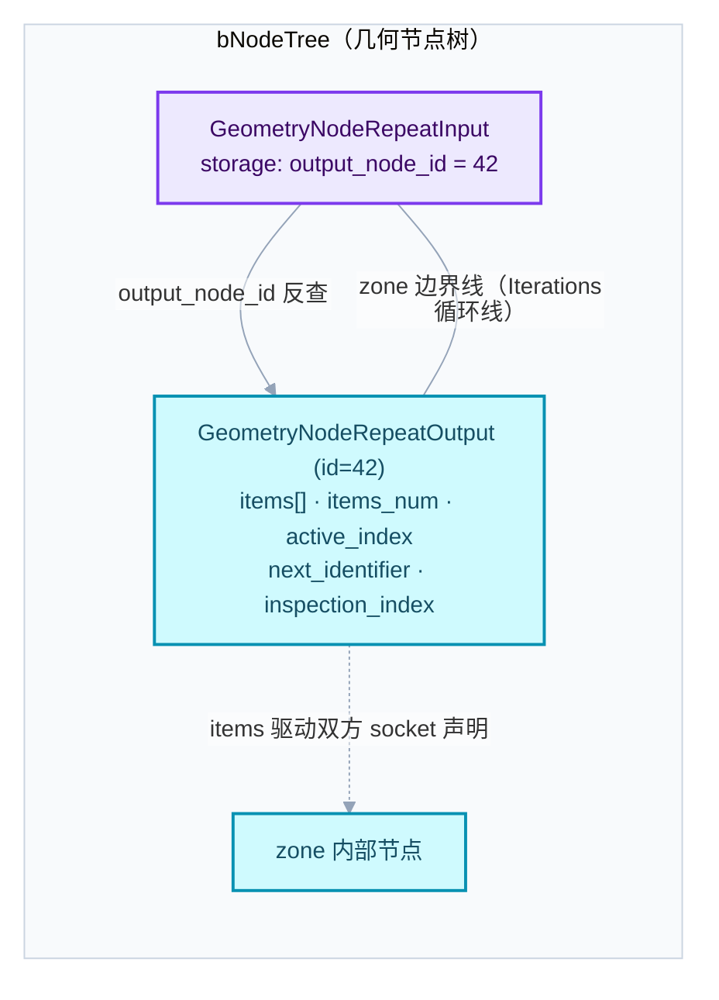
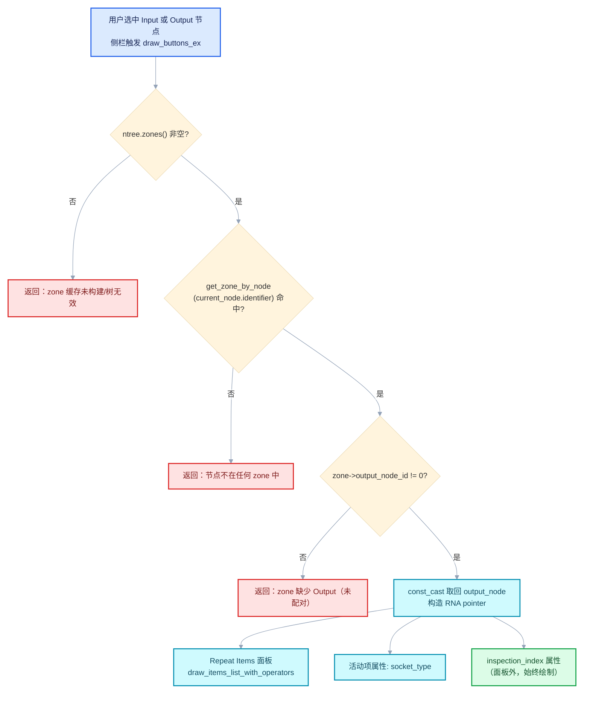
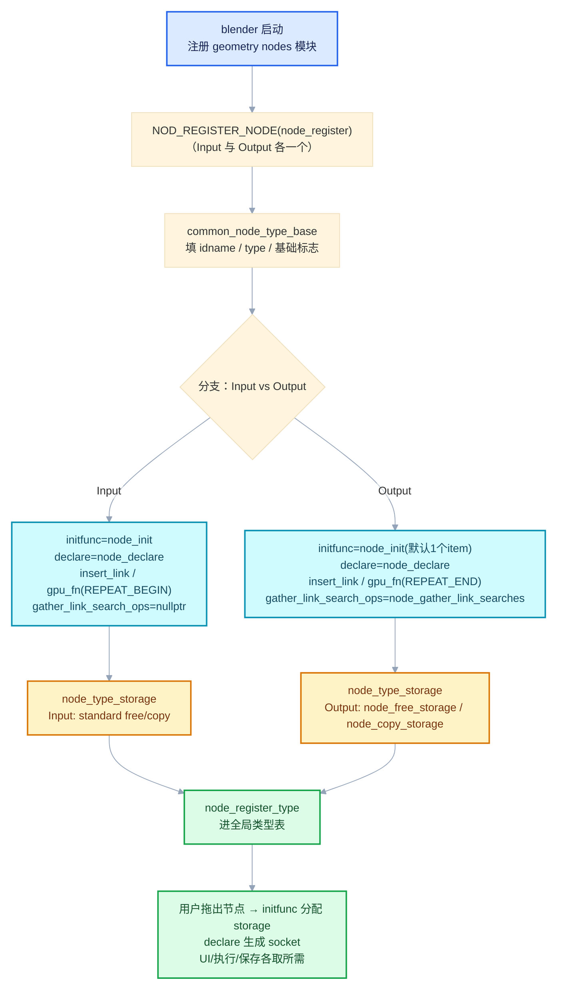
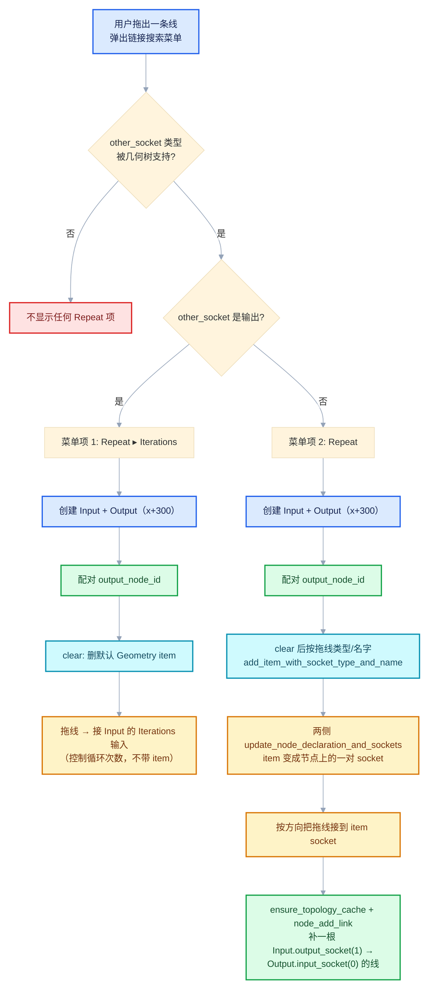

# 01 · Repeat 节点注册与 UI —— 精读 `node_geo_repeat.cc`

<div style="font-family:'Segoe UI','Microsoft YaHei',system-ui,-apple-system,sans-serif;display:flex;flex-wrap:wrap;align-items:center;gap:8px;margin:16px 0 20px;padding:10px 14px;background:#F8FAFC;border:1px solid #E2E8F0;border-radius:12px">
<span style="font-size:11px;font-weight:700;letter-spacing:.1em;color:#64748B;margin-right:2px">导航</span>
<a href="../README.md" style="font-size:13px;color:#334155;background:#F1F5F9;border:1px solid #E2E8F0;border-radius:999px;padding:3px 12px;text-decoration:none;white-space:nowrap">总入口</a>
<a href="./README.md" style="font-size:13px;color:#2563EB;background:#EFF6FF;border:1px solid #BFDBFE;border-radius:999px;padding:3px 12px;text-decoration:none;white-space:nowrap">本章 02-Repeat区域数据模型</a>
<a href="./02-DNA存储与NodeRepeatItem.md" style="font-size:13px;color:#7C3AED;background:#F5F3FF;border:1px solid #DDD6FE;border-radius:999px;padding:3px 12px;text-decoration:none;white-space:nowrap">DNA存储与NodeRepeatItem ›</a>
</div>

<div style="font-family:'Segoe UI','Microsoft YaHei',system-ui,-apple-system,sans-serif;margin:18px 0 22px;padding:14px 18px;background:#F5F3FF;border-left:4px solid #7C3AED;border-radius:10px">

**基准版本**：Blender 5.4.0-alpha。
本文所有行号、代码摘录均对照仓库内
[source/blender/nodes/geometry/nodes/node_geo_repeat.cc](../../../source/blender/nodes/geometry/nodes/node_geo_repeat.cc)
（全文共 **372 行**，本文通读全文后写成）。

</div>

<hr style="border:none;height:1px;background:linear-gradient(90deg,#BFDBFE,#E2E8F0 55%,transparent);margin:34px 0">

## 先回答一个具体问题

**问题：几何节点编辑器里那个可以无限加"Repeat Items"的 Repeat Zone（重复区域），在 C++ 侧到底是怎么"注册"出来的？为什么在 Input 节点的侧栏面板上，能看到 Output 节点身上的 item 列表？**

一句话回答：Repeat Zone 不是"一个节点"，而是**一对节点**——`GeometryNodeRepeatInput`（循环开始）和 `GeometryNodeRepeatOutput`（循环结束）。整个 [node_geo_repeat.cc](../../../source/blender/nodes/geometry/nodes/node_geo_repeat.cc) 做了五件事：

1. 给这一对节点写一个**共享的 UI 绘制函数** `node_layout_ex`：无论你选中 Input 还是 Output，侧栏都通过"zone 反查"找到 Output 节点，把 Output 存储里的 `NodeRepeatItem` 列表画出来；
2. 注册 Input 节点：它的 storage 只有一个 `int output_node_id`，指向配对的 Output 节点；
3. 注册 Output 节点：它的 storage 才是真正的数据容器 `NodeGeometryRepeatOutput`（`items` 数组、`items_num`、`active_index`、`next_identifier`、`inspection_index`），初始化时默认带一个 "Geometry" item；
4. 借助 **socket_items 工具族**（`NOD_socket_items.hh` 系列）把"动态增删 item → 动态增删 socket"这套重复模式（与 Simulation Zone、Foreach Geometry Element Zone 共用的基建）接进 link 搜索、插入连线、文件读写；
5. 给着色器（材质节点树）侧提供 `REPEAT_BEGIN` / `REPEAT_END` 两个 GPU 节点，用 `GPU_stack_link_zone` 把 zone 边界编进 GPU 节点图。

沿着这个问题读下去，本篇把 372 行逐段讲透。

<hr style="border:none;height:1px;background:linear-gradient(90deg,#BFDBFE,#E2E8F0 55%,transparent);margin:34px 0">

## 文件地图

| 函数 | 行号 | 所属 | 职责 |
|---|---|---|---|
| `node_layout_ex` | L34–L66 | 共享 | Input/Output 共用的侧栏绘制：zone 反查 Output 节点，画 Repeat Items 面板 + `inspection_index` |
| `repeat_input_node::node_declare` | L72–L111 | Input | 声明 Iteration/Iterations 固定 socket + 按 Output storage 的 item 动态生成输入/输出 + `__extend__` |
| `repeat_input_node::node_init` | L113–L119 | Input | 分配 `NodeGeometryRepeatInput`，`output_node_id = 0` |
| `repeat_input_node::node_label` | L121–L127 | Input | 节点显示标签固定为 "Repeat"（Output 复用） |
| `repeat_input_node::node_insert_link` | L129–L137 | Input | 有连线插入时，经 `__extend__` socket 尝试为 Output 新增 item |
| `repeat_input_node::node_shader_fn` | L139–L147 | Input | GPU 侧发 `REPEAT_BEGIN`，带 `zone_id` 与 `(false, 1, 1)` |
| `repeat_input_node::node_register` | L149–L167 | Input | 组装 `bke::bNodeType` 并注册 |
| `repeat_output_node::node_declare` | L176–L207 | Output | 按 self storage 的 item 动态生成输入/输出 + `__extend__` |
| `repeat_output_node::node_init` | L209–L224 | Output | 分配 storage；几何树默认创建一个 "Geometry" item |
| `repeat_output_node::node_free_storage` | L226–L230 | Output | `socket_items::destruct_array` + `MEM_delete` |
| `repeat_output_node::node_copy_storage` | L232–L239 | Output | 浅拷贝 storage + `socket_items::copy_array` 深拷 items |
| `repeat_output_node::node_insert_link` | L241–L245 | Output | 同 Input，`node` 自身即 Output |
| `repeat_output_node::node_operators` | L247–L250 | Output | 注册 item 增/删/移操作符 |
| `repeat_output_node::node_gather_link_searches` | L252–L297 | Output | Add 菜单两项："Repeat > Iterations" 与 "Repeat"（一键建 zone） |
| `repeat_output_node::node_blend_write` | L299–L302 | Output | items 写入 .blend |
| `repeat_output_node::node_blend_read` | L304–L307 | Output | items 从 .blend 读回 |
| `repeat_output_node::node_shader_fn` | L309–L317 | Output | GPU 侧发 `REPEAT_END`，带 `(true, 0, 0)` |
| `repeat_output_node::node_register` | L319–L339 | Output | 组装 `bke::bNodeType` 并注册 |
| `RepeatItemsAccessor::blend_write_item` | L350–L353 | 访问器 | 单个 item 的字符串字段 `name` 写盘 |
| `RepeatItemsAccessor::blend_read_data_item` | L355–L358 | 访问器 | 单个 item 的 `name` 读回（分配堆内存） |
| `NodeGeometryRepeatOutput::items_span()` ×2 | L362–L370 | DNA | 把裸指针+数量包成（Mutable）`Span<NodeRepeatItem>` |

> 源码链接前缀约定：本文相对路径 `../../../../` 指向仓库根，例如
> [../../../source/blender/nodes/geometry/nodes/node_geo_repeat.cc](../../../source/blender/nodes/geometry/nodes/node_geo_repeat.cc)。

先给一张全景图，说明一对 Repeat 节点之间的"指针 + 数据"关系，也是全文反复出现的背景：



<hr style="border:none;height:1px;background:linear-gradient(90deg,#BFDBFE,#E2E8F0 55%,transparent);margin:34px 0">

## 1 · 共享 UI 面板：`node_layout_ex`（L34–L66）

### 1.1 为什么 Input 和 Output 能共用一个绘制函数

函数注释第一行就点明：`/** Shared between repeat zone input and output node. */`。两个节点注册时都写了 `ntype.draw_buttons_ex = node_layout_ex`（L162、L332），所以无论你在节点编辑器里选中 Repeat Input 还是 Repeat Output，打开侧栏（N 面板）看到的都是**同一份内容**：Repeat Items 列表 + 活动项属性 + 检查索引。

关键在于：**item 数据只存在 Output 节点的 storage 里**（`NodeGeometryRepeatOutput::items`），Input 节点身上只有一个 `output_node_id`。所以 UI 要画 item 列表，必须先"从当前节点反查回 Output 节点"。反查的依据不是指针，而是 **zone 拓扑缓存**。

### 1.2 教学注释代码

```cpp
/** Input 与 Output 两个 repeat 节点共享的侧栏绘制函数。 */
static void node_layout_ex(ui::Layout &layout, bContext *C, PointerRNA *current_node_ptr)
{
  // [讲解] current_node_ptr->owner_id 是"拥有这个节点的 ID"，对节点树而言即 bNodeTree*。
  //        这里拿到的是当前正在被绘制的节点树。
  bNodeTree &ntree = *reinterpret_cast<bNodeTree *>(current_node_ptr->owner_id);
  // [讲解] data 字段指向当前节点（bNode），也就是用户此刻选中的 Input 或 Output。
  bNode *current_node = static_cast<bNode *>(current_node_ptr->data);

  // [讲解] zones() 返回节点树的 zone 拓扑缓存（bNodeTreeZones）。
  //        注意它可能为 null（例如树刚被修改、缓存尚未构建），必须判空直接返回。
  const bke::bNodeTreeZones *zones = ntree.zones();
  if (!zones) {
    return;
  }
  // [讲解] 用当前节点的 identifier 反查它所属的 zone。
  //        无论 current_node 是 Input（zone 的头）还是 Output（zone 的尾），
  //        都会命中同一个 bNodeTreeZone。
  const bke::bNodeTreeZone *zone = zones->get_zone_by_node(current_node->identifier);
  if (!zone) {
    return;
  }
  // [讲解] 一个合法的 repeat zone 必须有 output（尾）节点。
  //        若用户刚拖出一个孤零零的 Input 还没连 Output，zone->output_node_id 为 0，
  //        此时无从画 item 列表，直接返回——这就是 Input 节点"没配对时面板空白"的原因。
  if (!zone->output_node_id) {
    return;
  }
  // [讲解] 拿到真正的 Output 节点。zone 缓存里存的是 const 指针，
  //        而 UI 绘制（操作符回调等）需要可写访问，这里显式 const_cast。
  bNode &output_node = const_cast<bNode &>(*zone->output_node());
  // [讲解] 为 Output 节点构造一个 PointerRNA：owner 仍是同一棵节点树 ID，
  //        type 是 RNA_Node，data 指向 output_node。后面画 inspection_index 用。
  PointerRNA output_node_ptr = RNA_pointer_create_discrete(
      current_node_ptr->owner_id, RNA_Node, &output_node);

  // [讲解] 创建/获取名为 "Repeat Items" 的折叠面板（false = 默认展开）。
  //        panel() 返回 nullptr 表示面板被折叠，内部内容跳过绘制。
  if (ui::Layout *panel = layout.panel(C, "repeat_items", false, IFACE_("Repeat Items"))) {
    // [讲解] socket_items::ui 的通用绘制器：画出 item 列表（带 +/−/上移/下移 操作符），
    //        列表 UI 类型来自 RepeatItemsAccessor::ui_idnames::list
    //        （"DATA_UL_repeat_zone_state"），操作符来自 operator_idnames
    //        （NODE_OT_repeat_zone_item_add / remove / move）。
    //        数据源是 RepeatItemsAccessor::get_items_from_node —— 即 Output storage 的
    //        items / items_num / active_index 三件套。
    socket_items::ui::draw_items_list_with_operators<RepeatItemsAccessor>(
        C, panel, ntree, output_node);
    // [讲解] 再画"当前选中 item"的属性区。lambda 里的 item_ptr 指向 active_index
    //        对应的 NodeRepeatItem（经 item_srna = RNA_RepeatItem 反射）。
    //        这里只画一个属性：socket_type —— 即这个 item 在 Input/Output 节点上
    //        生成的 socket 的数据类型（Geometry / Float / Material / …）。
    socket_items::ui::draw_active_item_props<RepeatItemsAccessor>(
        ntree, output_node, [&](PointerRNA *item_ptr) {
          panel->use_property_split_set(true);
          panel->use_property_decorate_set(false);
          panel->prop(item_ptr, "socket_type", UI_ITEM_NONE, std::nullopt, ICON_NONE);
        });
  }

  // [讲解] 最后画 inspection_index —— Output storage 的一个 int（DNA_node_types.h L3569）。
  //        它不是"选中的 item"，而是"检查哪一次迭代"：视图层/调试工具用它在
  //        zone 执行过程中抓取第 N 次迭代的状态。注意它画在面板外，
  //        所以即使 Repeat Items 面板被折叠，这一项也始终可见。
  layout.prop(&output_node_ptr, "inspection_index", UI_ITEM_NONE, std::nullopt, ICON_NONE);
}
```

### 1.3 数据流：从点击 UI 到 storage 变化

<details>
<summary>核对原始源码：node_layout_ex · L34—L66</summary>

```cpp
/** Shared between repeat zone input and output node. */
static void node_layout_ex(ui::Layout &layout, bContext *C, PointerRNA *current_node_ptr)
{
  bNodeTree &ntree = *reinterpret_cast<bNodeTree *>(current_node_ptr->owner_id);
  bNode *current_node = static_cast<bNode *>(current_node_ptr->data);

  const bke::bNodeTreeZones *zones = ntree.zones();
  if (!zones) {
    return;
  }
  const bke::bNodeTreeZone *zone = zones->get_zone_by_node(current_node->identifier);
  if (!zone) {
    return;
  }
  if (!zone->output_node_id) {
    return;
  }
  bNode &output_node = const_cast<bNode &>(*zone->output_node());
  PointerRNA output_node_ptr = RNA_pointer_create_discrete(
      current_node_ptr->owner_id, RNA_Node, &output_node);

  if (ui::Layout *panel = layout.panel(C, "repeat_items", false, IFACE_("Repeat Items"))) {
    socket_items::ui::draw_items_list_with_operators<RepeatItemsAccessor>(
        C, panel, ntree, output_node);
    socket_items::ui::draw_active_item_props<RepeatItemsAccessor>(
        ntree, output_node, [&](PointerRNA *item_ptr) {
          panel->use_property_split_set(true);
          panel->use_property_decorate_set(false);
          panel->prop(item_ptr, "socket_type", UI_ITEM_NONE, std::nullopt, ICON_NONE);
        });
  }

  layout.prop(&output_node_ptr, "inspection_index", UI_ITEM_NONE, std::nullopt, ICON_NONE);
}
```

</details>

### 1.4 三层查找，每一层都可能失败

`node_layout_ex` 的防御性很强，连续四个早退：`zones` 为空、`zone` 找不到、`output_node_id == 0`、面板折叠。把这条链画出来：



**教学要点**：
- "zone 反查"而非"storage 反查"是刻意的解耦：Input 节点自己不认识 Output 的存储，它只认识 zone 拓扑。这样即便未来 zone 关系改由别的方式表达，UI 代码也不用动。
- `RNA_pointer_create_discrete(owner_id, RNA_Node, &output_node)` 的 owner 用的是 `current_node_ptr->owner_id`——因为 Input 和 Output 在同一棵树里，owner 必然相同。
- `inspection_index` 在 `NodeGeometryRepeatOutput`（[DNA_node_types.h L3569](../../../source/blender/makesdna/DNA_node_types.h)）上，所以 prop 绑定的是 `output_node_ptr`，而不是当前节点。如果你选中 Input，这个属性的修改其实落在 Output 身上——UI 的"跨节点写数据"就是靠这个 PointerRNA 完成的。

<hr style="border:none;height:1px;background:linear-gradient(90deg,#BFDBFE,#E2E8F0 55%,transparent);margin:34px 0">

## 2 · `repeat_input_node` 命名空间

### 2.0 先看 `NODE_STORAGE_FUNCS` 宏

文件 L70 有 `NODE_STORAGE_FUNCS(NodeGeometryRepeatInput);`，L174 有 `NODE_STORAGE_FUNCS(NodeGeometryRepeatOutput);`。它的定义在 [BKE_node.hh L1353–L1361](../../../source/blender/blenkernel/BKE_node.hh)：

<details>
<summary>核对原始源码：NODE_STORAGE_FUNCS 宏 · BKE_node.hh L1353—L1361</summary>

```cpp
#define NODE_STORAGE_FUNCS(StorageT) \
  [[maybe_unused]] static StorageT &node_storage(bNode &node) \
  { \
    return *static_cast<StorageT *>(node.storage); \
  } \
  [[maybe_unused]] static const StorageT &node_storage(const bNode &node) \
  { \
    return *static_cast<const StorageT &>(node.storage); \
  }
```

（注：实际第二重载返回 `*static_cast<const StorageT *>(node.storage)`，即 const 指针解引用；宏展开为**一对**重载的 `node_storage`：非 const 与 const 各一。）

真实摘录如下（与仓库一致）：

```cpp
#define NODE_STORAGE_FUNCS(StorageT) \
  [[maybe_unused]] static StorageT &node_storage(bNode &node) \
  { \
    return *static_cast<StorageT *>(node.storage); \
  } \
  [[maybe_unused]] static const StorageT &node_storage(const bNode &node) \
  { \
    return *static_cast<const StorageT *>(node.storage); \
  }
```

</details>

**语义**：Blender 的节点自定义数据统一挂在 `bNode.storage`（一个 `void *`）上。宏在当前命名空间里生成 `node_storage(bNode&)` / `node_storage(const bNode&)` 两个内联重载，把 `void*` 安全地 static_cast 成指定 storage 类型。好处是：

- 调用点写 `node_storage(*node).items_num` 而不是满屏 `static_cast<NodeGeometryRepeatOutput *>(node->storage)->items_num`；
- const 正确性由重载自动分发：只读上下文拿到 const 引用，编译器替你守住"不许在只读路径改 storage"；
- `[[maybe_unused]]` 允许某命名空间生成了但没用到（比如 `repeat_input_node` 里也有 `node_storage`，L83、L131、L145 都在用）。

注意作用域：宏生成的 `node_storage` 是**当前命名空间**的静态函数，所以 `repeat_input_node::node_storage` 返回 `NodeGeometryRepeatInput&`，`repeat_output_node::node_storage` 返回 `NodeGeometryRepeatOutput&`——同名函数、两种类型，互不干扰。这就是 C++ 命名空间 + 宏的经典搭配。

### 2.1 `node_declare`（L72–L111）：固定 socket + 动态 socket + `__extend__`

Input 节点的 socket 分三类：

1. **固定输出** `Iteration`（Int）：当前迭代下标，从 0 计数；
2. **固定输入** `Iterations`（Int）：min 0，默认 1——循环次数；
3. **动态输入/输出对**：数量与类型完全由**配对 Output 节点 storage 里的 items** 决定；
4. **扩展口** `__extend__`（输入与输出各一个，名字为空字符串）：UI 上显示为"加号/虚线"区域，用户把新连线拖到它上面时会触发 `node_insert_link` 自动新建 item。

还有两个声明级的开关贯穿始终：

- `b.use_custom_socket_order()`：socket 在节点上的排列顺序**不按声明顺序**，而按用户在 UI 上的自定义顺序（存于 `bNodeSocket` 的排序字段）。动态增删 item 时，新 socket 能插在 `__extend__` 旁边而不是被强制排到最后；
- `b.allow_any_socket_order()`：允许输入/输出交错排列——Repeat 节点上每个 item 是"左输入 + 右输出"成对出现的，交错布局正是 zone 节点视觉对称的基础。

#### 教学注释代码

```cpp
static void node_declare(NodeDeclarationBuilder &b)
{
  // [讲解] 打开自定义 socket 顺序 + 允许任意交错顺序。
  //        这是 zone 类节点（repeat/simulation/foreach）的标配，
  //        因为 item 生成的输入输出必须"成对、贴着长"，而不是输入一列输出一列。
  b.use_custom_socket_order();
  b.allow_any_socket_order();

  // [讲解] 固定输出 Iteration：当前迭代下标（0 起）。几何执行器每次迭代都会写这个值。
  b.add_output<decl::Int>("Iteration"_ustr)
      .description("Index of the current iteration. Starts counting at zero");
  // [讲解] 固定输入 Iterations：循环次数。min(0) 允许 0 次（zone 内部一次都不执行，
  //        输出取初始值），默认 1 次。注意它是普通 int 输入，可以接子树。
  b.add_input<decl::Int>("Iterations"_ustr).min(0).default_value(1);

  // [讲解] 动态部分开始。声明期可能拿不到 node/tree（例如类型注册阶段的调用），
  //        所以先取指针再判空。
  const bNode *node = b.node_or_null();
  const bNodeTree *tree = b.tree_or_null();
  if (node && tree) {
    // [讲解] Input 节点的 storage 只有一个 output_node_id。
    const NodeGeometryRepeatInput &storage = node_storage(*node);
    // [讲解] 用它反查配对的 Output 节点。找不到（=0 或已被删）就跳过动态 socket。
    if (const bNode *output_node = tree->node_by_id(storage.output_node_id)) {
      // [讲解] item 列表在 Output 的 storage 里。
      const auto &output_storage = *static_cast<const NodeGeometryRepeatOutput *>(
          output_node->storage);
      // [讲解] 每个 item 在 Input 节点上生成"一个输入 + 一个输出"。
      for (const int i : IndexRange(output_storage.items_num)) {
        const NodeRepeatItem &item = output_storage.items[i];
        const eNodeSocketDatatype socket_type = item.socket_type;   // 数据类型
        const UString name = item.name ? UString(item.name) : ""_ustr; // 显示名
        // [讲解] socket 标识符（identifier）形如 "Item_0"、"Item_5"，
        //        由 item.identifier（NodeRepeatItem 的 int 字段）拼出。
        //        它与显示名解耦：改名/换序都不会破坏已有连线。
        const UString identifier(RepeatItemsAccessor::socket_identifier_for_item(item));
        auto &input_decl = b.add_input(socket_type, name, identifier)
                               // [讲解] socket_name_ptr：socket 显示名与 item.name
                               //        建立 RNA 双向绑定——在节点上改 socket 名，
                               //        实际写回 Output storage 里的 item.name。
                               .socket_name_ptr(
                                   &tree->id, *RepeatItemsAccessor::item_srna, &item, "name")
                               .structure_type(StructureType::Dynamic)
                               .compositor_realization_mode(CompositorInputRealizationMode::None);
        // [讲解] 输出 socket 与输入同名同类型：
        //        - align_with_previous()：视觉上紧跟上面的输入（成对布局）；
        //        - propagate_all({input_decl.index()})：单例/网格等结构类型从对应输入传播；
        //        - inferred_structure_type：结构类型可由连线推断。
        b.add_output(socket_type, name, identifier)
            .align_with_previous()
            .propagate_all({input_decl.index()})
            .inferred_structure_type({input_decl.index()})
            .structure_type(StructureType::Dynamic);
      }
    }
  }
  // [讲解] 扩展输入口：名字为空、内部标识 "__extend__"。
  //        custom_draw 挂了通用绘制器——画成"虚线框/加号"，用户把线拖到这里
  //        就会触发 insert_link → 自动加 item（见 2.4）。
  b.add_input<decl::Extend>(""_ustr, "__extend__"_ustr)
      .structure_type(StructureType::Dynamic)
      .custom_draw(socket_items::ui::draw_extend_socket_fn<RepeatItemsAccessor>());
  // [讲解] 扩展输出口，同样对齐上一个 socket。
  b.add_output<decl::Extend>(""_ustr, "__extend__"_ustr)
      .structure_type(StructureType::Dynamic)
      .align_with_previous();
}
```

<details>
<summary>核对原始源码：repeat_input_node::node_declare · L72—L111</summary>

```cpp
static void node_declare(NodeDeclarationBuilder &b)
{
  b.use_custom_socket_order();
  b.allow_any_socket_order();
  b.add_output<decl::Int>("Iteration"_ustr)
      .description("Index of the current iteration. Starts counting at zero");
  b.add_input<decl::Int>("Iterations"_ustr).min(0).default_value(1);

  const bNode *node = b.node_or_null();
  const bNodeTree *tree = b.tree_or_null();
  if (node && tree) {
    const NodeGeometryRepeatInput &storage = node_storage(*node);
    if (const bNode *output_node = tree->node_by_id(storage.output_node_id)) {
      const auto &output_storage = *static_cast<const NodeGeometryRepeatOutput *>(
          output_node->storage);
      for (const int i : IndexRange(output_storage.items_num)) {
        const NodeRepeatItem &item = output_storage.items[i];
        const eNodeSocketDatatype socket_type = item.socket_type;
        const UString name = item.name ? UString(item.name) : ""_ustr;
        const UString identifier(RepeatItemsAccessor::socket_identifier_for_item(item));
        auto &input_decl = b.add_input(socket_type, name, identifier)
                               .socket_name_ptr(
                                   &tree->id, *RepeatItemsAccessor::item_srna, &item, "name")
                               .structure_type(StructureType::Dynamic)
                               .compositor_realization_mode(CompositorInputRealizationMode::None);
        b.add_output(socket_type, name, identifier)
            .align_with_previous()
            .propagate_all({input_decl.index()})
            .inferred_structure_type({input_decl.index()})
            .structure_type(StructureType::Dynamic);
      }
    }
  }
  b.add_input<decl::Extend>(""_ustr, "__extend__"_ustr)
      .structure_type(StructureType::Dynamic)
      .custom_draw(socket_items::ui::draw_extend_socket_fn<RepeatItemsAccessor>());
  b.add_output<decl::Extend>(""_ustr, "__extend__"_ustr)
      .structure_type(StructureType::Dynamic)
      .align_with_previous();
}
```

</details>

**注意一个不对称**：Input 的 `node_declare` 读的是 **Output 的 storage**（`output_storage.items`），Output 的 `node_declare`（L176–L207）读的是**自己的 storage**。也就是说 item 数据的**唯一真源（single source of truth）是 Output 节点**；Input 只是"镜像声明"。`RepeatItemsAccessor::get_items_from_node` 也印证了这一点——它硬编码 `NodeGeometryRepeatOutput *`。

另一个细节：`socket_identifier_for_item` 返回 `"Item_" + std::to_string(item.identifier)`（见 [NOD_geo_repeat.hh L83–L86](../../../source/blender/nodes/geometry/include/NOD_geo_repeat.hh)）。`identifier` 由 `next_identifier` 自增分配，**即使 item 被删除，这个号也不会被复用**，从根本上避免"删了 Item_2 再加一个，连线串了"的经典 bug。

### 2.2 `node_init`（L113–L119）：`output_node_id = 0` 的意义

```cpp
static void node_init(bNodeTree * /*tree*/, bNode *node)
{
  NodeGeometryRepeatInput *data = MEM_new<NodeGeometryRepeatInput>(__func__);
  /* Needs to be initialized for the node to work. */
  data->output_node_id = 0;
  node->storage = data;
}
```

只有三行，却藏着本文件最容易被忽视的知识点：

1. **`node->storage` 不是天生有值的**。`bNode.storage` 是 `void*`，节点被新建（用户拖进编辑器、复制、或从 .blend 读回但旧版本无 storage）时，Blender 会调用 `initfunc` 来分配自定义存储。不写 `node_init` 的话 storage 就是悬空的野指针，后续任何 `node_storage()` 调用都会崩。
2. **注释 "Needs to be initialized for the node to work" 在强调 `output_node_id = 0`**。`MEM_new` 走 DNA 默认值构造，`NodeGeometryRepeatInput::output_node_id` 的字段默认初始化本来就是 0（见 [DNA_node_types.h L3554–L3559](../../../source/blender/makesdna/DNA_node_types.h)，`int32_t output_node_id = 0;`）——那为什么还要显式写？因为语义上必须**明确**：0 不是"指向第一个节点"，而是哨兵值（sentinel），表示"**尚未配对**"：
   - `node_declare` 里 `tree->node_by_id(0)` 找不到节点（节点 identifier 从 1 开始分配），动态 socket 生成被跳过；
   - `node_insert_link` 里 L132 `if (!output_node) return true;` 直接放行连线、不加 item；
   - `node_layout_ex` 里 zone 反查失败，面板空白。
   
   三条路径都把 0 当"未配对"处理。假如 storage 忘了初始化、留着未定义值，`node_by_id` 会拿一个随机数去匹配节点表——轻则找不到、重则撞上真实节点 identifier 发生**错配**（Input 声明了别的 zone 的 socket）。这就是注释说"must be initialized"的原因。
3. **这里没有用 `node_type_storage` 注册的 free/copy 回调之外的任何逻辑**。Input 的 storage 是纯 POD（一个 int32），注册时用的就是 `node_free_standard_storage` / `node_copy_standard_storage`（见 2.5），DNA 层能直接 memcpy。

### 2.3 `node_label`（L121–L127）

```cpp
static void node_label(const bNodeTree * /*ntree*/,
                       const bNode * /*node*/,
                       char *label,
                       const int label_maxncpy)
{
  BLI_strncpy_utf8(label, CTX_IFACE_(BLT_I18NCONTEXT_ID_NODETREE, "Repeat"), label_maxncpy);
}
```

`labelfunc` 决定节点标题栏显示的文字。两个细节：

- 用 `BLI_strncpy_utf8`（文件开头 include 了 `BLI_string_utf8.hh`）而不是普通 `BLI_strncpy`——标签来自翻译系统，可能是任意 UTF-8（比如中文界面下的"重复"），按 UTF-8 语义截断才不会切出残缺字节；
- `CTX_IFACE_` 是带上下文的翻译宏，`BLT_I18NCONTEXT_ID_NODETREE` 把 "Repeat" 归入节点树翻译语境，避免和其他界面的 "Repeat" 撞翻译。

有意思的是 Output 注册时直接复用了这个函数：`ntype.labelfunc = repeat_input_node::node_label;`（L328）。所以 Input 和 Output 在画布上都叫 "Repeat"，靠上下位置与图标区分——这是 zone 节点的视觉惯例。

### 2.4 `node_insert_link`（L129–L137）：连线拖到 `__extend__` 上会发生什么

```cpp
static bool node_insert_link(bke::NodeInsertLinkParams &params)
{
  bNode *output_node = params.ntree.node_by_id(node_storage(params.node).output_node_id);
  if (!output_node) {
    return true;
  }
  return socket_items::try_add_item_via_any_extend_socket<RepeatItemsAccessor>(
      params.ntree, params.node, *output_node, params.link);
}
```

`insert_link` 回调在**一条连线被插进节点时**触发（包括拖放连线到节点上、以及拖到节点内部的扩展区）。流程是：

1. 反查配对 Output；没有配对（`output_node_id == 0` 或节点已删）就返回 `true`——放行连线，什么都不加。返回值含义是"允许这次插入"；
2. 否则调用通用模板 `try_add_item_via_any_extend_socket<RepeatItemsAccessor>`：检查连线的两端 socket 是否落在 `__extend__` 扩展区上。是的话，按**连线另一端的数据类型和名字**新建一个 `NodeRepeatItem`（写进 Output storage），重新声明两侧节点 socket，再把这条线重新接到新生成的 item socket 上。

所以用户的体感是："随便拿一条 Float 线丢到 Repeat 节点的加号上 → zone 上立刻多出一对 Float 输入输出，线也接好了。" 一个动作背后是 item 创建 + 双侧 socket 重建 + 连线重挂三件事。

Output 侧的 `node_insert_link`（L241–L245）逻辑相同，只是第四个参数传 `params.node` 自身（Output 就是 item 的宿主）：

```cpp
return socket_items::try_add_item_via_any_extend_socket<RepeatItemsAccessor>(
    params.ntree, params.node, params.node, params.link);
```

### 2.5 `node_shader_fn`（L139–L147）：GPU 侧的 REPEAT_BEGIN

```cpp
static int node_shader_fn(GPUMaterial *mat,
                          bNode *node,
                          bNodeExecData * /*execdata*/,
                          GPUNodeStack *in,
                          GPUNodeStack *out)
{
  int zone_id = node_storage(*node).output_node_id;
  return GPU_stack_link_zone(mat, node, "REPEAT_BEGIN", in, out, zone_id, false, 1, 1);
}
```

材质节点树（shader node tree）里没有几何执行器，Repeat zone 要靠 GPU 节点图"翻译"成着色器循环。这里调用的 `GPU_stack_link_zone` 签名（[GPU_material.hh L681–L689](../../../source/blender/gpu/GPU_material.hh)）是：

```cpp
bool GPU_stack_link_zone(GPUMaterial *material,
                         const bNode *bnode,
                         const char *name,
                         GPUNodeStack *in,
                         GPUNodeStack *out,
                         int zone_index,
                         bool is_zone_end,
                         int in_argument_count,
                         int out_argument_count);
```

在实现（[gpu_node_graph.cc L1076–L1121](../../../source/blender/gpu/intern/gpu_node_graph.cc)）里，`zone_index` 存进 `node->zone_index`，`is_zone_end` 存进 `node->is_zone_end`；随后把"第几个 socket 之后算 zone I/O"打标：

```cpp
for (const auto [i, input] : node->inputs.enumerate()) {
  input.is_zone_io = i >= in_argument_count;
  input.is_duplicate = input.is_zone_io && is_zone_end;
}
for (const auto [i, output] : node->outputs.enumerate()) {
  output.is_zone_io = i >= out_argument_count;
  output.is_duplicate = output.is_zone_io;
}
```

对照 Input 节点的调用参数 `(zone_id, false, 1, 1)`：

| 参数 | 值 | 含义 |
|---|---|---|
| `zone_index` | `output_node_id` | zone 的**唯一编号**取自配对 Output 节点的 identifier——Input 与 Output 必须报同一个号，GPU 后端才能把 BEGIN/END 配成一对循环 |
| `is_zone_end` | `false` | 这是循环的**开头** |
| `in_argument_count` | `1` | 前 1 个输入 socket（`Iterations`）是循环的"函数参数"，不算 zone 数据 I/O |
| `out_argument_count` | `1` | 前 1 个输出 socket（`Iteration`）是循环变量本身，不算 zone 数据 I/O |

于是从 `Iteration`（第 0 个输出）往后、`Iterations`（第 0 个输入）往后的所有 socket（即动态 item socket 和 `__extend__`）都成了 `is_zone_io = true`——它们才是"每次迭代进/出循环体的数据通道"。

被链接的 shader 函数是 `REPEAT_BEGIN`，来自 [gpu_shader_material_repeat_zone.bsl.hh](../../../source/blender/gpu/shaders/material/gpu_shader_material_repeat_zone.bsl.hh)：

```hlsl
#ifdef GPU_SHADER
#  define REPEAT_BEGIN(count, var) \
    for (int var##_i = 0; var##_i < count; var##_i++) { \
      var = var##_i;

#  define REPEAT_END() }
#else
/* Dummy functions for gpu_shader_dependency. */
[[node]] void REPEAT_BEGIN(int dummy) {}
[[node]] void REPEAT_END(float dummy) {}
#endif
```

即 `REPEAT_BEGIN(Iterations, iter)` 展开成 `for (int iter_i = 0; iter_i < Iterations; iter_i++) { iter = iter_i;`，`REPEAT_END` 补一个 `}`。GPU 后端把两个 zone 节点之间的数据流放进这个 for 循环体，完成"几何节点的 Repeat zone → 着色器 for 循环"的降级。

Output 侧（L309–L317）对称地调用：

```cpp
int zone_id = node->identifier;  // 注意：这里用的是自己的 identifier
return GPU_stack_link_zone(mat, node, "REPEAT_END", in, out, zone_id, true, 0, 0);
```

| 参数 | Output 的值 | 与 Input 对比 |
|---|---|---|
| `zone_index` | `node->identifier`（Output 自己） | Input 报的是 `output_node_id` = 同一个值 ⇒ 两端号一致，配对成功 |
| `is_zone_end` | `true` | 循环结尾；同时使输入侧打上 `is_duplicate`（END 节点的 zone 输入是"上一轮输出的副本"） |
| `in_argument_count` | `0` | 没有标量参数，全部输入都是 zone I/O |
| `out_argument_count` | `0` | 同上 |

### 2.6 `node_register`（L149–L167）与 `NOD_REGISTER_NODE`

<details>
<summary>核对原始源码：repeat_input_node::node_register · L149—L167</summary>

```cpp
static void node_register()
{
  static bke::bNodeType ntype;
  common_node_type_base(&ntype, "GeometryNodeRepeatInput"_ustr, GEO_NODE_REPEAT_INPUT);
  ntype.ui_name = "Repeat Input";
  ntype.enum_name_legacy = "REPEAT_INPUT";
  ntype.nclass = NODE_CLASS_INTERFACE;
  ntype.initfunc = node_init;
  ntype.declare = node_declare;
  ntype.labelfunc = node_label;
  ntype.gather_link_search_ops = nullptr;
  ntype.insert_link = node_insert_link;
  ntype.no_muting = true;
  ntype.draw_buttons_ex = node_layout_ex;
  ntype.gpu_fn = node_shader_fn;
  bke::node_type_storage(
      ntype, "NodeGeometryRepeatInput", node_free_standard_storage, node_copy_standard_storage);
  bke::node_register_type(ntype);
}
NOD_REGISTER_NODE(node_register)
```

</details>

逐字段解释：

| 字段 | 值 | 作用 |
|---|---|---|
| `common_node_type_base(&ntype, "GeometryNodeRepeatInput", GEO_NODE_REPEAT_INPUT)` | — | 初始化基础字段：idname（内部稳定名）、type（`GEO_NODE_REPEAT_INPUT` 枚举值）、尺寸、默认标志 |
| `ui_name` | `"Repeat Input"` | Add 菜单/搜索里显示的名字 |
| `enum_name_legacy` | `"REPEAT_INPUT"` | 旧版 RNA/Python 里的枚举名（兼容层） |
| `nclass` | `NODE_CLASS_INTERFACE` | 归类为"接口"类节点——与 Layout、Group Input/Output 同类。语义上 zone 边界节点不是"计算"，是"结构" |
| `initfunc` | `node_init` | 新建节点时分配 storage（见 2.2） |
| `declare` | `node_declare` | 声明 socket 拓扑（见 2.1），声明缓存失效时重建 |
| `labelfunc` | `node_label` | 标题文本 "Repeat" |
| `gather_link_search_ops` | `nullptr` | **显式置空**：Input 节点不出现在"拖线搜索"菜单里。为什么？见 3.7——创建 zone 的一对节点的逻辑全部由 Output 的搜索项承担，Input 若也提供会重复/冲突 |
| `insert_link` | `node_insert_link` | 连线插入回调（见 2.4） |
| `no_muting` | `true` | 禁止节点被静音（M 键）。zone 边界节点静音会破坏 zone 配对关系，直接不允许 |
| `draw_buttons_ex` | `node_layout_ex` | 侧栏扩展绘制（见 1） |
| `gpu_fn` | `node_shader_fn` | 材质树 GPU 翻译回调（见 2.5） |
| `node_type_storage(..., "NodeGeometryRepeatInput", node_free_standard_storage, node_copy_standard_storage)` | — | 声明 storage 的 DNA 名与释放/拷贝回调。Input 的 storage 是 POD，用标准 memcpy 版即可 |
| `node_register_type(ntype)` | — | 注册进全局节点类型表 |
| `NOD_REGISTER_NODE(node_register)` | — | 宏：生成一个在模块加载时调用 `node_register` 的注册桥（每个 nodes 模块文件末尾的标准收尾） |

**注册时序全景图**：



<hr style="border:none;height:1px;background:linear-gradient(90deg,#BFDBFE,#E2E8F0 55%,transparent);margin:34px 0">

## 3 · `repeat_output_node` 命名空间

### 3.1 `node_declare`（L176–L207）

与 Input 版几乎逐行相同，只有两处差别：

1. 读的是**自己的 storage**：`const NodeGeometryRepeatOutput &storage = node_storage(*node);`，循环直接 `IndexRange(storage.items_num)`；
2. 没有固定的 `Iteration`/`Iterations` socket——那些只属于 Input。

其余（`use_custom_socket_order`、`allow_any_socket_order`、成对声明输入输出、`socket_name_ptr` 双向绑定、`__extend__` 与 `custom_draw`）与 2.1 完全一致，此处不再重复。核心记一句话：**两个节点的动态 socket 都源自 Output storage 的同一个 items 数组，一个读自己，一个读别人。**

### 3.2 `node_init`（L209–L224）：默认创建一个 Geometry item

```cpp
static void node_init(bNodeTree *tree, bNode *node)
{
  NodeGeometryRepeatOutput *data = MEM_new<NodeGeometryRepeatOutput>(__func__);

  data->next_identifier = 0;

  if (tree->type == NTREE_GEOMETRY) {
    data->items = MEM_new_array<NodeRepeatItem>(1, __func__);
    data->items[0].name = BLI_strdup(DATA_("Geometry"));
    data->items[0].socket_type = SOCK_GEOMETRY;
    data->items[0].identifier = data->next_identifier++;
    data->items_num = 1;
  }

  node->storage = data;
}
```

五个细节值得咀嚼：

- **`next_identifier = 0` 起步，首个 item 拿 0**：`data->items[0].identifier = data->next_identifier++;` 先赋值后自增，所以第一个 item 的 socket 标识符是 `Item_0`。之后每加一个 item 都从 `next_identifier` 取号并自增——**只增不减**，与 2.1 说的"号不复用"呼应；
- **`MEM_new_array<NodeRepeatItem>(1, ...)`**：分配一个元素的 DNA POD 数组。`NodeRepeatItem` 本身（[DNA_node_types.h L3543–L3552](../../../source/blender/makesdna/DNA_node_types.h)）只有三个有效字段：`char *name`、`eNodeSocketDatatype socket_type`、`int identifier`（外加 2 字节 padding）；
- **`BLI_strdup(DATA_("Geometry"))`**：`name` 是 `char*`，必须**堆分配**。`DATA_()` 是静态数据翻译宏（默认不翻译、仅标记）。这里是全文少数几个"item 内含指针字段"的痕迹——正因为有它，才需要 3.3 的深度释放/拷贝/读写盘逻辑；
- **`tree->type == NTREE_GEOMETRY` 才建默认 item**：Repeat 节点也能被加进材质等节点树（用于 shader 循环），那种场景下不带默认 item，socket 全由用户后续添加；
- **`items_num = 1`**：数量字段与数组长度必须同步手写——这是 socket_items 访问器约定俗成的三件套（`items / items_num / active_index`）之一。

### 3.3 `node_free_storage` / `node_copy_storage`（L226–L239）

```cpp
static void node_free_storage(bNode *node)
{
  socket_items::destruct_array<RepeatItemsAccessor>(*node);
  MEM_delete(reinterpret_cast<NodeGeometryRepeatOutput *>(node->storage));
}

static void node_copy_storage(bNodeTree * /*dst_tree*/, bNode *dst_node, const bNode *src_node)
{
  const NodeGeometryRepeatOutput &src_storage = node_storage(*src_node);
  auto *dst_storage = MEM_new<NodeGeometryRepeatOutput>(__func__, dna::shallow_copy(src_storage));
  dst_node->storage = dst_storage;

  socket_items::copy_array<RepeatItemsAccessor>(*src_node, *dst_node);
}
```

为什么不能像 Input 那样用 `node_free_standard_storage` / `node_copy_standard_storage`？因为 Output 的 storage **不是纯 POD**：

- 释放时：`items` 是堆数组，且每个 `item.name` 又是一块堆字符串。`destruct_array` 沿访问器逐个调 `destruct_item`（`MEM_SAFE_DELETE(item->name)`），再释放数组本身；随后 `MEM_delete` 回收 storage 结构。两层都要清，否则双重泄漏；
- 拷贝时：先 `dna::shallow_copy` 复制结构体（连 `items` 指针原值一起带过来——此时它指向**源节点的**数组，是悬空的），再由 `copy_array` 调访问器的 `copy_item`（`dst = src; dst.name = BLI_strdup_null(dst.name);`）做**深拷贝**并重新分配数组。浅拷贝 + 修复指针，是 Blender 里处理"DNA 结构含堆指针"的标准两段式。

对比 Input 注册时的一行 `node_type_storage(..., node_free_standard_storage, node_copy_standard_storage)`，Output 注册时传的是自己的 `node_free_storage` / `node_copy_storage`（L337）——这就是 2.6 表格里两行 `node_type_storage` 的差别。

### 3.4 `node_insert_link`（L241–L245）

见 2.4 末尾。与 Input 唯一的差别是宿主节点参数：Input 传 `params.node, *output_node`（"item 落在 Output 身上"），Output 传 `params.node, params.node`。

### 3.5 `node_operators`（L247–L250）

```cpp
static void node_operators()
{
  socket_items::ops::make_common_operators<RepeatItemsAccessor>();
}
```

一行代码注册一套通用操作符，实际名字由访问器 `operator_idnames` 提供：

- `NODE_OT_repeat_zone_item_add` — 加 item；
- `NODE_OT_repeat_zone_item_remove` — 删 item；
- `NODE_OT_repeat_zone_item_move` — 上下移 item。

这三个操作符就是 1.2 里 `draw_items_list_with_operators` 画在面板上的 +/−/↑/↓ 按钮背后的实现。`ntype.register_operators = node_operators`（L333）让它们在类型注册阶段一并挂进全局操作符表。注意只有 Output 注册了 `register_operators`——操作符永远改 Output storage，Input 无需也无法被直接增删 item。

### 3.6 `node_blend_write` / `node_blend_read`（L299–L307）

```cpp
static void node_blend_write(const bNodeTree & /*tree*/, const bNode &node, BlendWriter &writer)
{
  socket_items::blend_write<RepeatItemsAccessor>(&writer, node);
}

static void node_blend_read(bNodeTree & /*tree*/, bNode &node, BlendDataReader &reader)
{
  socket_items::blend_read_data<RepeatItemsAccessor>(&reader, node);
}
```

保存/读取 .blend 时的钩子。通用模板做骨架（写/读 `items_num`、`active_index`、`next_identifier`、数组本体），访问器补"每个 item 里需要特殊处理的指针字段"——即文件尾部 L350–L358 的两个函数（见第 5 节）。注意 Input 节点**没有**这两个钩子：它注册用的是标准存储读写，一个 int32 由 DNA 机制自动处理。

### 3.7 `node_gather_link_searches`（L252–L297）：Add 菜单的两个搜索项

这是本文件最长也最"用户可感"的函数。场景：用户从某个节点拖出一条线，在空白处按住不放弹出的**链接搜索菜单**（link search / "拖线搜索"）里，Repeat Output 提供两个入口。

#### 搜索项一：`"Repeat > Iterations"`（只建 zone，连 Iterations）

触发条件：拖出的是**输出 socket**（`other_socket.in_out == SOCK_OUT`），且类型受支持。

行为：创建一对 Input/Output 节点并配对、清空 item、把**拖出的那条线**接到 Input 节点的 `Iterations` 上。

#### 搜索项二：`"Repeat"`（建 zone + 建 item + 连 item 线 + 连循环线）

无方向限制（任何受支持的 socket 都行）。行为：创建一对节点、建一个与**拖线 socket 同类型同名**的 item、两侧 socket 重建、把线接到对应 item socket、**最后自动把 Input 的 Iterations 输出连到 Output 的 Iterations 输入**（zone 循环线）。

#### 教学注释代码

```cpp
static void node_gather_link_searches(GatherLinkSearchOpParams &params)
{
  // [讲解] other_socket：搜索菜单弹出时"对面的那个 socket"（用户拖出来的那端）。
  const bNodeSocket &other_socket = params.other_socket();
  // [讲解] 类型过滤：RepeatItemsAccessor::supports_socket_type 内部调
  //        node_tree_type_supports_socket_type_static —— 即"这棵节点树支持这种 socket 类型吗"。
  //        几何树支持 Geometry/Float/Vector/...；若对面拖出的是几何树不认的类型，直接不出现菜单项。
  if (!RepeatItemsAccessor::supports_socket_type(other_socket.type, params.node_tree().type)) {
    return;
  }
  // [讲解] 第一项：对面是"输出 socket"时额外提供一个
  //        "Repeat ▸ Iterations"（UI_MENU_ARROW_SEP 是菜单分隔箭头）。
  if (other_socket.in_out == SOCK_OUT) {
    params.add_item_full_name(
        std::string(IFACE_("Repeat")) + " " + UI_MENU_ARROW_SEP + IFACE_("Iterations"),
        [](LinkSearchOpParams &params) {
          // [讲解] 同时创建一对节点。Output 放在 x+300（Input 右侧）。
          bNode &input_node = params.add_node("GeometryNodeRepeatInput"_ustr);
          bNode &output_node = params.add_node("GeometryNodeRepeatOutput"_ustr);
          output_node.location[0] = 300;

          // [讲解] 手工配对：Input storage 的 output_node_id 指向 Output 的 identifier。
          auto &input_storage = *static_cast<NodeGeometryRepeatInput *>(input_node.storage);
          input_storage.output_node_id = output_node.identifier;
          // [讲解] 清空 item——node_init 给 Output 默认塞了一个 "Geometry" item，
          //        这一项场景（只想循环次数）不需要它，删干净。
          socket_items::clear<RepeatItemsAccessor>(output_node);

          // [讲解] 把用户拖出的线接到 Input 的 "Iterations" 输入上。
          params.update_and_connect_available_socket(input_node, "Iterations"_ustr);
        });
  }
  // [讲解] 第二项：无条件提供的 "Repeat"。任何受支持 socket 都能走这条路。
  params.add_item_full_name(IFACE_("Repeat"), [](LinkSearchOpParams &params) {
    bNode &input_node = params.add_node("GeometryNodeRepeatInput"_ustr);
    bNode &output_node = params.add_node("GeometryNodeRepeatOutput"_ustr);
    output_node.location[0] = 300;

    auto &input_storage = *static_cast<NodeGeometryRepeatInput *>(input_node.storage);
    input_storage.output_node_id = output_node.identifier;

    // [讲解] 同样先清掉默认 Geometry item，
    socket_items::clear<RepeatItemsAccessor>(output_node);
    // [讲解] 然后按"拖线的类型 + 名字"新建一个 item。
    //        add_item_with_socket_type_and_name 内部走 init_with_socket_type_and_name：
    //        从 next_identifier 取号、set_item_name_and_make_unique 防重名。
    const UString name(params.socket.name);
    auto *item = socket_items::add_item_with_socket_type_and_name<RepeatItemsAccessor>(
        params.node_tree, output_node, params.socket.type, name.c_str());
    // [讲解] 两侧节点重新声明 socket（新 item 立刻变成节点上的一对输入输出）。
    update_node_declaration_and_sockets(params.node_tree, input_node);
    update_node_declaration_and_sockets(params.node_tree, output_node);
    // [讲解] 方向决定接谁：对面是输入 socket（用户从节点输出拖出线找输入）→
    //        线应接 Output 节点的同名输出；反之接 Input 节点的同名输入。
    bNode &node = params.socket.in_out == SOCK_IN ? output_node : input_node;
    params.connect_available_socket_by_identifier(
        node, UString(RepeatItemsAccessor::socket_identifier_for_item(*item)));
    // [讲解] 关键一步：自动补一根 zone 内部连线——
    //        Input 的 1 号输出 → Output 的 0 号输入（含义见下方核对说明）。
```

**核对说明：`output_socket(1)` 与 `input_socket(0)` 连的是哪两根？**

按 Input 刚被创建、只剩一个 item 的布局推演 socket 顺序：

- Input 输出侧：`Iteration`(0) → `Item_0`(1) → `__extend__`(2)；
- Output 输入侧：`Item_0`(0) → `__extend__`(1)（Output 没有固定输入 socket）。

于是这根线是 **Input 的 `Item_0` 输出 → Output 的 `Item_0` 输入**：把刚生成的 item 在 zone 内部"回接"起来，形成 zone 数据通道的第一段——item 线（用户拖来的外部连线接在 zone 入口/出口一侧）+ 这根内部回接线，共同构成一条穿区数据路径。注意两点：

1. 上一句 `connect_available_socket_by_identifier` 接的是**外部**那根线（从用户拖出的 socket 到 zone 的入口/出口 socket）；这一句 `node_add_link` 接的是**内部**回接线（Input 输出 → Output 输入，方向与数据流一致：zone 内算出的值从 Input 的 item 输出流回 Output 的 item 输入，供下一轮迭代使用）；
2. 调用前先 `ensure_topology_cache()`，保证 `output_socket(1)`/`input_socket(0)` 的索引对应刚重建的 socket 序。

由于实际索引依赖运行时 socket 顺序（`use_custom_socket_order` + 自定义排序字段），如遇特殊情况（item 为 0 个等）索引语义可能变化，阅读时请以 `node_by_socket` 的当前顺序为准；**代码事实**始终是：`bke::node_add_link(tree, input_node, input_node.output_socket(1), output_node, output_node.input_socket(0))`，且发生在 `update_node_declaration_and_sockets` 重建两侧 socket 之后——这正是本搜索项"一键搭好完整 zone"（配对 + item + 外部线 + 内部回接线）设计意图的最后一步。

<details>
<summary>核对原始源码：repeat_output_node::node_gather_link_searches · L252—L297</summary>

```cpp
static void node_gather_link_searches(GatherLinkSearchOpParams &params)
{
  const bNodeSocket &other_socket = params.other_socket();
  if (!RepeatItemsAccessor::supports_socket_type(other_socket.type, params.node_tree().type)) {
    return;
  }
  if (other_socket.in_out == SOCK_OUT) {
    params.add_item_full_name(
        std::string(IFACE_("Repeat")) + " " + UI_MENU_ARROW_SEP + IFACE_("Iterations"),
        [](LinkSearchOpParams &params) {
          bNode &input_node = params.add_node("GeometryNodeRepeatInput"_ustr);
          bNode &output_node = params.add_node("GeometryNodeRepeatOutput"_ustr);
          output_node.location[0] = 300;

          auto &input_storage = *static_cast<NodeGeometryRepeatInput *>(input_node.storage);
          input_storage.output_node_id = output_node.identifier;
          socket_items::clear<RepeatItemsAccessor>(output_node);

          params.update_and_connect_available_socket(input_node, "Iterations"_ustr);
        });
  }
  params.add_item_full_name(IFACE_("Repeat"), [](LinkSearchOpParams &params) {
    bNode &input_node = params.add_node("GeometryNodeRepeatInput"_ustr);
    bNode &output_node = params.add_node("GeometryNodeRepeatOutput"_ustr);
    output_node.location[0] = 300;

    auto &input_storage = *static_cast<NodeGeometryRepeatInput *>(input_node.storage);
    input_storage.output_node_id = output_node.identifier;

    socket_items::clear<RepeatItemsAccessor>(output_node);
    const UString name(params.socket.name);
    auto *item = socket_items::add_item_with_socket_type_and_name<RepeatItemsAccessor>(
        params.node_tree, output_node, params.socket.type, name.c_str());
    update_node_declaration_and_sockets(params.node_tree, input_node);
    update_node_declaration_and_sockets(params.node_tree, output_node);
    bNode &node = params.socket.in_out == SOCK_IN ? output_node : input_node;
    params.connect_available_socket_by_identifier(
        node, UString(RepeatItemsAccessor::socket_identifier_for_item(*item)));
    params.node_tree.ensure_topology_cache();
    bke::node_add_link(params.node_tree,
                       input_node,
                       input_node.output_socket(1),
                       output_node,
                       output_node.input_socket(0));
  });
}
```

</details>

两个搜索项的差异一图流：



**为什么 Input 的 `gather_link_search_ops` 是 `nullptr`（2.6 表格遗留问题的答案）**：这两个搜索项都会创建**完整的一对**节点。如果 Input 也注册搜索项，用户搜 "Repeat" 会得到两份一模一样的候选，而且 Input 单独出现时无法完成"建 zone + 建 item"的整套动作（item 数据在 Output 身上）。所以设计上把搜索入口全部收敛到 Output 一侧。

### 3.8 `node_blend_write` / `node_blend_read`（L299–L307）

见 3.6。补充一个对比记忆点：

| | Input | Output |
|---|---|---|
| storage | `NodeGeometryRepeatInput`（1 个 int） | `NodeGeometryRepeatOutput`（items 数组 + 4 个 int） |
| 释放 | `node_free_standard_storage` | 自定义 `node_free_storage`（两层释放） |
| 拷贝 | `node_copy_standard_storage`（memcpy） | 自定义 `node_copy_storage`（浅拷 + 深拷 items） |
| blend 钩子 | 无（DNA 自动） | `node_blend_write` / `node_blend_read`（items 数组 + name 字符串） |

### 3.9 `node_shader_fn`（L309–L317）

见 2.5 的对照表。补一句整体记忆法：**BEGIN 报别人的号、END 报自己的号；BEGIN 是 `(false,1,1)`（非结尾，留 1 入 1 出给 Iterations/Iteration），END 是 `(true,0,0)`（是结尾，全部 socket 都是 zone I/O）**。两端 zone_id 相等是 GPU 后端配对循环的唯一依据。

### 3.10 `node_register`（L319–L339）

<details>
<summary>核对原始源码：repeat_output_node::node_register · L319—L339</summary>

```cpp
static void node_register()
{
  static bke::bNodeType ntype;
  common_node_type_base(&ntype, "GeometryNodeRepeatOutput"_ustr, GEO_NODE_REPEAT_OUTPUT);
  ntype.ui_name = "Repeat Output";
  ntype.enum_name_legacy = "REPEAT_OUTPUT";
  ntype.nclass = NODE_CLASS_INTERFACE;
  ntype.initfunc = node_init;
  ntype.declare = node_declare;
  ntype.labelfunc = repeat_input_node::node_label;
  ntype.insert_link = node_insert_link;
  ntype.gather_link_search_ops = node_gather_link_searches;
  ntype.no_muting = true;
  ntype.draw_buttons_ex = node_layout_ex;
  ntype.register_operators = node_operators;
  ntype.blend_write_storage_content = node_blend_write;
  ntype.blend_data_read_storage_content = node_blend_read;
  ntype.gpu_fn = node_shader_fn;
  bke::node_type_storage(ntype, "NodeGeometryRepeatOutput", node_free_storage, node_copy_storage);
  bke::node_register_type(ntype);
}
NOD_REGISTER_NODE(node_register)
```

</details>

与 Input 注册（2.6）逐项对比，多出的字段正对应前文各节：

| 字段 | Input | Output | 说明 |
|---|---|---|---|
| `gather_link_search_ops` | `nullptr` | `node_gather_link_searches` | 搜索入口收敛在 Output（3.7） |
| `register_operators` | 无 | `node_operators` | item 增/删/移操作符（3.5） |
| `blend_write_storage_content` | 无 | `node_blend_write` | items 写盘（3.6、第 5 节） |
| `blend_data_read_storage_content` | 无 | `node_blend_read` | items 读盘 |
| `node_type_storage` 回调 | standard | 自定义 free/copy | Output storage 含堆指针（3.3） |
| `labelfunc` | 自有 `node_label` | **复用 Input 的** | 两节点同显 "Repeat"（2.3） |

<hr style="border:none;height:1px;background:linear-gradient(90deg,#BFDBFE,#E2E8F0 55%,transparent);margin:34px 0">

## 4 · 文件尾部：`RepeatItemsAccessor` 的读写盘与 `items_span`

### 4.1 `blend_write_item` / `blend_read_data_item`（L350–L358）

这两个函数是 [NOD_geo_repeat.hh](../../../source/blender/nodes/geometry/include/NOD_geo_repeat.hh) 里声明的访问器静态成员的实现（头文件 L54–L55 声明，实现放回 .cc 尾部、`nodes` 命名空间下）：

```cpp
StructRNA **RepeatItemsAccessor::item_srna = &RNA_RepeatItem;

void RepeatItemsAccessor::blend_write_item(BlendWriter *writer, const ItemT &item)
{
  writer->write_string(item.name);
}

void RepeatItemsAccessor::blend_read_data_item(BlendDataReader *reader, ItemT &item)
{
  BLO_read_string(reader, &item.name);
}
```

- **`item_srna = &RNA_RepeatItem`**：把 item 类型绑到 RNA 反射结构 `RNA_RepeatItem` 上。`socket_name_ptr`（2.1）、活动项属性绘制（1.2 的 `socket_type` prop）、操作符的 RNA 路径，全靠它把 C 结构字段暴露成可编辑属性；
- **`blend_write_item`**：通用 `blend_write` 骨架会写数组和标量字段，但 `item.name` 是**堆上 char\***，必须显式 `write_string`（写长度 + 内容）；
- **`blend_read_data_item`**：读回时 `BLO_read_string` **重新分配**堆内存并把指针填回 `item.name`。读盘后所有指针都必须"重新落地"，绝不能沿用文件里的旧指针值——这是 Blender 读写层的铁律；
- 注意这两个函数只处理 `name` 一个字段。`socket_type` 和 `identifier` 是普通 int，由通用 `blend_read_data` 按结构体尺寸整体读入。

### 4.2 `NodeGeometryRepeatOutput::items_span()`（L362–L370）

```cpp
Span<NodeRepeatItem> NodeGeometryRepeatOutput::items_span() const
{
  return Span<NodeRepeatItem>(items, items_num);
}

MutableSpan<NodeRepeatItem> NodeGeometryRepeatOutput::items_span()
{
  return MutableSpan<NodeRepeatItem>(items, items_num);
}
```

这是声明在 DNA 头里的 C++ 方法（`DNA_node_types.h L3572–L3573`，`#ifdef __cplusplus` 保护）的实现：把"裸指针 + 数量"打包成 BLI 的 `Span` / `MutableSpan` 视图。两个重载对应 const/非 const 上下文。

为什么值得单列一节？因为它是 **DNA 结构体上长出 C++ 接口**的样板：storage 归 DNA 管（可序列化、可 C 代码访问），而现代 C++ 调用方（几何执行器、socket_items 工具、zone 求值）通过 `items_span()` 拿到带边界检查语义的范围类型，不再手写 `items[i]` + `items_num` 循环。类似的模式也出现在 Simulation Zone 的 `NodeSimulationItems::items_span()`（同一文件 L3538）。

<hr style="border:none;height:1px;background:linear-gradient(90deg,#BFDBFE,#E2E8F0 55%,transparent);margin:34px 0">

## 5 · `NODE_STORAGE_FUNCS` 宏语义（收束）

2.0 已经给出宏体，这里收束成三条设计意图：

1. **类型安全的一跳**：`bNode.storage` 是 `void*`，宏生成的 `node_storage()` 把 static_cast 收敛到命名空间内一处，调用点不再出现裸 cast；
2. **const 正确性自动化**：一对重载按实参 const 性自动选择，只读路径（如 `node_declare` 里 `const NodeGeometryRepeatInput &storage = node_storage(*node);`）拿到 const 引用；
3. **命名空间即作用域**：同一符号 `node_storage` 在 `repeat_input_node` 与 `repeat_output_node` 里各生成一份、各绑各的 storage 类型——宏 + 命名空间的组合让"每个节点文件自定义 storage 访问器"成为零成本的惯例。

这解释了本文件里所有的 `node_storage(...)` 调用：L83（Input declare 读自己）、L131（Input insert_link）、L145（Input shader_fn）、L183（Output declare 读自己）、L234（Output copy_storage）。

<hr style="border:none;height:1px;background:linear-gradient(90deg,#BFDBFE,#E2E8F0 55%,transparent);margin:34px 0">

## 用小数据走一遍

<div style="font-family:'Segoe UI','Microsoft YaHei',system-ui,-apple-system,sans-serif;display:inline-block;margin:6px 0 14px;padding:3px 12px;font-size:12px;color:#0891B2;background:#ECFEFF;border:1px solid #A5F3FC;border-radius:999px">教学推演 · 手算中间值，逐轮核对</div>
**场景**：几何节点树上已有节点 A（Float 输出，socket 名 "Scale"）。用户从 A 的输出拖线，在空白处搜索 "Repeat"。

1. **搜索菜单构建**：`node_gather_link_searches` 被调用，`other_socket` = A 的 Float 输出。`supports_socket_type(SOCK_FLOAT, NTREE_GEOMETRY)` → true。`other_socket.in_out == SOCK_OUT`（A 的输出）→ 同时注册两项，但用户选择第二项 **"Repeat"**。
2. **建节点**：`add_node` 创建 `GeometryNodeRepeatInput` 与 `GeometryNodeRepeatOutput`，Output 位于 x=300。两个 `node_init` 已执行：Input storage = `{output_node_id: 0}`；Output storage = `{next_identifier:0, items:[Geometry item], items_num:1, ...}`。
3. **配对**：`input_storage.output_node_id = output_node.identifier`。此后 Input 的 zone 反查、socket 声明、UI 全部指向这个 Output。
4. **清 item**：`socket_items::clear` 删掉默认 Geometry item（`destruct_item` 释放其 name，数组释放，`items_num=0`）。此时 `next_identifier` 保持原值（clear 不会回退它）。
5. **建 item**：`add_item_with_socket_type_and_name(tree, output_node, SOCK_FLOAT, "Scale")` → 新 item `{name:"Scale"（唯一化后）, socket_type:SOCK_FLOAT, identifier:1}`，`next_identifier` 变 2。
6. **重建 socket**：两个 `update_node_declaration_and_sockets` → Input 与 Output 的 `node_declare` 重新执行。Input 读 Output storage，生成 `Item_1` 输入/输出对（Float、名 "Scale"）；Output 自己生成同样的对。
7. **接线**：`params.socket.in_out == SOCK_IN`（用户拖出的 A 输出是"对面是输入"方向……此处对面 socket 是 A 的输出，即 `params.socket` 是搜索发起方的 socket）→ `node` 取 `input_node` 或 `output_node`，`connect_available_socket_by_identifier(node, "Item_1")` 把 A 的线接到对应节点的新 item socket 上。
8. **补线**：`ensure_topology_cache()` 后 `node_add_link(Input.output_socket(1), Output.input_socket(0))` 补上 zone 内部那根线。
9. **UI 即时生效**：用户选中任一节点，`node_layout_ex` 经 zone 反查 Output，Repeat Items 面板显示一行 "Scale"（Float）；`active_index` 指向它，活动项属性区显示 socket_type 下拉框。
10. **保存**：`node_blend_write` → 通用骨架写 `items_num=1`、`active_index`、数组本体；`blend_write_item` 补写 `item.name` "Scale" 字符串。读回时 `blend_read_data_item` 重新分配 name。

如果第 5 步走的是**搜索项一**（"Repeat ▸ Iterations"）：没有 item，两侧 `node_declare` 只剩 `__extend__`；A 的线接到 Input 的 `Iterations` 输入——用户用 A 控制循环次数，而 zone 的数据通道等以后手动加。

**执行视角（几何树）**：求值时 zone 执行器读 Output storage 的 `items_span()` 决定循环边界内外各传哪些值；`Iterations` 输入的值 N 决定迭代次数；Input 的 `Iteration` 输出在每轮写 `0..N-1`。

**执行视角（材质树/GPU）**：Input `gpu_fn` 发 `REPEAT_BEGIN(zone_id=output_node_id, false, 1, 1)`，Output 发 `REPEAT_END(zone_id=node.identifier, true, 0, 0)`；两端号相等 → 后端把中间数据流包进 `for (int iter_i = 0; iter_i < Iterations; iter_i++) { iter = iter_i; ... }`。

<hr style="border:none;height:1px;background:linear-gradient(90deg,#BFDBFE,#E2E8F0 55%,transparent);margin:34px 0">

## 反例与边界

<div style="font-family:'Segoe UI','Microsoft YaHei',system-ui,-apple-system,sans-serif;display:inline-block;margin:6px 0 14px;padding:3px 12px;font-size:12px;color:#B45309;background:#FFFBEB;border:1px solid #FDE68A;border-radius:999px">边界情形 · 每条断言都可回到源码验证</div>
1. **Input 未配对（`output_node_id == 0` 或指向已删除节点）**：`node_declare` 的 `node_by_id` 返回 null → 不生成任何 item socket；`node_insert_link` 直接放行连线不加 item；`node_layout_ex` 走不到画列表的分支（zone 反查失败或 `zone->output_node_id == 0`）→ 侧栏只有空壳。节点不崩，但"像个摆设"——必须通过 Output 侧或搜索菜单配对后才有内容。
2. **在非几何树里新建 Repeat Output**：`node_init` 的 `tree->type == NTREE_GEOMETRY` 不成立 → `items_num = 0`，没有默认 Geometry item。用户在材质树里得到一个空 zone，所有数据通道要手动加。这是刻意行为，不是漏写。
3. **手写 identifier 复用 / 直接 memcpy 拷贝 Output storage**：如果谁绕过 `node_copy_storage` 直接浅拷贝（或 copy-on-write 时忘了调 `copy_array`），`items` 指针会在两个节点间共享，一个删除 item 就 double free。同理，若把 `next_identifier` 回退/重置，新 item 可能拿到已存在的 `Item_N`，与旧 socket 标识符冲突，`connect_available_socket_by_identifier` 会接错线。这也是为什么 free/copy 必须走访问器的深拷贝、identifier 只增不减。
4. **拖出几何树不支持的 socket 类型去搜 Repeat**：`node_gather_link_searches` 第一行就 return，菜单里完全不出现 Repeat 项。例：某些树类型不支持 Geometry socket 时，拖 Geometry 线搜不到 "Repeat"——不是 bug，是 `supports_socket_type` 的树类型过滤（`node_tree_type_supports_socket_type_static`）。
5. **给 Repeat 节点按 M（静音）**：`no_muting = true` 直接禁止。zone 是一对节点的拓扑契约，静音任意一端都会让 zone 配对失效（执行器找不到完整边界），所以干脆不允许。
6. **`node_label` 的 UTF-8 截断**：若用普通 `BLI_strncpy` 在多字节边界截断翻译字符串，会画出乱码。这里用 `BLI_strncpy_utf8` 规避——凡是"翻译文本进定长 buffer"的场合都要注意同类问题。
7. **UI 在 Input 上改的属性其实落在 Output**：`inspection_index`、item 列表、`socket_type` 下拉框的 RNA 写入目标是 Output 节点/其 item。若某段代码假设"当前节点的 storage 持有这些字段"，在 Input 上就会读错对象——共享 UI 函数的一切属性绑定必须盯住 `output_node_ptr`。

<hr style="border:none;height:1px;background:linear-gradient(90deg,#BFDBFE,#E2E8F0 55%,transparent);margin:34px 0">

## 继续阅读

- 下一篇：[02-DNA存储与NodeRepeatItem.md](02-DNA存储与NodeRepeatItem.md) —— 深入 `NodeRepeatItem` / `NodeGeometryRepeatInput` / `NodeGeometryRepeatOutput` 的 DNA 定义、版本兼容与序列化细节；
- 相关头文件：[NOD_geo_repeat.hh](../../../source/blender/nodes/geometry/include/NOD_geo_repeat.hh)（`RepeatItemsAccessor` 完整定义）、[GPU_material.hh L681](../../../source/blender/gpu/GPU_material.hh)（`GPU_stack_link_zone` 签名）、[BKE_node.hh L1353](../../../source/blender/blenkernel/BKE_node.hh)（`NODE_STORAGE_FUNCS` 宏）；
- GPU shader 模板：[gpu_shader_material_repeat_zone.bsl.hh](../../../source/blender/gpu/shaders/material/gpu_shader_material_repeat_zone.bsl.hh)（`REPEAT_BEGIN`/`REPEAT_END` 宏与依赖反射占位）；
- 本章 README：[README.md](README.md) · 系列总入口：[../README.md](../README.md)。

<div style="font-family:'Segoe UI','Microsoft YaHei',system-ui,-apple-system,sans-serif;margin:38px 0 4px;padding:13px 16px;background:#F8FAFC;border:1px solid #E2E8F0;border-radius:12px;display:flex;flex-wrap:wrap;align-items:center;gap:8px">
<span style="font-size:11px;font-weight:700;letter-spacing:.1em;color:#64748B;margin-right:2px">继续阅读</span>
<a href="./02-DNA存储与NodeRepeatItem.md" style="font-size:13px;color:#7C3AED;background:#F5F3FF;border:1px solid #DDD6FE;border-radius:999px;padding:3px 12px;text-decoration:none;white-space:nowrap">DNA存储与NodeRepeatItem ›</a>
<span style="font-size:13px;color:#334155;background:#F1F5F9;border:1px solid #E2E8F0;border-radius:999px;padding:3px 12px;text-decoration:none;white-space:nowrap">回到顶部</span>
</div>
