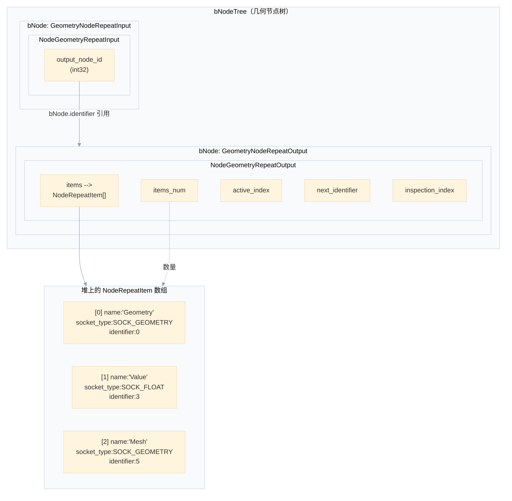
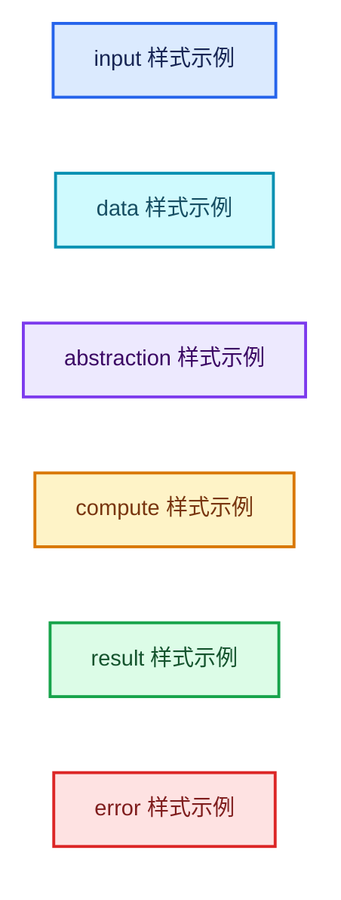
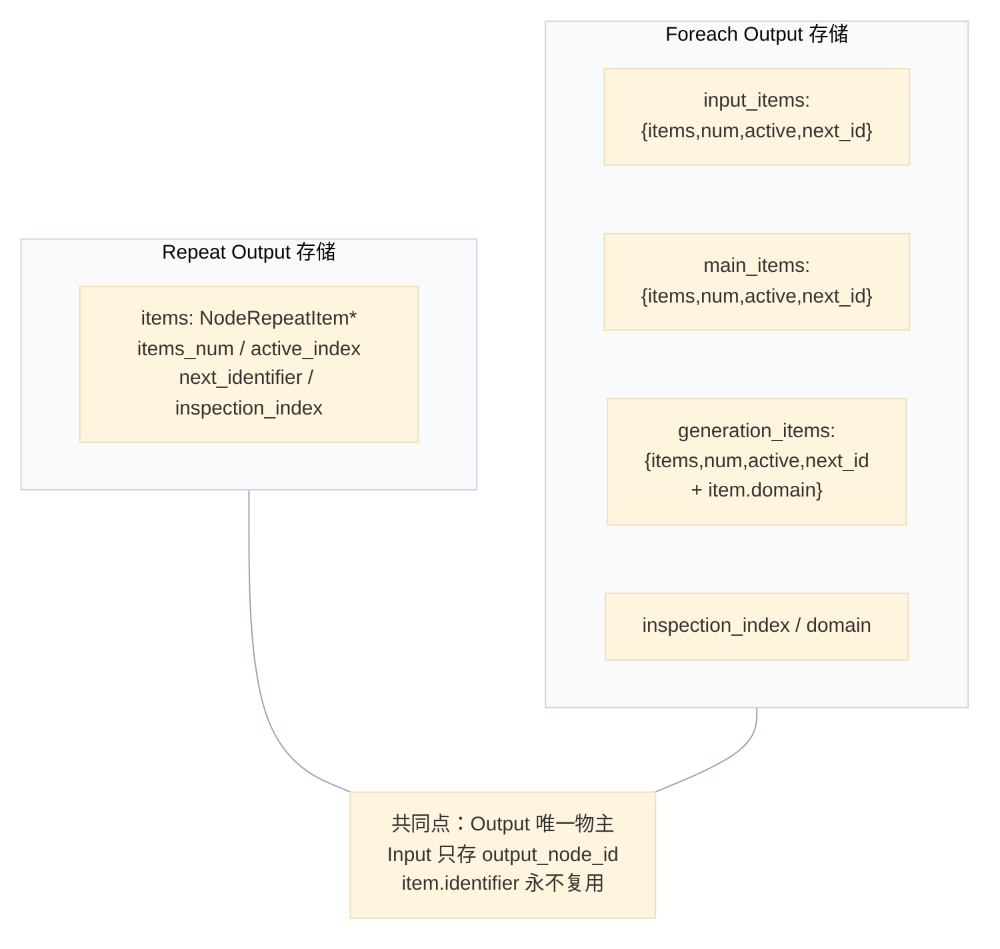
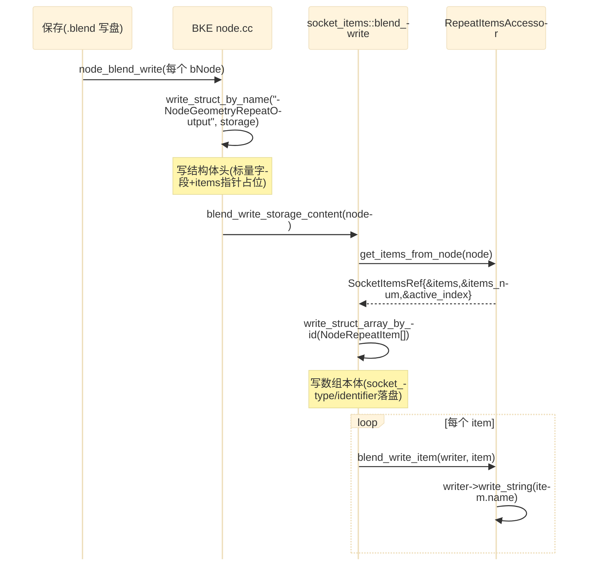
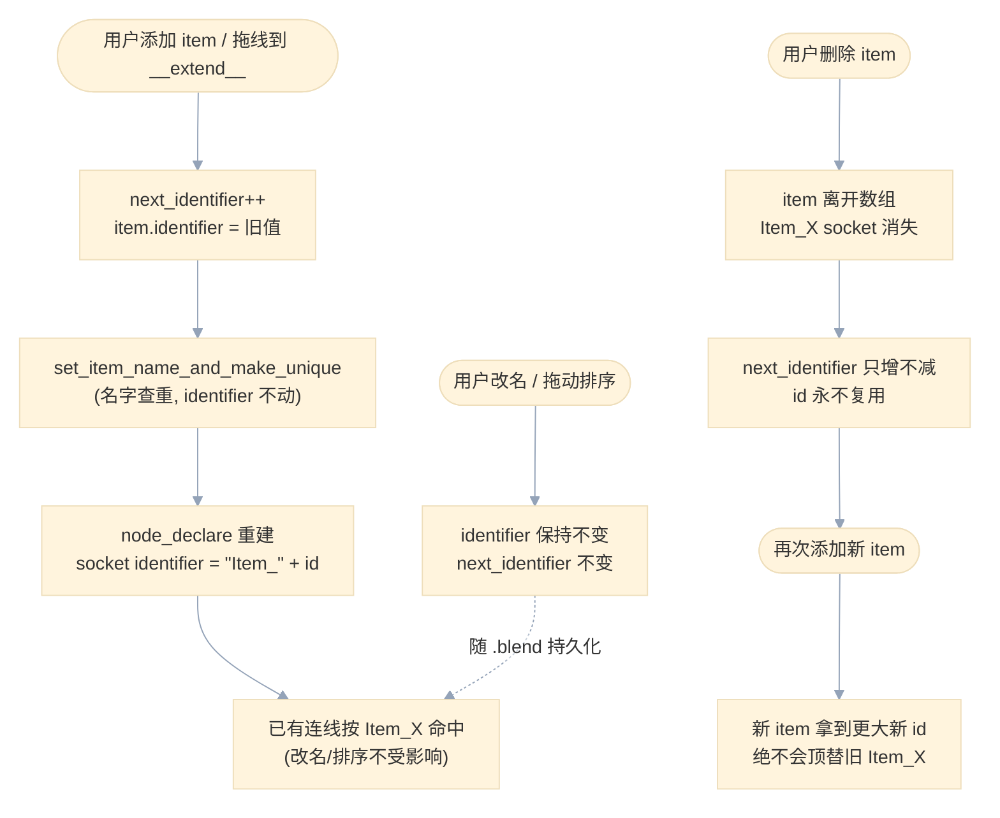
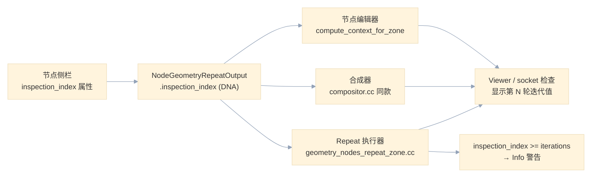
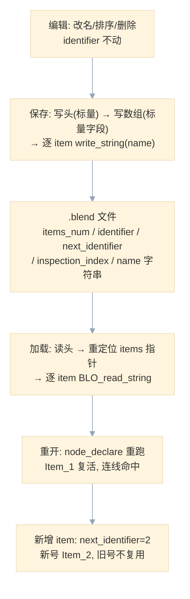

# 02 - DNA 存储与 NodeRepeatItem

<div style="font-family:'Segoe UI','Microsoft YaHei',system-ui,-apple-system,sans-serif;display:flex;flex-wrap:wrap;align-items:center;gap:8px;margin:16px 0 20px;padding:10px 14px;background:#F8FAFC;border:1px solid #E2E8F0;border-radius:12px">
<span style="font-size:11px;font-weight:700;letter-spacing:.1em;color:#64748B;margin-right:2px">导航</span>
<a href="../README.md" style="font-size:13px;color:#334155;background:#F1F5F9;border:1px solid #E2E8F0;border-radius:999px;padding:3px 12px;text-decoration:none;white-space:nowrap">总入口</a>
<a href="./README.md" style="font-size:13px;color:#2563EB;background:#EFF6FF;border:1px solid #BFDBFE;border-radius:999px;padding:3px 12px;text-decoration:none;white-space:nowrap">本章 02-Repeat区域数据模型</a>
<a href="./01-Repeat节点注册与UI.md" style="font-size:13px;color:#2563EB;background:#EFF6FF;border:1px solid #BFDBFE;border-radius:999px;padding:3px 12px;text-decoration:none;white-space:nowrap">‹ Repeat节点注册与UI</a>
<a href="./03-SocketItems通用条目框架.md" style="font-size:13px;color:#7C3AED;background:#F5F3FF;border:1px solid #DDD6FE;border-radius:999px;padding:3px 12px;text-decoration:none;white-space:nowrap">SocketItems通用条目框架 ›</a>
</div>

<div style="font-family:'Segoe UI','Microsoft YaHei',system-ui,-apple-system,sans-serif;margin:18px 0 22px;padding:14px 18px;background:#F5F3FF;border-left:4px solid #7C3AED;border-radius:10px">

**导航行**：[总入口](../README.md) · [本章 README](README.md) · [上一篇](01-Repeat节点注册与UI.md) · [下一篇](03-SocketItems通用条目框架.md)

</div>

> **基准说明**：本文所有源码引用基于本仓库（`D:\Repository\blender-git\blender`）当前工作副本，行号以该副本为准。阅读时建议把源码文件与本文并排打开。文中所有源码链接均以 `../../../` 为前缀，从本文所在目录直接跳到仓库根目录。若你的工作副本与本文行号有少量偏移，请以文件名 + 符号名（如 `NodeRepeatItem`、`RepeatItemsAccessor::init_with_socket_type_and_name`）为锚重新定位。

<hr style="border:none;height:1px;background:linear-gradient(90deg,#BFDBFE,#E2E8F0 55%,transparent);margin:34px 0">

## 先回答一个具体问题

**问题：Repeat 区域的 item 改名、排序、增删之后，为什么已经建立的连接不会断？**

在节点编辑器里你一定做过这些操作：

- 把 Repeat Output 上的 item `Geometry` 改名为 `Mesh`；
- 把第二个 item 拖到第一个 item 前面（排序）；
- 删掉一个 item，再重新添加一个同类型的 item。

做完全部操作之后，之前连到这些 socket 上的线依然是好的（除非你删掉了对应的 item）。这背后的机制是两个层面的"稳定标识"配合工作：

1. **item 层：`identifier` 是一次性分配、永不复用的整数。**
   每个 `NodeRepeatItem` 在创建时从 `NodeGeometryRepeatOutput::next_identifier` 取走一个递增编号（见 [NOD_geo_repeat.hh](../../../source/blender/nodes/geometry/include/NOD_geo_repeat.hh#L79)）：

   ```cpp
   item.identifier = storage->next_identifier++;
   ```

   这个 `identifier` 存在 DNA 里、随 `.blend` 文件持久化，**与 item 在数组中的下标无关，也与 item 的名字无关**。改名改的是 `name`（`char *`），排序改的是数组顺序，都不会碰 `identifier`。

2. **socket 层：socket 的 `identifier` 由 item 的 `identifier` 派生。**
   节点声明动态 socket 时，不是用"第 N 个 socket"这种位置信息，而是用 [NOD_geo_repeat.hh#L83](../../../source/blender/nodes/geometry/include/NOD_geo_repeat.hh#L83)：

   ```cpp
   static std::string socket_identifier_for_item(const NodeRepeatItem &item)
   {
     return "Item_" + std::to_string(item.identifier);
   }
   ```

   也就是说 socket 的标识是 `Item_0`、`Item_3`、`Item_7` 这种字符串。`bNodeLink` 记录的是两端的 socket 标识（而不是 socket 指针或下标）。只要 `identifier` 不变，重算节点声明（`node_declare`）时按同样的 `Item_X` 重建 socket，link 重定位就能命中同一个 socket。

   改名时唯一变化的是 socket 的**显示名**（`name`），通过 `socket_name_ptr`（见 [node_geo_repeat.cc#L93](../../../source/blender/nodes/geometry/nodes/node_geo_repeat.cc#L93)）直接指向 DNA 里 item 的 `name` 字段，socket 显示名跟着 DNA 实时变，但标识不变，所以连接不断。

3. **为什么删除后再加新 item 不会"顶替"旧连接？**
   因为 `next_identifier` 只增不减。删除 identifier 为 3 的 item 后再新建 item，新 item 拿到的是 `next_identifier` 给出的下一个数（比如 8），而不是复用 3。旧的 `Item_3` socket 不再被任何 item 派生出来，其上的连接由节点更新系统按"socket 消失"正常清理，绝不会出现"新 item 意外继承旧 item 连接"的事故。

<div style="font-family:'Segoe UI','Microsoft YaHei',system-ui,-apple-system,sans-serif;margin:16px 0 20px;padding:12px 16px;background:#F0FDF4;border-left:4px solid #16A34A;border-radius:10px">
<div style="font-size:11px;font-weight:700;letter-spacing:.08em;color:#15803D;margin-bottom:6px">一句话记住</div>

**"名字给人看，identifier 给机器用"。** UI 显示层（name）可以随便改，数据层（identifier）一旦分配就冻结，这就是 Repeat 区域（以及整个 socket items 框架家族）保持连接稳定的全部秘密。

</div>

<hr style="border:none;height:1px;background:linear-gradient(90deg,#BFDBFE,#E2E8F0 55%,transparent);margin:34px 0">

## 相关结构与字段总览

三个结构体都定义在 [DNA_node_types.h](../../../source/blender/makesdna/DNA_node_types.h#L3543)。先给逐字段表，再分节精读。

### 表 1：`NodeRepeatItem`（单个重复项）

| 结构 | 字段 | 类型 | 语义 |
| --- | --- | --- | --- |
| `NodeRepeatItem` | `name` | `char *` | item 的显示名，堆上分配（`BLI_strdup`），随 `.blend` 以字符串形式写盘；socket 显示名直接引用它 |
| `NodeRepeatItem` | `socket_type` | `eNodeSocketDatatype` | 该 item 对应的 socket 数据类型（`SOCK_GEOMETRY`、`SOCK_FLOAT`、`SOCK_VECTOR`……） |
| `NodeRepeatItem` | `_pad` | `char[2]` | DNA 对齐填充，保证结构体大小按 4 字节对齐；无语义 |
| `NodeRepeatItem` | `identifier` | `int` | 稳定唯一标识。源码注释原文：*"Generated unique identifier for sockets which stays the same even when the item order or names change."*（[DNA_node_types.h#L3547](../../../source/blender/makesdna/DNA_node_types.h#L3547)） |

### 表 2：`NodeGeometryRepeatInput`（Repeat Input 节点存储）

| 结构 | 字段 | 类型 | 语义 |
| --- | --- | --- | --- |
| `NodeGeometryRepeatInput` | `output_node_id` | `int32_t` | 指向同树内对应 Repeat **Output** 节点的 `bNode.identifier`。源码注释：*"bNode.identifier of the corresponding output node."*（[DNA_node_types.h#L3557](../../../source/blender/makesdna/DNA_node_types.h#L3557)） |

注意：**input 节点自己不存任何 item**。它的动态 socket 完全是"镜像"——`node_declare` 时顺着 `output_node_id` 找到 output 节点，遍历它的 `items` 数组逐个生成对齐的输入/输出 socket（[node_geo_repeat.cc#L80](../../../source/blender/nodes/geometry/nodes/node_geo_repeat.cc#L80)）。这是"单一数据源"设计：item 定义只存在于 output 节点一处。

### 表 3：`NodeGeometryRepeatOutput`（Repeat Output 节点存储，唯一的数据持有者）

| 结构 | 字段 | 类型 | 语义 |
| --- | --- | --- | --- |
| `NodeGeometryRepeatOutput` | `items` | `NodeRepeatItem *` | item 数组首地址（DNA 指针数组，堆上 `MEM_new_array` 分配） |
| `NodeGeometryRepeatOutput` | `items_num` | `int` | item 数量 |
| `NodeGeometryRepeatOutput` | `active_index` | `int` | UI 侧栏中当前选中的 item 下标（仅编辑状态，不参与执行） |
| `NodeGeometryRepeatOutput` | `next_identifier` | `int` | 下一个分配给新 item 的 identifier（单调递增计数器）。源码注释：*"Identifier to give to the next repeat item."* |
| `NodeGeometryRepeatOutput` | `inspection_index` | `int` | 检查器/Viewer 想查看的迭代轮次下标（专节详解） |
| `NodeGeometryRepeatOutput` | `items_span()` | `Span<NodeRepeatItem>` / `MutableSpan` | C++ 便捷方法，把裸指针 + 数量包装成 `Span`（[DNA_node_types.h#L3571](../../../source/blender/makesdna/DNA_node_types.h#L3571)，实现见 [node_geo_repeat.cc#L362](../../../source/blender/nodes/geometry/nodes/node_geo_repeat.cc#L362)） |

### 存储结构图


<div style="font-family:'Segoe UI','Microsoft YaHei',system-ui,-apple-system,sans-serif;margin:-4px 0 24px;padding:8px 14px;background:#F8FAFC;border-left:3px solid #BFDBFE;border-radius:0 8px 8px 0;font-size:13px;color:#64748B">

图 1：Repeat 区域的 DNA 存储结构。数据只有一份，在 Output 节点；Input 节点只存一个引用 id。

</div>

配色约定（本文所有 mermaid 图统一）：


<div style="font-family:'Segoe UI','Microsoft YaHei',system-ui,-apple-system,sans-serif;margin:-4px 0 24px;padding:8px 14px;background:#F8FAFC;border-left:3px solid #BFDBFE;border-radius:0 8px 8px 0;font-size:13px;color:#64748B">

图 2：图例。`input` = 用户/UI 入口；`data` = DNA/持久化数据；`abstraction` = 抽象层（Accessor/框架模板）；`compute` = 计算/执行路径；`result` = 成功结果；`error` = 警告与错误。

</div>

<hr style="border:none;height:1px;background:linear-gradient(90deg,#BFDBFE,#E2E8F0 55%,transparent);margin:34px 0">

## 分节详解

### 1. `NodeRepeatItem`：最小可能的 item

先看完整定义（[DNA_node_types.h#L3543](../../../source/blender/makesdna/DNA_node_types.h#L3543)）：

<details>
<summary>原始源码：NodeRepeatItem（点击展开）</summary>

```cpp
struct NodeRepeatItem {
  char *name = nullptr;
  eNodeSocketDatatype socket_type = {};
  char _pad[2] = {};
  /**
   * Generated unique identifier for sockets which stays the same even when the item order or
   * names change.
   */
  int identifier = 0;
};
```

</details>

**教学注释版：**

```cpp
// [讲解] 一个 Repeat item 就是"一个动态 socket 的 DNA 化描述"。
// 注意它有多小：一个堆上字符串 + 一个枚举 + 一个 int。没有默认值、没有子面板、
// 没有元数据——Repeat 区域的 item 不需要更多东西，因为它只是"这一轮迭代多出
// 哪几个 socket"的声明。
struct NodeRepeatItem {
  // [讲解] 堆上 C 字符串。为什么不存 char[64] 定长数组？
  //   1) DNA 里定长数组会烧死结构体大小，item 数组增大时读写都更贵；
  //   2) 名字长度不受限（中文 item 名、很长的字段名都能放）。
  // 代价是：这个指针指向的内存必须"手动"管理——copy 时 strdup、free 时 delete、
  // blend 写时 write_string、读时 BLO_read_string。这正是后面 blend_write_item /
  // blend_read_data_item 两个回调存在的唯一原因。
  char *name = nullptr;

  // [讲解] socket 的数据类型。eNodeSocketDatatype 是几何节点支持的类型枚举
  // （SOCK_FLOAT、SOCK_GEOMETRY、SOCK_COLLECTION……）。RepeatItemsAccessor 的
  // supports_socket_type 会用节点树类型过滤：几何节点树只支持几何节点可用的类型。
  eNodeSocketDatatype socket_type = {};

  // [讲解] DNA 结构体必须满足 C 层的确定布局；2 字节填充把
  // (8 指针 + 4 枚举 + 4 int) 对齐成 16 字节。手写 _pad 而不是依赖编译器
  // 隐式填充，是为了让 DNA 序列化器看到的布局在所有编译器下完全一致。
  char _pad[2] = {};

  // [讲解] 本文主角。注意注释的三个关键词：
  //   "Generated" —— 不是用户填的，是代码分配的；
  //   "unique"    —— 在同一个 NodeGeometryRepeatOutput 的 items 数组里唯一；
  //   "stays the same even when the item order or names change"
  //               —— 与下标无关、与名字无关，只属于这个 item 的"身份证号"。
  // 它随 .blend 持久化（它是 DNA 字段，不是运行时字段），所以保存/重开文件后
  // 连接依然稳定——identifier 的稳定性跨越了进程生命周期。
  int identifier = 0;
};
```

几个值得咀嚼的细节：

- **`_pad` 为什么要手写？** DNA 工具（`makesdna`）解析结构体布局生成 SDNA 表，手写填充消除编译器差异。同文件里 `NodeForeachGeometryElementInputItem`（[DNA_node_types.h#L3584](../../../source/blender/makesdna/DNA_node_types.h#L3584)）有一模一样的 `char _pad[2]`——这组 item 结构体是同一个模板刻出来的。
- **没有默认值字段。** 对比 `NodeGeometryViewerItem` 之类的结构，有些 item 带 flag；Repeat item 连 flag 都没有，它是该家族里最精简的形态。
- **`identifier` 是 `int` 不是 `int32_t`。** 语义相同，风格统一即可；而 `NodeGeometryRepeatInput::output_node_id` 用了 `int32_t`，因为它是跨结构的"外键"，作者想显式表达位宽契约。

### 2. `NodeGeometryRepeatInput`：只存一个"外键"

```cpp
// [讲解] Input 节点的全部存储。output_node_id 存的是对应 Output 节点的
// bNode.identifier——这是节点在树内的运行期 id（添加节点时分配，保存时持久化）。
// 注意区分三个"id"：
//   bNode.identifier            —— 节点实例 id（output_node_id 存的就是它）
//   bNodeSocket.identifier      —— socket 标识字符串（"Item_0" 等）
//   NodeRepeatItem.identifier   —— item 的整数身份证号（派生出 socket identifier）
// Input 节点拿到 output_node_id 后，在 node_declare 里通过
// tree->node_by_id(storage.output_node_id) 找到 Output 节点，再把它的 items
// 逐个镜像成自己的 socket 对（每个 item 生成一对：zone 输入 + zone 输出）。
```

镜像逻辑在 [node_geo_repeat.cc#L80](../../../source/blender/nodes/geometry/nodes/node_geo_repeat.cc#L80)（Input 节点）与 [node_geo_repeat.cc#L180](../../../source/blender/nodes/geometry/nodes/node_geo_repeat.cc#L180)（Output 节点），两边对每个 item 都调用同一个：

```cpp
const UString identifier(RepeatItemsAccessor::socket_identifier_for_item(item));
auto &input_decl = b.add_input(socket_type, name, identifier)
                       .socket_name_ptr(&tree->id, *RepeatItemsAccessor::item_srna, &item, "name")
```

第三个参数 `identifier` 就是 `"Item_X"` 字符串——**socket 的稳定身份在这里落地**。而 `.socket_name_ptr(...)` 把 socket 的显示名绑定到 item 的 `name` 字段：改名时 DNA 里的字符串变了，socket 显示名自动跟随，无需重建声明。

为什么 Input 节点不存一份 items 拷贝？因为 item 定义必须只有一个权威来源，两份拷贝就要面对"谁来同步、冲突听谁的"的经典问题。Repeat 区域从第一天起就选择了单向引用：**Output 是主，Input 是影子。**

### 3. `NodeGeometryRepeatOutput`：唯一的物主

```cpp
// [讲解] Output 节点存储承担了所有状态：
//   items/items_num   —— DNA 动态数组（指针 + 计数，DNA 的标准动态数组形态）
//   active_index      —— UI 选中态。注意它是"下标"不是 identifier！因为它只
//                        服务编辑 UI（侧栏里选中第几行），数组重排时 UI 会自己
//                        调整；它不需要跨排序稳定，所以用下标即可。
//   next_identifier   —— identifier 发号器。只增不减，永不回退。
//   inspection_index  —— 检查轮次（专节详解）。
// items_span() 是 C++ 侧糖：把 (items, items_num) 包成 Span，调用处不用
// 手动传两个值。它定义在 #ifdef __cplusplus 里，因为 DNA 结构体在 C 侧
// 也要能编译，Span 是 C++ 才有的。
```

### 4. 与 Foreach 的存储设计对比

Foreach 区域的结构体在同文件紧随其后（[DNA_node_types.h#L3577](../../../source/blender/makesdna/DNA_node_types.h#L3577)）。先看原始定义：

<details>
<summary>原始源码：Foreach 区域存储结构（点击展开）</summary>

```cpp
struct NodeGeometryForeachGeometryElementInput {
  DNA_DEFINE_CXX_METHODS(NodeGeometryForeachGeometryElementInput)

  /** bNode.identifier of the corresponding output node. */
  int32_t output_node_id = 0;
};

struct NodeForeachGeometryElementInputItem {
  char *name = nullptr;
  eNodeSocketDatatype socket_type = {};
  char _pad[2] = {};
  /** Generated identifier that stays the same even when the name or order changes. */
  int identifier = 0;
};

struct NodeForeachGeometryElementMainItem {
  char *name = nullptr;
  eNodeSocketDatatype socket_type = {};
  char _pad[2] = {};
  /** Generated identifier that stays the same even when the name or order changes. */
  int identifier = 0;
};

struct NodeForeachGeometryElementGenerationItem {
  char *name = nullptr;
  eNodeSocketDatatype socket_type = {};
  /** #AttrDomain. */
  uint8_t domain = 0;
  char _pad[1] = {};
  /** Generated identifier that stays the same even when the name or order changes. */
  int identifier = 0;
};

struct NodeForeachGeometryElementInputItems {
  DNA_DEFINE_CXX_METHODS(NodeForeachGeometryElementInputItems)

  NodeForeachGeometryElementInputItem *items = nullptr;
  int items_num = 0;
  int active_index = 0;
  int next_identifier = 0;
  char _pad[4] = {};
};

struct NodeForeachGeometryElementMainItems {
  DNA_DEFINE_CXX_METHODS(NodeForeachGeometryElementMainItems)

  NodeForeachGeometryElementMainItem *items = nullptr;
  int items_num = 0;
  int active_index = 0;
  int next_identifier = 0;
  char _pad[4] = {};
};

struct NodeForeachGeometryElementGenerationItems {
  DNA_DEFINE_CXX_METHODS(NodeForeachGeometryElementGenerationItems)

  NodeForeachGeometryElementGenerationItem *items = nullptr;
  int items_num = 0;
  int active_index = 0;
  int next_identifier = 0;
  char _pad[4] = {};
};

struct NodeGeometryForeachGeometryElementOutput {
  DNA_DEFINE_CXX_METHODS(NodeGeometryForeachGeometryElementOutput)

  /**
   * The `foreach` zone has three sets of dynamic sockets.
   * One on the input node and two on the output node.
   * All settings are stored centrally in the output node storage though.
   */
  NodeForeachGeometryElementInputItems input_items;
  NodeForeachGeometryElementMainItems main_items;
  NodeForeachGeometryElementGenerationItems generation_items;
  /** This index is used when displaying socket values or using the viewer node. */
  int inspection_index = 0;
  /** #AttrDomain. This is the domain that is iterated over. */
  uint8_t domain = 0;
  char _pad[3] = {};
};
```

</details>

**异同总结表：**

| 维度 | Repeat | Foreach Geometry Element |
| --- | --- | --- |
| item 结构体 | 一个：`NodeRepeatItem` | 三个：Input/Main/Generation item（Generation item 额外带 `domain`） |
| item 数组归属 | Output 节点存储的裸字段 `items/items_num/...` | 嵌套三个"items 容器结构体"（`input_items` / `main_items` / `generation_items`） |
| 数组管理方式 | 指针 + 数量散在存储顶层，由 `RepeatItemsAccessor::get_items_from_node` 聚合成 `SocketItemsRef` | 同样的指针 + 数量，但封装在嵌套结构体里，Accessor 直接返回指向嵌套成员的 ref |
| Input 节点 | 只存 `output_node_id`，socket 全靠镜像 | 同样只存 `output_node_id` |
| identifier 语义 | `Item_X`，与名字/顺序无关，同注释 | 完全相同的注释与语义；socket 标识同样按 identifier 派生 |
| `inspection_index` | 有（Output 顶层字段） | 有（Output 顶层字段，注释明确说 *"used when displaying socket values or using the viewer node"*） |
| 额外迭代配置 | 无（每轮独立执行 body） | 有：`domain`（迭代属性域） |

**设计异同要点：**

1. **同**：两者都遵守"Output 是唯一物主、Input 只存 `output_node_id` 外键、item 带永不复用的 `identifier`"三件套。注释几乎逐字相同——这是整个 zone 家族刻意统一的约定，后来者（Closure、Bundle 等，见 [DNA_node_types.h#L3658 起](../../../source/blender/makesdna/DNA_node_types.h#L3658)）也延续了这个模式。
2. **异（结构形态）**：Repeat 把数组字段平铺在存储顶层（只有一组 socket 集）；Foreach 有三组动态 socket，于是把每组抽成嵌套结构体。嵌套结构体本质只是"给一组 (items, items_num, active_index, next_identifier) 起个名字"，没有运行时开销。
3. **异（item 复杂度）**：Foreach 的 Generation item 多一个 `domain`（`#AttrDomain`），因为 generation 输出是"按域逐元素生成的属性"，必须记录在哪个域上。这提示我们：**item 结构体按 zone 的语义需求增删字段，但 `identifier` 这个字段永不变。**

### 对比图


<div style="font-family:'Segoe UI','Microsoft YaHei',system-ui,-apple-system,sans-serif;margin:-4px 0 24px;padding:8px 14px;background:#F8FAFC;border-left:3px solid #BFDBFE;border-radius:0 8px 8px 0;font-size:13px;color:#64748B">

图 3：Repeat 与 Foreach 存储形态对比。Repeat 一组 items 平铺；Foreach 三组嵌套；共同约定一致。

</div>

<hr style="border:none;height:1px;background:linear-gradient(90deg,#BFDBFE,#E2E8F0 55%,transparent);margin:34px 0">

## 持久化路径：blend write/read 全链路

### 4.1 节点侧的注册：回调挂在哪里

[node_geo_repeat.cc#L299](../../../source/blender/nodes/geometry/nodes/node_geo_repeat.cc#L299)：

<details>
<summary>原始源码：node_blend_write / node_blend_read（点击展开）</summary>

```cpp
static void node_blend_write(const bNodeTree & /*tree*/, const bNode &node, BlendWriter &writer)
{
  socket_items::blend_write<RepeatItemsAccessor>(&writer, node);
}

static void node_blend_read(bNodeTree & /*tree*/, bNode &node, BlendDataReader &reader)
{
  socket_items::blend_read_data<RepeatItemsAccessor>(&reader, node);
}
```

</details>

```cpp
// [讲解] 这两个静态函数只在 node_register 里被挂到节点类型上：
//   ntype.blend_write_storage_content = node_blend_write;
//   ntype.blend_data_read_storage_content = node_blend_read;
// （见 node_geo_repeat.cc 的 node_register，L334-L335。）
// 函数体薄到只剩一行模板调用——真正的知识都在 RepeatItemsAccessor 里。
// 注意：只有 Output 节点注册了这两个回调；Input 节点的存储里只有
// 一个 int32，没有指针成员，DNA 结构体直读直写即可，不需要额外回调。
```

### 4.2 谁来调用这两个回调：BKE 层

写盘侧 [node.cc#L1322](../../../source/blender/blenkernel/intern/node.cc#L1322)：

```cpp
// [讲解] BKE 层的通用节点写盘逻辑：
//   第一步：把 node->storage 指向的结构体本体写进去（按 storagename 找 SDNA）。
//           对 Repeat Output，storagename == "NodeGeometryRepeatOutput"，
//           写的是那个 20 字节的头（items 指针此时写成"后面还有数据"的占位）。
//   第二步：如果节点类型注册了 blend_write_storage_content，就调用它。
//           这一步负责"深的部分"——item 数组本体 + 每个 item 的 name 字符串。
// 两步合起来才是完整的存储。缺了第二步，items 指针读回来就是野指针。
```

读盘侧 [node.cc#L1998](../../../source/blender/blenkernel/intern/node.cc#L1998)：

```cpp
// [讲解] 读盘对称：
//   第一步：BLO_read_struct_by_name_array 按 storagename 读回结构体本体，
//           items 指针此时是"待重定位的地址"。
//   第二步：调用 blend_data_read_storage_content，把数组本体读回来、
//           修正 items 指针、读回每个 item 的 name 字符串。
// 顺序不能反：必须先有结构体头（才知道 items_num 是多少），才能读数组。
```

### 4.3 框架层：socket_items::blend_write / blend_read_data

[NOD_socket_items_blend.hh](../../../source/blender/nodes/NOD_socket_items_blend.hh#L17) 全文只有 38 行，是"模板 + Accessor"威力的最佳展品：

<details>
<summary>原始源码：socket_items::blend_write / blend_read_data（点击展开）</summary>

```cpp
template<typename Accessor> inline void blend_write(BlendWriter *writer, const bNode &node)
{
  using ItemT = typename Accessor::ItemT;
  const SocketItemsRef<ItemT> items = Accessor::get_items_from_node(const_cast<bNode &>(node));
  writer->write_struct_array_by_id(
      dna::sdna_struct_id_get<ItemT>(), *items.items_num, *items.items);
  for (const ItemT &item : Span(*items.items, *items.items_num)) {
    Accessor::blend_write_item(writer, item);
  }
}

template<typename Accessor> inline void blend_read_data(BlendDataReader *reader, bNode &node)
{
  using ItemT = typename Accessor::ItemT;
  const SocketItemsRef<ItemT> items = Accessor::get_items_from_node(node);
  BLO_read_array_and_validate_size(reader, items.items, items.items_num);
  for (ItemT &item : MutableSpan(*items.items, *items.items_num)) {
    Accessor::blend_read_data_item(reader, item);
  }
}
```

</details>

```cpp
// [讲解] 逐行拆解 blend_write：
// 1) Accessor::get_items_from_node(node) 拿到 SocketItemsRef{&items, &items_num,
//    &active_index}。注意是"三个指针的指针"——框架不关心数组存在存储的哪个
//    字段里，Repeat 在顶层、Foreach 在嵌套结构体里，都能适配。
// 2) write_struct_array_by_id(sdna_id, num, items) 把整个 item 数组按 SDNA
//    结构 id 写盘。数组里每个 NodeRepeatItem 的标量字段（socket_type、
//    identifier）随这一步全部落盘。
// 3) 再逐 item 调 Accessor::blend_write_item——这是留给节点作者的"深拷贝钩子"。
//    对 Repeat item，唯一的深数据就是 name 字符串。
//
// blend_read_data 对称：
// 1) BLO_read_array_and_validate_size 读回数组本体并重定位 items 指针，
//    同时校验读到的数量与 items_num 一致（防文件损坏）。
// 2) 逐 item 调 blend_read_data_item 修复堆上指针（name）。
// 注意：模板只处理"数组 + 每项钩子"，没有任何 Repeat 特有代码。
// Simulation/Viewer/Bake/Repeat/Foreach……全部共用这 38 行。
```

### 4.4 item 层钩子：blend_write_item / blend_read_data_item

[node_geo_repeat.cc#L350](../../../source/blender/nodes/geometry/nodes/node_geo_repeat.cc#L350)：

<details>
<summary>原始源码：RepeatItemsAccessor::blend_write_item / blend_read_data_item（点击展开）</summary>

```cpp
void RepeatItemsAccessor::blend_write_item(BlendWriter *writer, const ItemT &item)
{
  writer->write_string(item.name);
}

void RepeatItemsAccessor::blend_read_data_item(BlendDataReader *reader, ItemT &item)
{
  BLO_read_string(reader, &item.name);
}
```

</details>

```cpp
// [讲解] 每个	item 落盘时需要"额外"处理的就是这个堆上字符串：
//   写：writer->write_string(item.name) —— 把字符串内容写进 blend 块。
//   读：BLO_read_string(reader, &item.name) —— 分配新内存、拷入内容、
//       让 item.name 指向它。
// identifier、socket_type 这些标量不需要钩子——第 4.3 节的数组整体写读
// 已经覆盖了。这就是为什么钩子签名按"单个 item"设计：框架做完大头，
// 节点作者只补尾。
```

### 4.5 全链路时序图


<div style="font-family:'Segoe UI','Microsoft YaHei',system-ui,-apple-system,sans-serif;margin:-4px 0 24px;padding:8px 14px;background:#F8FAFC;border-left:3px solid #BFDBFE;border-radius:0 8px 8px 0;font-size:13px;color:#64748B">

图 4：blend 写盘时序。三层各司其职：BKE 写头、框架写数组、Accessor 写字符串。

</div>

读盘对称（方向反过来，`blend_read_data` 用 `BLO_read_array_and_validate_size` 重定位 `items` 指针，`BLO_read_string` 重建 `name`），不再重复画。

### 4.6 内存管理三兄弟：free / copy / init

[node_geo_repeat.cc#L209](../../../source/blender/nodes/geometry/nodes/node_geo_repeat.cc#L209)：

<details>
<summary>原始源码：node_init / node_free_storage / node_copy_storage（Output 节点，点击展开）</summary>

```cpp
static void node_init(bNodeTree *tree, bNode *node)
{
  NodeGeometryRepeatOutput *data = MEM_new<NodeGeometryRepeatOutput>(__func__);

  data->next_identifier = 0;

  if (tree->type == NTREE_GEOMETRY) {
    data->items = MEM_new_array<NodeRepeatItem>(1, __func__);
    data->items[0].name = BLI_strdup(DATA_("Geometry"));
    data->items[0].socket_type = SOCK_GEOMETRY;
    data->items[0].identifier = data->next_identifier++;
    data->items_num = 1;
  }

  node->storage = data;
}

static void node_free_storage(bNode *node)
{
  socket_items::destruct_array<RepeatItemsAccessor>(*node);
  MEM_delete(reinterpret_cast<NodeGeometryRepeatOutput *>(node->storage));
}

static void node_copy_storage(bNodeTree * /*dst_tree*/, bNode *dst_node, const bNode *src_node)
{
  const NodeGeometryRepeatOutput &src_storage = node_storage(*src_node);
  auto *dst_storage = MEM_new<NodeGeometryRepeatOutput>(__func__, dna::shallow_copy(src_storage));
  dst_node->storage = dst_storage;

  socket_items::copy_array<RepeatItemsAccessor>(*src_node, *dst_node);
}
```

</details>

```cpp
// [讲解] node_init（新建 Output 节点时的默认状态）：
//   - next_identifier 从 0 开始；
//   - 几何节点树里默认给 1 个 Geometry item，identifier 拿到 0，
//     同时 next_identifier 自增到 1——从此这个计数器只前进。
//   - 注意 if (tree->type == NTREE_GEOMETRY)：非几何树（如着色器树，
//     Repeat 也在其中可用）不建默认 item。

// [讲解] node_free_storage：
//   先 destruct_array：对每个 item 调 Accessor::destruct_item（free name），
//   再释放数组本身；最后 MEM_delete 存储结构体。两步缺一不可：
//   只 delete 数组会泄漏 name；只 delete 结构体则数组指针悬空且数组泄漏。

// [讲解] node_copy_storage（复制节点，如 Ctrl+C/V 或文件内 duplicate）：
//   第一步 dna::shallow_copy(src_storage) —— 按位拷贝整个结构体头。
//     这意味着 dst_storage->items 此刻与 src_storage->items 指向同一块数组！
//     shallow copy 的语义就是"结构体复制，数组共享"。
//   第二步 socket_items::copy_array —— 立刻补上深拷贝：
//     为 dst 新分配数组，逐 item 调 Accessor::copy_item
//     （dst = src; dst.name = BLI_strdup_null(dst.name)，见 NOD_geo_repeat.hh L43-L47），
//     然后把 dst_storage->items 指向新数组。
//   两步合起来才是完整深拷贝。这个"先浅后深"的两段式是 DNA 存储复制的
//   通用模式：结构体里裸指针字段一律不允许默认拷贝构造负责。
```

**关键点：identifier 在复制时的行为。** `copy_item` 是 `dst = src` 的位拷贝 + strdup 名字——**identifier 会被原样复制**。也就是说复制出的 Output 节点上的 item 与原节点的 item 拥有相同的 `Item_X`。这没有问题：socket identifier 只需要在**同一棵树、同一个节点的 items 数组**内唯一；两个独立节点的 socket 各自寻址，互不冲突。但两个节点的 `next_identifier` 也都被复制了，各自独立发号——从此两个节点的编号序列各自演化。

### 4.7 DNA_array_utils 与"浅拷贝结构体、深拷贝数组"的语义

动态数组的增删移动由 [DNA_array_utils.hh](../../../source/blender/makesdna/DNA_array_utils.hh) 提供，它是纯 DNA 层的工具（不知道 socket items 的存在）：

<details>
<summary>原始源码：dna::array::remove_index（点击展开）</summary>

```cpp
template<typename T>
inline void remove_index(
    T **items, int *items_num, int *active_index, const int index, void (*destruct_item)(T *))
{
  static_assert(std::is_trivially_copyable_v<T>);
  BLI_assert(index >= 0);
  BLI_assert(index < *items_num);

  const int old_items_num = *items_num;
  const int new_items_num = old_items_num - 1;

  T *old_items = *items;
  T *new_items = MEM_new_array<T>(new_items_num, __func__);

  std::copy_n(old_items, index, new_items);
  std::copy_n(old_items + index + 1, old_items_num - index - 1, new_items + index);

  destruct_item(&old_items[index]);
  MEM_delete(old_items);

  *items = new_items;
  *items_num = new_items_num;

  if (active_index) {
    const int old_active_index = active_index ? *active_index : 0;
    const int new_active_index = std::max(
        0, old_active_index == new_items_num ? new_items_num - 1 : old_active_index);
    *active_index = new_active_index;
  }
}
```

</details>

```cpp
// [讲解] 为什么 DNA 数组的"删除一个元素"是分配新数组而不是 memmove？
// 1) DNA 结构体语言层面必须 trivial（std::is_trivial_v，见文件头注释），
//    但语义上可能持堆指针（name）。删除前必须先对被删项调 destruct_item
//    释放 name，再缩小数组。
// 2) 分配新数组 + 分段拷贝是最简单且不会写坏旧内存的方案；items_num 通常
//    很小（个位数到几十），性能无所谓。
// 3) active_index 的收尾修正很人性化：如果删掉的正是选中项，选中项前移；
//    用 std::max(0, ...) 防止数组删空后 active_index 变负。
```

而 `dna::shallow_copy` 的准确定义在 [DNA_defs.h#L136](../../../source/blender/makesdna/DNA_defs.h#L136)：

```cpp
// [讲解] dna::shallow_copy(other) 返回一个包装器，赋值时走
// DNA_DEFINE_CXX_METHODS 宏生成的特殊构造/赋值函数（DNA_defs.h L112-L124），
// 本质是 _DNA_internal_memcpy(this, ref.get_pointer(), sizeof(class_name))——
// 整个对象按位复制。
// 语义总结（也是本节标题）：
//   shallow copy 结构体 = 结构体的所有标量字段 + 所有指针字段的"值"被复制
//                        （指针仍指向旧内存，数组共享）。
//   数组由 copy_array 深拷贝 = 框架随后新分配数组、逐 item strdup 名字、
//                             把指针改指新数组（所有权转移完成）。
// 之所以需要这个机制：DNA 结构体禁用了普通拷贝构造/赋值
// （DNA_DEFINE_CXX_METHODS 里 = delete），就是防止有人无意间浅拷贝后
// 双重释放。shallow_copy 是显式的、自觉的逃生门，用完必须马上补深拷贝。
```

### 4.8 add_item 的数组扩容

添加 item 的底层是 [NOD_socket_items.hh#L194](../../../source/blender/nodes/NOD_socket_items.hh#L194) 的 `detail::add_item_to_array`：

```cpp
// [讲解] 与 remove_index 同样的"新数组 + 拷贝"策略，方向相反：
//   old_items -> new_items(num+1)，末尾腾出的格子就是新 item。
//   active_index 被设为旧数量（即新 item 的下标）——新加的 item 自动选中。
// 上层 add_item_with_socket_type_and_name（L224-L245）随后调
// Accessor::init_with_socket_type_and_name 填类型与名字，
// identifier 就在这一步由 next_identifier++ 发放（见下一节）。
```

<hr style="border:none;height:1px;background:linear-gradient(90deg,#BFDBFE,#E2E8F0 55%,transparent);margin:34px 0">

## identifier 生命周期

这是本章的第二主题。把 identifier 从生到死（其实是"生到永远"）完整过一遍。

### 5.1 分配：`init_with_socket_type_and_name`

[NOD_geo_repeat.hh#L72](../../../source/blender/nodes/geometry/include/NOD_geo_repeat.hh#L72)：

<details>
<summary>原始源码：init_with_socket_type_and_name（点击展开）</summary>

```cpp
static void init_with_socket_type_and_name(bNode &node,
                                           NodeRepeatItem &item,
                                           const eNodeSocketDatatype socket_type,
                                           const char *name)
{
  auto *storage = static_cast<NodeGeometryRepeatOutput *>(node.storage);
  item.socket_type = socket_type;
  item.identifier = storage->next_identifier++;
  socket_items::set_item_name_and_make_unique<RepeatItemsAccessor>(node, item, name);
}
```

</details>

```cpp
// [讲解] 三行各干一件事：
// 1) 填类型；
// 2) 发号：post-increment 意味着 item 拿到旧值、计数器前进——多个 item
//    依次创建会拿到连续编号 3、4、5……
// 3) 名字去重：set_item_name_and_make_unique（NOD_socket_items.hh L149-L190）
//    保证同数组内名字唯一（重名会追加 ".001" 之类后缀）。
//    注意去重的是"名字"不是 identifier——identifier 由计数器保证唯一，
//    根本不需要查重。
```

`set_item_name_and_make_unique` 的内部值得一提（[NOD_socket_items.hh#L149](../../../source/blender/nodes/NOD_socket_items.hh#L149)）：空名字回退为类型标签（如 `Geometry`），随后 `BLI_uniquename_cb` 扫描同数组其他 item 查重，最后 `MEM_SAFE_DELETE(*item_name); *item_name = BLI_strdup(...)` 换掉堆字符串。**整个过程不碰 identifier**。

### 5.2 消费：`socket_identifier_for_item`

```cpp
// [讲解] identifier 的唯一消费方式是变成 socket 标识字符串 "Item_X"：
//   - node_declare 时传给 b.add_input/add_output 的第三参数
//     （node_geo_repeat.cc L91-L92、L188-L189）；
//   - try_add_item_via_extend_socket 把拖到 __extend__ 虚 socket 上的连线
//     改指向 bke::node_find_socket(node, SOCK_IN, "Item_X")（NOD_socket_items.hh
//     L367-L379）——新 item 的 socket 在声明更新后立刻按 identifier 找到，
//     连线无缝改挂；
//   - find_item_by_identifier（NOD_socket_items.hh L75-L87）反向查找：
//     拿着 "Item_5" 遍历 items 比对 socket_identifier_for_item，
//     用于 RNA/操作符从 socket 定位 item。
```

### 5.3 为何不能复用已删除 item 的 id

假设允许复用，用户经历：

1. item `Value`（`Item_3`）连着一条线；
2. 删除 `Value` —— 数组里没有 identifier 3 了，socket `Item_3` 消失，节点更新系统删除其上的连线（或标记失效）；
3. 新建一个 float item，若复用 3 —— 新 item 名字叫 `Value2`，socket 标识 `Item_3`；
4. 灾难场景 A：**撤销（undo）**。Blender 的撤销是快照式/增量式的，节点声明重建（`node_declare` 重新跑）后 `Item_3` socket 复活——但这次它是 `Value2` 的。任何持有"指向 Item_3"的旧数据（日志、viewer 缓存、脚本引用）都会指向语义完全不同的 socket。
5. 灾难场景 B：**同屏多视图/延迟声明**。两个 UI 或执行路径在不同时刻读到 items 数组，一个看到旧数组（有 Item_3 = Value）一个看到新数组（Item_3 = Value2），identifier 不再是可靠锚点。

不复用之后：`Item_3` 一旦消失就永远消失，任何时刻 identifier → item 的映射要么唯一要么不存在，没有"借尸还魂"。

### 5.4 生命周期图


<div style="font-family:'Segoe UI','Microsoft YaHei',system-ui,-apple-system,sans-serif;margin:-4px 0 24px;padding:8px 14px;background:#F8FAFC;border-left:3px solid #BFDBFE;border-radius:0 8px 8px 0;font-size:13px;color:#64748B">

图 5：identifier 生命周期。出生即发号、一生不改、死后号不作废。

</div>

### 5.5 版本兼容：旧文件如何回填 identifier

`next_identifier` 的存在还有一层"考古"意义：老版本 Blender 的存储结构里没有 identifier 字段或计数器，加载旧文件时必须**回填**。仓库里能看到标准做法：

**范例 1**：[versioning_402.cc#L1243](../../../source/blender/blenloader/intern/versioning_402.cc#L1243)（Capture Attribute 节点，模式与 Repeat 同源）：

```cpp
// [讲解] 版本化代码的标准姿势：
//   if (!MAIN_VERSION_FILE_ATLEAST(bmain, 402, 50)) —— 只对"老于 4.2.50"的
//     文件执行，新文件绝不重复处理；
//   if (storage->next_identifier > 0) continue —— 幂等保护：计数器已经
//     说明数据是新的，跳过；
//   然后手工重建 items、逐个 item.identifier = storage->next_identifier++
//     重新发号、BLI_strdup("Value") 补名字。
// 对 Repeat item 家族而言，identifier 字段从引入起就随结构体存在，
// 所以 Repeat 本身没有专门的 identifier 回填代码；但这个"检查计数器
// 判断新旧 + 重新发号"的范式适用于所有 socket items 节点。
```

**范例 2**：[versioning_500.cc#L2399](../../../source/blender/blenloader/intern/versioning_500.cc#L2399)（Viewer 节点 item 重建，结尾显式 `storage->next_identifier = 2;`）：

```cpp
// [讲解] 另一种形态：直接重建固定两个 item，identifier 硬编码 0 和 1，
// 最后把 next_identifier 拨到 2——发号器状态必须与新发出去的最大号一致，
// 否则下一个新 item 会与既有 item 撞号。这是手写版本化代码时最容易漏的一行。
```

**范例 3**：Repeat 自身在版本化里的存在感——[versioning_500.cc#L4445](../../../source/blender/blenloader/intern/versioning_500.cc#L4445)：

```cpp
// [讲解] 5.1.4 版本化把 GeometryNodeRepeatInput/Output 列入 no_muting_nodes，
// 清除旧文件里这两个节点上的 NODE_MUTED 标志——因为节点注册时设了
// ntype.no_muting = true（node_geo_repeat.cc L161/L331），Repeat 区域节点
// 不支持静音，旧文件的静音标志属于无效状态，加载时清掉。
// 这不是 identifier 回填，但它是 Repeat 节点在 blenloader 里出现的典型场景：
// 版本化处理的是"结构性/合法性"问题，而不是业务数据。
```

<hr style="border:none;height:1px;background:linear-gradient(90deg,#BFDBFE,#E2E8F0 55%,transparent);margin:34px 0">

## inspection_index 专节

### 6.1 它是什么

`NodeGeometryRepeatOutput::inspection_index`（[DNA_node_types.h#L3569](../../../source/blender/makesdna/DNA_node_types.h#L3569)）是一个 `int`，语义为：**"当用户用 Viewer 节点或 socket 检查器观察 Repeat 区域内部时，显示第几轮迭代的结果。"** 迭代从 0 计数；`0` 是默认值，表示"看第 0 轮"。

RNA 定义在 [rna_nodetree.cc#L8087](../../../source/blender/makesrna/intern/rna_nodetree.cc#L8087)：

```cpp
// [讲解] UI 文案原文："Iteration index that is used by inspection features
// like the viewer node or socket inspection"。属性更新走 rna_Node_update，
// 改它会导致节点树重算——因为不同的 inspection_index 对应不同的
// ComputeContext，缓存必须区分开（见 6.2）。
```

### 6.2 所有用武之地（grep `inspection_index` 全景）

| 位置 | 角色 |
| --- | --- |
| [DNA_node_types.h#L3569](../../../source/blender/makesdna/DNA_node_types.h#L3569) / [L3652](../../../source/blender/makesdna/DNA_node_types.h#L3652) | Repeat 与 Foreach 各存一份 |
| [node_geo_repeat.cc#L65](../../../source/blender/nodes/geometry/nodes/node_geo_repeat.cc#L65) | UI 暴露：`layout.prop(&output_node_ptr, "inspection_index", ...)`，画在 Repeat Input/Output 节点侧栏 |
| [node_geo_foreach_geometry_element.cc#L101](../../../source/blender/nodes/geometry/nodes/node_geo_foreach_geometry_element.cc#L101) | Foreach 同款 UI |
| [geometry_nodes_repeat_zone.cc#L216](../../../source/blender/nodes/intern/geometry_nodes_repeat_zone.cc#L216) | 执行时越界警告 |
| [space_node.cc#L462](../../../source/blender/editors/space_node/space_node.cc#L462) | 节点编辑器构造 zone 的 ComputeContext 时把 inspection_index 编入上下文 |
| [compositor.cc#L740](../../../source/blender/blenkernel/intern/compositor.cc#L740) | 合成器后端同理，为 Repeat 区域内 viewer 构造带 inspection_index 的上下文 |
| [rna_nodetree.cc#L8087](../../../source/blender/makesrna/intern/rna_nodetree.cc#L8087) / [L8321](../../../source/blender/makesrna/intern/rna_nodetree.cc#L8321) | Repeat 与 Foreach 的 RNA 属性定义 |

### 6.3 越界警告

[geometry_nodes_repeat_zone.cc#L210](../../../source/blender/nodes/intern/geometry_nodes_repeat_zone.cc#L210)：

<details>
<summary>原始源码：Inspection index is out of range（点击展开）</summary>

```cpp
    if (iterations >= 10) {
      /* Constructing and running the repeat zone has some overhead so that it's probably worth
       * trying to do something else in the meantime already. */
      lazy_threading::send_hint();
    }

    /* Show a warning when the inspection index is out of range. */
    if (node_storage.inspection_index > 0) {
      if (node_storage.inspection_index >= iterations) {
        if (eval_log::NodeTreeLogger *tree_logger = local_user_data.try_get_tree_logger(user_data))
        {
          tree_logger->node_warnings.append(
              *tree_logger->allocator,
              {repeat_output_bnode_.identifier,
               {NodeWarningType::Info, N_("Inspection index is out of range")}});
        }
      }
    }
```

</details>

```cpp
// [讲解] 三层条件缺一不可：
// 1) inspection_index > 0 —— 默认值 0（看第 0 轮）永远不警告；只有用户
//    主动调大过才检查。0 也不该对"0 轮迭代"警告吗？看下面。
// 2) inspection_index >= iterations —— 实际迭代次数不够才警告。
//    注意条件是 >=：index 与 iterations 相等时那一轮根本不存在
//    （0 轮迭代时任何 >0 的 index 都越界）。
// 3) try_get_tree_logger —— 只有存在执行日志记录器（编辑器触发的求值）
//    才记录；后台/渲染路径没必要。
// 警告级别是 Info 不是 Error——它不阻止执行，只是提示"你检查的轮次
// 没跑过，Viewer 不会显示数据"。
```

### 6.4 为什么 inspection_index 要参与 ComputeContext

[space_node.cc#L462](../../../source/blender/editors/space_node/space_node.cc#L462)：

```cpp
// [讲解] 每个逻辑执行上下文（同一 zone 的第几轮迭代）都有自己的
// ComputeContext 哈希。viewer 的中间结果按上下文哈希 + 节点 id 存放。
// 如果 inspection_index 不参与哈希，"第 2 轮的 viewer 结果"和
// "第 5 轮的 viewer 结果"会撞进同一个缓存槽——改 inspection_index
// 看到的还是旧轮次的脏数据。编入上下文后，每轮结果各归其位，
// 来回切换 inspection_index 都能命中正确缓存。
```

### inspection 数据流图


<div style="font-family:'Segoe UI','Microsoft YaHei',system-ui,-apple-system,sans-serif;margin:-4px 0 24px;padding:8px 14px;background:#F8FAFC;border-left:3px solid #BFDBFE;border-radius:0 8px 8px 0;font-size:13px;color:#64748B">

图 6：inspection_index 从 UI 到缓存与警告的完整数据流。

</div>

<hr style="border:none;height:1px;background:linear-gradient(90deg,#BFDBFE,#E2E8F0 55%,transparent);margin:34px 0">

## 用小数据走一遍：一次保存 / 加载 cycle

<div style="font-family:'Segoe UI','Microsoft YaHei',system-ui,-apple-system,sans-serif;display:inline-block;margin:6px 0 14px;padding:3px 12px;font-size:12px;color:#0891B2;background:#ECFEFF;border:1px solid #A5F3FC;border-radius:999px">教学推演 · 手算中间值，逐轮核对</div>
设一棵几何节点树，Repeat 区域的 Output 节点（`bNode.identifier = 42`）上有两个 item：

| 下标 | name | socket_type | identifier |
| --- | --- | --- | --- |
| 0 | `"Geometry"` | `SOCK_GEOMETRY` | 0 |
| 1 | `"Value"` | `SOCK_FLOAT` | 1 |

`next_identifier = 2`，`active_index = 1`，`inspection_index = 1`。外部有一个几何节点连到 Output 节点的 `Item_1`（zone 的输出之一），还有一条线从 zone 外连进 Input 节点对应的 `Item_1` 输入。

**编辑期（保存前）：**

1. `node_declare` 在 Output 节点上生成 socket：`Item_0`（Geometry）、`Item_1`（Float），以及 `__extend__` 虚 socket；Input 节点顺着 `output_node_id = 42` 镜像出对齐的两对 socket。
2. 用户把 `Value` 改名为 `Radius`：`set_item_name_and_make_unique` 换掉 `items[1].name` 指向的字符串；`socket_name_ptr` 绑定使 socket 显示名即时变化；socket 标识仍是 `Item_1`，连线纹丝不动。
3. 用户把 `Geometry` 拖到 `Radius` 后面：`dna::array::move_index` 移动数组元素（[DNA_array_utils.hh#L99](../../../source/blender/makesdna/DNA_array_utils.hh#L99)），identifier 跟着 item 一起搬，`Item_1` 依旧属于 `Radius`。
4. 用户删掉 `Geometry`：`destruct_item` 释放其 name，数组缩为 1；`Item_0` socket 消失。此时 `next_identifier` 仍是 2。

**保存（blend write）：**

5. BKE 写头：`write_struct_by_name("NodeGeometryRepeatOutput", storage)`——头里 `items` 指针是占位、`items_num = 1`、`next_identifier = 2`、`inspection_index = 1` 全部落盘。
6. `node_blend_write` → `socket_items::blend_write<RepeatItemsAccessor>` → `write_struct_array_by_id` 写入 1 个 `NodeRepeatItem`（`socket_type = SOCK_FLOAT`、`identifier = 1`）。
7. 循环调 `blend_write_item`：`writer->write_string("Radius")`。
8. Input 节点：`write_struct_by_name("NodeGeometryRepeatInput", ...)` 写下 `output_node_id = 42`。连线与 socket 引用由树级序列化按标识字符串记录。

**加载（blend read）：**

9. BKE 读头：`BLO_read_struct_by_name_array(..., "NodeGeometryRepeatOutput", ...)`——`items` 指针待重定位。
10. `node_blend_read` → `blend_read_data` → `BLO_read_array_and_validate_size`：分配 1 个元素的数组、修复 `items` 指针、校验数量。
11. 逐 item 调 `blend_read_data_item`：`BLO_read_string` 重建 `"Radius"`。
12. Input 节点读回 `output_node_id = 42`；树级加载按标识重连 link 到 `Item_1`。
13. 首次使用时 `node_declare` 重跑：items 里 `identifier = 1` 的 item 再次派生 `Item_1`，socket 复活，连接命中。

**加载后立刻添加新 item：** `next_identifier` 从盘上读回仍是 2，新 item 拿到 2（`Item_2`）——绝不与死掉的 `Item_0` 撞号，也绝不顶替 `Item_1`。整个 cycle 闭环。


<div style="font-family:'Segoe UI','Microsoft YaHei',system-ui,-apple-system,sans-serif;margin:-4px 0 24px;padding:8px 14px;background:#F8FAFC;border-left:3px solid #BFDBFE;border-radius:0 8px 8px 0;font-size:13px;color:#64748B">

图 7：一次保存/加载 cycle 的宏观流程。identifier 全程穿越文件边界。

</div>

<hr style="border:none;height:1px;background:linear-gradient(90deg,#BFDBFE,#E2E8F0 55%,transparent);margin:34px 0">

## 反例与边界

<div style="font-family:'Segoe UI','Microsoft YaHei',system-ui,-apple-system,sans-serif;display:inline-block;margin:6px 0 14px;padding:3px 12px;font-size:12px;color:#B45309;background:#FFFBEB;border:1px solid #FDE68A;border-radius:999px">边界情形 · 每条断言都可回到源码验证</div>
### 反例 1：把 `identifier` 当下标用

错误写法：`output_storage.items[socket.identifier.back()]` 之类"从 `Item_3` 拆出 3 当数组下标"。identifier 只保证唯一，**不保证连续**：删除 item 后数组是 `[Item_1, Item_5, Item_9]`，`items[5]` 直接越界。正确做法是 `find_item_by_identifier`（[NOD_socket_items.hh#L75](../../../source/blender/nodes/NOD_socket_items.hh#L75)）线性比对 `socket_identifier_for_item`。

### 反例 2：在 item 复制后手动"修正" identifier

有人想"复制节点后两边的 item 撞号了，要不要给副本重新发号？"——不要。如 4.6 节所述，socket 标识的唯一性作用域是**单个节点的 items 数组**，两个节点的 `Item_0` 互不冲突。重新发号反而破坏了"复制节点 = 精确副本"的用户预期（复制出的 Repeat 区域连接行为应与原件一致）。

### 反例 3：撤销/重做期间假设 `next_identifier` 可回退

撤销系统按编辑步骤回滚存储快照。若某次编辑"删除了 identifier=7 的 item"的快照里 `next_identifier` 也回到旧值，那么重做后再新建 item 会再次发出 7——**这就是为什么不复用 id 的原则必须由"计数器只增"这个不变量保证，而快照机制天然维护它：快照回滚到的是"发出 7 之后"的状态**。自己写工具脚本时不要图省事手动调小 `next_identifier`。

### 反例 4：混淆三个"identifier"

`bNode.identifier`（节点实例 id，`output_node_id` 存的是它）、`bNodeSocket.identifier`（socket 标识字符串 `"Item_X"`）、`NodeRepeatItem.identifier`（item 整数号）。常见事故：把 `NodeGeometryRepeatInput.output_node_id` 与 item 的 identifier 混为一谈，或在 C 代码里拿 `item.identifier` 直接去 `node_find_socket`（它要的是 `"Item_" + std::to_string(...)` 字符串）。三者作用域、类型、生命周期全部不同。

### 边界 5：`inspection_index` 与 `active_index` 语义差异

两个 index 长得很像，语义完全不同：`active_index` 是**编辑态**（侧栏选中哪一行，用下标，排序后 UI 自会调整，不需要跨排序稳定）；`inspection_index` 是**检视态**（看第几轮迭代，用轮次号，跨执行稳定，参与 ComputeContext 缓存键）。把二者混用（比如删 item 时顺手 clamp `inspection_index`）是没必要的——越界由执行期警告兜底（6.3 节），不做 clamp。

### 边界 6：非几何节点树里的 Repeat Output

`node_init` 里 `if (tree->type == NTREE_GEOMETRY)` 才建默认 Geometry item（[node_geo_repeat.cc#L215](../../../source/blender/nodes/geometry/nodes/node_geo_repeat.cc#L215)）。其他支持 zone 的树类型下 Output 节点出生时 `items = nullptr, items_num = 0`，`next_identifier = 0`。所有遍历 items 的代码必须容受 `items_num == 0`（框架代码全部走 `IndexRange(items_num)`，天然安全）；`items_span()` 对空数组返回空 `Span`。

<hr style="border:none;height:1px;background:linear-gradient(90deg,#BFDBFE,#E2E8F0 55%,transparent);margin:34px 0">

## 继续阅读

- [01-Repeat节点注册与UI.md](01-Repeat节点注册与UI.md)：节点类型注册、`node_layout_ex`、Repeat Items 列表 UI 与操作符。
- [03-SocketItems通用条目框架.md](03-SocketItems通用条目框架.md)：`SocketItemsAccessorDefaults`、`SocketItemsRef`、`try_add_item_via_any_extend_socket` 全解。
- [NOD_socket_items.hh](../../../source/blender/nodes/NOD_socket_items.hh)：框架本体（419 行，值得通读）。
- [NOD_socket_items_blend.hh](../../../source/blender/nodes/NOD_socket_items_blend.hh)：持久化模板（38 行，本文 4.3 节）。
- [DNA_array_utils.hh](../../../source/blender/makesdna/DNA_array_utils.hh)：DNA 数组的增删移动原语。
- [DNA_defs.h](../../../source/blender/makesdna/DNA_defs.h#L110)：`DNA_DEFINE_CXX_METHODS` 与 `dna::shallow_copy` 的准确语义。
- [geometry_nodes_repeat_zone.cc](../../../source/blender/nodes/intern/geometry_nodes_repeat_zone.cc)：Repeat 区域的执行器（下一章前的预热：`initialize_execution_graph` 如何把 body 复制 N 次）。
- 同系列姊妹篇（Foreach 区域）：[node_geo_foreach_geometry_element.cc](../../../source/blender/nodes/geometry/nodes/node_geo_foreach_geometry_element.cc)。

<hr style="border:none;height:1px;background:linear-gradient(90deg,#BFDBFE,#E2E8F0 55%,transparent);margin:34px 0">

*本章完。下一篇进入 socket_items 框架的模板机制与 Accessor 设计。*

<div style="font-family:'Segoe UI','Microsoft YaHei',system-ui,-apple-system,sans-serif;margin:38px 0 4px;padding:13px 16px;background:#F8FAFC;border:1px solid #E2E8F0;border-radius:12px;display:flex;flex-wrap:wrap;align-items:center;gap:8px">
<span style="font-size:11px;font-weight:700;letter-spacing:.1em;color:#64748B;margin-right:2px">继续阅读</span>
<a href="./01-Repeat节点注册与UI.md" style="font-size:13px;color:#2563EB;background:#EFF6FF;border:1px solid #BFDBFE;border-radius:999px;padding:3px 12px;text-decoration:none;white-space:nowrap">‹ Repeat节点注册与UI</a>
<a href="./03-SocketItems通用条目框架.md" style="font-size:13px;color:#7C3AED;background:#F5F3FF;border:1px solid #DDD6FE;border-radius:999px;padding:3px 12px;text-decoration:none;white-space:nowrap">SocketItems通用条目框架 ›</a>
<span style="font-size:13px;color:#334155;background:#F1F5F9;border:1px solid #E2E8F0;border-radius:999px;padding:3px 12px;text-decoration:none;white-space:nowrap">回到顶部</span>
</div>
