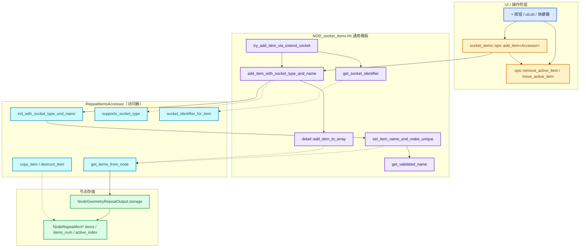
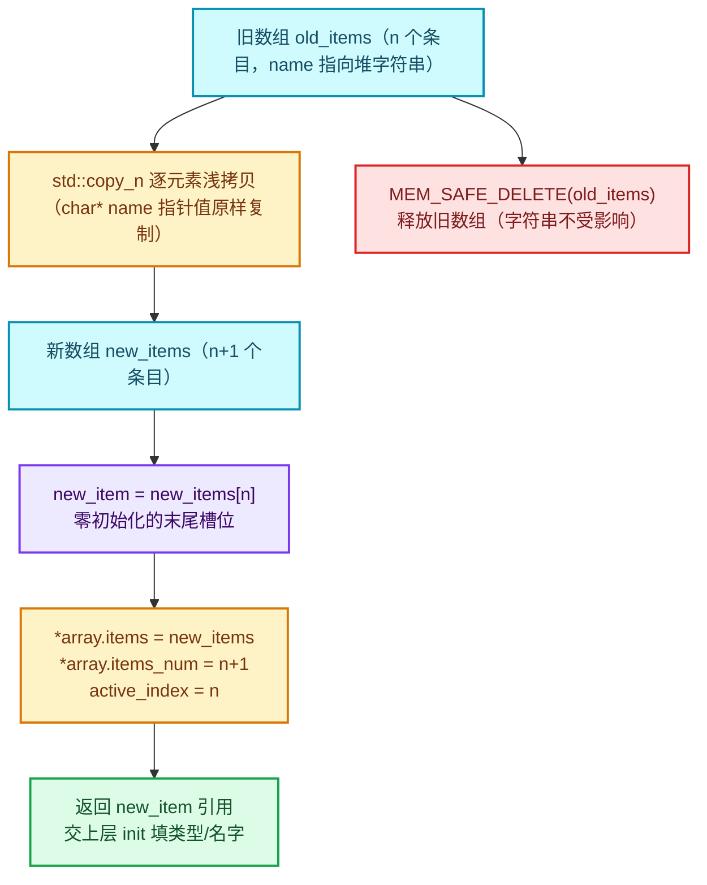
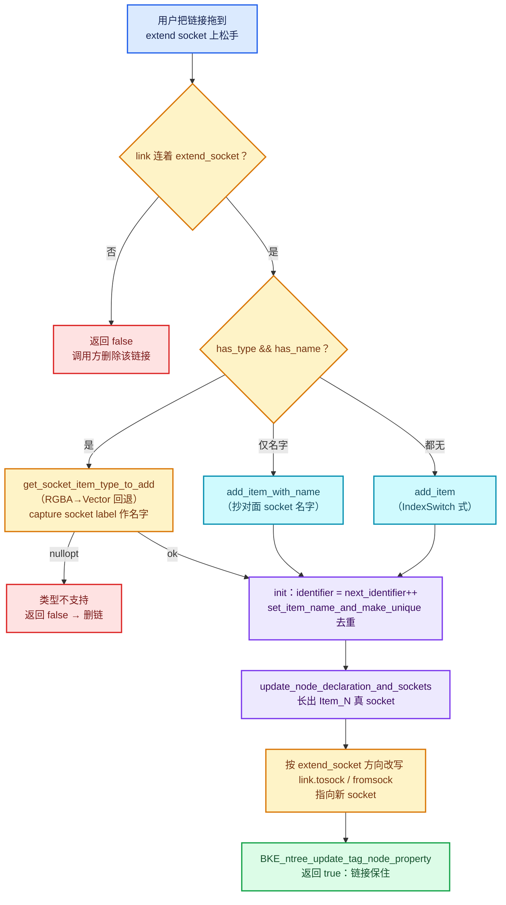

# 03 - SocketItems 通用条目框架：访问器驱动的动态 socket 条目

[02-Repeat区域数据模型](README.md) · [上一篇：DNA存储与NodeRepeatItem](02-DNA存储与NodeRepeatItem.md) · [下一章：03-几何节点执行架构](../03-几何节点执行架构/README.md)

> **基准说明**：本文所有行号与代码摘录基于当前工作区中的 Blender 源码：
>
> - 主角：[`source/blender/nodes/NOD_socket_items.hh`](../../../source/blender/nodes/NOD_socket_items.hh)（全文 419 行，已完整通读）
> - 伴生：[`NOD_socket_items_blend.hh`](../../../source/blender/nodes/NOD_socket_items_blend.hh)（38 行）、[`NOD_socket_items_ops.hh`](../../../source/blender/nodes/NOD_socket_items_ops.hh)（456 行）、[`NOD_socket_items_ui.hh`](../../../source/blender/nodes/NOD_socket_items_ui.hh)（140 行）
> - Repeat 实例：[`source/blender/nodes/geometry/include/NOD_geo_repeat.hh`](../../../source/blender/nodes/geometry/include/NOD_geo_repeat.hh)（全文 89 行，已完整通读）
>
> 源码链接相对路径前缀为 `../../../../`，从本文所在目录回溯到仓库根目录。

---

## 先回答一个具体问题

**问题：当你在 Repeat Zone 的 Output 节点上点一下"+"，多出一个 Repeat Item（条目）并长出一个新 socket——这背后的代码在哪个文件里？答案是"一个文件 + 一份配置"。**

直觉上你会以为 Repeat 节点自己写了一套"增删条目、重建数组、起名字、去重名、生成 socket identifier"的逻辑。实际上这些逻辑几乎一行都不在 Repeat 的实现文件里，而是集中在 [`NOD_socket_items.hh`](../../../source/blender/nodes/NOD_socket_items.hh) 这一个头文件中。Repeat 节点唯一做的事情，是在 [`NOD_geo_repeat.hh`](../../../source/blender/nodes/geometry/include/NOD_geo_repeat.hh) 里写了一个 **89 行的"访问器"（Accessor）结构体**，回答了一串问题：

- 你的条目类型（C 结构体）是什么？→ `using ItemT = NodeRepeatItem;`
- 条目数组存在哪个节点的 storage 里？→ `get_items_from_node()`
- 条目有没有类型、有没有名字？→ `has_type / has_name`
- 复制条目时怎么深拷贝？→ `copy_item()`
- 销毁条目时释放什么？→ `destruct_item()`
- 新条目的 socket identifier 长什么样？→ `"Item_" + std::to_string(item.identifier)`

然后，框架里的模板函数（`add_item_with_socket_type_and_name`、`set_item_name_and_make_unique`、`try_add_item_via_extend_socket`……）拿着这份"配置"去操作 `bNode->storage` 里的 C 数组。这就是本篇要讲透的 **访问器驱动的动态 socket 条目框架**：

```text
点"+"按钮
  └─ NODE_OT_repeat_zone_item_add（操作符，ops 层）
       └─ socket_items::ops::add_item<RepeatItemsAccessor>（通用操作符模板）
            └─ socket_items::add_item_with_socket_type_and_name<RepeatItemsAccessor>（核心模板）
                 ├─ detail::add_item_to_array：重建 C 数组、更新 items_num、移动 active_index
                 └─ RepeatItemsAccessor::init_with_socket_type_and_name：
                      ├─ item.socket_type = socket_type
                      ├─ item.identifier = storage->next_identifier++
                      └─ socket_items::set_item_name_and_make_unique：名字去重
```

读完本篇，你应当能回答：

1. 为什么框架要用 `SocketItemsRef<T>` 而不是 `MutableSpan<T>`？（答案：因为 resize 无法通过 span 完成）
2. `active_index` 在"添加/删除/移动条目"时如何跟随？
3. 从 extend socket（虚拟 socket）拖一条线出来时，条目是如何被"顺手"创建的？
4. Simulation、Index Switch、Bake、Closure……这些节点如何复用同一套逻辑？差异在哪里？

---

## 框架总览

先把整个框架的"角色表"摆出来：

| 角色 | 文件/类型 | 职责 |
|---|---|---|
| 通用逻辑（协议消费方） | `NOD_socket_items.hh` | 所有与"条目数组"相关的模板函数：查找、增删、复制、命名、extend socket 挂接 |
| 访问器协议（隐式） | `SocketItemsAccessorDefaults` + 各 Accessor | 用一组 `static constexpr` 开关 + 静态成员函数描述"某类节点的条目长什么样" |
| 数组引用 | `SocketItemsRef<T>` | 指向 `items / items_num / active_index` 三个变量的引用三元组 |
| 持久化 | `NOD_socket_items_blend.hh` | `blend_write / blend_read_data`：把条目数组写进/读出 .blend 文件 |
| 操作符 | `NOD_socket_items_ops.hh` | 生成"添加/删除/移动条目"的 wmOperator 模板 |
| UI | `NOD_socket_items_ui.hh` | 绘制条目 uiList、活动条目属性、extend socket 上的"+"按钮 |
| Repeat 实例 | `NOD_geo_repeat.hh` 的 `RepeatItemsAccessor` | 把上述协议落到 `NodeRepeatItem` 上 |

框架没有定义任何抽象基类——"协议"完全靠模板按名字查找（duck typing）+ `if constexpr` 开关裁剪实现。这是 C++ 里典型的 **compile-time policy-based design**。

### 图 1：Accessor 协议调用关系



图中实线是"调用"，虚线是"通过访问器间接查询/读写"。注意一个关键形状：**核心模板从不直接碰 `node.storage`**，所有对存储的访问都要先经过 `Accessor::get_items_from_node(node)` 拿到 `SocketItemsRef`。

---

## 1. 设计动机：逻辑共享、存储各异

文件头注释（[`NOD_socket_items.hh`](../../../source/blender/nodes/NOD_socket_items.hh) L11-L22）原文：

```cpp
/**
 * Some nodes have a dynamic number of sockets (e.g. simulation input/output). These nodes store an
 * array of items in their `bNode->storage` (e.g. `NodeSimulationItem`). Different nodes have
 * slightly different storage requirements, but a lot of the logic is still the same between nodes.
 * This file implements various shared functionality that can be used by different nodes to deal
 * with these item arrays.
 *
 * In order to use the functions, one has to implement an "accessor" which tells the shared code
 * how to deal with specific item arrays. Different functions have different requirements for the
 * accessor. It's easiest to just look at existing accessors like #SimulationItemsAccessor and
 * #RepeatItemsAccessor and to implement the same methods.
 */
```

翻译并拆解：

1. **背景**：有些节点的 socket 数量是动态的（simulation input/output 是最早的例子）。这些节点在 `bNode->storage` 里存一个 C 数组，每个数组元素对应一个 socket，例如 `NodeSimulationItem`。
2. **矛盾**：不同节点的"存储要求"略有差异（条目结构体不同、有的有条目类型有的没有、名字是否允许为空不同……），但**大量逻辑完全相同**：加一个条目要扩容数组、要把 `active_index` 指到新条目、名字要去重、identifier 要唯一且稳定……
3. **方案**：把相同逻辑抽成一份模板代码；把差异封装进每个节点自己的 **Accessor**（访问器）结构体。要用这套函数，就去实现一个访问器——注释甚至建议你"直接照抄 `SimulationItemsAccessor` 或 `RepeatItemsAccessor` 的方法列表"。

### 1.1 为什么是"访问器"而不是虚函数基类？

这是理解本文件的第一把钥匙。考虑三个候选方案：

| 方案 | 优点 | 致命缺点 |
|---|---|---|
| 虚函数基类 | 经典多态 | 条目类型 `ItemT` 是模板参数，基类无法表达"返回任意类型条目的引用"；且节点存储操作在热路径（每次 blend 读写、每次拓扑缓存构建都要跑） |
| 每节点复制粘贴 | 零抽象成本 | 十几个节点 × 每个几百行重复代码，改一处 bug 要改十几处 |
| **模板 + 访问器（本文件的选择）** | 零运行时开销；差异用 `if constexpr` 在编译期裁剪；漏实现方法时在使用点直接编译报错 | 报错信息较难读；协议没有显式声明，只能"照抄现有实现" |

访问器本质上是一个"**静态接口**"：框架对 `Accessor` 类型的要求完全是按名字查找的。例如 `add_item_with_socket_type_and_name` 内部会调用 `Accessor::supports_socket_type(...)`，如果你的访问器没有这个静态函数，编译就在那一行失败。

### 1.2 访问器需要实现哪些成员？

把全仓库所有 Accessor 的方法并排看，可以得到一张"协议清单"（按需实现，不同函数要求不同子集）：

| 成员 | 类别 | 被谁要求 |
|---|---|---|
| `using ItemT = ...` | 类型别名 | 所有函数（必需） |
| `static constexpr StringRefNull node_idname` | 常量 | `find_node_by_item`、`ops::get_active_node_to_operate_on` |
| `static constexpr bool has_type / has_name` | 开关 | ops/UI 层裁剪属性与对话框 |
| `SocketItemsRef<ItemT> get_items_from_node(bNode &)` | 函数 | 几乎所有函数（必需） |
| `void copy_item(const ItemT &, ItemT &)` | 函数 | `copy_array` |
| `void destruct_item(ItemT *)` | 函数 | `destruct_array`、删除条目 |
| `eNodeSocketDatatype get_socket_type(const ItemT &)` | 函数 | 有 `has_type` 时 |
| `char **get_name(ItemT &)` | 函数 | 有 `has_name` 时 |
| `bool supports_socket_type(eNodeSocketDatatype, int ntree_type)` | 函数 | `add_item_with_socket_type_and_name`、extend socket 流程 |
| `void init_with_socket_type_and_name(bNode &, ItemT &, type, name[, dims])` | 函数 | 有 `has_type && has_name` 时 |
| `void init_with_name(bNode &, ItemT &, name)` / `void init(bNode &, ItemT &)` | 函数 | `add_item_with_name` / `add_item` |
| `std::string socket_identifier_for_item(const ItemT &)` | 函数 | 有 `has_single_identifier_str` 时 |
| `std::string input_socket_identifier_for_item / output_socket_identifier_for_item` | 函数 | 无 `has_single_identifier_str` 时（输入/输出各一个 identifier） |
| `std::string validate_name(StringRef)` | 函数 | `has_name_validation = true` 时 |
| `std::string custom_initial_name(bNode &, StringRef)` | 函数 | `has_custom_initial_name = true` 时 |
| `blend_write_item / blend_read_data_item` | 函数 | blend 伴生头文件 |

> [!NOTE]
> `has_type` 和 `has_name` 虽然没有出现在 `SocketItemsAccessorDefaults` 里，但它们是协议的一部分——默认值没有给出，因此**每个访问器必须显式写**（你可以回去看 `RepeatItemsAccessor` L22-L23，这两个开关总是显式的）。

---

## 2. SocketItemsAccessorDefaults：一页"默认配置表"

原始定义（L39-L46）：

<details open>
<summary>核对原始源码：SocketItemsAccessorDefaults · L39—L46</summary>

```cpp
struct SocketItemsAccessorDefaults {
  static constexpr bool has_single_identifier_str = true;
  static constexpr bool has_name_validation = false;
  static constexpr bool has_custom_initial_name = false;
  static constexpr bool has_vector_dimensions = false;
  static constexpr bool can_have_empty_name = false;
  static constexpr char unique_name_separator = '.';
};
```

</details>

这是一个纯"默认值集合"，没有任何成员函数。各个访问器以 `struct X : public socket_items::SocketItemsAccessorDefaults` 的方式继承它，然后**只覆盖自己关心的开关**。逐个看这六个开关控制什么：

### 2.1 `has_single_identifier_str = true`

一个条目对应**一个** identifier 字符串（如 `"Item_3"`），输入侧和输出侧 socket 共用它。设为 `false` 的节点（如 `CaptureAttributeItemsAccessor`、`RaycastSampleAttributeItemsAccessor`、`FieldToListItemsAccessor`）条目有输入/输出两个方向，需要分别提供 `input_socket_identifier_for_item` 和 `output_socket_identifier_for_item`。它直接决定 `get_socket_identifier()` 走哪个分支（见第 3.13 节）。

### 2.2 `has_name_validation = false`

名字要不要"净化"（比如空格转下划线、截断非法字符）。设为 `true` 的访问器必须再提供 `validate_name()` 静态函数；`get_validated_name()` 会把原名字交给它处理。仓库里启用它的有：`CombineBundleItemsAccessor` / `SeparateBundleItemsAccessor`（bundle 的字段名会成为 RNA/attribute 路径的一部分，必须合法）、`FormatStringItemsAccessor`（占位符名要合法）、`FileOutputItemsAccessor`（名字要成为文件路径的一部分）。Repeat 不需要——repeat item 的名字纯粹是用户可见标签。

### 2.3 `has_custom_initial_name = false`

添加条目时，是否允许访问器**改写**"从链接 socket 捕获来的初始名字"。启用者（目前只有 `FormatStringItemsAccessor`）提供 `custom_initial_name(node, captured_name)`。比如 Format String 节点从 `{0}` 语法解析出的占位符名需要再加工。Repeat 不启用：拖线进来时新条目直接叫源 socket 的 label。

### 2.4 `has_vector_dimensions = false`

`Vector` 类型的 socket 可以是 2/3/4 维。此开关决定 `add_item_with_socket_type_and_name` 是否把可选的 `dimensions` 参数一路传给 `init_with_socket_type_and_name`。目前只有 `FileOutputItemsAccessor` 打开它（合成器的 File Output 支持输出多层向量）。Repeat 打不开——`NodeRepeatItem` 的 DNA 里根本没有 dimensions 字段，所以 `init_with_socket_type_and_name` 只有一个四参数版本（见 `NOD_geo_repeat.hh` L72-L75）。

### 2.5 `can_have_empty_name = false`

条目名字能否为空。`false`（默认）时，`set_item_name_and_make_unique` 会把空名字替换成一个兜底名：有条目类型的用 `bke::node_static_socket_label(type)`（如 "Vector"、"Float"），没有的用 `"Item"`。唯一允许空名字的是 `FileOutputItemsAccessor`——合成器文件输出的条目名会进入文件名模板，用户可以起名，但空名也合法（用默认输出名）。

### 2.6 `unique_name_separator = '.'`

`BLI_uniquename_cb` 生成去重名时的分隔符：`Vector.001`（默认，Repeat 用这个）或 `Vector_001`（bundle / format string / file output 用 `_`）。

> [!TIP]
> 读任何一个新节点的 Accessor，先扫这六个开关 + `has_type`/`has_name`，节点的"性格"就掌握了七成。剩下的都是存储布局细节。

---

## 3. SocketItemsRef&lt;T&gt;：能 resize 的"数组引用"

原始定义（L48-L56，含注释）：

<details open>
<summary>核对原始源码：SocketItemsRef · L48—L56</summary>

```cpp
/**
 * References a "C-Array" that is stored elsewhere. This is different from a MutableSpan, because
 * one can even resize the array through this reference.
 */
template<typename T> struct SocketItemsRef {
  T **items;
  int *items_num;
  int *active_index;
};
```

</details>

三个成员都是**指针的指针 / 指针**——它们是"变量的引用"而不是"数据的引用"：

- `T **items`：指向 storage 里那个 `T *items` 成员。`*ref.items` 就是数组首地址，而且框架可以 `*ref.items = new_array;` **整个换掉它**。
- `int *items_num`：指向条目数变量。
- `int *active_index`：指向"当前选中条目"的索引变量。**可以为 `nullptr`**——`IndexSwitchItemsAccessor` 就返回 `{&storage.items, &storage.items_num, nullptr}`，因为 Index Switch 没有"选中条目"的概念。所有使用 `active_index` 的代码都先判空（如 `clear()` 里的 `if (ref.active_index)`）。

### 3.1 为什么不用 `MutableSpan<T>`？

文件注释一句话点破："This is different from a MutableSpan, because one can even resize the array through this reference." `MutableSpan` 绑定的是"某块已有内存 + 长度"，它自己不知道内存从哪来、怎么释放，因此**无法 realloc**。而 `SocketItemsRef` 记录的是"storage 里那三个变量在哪"，于是：

```cpp
// detail::add_item_to_array 里发生的事情
ItemT *new_items = MEM_new_array<ItemT>(new_items_num, __func__);  // 分配新数组
std::copy_n(old_items, old_items_num, new_items);                  // 搬旧数据
MEM_SAFE_DELETE(old_items);                                        // 释放旧数组
*array.items = new_items;         // ← 通过 SocketItemsRef 把 storage 里的指针整个换掉
*array.items_num = new_items_num; // ← 更新计数
```

这正是 DNA 存储的形状决定的：`NodeGeometryRepeatOutput` 里存的是 `NodeRepeatItem *items; int items_num; int active_index;`，C 数组、手动管理。`SocketItemsRef` 就是把这三个成员"按引用"暴露给泛型代码的最小封装。

> [!NOTE]
> 换句话说：`SocketItemsRef<T>` ≈ `T *&items_ref, int &num_ref, int *active_ref` 的打包。名字里 "Ref" 的含义是"引用变量"而非"引用数据"。

### 3.2 `get_items_from_node`：访问器的"第一个必须实现的函数"

`RepeatItemsAccessor` 的实现（[`NOD_geo_repeat.hh`](../../../source/blender/nodes/geometry/include/NOD_geo_repeat.hh) L37-L41）：

```cpp
static socket_items::SocketItemsRef<NodeRepeatItem> get_items_from_node(bNode &node)
{
  auto *storage = static_cast<NodeGeometryRepeatOutput *>(node.storage);
  return {&storage->items, &storage->items_num, &storage->active_index};
}
```

就是一次 `static_cast` + 花括号初始化三元组。注意它返回的是**指向 storage 成员的指针**，所以只要节点活着，这个 ref 就一直有效；但如果你之后对数组做了 resize，之前从 `*ref.items` 读出来的裸指针就失效了——框架代码里每一处都小心地在 resize 后重新解引用。

---

## 4. RepeatItemsAccessor 全文精读

现在逐行读 [`NOD_geo_repeat.hh`](../../../source/blender/nodes/geometry/include/NOD_geo_repeat.hh)（89 行全文已通读）。它继承 `SocketItemsAccessorDefaults`，六个开关全部保持默认值，然后显式写了 `has_type`、`has_name` 与一串成员。

### 4.1 类型与身份（L17-L35）

```cpp
struct RepeatItemsAccessor : public socket_items::SocketItemsAccessorDefaults {
  using ItemT = NodeRepeatItem;                    // 条目 C 结构体（见 02-02 篇）
  static StructRNA **item_srna;                    // RNA 包装类型，供 UI 层 draw_active_item_props 用
  static int node_type;                            // node->type_legacy 值，供注册代码比对
  static constexpr StringRefNull node_idname = "GeometryNodeRepeatOutput";  // 条目存在哪种节点上
  static constexpr bool has_type = true;           // 条目带 socket 类型
  static constexpr bool has_name = true;           // 条目带名字
```

`node_idname` 值得停一下：**条目挂在 Output 节点上**（`GeometryNodeRepeatOutput`），不是 Input。这与 simulation 一样——数据（条目列表）统一存在 zone 的输出节点上，Input 节点的 socket 是运行时从 Output"投影"过去的。`ops::get_active_node_to_operate_on` 里也印证了这一点：当活动节点是 zone 的 input 节点时，它会自动改操作 zone 的 output 节点（[`NOD_socket_items_ops.hh`](../../../source/blender/nodes/NOD_socket_items_ops.hh) L70-L75）。

### 4.2 三组字符串常量（L24-L35）

```cpp
  struct operator_idnames {
    static constexpr StringRefNull add_item = "NODE_OT_repeat_zone_item_add";
    static constexpr StringRefNull remove_item = "NODE_OT_repeat_zone_item_remove";
    static constexpr StringRefNull move_item = "NODE_OT_repeat_zone_item_move";
  };
  struct ui_idnames {
    static constexpr StringRefNull list = "DATA_UL_repeat_zone_state";
  };
  struct rna_names {
    static constexpr StringRefNull items = "repeat_items";
    static constexpr StringRefNull active_index = "active_index";
  };
```

这三组是把泛型代码"接线"到 Blender 具体子系统的名字：

| 组 | 用在哪 | 举例中的值 |
|---|---|---|
| `operator_idnames` | UI 层 `draw_items_list_with_operators` 摆 +/-/上下按钮时调用对应 wmOperator | `NODE_OT_repeat_zone_item_add` 等（由 `ops::make_common_operators` 注册） |
| `ui_idnames` | `template_uilist` 的列表类型 idname | `DATA_UL_repeat_zone_state` |
| `rna_names` | `template_uilist` 通过 RNA 属性名访问条目数组与选中索引 | `repeat_items` / `active_index`（与 RNA 注册代码里 def 的属性名严格一致） |

### 4.3 深拷贝与销毁（L43-L52）

```cpp
  static void copy_item(const NodeRepeatItem &src, NodeRepeatItem &dst)
  {
    dst = src;                      // 浅拷贝：所有标量字段（socket_type、identifier 等）照搬
    dst.name = BLI_strdup_null(dst.name);  // name 是 char*，必须重新分配一份，否则两个节点共享同一块字符串
  }

  static void destruct_item(NodeRepeatItem *item)
  {
    MEM_SAFE_DELETE(item->name);    // 只需要释放 name；identifier/socket_type 是标量
  }
```

`NodeRepeatItem` 是 C 结构体（DNA），唯一拥有资源的就是 `char *name`。所以：

- `copy_item` = 赋值 + strdup；`dst = src` 会把 `src.name` 的**指针值**复制过来，若不 strdup，两个条目的 `name` 指向同一内存，随后任何一方 `destruct_item` 都会造成 double-free。
- `destruct_item` 只 free name。框架的 `destruct_array` 在 free 完每个条目后自己 `MEM_SAFE_DELETE(*ref.items)` 释放数组本体。

> [!WARNING]
> 如果你给 `NodeRepeatItem`（或自己仿写的 ItemT）加了新的堆资源字段，就必须同步改 `copy_item`、`destruct_item` 和 `blend_write_item / blend_read_data_item` 四处——这是这套 C 风格框架最常见的坑。

### 4.4 类型查询与名字访问（L57-L65)

```cpp
  static eNodeSocketDatatype get_socket_type(const NodeRepeatItem &item)
  {
    return item.socket_type;
  }

  static char **get_name(NodeRepeatItem &item)
  {
    return &item.name;
  }
```

`get_name` 返回 `char **` 而不是 `char *`——因为 `set_item_name_and_make_unique` 要**替换**这个指针（先 free 旧的，再 strdup 新的）。

### 4.5 支持哪些 socket 类型（L67-L70)

```cpp
  static bool supports_socket_type(const eNodeSocketDatatype socket_type, const int ntree_type)
  {
    return bke::node_tree_type_supports_socket_type_static(ntree_type, socket_type);
  }
```

Repeat 的策略是"宽口径"：**只要当前节点树类型（几何节点树）支持这个 socket 类型，就支持**。对比 `SimulationItemsAccessor`（`NOD_geo_simulation.hh` L67 起）：simulation 明确排除了 data-block 类型和 closure（`ELEM(socket_type, SOCK_FLOAT, ...)` 白名单）。差异的根源：simulation zone 的状态要在多帧间保持并可 bake，几何/闭包等"重资源"类型受限；repeat 的条目只是 zone 内部的迭代接口，能接就接。

### 4.6 初始化新条目（L72-L81)——`next_identifier++` 与名字去重

```cpp
  static void init_with_socket_type_and_name(bNode &node,
                                             NodeRepeatItem &item,
                                             const eNodeSocketDatatype socket_type,
                                             const char *name)
  {
    auto *storage = static_cast<NodeGeometryRepeatOutput *>(node.storage);
    item.socket_type = socket_type;
    item.identifier = storage->next_identifier++;   // ← 单调递增，永不复用
    socket_items::set_item_name_and_make_unique<RepeatItemsAccessor>(node, item, name);
  }
```

两件大事：

1. **`item.identifier = storage->next_identifier++`**。`identifier` 是条目的稳定身份（`.blend` 里持久化），socket 的 identifier（`Item_0`、`Item_1`…）由它派生。用 `next_identifier++` 而不是"数组下标"是刻意设计：删除中间条目后，新条目的 identifier 不会与旧 socket 撞名，已存在的链接不会错接到别的条目上。这正是 02-02 篇"identifier 为什么必须稳定"的答案。
2. **`set_item_name_and_make_unique`**（框架函数，见 3.7 节）：把传入的名字去重后 strdup 进条目。注意它传的模板参数是 `RepeatItemsAccessor` 自己——访问器会"回调"进框架，框架再"回调"回访问器，两层互咬。

`RepeatItemsAccessor` **没有**实现带 dimensions 的重载（对比 `FileOutputItemsAccessor`），因为 `has_vector_dimensions = false`，框架也绝不会调用五参数版本。

### 4.7 socket identifier（L83-L86)

```cpp
  static std::string socket_identifier_for_item(const NodeRepeatItem &item)
  {
    return "Item_" + std::to_string(item.identifier);
  }
```

最终 socket 长这样：`Item_0`、`Item_1`、`Item_7`……这个字符串同时是：

- 节点声明（`NodeDeclaration`）里动态 socket 的 identifier；
- `find_item_by_identifier` 的查找键（UI 或执行期拿一个 socket identifier 反查条目）；
- `.blend` 里链接（`bNodeLink` 存的是两端 socket 的 identifier 字符串）赖以跨保存/加载存活的东西。

---

## 5. 核心模板函数逐个精讲

以下按 [`NOD_socket_items.hh`](../../../source/blender/nodes/NOD_socket_items.hh) 的出场顺序逐个讲。每节先给签名与参数，再讲实现，最后给"讲解版代码 + 折叠的原始源码"。

### 5.1 find_node_by_item：这个条目属于哪个节点？

**签名**（L61-L62）：

```cpp
template<typename Accessor>
inline bNode *find_node_by_item(bNodeTree &ntree, const typename Accessor::ItemT &item);
```

**参数**：`ntree` 待搜索的节点树；`item` 条目的**引用**（不是拷贝——靠地址比对）。

**实现讲解**：先 `ensure_topology_cache()` 确保按 node type 分组的缓存有效，然后遍历该类型的所有节点，用 `get_items_from_node` 拿数组引用，做**指针区间判断**：`&item` 是否落在 `[*items, *items + items_num)` 内。命中即返回节点，否则 `nullptr`。

```cpp
// [讲解] find_node_by_item：靠"地址在数组区间内"反查宿主节点
template<typename Accessor>
inline bNode *find_node_by_item(bNodeTree &ntree, const typename Accessor::ItemT &item)
{
  ntree.ensure_topology_cache();  // [讲解] 保证 nodes_by_type 缓存可用，避免遍历时结构变动
  for (bNode *node : ntree.nodes_by_type(UString(Accessor::node_idname))) {
    SocketItemsRef array = Accessor::get_items_from_node(*node);
    // [讲解] 关键：比较的是地址而非值。同一个节点树里可能有两个值完全相同的条目，
    //        只有"这块内存属于谁的数组"才是身份。
    if (&item >= *array.items && &item < *array.items + *array.items_num) {
      return node;
    }
  }
  return nullptr;  // [讲解] 条目不属于此树中任何节点（例如已被删除），返回空
}
```

<details>
<summary>核对原始源码：find_node_by_item · L58—L72</summary>

```cpp
/**
 * Iterates over the node tree to find the node that this item belongs to.
 */
template<typename Accessor>
inline bNode *find_node_by_item(bNodeTree &ntree, const typename Accessor::ItemT &item)
{
  ntree.ensure_topology_cache();
  for (bNode *node : ntree.nodes_by_type(UString(Accessor::node_idname))) {
    SocketItemsRef array = Accessor::get_items_from_node(*node);
    if (&item >= *array.items && &item < *array.items + *array.items_num) {
      return node;
    }
  }
  return nullptr;
}
```

</details>

**用途**：典型的调用场景是"用户在 uiList 里点了一个条目"——RNA 层拿到的是 `PointerRNA`（内部是条目指针），操作符需要知道该去更新哪个节点。

### 5.2 find_item_by_identifier：从 socket identifier 反查条目

**签名**（L75-L77）：

```cpp
template<typename Accessor>
inline typename Accessor::ItemT *find_item_by_identifier(bNode &node, const StringRef identifier);
```

**实现讲解**：拿数组引用，线性扫描，对每个条目调用 `Accessor::socket_identifier_for_item(item)` 与 `identifier` 比对，命中返回指针，否则 `nullptr`。

```cpp
// [讲解] 给一个 socket identifier（如 "Item_3"），找到对应的条目
template<typename Accessor>
inline typename Accessor::ItemT *find_item_by_identifier(bNode &node, const StringRef identifier)
{
  SocketItemsRef array = Accessor::get_items_from_node(node);
  for (const int i : IndexRange(*array.items_num)) {
    typename Accessor::ItemT &item = (*array.items)[i];
    if (Accessor::socket_identifier_for_item(item) == identifier) {  // [讲解] 重建字符串再比对
      return &item;
    }
  }
  return nullptr;
}
```

<details>
<summary>核对原始源码：find_item_by_identifier · L74—L87</summary>

```cpp
/** Find the item with the given identifier. */
template<typename Accessor>
inline typename Accessor::ItemT *find_item_by_identifier(bNode &node, const StringRef identifier)
{

  SocketItemsRef array = Accessor::get_items_from_node(node);
  for (const int i : IndexRange(*array.items_num)) {
    typename Accessor::ItemT &item = (*array.items)[i];
    if (Accessor::socket_identifier_for_item(item) == identifier) {
      return &item;
    }
  }
  return nullptr;
}
```

</details>

**为什么需要它**：`bNodeLink` 在保存文件时只存 socket 的 identifier 字符串。加载后执行期要把链接接回正确条目，就得靠这个反查。O(n) 线性扫描没问题——条目数通常个位数到几十。

### 5.3 destruct_array：销毁所有条目并释放数组

**签名**（L92）：`template<typename Accessor> inline void destruct_array(bNode &node);`

```cpp
// [讲解] 两层释放：先让访问器清理每个条目拥有的资源，再释放数组本体
template<typename Accessor> inline void destruct_array(bNode &node)
{
  using ItemT = typename Accessor::ItemT;
  SocketItemsRef ref = Accessor::get_items_from_node(node);
  for (const int i : IndexRange(*ref.items_num)) {
    ItemT &item = (*ref.items)[i];
    Accessor::destruct_item(&item);      // [讲解] Repeat：free item->name
  }
  MEM_SAFE_DELETE(*ref.items);           // [讲解] 释放数组本身；注意 items_num 不清零！
}
```

<details>
<summary>核对原始源码：destruct_array · L89—L101</summary>

```cpp
/**
 * Destruct all the items and the free the array itself.
 */
template<typename Accessor> inline void destruct_array(bNode &node)
{
  using ItemT = typename Accessor::ItemT;
  SocketItemsRef ref = Accessor::get_items_from_node(node);
  for (const int i : IndexRange(*ref.items_num)) {
    ItemT &item = (*ref.items)[i];
    Accessor::destruct_item(&item);
  }
  MEM_SAFE_DELETE(*ref.items);
}
```

</details>

> [!WARNING]
> `destruct_array` **故意不把 `items_num` 归零**。它假设调用方马上要整体替换状态（比如 `clear()`、节点 free、复制节点前清目标）。如果你直接调用它之后又把 `*ref.items` 当有效数组用，就是 use-after-free。日常代码请用下一节的 `clear()`。

### 5.4 clear：清空条目（安全的 destruct_array）

**签名**（L106）：`template<typename Accessor> inline void clear(bNode &node);`

```cpp
// [讲解] clear = destruct_array + 状态归零；active_index 可能为空指针，要判
template<typename Accessor> inline void clear(bNode &node)
{
  destruct_array<Accessor>(node);        // [讲解] 释放内存（此时 items 悬空）
  SocketItemsRef ref = Accessor::get_items_from_node(node);
  *ref.items_num = 0;                    // [讲解] 计数归零，数组指针保持为 nullptr/悬空但不再被解引用
  if (ref.active_index) {                // [讲解] IndexSwitch 等没有 active_index，判空
    *ref.active_index = 0;
  }
}
```

<details>
<summary>核对原始源码：clear · L103—L114</summary>

```cpp
/**
 * Removes all items from the node.
 */
template<typename Accessor> inline void clear(bNode &node)
{
  destruct_array<Accessor>(node);
  SocketItemsRef ref = Accessor::get_items_from_node(node);
  *ref.items_num = 0;
  if (ref.active_index) {
    *ref.active_index = 0;
  }
}
```

</details>

### 5.5 copy_array：节点复制时的条目深拷贝

**签名**（L119）：`template<typename Accessor> inline void copy_array(const bNode &src_node, bNode &dst_node);`

```cpp
// [讲解] 按源条目数分配新数组，逐个交给访问器深拷贝；不碰 active_index
template<typename Accessor> inline void copy_array(const bNode &src_node, bNode &dst_node)
{
  using ItemT = typename Accessor::ItemT;
  SocketItemsRef src_ref = Accessor::get_items_from_node(const_cast<bNode &>(src_node));
  SocketItemsRef dst_ref = Accessor::get_items_from_node(dst_node);
  const int items_num = *src_ref.items_num;              // [讲解] 先拍下数量，防 src==dst 之类意外
  *dst_ref.items = MEM_new_array<ItemT>(items_num, __func__);  // [讲解] 全新分配，dst 旧数组由调用方负责先清
  for (const int i : IndexRange(items_num)) {
    Accessor::copy_item((*src_ref.items)[i], (*dst_ref.items)[i]);  // [讲解] Repeat：strdup 名字
  }
}
```

<details>
<summary>核对原始源码：copy_array · L116—L129</summary>

```cpp
/**
 * Copy the items from the storage of the source node to the storage of the destination node.
 */
template<typename Accessor> inline void copy_array(const bNode &src_node, bNode &dst_node)
{
  using ItemT = typename Accessor::ItemT;
  SocketItemsRef src_ref = Accessor::get_items_from_node(const_cast<bNode &>(src_node));
  SocketItemsRef dst_ref = Accessor::get_items_from_node(dst_node);
  const int items_num = *src_ref.items_num;
  *dst_ref.items = MEM_new_array<ItemT>(items_num, __func__);
  for (const int i : IndexRange(items_num)) {
    Accessor::copy_item((*src_ref.items)[i], (*dst_ref.items)[i]);
  }
}
```

</details>

注意 `active_index` **没有被复制**——调用方（各节点的 `node_copy_cb`）一般随后手动把目标的 `active_index` 钳制或复制。还要注意框架不做"先清空 dst"的动作，Repeat 节点自己的复制回调负责保证 dst 原来没有条目（新分配的节点 storage 为空）。

### 5.6 get_validated_name：名字净化的一行开关

**签名**（L134）：`template<typename Accessor> inline std::string get_validated_name(const StringRef name);`

```cpp
// [讲解] 编译期开关：有 validate_name 就用，没有就原样返回
template<typename Accessor> inline std::string get_validated_name(const StringRef name)
{
  if constexpr (Accessor::has_name_validation) {
    return Accessor::validate_name(name);   // [讲解] bundle/format-string/file-output 才有这条路
  }
  else {
    return name;
  }
}
```

<details>
<summary>核对原始源码：get_validated_name · L131—L142</summary>

```cpp
/**
 * Enforce constraints on the name of the item.
 */
template<typename Accessor> inline std::string get_validated_name(const StringRef name)
{
  if constexpr (Accessor::has_name_validation) {
    return Accessor::validate_name(name);
  }
  else {
    return name;
  }
}
```

</details>

`if constexpr` 的价值在这里体现得很典型：未启用验证的访问器**不需要存在 `validate_name` 函数**，死分支在编译期就被丢弃，不会触发按名字查找失败。

### 5.7 set_item_name_and_make_unique：改名 + 全数组去重

**签名**（L148-L151）：

```cpp
template<typename Accessor>
inline void set_item_name_and_make_unique(bNode &node,
                                          typename Accessor::ItemT &item,
                                          const char *value);
```

这是 Repeat 的 `init_with_socket_type_and_name` 和 RNA 改名回调都会走的函数。实现分四步：

```cpp
// [讲解] 改名四步：兜底空名 → 净化 → 去重 → strdup 写回
template<typename Accessor>
inline void set_item_name_and_make_unique(bNode &node,
                                          typename Accessor::ItemT &item,
                                          const char *value)
{
  using ItemT = typename Accessor::ItemT;
  SocketItemsRef array = Accessor::get_items_from_node(node);

  // [讲解] 第 1 步：空名兜底（can_have_empty_name=false 时）
  std::string name = value;
  if constexpr (!Accessor::can_have_empty_name) {
    if (name.empty()) {
      if constexpr (Accessor::has_type) {
        // [讲解] 有类型：用类型标签兜底，如 "Vector" / "Float"
        name = *bke::node_static_socket_label(Accessor::get_socket_type(item), 0);
      }
      else {
        name = "Item";
      }
    }
  }

  // [讲解] 第 2 步：名字净化（Repeat：直通）
  const std::string validated_name = get_validated_name<Accessor>(name);

  // [讲解] 第 3 步：BLI_uniquename_cb 去重。回调回答"这个名字在数组里是否已被别人占用"，
  //        若占用则自动追加 ".001"、".002"……（分隔符来自 Accessor::unique_name_separator）
  const std::string unique_name = BLI_uniquename_cb(
      [&](const StringRef name) {
        for (ItemT &item_iter : MutableSpan(*array.items, *array.items_num)) {
          if (&item_iter != &item) {          // [讲解] 排除自己，否则自己占用自己的名字
            if (*Accessor::get_name(item_iter) == name) {
              return true;
            }
          }
        }
        return false;
      },
      Accessor::unique_name_separator,
      validated_name);

  /* The unique name should still be valid. */
  BLI_assert(unique_name == get_validated_name<Accessor>(unique_name));  // [讲解] 去重不得破坏合法性

  // [讲解] 第 4 步：释放旧名、strdup 新名（get_name 返回 char**，就是为了能替换指针）
  char **item_name = Accessor::get_name(item);
  MEM_SAFE_DELETE(*item_name);
  *item_name = BLI_strdup(unique_name.c_str());
}
```

<details>
<summary>核对原始源码：set_item_name_and_make_unique · L144—L190</summary>

```cpp
/**
 * Changes the name of an existing item and makes sure that the name is unique among other the
 * other items in the same array.
 */
template<typename Accessor>
inline void set_item_name_and_make_unique(bNode &node,
                                          typename Accessor::ItemT &item,
                                          const char *value)
{
  using ItemT = typename Accessor::ItemT;
  SocketItemsRef array = Accessor::get_items_from_node(node);

  std::string name = value;
  if constexpr (!Accessor::can_have_empty_name) {
    if (name.empty()) {
      if constexpr (Accessor::has_type) {
        name = *bke::node_static_socket_label(Accessor::get_socket_type(item), 0);
      }
      else {
        name = "Item";
      }
    }
  }

  const std::string validated_name = get_validated_name<Accessor>(name);

  const std::string unique_name = BLI_uniquename_cb(
      [&](const StringRef name) {
        for (ItemT &item_iter : MutableSpan(*array.items, *array.items_num)) {
          if (&item_iter != &item) {
            if (*Accessor::get_name(item_iter) == name) {
              return true;
            }
          }
        }
        return false;
      },
      Accessor::unique_name_separator,
      validated_name);

  /* The unique name should still be valid. */
  BLI_assert(unique_name == get_validated_name<Accessor>(unique_name));

  char **item_name = Accessor::get_name(item);
  MEM_SAFE_DELETE(*item_name);
  *item_name = BLI_strdup(unique_name.c_str());
}
```

</details>

**教学追问：去重为什么在框架做而不让访问器自己做？** 因为"唯一性"是数组的**全局**性质，只有拿得到全数组的框架代码能维护它；访问器只懂单个条目。这是"数组级不变量放在框架、条目级资源放在访问器"分工的典型体现。

### 5.8 detail::add_item_to_array：重建数组、active_index 跟随

**签名**（L194，位于 `namespace detail`——仅供框架内部使用）：

```cpp
template<typename Accessor> inline typename Accessor::ItemT &add_item_to_array(bNode &node);
```

```cpp
// [讲解] 最核心的"扩容"原语：C 数组没有 realloc，就手动 新分配 → 拷贝 → 释放 → 换指针
namespace detail {
template<typename Accessor> inline typename Accessor::ItemT &add_item_to_array(bNode &node)
{
  using ItemT = typename Accessor::ItemT;
  SocketItemsRef array = Accessor::get_items_from_node(node);

  ItemT *old_items = *array.items;          // [讲解] 旧数组（可能为 nullptr，首条目时）
  const int old_items_num = *array.items_num;
  const int new_items_num = old_items_num + 1;

  ItemT *new_items = MEM_new_array<ItemT>(new_items_num, __func__);  // [讲解] 多分配一个槽位
  std::copy_n(old_items, old_items_num, new_items);  // [讲解] 逐字节搬旧条目（浅拷贝！）
  ItemT &new_item = new_items[old_items_num];        // [讲解] 新条目 = 末尾槽位，默认零初始化

  MEM_SAFE_DELETE(old_items);               // [讲解] 旧数组释放
  *array.items = new_items;                 // [讲解] 通过 Ref 把 storage 里的指针换掉
  *array.items_num = new_items_num;
  if (array.active_index) {
    *array.active_index = old_items_num;    // [讲解] 选中索引 = 新条目的下标（末尾）
  }

  return new_item;                          // [讲解] 返回引用，交由上层 init 填内容
}
}  // namespace detail
```

<details>
<summary>核对原始源码：detail::add_item_to_array · L192—L217</summary>

```cpp
namespace detail {

template<typename Accessor> inline typename Accessor::ItemT &add_item_to_array(bNode &node)
{
  using ItemT = typename Accessor::ItemT;
  SocketItemsRef array = Accessor::get_items_from_node(node);

  ItemT *old_items = *array.items;
  const int old_items_num = *array.items_num;
  const int new_items_num = old_items_num + 1;

  ItemT *new_items = MEM_new_array<ItemT>(new_items_num, __func__);
  std::copy_n(old_items, old_items_num, new_items);
  ItemT &new_item = new_items[old_items_num];

  MEM_SAFE_DELETE(old_items);
  *array.items = new_items;
  *array.items_num = new_items_num;
  if (array.active_index) {
    *array.active_index = old_items_num;
  }

  return new_item;
}

}  // namespace detail
```

</details>

#### 图 2：add_item_to_array 的数据迁移



要点提醒：

- `std::copy_n` 搬的是**条目本身的位模式**。对 `NodeRepeatItem` 来说，`name` 指针被原样复制——新旧数组里的条目**短暂共享**同一块字符串。这里安全，因为旧数组马上被释放，共享窗口只有一个函数调用，且期间没有人调用 `destruct_item`。
- `active_index` 被无条件设为新条目下标。"添加即选中"是这套 UI 的既定交互。
- 为什么不增长式扩容（capacity 翻倍）？条目数极小、操作是用户点击级别，每次加一个都全量重建完全可以接受，换来的是 DNA 数组永远是"紧凑精确大小"，`.blend` 读写和 RNA 数组暴露都简单。

### 5.9 add_item_with_socket_type_and_name：带类型与名字的添加

**签名**（L224-L230）：

```cpp
template<typename Accessor>
inline typename Accessor::ItemT *add_item_with_socket_type_and_name(
    bNodeTree &ntree,
    bNode &node,
    const eNodeSocketDatatype socket_type,
    const char *name,
    std::optional<int> dimensions = std::nullopt);
```

**参数**：`ntree` 只用于断言（检查 `socket_type` 在该节点树类型下合法，`UNUSED_VARS_NDEBUG` 表明 release 版不用它）；`socket_type` 新条目的 socket 类型；`name` 初始名（可为空，会被兜底+去重）；`dimensions` 仅 Vector 有效，缺省按 3。

```cpp
// [讲解] 先断言再动手：类型合法性、dimensions 只配 Vector、dimensions ∈ [2,4]
template<typename Accessor>
inline typename Accessor::ItemT *add_item_with_socket_type_and_name(
    bNodeTree &ntree, bNode &node, const eNodeSocketDatatype socket_type,
    const char *name, std::optional<int> dimensions = std::nullopt)
{
  using ItemT = typename Accessor::ItemT;
  BLI_assert(Accessor::supports_socket_type(socket_type, ntree.type));   // [讲解] 访问器裁决
  BLI_assert(!(dimensions.has_value() && socket_type != SOCK_VECTOR));   // [讲解] dims 只给 Vector
  BLI_assert(ELEM(dimensions.value_or(3), 2, 3, 4));                     // [讲解] 缺省当 3 检查
  UNUSED_VARS_NDEBUG(ntree);                                             // [讲解] release 下 ntree 弃用
  ItemT &new_item = detail::add_item_to_array<Accessor>(node);           // [讲解] 先扩容
  if constexpr (Accessor::has_vector_dimensions) {                       // [讲解] 编译期选重载
    Accessor::init_with_socket_type_and_name(node, new_item, socket_type, name, dimensions);
  }
  else {
    Accessor::init_with_socket_type_and_name(node, new_item, socket_type, name);
  }
  return &new_item;
}
```

<details>
<summary>核对原始源码：add_item_with_socket_type_and_name · L219—L245</summary>

```cpp
/**
 * Add a new item at the end with the given socket type and name. The optional dimensions argument
 * can be provided for types that support multiple possible dimensions like Vector. It is expected
 * to be in the range [2, 4] and if not provided, 3 should be assumed.
 */
template<typename Accessor>
inline typename Accessor::ItemT *add_item_with_socket_type_and_name(
    bNodeTree &ntree,
    bNode &node,
    const eNodeSocketDatatype socket_type,
    const char *name,
    std::optional<int> dimensions = std::nullopt)
{
  using ItemT = typename Accessor::ItemT;
  BLI_assert(Accessor::supports_socket_type(socket_type, ntree.type));
  BLI_assert(!(dimensions.has_value() && socket_type != SOCK_VECTOR));
  BLI_assert(ELEM(dimensions.value_or(3), 2, 3, 4));
  UNUSED_VARS_NDEBUG(ntree);
  ItemT &new_item = detail::add_item_to_array<Accessor>(node);
  if constexpr (Accessor::has_vector_dimensions) {
    Accessor::init_with_socket_type_and_name(node, new_item, socket_type, name, dimensions);
  }
  else {
    Accessor::init_with_socket_type_and_name(node, new_item, socket_type, name);
  }
  return &new_item;
}
```

</details>

**dimensions 约束 [2,4] 仅 SOCK_VECTOR**：三条断言合起来说明"维度"是 Vector 的专属属性，且合法值只有 2、3、4。Repeat 的条目没有维度概念，`RepeatItemsAccessor` 走 `else` 分支（四参数 init）。

### 5.10 add_item_with_name 与 add_item：退化形态

```cpp
// [讲解] 只有名字没有类型（has_type=false 且 has_name=true 的节点，如 RasterizePoints）
template<typename Accessor>
inline typename Accessor::ItemT *add_item_with_name(bNode &node, const char *name)
{
  using ItemT = typename Accessor::ItemT;
  ItemT &new_item = detail::add_item_to_array<Accessor>(node);
  Accessor::init_with_name(node, new_item, name);   // [讲解] 访问器决定 identifier 等
  return &new_item;
}

// [讲解] 既无类型也无名字（如 IndexSwitch：条目就是个 identifier）
template<typename Accessor> inline typename Accessor::ItemT *add_item(bNode &node)
{
  using ItemT = typename Accessor::ItemT;
  ItemT &new_item = detail::add_item_to_array<Accessor>(node);
  Accessor::init(node, new_item);                   // [讲解] IndexSwitch: item.identifier = next_identifier++
  return &new_item;
}
```

<details>
<summary>核对原始源码：add_item_with_name / add_item · L247—L268</summary>

```cpp
/**
 * Add a new item at the end with the given name.
 */
template<typename Accessor>
inline typename Accessor::ItemT *add_item_with_name(bNode &node, const char *name)
{
  using ItemT = typename Accessor::ItemT;
  ItemT &new_item = detail::add_item_to_array<Accessor>(node);
  Accessor::init_with_name(node, new_item, name);
  return &new_item;
}

/**
 * Add a new item at the end.
 */
template<typename Accessor> inline typename Accessor::ItemT *add_item(bNode &node)
{
  using ItemT = typename Accessor::ItemT;
  ItemT &new_item = detail::add_item_to_array<Accessor>(node);
  Accessor::init(node, new_item);
  return &new_item;
}
```

</details>

三个 add 变体共享同一个骨架：`add_item_to_array` 负责数组结构，`Accessor::init*` 负责条目内容。ops 层的 `add_item` 操作符正是按 `has_type`/`has_name` 的组合在这三者之间 `if constexpr` 选择（[`NOD_socket_items_ops.hh`](../../../source/blender/nodes/NOD_socket_items_ops.hh) L267-L279）。

### 5.11 get_socket_identifier：单/双 identifier 分支

**签名**（L270-L272）：

```cpp
template<typename Accessor>
inline std::string get_socket_identifier(const typename Accessor::ItemT &item,
                                         const eNodeSocketInOut in_out);
```

```cpp
// [讲解] 单 identifier（Repeat）：in_out 参数被无视，输入输出 socket 共用 "Item_N"
//        双 identifier（CaptureAttribute 等）：按方向查 input_*/output_*_for_item
template<typename Accessor>
inline std::string get_socket_identifier(const typename Accessor::ItemT &item,
                                         const eNodeSocketInOut in_out)
{
  if constexpr (Accessor::has_single_identifier_str) {
    return Accessor::socket_identifier_for_item(item);        // [讲解] Repeat 走这里
  }
  else {
    if (in_out == SOCK_IN) {
      return Accessor::input_socket_identifier_for_item(item);
    }
    return Accessor::output_socket_identifier_for_item(item);
  }
}
```

<details>
<summary>核对原始源码：get_socket_identifier · L270—L283</summary>

```cpp
template<typename Accessor>
inline std::string get_socket_identifier(const typename Accessor::ItemT &item,
                                         const eNodeSocketInOut in_out)
{
  if constexpr (Accessor::has_single_identifier_str) {
    return Accessor::socket_identifier_for_item(item);
  }
  else {
    if (in_out == SOCK_IN) {
      return Accessor::input_socket_identifier_for_item(item);
    }
    return Accessor::output_socket_identifier_for_item(item);
  }
}
```

</details>

为什么会有"双 identifier"的节点？像 Capture Attribute / Field to List / Raycast 采样属性这类节点，同一个条目会同时产生一个输入 socket 和一个输出 socket（例如"捕获字段 X"：X 从输入进来、从输出出去），输入输出 socket 需要不同的 identifier 前缀（如 `"Input_3"` / `"Output_3"`）以免冲突。Repeat 的条目在 Input 节点出、Output 节点入，两个节点天然分开，共用一个 identifier 即可。

### 5.12 get_socket_item_type_to_add：RGBA→Vector 回退

**签名**（L285-L287）：

```cpp
inline std::optional<eNodeSocketDatatype> get_socket_item_type_to_add(
    const eNodeSocketDatatype linked_type,
    const FunctionRef<bool(eNodeSocketDatatype type)> is_supported);
```

注意：这是唯一一个**非模板**的辅助函数——它不依赖具体访问器，"支持与否"以回调传入。

```cpp
// [讲解] 决定"为这条链接创建什么类型的条目"：
//        1) 链接类型受支持 → 原样使用
//        2) 链接是 RGBA 且 Vector 受支持 → 降级为 Vector（颜色可以当 3 通道向量）
//        3) 其余 → nullopt（调用方将拒绝/删链）
inline std::optional<eNodeSocketDatatype> get_socket_item_type_to_add(
    const eNodeSocketDatatype linked_type,
    const FunctionRef<bool(eNodeSocketDatatype type)> is_supported)
{
  if (is_supported(linked_type)) {
    return linked_type;               // [讲解] 首选：完全匹配
  }
  if (linked_type == SOCK_RGBA) {
    if (is_supported(SOCK_VECTOR)) {
      return SOCK_VECTOR;             // [讲解] 唯一的回退规则：颜色 → 向量
    }
  }
  return std::nullopt;                // [讲解] 不支持：由 try_add_item_via_extend_socket 返回 false 删链
}
```

<details>
<summary>核对原始源码：get_socket_item_type_to_add · L285—L298</summary>

```cpp
inline std::optional<eNodeSocketDatatype> get_socket_item_type_to_add(
    const eNodeSocketDatatype linked_type,
    const FunctionRef<bool(eNodeSocketDatatype type)> is_supported)
{
  if (is_supported(linked_type)) {
    return linked_type;
  }
  if (linked_type == SOCK_RGBA) {
    if (is_supported(SOCK_VECTOR)) {
      return SOCK_VECTOR;
    }
  }
  return std::nullopt;
}
```

</details>

为什么单给 RGBA 开后门？因为 RGBA 在 Blender 里"几乎就是"一个 3+1 通道向量，把颜色拖进 repeat zone 让它变成 Vector 条目是符合直觉的宽容行为；而像 Geometry、String 这种类型没有合理的自动转换，宁可拒绝。

### 5.13 try_add_item_via_extend_socket：拖线"长出"新条目（L305—L382）

这是整个文件里最长、也最能体现框架价值的函数。**场景**：Repeat Output 节点底部有一个 virtual 的 extend socket（"plus" 插槽）。用户从别的节点拖一条线到这个插槽松手——本函数被节点树更新逻辑调用，负责：创建条目 → 更新节点声明（长出真 socket）→ 把这条链接**改接**到新 socket 上。

**签名**（L305-L312）：

```cpp
template<typename Accessor>
[[nodiscard]] inline bool try_add_item_via_extend_socket(
    bNodeTree &ntree,
    bNode &extend_node,       // 拥有 extend socket 的节点（如 GeometryNodeRepeatOutput）
    bNodeSocket &extend_socket, // 那个 virtual socket
    bNode &storage_node,      // 条目数组真正所在的节点（repeat 里与 extend_node 是同一个）
    bNodeLink &link,          // 刚拖好的那条链接，会被就地改写
    typename Accessor::ItemT **r_new_item = nullptr);  // 可选出参：新条目
```

`[[nodiscard]]` + bool 返回：返回 `false` 表示**这条链接应该被删掉**（类型不支持等），调用方据此删链。

**实现讲解**（分四段）：

```cpp
// [讲解] 第 1 段：确认这条链接确实接在 extend socket 上，并找出"对面"的源 socket
template<typename Accessor>
[[nodiscard]] inline bool try_add_item_via_extend_socket(
    bNodeTree &ntree, bNode &extend_node, bNodeSocket &extend_socket,
    bNode &storage_node, bNodeLink &link, typename Accessor::ItemT **r_new_item = nullptr)
{
  using ItemT = typename Accessor::ItemT;
  bNodeSocket *src_socket = nullptr;
  if (link.tosock == &extend_socket) {
    src_socket = link.fromsock;        // [讲解] 拖到 extend 输入端：对面是源
  }
  else if (link.fromsock == &extend_socket) {
    src_socket = link.tosock;          // [讲解] 从 extend 输出端拖出：对面是目标
  }
  else {
    return false;                      // [讲解] 与 extend socket 无关，链该删
  }

  // [讲解] 第 2 段：三分支创建条目（按 has_type/has_name 组合）
  ItemT *item = nullptr;
  if constexpr (Accessor::has_name && Accessor::has_type) {
    // [讲解] Repeat 走这里：由源 socket 类型决定条目类型（含 RGBA→Vector 回退）
    const eNodeSocketDatatype src_socket_type = src_socket->type;
    const std::optional<eNodeSocketDatatype> added_socket_type = get_socket_item_type_to_add(
        src_socket_type, [&](const eNodeSocketDatatype type) {
          return Accessor::supports_socket_type(type, ntree.type);
        });
    if (!added_socket_type) {
      return false;                    // [讲解] 类型不支持 → 让调用方删链
    }
    /* Ensure the source node declaration is up-to-date before capturing the socket label.
     * This is necessary to correctly capture dynamic labels at creation time. */
    ntree.ensure_topology_cache();     // [讲解] 保证声明缓存新鲜
    blender::bke::node_declaration_ensure(src_socket->owner_tree(), src_socket->owner_node());
    std::string name = blender::bke::node_socket_label(*src_socket);  // [讲解] 用对面 socket 的 label 当名字

    std::optional<int> dimensions = std::nullopt;
    if (src_socket_type == SOCK_VECTOR && added_socket_type == SOCK_VECTOR) {
      // [讲解] 源是几维向量，新条目就继承几维（若访问器支持 dims）
      dimensions = src_socket->default_value_typed<bNodeSocketValueVector>()->dimensions;
    }

    if constexpr (Accessor::has_custom_initial_name) {
      name = Accessor::custom_initial_name(storage_node, name);  // [讲解] format string 等可再加工
    }

    item = add_item_with_socket_type_and_name<Accessor>(
        ntree, storage_node, *added_socket_type, name.c_str(), dimensions);
  }
  else if constexpr (Accessor::has_name && !Accessor::has_type) {
    item = add_item_with_name<Accessor>(storage_node, src_socket->name);  // [讲解] 只抄名字
  }
  else {
    item = add_item<Accessor>(storage_node);        // [讲解] IndexSwitch：无脑加一个
  }
  if (item == nullptr) {
    return false;
  }
  if (r_new_item) {
    *r_new_item = item;
  }

  // [讲解] 第 3 段：刷新 extend 节点的声明（此时才真正长出 Item_N socket）
  update_node_declaration_and_sockets(ntree, extend_node);

  // [讲解] 第 4 段：把链接改接到新 socket 上（按 extend socket 的方向）
  if (extend_socket.is_input()) {
    const std::string item_identifier = get_socket_identifier<Accessor>(*item, SOCK_IN);
    bNodeSocket *new_socket = bke::node_find_socket(
        extend_node, SOCK_IN, UString(item_identifier));
    link.tosock = new_socket;
  }
  else {
    const std::string item_identifier = get_socket_identifier<Accessor>(*item, SOCK_OUT);
    bNodeSocket *new_socket = bke::node_find_socket(
        extend_node, SOCK_OUT, UString(item_identifier.c_str()));
    link.fromsock = new_socket;
  }
  BKE_ntree_update_tag_node_property(&ntree, &storage_node);  // [讲解] 打更新标签，触发后续求值重建
  return true;                                                // [讲解] 链接保住了，且已改接
}
```

<details>
<summary>核对原始源码：try_add_item_via_extend_socket · L300—L382</summary>

```cpp
/**
 * Check if the link connects to the `extend_socket`. If yes, create a new item for the linked
 * socket, update the node and then change the link to point to the new socket.
 * \return False if the link should be removed.
 */
template<typename Accessor>
[[nodiscard]] inline bool try_add_item_via_extend_socket(
    bNodeTree &ntree,
    bNode &extend_node,
    bNodeSocket &extend_socket,
    bNode &storage_node,
    bNodeLink &link,
    typename Accessor::ItemT **r_new_item = nullptr)
{
  using ItemT = typename Accessor::ItemT;
  bNodeSocket *src_socket = nullptr;
  if (link.tosock == &extend_socket) {
    src_socket = link.fromsock;
  }
  else if (link.fromsock == &extend_socket) {
    src_socket = link.tosock;
  }
  else {
    return false;
  }

  ItemT *item = nullptr;
  if constexpr (Accessor::has_name && Accessor::has_type) {
    const eNodeSocketDatatype src_socket_type = src_socket->type;
    const std::optional<eNodeSocketDatatype> added_socket_type = get_socket_item_type_to_add(
        src_socket_type, [&](const eNodeSocketDatatype type) {
          return Accessor::supports_socket_type(type, ntree.type);
        });
    if (!added_socket_type) {
      return false;
    }
    /* Ensure the source node declaration is up-to-date before capturing the socket label.
     * This is necessary to correctly capture dynamic labels at creation time. */
    ntree.ensure_topology_cache();
    blender::bke::node_declaration_ensure(src_socket->owner_tree(), src_socket->owner_node());
    std::string name = blender::bke::node_socket_label(*src_socket);

    std::optional<int> dimensions = std::nullopt;
    if (src_socket_type == SOCK_VECTOR && added_socket_type == SOCK_VECTOR) {
      dimensions = src_socket->default_value_typed<bNodeSocketValueVector>()->dimensions;
    }

    if constexpr (Accessor::has_custom_initial_name) {
      name = Accessor::custom_initial_name(storage_node, name);
    }

    item = add_item_with_socket_type_and_name<Accessor>(
        ntree, storage_node, *added_socket_type, name.c_str(), dimensions);
  }
  else if constexpr (Accessor::has_name && !Accessor::has_type) {
    item = add_item_with_name<Accessor>(storage_node, src_socket->name);
  }
  else {
    item = add_item<Accessor>(storage_node);
  }
  if (item == nullptr) {
    return false;
  }
  if (r_new_item) {
    *r_new_item = item;
  }

  update_node_declaration_and_sockets(ntree, extend_node);
  if (extend_socket.is_input()) {
    const std::string item_identifier = get_socket_identifier<Accessor>(*item, SOCK_IN);
    bNodeSocket *new_socket = bke::node_find_socket(
        extend_node, SOCK_IN, UString(item_identifier));
    link.tosock = new_socket;
  }
  else {
    const std::string item_identifier = get_socket_identifier<Accessor>(*item, SOCK_OUT);
    bNodeSocket *new_socket = bke::node_find_socket(
        extend_node, SOCK_OUT, UString(item_identifier.c_str()));
    link.fromsock = new_socket;
  }
  BKE_ntree_update_tag_node_property(&ntree, &storage_node);
  return true;
}
```

</details>

#### 图 3：extend socket 插入流程



一个细节：为什么 repeat 场景下 `extend_node` 与 `storage_node` 是分开的两个参数？因为在某些节点上，virtual extend socket 所在的节点和条目存储所在节点可以不同（框架不假设二者一致）。对 Repeat Output 而言调用方传入同一个节点。

### 5.14 try_add_item_via_any_extend_socket：任意 extend socket 的前置过滤（L384—L417）

**签名**（L388-L395）：

```cpp
template<typename Accessor>
[[nodiscard]] inline bool try_add_item_via_any_extend_socket(
    bNodeTree &ntree,
    bNode &extend_node,
    bNode &storage_node,
    bNodeLink &link,
    const std::optional<StringRef> socket_identifier = std::nullopt,
    typename Accessor::ItemT **r_new_item = nullptr);
```

它是上一函数的**宽松包装**：不要求调用方先找到具体的 extend socket，而是自己判断这条链接碰到的 virtual socket 是否算 extend socket：

```cpp
// [讲解] 四道闸门全过，才真正调用 try_add_item_via_extend_socket
template<typename Accessor>
[[nodiscard]] inline bool try_add_item_via_any_extend_socket(
    bNodeTree &ntree, bNode &extend_node, bNode &storage_node, bNodeLink &link,
    const std::optional<StringRef> socket_identifier = std::nullopt,
    typename Accessor::ItemT **r_new_item = nullptr)
{
  bNodeSocket *possible_extend_socket = nullptr;
  if (link.fromnode == &extend_node) {
    possible_extend_socket = link.fromsock;    // [讲解] 闸门 1：链接必须接触这个节点
  }
  if (link.tonode == &extend_node) {
    possible_extend_socket = link.tosock;
  }
  if (possible_extend_socket == nullptr) {
    return true;   // [讲解] 与本节点无关：不干预（注意返回 true = "别删链"）
  }
  if (!STREQ(possible_extend_socket->idname, "NodeSocketVirtual")) {
    return true;   // [讲解] 闸门 2：只有 virtual socket 才可能是 extend socket
  }
  if (socket_identifier.has_value()) {
    if (possible_extend_socket->identifier != socket_identifier) {
      return true; // [讲解] 闸门 3：调用方可指定"只认某个 identifier 的 extend socket"
    }
  }
  // [讲解] 闸门 4 隐含在下一层：类型不匹配会让内层返回 false（删链）
  return try_add_item_via_extend_socket<Accessor>(
      ntree, extend_node, *possible_extend_socket, storage_node, link, r_new_item);
}
```

<details>
<summary>核对原始源码：try_add_item_via_any_extend_socket · L384—L417</summary>

```cpp
/**
 * Allow the item array to be extended from any extend-socket in the node.
 * \return False if the link should be removed.
 */
template<typename Accessor>
[[nodiscard]] inline bool try_add_item_via_any_extend_socket(
    bNodeTree &ntree,
    bNode &extend_node,
    bNode &storage_node,
    bNodeLink &link,
    const std::optional<StringRef> socket_identifier = std::nullopt,
    typename Accessor::ItemT **r_new_item = nullptr)
{
  bNodeSocket *possible_extend_socket = nullptr;
  if (link.fromnode == &extend_node) {
    possible_extend_socket = link.fromsock;
  }
  if (link.tonode == &extend_node) {
    possible_extend_socket = link.tosock;
  }
  if (possible_extend_socket == nullptr) {
    return true;
  }
  if (!STREQ(possible_extend_socket->idname, "NodeSocketVirtual")) {
    return true;
  }
  if (socket_identifier.has_value()) {
    if (possible_extend_socket->identifier != socket_identifier) {
      return true;
    }
  }
  return try_add_item_via_extend_socket<Accessor>(
      ntree, extend_node, *possible_extend_socket, storage_node, link, r_new_item);
}
```

</details>

注意返回值的语义有讲究：**"链接与本节点无关"和"链接碰到普通 socket"都返回 `true`**（链接照常保留），只有"确实想为它建条目但建不成"才返回 `false`（删链）。返回 `true` 不代表"添加了条目"，只代表"别删这条链接"。

---

## 6. 三个伴生头文件：blend / ops / ui

核心头文件只管"内存中的数组"。围绕它还有三个伴生头，各自覆盖一个生命周期切面。

### 6.1 NOD_socket_items_blend.hh：.blend 读写

全文 38 行，只有两个模板函数：

- **`blend_write<Accessor>(BlendWriter *writer, const bNode &node)`**：先 `write_struct_array_by_id` 把条目数组按 SDNA 结构 ID 写出，再对每个条目调用 `Accessor::blend_write_item(writer, item)` 写条目拥有的堆资源（Repeat 里就是那个 `name` 字符串）。
- **`blend_read_data<Accessor>(BlendDataReader *reader, bNode &node)`**：`BLO_read_array_and_validate_size` 读回数组（顺带校验 `items_num` 合法性，防损坏文件），再逐条目调 `Accessor::blend_read_data_item` 读回堆资源。

<details>
<summary>核对原始源码：blend_write / blend_read_data · NOD_socket_items_blend.hh L17—L36</summary>

```cpp
template<typename Accessor> inline void blend_write(BlendWriter *writer, const bNode &node)
{
  using ItemT = typename Accessor::ItemT;
  const SocketItemsRef<ItemT> items = Accessor::get_items_from_node(const_cast<bNode &>(node));
  writer->write_struct_array_by_id(
      dna::sdna_struct_id_get<ItemT>(), *items.items_num, *items.items);
  for (const ItemT &item : Span(*items.items, *items.items_num)) {
    Accessor::blend_write_item(writer, item);
  }
}

template<typename Accessor> inline void blend_read_data(BlendDataReader *reader, bNode &node)
{
  using ItemT = typename Accessor::ItemT;
  const SocketItemsRef<ItemT> items = Accessor::get_items_from_node(node);
  BLO_read_array_and_validate_size(reader, items.items, items.items_num);
  for (ItemT &item : MutableSpan(*items.items, *items.items_num)) {
    Accessor::blend_read_data_item(reader, item);
  }
}
```

</details>

模式与核心头一致：**数组的形状由框架管，条目内部的资源由访问器管**。`RepeatItemsAccessor` 用两个前向声明把 `blend_write_item / blend_read_data_item` 留给 `node_geometry_repeat.cc` 实现（访问器头文件不想拖进 BLO 头）。

### 6.2 NOD_socket_items_ops.hh：操作符工厂（456 行）

这个文件把"添加/删除/移动条目"做成了**可复用的 wmOperator 模板**，公开接口概览：

| 函数 | 作用 |
|---|---|
| `get_active_node_to_operate_on(C, op, node_idname)` | 找到要操作的节点：优先 `node_identifier` 属性，否则活动节点；若是 zone 的 input 节点自动转到 output 节点 |
| `update_after_node_change(C, node_ptr)` | 打节点属性更新标签 + `BKE_main_ensure_invariants` + 发 NC_NODE 通知 |
| `editable_node_active_poll<Accessor>(C)` | poll：必须在可编辑的节点编辑器里 |
| `add_node_identifier_property(ot)` | 给操作符加可选的 `node_identifier` int 属性（支持从 keymap/脚本指定节点） |
| `add_item<Accessor>(ot, ...)` | "添加条目"操作符主体：invoke 可弹对话框（有 type/name 时），exec 里按 `init_from_active` 决定是否复制活动条目的类型和名字，添加后用 `dna::array::move_index` 把新条目挪到活动条目下方 |
| `remove_active_item<Accessor>(ot, ...)` | 删除活动条目（`dna::array::remove_index`） |
| `remove_item_by_index<Accessor>(ot, ...)` | 按索引删除（供 RNA/UI 以编程方式删） |
| `move_active_item<Accessor>(ot, ...)` | 上/下移动活动条目（`direction` 枚举） |
| `make_add_item_operator / make_remove_active_item_operator / make_remove_item_by_index_operator / make_move_item_operator` | 把上述模板注册成 wmOperatorType（idname 显式传入，注释说是为了可搜索性） |
| `make_common_operators<Accessor>()` | 一键注册 add + remove + move 三个操作符 |

<details>
<summary>节选：ops::add_item 的 exec 核心 · NOD_socket_items_ops.hh L219—L288</summary>

```cpp
  ot->exec = [](bContext *C, wmOperator *op) -> wmOperatorStatus {
    PointerRNA node_ptr = get_active_node_to_operate_on(C, op, Accessor::node_idname);
    if (!node_ptr) {
      return OPERATOR_CANCELLED;
    }
    bNodeTree *ntree = reinterpret_cast<bNodeTree *>(node_ptr.owner_id);
    bNode &node = *static_cast<bNode *>(node_ptr.data);
    SocketItemsRef ref = Accessor::get_items_from_node(node);
    const typename Accessor::ItemT *active_item = nullptr;
    int dst_index = *ref.items_num;
    if (ref.active_index) {
      const int old_active_index = *ref.active_index;
      if (old_active_index >= 0 && old_active_index < *ref.items_num) {
        active_item = &(*ref.items)[old_active_index];
        dst_index = active_item ? old_active_index + 1 : *ref.items_num;
      }
    }

    /* Determine name if necessary. */
    const bool init_from_active = RNA_boolean_get(op->ptr, "init_from_active");
    std::optional<std::string> name;
    if constexpr (Accessor::has_name) {
      if (!init_from_active) {
        name = RNA_string_get(op->ptr, item_name_id);
      }
      else {
        name = active_item ? active_item->name : "";
        if constexpr (Accessor::has_custom_initial_name) {
          name = Accessor::custom_initial_name(node, *name);
        }
      }
    }

    /* Determine socket type if necessary. */
    std::optional<eNodeSocketDatatype> socket_type;
    if constexpr (Accessor::has_type) {
      if (!init_from_active) {
        socket_type = eNodeSocketDatatype(RNA_enum_get(op->ptr, socket_type_id));
      }
      else if (active_item) {
        socket_type = Accessor::get_socket_type(*active_item);
      }
      else {
        socket_type = Accessor::supports_socket_type(SOCK_GEOMETRY, ntree->type) ? SOCK_GEOMETRY :
                                                                                   SOCK_FLOAT;
      }
    }

    if constexpr (Accessor::has_type && Accessor::has_name) {
      socket_items::add_item_with_socket_type_and_name<Accessor>(
          *ntree, node, *socket_type, name->c_str());
    }
    else if constexpr (!Accessor::has_type && Accessor::has_name) {
      socket_items::add_item_with_name<Accessor>(node, name->c_str());
    }
    else if constexpr (!Accessor::has_type && !Accessor::has_name) {
      socket_items::add_item<Accessor>(node);
    }
    else {
      BLI_assert_unreachable();
    }

    dna::array::move_index(*ref.items, *ref.items_num, *ref.items_num - 1, dst_index);
    if (ref.active_index) {
      *ref.active_index = dst_index;
    }

    update_after_node_change(C, node_ptr);
    return OPERATOR_FINISHED;
  };
```

</details>

值得注意的组合拳：**框架的 `add_item_to_array` 只会加到末尾**；ops 层"插到活动条目下方"的体验，是"先加到末尾、再 `dna::array::move_index` 挪过去"实现的。职责分层清晰：数组原语保持最简，交互语义在 ops 层组装。

删除用的是 `dna::array::remove_index(ref.items, ref.items_num, ref.active_index, index, Accessor::destruct_item)`——DNA 数组工具函数负责搬移元素与调整 active_index，访问器只负责销毁单个条目的资源。`remove_index` 会在删除位置小于 active_index 时自动让 active_index 前移一格。

### 6.3 NOD_socket_items_ui.hh：绘制（140 行）

公开接口概览：

| 函数 | 作用 |
|---|---|
| `draw_item_in_list<Accessor>(...)` | uiList 单行绘制回调：有条目类型时先画一个颜色小圆点（`template_node_socket`），再画可编辑的名字输入框 |
| `draw_items_list_with_operators<Accessor>(C, layout, tree, node)` | 画整套条目面板：`template_uilist`（用 `Accessor::ui_idnames::list` 与 `rna_names`）+ 右侧 +/- 按钮列 + 上下移动按钮列（调用 `operator_idnames` 里的操作符） |
| `draw_active_item_props<Accessor>(tree, node, draw_item)` | 拿到活动条目的 `PointerRNA`（用 `Accessor::item_srna` 包装），回调给调用方画"活动条目属性"；active_index 越界或为 -1 时什么都不画 |
| `draw_extend_socket_fn<Accessor>()` | 返回一个回调，给 extend socket 画一个"+"按钮：点击触发 `add_item` 操作符并传 `node_identifier`、`show_dialog=true` |

<details>
<summary>节选：draw_items_list_with_operators 的按钮区 · NOD_socket_items_ui.hh L90—L103</summary>

```cpp
  blender::ui::Layout *ops_col = &row->column(false);
  {
    blender::ui::Layout *add_remove_col = &ops_col->column(true);
    add_remove_col->op(Accessor::operator_idnames::add_item, "", ICON_ADD);
    add_remove_col->op(Accessor::operator_idnames::remove_item, "", ICON_REMOVE);
  }
  {
    blender::ui::Layout *up_down_col = &ops_col->column(true);
    PointerRNA op_ptr = up_down_col->op(Accessor::operator_idnames::move_item, "", ICON_TRIA_UP);
    RNA_enum_set(&op_ptr, "direction", 0);
    op_ptr = up_down_col->op(Accessor::operator_idnames::move_item, "", ICON_TRIA_DOWN);
    RNA_enum_set(&op_ptr, "direction", 1);
  }
```

</details>

至此闭环成形：**UI 的每个按钮 → ops 层的操作符 → 核心模板函数 → 访问器 → storage**。四层各自只依赖下一层，而"下一层"对核心模板而言就是访问器这张配置表。

---

## 7. 全家福：仓库里的所有 Accessor 对比

用 `grep "struct \w*ItemsAccessor"`（另加 `RaycastSampleAttributeItemsAccessor` 这类变体名）扫全仓库，共 **20 个访问器**，分布在 geometry / shader / composite / function 四个节点域：

| Accessor | 所在文件（include/ 下） | ItemT | node_idname | has_type | has_name | 特殊开关 / 备注 |
|---|---|---|---|---|---|---|
| `RepeatItemsAccessor` | `NOD_geo_repeat.hh` | `NodeRepeatItem` | `GeometryNodeRepeatOutput` | ✅ | ✅ | 全默认；`supports_socket_type` 按节点树类型宽口径 |
| `SimulationItemsAccessor` | `NOD_geo_simulation.hh` | `NodeSimulationItem` | `GeometryNodeSimulationOutput` | ✅ | ✅ | 白名单禁 data-block/closure |
| `ForeachGeometryElementInputItemsAccessor` | `NOD_geo_foreach_geometry_element.hh` | `NodeForeachGeometryElementInputItem` | `GeometryNodeForeachGeometryElementOutput` | ✅ | ✅ | identifier 前缀 `Input_`；含 MENU |
| `ForeachGeometryElementMainItemsAccessor` | 同上 | `NodeForeachGeometryElementMainItem` | 同上 | ✅ | ✅ | 前缀 `Main_`；无 MENU/GEOMETRY |
| `ForeachGeometryElementGenerationItemsAccessor` | 同上 | `NodeForeachGeometryElementGenerationItem` | 同上 | ✅ | ✅ | 前缀 `Generation_`；含 GEOMETRY。**三个访问器共用一个节点的 storage 里三个子数组** |
| `IndexSwitchItemsAccessor` | `NOD_geo_index_switch.hh` | `IndexSwitchItem` | `GeometryNodeIndexSwitch` | ❌ | ❌ | `active_index = nullptr`；只有 `init` |
| `MenuSwitchItemsAccessor` | `NOD_geo_menu_switch.hh` | `NodeEnumItem` | `GeometryNodeMenuSwitch` | ❌ | ✅ | 有名无类型 |
| `CaptureAttributeItemsAccessor` | `NOD_geo_capture_attribute.hh` | `NodeGeometryAttributeCaptureItem` | `GeometryNodeCaptureAttribute` | ✅ | ✅ | `has_single_identifier_str=false`（双 identifier） |
| `BakeItemsAccessor` | `NOD_geo_bake.hh` | `NodeGeometryBakeItem` | `GeometryNodeBake` | ✅ | ✅ | 全默认 |
| `GeoViewerItemsAccessor` | `NOD_geo_viewer.hh` | `NodeGeometryViewerItem` | `GeometryNodeViewer` | ✅ | ✅ | 全默认 |
| `RasterizePointsItemsAccessor` | `NOD_geo_rasterize_points.hh` | `NodeGeometryRasterizePointsItem` | `GeometryNodeRasterizePoints` | ❌ | ✅ | 有名无类型 |
| `CombineBundleItemsAccessor` | `NOD_geo_bundle.hh` | `NodeCombineBundleItem` | `NodeCombineBundle` | ✅ | ✅ | `has_name_validation=true`、分隔符 `_`（字段名要合法） |
| `SeparateBundleItemsAccessor` | 同上 | `NodeSeparateBundleItem` | `NodeSeparateBundle` | ✅ | ✅ | 同上 |
| `FieldToListItemsAccessor` | `NOD_geo_field_to_list.hh` | `GeometryNodeFieldToListItem` | `GeometryNodeFieldToList` | ✅ | ✅ | 双 identifier |
| `FieldToGridItemsAccessor` | `NOD_geo_field_to_grid.hh` | `GeometryNodeFieldToGridItem` | `GeometryNodeFieldToGrid` | ✅ | ✅ | 双 identifier |
| `ClosureToListItemsAccessor` | `NOD_geo_closure_to_list.hh` | `GeometryNodeClosureToListItem` | `GeometryNodeClosureToList` | ✅ | ✅ | 双 identifier |
| `ClosureInputItemsAccessor` / `ClosureOutputItemsAccessor` | `NOD_geo_closure.hh` | `NodeClosureInputItem` / `NodeClosureOutputItem` | `NodeClosureOutput` | ✅ | ✅ | 两个访问器指向同一节点的输入/输出两组数组 |
| `EvaluateClosureInputItemsAccessor` / `EvaluateClosureOutputItemsAccessor` | 同上 | `NodeEvaluateClosureInputItem` / `NodeEvaluateClosureOutputItem` | `NodeEvaluateClosure` | ✅ | ✅ | 成对模式再例 |
| `CombineListItem`（`CombineListItemsAccessor`） | `NOD_geo_combine_list.hh` | `CombineListItem` | `GeometryNodeCombineList` | ❌ | ❌ | 无类型无名 |
| `FormatStringItemsAccessor` | `NOD_fn_format_string.hh` | `NodeFunctionFormatStringItem` | `FunctionNodeFormatString` | ✅ | ✅ | `has_name_validation=true`、`has_custom_initial_name=true`、分隔符 `_` |
| `FileOutputItemsAccessor` | `NOD_compositor_file_output.hh` | `NodeCompositorFileOutputItem` | `CompositorNodeOutputFile` | ✅ | ✅ | `has_name_validation=true`、`has_vector_dimensions=true`、`can_have_empty_name=true`、分隔符 `_`；条目还带图像格式 |
| `RaycastSampleAttributeItemsAccessor` | `NOD_shader_raycast.hh` | `NodeRaycastSampleAttributeItem` | `ShaderNodeRaycast` | ✅ | ✅ | 双 identifier；`get_socket_type` 由 CustomData 类型反推 |

从这张表能读出几条模式：

1. **一个节点可以配多个访问器**。当一个节点的 storage 里有**多组**条目数组（foreach：input/main/generation；closure：input/output；bundle：combine/separate 是两个节点各一组），每组一个访问器，靠 `get_items_from_node` 指向 storage 里不同的子结构即可。
2. **开关组合是离散的**。`has_type/has_name` 的四种组合里出现了三种（全有 / 只有名 / 全无），唯一没出现的"只有类型没有名字"也恰好对应框架里 `add_item_with_socket_type_and_name` 需要名字兜底的路径。
3. **越"名字有语义"的节点，开关越多**。Repeat 的名字是纯标签，零定制；bundle 字段名进 attribute 路径、format string 名字进占位符、file output 名字进文件路径——三个都要 `has_name_validation`，file output 还要允许空名和向量维度。

---

## 8. 用小数据走一遍

下面手工模拟对 Repeat Output 节点做三个操作：**add 两次 → 删除中间一个**，追踪数组与 identifier 的每一步变化。设初始 storage 为：

```text
NodeGeometryRepeatOutput {
  items = nullptr, items_num = 0, active_index = 0, next_identifier = 0
}
```

### 第 1 步：add_item_with_socket_type_and_name(SOCK_FLOAT, "Frame")

`detail::add_item_to_array`：新数组长度 1，`active_index = 0`。然后 `init_with_socket_type_and_name`：`socket_type = FLOAT`，`identifier = next_identifier++` → **0**（next_identifier 变 1）。`set_item_name_and_make_unique`：数组里没有别人，"Frame" 直接可用。

```text
items = [ {name:"Frame",  socket_type:FLOAT,  identifier:0} ]
items_num = 1, active_index = 0, next_identifier = 1
节点 socket：Item_0 (Float, "Frame")
```

### 第 2 步：add_item_with_socket_type_and_name(SOCK_VECTOR, "Frame")

`add_item_to_array`：新数组长度 2（把第 0 号条目按位搬运过来，name 指针浅拷贝后旧数组释放——字符串还活着），`active_index = 1`。init：`socket_type = VECTOR`，`identifier = 1`（next_identifier 变 2）。改名：传入 "Frame"，但去重回调查出 index 0 已占用 "Frame" → `BLI_uniquename_cb` 生成 **"Frame.001"**（分隔符 `.`）。

```text
items = [ {name:"Frame",     socket_type:FLOAT,  identifier:0},
          {name:"Frame.001", socket_type:VECTOR, identifier:1} ]
items_num = 2, active_index = 1, next_identifier = 2
节点 socket：Item_0 (Float, "Frame"), Item_1 (Vector, "Frame.001")
```

### 第 3 步：删除中间……只有一个能删，改删 index 1（再用第 4 步补一个真正的"删中间"）

（本节末尾的完整三步走见下）先按题意演示"删除中间一个"，需要三个条目。补第 3 步：add_item_with_socket_type_and_name(SOCK_GEOMETRY, "Geo")：

```text
items = [ {name:"Frame",     FLOAT,   identifier:0},
          {name:"Frame.001", VECTOR,  identifier:1},
          {name:"Geo",       GEOMETRY,identifier:2} ]
items_num = 3, active_index = 2, next_identifier = 3
```

### 第 4 步：删除中间的 index 1（"Frame.001"）

ops 层 `remove_active_item`（或 `remove_item_by_index`）调用 `dna::array::remove_index(&items, &items_num, &active_index, 1, destruct_item)`：

1. `destruct_item(&items[1])` → free "Frame.001" 字符串；
2. index 2 的条目**按位前移**到 index 1（identifier 2、name "Geo" 都跟着搬，但**值不变**）；
3. `items_num = 3 → 2`；`active_index` 语义为"被删的选中项"时归位——若删除前 active_index == 1，则钳制为 1（现在指向 "Geo"）。

```text
items = [ {name:"Frame", FLOAT,    identifier:0},
          {name:"Geo",   GEOMETRY, identifier:2} ]     ← identifier=2 不重排！
items_num = 2, active_index = 1, next_identifier = 3（不回退）
节点 socket：Item_0 (Float, "Frame"), Item_2 (Geometry, "Geo")
```

**三个关键观察**：

- 被删条目之后的所有条目**数组下标全部前移一位，但 identifier 一个都不变**。如果某条外部链接曾指向 `Item_2`，它依然指向 "Geo"，不会错接到别的条目。
- `next_identifier` 不回退。下一个新条目拿 `identifier = 3` → socket `Item_3`，与历史 identifier 永不冲突——即使 `Item_1` 的位置空出来了也**不会**被复用。
- 名字去重只看"当前数组里活着的条目"：删除 "Frame.001" 后，再添加一个叫 "Frame" 的条目会得到 "Frame.001"（与 "Frame" 冲突）而不是 "Frame.002"——历史名字不会被记账。这是可接受的：identifier 才是稳定身份，名字只是标签。

---

## 9. 反例与边界

**反例 1：手写 `items_num` 而不重建数组。** 有人想"加条目不就是 `items_num++` 吗"。看 `NodeGeometryRepeatOutput` 的 DNA：`items` 是手动分配的 C 数组，`MEM_new_array(items_num+1)` 才是它的存储契约。直接 `items_num++` 等于让 RNA/blend 层按更大的数量去读一块越界内存——崩溃或数据污染。同理，把 `items_num` 改小而释放数组会让 `MEM_SAFE_DELETE` 在 free 回调里拿到错误的容量信息。

**反例 2：`copy_item` 忘记 strdup。** `dst = src` 之后直接用，两个节点的条目共享同一个 `name` 指针。删除任一节点的该条目时 `destruct_item` free 掉字符串，另一个节点的条目 `name` 变悬空指针；保存文件时 `blend_write_item` 读悬空指针直接崩溃。凡是 ItemT 新增堆字段（如 FileOutput 条目的 `format`），`copy_item`/`destruct_item`/`blend_*_item` 四处必须同步——这是本框架最重要的维护纪律。

**反例 3：在 `destruct_array` 之后继续用条目指针。** `destruct_array` 释放数组但不归零 `items_num`，也不置空 `items`。如果调用它之后（而不是 `clear`）又调用 `find_item_by_identifier` 之类的函数，`*ref.items` 是悬空指针，循环里直接解引用已释放内存。规则：**只把 `destruct_array` 当作 `clear` 的内部步骤或节点销毁路径的一部分**，业务代码一律走 `clear` 或 dna 数组工具。

**反例 4：把 `try_add_item_via_any_extend_socket` 的返回值当"是否添加了条目"。** 它返回 `true` 有三种互不相同的含义：链接与本节点无关、链接碰到的是普通 socket、条目添加成功。只有返回 `false` 才有唯一含义（该删链）。若把 `true` 当"成功添加"，会把无关链接误判为"已建条目"。需要确切知道新条目时，用 `r_new_item` 出参判空。

**反例 5（边界）：`has_vector_dimensions` 开了但访问器没实现五参数 init。** `add_item_with_socket_type_and_name` 的 `if constexpr` 会去调用带 `dimensions` 的 `init_with_socket_type_and_name` 重载；访问器只写了四参数版本时，编译在那一行报"没有匹配的函数"。反过来，`RepeatItemsAccessor` 即使写了五参数版本也永远不会被调用（开关为 false，死分支被丢弃）。开关与函数必须成对出现——`FileOutputItemsAccessor` 是正确示范（L29 开关 + 五参数 init）。

**反例 6（边界）：`active_index` 未判空。** `SocketItemsRef` 允许 `active_index = nullptr`（IndexSwitch 就这么用）。任何"直接 `*ref.active_index = ...`"的新代码都要先想清楚这个访问器是不是给了空指针。框架内所有触碰 `active_index` 的地方（`clear`、`add_item_to_array`、ops 的 remove/move）都判了空；模仿框架写新泛型代码时必须保持这个习惯。

---

## 10. 继续阅读

- 上一篇：[02-02 DNA存储与NodeRepeatItem](02-DNA存储与NodeRepeatItem.md)——`NodeRepeatItem` 与 `NodeGeometryRepeatOutput` 的 DNA 布局、`identifier` 的持久化语义，是本文 `next_identifier++` 讨论的前置。
- 本章目录：[02-Repeat区域数据模型](README.md)。
- 源码延伸（按阅读价值排序）：
  - [`source/blender/nodes/NOD_socket_items_ops.hh`](../../../source/blender/nodes/NOD_socket_items_ops.hh)——操作符如何组装核心模板，重点读 `add_item` 的 exec（L219-L288）与 `make_common_operators`（L449-L454）。
  - [`source/blender/nodes/geometry/include/NOD_geo_simulation.hh`](../../../source/blender/nodes/geometry/include/NOD_geo_simulation.hh)——与 Repeat 最像的访问器，对比 `supports_socket_type` 白名单差异。
  - [`source/blender/nodes/geometry/include/NOD_geo_foreach_geometry_element.hh`](../../../source/blender/nodes/geometry/include/NOD_geo_foreach_geometry_element.hh)——"一个节点三个访问器"的最佳样本。
  - [`source/blender/nodes/composite/include/NOD_compositor_file_output.hh`](../../../source/blender/nodes/composite/include/NOD_compositor_file_output.hh)——把六个默认开关几乎全改掉的极端样本。
  - 下一篇（本章内）：Repeat 节点的 RNA 注册如何用 `rna_names` 把 `repeat_items` 暴露给 UI（见本章 README 的阅读顺序）。
- 下一篇章：[03-几何节点执行架构](../03-几何节点执行架构/README.md)——Repeat Zone 在求值期如何被展开。

---

*本文基于工作区源码 `NOD_socket_items.hh`(419 行)/`NOD_geo_repeat.hh`(89 行) 逐行核对写成；行号引用以当前检出为准。*
