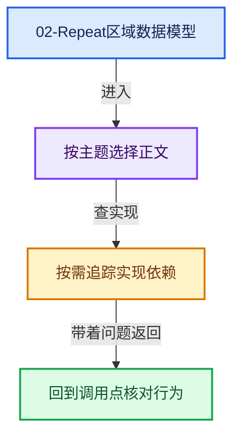

# 02-Repeat区域数据模型

[总入口](../README.md) · [课程指南](../00-课程指南/README.md) · [上一章](../01-Zone系统基础/README.md)

本章回答：Repeat 节点如何注册、它的用户可见数据（Repeat Items）存在哪里、如何被通用框架管理。

## 阅读顺序

- [02-01 Repeat节点注册与UI](01-Repeat节点注册与UI.md)
- [02-02 DNA存储与NodeRepeatItem](02-DNA存储与NodeRepeatItem.md)
- [02-03 SocketItems通用条目框架](03-SocketItems通用条目框架.md)

## 本章问题

- Repeat Input/Output 的类型如何注册？UI 面板如何绘制条目列表？
- `NodeRepeatItem` 的 `identifier` 为什么必须稳定？
- `NodeGeometryRepeatOutput` 的存储布局与 blend 读写全链路？
- `NOD_socket_items.hh` 的访问器协议如何把重复逻辑抽出来？

