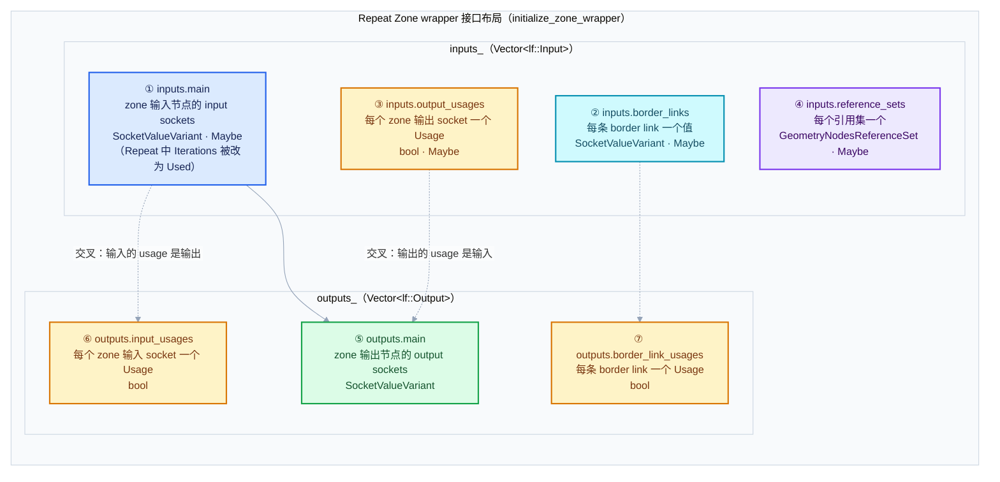
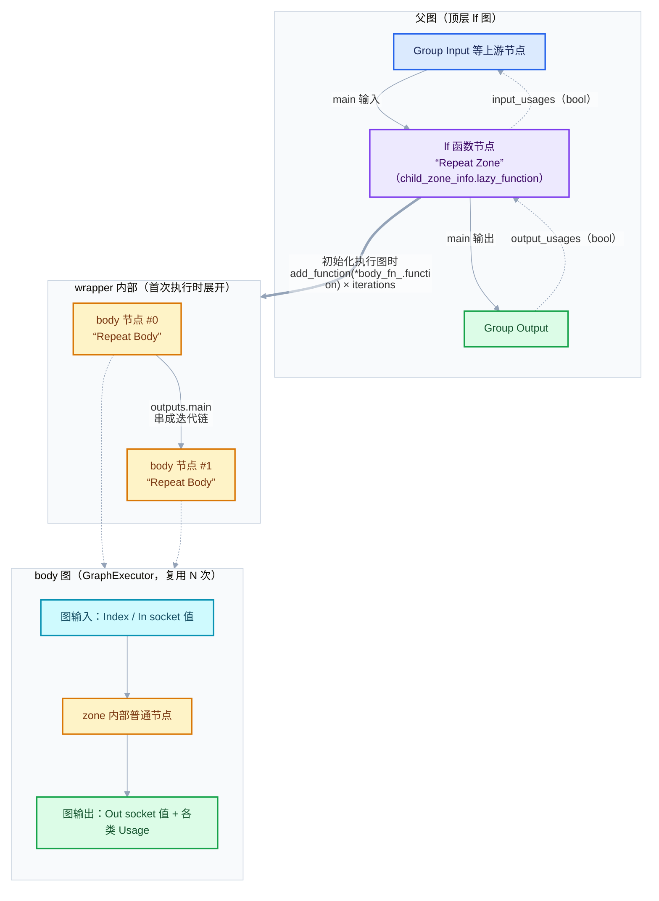
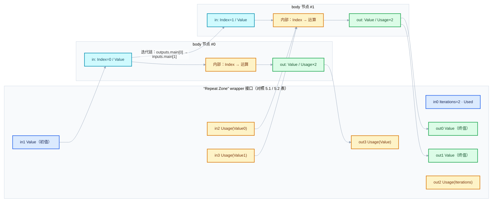

# 03 章 · 几何节点执行架构（一）：ZoneBodyFunction 与 ZoneBuildInfo

<div style="font-family:'Segoe UI','Microsoft YaHei',system-ui,-apple-system,sans-serif;display:flex;flex-wrap:wrap;align-items:center;gap:8px;margin:16px 0 20px;padding:10px 14px;background:#F8FAFC;border:1px solid #E2E8F0;border-radius:12px">
<span style="font-size:11px;font-weight:700;letter-spacing:.1em;color:#64748B;margin-right:2px">导航</span>
<a href="../README.md" style="font-size:13px;color:#334155;background:#F1F5F9;border:1px solid #E2E8F0;border-radius:999px;padding:3px 12px;text-decoration:none;white-space:nowrap">总入口</a>
<a href="./README.md" style="font-size:13px;color:#2563EB;background:#EFF6FF;border:1px solid #BFDBFE;border-radius:999px;padding:3px 12px;text-decoration:none;white-space:nowrap">本章 03-几何节点执行架构</a>
<a href="./02-Repeat循环体函数构建详解.md" style="font-size:13px;color:#7C3AED;background:#F5F3FF;border:1px solid #DDD6FE;border-radius:999px;padding:3px 12px;text-decoration:none;white-space:nowrap">Repeat循环体函数构建详解 ›</a>
</div>

<div style="font-family:'Segoe UI','Microsoft YaHei',system-ui,-apple-system,sans-serif;margin:18px 0 22px;padding:14px 18px;background:#F5F3FF;border-left:4px solid #7C3AED;border-radius:10px">

[系列总入口](../README.md) · [本章导航](README.md) · 上一篇：[02-Repeat循环体函数构建详解](02-Repeat循环体函数构建详解.md) · 下一篇：[04 章 / RepeatEvalStorage 与一次求值](../04-运行时机制/01-RepeatEvalStorage与一次求值.md)

**基准版本**：Blender 5.4.0-alpha（源码行号以当前仓库 `D:\Repository\blender-git\blender` 为准，后文所有 `L行号` 均可在对应文件中直接核对）。

</div>

<hr style="border:none;height:1px;background:linear-gradient(90deg,#BFDBFE,#E2E8F0 55%,transparent);margin:34px 0">

Repeat Zone（重复区域）在 Blender 几何节点的运行体系中，并不是一个"节点"，而是**两个互相咬合的 LazyFunction**：一个代表循环体（body），一个代表整个 zone（wrapper）。本文讲解承载这两个函数的三个核心数据结构——`ZoneFunctionIndices`、`ZoneBuildInfo`、`ZoneBodyFunction`——并把"zone 是如何一步步被翻译成 LazyFunction 图、再插回父图"的完整构建流程讲清楚。

<hr style="border:none;height:1px;background:linear-gradient(90deg,#BFDBFE,#E2E8F0 55%,transparent);margin:34px 0">

## 1. 先回答一个具体问题：为什么循环体要先包成一个函数，再被另一个函数包装？

初读 Repeat Zone 相关代码时，最常见的困惑是：明明一个 zone 就是"框住一批节点"，为什么源码要拆成 `ZoneBodyFunction` 和 `ZoneBuildInfo` 两层，还要先 `build_zone_body_function` 再 `build_repeat_zone_lazy_function`？

答案写在头文件的注释里。看 [NOD_geometry_nodes_lazy_function.hh · L613-L621](../../../source/blender/nodes/NOD_geometry_nodes_lazy_function.hh#L613)：

```cpp
/**
 * Contains the lazy-function for the "body" of a zone. It contains all the nodes inside of the
 * zone. The "body" function is wrapped by another lazy-function which represents the zone as a
 * hole. The wrapper function might invoke the zone body multiple times (like for repeat zones).
 */
struct ZoneBodyFunction {
  const LazyFunction *function = nullptr;
  ZoneFunctionIndices indices;
};
```

把这段注释翻译成三条设计动机：

1. **"body 可能被调用多次"**。Repeat Zone 的本质是把 zone 内部那批节点重复执行 N 次。LazyFunction 的执行模型里，一个函数节点就是图上的一个点，执行器按数据流调度它。要让"重复 N 次"成立，最自然的做法是：把 body 编译成一个可复用的 `LazyFunction`（`GraphExecutor`），然后在运行期把它作为函数节点往执行图里放 N 份。这正是 [geometry_nodes_repeat_zone.cc · L249-L252](../../../source/blender/nodes/intern/geometry_nodes_repeat_zone.cc#L249) 做的事——`for` 循环里 `add_function(*body_fn_.function)` 加了 `iterations` 个 body 节点。

2. **"wrapper 把 zone 当成一个黑洞（hole）"**。对 zone 外面的图来说，Repeat Zone 只是一个有输入输出的普通函数节点；它内部循环了几次、怎么传递状态，外界一概不关心。所以需要第二个 LazyFunction（`LazyFunctionForRepeatZone`，debug 名就叫 `"Repeat Zone"`）来实现"黑洞语义"：吃进主输入、吐出主输出，内部决定调几次 body。

3. **"两套接口要对得上号"**。body 图和 wrapper 图是两张不同的 lf 图，接口顺序并不天然一致（wrapper 的输入来自 zone 输入节点的 **input** sockets，body 的输入却来自 zone 输入节点的 **output** sockets，方向相反！）。`ZoneFunctionIndices` 就是两张图之间的"对账单"：记录每一组输入/输出分别在各自接口向量里的下标，wrapper 靠这些下标把数据接到 body 上。

<div style="font-family:'Segoe UI','Microsoft YaHei',system-ui,-apple-system,sans-serif;margin:16px 0 20px;padding:12px 16px;background:#F0FDF4;border-left:4px solid #16A34A;border-radius:10px">
<div style="font-size:11px;font-weight:700;letter-spacing:.08em;color:#15803D;margin-bottom:6px">一句话记住</div>

**body 函数 = zone 内部的可复用编译产物；wrapper 函数 = 对外暴露的黑洞；`ZoneBuildInfo`/`ZoneBodyFunction` 里的 `indices` = 把黑洞接到身体上的接线表。**

</div>

<hr style="border:none;height:1px;background:linear-gradient(90deg,#BFDBFE,#E2E8F0 55%,transparent);margin:34px 0">

## 2. 预备知识：LazyFunction 的接口与 `ValueUsage`

在读两个核心结构之前，需要先掌握 LazyFunction 层最基础的三件套：`ValueUsage`、`Input`、`Output`。它们定义在 [FN_lazy_function.hh · L61-L76](../../../source/blender/functions/FN_lazy_function.hh#L61)：

### 2.1 三种使用意图：`Used` / `Maybe` / `Unused`

```cpp
enum class ValueUsage : uint8_t {
  /**
   * The value is definitely used and therefore has to be computed.
   */
  Used,
  /**
   * It's unknown whether this value will be used or not. Computing it is ok but the result may be
   * discarded.
   */
  Maybe,
  /**
   * The value will definitely not be used. It can still be computed but the result will be
   * discarded in all cases.
   */
  Unused,
};
```

<details>
<summary>核对原始源码：FN_lazy_function.hh · L61—L76</summary>

```cpp
enum class ValueUsage : uint8_t {
  /**
   * The value is definitely used and therefore has to be computed.
   */
  Used,
  /**
   * It's unknown whether this value will be used or not. Computing it is ok but the result may be
   * discarded.
   */
  Maybe,
  /**
   * The value will definitely not be used. It can still be computed but the result will be
   * discarded in all cases.
   */
  Unused,
};
```

</details>

三者的语义梯度是"必算 / 可算可不算 / 不算"。zone 的 wrapper 接口几乎全部声明为 `Maybe`（见 [initialize_zone_wrapper · L1716](../../../source/blender/nodes/intern/geometry_nodes_lazy_function.cc#L1716)），唯一例外是 Repeat 的 Iterations 输入——`LazyFunctionForRepeatZone` 构造函数里显式改成了 `Used`（[geometry_nodes_repeat_zone.cc · L135-L136](../../../source/blender/nodes/intern/geometry_nodes_repeat_zone.cc#L135)），因为不管外部要不要输出，循环次数都必须先算出来。

### 2.2 `Input` 与 `Output`：接口的最小描述单元

[Input 定义 · L202-L227](../../../source/blender/functions/FN_lazy_function.hh#L202)：

```cpp
struct Input {
  /**
   * Name used for debugging purposes. The string has to be static or has to be owned by something
   * else.
   */
  const char *debug_name;
  /**
   * Data type of this input.
   */
  const CPPType *type;
  /**
   * Can be used to indicate a caller or this function if this input is used statically before
   * executing it the first time. ...
   */
  ValueUsage usage;
};
```

`Output` 结构与之对称（`debug_name` + `type`，见 [FN_lazy_function.hh · L229-L239](../../../source/blender/functions/FN_lazy_function.hh#L229)）。`LazyFunction` 内部就是两条 `Vector<Input> inputs_` 与 `Vector<Output> outputs_`；而 zone 构建过程中反复出现的 `r_inputs.append_and_get_index_as(...)`，本质就是"往接口向量里追加一项，并顺手把下标记进 `indices` 的某一组"。**这就是 `ZoneFunctionIndices` 存在的全部理由：append 的同时记账。**

另外两个与后文相关的 `Params` 能力（[FN_lazy_function.hh · L127-L164](../../../source/blender/functions/FN_lazy_function.hh#L127)）：

- `try_get_input_data_ptr_or_request(index)`：输入还没就绪就"挂起等待"，这是延迟求值的调度基础；
- `get_output_usage(index)` / `output_was_set(index)`：函数可以探测"调用方到底还要不要我这个输出"。Repeat wrapper 用后者判断 Iterations 的 usage 输出是否已经设置过（[geometry_nodes_repeat_zone.cc · L164-L168](../../../source/blender/nodes/intern/geometry_nodes_repeat_zone.cc#L164)）。

<hr style="border:none;height:1px;background:linear-gradient(90deg,#BFDBFE,#E2E8F0 55%,transparent);margin:34px 0">

## 3. 两个核心结构

先一次性给出头文件里的完整定义（[NOD_geometry_nodes_lazy_function.hh · L591-L621](../../../source/blender/nodes/NOD_geometry_nodes_lazy_function.hh#L591)）：

```cpp
struct ZoneFunctionIndices {
  struct {
    Vector<int> main;
    Vector<int> border_links;
    Vector<int> output_usages;
    Map<ReferenceSetIndex, int> reference_sets;
  } inputs;
  struct {
    Vector<int> main;
    Vector<int> border_link_usages;
    Vector<int> input_usages;
  } outputs;
};

struct ZoneBuildInfo {
  /** The lazy function that contains the zone. */
  const LazyFunction *lazy_function = nullptr;

  /** Information about what the various inputs and outputs of the lazy-function are. */
  ZoneFunctionIndices indices;
};

/**
 * Contains the lazy-function for the "body" of a zone. It contains all the nodes inside of the
 * zone. The "body" function is wrapped by another lazy-function which represents the zone as a
 * hole. The wrapper function might invoke the zone body multiple times (like for repeat zones).
 */
struct ZoneBodyFunction {
  const LazyFunction *function = nullptr;
  ZoneFunctionIndices indices;
};
```

<details>
<summary>核对原始源码：NOD_geometry_nodes_lazy_function.hh · L591—L621</summary>

```cpp
struct ZoneFunctionIndices {
  struct {
    Vector<int> main;
    Vector<int> border_links;
    Vector<int> output_usages;
    Map<ReferenceSetIndex, int> reference_sets;
  } inputs;
  struct {
    Vector<int> main;
    Vector<int> border_link_usages;
    Vector<int> input_usages;
  } outputs;
};

struct ZoneBuildInfo {
  /** The lazy function that contains the zone. */
  const LazyFunction *lazy_function = nullptr;

  /** Information about what the various inputs and outputs of the lazy-function are. */
  ZoneFunctionIndices indices;
};

/**
 * Contains the lazy-function for the "body" of a zone. It contains all the nodes inside of the
 * zone. The "body" function is wrapped by another lazy-function which represents the zone as a
 * hole. The wrapper function might invoke the zone body multiple times (like for repeat zones).
 */
struct ZoneBodyFunction {
  const LazyFunction *function = nullptr;
  ZoneFunctionIndices indices;
};
```

</details>

### 3.1 `ZoneFunctionIndices`：七组下标，一张接线表

`ZoneFunctionIndices` 把一个函数（body 或 wrapper 都通用）的全部接口按"语义组"分成 4 组输入 + 3 组输出，每组存的是**该组内第 k 个 socket 在整个接口向量里的全局下标**：

| 组 | 方向 | 存的是什么 | 为什么需要它 |
| --- | --- | --- | --- |
| `inputs.main` | 输入 | zone 主输入（对 Repeat 而言：Iterations + 各 item 的 In socket 值） | 数据通路主体 |
| `inputs.border_links` | 输入 | 越过 zone 边界进入 zone 的链接所携带的值 | 跨 zone 取数（详见 02 篇） |
| `inputs.output_usages` | 输入 | 每个 zone **输出** socket 对应一个 `bool`："调用方还要这个输出吗" | 惰性剪枝：输出没人要，对应链路就可以不算 |
| `inputs.reference_sets` | 输入 | `Map<ReferenceSetIndex, int>`：第 i 个引用集 → 接口下标 | 引用生命周期管理的挂钩（闭包/引用集机制） |
| `outputs.main` | 输出 | zone 主输出（各 item 的 Out socket 值） | 数据通路主体 |
| `outputs.border_link_usages` | 输出 | 每条 border link 一个 `bool`："body 用过这条链接吗" | wrapper 据此合并多次迭代的 usage |
| `outputs.input_usages` | 输出 | 每个 zone **输入** socket 对应一个 `bool`："body 实际用到这个输入了吗" | 反向反馈，供父图做剪枝与循环打断 |

注意 `inputs.output_usages` 与 `outputs.input_usages` 的**交叉对称**：输出的 usage 是输入、输入的 usage 是输出。这不是笔误——"我需不需要你的输出"必须由调用方**喂进来**，"我有没有用到你的输入"必须由函数**报告出去**。usage 在 LazyFunction 图里永远以布尔值的形式沿边流动。

`reference_sets` 用 `Map` 而不是 `Vector`，是因为并非每个引用集都要暴露成接口：只有"接口级"的引用集（例如来自 Group Input 的）才会在 body 图里生成一个图输入 socket，其它局部引用集在 zone 内部消化。Repeat wrapper 构建时 `expose_all_reference_sets = true`，会把 body 里出现的每个引用集都照搬到 wrapper 接口上（[geometry_nodes_lazy_function.cc · L1747-L1755](../../../source/blender/nodes/intern/geometry_nodes_lazy_function.cc#L1747)）。

### 3.2 `ZoneBuildInfo`：wrapper 的"函数 + 接线表"

```cpp
struct ZoneBuildInfo {
  /** The lazy function that contains the zone. */
  const LazyFunction *lazy_function = nullptr;

  /** Information about what the various inputs and outputs of the lazy-function are. */
  ZoneFunctionIndices indices;
};
```

`lazy_function` 指向**wrapper**——即整个 zone 对外的那一个 `LazyFunction`。构建开始时它是 `nullptr`，`build_repeat_zone_function` 的最后一行才把它填上（见 4.3 节）。`indices` 描述的也是 **wrapper** 的接口布局。

在父图构建时，`zone_build_infos_`（按 zone 索引排列的 `Array<ZoneBuildInfo>`）就是所有 zone 的"花名册"：`insert_child_zone_node` 拿着 `child_zone_info.lazy_function` 把 zone 插成父图里的函数节点，再拿 `child_zone_info.indices` 精确对号入座（见 4.6 节）。

### 3.3 `ZoneBodyFunction`：body 的"函数 + 接线表"

```cpp
struct ZoneBodyFunction {
  const LazyFunction *function = nullptr;
  ZoneFunctionIndices indices;
};
```

结构与 `ZoneBuildInfo` 完全同构，只是两点不同：

1. `function` 指向的是 **body** 的 `GraphExecutor`（`build_zone_body_function` 末尾构造，[geometry_nodes_lazy_function.cc · L2381-L2386](../../../source/blender/nodes/intern/geometry_nodes_lazy_function.cc#L2381)）；
2. 它**没有**"包含 zone 的 lazy function"语义，它就是 zone 内部那批节点的编译产物，可以被 wrapper 复用任意多次。

两个结构的 `indices` 类型相同，这正是 wrapper 能"盲接" body 的前提：wrapper 拿着 `body_fn.indices.inputs.main[i]` 去索引 body 节点的输入，拿着自己 `zone_info.indices.inputs.main[i]` 去索引自己的图输入，两边顺序由**同一套构建规则**保证对齐。

### 3.4 接口布局总览：wrapper 的输入/输出分组

`ZoneBuildInfo.indices` 记录的 wrapper 接口布局，由 [initialize_zone_wrapper · L1704-L1756](../../../source/blender/nodes/intern/geometry_nodes_lazy_function.cc#L1704) 统一构建。分组顺序如下图（这是理解第 5 节"小数据走一遍"的钥匙）：



记住这个 ①→⑦ 的编号，第 5 节会原样展开成具体下标表。

<hr style="border:none;height:1px;background:linear-gradient(90deg,#BFDBFE,#E2E8F0 55%,transparent);margin:34px 0">

## 4. 构建总流程

整个 zone 构建发生在 `GeometryNodesLazyFunctionBuilder`（`geometry_nodes_lazy_function.cc` 内部的构建器类）中，入口是 `build_zone_functions()`。流程链：

```
compute_zone_build_order  →  build_zone_body_function  →  build_repeat_zone_lazy_function
        （排序）                  （编译 body 图）              （构造 wrapper + 记账）
                                                ↓
insert_child_zone_node（把 wrapper 作为函数节点插进父图，usage/border link 对号接线）
```

下面每步一节。

### 4.1 `compute_zone_build_order`：嵌套 zone 先建

[geometry_nodes_lazy_function.cc · L2096-L2105](../../../source/blender/nodes/intern/geometry_nodes_lazy_function.cc#L2096)：

```cpp
  Array<int> compute_zone_build_order()
  {
    /* Build nested zones first. */
    Array<int> zone_build_order(tree_zones_->zones.size());
    array_utils::fill_index_range<int>(zone_build_order);
    std::ranges::sort(zone_build_order, [&](const int zone_a, const int zone_b) {
      return tree_zones_->zones[zone_a]->depth > tree_zones_->zones[zone_b]->depth;
    });
    return zone_build_order;
  }
```

[讲解]：

- [L2099] 先开一个与 zone 总数等长的下标数组；
- [L2100] `fill_index_range` 把它填成 `0,1,2,…`，即初始顺序 = zone 在 `tree_zones_->zones` 里的天然顺序；
- [L2101-L2103] 关键一步：按 `depth` **降序**排序。`depth` 的语义定义在 [BKE_node_tree_zones.hh · L28-L29](../../../source/blender/blenkernel/BKE_node_tree_zones.hh#L28)："Zero for top level zones, one for a nested zone, and so on"——所以降序就是**最深的（嵌套最里的）zone 排最前**；
- 注释 `/* Build nested zones first. */` 点明动机：外层 zone 构建时，需要把内层 zone 已经编译好的 wrapper 当作子图节点插进来（见 4.6 节的 `insert_child_zone_node`，它直接解引用 `zone_build_infos_[child_zone_i].lazy_function`）。顺序反了就是空指针。

<details>
<summary>核对原始源码：geometry_nodes_lazy_function.cc · L2096—L2105</summary>

```cpp
  Array<int> compute_zone_build_order()
  {
    /* Build nested zones first. */
    Array<int> zone_build_order(tree_zones_->zones.size());
    array_utils::fill_index_range<int>(zone_build_order);
    std::ranges::sort(zone_build_order, [&](const int zone_a, const int zone_b) {
      return tree_zones_->zones[zone_a]->depth > tree_zones_->zones[zone_b]->depth;
    });
    return zone_build_order;
  }
```

</details>

用一张图看三种典型树形下，构建顺序如何展开：

```mermaid
%%{init: {"theme":"base","themeVariables":{"fontFamily":"\"Segoe UI\",\"Microsoft YaHei\",sans-serif","fontSize":"15px","lineColor":"#94A3B8","edgeLabelBackground":"#FFFFFF","clusterBkg":"#F8FAFC","clusterBorder":"#CBD5E1"},"flowchart":{"htmlLabels":false,"curve":"basis","nodeSpacing":52,"rankSpacing":64,"padding":14,"diagramPadding":16,"useMaxWidth":true},"sequence":{"useMaxWidth":true,"wrap":true,"mirrorActors":false,"messageMargin":36}}}%%
flowchart TB
    subgraph TREE1["情形 A：无嵌套"]
        ZA0["Repeat zone（depth 0）"]
    end
    subgraph TREE2["情形 B：Repeat 套 Repeat"]
        ZB0["外层 Repeat（depth 0）"]
        ZB1["内层 Repeat（depth 1）"]
        ZB0 --- ZB1
    end
    subgraph TREE3["情形 C：Simulation 套 Repeat，再套 Closure"]
        ZC0["Simulation zone（depth 0）"]
        ZC1["Repeat zone（depth 1）"]
        ZC2["Closure zone（depth 2）"]
        ZC0 --- ZC1 --- ZC2
    end
    ORDER["构建顺序（depth 降序）"]:::result
    OA["A：Repeat(0)"]:::result
    OB["B：内层 Repeat(1) → 外层 Repeat(0)"]:::result
    OC["C：Closure(2) → Repeat(1) → Simulation(0)"]:::result
    ORDER --> OA
    ORDER --> OB
    ORDER --> OC
    classDef result fill:#DCFCE7,stroke:#16A34A,color:#14532D,stroke-width:2px
```



### 4.2 `build_zone_functions`：按 zone 输出节点类型分发

排好序后逐个构建，[geometry_nodes_lazy_function.cc · L2065-L2094](../../../source/blender/nodes/intern/geometry_nodes_lazy_function.cc#L2065)：

```cpp
  void build_zone_functions()
  {
    zone_build_infos_ = scope_.construct<Array<ZoneBuildInfo>>(tree_zones_->zones.size());

    const Array<int> zone_build_order = this->compute_zone_build_order();

    for (const int zone_i : zone_build_order) {
      const bNodeTreeZone &zone = *tree_zones_->zones[zone_i];
      switch (zone.output_node()->type_legacy) {
        case GEO_NODE_SIMULATION_OUTPUT: {
          this->build_simulation_zone_function(zone);
          break;
        }
        case GEO_NODE_REPEAT_OUTPUT: {
          this->build_repeat_zone_function(zone);
          break;
        }
        case GEO_NODE_FOREACH_GEOMETRY_ELEMENT_OUTPUT:
          this->build_foreach_geometry_element_zone_function(zone);
          break;
        case NODE_CLOSURE_OUTPUT:
          this->build_closure_zone_function(zone);
          break;
        default: {
          BLI_assert_unreachable();
          break;
        }
      }
    }
  }
```

[讲解]：

- [L2067] 先把 `zone_build_infos_` 这个 `Array<ZoneBuildInfo>` 整体分配出来，长度等于 zone 总数——注意此时每个元素的 `lazy_function` 都是 `nullptr`，靠后续循环逐个填充；
- [L2069] 拿到 4.1 节的构建顺序；
- [L2073] 分发依据是 **zone 的输出节点类型**（Simulation/Repeat/Foreach/Closure 四种），每种类型有独立的 build 函数；
- [L2078-L2081] 本文主角：`GEO_NODE_REPEAT_OUTPUT` → `build_repeat_zone_function`；
- [L2088-L2089] `default` 分支 `BLI_assert_unreachable()`：`bNodeTreeZones` 的分析阶段保证不会有别的 zone 输出类型漏进来。

<details>
<summary>核对原始源码：geometry_nodes_lazy_function.cc · L2065—L2094</summary>

```cpp
  void build_zone_functions()
  {
    zone_build_infos_ = scope_.construct<Array<ZoneBuildInfo>>(tree_zones_->zones.size());

    const Array<int> zone_build_order = this->compute_zone_build_order();

    for (const int zone_i : zone_build_order) {
      const bNodeTreeZone &zone = *tree_zones_->zones[zone_i];
      switch (zone.output_node()->type_legacy) {
        case GEO_NODE_SIMULATION_OUTPUT: {
          this->build_simulation_zone_function(zone);
          break;
        }
        case GEO_NODE_REPEAT_OUTPUT: {
          this->build_repeat_zone_function(zone);
          break;
        }
        case GEO_NODE_FOREACH_GEOMETRY_ELEMENT_OUTPUT:
          this->build_foreach_geometry_element_zone_function(zone);
          break;
        case NODE_CLOSURE_OUTPUT:
          this->build_closure_zone_function(zone);
          break;
        default: {
          BLI_assert_unreachable();
          break;
        }
      }
    }
  }
```

</details>

### 4.3 `build_repeat_zone_function`：先身体，后包装

[geometry_nodes_lazy_function.cc · L2243-L2252](../../../source/blender/nodes/intern/geometry_nodes_lazy_function.cc#L2243)：

```cpp
  void build_repeat_zone_function(const bNodeTreeZone &zone)
  {
    ZoneBuildInfo &zone_info = zone_build_infos_[zone.index];
    /* Build a function for the loop body. */
    ZoneBodyFunction &body_fn = this->build_zone_body_function(
        zone, "Repeat Body", &scope_.construct<GeometryNodesLazyFunctionSideEffectProvider>());
    /* Wrap the loop body by another function that implements the repeat behavior. */
    auto &zone_fn = build_repeat_zone_lazy_function(scope_, btree_, zone, zone_info, body_fn);
    zone_info.lazy_function = &zone_fn;
  }
```

[讲解]：

- [L2245] 从花名册里取出本 zone 的 `ZoneBuildInfo` 引用（此刻 `lazy_function == nullptr`）；
- [L2247-L2248] **第一步**：编译循环体。名字 `"Repeat Body"` 会成为 body 图 `lf::Graph` 的 debug 名；同时传入一个 side effect provider，让 body 图执行时能响应"Set Position 等带副作用的节点需要强制求值"的调度请求；
- [L2250] **第二步**：调 [build_repeat_zone_lazy_function · L423-L430（geometry_nodes_repeat_zone.cc）](../../../source/blender/nodes/intern/geometry_nodes_repeat_zone.cc#L423)。这个函数只有一行——`return scope.construct<LazyFunctionForRepeatZone>(btree, zone, zone_info, body_fn);`——真正的活儿全在 `LazyFunctionForRepeatZone` 的构造函数里（见 4.5 节）。注意参数顺序：`zone_info` 以**可变引用**传入（构造函数要在里面记账），`body_fn` 以**只读引用**传入（body 已经定稿，不许改）；
- [L2251] **第三步**：把 wrapper 的地址写回 `zone_info.lazy_function`。从此父图就能通过花名册找到这个 zone。

<details>
<summary>核对原始源码：geometry_nodes_lazy_function.cc · L2243—L2252 与 geometry_nodes_repeat_zone.cc · L423—L430</summary>

```cpp
  void build_repeat_zone_function(const bNodeTreeZone &zone)
  {
    ZoneBuildInfo &zone_info = zone_build_infos_[zone.index];
    /* Build a function for the loop body. */
    ZoneBodyFunction &body_fn = this->build_zone_body_function(
        zone, "Repeat Body", &scope_.construct<GeometryNodesLazyFunctionSideEffectProvider>());
    /* Wrap the loop body by another function that implements the repeat behavior. */
    auto &zone_fn = build_repeat_zone_lazy_function(scope_, btree_, zone, zone_info, body_fn);
    zone_info.lazy_function = &zone_fn;
  }
```

```cpp
LazyFunction &build_repeat_zone_lazy_function(ResourceScope &scope,
                                              const bNodeTree &btree,
                                              const bke::bNodeTreeZone &zone,
                                              ZoneBuildInfo &zone_info,
                                              const ZoneBodyFunction &body_fn)
{
  return scope.construct<LazyFunctionForRepeatZone>(btree, zone, zone_info, body_fn);
}
```

</details>

同一个模式在 Foreach（`"Foreach Body"`，[L2254-L2264](../../../source/blender/nodes/intern/geometry_nodes_lazy_function.cc#L2254)）和 Closure（`"Closure Body"`，[L2266-L2275](../../../source/blender/nodes/intern/geometry_nodes_lazy_function.cc#L2266)）上完全复用——**"先 body 后 wrapper"是所有多调用 zone 的统一构建范式**，区别只在 wrapper 的实现和 body 名字。

### 4.4 `build_zone_body_function`：把 zone 内部翻译成一张可复用的 body 图

[geometry_nodes_lazy_function.cc · L2280-L2393](../../../source/blender/nodes/intern/geometry_nodes_lazy_function.cc#L2280)。这是全文件最长的函数之一，这里按"接口构建 → 内部建图 → 收尾"三段拆讲。

**第一段：body 的三组基础接口**（L2289-L2325）：

```cpp
    Vector<lf::GraphInputSocket *> lf_body_inputs;
    Vector<lf::GraphOutputSocket *> lf_body_outputs;
    ZoneBodyFunction &body_fn = scope_.construct<ZoneBodyFunction>();

    for (const bNodeSocket *bsocket : zone.input_node()->output_sockets()) {
      if (ignore_zone_bsocket(*bsocket)) {
        continue;
      }
      lf::GraphInputSocket &lf_input = lf_body_graph.add_input(CPPType::get<SocketValueVariant>(),
                                                               bsocket->name);
      lf::GraphOutputSocket &lf_input_usage = lf_body_graph.add_output(
          CPPType::get<bool>(), "Usage: " + StringRef(bsocket->name));
      body_fn.indices.inputs.main.append(lf_body_inputs.append_and_get_index(&lf_input));
      body_fn.indices.outputs.input_usages.append(
          lf_body_outputs.append_and_get_index(&lf_input_usage));
      graph_params.lf_output_by_bsocket.add_new(bsocket, &lf_input);
    }
```

[讲解]：

- [L2293] 注意方向：body 的输入来自 zone **输入节点的输出侧** sockets（Repeat Input 的 `Index` 和各 item 的 Out）。zone 输入节点在 body 图里的角色是"数据源"；
- [L2294-L2296] `ignore_zone_bsocket` 过滤掉不可用 socket 和没有 `geometry_nodes_default_value` 的 socket（后者典型是 extend socket，见 [L1692-L1702](../../../source/blender/nodes/intern/geometry_nodes_lazy_function.cc#L1692)）——**body 接口与 bsocket 原生序号因此不对齐，必须靠 `indices` 对账**；
- [L2299-L2300] 每个输入值 socket 伴随生成一个 `"Usage: <name>"` 的布尔**输出**——这就是 3.1 节说的交叉对称：body 要向调用方报告"这个输入我用了吗"；
- [L2301-L2303] `append_and_get_index` + `indices...append`：追加的同时把下标记进 `body_fn.indices`，这正是 2.2 节说的"append 即记账"；
- [L2304] 建立 bsocket → lf 输出 socket 的映射，后面内部连线全靠它。

<details>
<summary>核对原始源码：geometry_nodes_lazy_function.cc · L2289—L2305</summary>

```cpp
    Vector<lf::GraphInputSocket *> lf_body_inputs;
    Vector<lf::GraphOutputSocket *> lf_body_outputs;
    ZoneBodyFunction &body_fn = scope_.construct<ZoneBodyFunction>();

    for (const bNodeSocket *bsocket : zone.input_node()->output_sockets()) {
      if (ignore_zone_bsocket(*bsocket)) {
        continue;
      }
      lf::GraphInputSocket &lf_input = lf_body_graph.add_input(CPPType::get<SocketValueVariant>(),
                                                               bsocket->name);
      lf::GraphOutputSocket &lf_input_usage = lf_body_graph.add_output(
          CPPType::get<bool>(), "Usage: " + StringRef(bsocket->name));
      body_fn.indices.inputs.main.append(lf_body_inputs.append_and_get_index(&lf_input));
      body_fn.indices.outputs.input_usages.append(
          lf_body_outputs.append_and_get_index(&lf_input_usage));
      graph_params.lf_output_by_bsocket.add_new(bsocket, &lf_input);
    }
```

</details>

border link 部分由两个小工具函数完成（[L2395-L2416](../../../source/blender/nodes/intern/geometry_nodes_lazy_function.cc#L2395)）：`build_zone_border_links_inputs` 为每条 border link 加一个名为 `"Link from <socket>"` 的图输入，`build_zone_border_link_input_usages` 加一个 `"Usage: Link from <socket>"` 的图输出。

输出侧接口（L2312-L2325）方向同样相反：body 的**输出**来自 zone **输出节点的输入侧** sockets（Repeat In），每个伴随一个 `"Usage: <name>"` 的布尔**输入**，分别记入 `indices.outputs.main` 与 `indices.inputs.output_usages`。

**第二段：内部建图**。核心三行：

- [L2327] `insert_nodes_and_zones(zone.child_nodes(), zone.child_zones, graph_params)`——递归地把 zone 内的普通节点和**子 zone**（已经编译好的 wrapper）插进 body 图；
- [L2352-L2354] 把每个有映射的 bsocket 向外发起连线；
- [L2356-L2361] `link_border_link_inputs_and_usages`：把 border link 输入接到 zone 内部的目标 socket，并把 body 内部对 border link 的使用情况汇聚到 usage 输出。

**第三段：收尾与执行器**（L2363-L2392）：

```cpp
    this->add_default_inputs(graph_params);

    Map<int, lf::OutputSocket *> lf_reference_sets;
    this->build_reference_set_for_zone(graph_params, lf_reference_sets);
    for (const auto item : lf_reference_sets.items()) {
      lf::OutputSocket &lf_attribute_set_socket = *item.value;
      if (lf_attribute_set_socket.node().is_interface()) {
        body_fn.indices.inputs.reference_sets.add_new(
            item.key, lf_body_inputs.append_and_get_index(&lf_attribute_set_socket));
      }
    }
    this->link_reference_sets(graph_params, lf_reference_sets);
    this->fix_link_cycles(lf_body_graph, graph_params.socket_usage_inputs);

    lf_body_graph.update_node_indices();

    auto &logger = scope_.construct<GeometryNodesLazyFunctionLogger>(*lf_graph_info_);

    body_fn.function = &scope_.construct<lf::GraphExecutor>(lf_body_graph,
                                                            lf_body_inputs.as_span(),
                                                            lf_body_outputs.as_span(),
                                                            &logger,
                                                            side_effect_provider,
                                                            nullptr);

    lf_graph_info_->debug_zone_body_graphs.add(zone.output_node()->identifier, &lf_body_graph);

    return body_fn;
```

[讲解]：

- [L2369-L2373] 只有挂在**接口节点**上的引用集才暴露成 body 输入并记进 `indices.inputs.reference_sets`——局部引用集不出图；
- [L2375] `fix_link_cycles` 借助 usage 输入（`graph_params.socket_usage_inputs`）打断依赖环，这也是 usage 机制的用途之一（[L1680-L1684](../../../source/blender/nodes/intern/geometry_nodes_lazy_function.cc#L1680) 的注释专门交代了这一点）；
- [L2381-L2386] 最终把 body 图包成 `lf::GraphExecutor`——**body 从此就是一个普通的可调用 LazyFunction**，写入 `body_fn.function`；
- [L2388] body 图的 dot 表示被存进 `debug_zone_body_graphs`，可在节点编辑器的 GraphViz 调试面板里查看。

<details>
<summary>核对原始源码：geometry_nodes_lazy_function.cc · L2363—L2392</summary>

```cpp
    this->add_default_inputs(graph_params);

    Map<int, lf::OutputSocket *> lf_reference_sets;
    this->build_reference_set_for_zone(graph_params, lf_reference_sets);
    for (const auto item : lf_reference_sets.items()) {
      lf::OutputSocket &lf_attribute_set_socket = *item.value;
      if (lf_attribute_set_socket.node().is_interface()) {
        body_fn.indices.inputs.reference_sets.add_new(
            item.key, lf_body_inputs.append_and_get_index(&lf_attribute_set_socket));
      }
    }
    this->link_reference_sets(graph_params, lf_reference_sets);
    this->fix_link_cycles(lf_body_graph, graph_params.socket_usage_inputs);

    lf_body_graph.update_node_indices();

    auto &logger = scope_.construct<GeometryNodesLazyFunctionLogger>(*lf_graph_info_);

    body_fn.function = &scope_.construct<lf::GraphExecutor>(lf_body_graph,
                                                            lf_body_inputs.as_span(),
                                                            lf_body_outputs.as_span(),
                                                            &logger,
                                                            side_effect_provider,
                                                            nullptr);

    lf_graph_info_->debug_zone_body_graphs.add(zone.output_node()->identifier, &lf_body_graph);

    return body_fn;
```

</details>

### 4.5 wrapper：`LazyFunctionForRepeatZone` 与统一接口初始化

wrapper 的构造函数在 [geometry_nodes_repeat_zone.cc · L122-L137](../../../source/blender/nodes/intern/geometry_nodes_repeat_zone.cc#L122)：

```cpp
  LazyFunctionForRepeatZone(const bNodeTree &btree,
                            const bke::bNodeTreeZone &zone,
                            ZoneBuildInfo &zone_info,
                            const ZoneBodyFunction &body_fn)
      : btree_(btree),
        zone_(zone),
        repeat_output_bnode_(*zone.output_node()),
        zone_info_(zone_info),
        body_fn_(body_fn)
  {
    debug_name_ = "Repeat Zone";

    initialize_zone_wrapper(zone, zone_info, body_fn, true, inputs_, outputs_);
    /* Iterations input is always used. */
    inputs_[zone_info.indices.inputs.main[0]].usage = lf::ValueUsage::Used;
  }
```

[讲解]：

- [L132] wrapper 的 debug 名就叫 `"Repeat Zone"`——在惰性求值日志与 dot 图里你看到的就是它；
- [L134] **接口完全交给通用的 `initialize_zone_wrapper` 构建**（[geometry_nodes_lazy_function.cc · L1704-L1756](../../../source/blender/nodes/intern/geometry_nodes_lazy_function.cc#L1704)），第 5 个参数 `expose_all_reference_sets = true`：Repeat 要求所有引用集都上接口（closure zone 则传 `false`，这是两种 zone 在接口层面的可见差异）；
- [L135-L136] 构建完再把第 0 个 main 输入（即 Iterations）的 usage 从 `Maybe` 改成 `Used`——循环次数无论如何都要算。

<details>
<summary>核对原始源码：geometry_nodes_repeat_zone.cc · L122—L137</summary>

```cpp
  LazyFunctionForRepeatZone(const bNodeTree &btree,
                            const bke::bNodeTreeZone &zone,
                            ZoneBuildInfo &zone_info,
                            const ZoneBodyFunction &body_fn)
      : btree_(btree),
        zone_(zone),
        repeat_output_bnode_(*zone.output_node()),
        zone_info_(zone_info),
        body_fn_(body_fn)
  {
    debug_name_ = "Repeat Zone";

    initialize_zone_wrapper(zone, zone_info, body_fn, true, inputs_, outputs_);
    /* Iterations input is always used. */
    inputs_[zone_info.indices.inputs.main[0]].usage = lf::ValueUsage::Used;
  }
```

</details>

`initialize_zone_wrapper` 本体（本文最值得逐行读的函数之一，[L1704-L1756](../../../source/blender/nodes/intern/geometry_nodes_lazy_function.cc#L1704)）：

```cpp
void initialize_zone_wrapper(const bNodeTreeZone &zone,
                             ZoneBuildInfo &zone_info,
                             const ZoneBodyFunction &body_fn,
                             const bool expose_all_reference_sets,
                             Vector<lf::Input> &r_inputs,
                             Vector<lf::Output> &r_outputs)
{
  for (const bNodeSocket *socket : zone.input_node()->input_sockets()) {
    if (ignore_zone_bsocket(*socket)) {
      continue;
    }
    zone_info.indices.inputs.main.append(r_inputs.append_and_get_index_as(
        socket->name, CPPType::get<SocketValueVariant>(), lf::ValueUsage::Maybe));
  }

  for (const bNodeLink *link : zone.border_links) {
    zone_info.indices.inputs.border_links.append(r_inputs.append_and_get_index_as(
        link->fromsock->name, CPPType::get<SocketValueVariant>(), lf::ValueUsage::Maybe));
  }

  for (const bNodeSocket *socket : zone.output_node()->output_sockets()) {
    if (ignore_zone_bsocket(*socket)) {
      continue;
    }
    zone_info.indices.inputs.output_usages.append(
        r_inputs.append_and_get_index_as("Usage", CPPType::get<bool>(), lf::ValueUsage::Maybe));
    zone_info.indices.outputs.main.append(
        r_outputs.append_and_get_index_as(socket->name, CPPType::get<SocketValueVariant>()));
  }

  for ([[maybe_unused]] const bNodeSocket *socket : zone.input_node()->input_sockets()) {
    if (ignore_zone_bsocket(*socket)) {
      continue;
    }
    zone_info.indices.outputs.input_usages.append(
        r_outputs.append_and_get_index_as("Usage", CPPType::get<bool>()));
  }

  for ([[maybe_unused]] const bNodeLink *link : zone.border_links) {
    zone_info.indices.outputs.border_link_usages.append(
        r_outputs.append_and_get_index_as("Border Link Usage", CPPType::get<bool>()));
  }

  /* Some zone types (e.g. the closure zone) do not expose all reference sets. */
  if (expose_all_reference_sets) {
    for (const auto item : body_fn.indices.inputs.reference_sets.items()) {
      zone_info.indices.inputs.reference_sets.add_new(
          item.key,
          r_inputs.append_and_get_index_as(
              "Reference Set", CPPType::get<GeometryNodesReferenceSet>(), lf::ValueUsage::Maybe));
    }
  }
}
```

[讲解]（按 3.4 节的 ①→⑦ 编号）：

- [L1711-L1717] **① main 输入**：遍历 zone 输入节点的 *input* sockets（对 wrapper 而言这是"外界塞数据进来的口"），类型 `SocketValueVariant`，usage `Maybe`；
- [L1719-L1722] **② border link 输入**：每条 border link 一个，debug 名取**来源 socket 名**（`link->fromsock->name`）；
- [L1724-L1732] **③ 输出 usage 输入 + ⑤ main 输出**：同一次遍历里成对添加——每有一个 zone 输出 socket，就在输入侧加一个 `"Usage"`（bool），在输出侧加一个同名值输出。**这一对必须同序**，wrapper 接线时靠 `output_usages[k]` ↔ `outputs.main[k]` 的下标对应；
- [L1734-L1740] **⑥ 输入 usage 输出**：每个 zone 输入 socket 一个 `"Usage"` 布尔输出；
- [L1742-L1745] **⑦ border link usage 输出**：每条 border link 一个 `"Border Link Usage"`；
- [L1747-L1755] **④ 引用集输入**：直接照抄 body 的 `reference_sets` 映射——**key（引用集编号）保持一致，value 换成 wrapper 自己的接口下标**，后续接线时两表对查。

<details>
<summary>核对原始源码：geometry_nodes_lazy_function.cc · L1704—L1756</summary>

```cpp
void initialize_zone_wrapper(const bNodeTreeZone &zone,
                             ZoneBuildInfo &zone_info,
                             const ZoneBodyFunction &body_fn,
                             const bool expose_all_reference_sets,
                             Vector<lf::Input> &r_inputs,
                             Vector<lf::Output> &r_outputs)
{
  for (const bNodeSocket *socket : zone.input_node()->input_sockets()) {
    if (ignore_zone_bsocket(*socket)) {
      continue;
    }
    zone_info.indices.inputs.main.append(r_inputs.append_and_get_index_as(
        socket->name, CPPType::get<SocketValueVariant>(), lf::ValueUsage::Maybe));
  }

  for (const bNodeLink *link : zone.border_links) {
    zone_info.indices.inputs.border_links.append(r_inputs.append_and_get_index_as(
        link->fromsock->name, CPPType::get<SocketValueVariant>(), lf::ValueUsage::Maybe));
  }

  for (const bNodeSocket *socket : zone.output_node()->output_sockets()) {
    if (ignore_zone_bsocket(*socket)) {
      continue;
    }
    zone_info.indices.inputs.output_usages.append(
        r_inputs.append_and_get_index_as("Usage", CPPType::get<bool>(), lf::ValueUsage::Maybe));
    zone_info.indices.outputs.main.append(
        r_outputs.append_and_get_index_as(socket->name, CPPType::get<SocketValueVariant>()));
  }

  for ([[maybe_unused]] const bNodeSocket *socket : zone.input_node()->input_sockets()) {
    if (ignore_zone_bsocket(*socket)) {
      continue;
    }
    zone_info.indices.outputs.input_usages.append(
        r_outputs.append_and_get_index_as("Usage", CPPType::get<bool>()));
  }

  for ([[maybe_unused]] const bNodeLink *link : zone.border_links) {
    zone_info.indices.outputs.border_link_usages.append(
        r_outputs.append_and_get_index_as("Border Link Usage", CPPType::get<bool>()));
  }

  /* Some zone types (e.g. the closure zone) do not expose all reference sets. */
  if (expose_all_reference_sets) {
    for (const auto item : body_fn.indices.inputs.reference_sets.items()) {
      zone_info.indices.inputs.reference_sets.add_new(
          item.key,
          r_inputs.append_and_get_index_as(
              "Reference Set", CPPType::get<GeometryNodesReferenceSet>(), lf::ValueUsage::Maybe));
    }
  }
}
```

</details>

顺带一提两个调试辅助：[zone_wrapper_input_name · L1758-L1777](../../../source/blender/nodes/intern/geometry_nodes_lazy_function.cc#L1758) 与 [zone_wrapper_output_name · L1779-L1798](../../../source/blender/nodes/intern/geometry_nodes_lazy_function.cc#L1779)。因为所有 usage 接口的 debug 名都叫 `"Usage"`，日志里无法区分；这两个函数通过 `indices.inputs.output_usages.contains(lf_socket_i)` 判断该下标是不是 usage，再减去组内首下标反查出对应的 bsocket 名，返回 `"Usage: <socket名>"`。`LazyFunctionForRepeatZone::input_name/output_name`（[geometry_nodes_repeat_zone.cc · L412-L420](../../../source/blender/nodes/intern/geometry_nodes_repeat_zone.cc#L412)）正是转发到这里。

### 4.6 `insert_child_zone_node`：zone 插回父图

wrapper 建好后，父图（可能是顶层图，也可能是某个 body 图——别忘了 zone 可以嵌套）通过 [insert_child_zone_node · L2810-L2877](../../../source/blender/nodes/intern/geometry_nodes_lazy_function.cc#L2810) 把它当函数节点接入：

```cpp
  void insert_child_zone_node(const bNodeTreeZone &child_zone, BuildGraphParams &graph_params)
  {
    const int child_zone_i = child_zone.index;
    ZoneBuildInfo &child_zone_info = zone_build_infos_[child_zone_i];
    lf::FunctionNode &child_zone_node = graph_params.lf_graph.add_function(
        *child_zone_info.lazy_function);
    mapping_->zone_node_map.add_new(*child_zone.output_node_id, &child_zone_node);

    {
      int valid_socket_i = 0;
      for (const bNodeSocket *bsocket : child_zone.input_node()->input_sockets()) {
        if (ignore_zone_bsocket(*bsocket)) {
          continue;
        }
        lf::InputSocket &lf_input_socket = child_zone_node.input(
            child_zone_info.indices.inputs.main[valid_socket_i]);
        lf::OutputSocket &lf_usage_socket = child_zone_node.output(
            child_zone_info.indices.outputs.input_usages[valid_socket_i]);
        this->add_to_socket_map(graph_params, *bsocket, lf_input_socket);
        graph_params.usage_by_bsocket.add(bsocket, &lf_usage_socket);
        valid_socket_i++;
      }
    }
```

[讲解]：

- [L2814-L2815] `add_function(*child_zone_info.lazy_function)`——**这就是 4.1 节"先建嵌套 zone"的兑现处**：内层 zone 的 wrapper 必须已经构建完成，这里才能安全解引用；
- [L2816] `zone_node_map` 把 zone 的输出节点 id 映射到 lf 函数节点，惰性日志因此能把执行记录挂回正确的 zone；
- [L2820-L2831] **主输入接线**：遍历子 zone 输入节点的 input sockets，跳过不可用的（`valid_socket_i` 只数有效项，正是为了对齐 `indices` 里被过滤后的下标）；每个有效 socket 做两件事——把 wrapper 的 main 输入挂进 socket 映射（父图数据能流进来），把 wrapper 的 `input_usages` 输出挂进 `usage_by_bsocket`（**body 用没用这个输入**，将以布尔值回流给父图）。

<details>
<summary>核对原始源码：geometry_nodes_lazy_function.cc · L2810—L2832</summary>

```cpp
  void insert_child_zone_node(const bNodeTreeZone &child_zone, BuildGraphParams &graph_params)
  {
    const int child_zone_i = child_zone.index;
    ZoneBuildInfo &child_zone_info = zone_build_infos_[child_zone_i];
    lf::FunctionNode &child_zone_node = graph_params.lf_graph.add_function(
        *child_zone_info.lazy_function);
    mapping_->zone_node_map.add_new(*child_zone.output_node_id, &child_zone_node);

    {
      int valid_socket_i = 0;
      for (const bNodeSocket *bsocket : child_zone.input_node()->input_sockets()) {
        if (ignore_zone_bsocket(*bsocket)) {
          continue;
        }
        lf::InputSocket &lf_input_socket = child_zone_node.input(
            child_zone_info.indices.inputs.main[valid_socket_i]);
        lf::OutputSocket &lf_usage_socket = child_zone_node.output(
            child_zone_info.indices.outputs.input_usages[valid_socket_i]);
        this->add_to_socket_map(graph_params, *bsocket, lf_input_socket);
        graph_params.usage_by_bsocket.add(bsocket, &lf_usage_socket);
        valid_socket_i++;
      }
    }
```

</details>

后半段（[L2833-L2868](../../../source/blender/nodes/intern/geometry_nodes_lazy_function.cc#L2833)）继续：

- **输出侧**（L2833-L2856）：每个 zone 输出 socket 挂出 wrapper 的 `outputs.main`，同时找它的 usage 来源——父图里谁声明"要这个输出"（`usage_by_bsocket`）就接进 wrapper 的 `output_usages` 输入；没人要就 `set_default_value(&static_false)`（L2851-L2852）；
- **border link**（L2858-L2868）：子 zone 的每条 border link 登记 `lf_input_by_border_link`（wrapper 的 border link 输入等父图连线时再接上），并把 `link.tosock` 映射到该输入、其 usage 映射到 `border_link_usages` 输出——**从父图看，跨 border link 的连线终点就是这个 wrapper 输入**；
- **引用集**（L2870-L2876）：wrapper 暴露的每个引用集输入登记进 `lf_reference_set_inputs`，由父图的引用集构建阶段统一供线。

最后，把三层关系画成一张嵌套图：



注意一个容易混淆的层次：**父图 → wrapper 是编译期静态插入**（`insert_child_zone_node` 发生在整体 lf 图构建时）；**wrapper → body × N 是运行期动态展开**（`LazyFunctionForRepeatZone::initialize_execution_graph` 在首次执行、拿到 `iterations` 值之后才把 body 复制 N 份，见 [geometry_nodes_repeat_zone.cc · L187-L252](../../../source/blender/nodes/intern/geometry_nodes_repeat_zone.cc#L187) 的注释："Since this graph depends on the number of iterations, it can't be reused in general"）。

<hr style="border:none;height:1px;background:linear-gradient(90deg,#BFDBFE,#E2E8F0 55%,transparent);margin:34px 0">

## 5. 用小数据走一遍：一个 2-item 的 Repeat Zone

<div style="font-family:'Segoe UI','Microsoft YaHei',system-ui,-apple-system,sans-serif;display:inline-block;margin:6px 0 14px;padding:3px 12px;font-size:12px;color:#0891B2;background:#ECFEFF;border:1px solid #A5F3FC;border-radius:999px">教学推演 · 手算中间值，逐轮核对</div>
构造一个最小场景（无 border link、无引用集，让下标表最干净）：

- Repeat Input 节点：`Iterations`（整数，item 0）+ `Value`（几何，item 1），另有输出侧 `Index` socket；
- Repeat Output 节点：`Value`（item 0）+ `Value`（item 1）；
- zone 内部只有一条链：`Index → 某运算节点 → Out(Value)`；
- 循环次数 iterations = 2。

### 5.1 wrapper 的全部输入（顺序即 `inputs_` 向量顺序）

| 下标 | debug 名 | 组（3.4 节编号） | 类型 | 声明 usage | 备注 |
| --- | --- | --- | --- | --- | --- |
| 0 | `Iterations` | ① main[0] | SocketValueVariant | `Maybe` → **构造后改 `Used`** | 循环次数，永不可省 |
| 1 | `Value` | ① main[1] | SocketValueVariant | `Maybe` | item 1 的初值 |
| — | （无 border link 输入） | ② | — | — | border_links 为空 |
| 2 | `Usage` | ③ output_usages[0] | bool | `Maybe` | "要 `Value`(item0) 这个输出吗" |
| 3 | `Usage` | ③ output_usages[1] | bool | `Maybe` | "要 `Value`(item1) 这个输出吗" |
| — | （无引用集输入） | ④ | — | — | 无接口级引用集 |

### 5.2 wrapper 的全部输出（顺序即 `outputs_` 向量顺序）

| 下标 | debug 名 | 组 | 类型 | 备注 |
| --- | --- | --- | --- | --- |
| 0 | `Value` | ⑤ main[0] | SocketValueVariant | item 0 最终值 |
| 1 | `Value` | ⑤ main[1] | SocketValueVariant | item 1 最终值 |
| 2 | `Usage` | ⑥ input_usages[0] | bool | "body 用了 `Iterations` 吗" |
| 3 | `Usage` | ⑥ input_usages[1] | bool | "body 用了 `Value` 吗" |
| — | （无 border link usage） | ⑦ | — | border_links 为空 |

（名字歧义时按 4.5 节的 `zone_wrapper_input_name` 逻辑展开成 `Usage: Iterations` / `Usage: Value`。）

### 5.3 body 函数的接口（对照）

body 的接口来自 `build_zone_body_function`，方向与 wrapper 相反：

| 方向 | 下标 | debug 名 | 组 |
| --- | --- | --- | --- |
| 输入 | 0 | `Index` | inputs.main[0] |
| 输入 | 1 | `Value` | inputs.main[1] |
| 输入 | 2 | `Usage` | inputs.output_usages[0] |
| 输出 | 0 | `Value` | outputs.main[0] |
| 输出 | 1 | `Usage: Index` | outputs.input_usages[0] |
| 输出 | 2 | `Usage: Value` | outputs.input_usages[1] |

### 5.4 运行期：wrapper 首次执行时如何用这张接线表

iterations = 2 落地后，`initialize_execution_graph`（[geometry_nodes_repeat_zone.cc · L195-L358](../../../source/blender/nodes/intern/geometry_nodes_repeat_zone.cc#L195)）做以下接线（关键下标全部来自 5.1-5.3 的表）：

1. 建 2 个 body 节点 `lf_body_nodes[0..1]`，`add_function(*body_fn_.function)`（L249-L252）；
2. `Iterations` 不进 body 链：wrapper 的 main[0]（下标 0）被读出数值供 `iterations` 使用，body 节点的 `inputs.main[0]`（Index）直接 `set_default_value(i)`（L275-L281）；
3. **迭代链**：`lf_body_nodes[0].outputs.main[0]` → `lf_body_nodes[1].inputs.main[1]`（L299-L310），即"第 1 次的 Out(Value) 喂第 2 次的 In(Value)"；同时前一节的 `input_usages` 输入被硬编码 `set_default_value(&static_true)`（L309）——**上一轮的输入当然被用了**；
4. **首尾**：wrapper main[1] → body#0 main[1]；body#0 的 `input_usages[1]` 输出 → wrapper 的 `input_usages` 输出（下标 3）（L321-L330）；末节 body#1 → wrapper `outputs.main`，wrapper 的 `output_usages`（下标 2、3）→ 末节 body 的 `output_usages`（L333-L341）；
5. **零迭代兜底**：`iterations == 0` 时不开 body 节点，wrapper main 输入直连 main 输出（L344-L358）。

把 2 次迭代的数据流画出来：



（图为示意：`Usage` 的实际流向以 L313-L341 的连线代码为准；body#0 的 usage 输出接的是 wrapper 的 `input_usages` 输出。）

<hr style="border:none;height:1px;background:linear-gradient(90deg,#BFDBFE,#E2E8F0 55%,transparent);margin:34px 0">

## 6. 反例与边界

<div style="font-family:'Segoe UI','Microsoft YaHei',system-ui,-apple-system,sans-serif;display:inline-block;margin:6px 0 14px;padding:3px 12px;font-size:12px;color:#B45309;background:#FFFBEB;border:1px solid #FDE68A;border-radius:999px">边界情形 · 每条断言都可回到源码验证</div>
**反例 1：拿 bsocket 的原生序号当 lf 接口下标。**
`ignore_zone_bsocket`（[L1692-L1702](../../../source/blender/nodes/intern/geometry_nodes_lazy_function.cc#L1692)）会跳过不可用 socket 与 extend socket，所以 `indices` 里的下标是"过滤后重新计数"的。拿 `socket->index()` 直接去索引 wrapper 接口（比如 `child_zone_node.input(socket->index())`）在存在不可用 socket 的树里必然错位。正确做法是像 4.6 节那样维护 `valid_socket_i` 与 `indices` 对齐。

**反例 2：先建外层 zone，再建内层 zone。**
`compute_zone_build_order` 按 `depth` 降序构建不是风格偏好，而是硬约束：`insert_child_zone_node` 第一时间解引用 `*child_zone_info.lazy_function`（[L2814-L2815](../../../source/blender/nodes/intern/geometry_nodes_lazy_function.cc#L2814)）。若外层先建、内层还没填 `lazy_function`，这里就是对 `nullptr` 解引用。同理，手工调用构建器时若漏掉某个嵌套 zone，也会在父图插入阶段炸掉。

**反例 3：认为"输出没连就不需要 Usage 输入"。**
wrapper 的 `output_usages` 输入即使 zone 输出完全没被使用也必须存在——`insert_child_zone_node` 里没连时会显式 `set_default_value(&static_false)`（[L2850-L2852](../../../source/blender/nodes/intern/geometry_nodes_lazy_function.cc#L2850)）。如果某个自定义 zone 类型删掉了这对接口，父图构建阶段（以及 `fix_link_cycles` 的 usage 机制）都会失去锚点。usage 接口是**结构性的**，不是可选优化。

**反例 4：把 `iterations == 0` 当异常。**
零迭代是合法路径，wrapper 内部直接把 main 输入直连 main 输出，并把 border link usage 输出置 `false`（[geometry_nodes_repeat_zone.cc · L344-L358](../../../source/blender/nodes/intern/geometry_nodes_repeat_zone.cc#L344)）。任何假设"body 至少跑一次"的下标推导（例如"末节 body 一定存在"）都必须以 `iterations > 0` 为前提分支处理——源码正是用 `if (iterations > 0)` / `else` 两条路分别接线的。

**边界 5：`Usage` 同名歧义只能靠下标组区分。**
`initialize_zone_wrapper` 给所有 usage 接口的 debug 名都是 `"Usage"` / `"Border Link Usage"`，同名大量存在。任何"按名字查接口"的调试代码都不可靠，必须走 `indices` 的组下标；人类可读名要经 `zone_wrapper_input_name/output_name` 二次解析。

**边界 6：`expose_all_reference_sets` 是 zone 类型间的真实分叉。**
Repeat 传 `true`，closure 传 `false`（注释原文："Some zone types (e.g. the closure zone) do not expose all reference sets"，[L1747](../../../source/blender/nodes/intern/geometry_nodes_lazy_function.cc#L1747)）。所以"wrapper 一定有引用集输入"对 closure 不成立；跨 zone 类型复用接线代码时要先查 `indices.inputs.reference_sets` 是否含对应 key。

**边界 7：wrapper 图与迭代图是两张图。**
`ZoneBuildInfo.indices` 描述的是 wrapper 的静态接口；`LazyFunctionForRepeatZone` 首次执行时另建一张**迭代图**（`RepeatEvalStorage.graph`），并通过 `input_index_map/output_index_map` 做参数重映射——其中 iterations 输入被"吃掉"不进迭代图（[geometry_nodes_repeat_zone.cc · L367-L385](../../../source/blender/nodes/intern/geometry_nodes_repeat_zone.cc#L367)）。想当然地认为"wrapper 下标 == 迭代图下标"会在 `main_inputs_offset` / `body_inputs_offset`（L230-L231）处踩坑。这部分在 [04 章 / RepeatEvalStorage 与一次求值](../04-运行时机制/01-RepeatEvalStorage与一次求值.md) 展开。

<hr style="border:none;height:1px;background:linear-gradient(90deg,#BFDBFE,#E2E8F0 55%,transparent);margin:34px 0">

## 7. 继续阅读

- 上一篇：[02-Repeat循环体函数构建详解](02-Repeat循环体函数构建详解.md)——本文 4.4 节只给了 body 构建的骨架，border link 与 usage 的细节在那篇。
- 下一篇：[04 章 / RepeatEvalStorage 与一次求值](../04-运行时机制/01-RepeatEvalStorage与一次求值.md)——wrapper 拿到 iterations 之后发生了什么。
- 本章导航：[README](README.md) · 系列总入口：[总入口](../README.md)。
- 关键源码索引：
  - [NOD_geometry_nodes_lazy_function.hh · L591-L678](../../../source/blender/nodes/NOD_geometry_nodes_lazy_function.hh#L591)——三个结构与 wrapper 相关声明；
  - [geometry_nodes_lazy_function.cc · L1692-L1798](../../../source/blender/nodes/intern/geometry_nodes_lazy_function.cc#L1692)——`ignore_zone_bsocket`、`initialize_zone_wrapper`、两个名字解析函数；
  - [geometry_nodes_lazy_function.cc · L2065-L2105](../../../source/blender/nodes/intern/geometry_nodes_lazy_function.cc#L2065)——构建顺序与分发；
  - [geometry_nodes_lazy_function.cc · L2280-L2393](../../../source/blender/nodes/intern/geometry_nodes_lazy_function.cc#L2280)——`build_zone_body_function`；
  - [geometry_nodes_lazy_function.cc · L2810-L2877](../../../source/blender/nodes/intern/geometry_nodes_lazy_function.cc#L2810)——`insert_child_zone_node`；
  - [geometry_nodes_repeat_zone.cc · L113-L137](../../../source/blender/nodes/intern/geometry_nodes_repeat_zone.cc#L113)——`LazyFunctionForRepeatZone` 构造；
  - [geometry_nodes_repeat_zone.cc · L195-L358](../../../source/blender/nodes/intern/geometry_nodes_repeat_zone.cc#L195)——迭代图接线；
  - [FN_lazy_function.hh · L61-L76](../../../source/blender/functions/FN_lazy_function.hh#L61)——`ValueUsage` 三态；
  - [BKE_node_tree_zones.hh · L23-L55](../../../source/blender/blenkernel/BKE_node_tree_zones.hh#L23)——`bNodeTreeZone`（`depth`、`border_links`、`child_zones` 的权威定义）。

<hr style="border:none;height:1px;background:linear-gradient(90deg,#BFDBFE,#E2E8F0 55%,transparent);margin:34px 0">

*本文基于 Blender 5.4.0-alpha 源码撰写；若行号漂移，请以文中给出的符号名（`ZoneBuildInfo`、`initialize_zone_wrapper` 等）在仓库内搜索定位。*

<div style="font-family:'Segoe UI','Microsoft YaHei',system-ui,-apple-system,sans-serif;margin:38px 0 4px;padding:13px 16px;background:#F8FAFC;border:1px solid #E2E8F0;border-radius:12px;display:flex;flex-wrap:wrap;align-items:center;gap:8px">
<span style="font-size:11px;font-weight:700;letter-spacing:.1em;color:#64748B;margin-right:2px">继续阅读</span>
<a href="./02-Repeat循环体函数构建详解.md" style="font-size:13px;color:#7C3AED;background:#F5F3FF;border:1px solid #DDD6FE;border-radius:999px;padding:3px 12px;text-decoration:none;white-space:nowrap">Repeat循环体函数构建详解 ›</a>
<span style="font-size:13px;color:#334155;background:#F1F5F9;border:1px solid #E2E8F0;border-radius:999px;padding:3px 12px;text-decoration:none;white-space:nowrap">回到顶部</span>
</div>
