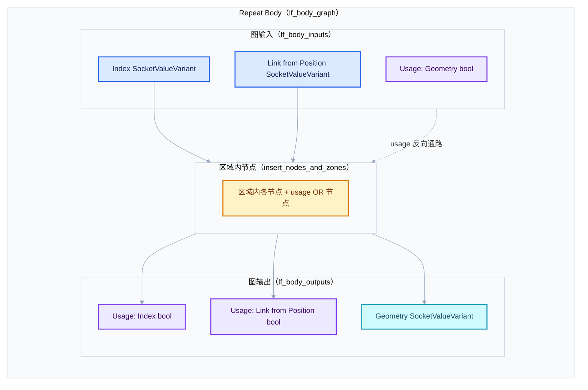
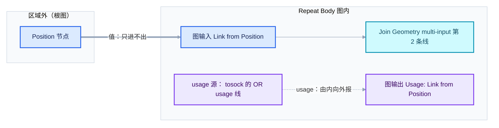
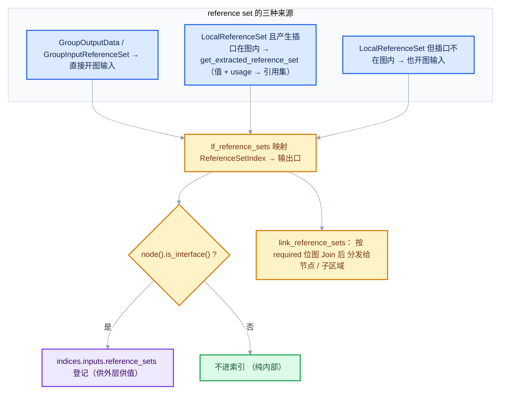
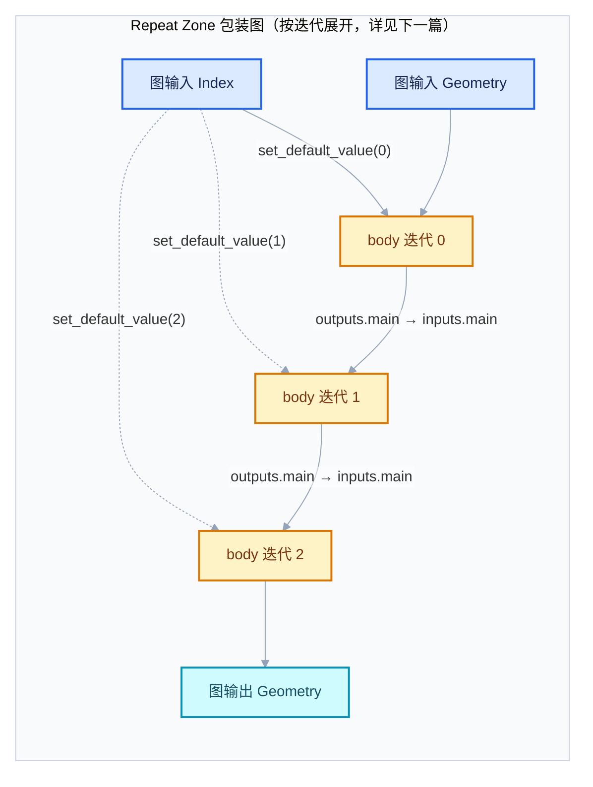
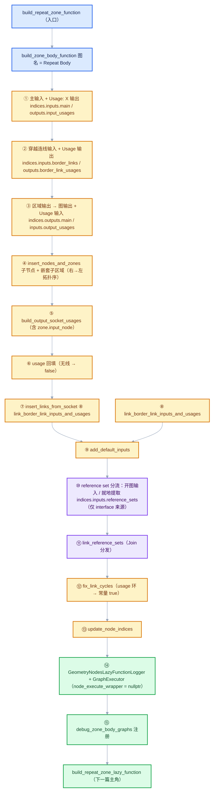

<!-- 重复区域（Repeat Zone）全面学习 · 03 几何节点执行架构 · 第 2 篇 -->

# Repeat 循环体函数构建详解（build_zone_body_function）

<div style="font-family:'Segoe UI','Microsoft YaHei',system-ui,-apple-system,sans-serif;display:flex;flex-wrap:wrap;align-items:center;gap:8px;margin:16px 0 20px;padding:10px 14px;background:#F8FAFC;border:1px solid #E2E8F0;border-radius:12px">
<span style="font-size:11px;font-weight:700;letter-spacing:.1em;color:#64748B;margin-right:2px">导航</span>
<a href="../README.md" style="font-size:13px;color:#334155;background:#F1F5F9;border:1px solid #E2E8F0;border-radius:999px;padding:3px 12px;text-decoration:none;white-space:nowrap">总入口</a>
<a href="./README.md" style="font-size:13px;color:#2563EB;background:#EFF6FF;border:1px solid #BFDBFE;border-radius:999px;padding:3px 12px;text-decoration:none;white-space:nowrap">本章 03-几何节点执行架构</a>
<a href="./01-ZoneBodyFunction与ZoneBuildInfo.md" style="font-size:13px;color:#2563EB;background:#EFF6FF;border:1px solid #BFDBFE;border-radius:999px;padding:3px 12px;text-decoration:none;white-space:nowrap">‹ 01-ZoneBodyFunction与ZoneBuildInfo</a>
<a href="./03-执行图按迭代展开.md" style="font-size:13px;color:#7C3AED;background:#F5F3FF;border:1px solid #DDD6FE;border-radius:999px;padding:3px 12px;text-decoration:none;white-space:nowrap">03-执行图按迭代展开 ›</a>
</div>

<div style="font-family:'Segoe UI','Microsoft YaHei',system-ui,-apple-system,sans-serif;margin:18px 0 22px;padding:14px 18px;background:#F5F3FF;border-left:4px solid #7C3AED;border-radius:10px">

系列定位：本篇是《重复区域（Repeat Zone）全面学习》系列 03 章第 2 篇。它逐段解剖 build_zone_body_function：main、border link、reference set 三组索引如何登记，usage 如何回填，环如何打断。

</div>

<hr style="border:none;height:1px;background:linear-gradient(90deg,#BFDBFE,#E2E8F0 55%,transparent);margin:34px 0">

**基准版本**：Blender 5.4.0-alpha（主分支源码）。文中所有行号均以该版本为准，若你在更新的版本中阅读，行号可能有少量漂移，但函数名与结构基本稳定。

**核心源文件**：

- [geometry_nodes_lazy_function.cc · L2280](../../../source/blender/nodes/intern/geometry_nodes_lazy_function.cc#L2280) —— `build_zone_body_function()` 主函数
- [geometry_nodes_lazy_function.cc · L2243](../../../source/blender/nodes/intern/geometry_nodes_lazy_function.cc#L2243) —— `build_repeat_zone_function()` 入口
- [geometry_nodes_lazy_function.cc · L1941](../../../source/blender/nodes/intern/geometry_nodes_lazy_function.cc#L1941) —— `GeometryNodesLazyFunctionSideEffectProvider`
- [NOD_geometry_nodes_lazy_function.hh · L591](../../../source/blender/nodes/NOD_geometry_nodes_lazy_function.hh#L591) —— `ZoneFunctionIndices` / `ZoneBuildInfo` / `ZoneBodyFunction` 定义

## 先回答一个具体问题

**问：循环体函数的输入为什么比 Repeat 节点面板上看到的多？**

假设你建了一个最简单的 Repeat 区域，只暴露一个 Geometry 条目。按直觉，"Repeat Body" 这个函数应该只有 1 个输入、1 个输出。但真实构建出来的 LF 图有：

- 图输入：`Index`（1 个）、`Geometry`（1 个）、`Usage: Geometry`（1 个）——外加可能的 `Reference Set`；
- 图输出：`Usage: Index`、`Geometry`、`Usage: Link from Position`（如果有穿越连线）……

比面板上多了好几个看起来莫名其妙的 `Usage: xxx` 布尔通道。它们是干什么的？

**答：这些隐藏通道是"惰性求值的记账本"。** Blender 的几何节点求值是惰性的（lazy）：一个值只有在下游真的需要时才算。但"下游需不需要"在图里并不是天然可知的，于是每条可能被跳过的数据通路旁边都配一根**布尔 usage 线**，从下游往上游反向传播"我需要 / 我不需要"的信号：

1. **`Usage: Index`（输出）**：告诉 Repeat 包装函数，本次迭代里循环体到底有没有用 `Index`。如果没用，包装函数就不必构造索引值（见 [geometry_nodes_repeat_zone.cc · L263](../../../source/blender/nodes/intern/geometry_nodes_repeat_zone.cc#L263) 的 `use_index_values` 判断）。
2. **`Usage: Geometry`（输入）**：Zone 输出节点的输出是否被区域外消费。这个信号由外层图从右往左推过来，最终只作用于**最后一次迭代**的 body。
3. **`Usage: Link from X`（输出）**：某条穿越连线（border link）在循环体内是否被消费。包装函数用 OR 节点把 N 次迭代的这个布尔并起来（[geometry_nodes_repeat_zone.cc · L254-L261](../../../source/blender/nodes/intern/geometry_nodes_repeat_zone.cc#L254)）。
4. **`Reference Set`（输入）**：一根传递"匿名属性引用集合"的通道，告诉循环体内每个节点该把哪些属性传播下去、哪些可以删掉。

再加上一种隐藏输入：**穿越连线的值通道**（`Link from X`）。穿越连线在节点树里是"从区域外直接插进区域内某个节点"的连线，但对 body 函数而言它必须变成一根显式的图输入，因为 body 函数的边界就是区域的边界。

所以记住一个心智模型：

> **body 函数 = 区域内所有节点 + 双倍的数据通路**。 > 每条数据值通路，几乎都伴随一根反向的 usage 布尔通路；每处匿名属性生命周期的信息，都走 `Reference Set` 通道。

下面按 `build_zone_body_function()` 的真实构建顺序，逐段精读源码。

## 0. 入口：谁调用了 body 构建？

Repeat 区域的顶层编译入口是 `build_repeat_zone_function()`，它极其短小，却点明了整个架构的分工：

```cpp
// geometry_nodes_lazy_function.cc L2243-L2252（原文照录）
void build_repeat_zone_function(const bNodeTreeZone &zone)
{
  ZoneBuildInfo &zone_info = zone_build_infos_[zone.index];
  /* Build a function for the loop body. */
  ZoneBodyFunction &body_fn = this->build_zone_body_function(
      zone, "Repeat Body", &scope_.construct<GeometryNodesLazyFunctionSideEffectProvider>());
  /* Wrap the loop body by another function that implements the repeat behavior. */
  auto &zone_fn = build_repeat_zone_lazy_function(scope_, btree_, zone, zone_info, body_fn);
  zone_info.lazy_function = &zone_fn;
}
```

加中文教学注释的版本：

```cpp
void build_repeat_zone_function(const bNodeTreeZone &zone)
{
  // [讲解] zone_build_infos_ 是按 zone.index 索引的数组，每个区域一份 ZoneBuildInfo。
  //        本篇主角 body_fn 的 indices 就存在 zone_info 里，但 body_fn 是独立对象。
  ZoneBuildInfo &zone_info = zone_build_infos_[zone.index];

  // [讲解] 第一步：把区域内全部节点编译成 "Repeat Body" 函数（独立 LF 图）。
  //        同时塞进去一个副作用查询提供器（side_effect_provider），后文专节讲。
  //        body_fn 是引用，生命周期由 ResourceScope（scope_）管理。
  ZoneBodyFunction &body_fn = this->build_zone_body_function(
      zone, "Repeat Body", &scope_.construct<GeometryNodesLazyFunctionSideEffectProvider>());

  // [讲解] 第二步：再用一个 "Repeat Zone" 包装函数把 body_fn 裹起来。
  //        真正的"迭代 N 次"逻辑（把 body 按迭代次数展开成执行图）住在包装函数里，
  //        那是下一篇《03-执行图按迭代展开》的主题。
  auto &zone_fn = build_repeat_zone_lazy_function(scope_, btree_, zone, zone_info, body_fn);

  // [讲解] 对外只暴露包装函数；body_fn 只被包装函数持有。
  zone_info.lazy_function = &zone_fn;
}
```

三个要点：

1. **body 与 wrapper 分离**。body 是"一次迭代干什么"，wrapper 是"迭代多少次、怎么串起来"。同一份 body_fn 会被 wrapper 在运行时复制成 N 个节点（`lf_graph.add_function(*body_fn_.function)`），但 body 的编译只发生一次。
2. **"Repeat Body" 就是 LF 图的调试名**。你在 Blender 的 zone 图调试输出（`to_dot()`）里看到的图名即来源于此。Foreach 区域对应 "Foreach Body"，Closure 区域对应 "Closure Body"——三者共用同一个构建函数，本篇讲的逻辑对它们都成立，只是 wrapper 不同。
3. **副作用提供器在这里注入**。`scope_.construct<GeometryNodesLazyFunctionSideEffectProvider>()` 以默认参数构造（本地副作用节点列表为空），具体查询逻辑见后文专节。

顺带一提，zone 函数的构建顺序在 `build_zone_functions()` 里是**按深度从深到浅**排序的（[geometry_nodes_lazy_function.cc · L2098-L2105](../../../source/blender/nodes/intern/geometry_nodes_lazy_function.cc#L2098)），所以嵌套 Repeat 一定先编译内层——这保证了第 4 步 `insert_nodes_and_zones` 插入子区域节点时，子区域的 `lazy_function` 已经就绪。

<details> <summary>核对原始源码：build_repeat_zone_function · L2243—L2252</summary>

```cpp
  /**
   * Builds a #LazyFunction for a repeat zone.
   */
  void build_repeat_zone_function(const bNodeTreeZone &zone)
  {
    ZoneBuildInfo &zone_info = zone_build_infos_[zone.index];
    /* Build a function for the loop body. */
    ZoneBodyFunction &body_fn = this->build_zone_body_function(
        zone, "Repeat Body", &scope_.construct<GeometryNodesLazyFunctionSideEffectProvider>());
    /* Wrap the loop body by another function that implements the repeat behavior. */
    auto &zone_fn = build_repeat_zone_lazy_function(scope_, btree_, zone, zone_info, body_fn);
    zone_info.lazy_function = &zone_fn;
  }
```

</details>

## 1. 第一步：主输入与成对的 "Usage: " 输出

`build_zone_body_function()` 开头创建一张名为 "Repeat Body" 的新 LF 图，然后做的第一件事就是把 **Repeat 输入节点的输出**搬进来：

```cpp
// geometry_nodes_lazy_function.cc L2280-L2305（原文照录，节选至主输入部分）
ZoneBodyFunction &build_zone_body_function(
    const bNodeTreeZone &zone,
    const StringRef name,
    const lf::GraphExecutorSideEffectProvider *side_effect_provider)
{
  lf::Graph &lf_body_graph = scope_.construct<lf::Graph>(name);

  BuildGraphParams graph_params{lf_body_graph};

  Vector<lf::GraphInputSocket *> lf_body_inputs;
  Vector<lf::GraphOutputSocket *> lf_body_outputs;
  ZoneBodyFunction &body_fn = scope_.construct<ZoneBodyFunction>();

  for (const bNodeSocket *bsocket : zone.input_node()->output_sockets()) {
    if (ignore_zone_bsocket(*bsocket)) {
      continue;
    }
    lf::GraphInputSocket &lf_input = lf_body_graph.add_input(CPPType::get<SocketValueVariant>(),
                                                             bsocket->name);
    lf::GraphOutputSocket &lf_input_usage = lf_body_graph.add_output(
        CPPType::get<bool>(), "Usage: " + StringRef(bsocket->name));
    body_fn.indices.inputs.main.append(lf_body_inputs.append_and_get_index(&lf_input));
    body_fn.indices.outputs.input_usages.append(
        lf_body_outputs.append_and_get_index(&lf_input_usage));
    graph_params.lf_output_by_bsocket.add_new(bsocket, &lf_input);
  }
```

逐句讲解：

```cpp
ZoneBodyFunction &build_zone_body_function(
    const bNodeTreeZone &zone,          // [讲解] bNodeTreeZone 是节点树运行时拓扑里的"区域"对象
    const StringRef name,               // [讲解] 调试名，Repeat 传 "Repeat Body"
    const lf::GraphExecutorSideEffectProvider *side_effect_provider)
                                        // [讲解] 惰性求值器执行时用来问"哪些节点有副作用"
{
  // [讲解] 全新的 lf::Graph：body 的世界从此自成一图，与外层图完全隔离。
  lf::Graph &lf_body_graph = scope_.construct<lf::Graph>(name);

  // [讲解] graph_params 是贯穿整个构建过程的"施工脚手架"：
  //        lf_output_by_bsocket / lf_inputs_by_bsocket / usage_by_bsocket 等
  //        负责 bNodeSocket（节点树世界）与 lf socket（LF 图世界）之间的双向登记。
  BuildGraphParams graph_params{lf_body_graph};

  // [讲解] 两个临时向量按添加顺序记录图输入/图输出指针，
  //        它们的下标正是 indices 里存的整数。
  Vector<lf::GraphInputSocket *> lf_body_inputs;
  Vector<lf::GraphOutputSocket *> lf_body_outputs;

  // [讲解] body_fn 是要返回的对象，indices 三组索引从这里开始被填充。
  ZoneBodyFunction &body_fn = scope_.construct<ZoneBodyFunction>();

  // [讲解] 遍历 Repeat 输入节点的"输出"插口（即 Index + 各条目）。
  //        注意是 output_sockets：对区域内来说，输入节点的输出才是循环体的数据源。
  for (const bNodeSocket *bsocket : zone.input_node()->output_sockets()) {
    // [讲解] 过滤不可用插口和 extend 插口（见下方 ignore_zone_bsocket 专节）。
    if (ignore_zone_bsocket(*bsocket)) {
      continue;
    }
    // [讲解] 每个数据插口 → 一根图输入，类型是 SocketValueVariant（几何节点的通用值类型）。
    lf::GraphInputSocket &lf_input = lf_body_graph.add_input(CPPType::get<SocketValueVariant>(),
                                                             bsocket->name);
    // [讲解] 同时立刻配一根反向的布尔图输出："Usage: " + 插口名。
    //        这是本篇开头那个"隐藏通道"的出生地。
    lf::GraphOutputSocket &lf_input_usage = lf_body_graph.add_output(
        CPPType::get<bool>(), "Usage: " + StringRef(bsocket->name));
    // [讲解] 数据输入下标记入 indices.inputs.main；usage 输出下标记入 indices.outputs.input_usages。
    //        两个向量的元素个数此后永远一一对应（第 i 个 main 输入 ↔ 第 i 个 input_usage 输出）。
    body_fn.indices.inputs.main.append(lf_body_inputs.append_and_get_index(&lf_input));
    body_fn.indices.outputs.input_usages.append(
        lf_body_outputs.append_and_get_index(&lf_input_usage));
    // [讲解] 登记：区域输入节点的这个输出插口，今后在 body 图里由 lf_input 供值。
    graph_params.lf_output_by_bsocket.add_new(bsocket, &lf_input);
  }
```

几个必须记住的细节：

- **`zone.input_node()` 是 Repeat Input 节点**。它有两个身份：对用户来说是"往循环里喂数据的节点"；对 body 图来说，它的**输出插口列表**就是 body 函数的形参列表。`output_sockets()` 的第 0 个永远是 `Index`（整型的迭代序号），后面才是用户添加的条目。
- **值类型统一为 `SocketValueVariant`**。不管条目是 Geometry、Float 还是 Vector，进 LF 图后都装进带类型标签的变体里，避免为每种类型生成一套图。
- **usage 输出与数据输入在同一轮循环里成对创建**，所以 `indices.inputs.main[i]` 和 `indices.outputs.input_usages[i]` 指向同一个逻辑插口——这个对应关系后面会被 Repeat 包装函数反复使用（例如给非最后一次迭代的 body 硬塞 `usage = true`，见 [geometry_nodes_repeat_zone.cc · L309](../../../source/blender/nodes/intern/geometry_nodes_repeat_zone.cc#L309)）。
- **`lf_output_by_bsocket` 是"正向"登记**：区域外（其实是区域内下游）任何连接到这个 bsocket 的连线，之后都能找到 body 图里的供值口。

### 1.1 插口过滤：`ignore_zone_bsocket`

```cpp
// geometry_nodes_lazy_function.cc L1692-L1702（原文照录）
static bool ignore_zone_bsocket(const bNodeSocket &bsocket)
{
  if (!bsocket.is_available()) {
    return true;
  }
  if (!bsocket.typeinfo->geometry_nodes_default_value) {
    /* These are typically extend sockets. */
    return true;
  }
  return false;
}
```

```cpp
static bool ignore_zone_bsocket(const bNodeSocket &bsocket)
{
  // [讲解] 规则一：插口 UI 上被禁用（is_available 为假）就跳过。
  //        比如某些插口在特定节点设置下不显示，它们不参与求值。
  if (!bsocket.is_available()) {
    return true;
  }
  // [讲解] 规则二：该插口类型没有注册"几何节点默认值"构造器。
  //        Zone 节点有虚拟的 extend（扩展）插口——面板上那两个小三角占位——
  //        它们只负责 UI 层的扩展语义，不携带真实数据，必须排除。
  if (!bsocket.typeinfo->geometry_nodes_default_value) {
    /* These are typically extend sockets. */
    return true;
  }
  return false;
}
```

这个过滤函数在整篇代码里出现了十几次，是理解"面板插口 ≠ LF 图插口"的钥匙：**LF 图永远只收 available 且非 extend 的插口**。也正因为如此，后文所有 `valid_socket_i` 计数器都是"过滤后的第几个"，而不是 bsocket 的原始 index。

<details> <summary>核对原始源码：build_zone_body_function 开头与主输入 · L2280—L2305</summary>

```cpp
  ZoneBodyFunction &build_zone_body_function(
      const bNodeTreeZone &zone,
      const StringRef name,
      const lf::GraphExecutorSideEffectProvider *side_effect_provider)
  {
    lf::Graph &lf_body_graph = scope_.construct<lf::Graph>(name);

    BuildGraphParams graph_params{lf_body_graph};

    Vector<lf::GraphInputSocket *> lf_body_inputs;
    Vector<lf::GraphOutputSocket *> lf_body_outputs;
    ZoneBodyFunction &body_fn = scope_.construct<ZoneBodyFunction>();

    for (const bNodeSocket *bsocket : zone.input_node()->output_sockets()) {
      if (ignore_zone_bsocket(*bsocket)) {
        continue;
      }
      lf::GraphInputSocket &lf_input = lf_body_graph.add_input(CPPType::get<SocketValueVariant>(),
                                                               bsocket->name);
      lf::GraphOutputSocket &lf_input_usage = lf_body_graph.add_output(
          CPPType::get<bool>(), "Usage: " + StringRef(bsocket->name));
      body_fn.indices.inputs.main.append(lf_body_inputs.append_and_get_index(&lf_input));
      body_fn.indices.outputs.input_usages.append(
          lf_body_outputs.append_and_get_index(&lf_input_usage));
      graph_params.lf_output_by_bsocket.add_new(bsocket, &lf_input);
    }
```

</details>

<details> <summary>核对原始源码：ignore_zone_bsocket · L1692—L1702</summary>

```cpp
static bool ignore_zone_bsocket(const bNodeSocket &bsocket)
{
  if (!bsocket.is_available()) {
    return true;
  }
  if (!bsocket.typeinfo->geometry_nodes_default_value) {
    /* These are typically extend sockets. */
    return true;
  }
  return false;
}
```

</details>

## 2. 第二步：穿越连线（border link）的值输入与 usage 输出

什么是穿越连线？在节点编辑器里，从区域**外**某个节点的输出，直接拉一条线穿过区域边界，接到区域**内**某个节点的输入上——这条线就是 border link。它没有经过 Repeat Input / Repeat Output 节点的任何插口，但对 body 函数来说必须显式建模：**body 的边界就是区域的边界，任何穿墙的东西都得变成图输入**。

```cpp
// geometry_nodes_lazy_function.cc L2395-L2405（原文照录）
void build_zone_border_links_inputs(const bNodeTreeZone &zone,
                                    lf::Graph &lf_graph,
                                    Vector<lf::GraphInputSocket *> &r_lf_graph_inputs,
                                    Vector<int> &r_indices)
{
  for (const bNodeLink *border_link : zone.border_links) {
    r_indices.append(r_lf_graph_inputs.append_and_get_index(
        &lf_graph.add_input(CPPType::get<SocketValueVariant>(),
                            StringRef("Link from ") + border_link->fromsock->name)));
  }
}
```

```cpp
void build_zone_border_links_inputs(const bNodeTreeZone &zone,
                                    lf::Graph &lf_graph,
                                    Vector<lf::GraphInputSocket *> &r_lf_graph_inputs,
                                    Vector<int> &r_indices)
{
  // [讲解] zone.border_links 是运行时拓扑缓存收集好的穿越连线列表，
  //        顺序即 bNodeLink 在树中的出现顺序，构建期与包装期都依赖这个一致顺序。
  for (const bNodeLink *border_link : zone.border_links) {
    // [讲解] 每条穿越连线 → 一根图输入，名字 "Link from " + 源插口名。
    //        例如区域外连的是 Position 节点的输出，这里就叫 "Link from Position"。
    //        r_indices 记录它在图输入里的下标，最终进 indices.inputs.border_links。
    r_indices.append(r_lf_graph_inputs.append_and_get_index(
        &lf_graph.add_input(CPPType::get<SocketValueVariant>(),
                            StringRef("Link from ") + border_link->fromsock->name)));
  }
}
```

紧接着是它的镜像函数——穿越连线的 usage 输出：

```cpp
// geometry_nodes_lazy_function.cc L2407-L2416（原文照录）
void build_zone_border_link_input_usages(const bNodeTreeZone &zone,
                                         lf::Graph &lf_graph,
                                         Vector<lf::GraphOutputSocket *> &r_lf_graph_outputs,
                                         Vector<int> &r_indices)
{
  for (const bNodeLink *border_link : zone.border_links) {
    r_indices.append(r_lf_graph_outputs.append_and_get_index(&lf_graph.add_output(
        CPPType::get<bool>(), StringRef("Usage: Link from ") + border_link->fromsock->name)));
  }
}
```

```cpp
void build_zone_border_link_input_usages(const bNodeTreeZone &zone,
                                         lf::Graph &lf_graph,
                                         Vector<lf::GraphOutputSocket *> &r_lf_graph_outputs,
                                         Vector<int> &r_indices)
{
  // [讲解] 与值输入一一对应：每条穿越连线再配一根 "Usage: Link from X" 布尔输出。
  //        语义：这一轮迭代里，循环体到底消费了这条穿越连线的值没有？
  //        Repeat 包装函数之后会用 OR 节点把 N 次迭代的该输出并起来：
  //        只要有一次迭代用了它，区域外就必须真的计算它。
  for (const bNodeLink *border_link : zone.border_links) {
    r_indices.append(r_lf_graph_outputs.append_and_get_index(&lf_graph.add_output(
        CPPType::get<bool>(), StringRef("Usage: Link from ") + border_link->fromsock->name)));
  }
}
```

调用点在 `build_zone_body_function()` L2307-L2310：

```cpp
    this->build_zone_border_links_inputs(
        zone, lf_body_graph, lf_body_inputs, body_fn.indices.inputs.border_links);
    this->build_zone_border_link_input_usages(
        zone, lf_body_graph, lf_body_outputs, body_fn.indices.outputs.border_link_usages);
```

**注意一个顺序细节**：这两步发生在"区域输出插口"之前，所以 body 图的图输出里，`border_link_usages` 的下标排在 `main` 输出**前面**。`indices` 的存在就是为了让你不必关心物理排列顺序——所有消费者都通过索引间接寻址。

<details> <summary>核对原始源码：build_zone_border_links_inputs / build_zone_border_link_input_usages · L2395—L2416</summary>

```cpp
  void build_zone_border_links_inputs(const bNodeTreeZone &zone,
                                      lf::Graph &lf_graph,
                                      Vector<lf::GraphInputSocket *> &r_lf_graph_inputs,
                                      Vector<int> &r_indices)
  {
    for (const bNodeLink *border_link : zone.border_links) {
      r_indices.append(r_lf_graph_inputs.append_and_get_index(
          &lf_graph.add_input(CPPType::get<SocketValueVariant>(),
                              StringRef("Link from ") + border_link->fromsock->name)));
    }
  }

  void build_zone_border_link_input_usages(const bNodeTreeZone &zone,
                                           lf::Graph &lf_graph,
                                           Vector<lf::GraphOutputSocket *> &r_lf_graph_outputs,
                                           Vector<int> &r_indices)
  {
    for (const bNodeLink *border_link : zone.border_links) {
      r_indices.append(r_lf_graph_outputs.append_and_get_index(&lf_graph.add_output(
          CPPType::get<bool>(), StringRef("Usage: Link from ") + border_link->fromsock->name)));
    }
  }
```

</details>

## 3. 第三步：区域输出插口 → body 输出 + usage 输入

现在处理"出口"：Repeat Output 节点的**输入**插口（即区域内最后一级的数据出口）。对 body 图来说，它们是函数的**返回值**；同时每个返回值还要配一根 **usage 输入**——由外层图告诉 body："这个输出真的有人要"。

```cpp
// geometry_nodes_lazy_function.cc L2312-L2325（原文照录）
for (const bNodeSocket *bsocket : zone.output_node()->input_sockets()) {
  if (ignore_zone_bsocket(*bsocket)) {
    continue;
  }
  lf::GraphOutputSocket &lf_output = lf_body_graph.add_output(
      CPPType::get<SocketValueVariant>(), bsocket->name);
  lf::GraphInputSocket &lf_output_usage = lf_body_graph.add_input(
      CPPType::get<bool>(), "Usage: " + StringRef(bsocket->name));
  graph_params.lf_inputs_by_bsocket.add(bsocket, &lf_output);
  graph_params.usage_by_bsocket.add(bsocket, &lf_output_usage);
  body_fn.indices.outputs.main.append(lf_body_outputs.append_and_get_index(&lf_output));
  body_fn.indices.inputs.output_usages.append(
      lf_body_inputs.append_and_get_index(&lf_output_usage));
}
```

逐句讲解：

```cpp
for (const bNodeSocket *bsocket : zone.output_node()->input_sockets()) {
  // [讲解] Repeat Output 节点的输入插口 = 区域的正式出口（不含 Index，Index 只进不出）。
  if (ignore_zone_bsocket(*bsocket)) {
    continue;
  }
  // [讲解] 出口数据 → 一根图输出（SocketValueVariant）。
  lf::GraphOutputSocket &lf_output = lf_body_graph.add_output(
      CPPType::get<SocketValueVariant>(), bsocket->name);
  // [讲解] 同时配一根反向的 usage 图输入："Usage: " + 出口名。
  //        方向性重点：主输入的 usage 是【输出】（body 向外报告），
  //        主输出的 usage 是【输入】（外层向 body 下达）。
  lf::GraphInputSocket &lf_output_usage = lf_body_graph.add_input(
      CPPType::get<bool>(), "Usage: " + StringRef(bsocket->name));
  // [讲解] 反向登记：区域内连到这个出口 bsocket 的线，值要汇入 lf_output。
  graph_params.lf_inputs_by_bsocket.add(bsocket, &lf_output);
  // [讲解] usage 登记：这个出口 bsocket 的"被需要程度"由 lf_output_usage 表达。
  //        之后 build_output_socket_usages 会把区域内指向它的线的 usage OR 起来连到这里。
  graph_params.usage_by_bsocket.add(bsocket, &lf_output_usage);
  // [讲解] 下标入册：出口数据 → indices.outputs.main；usage → indices.inputs.output_usages。
  body_fn.indices.outputs.main.append(lf_body_outputs.append_and_get_index(&lf_output));
  body_fn.indices.inputs.output_usages.append(
      lf_body_inputs.append_and_get_index(&lf_output_usage));
}
```

此时 body 图的**完整输入输出清单**（以"1 个 Geometry 条目 + 1 条穿越连线"为例）已经齐了一半，先看全貌：



（图例：蓝色 = 数据输入通道；紫色 = usage 抽象通道；黄色 = 区域内计算节点；青色 = 数据输出。下同。）

对照代码验证三个下标组此时已填好的部分：

| 索引组 | 内容（本例） | 来源步骤 |
|---|---|---|
| `indices.inputs.main` | `[0]`（Index 的图输入下标；Geometry 条目同理） | 第 1 步 |
| `indices.inputs.border_links` | `[1]`（Link from Position 的下标） | 第 2 步 |
| `indices.inputs.output_usages` | `[2]`（Usage: Geometry 的下标） | 第 3 步 |
| `indices.outputs.main` | `[2]`（Geometry 的图输出下标） | 第 3 步 |
| `indices.outputs.input_usages` | `[0]`（Usage: Index 的下标） | 第 1 步 |
| `indices.outputs.border_link_usages` | `[1]`（Usage: Link from Position 的下标） | 第 2 步 |

<details> <summary>核对原始源码：区域输出插口部分 · L2312—L2325</summary>

```cpp
    for (const bNodeSocket *bsocket : zone.output_node()->input_sockets()) {
      if (ignore_zone_bsocket(*bsocket)) {
        continue;
      }
      lf::GraphOutputSocket &lf_output = lf_body_graph.add_output(
          CPPType::get<SocketValueVariant>(), bsocket->name);
      lf::GraphInputSocket &lf_output_usage = lf_body_graph.add_input(
          CPPType::get<bool>(), "Usage: " + StringRef(bsocket->name));
      graph_params.lf_inputs_by_bsocket.add(bsocket, &lf_output);
      graph_params.usage_by_bsocket.add(bsocket, &lf_output_usage);
      body_fn.indices.outputs.main.append(lf_body_outputs.append_and_get_index(&lf_output));
      body_fn.indices.inputs.output_usages.append(
          lf_body_inputs.append_and_get_index(&lf_output_usage));
    }
```

</details>

## 4. 第四步：把区域内的节点搬进图（含嵌套 zone）

```cpp
// geometry_nodes_lazy_function.cc L2327（原文照录）
this->insert_nodes_and_zones(zone.child_nodes(), zone.child_zones, graph_params);
```

一行调用背后是个通用引擎，根图（root graph）也用它。精读 [geometry_nodes_lazy_function.cc · L2695-L2719](../../../source/blender/nodes/intern/geometry_nodes_lazy_function.cc#L2695)：

```cpp
// 原文照录
void insert_nodes_and_zones(const Span<const bNode *> bnodes,
                            const Span<const bNodeTreeZone *> zones,
                            BuildGraphParams &graph_params)
{
  Vector<const bNode *> nodes_to_insert = bnodes;
  Map<const bNode *, const bNodeTreeZone *> zone_by_output;
  for (const bNodeTreeZone *zone : zones) {
    nodes_to_insert.append(zone->output_node());
    zone_by_output.add(zone->output_node(), zone);
  }
  /* Insert nodes from right to left so that usage sockets can be built in the same pass. */
  std::ranges::sort(nodes_to_insert, [](const bNode *a, const bNode *b) {
    return a->runtime->toposort_right_to_left_index < b->runtime->toposort_right_to_left_index;
  });

  for (const bNode *bnode : nodes_to_insert) {
    this->build_output_socket_usages(*bnode, graph_params);
    if (const bNodeTreeZone *zone = zone_by_output.lookup_default(bnode, nullptr)) {
      this->insert_child_zone_node(*zone, graph_params);
    }
    else {
      this->insert_node_in_graph(*bnode, graph_params);
    }
  }
}
```

```cpp
void insert_nodes_and_zones(const Span<const bNode *> bnodes,
                            const Span<const bNodeTreeZone *> zones,
                            BuildGraphParams &graph_params)
{
  // [讲解] 待插入清单 = 区域直接子节点。
  Vector<const bNode *> nodes_to_insert = bnodes;
  // [讲解] 嵌套区域用一个"输出节点 → 区域"的映射表示：
  //        每个区域在树里由一对输入/输出节点圈出，其中输出节点当作区域的"替身"参与排序。
  Map<const bNode *, const bNodeTreeZone *> zone_by_output;
  for (const bNodeTreeZone *zone : zones) {
    nodes_to_insert.append(zone->output_node());
    zone_by_output.add(zone->output_node(), zone);
  }
  // [讲解] 关键排序：从右往左的拓扑序。
  //        usage 信号是从右（下游）往左（上游）传播的，右边的节点先插进图，
  //        轮到左边节点时它的下游 usage 已就位，可以同一次遍历里把 usage 线连好。
  /* Insert nodes from right to left so that usage sockets can be built in the same pass. */
  std::ranges::sort(nodes_to_insert, [](const bNode *a, const bNode *b) {
    return a->runtime->toposort_right_to_left_index < b->runtime->toposort_right_to_left_index;
  });

  for (const bNode *bnode : nodes_to_insert) {
    // [讲解] 每个节点先建 usage（OR 自己下游所有目标 usage）。
    this->build_output_socket_usages(*bnode, graph_params);
    // [讲解] 是区域的输出节点 → 插入的是整个子区域的包装函数节点（早已编译好）。
    if (const bNodeTreeZone *zone = zone_by_output.lookup_default(bnode, nullptr)) {
      this->insert_child_zone_node(*zone, graph_params);
    }
    else {
      // [讲解] 普通节点 → 按节点自身声明插入对应的 LazyFunction。
      this->insert_node_in_graph(*bnode, graph_params);
    }
  }
}
```

要点拆解：

- **嵌套区域被当成"一个大节点"插入**。`insert_child_zone_node()`（[L2810-L2877](../../../source/blender/nodes/intern/geometry_nodes_lazy_function.cc#L2810)）把子区域的 `lazy_function`（对内层 Repeat 就是它的 wrapper）挂成一个 `lf::FunctionNode`，然后把子区域各插口与 usage 插口双向登记进 `graph_params`——包括把子区域的穿越连线入口登记到 `lf_input_by_border_link`，供 `find_link_targets` 寻址。
- **子区域先编译是前提**。`build_zone_functions()` 按深度降序编译（见第 0 节末尾），所以走到这里时内层区域的函数一定已存在。
- **区域内节点与外层的隔离是靠 `zone.child_nodes()` 保证的**：只有"直接子节点"（不含更深区域内部的节点）会被插入本图，更深的部分由子区域的 body 图负责。

<details> <summary>核对原始源码：insert_nodes_and_zones · L2695—L2719</summary>

```cpp
  void insert_nodes_and_zones(const Span<const bNode *> bnodes,
                              const Span<const bNodeTreeZone *> zones,
                              BuildGraphParams &graph_params)
  {
    Vector<const bNode *> nodes_to_insert = bnodes;
    Map<const bNode *, const bNodeTreeZone *> zone_by_output;
    for (const bNodeTreeZone *zone : zones) {
      nodes_to_insert.append(zone->output_node());
      zone_by_output.add(zone->output_node(), zone);
    }
    /* Insert nodes from right to left so that usage sockets can be built in the same pass. */
    std::ranges::sort(nodes_to_insert, [](const bNode *a, const bNode *b) {
      return a->runtime->toposort_right_to_left_index < b->runtime->toposort_right_to_left_index;
    });

    for (const bNode *bnode : nodes_to_insert) {
      this->build_output_socket_usages(*bnode, graph_params);
      if (const bNodeTreeZone *zone = zone_by_output.lookup_default(bnode, nullptr)) {
        this->insert_child_zone_node(*zone, graph_params);
      }
      else {
        this->insert_node_in_graph(*bnode, graph_params);
      }
    }
  }
```

</details>

## 5. 第五步：usage 的生成与回填

### 5.1 `build_output_socket_usages`：usage 是 OR 出来的

[L4060-L4084](../../../source/blender/nodes/intern/geometry_nodes_lazy_function.cc#L4060)：

```cpp
// 原文照录
void build_output_socket_usages(const bNode &bnode, BuildGraphParams &graph_params)
{
  /* Output sockets are used when any of their linked inputs are used. */
  for (const bNodeSocket *socket : bnode.output_sockets()) {
    if (!socket->is_available()) {
      continue;
    }
    /* Determine when linked target sockets are used. */
    Vector<lf::OutputSocket *> target_usages;
    for (const bNodeLink *link : socket->directly_linked_links()) {
      if (!link->is_used()) {
        continue;
      }
      const bNodeSocket &target_socket = *link->tosock;
      if (lf::OutputSocket *is_used_socket = graph_params.usage_by_bsocket.lookup_default(
              &target_socket, nullptr))
      {
        target_usages.append_non_duplicates(is_used_socket);
      }
    }
    /* Combine target socket usages into the usage of the current socket. */
    graph_params.usage_by_bsocket.add(socket,
                                      this->or_socket_usages(target_usages, graph_params));
  }
}
```

```cpp
void build_output_socket_usages(const bNode &bnode, BuildGraphParams &graph_params)
{
  // [讲解] 核心规则一句话：一个输出被使用，当且仅当它的任意一个下游输入被使用。
  /* Output sockets are used when any of their linked inputs are used. */
  for (const bNodeSocket *socket : bnode.output_sockets()) {
    if (!socket->is_available()) {
      continue;
    }
    // [讲解] 收集所有有效连线（静音的线不算）指向的目标插口的 usage 输出口。
    Vector<lf::OutputSocket *> target_usages;
    for (const bNodeLink *link : socket->directly_linked_links()) {
      if (!link->is_used()) {
        continue;
      }
      const bNodeSocket &target_socket = *link->tosock;
      if (lf::OutputSocket *is_used_socket = graph_params.usage_by_bsocket.lookup_default(
              &target_socket, nullptr))
      {
        // [讲解] append_non_duplicates：同一条 usage 不会被 OR 两次。
        target_usages.append_non_duplicates(is_used_socket);
      }
    }
    // [讲解] 用 OR 节点（必要时）把多个 usage 并成一个，登记为本插口的 usage。
    //        没有目标 → OR 结果为常量 false（该输出根本没人用）。
    graph_params.usage_by_bsocket.add(socket,
                                      this->or_socket_usages(target_usages, graph_params));
  }
}
```

在 body 构建流程里，这个函数被调用了**两种对象**：

1. 区域内每个普通节点（第 4 步循环里逐个调用）；
2. **Repeat Input 节点本身**（[L2329](../../../source/blender/nodes/intern/geometry_nodes_lazy_function.cc#L2329)：`this->build_output_socket_usages(*zone.input_node(), graph_params);`）——它的输出就是 body 的主输入，于是"主输入被使用"被 OR 成一根 usage 线，等着往 `Usage: Index` 等输出灌。

### 5.2 usage 回填循环：找不到就默认 false

构建 usage 线时有一个顺序问题：`Usage: Index` 等图输出在第 1 步就创建好了，但当时区域内节点还没插，谁也不知道该往里连什么。于是构建进行到 L2331-L2350 时做一次**回填**：

```cpp
// geometry_nodes_lazy_function.cc L2331-L2350（原文照录）
{
  int valid_socket_i = 0;
  for (const bNodeSocket *bsocket : zone.input_node()->output_sockets()) {
    if (ignore_zone_bsocket(*bsocket)) {
      continue;
    }
    lf::OutputSocket *lf_usage = graph_params.usage_by_bsocket.lookup_default(bsocket, nullptr);
    lf::GraphOutputSocket &lf_usage_output =
        *lf_body_outputs[body_fn.indices.outputs.input_usages[valid_socket_i]];
    if (lf_usage) {
      lf_body_graph.add_link(*lf_usage, lf_usage_output);
    }
    else {
      static const bool static_false = false;
      lf_usage_output.set_default_value(&static_false);
    }
    valid_socket_i++;
  }
}
```

```cpp
{
  // [讲解] valid_socket_i 是"过滤后序号"，与第 1 步创建 usage 输出时的计数完全对齐。
  int valid_socket_i = 0;
  for (const bNodeSocket *bsocket : zone.input_node()->output_sockets()) {
    if (ignore_zone_bsocket(*bsocket)) {
      continue;
    }
    // [讲解] 查第 5.1 步为该主输入 OR 出来的 usage 线。
    lf::OutputSocket *lf_usage = graph_params.usage_by_bsocket.lookup_default(bsocket, nullptr);
    // [讲解] 用 indices 反查当年创建的那根 "Usage: X" 图输出——这就是索引组的意义：
    //        物理下标永远不硬编码，全部经由 indices 间接寻址。
    lf::GraphOutputSocket &lf_usage_output =
        *lf_body_outputs[body_fn.indices.outputs.input_usages[valid_socket_i]];
    if (lf_usage) {
      // [讲解] 有线就连：区域内谁用了主输入，usage 就顺着 OR 线灌出去。
      lf_body_graph.add_link(*lf_usage, lf_usage_output);
    }
    else {
      // [讲解] 没人用（甚至插口根本没参与）→ 恒 false。
      //        外层 Repeat 包装函数看到 false 就知道：这个输入这轮迭代白给了。
      static const bool static_false = false;
      lf_usage_output.set_default_value(&static_false);
    }
    valid_socket_i++;
  }
}
```

为什么"找不到 usage"是**默认 false** 而不是 true？因为 usage_by_bsocket 的登记是全覆盖的——`build_output_socket_usages` 对每个 available 插口都会登记（哪怕 OR 结果是常量 false）。真的查不到只发生在"该插口没有任何有效下游"的场合，此时"未被使用"正是事实。

<details> <summary>核对原始源码：usage 回填循环 · L2331—L2350</summary>

```cpp
    {
      int valid_socket_i = 0;
      for (const bNodeSocket *bsocket : zone.input_node()->output_sockets()) {
        if (ignore_zone_bsocket(*bsocket)) {
          continue;
        }
        lf::OutputSocket *lf_usage = graph_params.usage_by_bsocket.lookup_default(bsocket,
                                                                                  nullptr);
        lf::GraphOutputSocket &lf_usage_output =
            *lf_body_outputs[body_fn.indices.outputs.input_usages[valid_socket_i]];
        if (lf_usage) {
          lf_body_graph.add_link(*lf_usage, lf_usage_output);
        }
        else {
          static const bool static_false = false;
          lf_usage_output.set_default_value(&static_false);
        }
        valid_socket_i++;
      }
    }
```

</details>

<details> <summary>核对原始源码：build_output_socket_usages · L4060—L4084</summary>

```cpp
  void build_output_socket_usages(const bNode &bnode, BuildGraphParams &graph_params)
  {
    /* Output sockets are used when any of their linked inputs are used. */
    for (const bNodeSocket *socket : bnode.output_sockets()) {
      if (!socket->is_available()) {
        continue;
      }
      /* Determine when linked target sockets are used. */
      Vector<lf::OutputSocket *> target_usages;
      for (const bNodeLink *link : socket->directly_linked_links()) {
        if (!link->is_used()) {
          continue;
        }
        const bNodeSocket &target_socket = *link->tosock;
        if (lf::OutputSocket *is_used_socket = graph_params.usage_by_bsocket.lookup_default(
                &target_socket, nullptr))
        {
          target_usages.append_non_duplicates(is_used_socket);
        }
      }
      /* Combine target socket usages into the usage of the current socket. */
      graph_params.usage_by_bsocket.add(socket,
                                        this->or_socket_usages(target_usages, graph_params));
    }
  }
```

</details>

## 6. 第六步：数据连线与穿越连线的落地

### 6.1 常规连线：`insert_links_from_socket`

```cpp
// geometry_nodes_lazy_function.cc L2352-L2354（原文照录）
for (const auto item : graph_params.lf_output_by_bsocket.items()) {
  this->insert_links_from_socket(*item.key, *item.value, graph_params);
}
```

```cpp
// [讲解] 遍历所有登记过的"供值口"（bNodeSocket → lf 输出），
//        把每个源插口的每条有效连线转成 LF 图连线。
//        区域内节点间的连线、主输入 → 区域内节点的连线，都在这一步落地。
for (const auto item : graph_params.lf_output_by_bsocket.items()) {
  this->insert_links_from_socket(*item.key, *item.value, graph_params);
}
```

### 6.2 穿越连线：`link_border_link_inputs_and_usages`

这是本篇最精妙的函数之一，[L2721-L2749](../../../source/blender/nodes/intern/geometry_nodes_lazy_function.cc#L2721)：

```cpp
// 原文照录
void link_border_link_inputs_and_usages(const bNodeTreeZone &zone,
                                        const Span<lf::GraphInputSocket *> lf_inputs,
                                        const Span<int> lf_border_link_input_indices,
                                        const Span<lf::GraphOutputSocket *> lf_usages,
                                        const Span<int> lf_border_link_usage_indices,
                                        BuildGraphParams &graph_params)
{
  lf::Graph &lf_graph = graph_params.lf_graph;
  for (const int border_link_i : zone.border_links.index_range()) {
    const bNodeLink &border_link = *zone.border_links[border_link_i];
    lf::GraphInputSocket &lf_from = *lf_inputs[lf_border_link_input_indices[border_link_i]];
    const Vector<lf::InputSocket *> lf_link_targets = this->find_link_targets(border_link,
                                                                              graph_params);
    for (lf::InputSocket *lf_to : lf_link_targets) {
      lf_graph.add_link(lf_from, *lf_to);
    }
    lf::GraphOutputSocket &lf_usage_output =
        *lf_usages[lf_border_link_usage_indices[border_link_i]];
    if (lf::OutputSocket *lf_usage = graph_params.usage_by_bsocket.lookup_default(
            border_link.tosock, nullptr))
    {
      lf_graph.add_link(*lf_usage, lf_usage_output);
    }
    else {
      static const bool static_false = false;
      lf_usage_output.set_default_value(&static_false);
    }
  }
}
```

```cpp
void link_border_link_inputs_and_usages(const bNodeTreeZone &zone,
                                        const Span<lf::GraphInputSocket *> lf_inputs,
                                        const Span<int> lf_border_link_input_indices,
                                        const Span<lf::GraphOutputSocket *> lf_usages,
                                        const Span<int> lf_border_link_usage_indices,
                                        BuildGraphParams &graph_params)
{
  lf::Graph &lf_graph = graph_params.lf_graph;
  // [讲解] 按穿越连线顺序逐条处理。注意值与 usage 分两条通路处理，互不干扰。
  for (const int border_link_i : zone.border_links.index_range()) {
    const bNodeLink &border_link = *zone.border_links[border_link_i];
    // [讲解] 值通路起点：第 2 步创建的 "Link from X" 图输入（用索引组寻址）。
    lf::GraphInputSocket &lf_from = *lf_inputs[lf_border_link_input_indices[border_link_i]];
    // [讲解] 找这条线在 body 图内的所有落脚点（可能不止一个！见下文 find_link_targets）。
    const Vector<lf::InputSocket *> lf_link_targets = this->find_link_targets(border_link,
                                                                              graph_params);
    // [讲解] 值通路：一根图输入可以喂给多个目标（multi-input 就是这样发生分裂的）。
    for (lf::InputSocket *lf_to : lf_link_targets) {
      lf_graph.add_link(lf_from, *lf_to);
    }
    // [讲解] usage 通路终点：对应的 "Usage: Link from X" 图输出。
    lf::GraphOutputSocket &lf_usage_output =
        *lf_usages[lf_border_link_usage_indices[border_link_i]];
    // [讲解] usage 源头：目标插口（tosock）的 usage 线——
    //        即"区域内这个输入被它所在节点的下游需要"的信号。
    if (lf::OutputSocket *lf_usage = graph_params.usage_by_bsocket.lookup_default(
            border_link.tosock, nullptr))
    {
      lf_graph.add_link(*lf_usage, lf_usage_output);
    }
    else {
      // [讲解] 目标插口完全没人要 → 恒 false，外层图连区域外的源节点都可以不计算。
      static const bool static_false = false;
      lf_usage_output.set_default_value(&static_false);
    }
  }
}
```

**usage 与值分开连接**是这里的重点：值是"从外向内灌"，usage 是"从内向外报"。一根穿越连线在 body 图里实际占两个通道（1 值 + 1 布尔），方向相反。

### 6.3 落脚点怎么找：`find_link_targets`

[L3875-L3917](../../../source/blender/nodes/intern/geometry_nodes_lazy_function.cc#L3875) 处理了三种情况：

```cpp
// 原文照录（节选）
Vector<lf::InputSocket *> find_link_targets(const bNodeLink &link,
                                            const BuildGraphParams &graph_params)
{
  if (lf::InputSocket *lf_input_socket = graph_params.lf_input_by_border_link.lookup_default(
          &link, nullptr))
  {
    return {lf_input_socket};
  }

  const bNodeSocket &to_bsocket = *link.tosock;
  if (to_bsocket.is_multi_input()) {
    /* TODO: Cache this index on the link. */
    int link_index = 0;
    for (const bNodeLink *multi_input_link : to_bsocket.directly_linked_links()) {
      if (multi_input_link == &link) {
        break;
      }
      if (multi_input_link->is_muted() || !multi_input_link->fromsock->is_available() ||
          multi_input_link->fromnode->is_dangling_reroute())
      {
        continue;
      }
      link_index++;
    }
    if (to_bsocket.owner_node().is_muted()) {
      if (link_index == 0) {
        return Vector<lf::InputSocket *>(graph_params.lf_inputs_by_bsocket.lookup(&to_bsocket));
      }
    }
    else {
      lf::InputSocket *lf_multi_input_socket =
          graph_params.lf_input_by_multi_input_link.lookup_default(&link, nullptr);
      if (!lf_multi_input_socket) {
        return {};
      }
      return {lf_multi_input_socket};
    }
  }
  else {
    return Vector<lf::InputSocket *>(graph_params.lf_inputs_by_bsocket.lookup(&to_bsocket));
  }
  return {};
}
```

```cpp
Vector<lf::InputSocket *> find_link_targets(const bNodeLink &link,
                                            const BuildGraphParams &graph_params)
{
  // [讲解] 情形一：目标在嵌套子区域里。
  //        insert_child_zone_node 已把子区域的穿越连线入口登记在 lf_input_by_border_link，
  //        直接命中——值穿过外层区域再进内层区域，一层一层交给内层 body。
  if (lf::InputSocket *lf_input_socket = graph_params.lf_input_by_border_link.lookup_default(
          &link, nullptr))
  {
    return {lf_input_socket};
  }

  const bNodeSocket &to_bsocket = *link.tosock;
  // [讲解] 情形二：目标是 multi-input（比如 Join Geometry 的输入叠了多条线）。
  if (to_bsocket.is_multi_input()) {
    // [讲解] 算出本条线在"有效线堆"里的序号：跳过静音线、不可用源、悬空 reroute。
    /* TODO: Cache this index on the link. */
    int link_index = 0;
    for (const bNodeLink *multi_input_link : to_bsocket.directly_linked_links()) {
      if (multi_input_link == &link) {
        break;
      }
      if (multi_input_link->is_muted() || !multi_input_link->fromsock->is_available() ||
          multi_input_link->fromnode->is_dangling_reroute())
      {
        continue;
      }
      link_index++;
    }
    // [讲解] 所在节点整体被静音 → 只有堆顶那条线真的参与输出直通。
    if (to_bsocket.owner_node().is_muted()) {
      if (link_index == 0) {
        return Vector<lf::InputSocket *>(graph_params.lf_inputs_by_bsocket.lookup(&to_bsocket));
      }
    }
    else {
      // [讲解] 正常 multi-input：插入节点时已为每条线预留了独立的 lf 输入插口，
      //        查表即得。查不到（如本线实际无效）→ 空列表，值通路静默跳过。
      lf::InputSocket *lf_multi_input_socket =
          graph_params.lf_input_by_multi_input_link.lookup_default(&link, nullptr);
      if (!lf_multi_input_socket) {
        return {};
      }
      return {lf_multi_input_socket};
    }
  }
  else {
    // [讲解] 情形三：普通单输入插口 → 该 bsocket 登记的全部 lf 输入（通常一根）。
    return Vector<lf::InputSocket *>(graph_params.lf_inputs_by_bsocket.lookup(&to_bsocket));
  }
  return {};
}
```

画一张穿越连线在 body 内的连接图：



<details> <summary>核对原始源码：link_border_link_inputs_and_usages · L2721—L2749</summary>

```cpp
  void link_border_link_inputs_and_usages(const bNodeTreeZone &zone,
                                          const Span<lf::GraphInputSocket *> lf_inputs,
                                          const Span<int> lf_border_link_input_indices,
                                          const Span<lf::GraphOutputSocket *> lf_usages,
                                          const Span<int> lf_border_link_usage_indices,
                                          BuildGraphParams &graph_params)
  {
    lf::Graph &lf_graph = graph_params.lf_graph;
    for (const int border_link_i : zone.border_links.index_range()) {
      const bNodeLink &border_link = *zone.border_links[border_link_i];
      lf::GraphInputSocket &lf_from = *lf_inputs[lf_border_link_input_indices[border_link_i]];
      const Vector<lf::InputSocket *> lf_link_targets = this->find_link_targets(border_link,
                                                                                graph_params);
      for (lf::InputSocket *lf_to : lf_link_targets) {
        lf_graph.add_link(lf_from, *lf_to);
      }
      lf::GraphOutputSocket &lf_usage_output =
          *lf_usages[lf_border_link_usage_indices[border_link_i]];
      if (lf::OutputSocket *lf_usage = graph_params.usage_by_bsocket.lookup_default(
              border_link.tosock, nullptr))
      {
        lf_graph.add_link(*lf_usage, lf_usage_output);
      }
      else {
        static const bool static_false = false;
        lf_usage_output.set_default_value(&static_false);
      }
    }
  }
```

</details>

<details> <summary>核对原始源码：find_link_targets · L3875—L3917</summary>

```cpp
  Vector<lf::InputSocket *> find_link_targets(const bNodeLink &link,
                                              const BuildGraphParams &graph_params)
  {
    if (lf::InputSocket *lf_input_socket = graph_params.lf_input_by_border_link.lookup_default(
            &link, nullptr))
    {
      return {lf_input_socket};
    }

    const bNodeSocket &to_bsocket = *link.tosock;
    if (to_bsocket.is_multi_input()) {
      /* TODO: Cache this index on the link. */
      int link_index = 0;
      for (const bNodeLink *multi_input_link : to_bsocket.directly_linked_links()) {
        if (multi_input_link == &link) {
          break;
        }
        if (multi_input_link->is_muted() || !multi_input_link->fromsock->is_available() ||
            multi_input_link->fromnode->is_dangling_reroute())
        {
          continue;
        }
        link_index++;
      }
      if (to_bsocket.owner_node().is_muted()) {
        if (link_index == 0) {
          return Vector<lf::InputSocket *>(graph_params.lf_inputs_by_bsocket.lookup(&to_bsocket));
        }
      }
      else {
        lf::InputSocket *lf_multi_input_socket =
            graph_params.lf_input_by_multi_input_link.lookup_default(&link, nullptr);
        if (!lf_multi_input_socket) {
          return {};
        }
        return {lf_multi_input_socket};
      }
    }
    else {
      return Vector<lf::InputSocket *>(graph_params.lf_inputs_by_bsocket.lookup(&to_bsocket));
    }
    return {};
  }
```

</details>

## 7. 第七步：默认值与隐式输入

```cpp
// geometry_nodes_lazy_function.cc L2363（原文照录）
this->add_default_inputs(graph_params);
```

[L3937-L3961](../../../source/blender/nodes/intern/geometry_nodes_lazy_function.cc#L3937)：

```cpp
// 原文照录
void add_default_inputs(BuildGraphParams &graph_params)
{
  for (auto item : graph_params.lf_inputs_by_bsocket.items()) {
    const bNodeSocket &bsocket = *item.key;
    const Span<lf::InputSocket *> lf_sockets = item.value;
    for (lf::InputSocket *lf_socket : lf_sockets) {
      if (lf_socket->origin() != nullptr) {
        /* Is linked already. */
        continue;
      }
      this->add_default_input(bsocket, *lf_socket, graph_params);
    }
  }
}

void add_default_input(const bNodeSocket &input_bsocket,
                       lf::InputSocket &input_lf_socket,
                       BuildGraphParams &graph_params)
{
  if (this->try_add_implicit_input(input_bsocket, input_lf_socket, graph_params)) {
    return;
  }
  input_lf_socket.set_default_value(&scope_.add_value(
      input_bsocket.typeinfo->get_geometry_nodes_cpp_value(input_bsocket.default_value)));
}
```

```cpp
void add_default_inputs(BuildGraphParams &graph_params)
{
  // [讲解] 扫一遍所有登记过的 lf 输入插口。
  for (auto item : graph_params.lf_inputs_by_bsocket.items()) {
    const bNodeSocket &bsocket = *item.key;
    const Span<lf::InputSocket *> lf_sockets = item.value;
    for (lf::InputSocket *lf_socket : lf_sockets) {
      // [讲解] 已有连线（origin 非空）→ 跳过，只处理"悬空"输入。
      if (lf_socket->origin() != nullptr) {
        /* Is linked already. */
        continue;
      }
      this->add_default_input(bsocket, *lf_socket, graph_params);
    }
  }
}

void add_default_input(const bNodeSocket &input_bsocket,
                       lf::InputSocket &input_lf_socket,
                       BuildGraphParams &graph_params)
{
  // [讲解] 优先尝试"隐式输入"：比如 Z 轴输入默认取场景帧号、
  //        Object Info 的 Self Object 之类按声明自动补的特殊来源。
  if (this->try_add_implicit_input(input_bsocket, input_lf_socket, graph_params)) {
    return;
  }
  // [讲解] 兜底：把插口的编辑器默认值转成几何节点运行时值，直接钉在插口上。
  input_lf_socket.set_default_value(&scope_.add_value(
      input_bsocket.typeinfo->get_geometry_nodes_cpp_value(input_bsocket.default_value)));
}
```

对 body 图而言这一步同样必要：区域内的节点也会有未连接的输入（用户填的数值、未连的矢量等），它们不因为进了循环体就失去默认值语义。

## 8. 第八步：Reference Set 通道（匿名属性生命周期）

这是三个索引组里最抽象的一组，先建立直觉：

**问题背景**：几何节点里大量属性是"匿名"的（比如捕获属性、分布点时附带法线）。一个节点输出几何的同时会输出一批匿名属性引用；下游节点需要知道"哪些属性还要继续传播、哪些可以趁机删掉"来省内存。这套信息打包成 `GeometryNodesReferenceSet`——本质是 `shared_ptr<Set<std::string>>`（见 [BKE_geometry_nodes_reference_set.hh · L21](../../../source/blender/blenkernel/BKE_geometry_nodes_reference_set.hh#L21)），在 LF 图里作为独立类型 `GeometryNodesReferenceSet` 的插口流动。

**body 图的特殊之处**：引用可能在循环体内部产生（比如体内捕获的属性），也可能来自区域外（体外捕获、往体内传）。所以 `build_reference_set_for_zone()`（[L2418-L2461](../../../source/blender/nodes/intern/geometry_nodes_lazy_function.cc#L2418)）对每个需要的 reference set 分流处理：

```cpp
// 原文照录
void build_reference_set_for_zone(BuildGraphParams &graph_params,
                                  Map<ReferenceSetIndex, lf::OutputSocket *> &lf_reference_sets)
{
  const Vector<ReferenceSetIndex> all_required_reference_sets =
      this->find_all_required_reference_sets(graph_params.lf_reference_set_input_by_output,
                                             graph_params.lf_reference_set_inputs);

  auto add_reference_set_zone_input = [&](const ReferenceSetIndex reference_set_i) {
    lf::GraphInputSocket &lf_graph_input = graph_params.lf_graph.add_input(
        CPPType::get<GeometryNodesReferenceSet>(), "Reference Set");
    lf_reference_sets.add(reference_set_i, &lf_graph_input);
  };

  VectorSet<ReferenceSetIndex> input_reference_sets;
  for (const ReferenceSetIndex reference_set_i : all_required_reference_sets) {
    const ReferenceSetInfo &reference_set = reference_lifetimes_.reference_sets[reference_set_i];
    switch (reference_set.type) {
      case ReferenceSetType::GroupOutputData:
      case ReferenceSetType::GroupInputReferenceSet: {
        add_reference_set_zone_input(reference_set_i);
        break;
      }
      case ReferenceSetType::LocalReferenceSet:
      case ReferenceSetType::ClosureOutputData:
      case ReferenceSetType::ClosureInputReferenceSet: {
        const bNodeSocket &bsocket = *reference_set.socket;
        if (lf::OutputSocket *lf_socket = graph_params.lf_output_by_bsocket.lookup_default(
                &bsocket, nullptr))
        {
          lf::OutputSocket *lf_usage_socket = graph_params.usage_by_bsocket.lookup_default(
              &bsocket, nullptr);
          lf::OutputSocket &lf_reference_set_socket = this->get_extracted_reference_set(
              *lf_socket, lf_usage_socket, graph_params);
          lf_reference_sets.add(reference_set_i, &lf_reference_set_socket);
        }
        else {
          /* The reference was not created in the zone, so it needs to come from the input. */
          add_reference_set_zone_input(reference_set_i);
        }
        break;
      }
    }
  }
}
```

```cpp
void build_reference_set_for_zone(BuildGraphParams &graph_params,
                                  Map<ReferenceSetIndex, lf::OutputSocket *> &lf_reference_sets)
{
  // [讲解] 先汇总：体内到底需要哪些 reference set？
  //        两个来源取并集——(a) 体内有节点要"向外报告需要传播的属性"（lf_reference_set_input_by_output），
  //        (b) 嵌套子区域声明了要外部供给的 reference set 输入。
  const Vector<ReferenceSetIndex> all_required_reference_sets =
      this->find_all_required_reference_sets(graph_params.lf_reference_set_input_by_output,
                                             graph_params.lf_reference_set_inputs);

  // [讲解] 局部函数：为某个 reference set 开一根 "Reference Set" 图输入。
  //        也就是说，引用集合跟普通数据一样可以"穿墙"进入 body。
  auto add_reference_set_zone_input = [&](const ReferenceSetIndex reference_set_i) {
    lf::GraphInputSocket &lf_graph_input = graph_params.lf_graph.add_input(
        CPPType::get<GeometryNodesReferenceSet>(), "Reference Set");
    lf_reference_sets.add(reference_set_i, &lf_graph_input);
  };

  VectorSet<ReferenceSetIndex> input_reference_sets;
  for (const ReferenceSetIndex reference_set_i : all_required_reference_sets) {
    const ReferenceSetInfo &reference_set = reference_lifetimes_.reference_sets[reference_set_i];
    switch (reference_set.type) {
      // [讲解] 分支一：组级引用（数据来自组输出 / 引用集来自组输入声明）——
      //        与区域内部无关，只能从外部图输入进来。
      case ReferenceSetType::GroupOutputData:
      case ReferenceSetType::GroupInputReferenceSet: {
        add_reference_set_zone_input(reference_set_i);
        break;
      }
      // [讲解] 分支二：引用由某个具体插口产生（体内捕获等）。
      case ReferenceSetType::LocalReferenceSet:
      case ReferenceSetType::ClosureOutputData:
      case ReferenceSetType::ClosureInputReferenceSet: {
        const bNodeSocket &bsocket = *reference_set.socket;
        // [讲解] 产生该引用的插口在 body 图里有对应节点吗？
        if (lf::OutputSocket *lf_socket = graph_params.lf_output_by_bsocket.lookup_default(
                &bsocket, nullptr))
        {
          // [讲解] 在图内：不必穿墙，就地用"提取节点"把引用集从值里剥出来。
          //        顺带把 usage 也接进去——值没人用时提取节点可以被短路。
          lf::OutputSocket *lf_usage_socket = graph_params.usage_by_bsocket.lookup_default(
              &bsocket, nullptr);
          lf::OutputSocket &lf_reference_set_socket = this->get_extracted_reference_set(
              *lf_socket, lf_usage_socket, graph_params);
          lf_reference_sets.add(reference_set_i, &lf_reference_set_socket);
        }
        else {
          /* The reference was not created in the zone, so it needs to come from the input. */
          // [讲解] 不在图内（引用产自区域外）→ 老老实实开图输入穿墙进来。
          add_reference_set_zone_input(reference_set_i);
        }
        break;
      }
    }
  }
}
```

### 8.1 提取节点：`get_extracted_reference_set`

[L2751-L2769](../../../source/blender/nodes/intern/geometry_nodes_lazy_function.cc#L2751)：

```cpp
// 原文照录
lf::OutputSocket &get_extracted_reference_set(lf::OutputSocket &lf_field_socket,
                                              lf::OutputSocket *lf_usage_socket,
                                              BuildGraphParams &graph_params)
{
  auto &lazy_function = scope_.construct<LazyFunctionForExtractingReferenceSet>();
  lf::Node &lf_node = graph_params.lf_graph.add_function(lazy_function);
  lf::InputSocket &lf_use_input = lf_node.input(0);
  lf::InputSocket &lf_field_input = lf_node.input(1);
  graph_params.socket_usage_inputs.add_new(&lf_use_input);
  if (lf_usage_socket) {
    graph_params.lf_graph.add_link(*lf_usage_socket, lf_use_input);
  }
  else {
    static const bool static_false = false;
    lf_use_input.set_default_value(&static_false);
  }
  graph_params.lf_graph.add_link(lf_field_socket, lf_field_input);
  return lf_node.output(0);
}
```

```cpp
lf::OutputSocket &get_extracted_reference_set(lf::OutputSocket &lf_field_socket,
                                              lf::OutputSocket *lf_usage_socket,
                                              BuildGraphParams &graph_params)
{
  // [讲解] 提取函数：输入 = 值 + 是否需要；输出 = 从值里抽出的引用名字集合。
  auto &lazy_function = scope_.construct<LazyFunctionForExtractingReferenceSet>();
  lf::Node &lf_node = graph_params.lf_graph.add_function(lazy_function);
  // [讲解] input(0) 是 use 输入，input(1) 是值输入。
  lf::InputSocket &lf_use_input = lf_node.input(0);
  lf::InputSocket &lf_field_input = lf_node.input(1);
  // [讲解] 把 use 输入登记进 socket_usage_inputs——这很重要：
  //        稍后 fix_link_cycles 遇到依赖环时，只会把【这类】use 输入改成常量 true。
  graph_params.socket_usage_inputs.add_new(&lf_use_input);
  // [讲解] use 有线接线，没线常量 false（不需要就别提取）。
  if (lf_usage_socket) {
    graph_params.lf_graph.add_link(*lf_usage_socket, lf_use_input);
  }
  else {
    static const bool static_false = false;
    lf_use_input.set_default_value(&static_false);
  }
  graph_params.lf_graph.add_link(lf_field_socket, lf_field_input);
  return lf_node.output(0);
}
```

### 8.2 只有"接口来源"的 reference set 才进 `indices.inputs.reference_sets`

构建完所有 reference set 源头后，主函数里有一段小而关键的循环（[L2365-L2374](../../../source/blender/nodes/intern/geometry_nodes_lazy_function.cc#L2365)）：

```cpp
// 原文照录
Map<int, lf::OutputSocket *> lf_reference_sets;
this->build_reference_set_for_zone(graph_params, lf_reference_sets);
for (const auto item : lf_reference_sets.items()) {
  lf::OutputSocket &lf_attribute_set_socket = *item.value;
  if (lf_attribute_set_socket.node().is_interface()) {
    body_fn.indices.inputs.reference_sets.add_new(
        item.key, lf_body_inputs.append_and_get_index(&lf_attribute_set_socket));
  }
}
this->link_reference_sets(graph_params, lf_reference_sets);
this->fix_link_cycles(lf_body_graph, graph_params.socket_usage_inputs);
```

```cpp
Map<int, lf::OutputSocket *> lf_reference_sets;
this->build_reference_set_for_zone(graph_params, lf_reference_sets);
for (const auto item : lf_reference_sets.items()) {
  lf::OutputSocket &lf_attribute_set_socket = *item.value;
  // [讲解] is_interface() = 这个输出口是图输入本身（即"穿墙"来源）。
  //        只有这类才需要外层图供值 → 记入 indices.inputs.reference_sets（key 是引用集编号）。
  //        而"体内提取"的来源（提取节点输出）不进索引：外层根本不用管它。
  if (lf_attribute_set_socket.node().is_interface()) {
    body_fn.indices.inputs.reference_sets.add_new(
        item.key, lf_body_inputs.append_and_get_index(&lf_attribute_set_socket));
  }
}
// [讲解] 把各 reference set 分发给体内需要它的节点/子区域（多来源用 Join 合并）。
this->link_reference_sets(graph_params, lf_reference_sets);
// [讲解] usage 信号让图可能产生环，最后统一断环（见第 9 步）。
this->fix_link_cycles(lf_body_graph, graph_params.socket_usage_inputs);
```

画一张 reference set 提取与分发的图：



`link_reference_sets()`（[L2647-L2693](../../../source/blender/nodes/intern/geometry_nodes_lazy_function.cc#L2647)）的两个细节值得点名：

- **按需合并（Join）**：每个节点查 `required_data_by_socket` 位图，把该插口需要的所有 reference set 用 `LazyFunctionForJoinReferenceSets` 合成一个（结果有缓存，`join_reference_sets_cache`）；本地节点自己刚产生的引用不作为自己的输入。
- **合并失败/无需求** → 塞一个空的 `GeometryNodesReferenceSet` 常量，节点照常执行只是"无属性可传播"。

<details> <summary>核对原始源码：build_reference_set_for_zone · L2418—L2461</summary>

```cpp
  void build_reference_set_for_zone(BuildGraphParams &graph_params,
                                    Map<ReferenceSetIndex, lf::OutputSocket *> &lf_reference_sets)
  {
    const Vector<ReferenceSetIndex> all_required_reference_sets =
        this->find_all_required_reference_sets(graph_params.lf_reference_set_input_by_output,
                                               graph_params.lf_reference_set_inputs);

    auto add_reference_set_zone_input = [&](const ReferenceSetIndex reference_set_i) {
      lf::GraphInputSocket &lf_graph_input = graph_params.lf_graph.add_input(
          CPPType::get<GeometryNodesReferenceSet>(), "Reference Set");
      lf_reference_sets.add(reference_set_i, &lf_graph_input);
    };

    VectorSet<ReferenceSetIndex> input_reference_sets;
    for (const ReferenceSetIndex reference_set_i : all_required_reference_sets) {
      const ReferenceSetInfo &reference_set = reference_lifetimes_.reference_sets[reference_set_i];
      switch (reference_set.type) {
        case ReferenceSetType::GroupOutputData:
        case ReferenceSetType::GroupInputReferenceSet: {
          add_reference_set_zone_input(reference_set_i);
          break;
        }
        case ReferenceSetType::LocalReferenceSet:
        case ReferenceSetType::ClosureOutputData:
        case ReferenceSetType::ClosureInputReferenceSet: {
          const bNodeSocket &bsocket = *reference_set.socket;
          if (lf::OutputSocket *lf_socket = graph_params.lf_output_by_bsocket.lookup_default(
                  &bsocket, nullptr))
          {
            lf::OutputSocket *lf_usage_socket = graph_params.usage_by_bsocket.lookup_default(
                &bsocket, nullptr);
            lf::OutputSocket &lf_reference_set_socket = this->get_extracted_reference_set(
                *lf_socket, lf_usage_socket, graph_params);
            lf_reference_sets.add(reference_set_i, &lf_reference_set_socket);
          }
          else {
            /* The reference was not created in the zone, so it needs to come from the input. */
            add_reference_set_zone_input(reference_set_i);
          }
          break;
        }
      }
    }
  }
```

</details>

<details> <summary>核对原始源码：reference set 索引填充与 link · L2365—L2375</summary>

```cpp
    Map<int, lf::OutputSocket *> lf_reference_sets;
    this->build_reference_set_for_zone(graph_params, lf_reference_sets);
    for (const auto item : lf_reference_sets.items()) {
      lf::OutputSocket &lf_attribute_set_socket = *item.value;
      if (lf_attribute_set_socket.node().is_interface()) {
        body_fn.indices.inputs.reference_sets.add_new(
            item.key, lf_body_inputs.append_and_get_index(&lf_attribute_set_socket));
      }
    }
    this->link_reference_sets(graph_params, lf_reference_sets);
    this->fix_link_cycles(lf_body_graph, graph_params.socket_usage_inputs);
```

</details>

<details> <summary>核对原始源码：get_extracted_reference_set · L2751—L2769</summary>

```cpp
  lf::OutputSocket &get_extracted_reference_set(lf::OutputSocket &lf_field_socket,
                                                lf::OutputSocket *lf_usage_socket,
                                                BuildGraphParams &graph_params)
  {
    auto &lazy_function = scope_.construct<LazyFunctionForExtractingReferenceSet>();
    lf::Node &lf_node = graph_params.lf_graph.add_function(lazy_function);
    lf::InputSocket &lf_use_input = lf_node.input(0);
    lf::InputSocket &lf_field_input = lf_node.input(1);
    graph_params.socket_usage_inputs.add_new(&lf_use_input);
    if (lf_usage_socket) {
      graph_params.lf_graph.add_link(*lf_usage_socket, lf_use_input);
    }
    else {
      static const bool static_false = false;
      lf_use_input.set_default_value(&static_false);
    }
    graph_params.lf_graph.add_link(lf_field_socket, lf_field_input);
    return lf_node.output(0);
  }
```

</details>

## 9. 第九步：`fix_link_cycles`——usage 信号带来的环

usage 是"向未来发的问卷"（下游要不要我？），而求值器是按依赖推进的，两者相遇就可能成环。源码注释给了一个标准例子（[L4125-L4135](../../../source/blender/nodes/intern/geometry_nodes_lazy_function.cc#L4125)）：`Distribute Points on Faces` 的 `Normal` 输出是否要算，取决于下游 Switch 的选择，而 Switch 的结果又依赖点数——要知道点数就得先撒点，撒点前又得先决定要不要带法线。死锁。

**解法朴素而正确**：检测到环时，找一个位于环上的 usage 类输入插口，把它的连线剪掉，改接常量 `true`——"宁可多算，不可算错"。

```cpp
// geometry_nodes_lazy_function.cc L4136-L4139、L4197-L4238（原文照录，节选）
void fix_link_cycles(lf::Graph &lf_graph, const Set<lf::InputSocket *> &socket_usage_inputs)
{
  lf_graph.update_socket_indices();
  const int sockets_num = lf_graph.socket_num();
  /* …… DFS 找环 …… */
      bool broke_cycle = false;
      for (lf::Socket *lf_cycle_socket : cycle) {
        if (lf_cycle_socket->is_input() &&
            socket_usage_inputs.contains(&lf_cycle_socket->as_input()))
        {
          lf::InputSocket &lf_cycle_input_socket = lf_cycle_socket->as_input();
          lf_graph.clear_origin(lf_cycle_input_socket);
          static const bool static_true = true;
          lf_cycle_input_socket.set_default_value(&static_true);
          broke_cycle = true;
        }
        /* This is actually removed from the stack when it is resized below. */
        SocketState &lf_cycle_socket_state = socket_states[lf_cycle_socket->index_in_graph()];
        lf_cycle_socket_state.in_stack = false;
      }
      if (!broke_cycle) {
        BLI_assert_unreachable();
      }
      /* Roll back algorithm by removing the sockets that corresponded to the cycle from the
       * stacks. */
      lf_socket_stack.resize(index_in_socket_stack);
      /* The +1 is there so that the socket itself is not removed. */
      lf_sockets_to_check.resize(index_in_sockets_to_check + 1);
```

```cpp
void fix_link_cycles(lf::Graph &lf_graph, const Set<lf::InputSocket *> &socket_usage_inputs)
{
  // [讲解] 先刷新插口下标，后面用 index_in_graph 做 O(1) 状态表。
  lf_graph.update_socket_indices();
  const int sockets_num = lf_graph.socket_num();
  /* …… DFS 找环 …… */
  // [讲解] 沿 origin / 可能的输出依赖边深搜；socket_stack 就是当前路径。
  //      检测到环（某个 origin 已在栈中）后：
  bool broke_cycle = false;
  for (lf::Socket *lf_cycle_socket : cycle) {
    // [讲解] 只对【usage 类】输入动刀——这正是第 8 步登记 socket_usage_inputs 的原因：
    //        OR usage 节点的输入、提取节点的 use 输入、Join 节点的 use 输入都在集合里。
    if (lf_cycle_socket->is_input() &&
        socket_usage_inputs.contains(&lf_cycle_socket->as_input()))
    {
      lf::InputSocket &lf_cycle_input_socket = lf_cycle_socket->as_input();
      // [讲解] 剪线 + 钉常量 true：usage 变保守，最多少算点东西，绝不会少算。
      lf_graph.clear_origin(lf_cycle_input_socket);
      static const bool static_true = true;
      lf_cycle_input_socket.set_default_value(&static_true);
      broke_cycle = true;
    }
    /* This is actually removed from the stack when it is resized below. */
    // [讲解] 清环上所有插口的 in_stack 标记。
    SocketState &lf_cycle_socket_state = socket_states[lf_cycle_socket->index_in_graph()];
    lf_cycle_socket_state.in_stack = false;
  }
  // [讲解] 理论上 usage 输入集合覆盖了所有可断环点，断不了就是 bug。
  if (!broke_cycle) {
    BLI_assert_unreachable();
  }
  /* Roll back algorithm by removing the sockets that corresponded to the cycle from the
   * stacks. */
  // [讲解] 回滚到环的起点，继续查别的环。
  lf_socket_stack.resize(index_in_socket_stack);
  /* The +1 is there so that the socket itself is not removed. */
  lf_sockets_to_check.resize(index_in_sockets_to_check + 1);
```

对 Repeat body 而言，`fix_link_cycles` 尤其重要：循环体内部 Switch/分支 + usage 反传的组合非常容易造出这类环（每次迭代的 usage 询问都会沿体内节点传播）。

<details> <summary>核对原始源码：fix_link_cycles 断环段 · L4136—L4139、L4215—L4238</summary>

```cpp
  void fix_link_cycles(lf::Graph &lf_graph, const Set<lf::InputSocket *> &socket_usage_inputs)
  {
    lf_graph.update_socket_indices();
    const int sockets_num = lf_graph.socket_num();
```

```cpp
          bool broke_cycle = false;
          for (lf::Socket *lf_cycle_socket : cycle) {
            if (lf_cycle_socket->is_input() &&
                socket_usage_inputs.contains(&lf_cycle_socket->as_input()))
            {
              lf::InputSocket &lf_cycle_input_socket = lf_cycle_socket->as_input();
              lf_graph.clear_origin(lf_cycle_input_socket);
              static const bool static_true = true;
              lf_cycle_input_socket.set_default_value(&static_true);
              broke_cycle = true;
            }
            /* This is actually removed from the stack when it is resized below. */
            SocketState &lf_cycle_socket_state = socket_states[lf_cycle_socket->index_in_graph()];
            lf_cycle_socket_state.in_stack = false;
          }
          if (!broke_cycle) {
            BLI_assert_unreachable();
          }
          /* Roll back algorithm by removing the sockets that corresponded to the cycle from the
           * stacks. */
          lf_socket_stack.resize(index_in_socket_stack);
          /* The +1 is there so that the socket itself is not removed. */
          lf_sockets_to_check.resize(index_in_sockets_to_check + 1);
```

</details>

## 10. 收尾：索引刷新、日志器、GraphExecutor 与调试注册

body 图全部连好后，最后一段（[L2377-L2390](../../../source/blender/nodes/intern/geometry_nodes_lazy_function.cc#L2377)）把它变成可执行对象：

```cpp
// 原文照录
lf_body_graph.update_node_indices();

auto &logger = scope_.construct<GeometryNodesLazyFunctionLogger>(*lf_graph_info_);

body_fn.function = &scope_.construct<lf::GraphExecutor>(lf_body_graph,
                                                        lf_body_inputs.as_span(),
                                                        lf_body_outputs.as_span(),
                                                        &logger,
                                                        side_effect_provider,
                                                        nullptr);

lf_graph_info_->debug_zone_body_graphs.add(zone.output_node()->identifier, &lf_body_graph);
```

```cpp
// [讲解] 执行器需要节点/插口的连续下标，跑一遍刷新。
lf_body_graph.update_node_indices();

// [讲解] 几何节点专用日志器：把 LF 图里的执行事件翻译回 bNode 世界，
//        让节点编辑器里的"查看器/警告/时间"能定位到具体节点。
auto &logger = scope_.construct<GeometryNodesLazyFunctionLogger>(*lf_graph_info_);

// [讲解] 打包成 GraphExecutor——body_fn.function 从此是一个可调用的惰性函数。
//        六个参数依次是：图、输入口列表、输出口列表、日志器、
//        副作用提供器（build_repeat_zone_function 传进来的那个）、
//        node_execute_wrapper（此处为 nullptr！）。
body_fn.function = &scope_.construct<lf::GraphExecutor>(lf_body_graph,
                                                        lf_body_inputs.as_span(),
                                                        lf_body_outputs.as_span(),
                                                        &logger,
                                                        side_effect_provider,
                                                        nullptr);

// [讲解] 把整张 body 图登记进调试注册表，zone 的标识符作 key。
//        Blender 的 zone 图调试功能就是从这里把 to_dot() 结果掏出来的。
lf_graph_info_->debug_zone_body_graphs.add(zone.output_node()->identifier, &lf_body_graph);
```

**为什么 `node_execute_wrapper` 传 nullptr？** 这是理解分层的关键。执行上下文的包装（比如为每次迭代建立 `RepeatZoneComputeContext` 以支持正确的日志与查看器定位）不在 body 层做，而是由**外层 Repeat 包装函数**在做执行图展开时包办——那里会构造 `RepeatBodyNodeExecuteWrapper` 并传给展开图的执行器（见 [geometry_nodes_repeat_zone.cc · L387-L399](../../../source/blender/nodes/intern/geometry_nodes_repeat_zone.cc#L387)）。body 自身保持"纯粹的一次迭代函数"身份，谁调用它、在什么上下文里调用，它一概不知。副作用查询同理：body 层挂的 `GeometryNodesLazyFunctionSideEffectProvider` 走通用 context 查表路径（见下一节）。

<details> <summary>核对原始源码：收尾段 · L2377—L2390</summary>

```cpp
    lf_body_graph.update_node_indices();

    auto &logger = scope_.construct<GeometryNodesLazyFunctionLogger>(*lf_graph_info_);

    body_fn.function = &scope_.construct<lf::GraphExecutor>(lf_body_graph,
                                                            lf_body_inputs.as_span(),
                                                            lf_body_outputs.as_span(),
                                                            &logger,
                                                            side_effect_provider,
                                                            nullptr);

    lf_graph_info_->debug_zone_body_graphs.add(zone.output_node()->identifier, &lf_body_graph);
```

</details>

## 11. 三个索引组专节

`ZoneFunctionIndices`（[NOD_geometry_nodes_lazy_function.hh · L591-L603](../../../source/blender/nodes/NOD_geometry_nodes_lazy_function.hh#L591)）把 body/wrapper 的插口分成三组输入索引、三组输出索引。Repeat body 用到了其中的 `main`、`border_links`、`output_usages`（输入侧）与 `main`、`input_usages`、`border_link_usages`（输出侧）。下面按题设重点讲输入侧三组，并配执行时角色。

### 11.1 `inputs.main`：一次迭代的状态通道

- **内容**：Repeat Input 节点的可用输出（Index + 各条目）对应的图输入下标。
- **执行时角色**（对照 [geometry_nodes_repeat_zone.cc · L296-L343](../../../source/blender/nodes/intern/geometry_nodes_repeat_zone.cc#L296)）：
  - `main[0]`（Index）：包装函数直接 `set_default_value` 一个整型变体塞进每个 body 节点（仅当 Index 被使用时才构造值）；
  - 第 1 次迭代：`main[i+1]` 从区域的 `inputs.main[i+1]` 供值；
  - 迭代之间：`outputs.main[i]`（第 k 次迭代）→ `inputs.main[i+1]`（第 k+1 次迭代），这就是"状态接力"；
  - 最后一次迭代：`outputs.main[i]` 直通区域输出。



### 11.2 `inputs.border_links`：外部世界的直通车

- **内容**：每条穿越连线一根图输入（"Link from X"），值在所有迭代中**相同**——包装函数把同一根外层图输入连到每个 body 节点的该输入上（[geometry_nodes_repeat_zone.cc · L282-L284](../../../source/blender/nodes/intern/geometry_nodes_repeat_zone.cc#L282)）。
- **执行时角色**：
  - 每次迭代消费同一份外部值，不做接力（它不是循环状态，只是"视图"）；
  - 对应的 `outputs.border_link_usages[i]` 逐迭代 OR 起来，决定外层是否要真的计算 `X`；
  - 0 次迭代时直接置 false（循环体一次都没跑，何谈使用）。

### 11.3 `inputs.reference_sets`：属性传播的指挥棒

- **内容**：`Map<ReferenceSetIndex, int>`——不是数组而是映射，key 是引用集编号，value 是图输入下标。数量取决于体内节点对匿名属性的需求（静态分析的结果），可以为 0。
- **执行时角色**：包装函数把它一对一从区域输入连到每个 body 节点（[geometry_nodes_repeat_zone.cc · L289-L293](../../../source/blender/nodes/intern/geometry_nodes_repeat_zone.cc#L289)），让**每一次迭代**都知道该传播哪些属性——每个迭代的输出都是一份新几何，属性过滤策略必须逐迭代生效。
- **为什么 body 内部提取的不进索引**：体内产生的引用集不需要外界供值，索引组只登记"要外层喂的通道"，这与 `initialize_zone_wrapper`（wrapper 侧，[L1747-L1755](../../../source/blender/nodes/intern/geometry_nodes_lazy_function.cc#L1747)）的 `expose_all_reference_sets` 参数呼应——Closure 区域可以选择不暴露全部引用集，Repeat 恒为 true。

三组索引小结表：

| 索引组 | 物理形态 | 谁供值 | 逐迭代是否变化 | 典型消费者 |
|---|---|---|---|---|
| `inputs.main` | `Vector<int>` | 第 1 次迭代：区域输入；后续：上一次迭代的 `outputs.main` | 是（状态接力） | body 内部节点 |
| `inputs.border_links` | `Vector<int>` | 区域输入（每迭代同一份） | 否 | body 内部节点 |
| `inputs.reference_sets` | `Map<int,int>` | 区域输入（每迭代同一份） | 否 | 体内节点的属性过滤器 |
| `outputs.main` | `Vector<int>` | 体内最后一级节点 | 是 | 下一次迭代 / 区域输出 |
| `outputs.input_usages` | `Vector<int>` | 体内 usage OR 线 | 是 | 包装函数 / 区域输入 usage |
| `outputs.border_link_usages` | `Vector<int>` | tosock 的 usage 线 | 是（OR 汇总） | 区域输出 usage |

## 12. 副作用提供器：`GeometryNodesLazyFunctionSideEffectProvider`

定义在 [L1936-L1967](../../../source/blender/nodes/intern/geometry_nodes_lazy_function.cc#L1936)：

```cpp
// 原文照录
/**
 * Tells the lazy-function graph evaluator which nodes have side effects based on the current
 * context. For example, the same viewer node can have side effects in one context, but not in
 * another (depending on e.g. which tree path is currently viewed in the node editor).
 */
class GeometryNodesLazyFunctionSideEffectProvider : public lf::GraphExecutor::SideEffectProvider {
 private:
  Span<const lf::FunctionNode *> local_side_effect_nodes_;

 public:
  GeometryNodesLazyFunctionSideEffectProvider(
      Span<const lf::FunctionNode *> local_side_effect_nodes = {})
      : local_side_effect_nodes_(local_side_effect_nodes)
  {
  }

  Vector<const lf::FunctionNode *> get_nodes_with_side_effects(
      const lf::Context &context) const override
  {
    GeoNodesUserData *user_data = dynamic_cast<GeoNodesUserData *>(context.user_data);
    BLI_assert(user_data != nullptr);
    const GeoNodesCallData &call_data = *user_data->call_data;
    if (!call_data.side_effect_nodes) {
      return {};
    }
    const ComputeContextHash &context_hash = user_data->compute_context->hash();
    Vector<const lf::FunctionNode *> side_effect_nodes =
        call_data.side_effect_nodes->nodes_by_context.lookup(context_hash);
    side_effect_nodes.extend(local_side_effect_nodes_);
    return side_effect_nodes;
  }
};
```

```cpp
// [讲解] "副作用节点"指查看器（Viewer）这类即使输出没人消费也必须执行的节点——
//        用户盯着它看呢。但"用户在哪个上下文盯着"是运行时状态，编译期不知道，
//        所以执行器要问提供器。
class GeometryNodesLazyFunctionSideEffectProvider : public lf::GraphExecutor::SideEffectProvider {
 private:
  // [讲解] 本地附加列表：group 节点编译等场景会把"本地已知副作用节点"塞进来。
  //        Repeat body 场景用默认构造 → 列表为空。
  Span<const lf::FunctionNode *> local_side_effect_nodes_;

 public:
  GeometryNodesLazyFunctionSideEffectProvider(
      Span<const lf::FunctionNode *> local_side_effect_nodes = {})
      : local_side_effect_nodes_(local_side_effect_nodes)
  {
  }

  Vector<const lf::FunctionNode *> get_nodes_with_side_effects(
      const lf::Context &context) const override
  {
    // [讲解] 从执行上下文取几何节点侧的用户数据，进而拿到本次调用的 call_data。
    GeoNodesUserData *user_data = dynamic_cast<GeoNodesUserData *>(context.user_data);
    BLI_assert(user_data != nullptr);
    const GeoNodesCallData &call_data = *user_data->call_data;
    // [讲解] 本次求值压根没登记副作用节点 → 空列表，执行器不额外调度任何节点。
    if (!call_data.side_effect_nodes) {
      return {};
    }
    // [讲解] 核心：用【当前计算上下文的哈希】去查表。
    //        同一个 Viewer 在"用户正在浏览的树路径"里才有副作用；
    //        而 Repeat 每次迭代的上下文哈希都不同（含迭代号），
    //        所以哪个迭代的 Viewer 生效，是由当时所处的 context 决定的。
    const ComputeContextHash &context_hash = user_data->compute_context->hash();
    Vector<const lf::FunctionNode *> side_effect_nodes =
        call_data.side_effect_nodes->nodes_by_context.lookup(context_hash);
    // [讲解] 再补上编译期就确定的本地产物。
    side_effect_nodes.extend(local_side_effect_nodes_);
    return side_effect_nodes;
  }
};
```

在 Repeat 全景里的分工：

- **body 层**（本篇）：通用 provider，按 `compute_context->hash()` 查表。body 图执行时若处于某个迭代的 `RepeatZoneComputeContext` 里，查到的就是该迭代的副作用节点。
- **展开图层**（下一篇）：`RepeatZoneSideEffectProvider`（[geometry_nodes_repeat_zone.cc · L70-L96](../../../source/blender/nodes/intern/geometry_nodes_repeat_zone.cc#L70)）更进一步——先查 `iterations_by_iteration_zone` 得到"哪些迭代序号有副作用"，再把迭代序号映射回展开图里的具体 body 节点返回。
- **外层 group 图层**：同样用本类的通用版本。

三层各答各的问题："哪些节点有副作用"（通用）、"哪些迭代有副作用"（Repeat 专属）、"迭代 → 展开图节点"（映射）。

<details> <summary>核对原始源码：GeometryNodesLazyFunctionSideEffectProvider · L1936—L1967</summary>

```cpp
/**
 * Tells the lazy-function graph evaluator which nodes have side effects based on the current
 * context. For example, the same viewer node can have side effects in one context, but not in
 * another (depending on e.g. which tree path is currently viewed in the node editor).
 */
class GeometryNodesLazyFunctionSideEffectProvider : public lf::GraphExecutor::SideEffectProvider {
 private:
  Span<const lf::FunctionNode *> local_side_effect_nodes_;

 public:
  GeometryNodesLazyFunctionSideEffectProvider(
      Span<const lf::FunctionNode *> local_side_effect_nodes = {})
      : local_side_effect_nodes_(local_side_effect_nodes)
  {
  }

  Vector<const lf::FunctionNode *> get_nodes_with_side_effects(
      const lf::Context &context) const override
  {
    GeoNodesUserData *user_data = dynamic_cast<GeoNodesUserData *>(context.user_data);
    BLI_assert(user_data != nullptr);
    const GeoNodesCallData &call_data = *user_data->call_data;
    if (!call_data.side_effect_nodes) {
      return {};
    }
    const ComputeContextHash &context_hash = user_data->compute_context->hash();
    Vector<const lf::FunctionNode *> side_effect_nodes =
        call_data.side_effect_nodes->nodes_by_context.lookup(context_hash);
    side_effect_nodes.extend(local_side_effect_nodes_);
    return side_effect_nodes;
  }
};
```

</details>

## 13. 构建顺序总览

把本篇全部步骤串成一张流程图，方便对照调试：



## 14. 用小数据走一遍

**场景**：一个 Repeat 区域，条目面板里只加了一个 **Geometry** 条目；区域外有一个 `Position` 节点，其输出被一条线直接穿过区域边界，接到区域内一个 `Set Position` 的输入上；区域内还把条目 Geometry 接到 Set Position，最终连到 Repeat Output 的 Geometry 输出。用户在区域外连接了 Repeat Output 的 Geometry 到 Group Output。Index 输出没有连给任何节点。

调用 `build_repeat_zone_function` 后，`body_fn.indices` 的完整内容如下（图输入/输出下标按添加顺序）：

**图输入（共 3 根）**

| 下标 | 名字 | 类型 | 归属索引组 |
|---|---|---|---|
| 0 | `Index` | SocketValueVariant | `inputs.main[0]` |
| 1 | `Link from Position` | SocketValueVariant | `inputs.border_links[0]` |
| 2 | `Usage: Geometry` | bool | `inputs.output_usages[0]` |

**图输出（共 3 根）**

| 下标 | 名字 | 类型 | 归属索引组 |
|---|---|---|---|
| 0 | `Usage: Index` | bool | `outputs.input_usages[0]` |
| 1 | `Usage: Link from Position` | bool | `outputs.border_link_usages[0]` |
| 2 | `Geometry` | SocketValueVariant | `outputs.main[0]` |

**图内连线（关键几条）**

1. `Index` 图输入 → 空转：Index 没连给任何节点，第 1 步只建了输入与 usage 输出；第 5.1 步 `build_output_socket_usages(zone.input_node)` 发现 Index 无有效下游 → `Usage: Index` 图输出接常量 `false`（usage 回填循环的 else 分支）。
2. `Link from Position` 图输入 → `find_link_targets` 命中普通单输入插口情形 → 连到 `Set Position` 对应的 lf 输入。
3. `Set Position` 的值输出 → `Geometry` 图输出（经由 `lf_inputs_by_bsocket` 登记，`insert_links_from_socket` 落线）。
4. usage 线：Group Output 的 usage → `Usage: Geometry` 图输入 → （build_output_socket_usages 对 zone.input_node 的处理）→ OR 线 → `Geometry` 出口的下游……最终体内 `Set Position` 被标记需要执行。
5. `Usage: Link from Position` 图输出 ← `Set Position` 上 tosock 的 usage 线（体内确实消费了穿越连线）→ true。
6. reference set：本例体内无捕获属性、外层无需传播的匿名属性 → `indices.inputs.reference_sets` 为空映射，图中没有 Reference Set 通道。

**交给包装函数后（简述，详见下一篇）**：`initialize_execution_graph` 会按迭代次数把 `body_fn.function` 实例化 N 次；每次迭代的 `inputs.main[1]`（Geometry）接力；`Link from Position` 三根（每迭代一根）全连到同一根区域输入；三份 `Usage: Link from Position` 进 OR 节点汇成区域输出；`Usage: Geometry` 只对最后一次迭代生效。注意 `outputs.main` 在图输出里的下标是 2 而不是 0——消费者全部走索引，物理顺序无关紧要，这正是 indices 机制的价值。

## 15. 反例与边界

**反例 1：以为 body 图输入顺序 = 面板插口顺序。** 图输入顺序是 `main → border_links → output_usages → reference_sets`；图输出顺序是 `input_usages → border_link_usages → main`（main 输出最后创建，见第 3 步在 border link 之后才执行）。任何"按位置猜下标"的代码都会错，必须走 `indices`。外包/插件作者如果想用 `to_dot()` 调试 zone 图，也应以插口 `debug_name` 为准而不是位置。

**反例 2：把穿越连线当成"只有一根线"。** 一条穿越连线在 body 里可能分裂为多根值线（multi-input 的每条堆线一个 lf 输入插口），也可能一个目标都找不到（线被静音、目标节点整体静音且它不在堆顶、目标在子区域但登记缺失）。`find_link_targets` 返回的是向量、允许空列表——值通路静默缺失是合法状态，usage 通路会如实地报 false。

**反例 3：以为 usage=false 意味着"值一定是垃圾"。** usage=false 只说明"这次迭代没人消费这个值"，body 输出仍然会被赋值（变体里可能就是默认值）。包装函数用它决定"是否需要为上一次迭代计算这条接力值"或"0 次迭代时是否直通输入"，而不是用来判断数值有效性。反过来，`fix_link_cycles` 把 usage 钉成 true 后，可能造成"明明没人用却算了"——这是**性能**上的让步，不是正确性问题。

**反例 4：在嵌套 Repeat 里假设 reference set 通道数量固定。** `indices.inputs.reference_sets` 是 `Map<ReferenceSetIndex,int>`，元素个数取决于体内节点的匿名属性需求（静态分析 `required_data_by_socket` 的结果）。改一个节点（比如加一个捕获属性、删一个 Viewer）都可能增减通道。外部代码若按固定数量连读连写会直接越界或漏接——包装函数自己都是用 `items()` 迭代（`body_fn_.indices.inputs.reference_sets.items()`）而不是按下标范围。

**反例 5：以为 0 次迭代也会执行 body。** body 编译与 body 执行是两回事。编译出的 body_fn 永远存在；但包装函数在 `iterations == 0` 时走直通分支（输入直接连输出、border link usage 恒 false，见 [geometry_nodes_repeat_zone.cc · L344-L358](../../../source/blender/nodes/intern/geometry_nodes_repeat_zone.cc#L344)），body 一次都不跑。在 body 里放 Viewer 观察"第 0 次迭代"的设想会落空——副作用 provider 也不会为不存在的迭代调度任何节点。

**反例 6：忽略 `ignore_zone_bsocket` 导致计数错位。** 自研工具若按"第 n 个 bsocket"对齐 usage 通道，遇到 unavailable 插口或 extend 插口就会错位。源码里所有对齐都靠 `valid_socket_i` 这种"过滤后计数器"，别用 `bsocket->index()`。

## 16. 继续阅读

- 上一篇：[01-ZoneBodyFunction与ZoneBuildInfo.md](01-ZoneBodyFunction与ZoneBuildInfo.md) —— 三个索引组的数据结构定义与 `initialize_zone_wrapper` 如何用同一套 indices 描述 wrapper 插口。
- 下一篇：[03-执行图按迭代展开.md](03-执行图按迭代展开.md) —— `LazyFunctionForRepeatZone::initialize_execution_graph` 如何把本篇的 body_fn 复制 N 份、接力 `outputs.main`、OR `border_link_usages`，以及 0 次迭代的直通分支。
- 本章导航：[README.md](README.md)
- 系列总入口：[../README.md](../README.md)
- 运行时衔接：[../04-运行时机制/01-RepeatEvalStorage与一次求值.md](../04-运行时机制/01-RepeatEvalStorage与一次求值.md) —— `RepeatEvalStorage` 如何缓存展开图与执行器存储。
- 源码索引：
  - [build_zone_body_function · L2280](../../../source/blender/nodes/intern/geometry_nodes_lazy_function.cc#L2280)
  - [build_repeat_zone_function · L2243](../../../source/blender/nodes/intern/geometry_nodes_lazy_function.cc#L2243)
  - [build_zone_border_links_inputs · L2395](../../../source/blender/nodes/intern/geometry_nodes_lazy_function.cc#L2395)
  - [build_reference_set_for_zone · L2418](../../../source/blender/nodes/intern/geometry_nodes_lazy_function.cc#L2418)
  - [link_border_link_inputs_and_usages · L2721](../../../source/blender/nodes/intern/geometry_nodes_lazy_function.cc#L2721)
  - [find_link_targets · L3875](../../../source/blender/nodes/intern/geometry_nodes_lazy_function.cc#L3875)
  - [fix_link_cycles · L4136](../../../source/blender/nodes/intern/geometry_nodes_lazy_function.cc#L4136)
  - [GeometryNodesLazyFunctionSideEffectProvider · L1941](../../../source/blender/nodes/intern/geometry_nodes_lazy_function.cc#L1941)
  - [ZoneFunctionIndices 定义 · NOD_geometry_nodes_lazy_function.hh L591](../../../source/blender/nodes/NOD_geometry_nodes_lazy_function.hh#L591)
  - [LazyFunctionForRepeatZone · geometry_nodes_repeat_zone.cc L113](../../../source/blender/nodes/intern/geometry_nodes_repeat_zone.cc#L113)

*本篇基于 Blender 5.4.0-alpha 源码精读整理；行号以调研当日主分支为准。*

