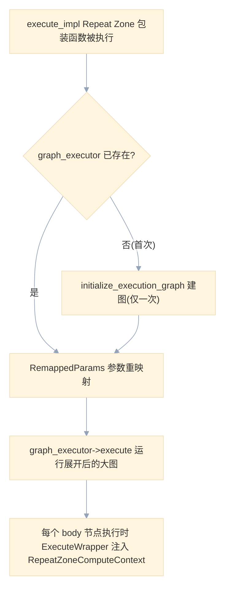
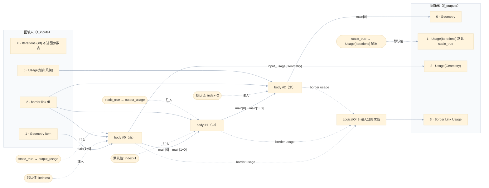
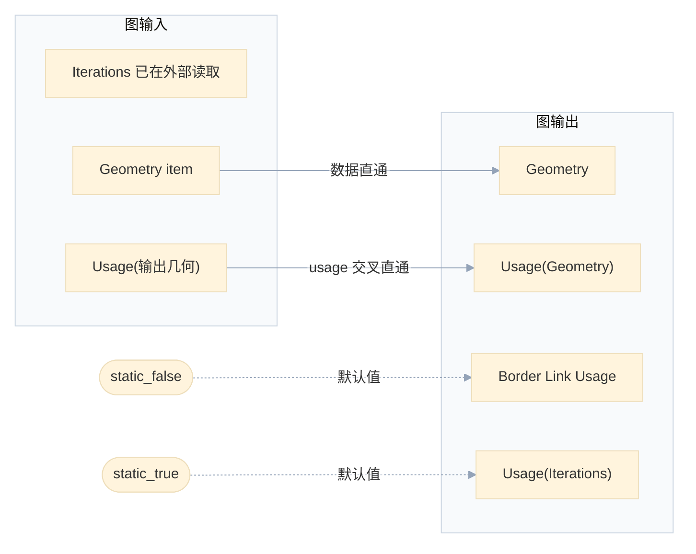
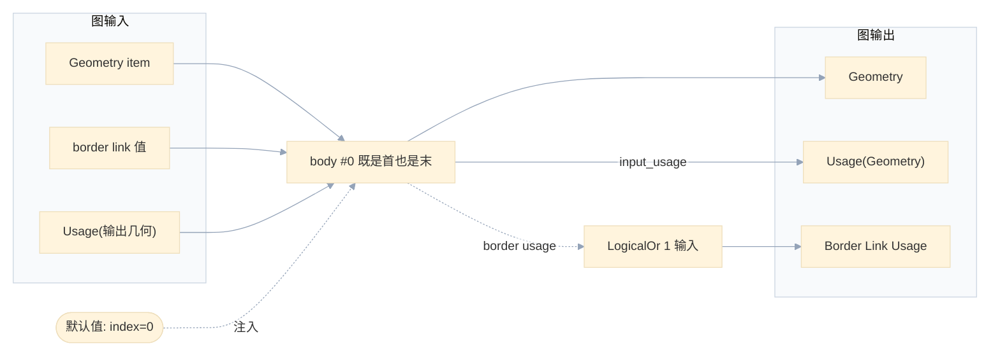
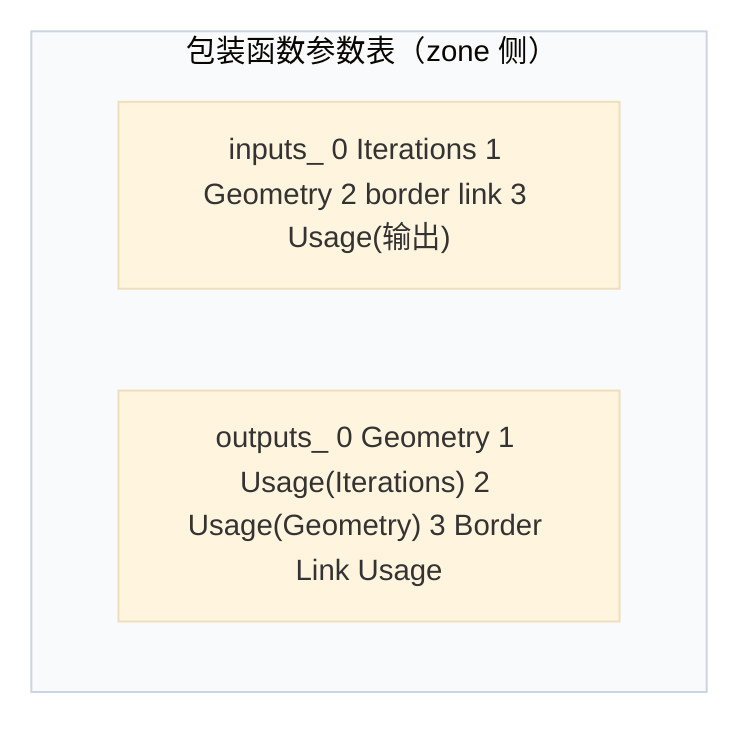

# 03 · 执行图按迭代展开：`initialize_execution_graph` 全文精读

<div style="font-family:'Segoe UI','Microsoft YaHei',system-ui,-apple-system,sans-serif;display:flex;flex-wrap:wrap;align-items:center;gap:8px;margin:16px 0 20px;padding:10px 14px;background:#F8FAFC;border:1px solid #E2E8F0;border-radius:12px">
<span style="font-size:11px;font-weight:700;letter-spacing:.1em;color:#64748B;margin-right:2px">导航</span>
<a href="../README.md" style="font-size:13px;color:#334155;background:#F1F5F9;border:1px solid #E2E8F0;border-radius:999px;padding:3px 12px;text-decoration:none;white-space:nowrap">总入口</a>
<a href="./README.md" style="font-size:13px;color:#2563EB;background:#EFF6FF;border:1px solid #BFDBFE;border-radius:999px;padding:3px 12px;text-decoration:none;white-space:nowrap">本章 03-几何节点执行架构</a>
<a href="./02-Repeat循环体函数构建详解.md" style="font-size:13px;color:#2563EB;background:#EFF6FF;border:1px solid #BFDBFE;border-radius:999px;padding:3px 12px;text-decoration:none;white-space:nowrap">‹ 02-Repeat循环体函数构建详解</a>
</div>

<div style="font-family:'Segoe UI','Microsoft YaHei',system-ui,-apple-system,sans-serif;margin:18px 0 22px;padding:14px 18px;background:#F5F3FF;border-left:4px solid #7C3AED;border-radius:10px">

系列定位：本篇是《重复区域（Repeat Zone）全面学习》系列 03 章第 3 篇，也是全系列核心篇。它逐段解剖 initialize_execution_graph：body 节点如何复制、成对如何串联、零轮如何直通、索引映射如何对齐。

</div>

<hr style="border:none;height:1px;background:linear-gradient(90deg,#BFDBFE,#E2E8F0 55%,transparent);margin:34px 0">

## 先回答一个具体问题

**问：循环不是 for 循环——Blender 是把循环体复制 N 份拼成一张大图？**

**答：是的。而且这不是实现上的偷懒，而是深思熟虑的架构选择。**

当你给 Repeat Zone 的 Iterations 填 `100` 时，Blender 不会生成一个"运行时循环"的执行单元，而是把循环体的 lazy-function **原样复制 100 份**，串成一条链：第 0 份的输出接第 1 份的输入，第 1 份的输出接第 2 份的输入……直到第 99 份。整条链连同边界连接（border link）、LogicalOr 节点、静态默认值一起，被装配成一张 `lf::Graph`，交给通用的图执行器去跑。

源码作者在函数正上方的注释里把这个取舍写得非常坦白（L187–L194）：

```cpp
  /**
   * Generate a lazy-function graph that contains the loop body (`body_fn_`) as many times
   * as there are iterations. Since this graph depends on the number of iterations, it can't be
   * reused in general. We could consider caching a version of this graph per number of iterations,
   * but right now that doesn't seem worth it. In practice, it takes much less time to create the
   * graph than to execute it (for intended use cases of this generic implementation, more special
   * case repeat loop evaluations could be implemented separately).
   */
```

逐句翻译并展开：

1. **"contains the loop body as many times as there are iterations"**——图里有几个 body 节点，就有几次迭代。图的结构本身编码了迭代次数。
2. **"it can't be reused in general"**——因为图依赖迭代次数，所以同一张图不能跨调用复用（除非迭代次数恰好相同）。这就是为什么图要建在 `RepeatEvalStorage` 里、每次 zone 求值重建（见上一篇的存储生命周期讨论）。
3. **"We could consider caching a version of this graph per number of iterations, but right now that doesn't seem worth it"**——理论上可以按迭代数缓存图（100 次迭代建一次，下次直接用），但作者明确说**不值得**。
4. **为什么不值得？** "it takes much less time to create the graph than to execute it"——**建图远快于执行**。建图只是往 `lf::Graph` 里加几百个节点指针和连线，是纯内存操作；执行却要跑真实的几何运算（布尔、变换、采样……），往往以毫秒甚至秒计。为省掉纳秒级的建图去维护一个缓存，是负收益。
5. **"more special case repeat loop evaluations could be implemented separately"**——通用实现保持简单；真正需要极致性能的特定场景，可以另写特化的 repeat 求值。

这个取舍对你读后续代码有两个直接启示：

- **不要在这段代码里找"循环控制流"**——没有循环计数器递增、没有跳转，控制流完全被"数据依赖的链式图"取代。第 N 份 body 能开始执行，仅仅是因为第 N-1 份的输出到达了。
- **不要担心 iterations 很大时图爆炸**——比如 10 万次迭代会复制出 10 万个 body 节点。这确实会发生（每个节点都是 `body_fn_.function` 的引用，不是拷贝，内存开销可控），lazy 执行器也只会沿链**按需求值**：如果下游只用最后一次迭代的某个输出，lazy 机制仍然要跑完整条链（因为链是串行依赖），但每个 body 内部未被使用的分支可以跳过。真正"跳过整轮迭代"的优化不存在——这是与"运行时 for 循环 + 提前 break"最大的语义差异。

<details><summary>核对原始源码：函数头注释 · L187—L194</summary>

```cpp
  /**
   * Generate a lazy-function graph that contains the loop body (`body_fn_`) as many times
   * as there are iterations. Since this graph depends on the number of iterations, it can't be
   * reused in general. We could consider caching a version of this graph per number of iterations,
   * but right now that doesn't seem worth it. In practice, it takes much less time to create the
   * graph than to execute it (for intended use cases of this generic implementation, more special
   * case repeat loop evaluations could be implemented separately).
   */
  void initialize_execution_graph(lf::Params &params,
                                  RepeatEvalStorage &eval_storage,
                                  const NodeGeometryRepeatOutput &node_storage,
                                  GeoNodesUserData &user_data,
                                  GeoNodesLocalUserData &local_user_data) const
```

</details>

在进入正文前，先给出本文要反复使用的两个角色说明（不熟悉请回看上一篇）：

- `zone_info_`（`ZoneBuildInfo`）：描述 **zone 包装函数**（即 Repeat Zone 对外暴露的那个 lazy-function）的输入/输出 socket 索引，见 [`NOD_geometry_nodes_lazy_function.hh` L605](../../../source/blender/nodes/NOD_geometry_nodes_lazy_function.hh#L605)。
- `body_fn_`（`ZoneBodyFunction`）：描述 **循环体函数**（zone 内所有节点打包成的单个 lazy-function）的输入/输出索引，见 [`NOD_geometry_nodes_lazy_function.hh` L618](../../../source/blender/nodes/NOD_geometry_nodes_lazy_function.hh#L618)。

两者的索引体系完全独立，本文代码里出现的每一处下标偏移，本质上都在回答"这是 zone 的第几个参数"还是"这是 body 的第几个参数"。

## 全景：这个函数在整个求值流程里的位置

`initialize_execution_graph` 不是被外部直接调用的，而是由 `execute_impl` 在**首次求值**时触发的。先把流程钉在脑子里，再逐段读代码：



要点只有一条：**建图是一次性的，执行是每次的**。`RepeatEvalStorage` 在 zone 函数的存储初始化时创建（`init_storage`，L139–L142），图在第一次 `execute_impl` 时建好并缓存在 `eval_storage.graph_executor` 里；后续调用直接走 `RemappedParams` + `graph_executor->execute`（L177–L184）。

下面按源码顺序拆解 15 个要点。

## 1. 前置读取：iterations、调度提示与检查索引（L201–L231）

### 1.1 读入三个基础量

```cpp
    const int num_repeat_items = node_storage.items_num;
    const int num_border_links = body_fn_.indices.inputs.border_links.size();
```

`[讲解]` 这两个量在函数开头就确定，后面所有循环都以它们为界：

- `num_repeat_items`：Repeat Zone 输出节点上声明的 **item 数量**（用户在节点 UI 上加的 "Item" 槽位个数），来自节点持久化存储 `NodeGeometryRepeatOutput::items_num`。item 是随迭代传递的主数据槽（通常是 Geometry，也可以是其他类型）。
- `num_border_links`：**border link 数量**——穿过 zone 边界、从 zone 内部连到外部的链接。注意它取自 `body_fn_.indices.inputs.border_links.size()`，即循环体函数签名里登记的 border link 输入个数；这保证了与 body 函数的实际参数布局一致，而不是重新去数 bNodeTree 里的连线。

```cpp
    /* Number of iterations to evaluate. */
    const int iterations = std::max<int>(
        0,
        params.get_input<SocketValueVariant>(zone_info_.indices.inputs.main[0])
            .ensure_type<int>());
```

`[讲解]` 迭代次数从 **zone 包装函数的 0 号输入**读出——`zone_info_.indices.inputs.main[0]` 就是 Iterations 槽位。三个细节值得停一停：

- **`ensure_type<int>()`**：断言并取出整数。socket 值统一装在 `SocketValueVariant` 里；如果类型不对会触发断言（调试构建崩溃、发布构建未定义行为之前的检查）。上游构建器保证这个 socket 一定是 int，所以这里是内部一致性检查而非用户输入校验。
- **`std::max<int>(0, ...)`**：**负数钳为 0**。理论上用户不可能在 UI 里输负数，但 Python API、文件损坏或浮点转 int 的截断都可能产生负值；钳位让后续 `IndexRange(iterations)` 不会变成 UB。
- **这里读的是 `params`（包装函数的参数）**，不是图输入——因为 iterations **不会进入**下面构建的执行图（见 1.2），它只在建图时被消费一次。

### 1.2 `main_inputs_offset = 1` 与 `body_inputs_offset = 1`：iterations 被排除在图外

```cpp
    /* Take iterations input into account. */
    const int main_inputs_offset = 1;
    const int body_inputs_offset = 1;
```

`[讲解]` 两个偏移量都等于 1，但含义不同，务必分清：

- **`main_inputs_offset = 1`（zone 侧）**：zone 包装函数的 main 输入序列是 `[Iterations, Item0, Item1, ...]`。**Iterations 占据了 main[0]**，真正的 item 从 main[1] 开始。所以"zone 的第 i 个 item"的包装参数下标是 `main_inputs_offset + i`。它用于把图输入接到首 body、把输入直通输出等场合。
- **`body_inputs_offset = 1`（body 侧）**：循环体函数的 main 输入序列是 `[迭代索引(index), Item0, Item1, ...]`。body 的 **main[0] 是本轮迭代索引**（即 "Iteration" socket 的值），item 从 main[1] 开始。所以"body 的第 i 个 item"的 body 参数下标是 `body_inputs_offset + i`。它用于首 body 接线与成对串联。

换句话说：**同一个语义槽位（第 i 个 item）在 zone 侧和 body 侧的下标恰好都是"i + 1"**——zone 侧因为前面插了 Iterations，body 侧因为前面插了迭代索引。两个偏移量数值相同纯属这个对称结构，代码保留两个名字是为了语义清晰。

**iterations 输入被排除在图外**意味着：执行图里不存在"Iterations"这个图输入；图的参数表从 item 开始。这也是第 14 节索引映射复杂度的根源——图参数和包装参数之间错了一位，必须用映射表对齐。

### 1.3 迭代多时给调度器递个话：`lazy_threading::send_hint()`

```cpp
    if (iterations >= 10) {
      /* Constructing and running the repeat zone has some overhead so that it's probably worth
       * trying to do something else in the meantime already. */
      lazy_threading::send_hint();
    }
```

`[讲解]` 这三行极容易误读。它**不是**"迭代 ≥10 就并行执行循环体"，而是一次**调度提示**。

看 [`BLI_lazy_threading.hh` L68](../../../source/blender/blenlib/BLI_lazy_threading.hh#L68) 的声明和 [`lazy_threading.cc` L28–L33](../../../source/blender/blenlib/intern/lazy_threading.cc#L28) 的实现：

```cpp
void send_hint()
{
  for (const FunctionRef<void()> &fn : hint_receivers.peek()) {
    fn();
  }
}
```

机制是：外层的 lazy-function 图执行器在启动时会注册 `HintReceiver`（见 [`lazy_function_graph_executor_generic.hh` L1477](../../../source/blender/functions/intern/lazy_function_graph_executor_generic.hh#L1477) 附近的注释：当某个节点调用 `send_hint` 时，执行器可以提前把其他待执行的节点分配到空闲线程上）。`send_hint()` 只是遍历当前线程的接收器列表并逐个调用回调。

放在 Repeat Zone 的语境里：构建这张图 + 执行这条长链都有固定开销（比如第一个 body 还在等它的输入到达），如果迭代数够大（≥10 是经验阈值），**主线程马上要陷入一段较长的串行工作**，此时提前告诉调度器"你可以先去别处干活/多开几个 worker"，能提高整体吞吐。它是一个纯粹的**性能 hint**——没有任何正确性影响，迭代数 <10 时 simply 不发提示而已。

### 1.4 检查索引越界警告（L216–L227）

```cpp
    /* Show a warning when the inspection index is out of range. */
    if (node_storage.inspection_index > 0) {
      if (node_storage.inspection_index >= iterations) {
        if (eval_log::NodeTreeLogger *tree_logger = local_user_data.try_get_tree_logger(user_data))
        {
          tree_logger->node_warnings.append(
              *tree_logger->allocator,
              {repeat_output_bnode_.identifier,
               {NodeWarningType::Info, N_("Inspection index is out of range")}});
        }
      }
    }
```

`[讲解]` Repeat Zone 支持"检查某一轮迭代"的调试功能（在节点 UI 上选择要检视的第几轮，配合 Viewer 节点观察中间数据）。`inspection_index` 就是这个轮号。逻辑分三层：

- **`inspection_index > 0` 才检查**：0 表示"未启用检视"（或指向第 0 轮之外的特殊状态），此时连警告都不发。注意"第 0 轮"本身是合法检视目标，所以判断用的是 `> 0` 而非 `>= 0`。
- **`inspection_index >= iterations` 为越界**：比如只有 3 轮迭代却想检视第 5 轮。此时无法生成该轮的检视数据。
- **警告级别是 `Info` 而非 `Error`**：这不是用户写错了节点树，只是"你想看的这一轮不存在"。警告挂在 **repeat 输出节点**（`repeat_output_bnode_.identifier`）上，出现在节点编辑器的节点警告角标里。
- **`try_get_tree_logger` 可能返回空**：没有日志器（比如后台渲染、无 GUI 会话）时安静跳过——调试设施永远不能影响正常执行。

<details><summary>核对原始源码：前置读取 · L201—L231</summary>

```cpp
    const int num_repeat_items = node_storage.items_num;
    const int num_border_links = body_fn_.indices.inputs.border_links.size();

    /* Number of iterations to evaluate. */
    const int iterations = std::max<int>(
        0,
        params.get_input<SocketValueVariant>(zone_info_.indices.inputs.main[0])
            .ensure_type<int>());

    if (iterations >= 10) {
      /* Constructing and running the repeat zone has some overhead so that it's probably worth
       * trying to do something else in the meantime already. */
      lazy_threading::send_hint();
    }

    /* Show a warning when the inspection index is out of range. */
    if (node_storage.inspection_index > 0) {
      if (node_storage.inspection_index >= iterations) {
        if (eval_log::NodeTreeLogger *tree_logger = local_user_data.try_get_tree_logger(user_data))
        {
          tree_logger->node_warnings.append(
              *tree_logger->allocator,
              {repeat_output_bnode_.identifier,
               {NodeWarningType::Info, N_("Inspection index is out of range")}});
        }
      }
    }

    /* Take iterations input into account. */
    const int main_inputs_offset = 1;
    const int body_inputs_offset = 1;
```

</details>

## 2. 建图的输入/输出与 body 节点复制（L233–L252)

### 2.1 图的输入/输出与包装函数一一对应

```cpp
    lf::Graph &lf_graph = eval_storage.graph;

    Vector<lf::GraphInputSocket *> lf_inputs;
    Vector<lf::GraphOutputSocket *> lf_outputs;

    for (const int i : inputs_.index_range()) {
      const lf::Input &input = inputs_[i];
      lf_inputs.append(&lf_graph.add_input(*input.type, this->input_name(i)));
    }
    for (const int i : outputs_.index_range()) {
      const lf::Output &output = outputs_[i];
      lf_outputs.append(&lf_graph.add_output(*output.type, this->output_name(i)));
    }
```

`[讲解]` 执行图的**外部接口**与 Repeat Zone 包装函数的接口**逐槽位对齐**（除了马上会讲到的 iterations——它在图参数层面依然存在，只是不被图使用，第 14 节的映射会精确处理这一点）：

- `inputs_` / `outputs_` 是包装函数（`LazyFunctionForRepeatZone` 本身）在构造时经 `initialize_zone_wrapper`（见 [`geometry_nodes_lazy_function.cc` L1704](../../../source/blender/nodes/intern/geometry_nodes_lazy_function.cc#L1704)）登记的接口列表。以"1 个 Geometry item + 1 条 border link"为例：
  - **图输入**（`lf_inputs`）：`[Iterations, Geometry, border link, Usage(输出几何)]`；
  - **图输出**（`lf_outputs`）：`[Geometry, Usage(iterations), Usage(Geometry), Border Link Usage]`。
- **下标完全同序**：`lf_inputs[i]` 对应包装参数 i，`lf_outputs[i]` 对应包装输出 i。后面所有 `zone_info_.indices...` 索引都可以直接用来下标这两个 Vector。
- `input_name(i)` / `output_name(i)`（L412–L420）给每个图 socket 起语义化名字，调试 dot 图里可读。
- 图被建在 `eval_storage.graph` 里——它是 `RepeatEvalStorage` 的成员，生命周期与本次 zone 求值绑定。

### 2.2 按 iterations 复制 body：`VectorSet` 顺便建立"节点 → 轮号"的映射

```cpp
    /* Create body nodes. */
    VectorSet<lf::FunctionNode *> &lf_body_nodes = eval_storage.lf_body_nodes;
    for ([[maybe_unused]] const int i : IndexRange(iterations)) {
      lf::FunctionNode &lf_node = lf_graph.add_function(*body_fn_.function);
      lf_body_nodes.add_new(&lf_node);
    }
```

`[讲解]` 核心的一步，也是本文开头那个问题的代码答案：

- **循环跑 `iterations` 次，每次 `add_function(*body_fn_.function)`**。注意 `add_function` 存的是**指向同一个 `body_fn_.function` 的指针**——N 个 `lf::FunctionNode` 共享同一个函数对象。复制的不是函数体（代码），而是**函数调用点**（invocation）。每个调用点有自己独立的参数槽位和存储，天然实现了"每轮独立的变量"。
- `[[maybe_unused]]`：循环变量 i 在这里没用到（轮号信息由 VectorSet 的位置隐式承载），加属性压制编译器警告。
- **`VectorSet<lf::FunctionNode *>` 的双重身份**：
  1. 它是按序容器——`lf_body_nodes[k]` 就是第 k 轮的 body 节点；
  2. 它是哈希集合——提供 `index_of_try(ptr)`：O(1) 查询某个节点指针在集合中的下标，**不在则返回 -1**。
- 第 2 个能力在 [`RepeatBodyNodeExecuteWrapper`](../../../source/blender/nodes/intern/geometry_nodes_repeat_zone.cc#L35) 里被用得淋漓尽致（L45）：执行器每执行一个节点，wrapper 都问一句 `lf_body_nodes_->index_of_try(&node)`——返回 ≥0 说明这是第 `iteration` 轮的 body，于是构造 `RepeatZoneComputeContext{..., iteration}` 让日志/检视系统能区分各轮；返回 -1 说明这是图里的其他节点（比如 LogicalOr），正常执行即可。**VectorSet 在这里同时是"图结构的一部分"和"运行时身份识别器"**。

`[讲解]` 还有一个生命周期细节：`lf_body_nodes` 是 `eval_storage` 成员的引用绑定（`VectorSet<...> &lf_body_nodes = eval_storage.lf_body_nodes;`），因为 `RepeatBodyNodeExecuteWrapper` 和 `RepeatZoneSideEffectProvider` 稍后会**长期持有指向它的指针**（L389、L392）。图执行是异步多线程的，wrapper 在任意 body 节点执行时都要访问这个集合，所以它必须活得和 executor 一样久——放在 storage 里正是为此。

<details><summary>核对原始源码：建图接口与 body 复制 · L233—L252</summary>

```cpp
    lf::Graph &lf_graph = eval_storage.graph;

    Vector<lf::GraphInputSocket *> lf_inputs;
    Vector<lf::GraphOutputSocket *> lf_outputs;

    for (const int i : inputs_.index_range()) {
      const lf::Input &input = inputs_[i];
      lf_inputs.append(&lf_graph.add_input(*input.type, this->input_name(i)));
    }
    for (const int i : outputs_.index_range()) {
      const lf::Output &output = outputs_[i];
      lf_outputs.append(&lf_graph.add_output(*output.type, this->output_name(i)));
    }

    /* Create body nodes. */
    VectorSet<lf::FunctionNode *> &lf_body_nodes = eval_storage.lf_body_nodes;
    for ([[maybe_unused]] const int i : IndexRange(iterations)) {
      lf::FunctionNode &lf_node = lf_graph.add_function(*body_fn_.function);
      lf_body_nodes.add_new(&lf_node);
    }
```

</details>

## 3. border link usage 的 LogicalOr 节点：任一轮用到就算用到（L254–L261）

```cpp
    /* Create nodes for combining border link usages. A border link is used when any of the loop
     * bodies uses the border link, so an "or" node is necessary. */
    Array<lf::FunctionNode *> lf_border_link_usage_or_nodes(num_border_links);
    eval_storage.or_function.emplace(iterations);
    for (const int i : IndexRange(num_border_links)) {
      lf::FunctionNode &lf_node = lf_graph.add_function(*eval_storage.or_function);
      lf_border_link_usage_or_nodes[i] = &lf_node;
    }
```

`[讲解]` 先回忆 border link 的语义：一条从 **zone 内部**引到 **zone 外部**的链接。zone 求值结束后，外部拿到的是**最后一轮写入的值**；而"这个 border link 到底有没有被用到"这个布尔信息，是 repeat zone 输出节点暴露给外层的 **usage 输出**（`Border Link Usage`）。

"被用到"的判定规则是 **OR**：只要**任意一轮**的 body 实际读取/写入了这条 border link，外层就应该认为它被使用了。所以每条 border link 需要一个逻辑或节点，把 N 轮各自的 usage 布尔值归约成一个。逐行看：

- **`eval_storage.or_function.emplace(iterations)`**：构造一个 `LazyFunctionForLogicalOr`，**输入个数恰好是 iterations**——每一轮贡献一个输入。它被放在 storage 里（`std::optional`）是因为图节点只存函数指针，函数对象本身必须活到执行结束。
- **每个 border link 一个 or 节点**（`lf_border_link_usage_or_nodes[i]`），N 条 border link 就有 N 个 or 节点。它们的第 `iter_i` 号输入将在第 6 节接到第 `iter_i` 轮 body 的 `border_link_usages[i]` 输出。
- **短路求值是关键**。看 [`NOD_geometry_nodes_lazy_function.hh` L580–L589](../../../source/blender/nodes/NOD_geometry_nodes_lazy_function.hh#L584) 的注释：

  > Computes the logical or of the inputs and supports short-circuit evaluation (i.e. if the first input is true already, the other inputs are not checked).

  这个 or 函数不是"收齐 N 个布尔再算"，而是**惰性**的：一旦拿到某个 `true`（通常是第 0 轮报告"我用了"），就立即输出 `true`，**不再请求后续输入**。在 lazy 图里，"不请求输入"意味着**上游根本不会被求值**——但这里 or 的输入是各轮 body 的 usage 输出，usage 是执行器在调度 body 时顺手产生的元数据，所以短路省的主要是 usage 传播路径上的开销，而不是 body 本身的执行（body 是否执行由 item 数据链决定）。不过"任一轮用到即真"的语义由它精确保证。

`[讲解]` 一个容易忽略的形状信息：or 节点有 `iterations` 个输入、1 个输出。当 iterations = 0 时它有 0 个输入——一个没有任何输入的 or 节点会输出 `false`（空集的逻辑或是假），这与 0 轮迭代时"没有人用过 border link"的语义恰好一致；不过 0 轮分支实际上走的是 L344–L358 的直通路径，给 usage 输出直接设了静态 `false` 默认值（见第 10 节），or 节点此时根本没被连线。

<details><summary>核对原始源码：LogicalOr 节点创建 · L254—L261</summary>

```cpp
    /* Create nodes for combining border link usages. A border link is used when any of the loop
     * bodies uses the border link, so an "or" node is necessary. */
    Array<lf::FunctionNode *> lf_border_link_usage_or_nodes(num_border_links);
    eval_storage.or_function.emplace(iterations);
    for (const int i : IndexRange(num_border_links)) {
      lf::FunctionNode &lf_node = lf_graph.add_function(*eval_storage.or_function);
      lf_border_link_usage_or_nodes[i] = &lf_node;
    }
```

</details>

## 4. `index_values` 并行填充：Iteration socket 是否真的被用到（L263–L272）

```cpp
    const bool use_index_values = zone_.input_node()->output_socket(0).is_directly_linked();

    if (use_index_values) {
      eval_storage.index_values.reinitialize(iterations);
      threading::parallel_for(IndexRange(iterations), 1024, [&](const IndexRange range) {
        for (const int i : range) {
          eval_storage.index_values[i].emplace<int>(i);
        }
      });
    }
```

`[讲解]` Repeat Zone 输入节点有一个特殊输出——**"Iteration"**，把它连进循环体内部，就能在每轮拿到自己的轮号（0、1、2……）。这一段处理它的值准备：

- **`use_index_values` 的判定**：`zone_.input_node()->output_socket(0)` 是 zone 输入节点的 Iteration 输出 socket。`is_directly_linked()` 为真，说明**用户确实把 Iteration 连进了循环体**里的某个节点。只有这时才值得预先计算所有轮号。
- **`static_unused_index{-1}`**（在下一节开头定义）：如果用户**没有**用 Iteration，各轮 body 的 index 输入会被注入同一个静态值 **-1**——一个"显然非法"的哨兵值。它永远不会被读取（因为没连线，body 的 index 输入端口是 Maybe usage 且无人请求），但 lazy-function 要求每个未连线的输入必须有默认值，于是给一个明确的垃圾值。**用 -1 而不是 0 是个好习惯**：万一将来有代码错误地读了它，-1 会立刻暴露问题，而 0 会伪装成"第 0 轮"。
- **预计算的意义**：这些轮号值是 `SocketValueVariant`（带类型标签的变体），构造有成本；第 0 轮、第 1 轮……每轮的 body 都要注入一个。预先在 `eval_storage.index_values` 里造好 `iterations` 个，之后逐节点注入时只是传指针（下一节 `set_default_value(index_value)`）。
- **`threading::parallel_for(..., 1024, ...)`**：当迭代数很大时，并行造值；**粒度 1024**——每个线程至少处理 1024 个元素，避免几万次微任务调度的开销反噬。对 3、5 轮的小循环这就是一个单线程区间，零额外成本。
- **为什么是 `emplace<int>(i)`**：`index_values` 是 `Array<SocketValueVariant>`，`emplace<int>` 在变体里就地构造 int 值。

`[讲解]` 一个值得体会的设计点：**轮号是"注入的常量"而不是"循环变量"**。图中没有任何东西会"递增"它——第 k 轮 body 的 index 输入在建图时就被永久固定为 k。轮次的推进完全由 body 链的拓扑顺序体现。

<details><summary>核对原始源码：index_values 填充 · L263—L272</summary>

```cpp
    const bool use_index_values = zone_.input_node()->output_socket(0).is_directly_linked();

    if (use_index_values) {
      eval_storage.index_values.reinitialize(iterations);
      threading::parallel_for(IndexRange(iterations), 1024, [&](const IndexRange range) {
        for (const int i : range) {
          eval_storage.index_values[i].emplace<int>(i);
        }
      });
    }
```

</details>

## 5. 逐 body 连接：index 注入、border link、reference set（L274–L294）

```cpp
    /* Handle body nodes one by one. */
    static const SocketValueVariant static_unused_index{-1};
    for (const int iter_i : lf_body_nodes.index_range()) {
      lf::FunctionNode &lf_node = *lf_body_nodes[iter_i];
      const SocketValueVariant *index_value = use_index_values ?
                                                  &eval_storage.index_values[iter_i] :
                                                  &static_unused_index;
      lf_node.input(body_fn_.indices.inputs.main[0]).set_default_value(index_value);
      for (const int i : IndexRange(num_border_links)) {
        lf_graph.add_link(*lf_inputs[zone_info_.indices.inputs.border_links[i]],
                          lf_node.input(body_fn_.indices.inputs.border_links[i]));
        lf_graph.add_link(lf_node.output(body_fn_.indices.outputs.border_link_usages[i]),
                          lf_border_link_usage_or_nodes[i]->input(iter_i));
      }

      /* Handle reference sets. */
      for (const auto &item : body_fn_.indices.inputs.reference_sets.items()) {
        lf_graph.add_link(*lf_inputs[zone_info_.indices.inputs.reference_sets.lookup(item.key)],
                          lf_node.input(item.value));
      }
    }
```

`[讲解]` 这个循环对**每一个** body 节点做三类接线（注意这里不分首/中/末——所有 body 一视同仁，差异化的接线在后面的成对循环和首尾连接里补）：

**① 迭代索引注入（`main[0]`）**

- `body_fn_.indices.inputs.main[0]` 是 body 的 **index 输入**（还记得 `body_inputs_offset = 1` 吗——它前面就只有这一个槽位）。
- `set_default_value(index_value)` **不是连线**，而是给这个输入端口设置默认值指针：用了 Iteration 就指向预计算好的第 `iter_i` 轮的 variant；没用就指向静态的 -1 哨兵。
- 这是把"第 k 轮"这个信息写进图结构的唯一位置。

**② border link 的双向接线**

每条 border link 接两根线，方向相反，语义不同：

- **值流入**：`lf_inputs[zone 边界输入 i] → body 的 border link 输入 i`。zone 外部（其实是 zone 内部节点链的边界桥接）产生的值，**每一轮都能读到同一个源值**。border link 常见用途是把"上一轮的结果"（经 Zone 输入节点的对应输出）和"外部常量"一起送进循环体。
- **usage 流出**：`body 的 border_link_usage[i] 输出 → or 节点的第 iter_i 号输入`。每轮报告"我这轮碰没碰这条 border link"，N 份布尔在 or 节点归约（第 3 节）。
- 注意下标体系切换：`zone_info_.indices.inputs.border_links[i]` 索引的是**图输入**，`body_fn_.indices.inputs.border_links[i]` 索引的是 **body 端口**——同一语义槽位在两套索引里的位置由 `initialize_zone_wrapper` 的登记顺序保证一致。

**③ reference set 连接**

- reference set（引用集）是 Repeat Zone 支持"在循环体内引用外部集合元素"的机制（比如每轮处理列表里的一个元素）。
- `body_fn_.indices.inputs.reference_sets` 是一个 `Map<ReferenceSetIndex, int>`：键是引用集编号，值是 body 输入端口下标。`items()` 遍历它，对每个引用集把**图输入**（`zone_info_.indices.inputs.reference_sets.lookup(item.key)`）连到 **body 输入**（`item.value`）。
- 与 border link 不同，reference set 只有值流入、没有 usage 流出——它的"是否被用"由 body 函数内部的参数 usage 机制直接传播。

`[讲解]` 注意本节循环**没有**接任何 main（item）数据线——item 的接线在下一节的成对串联和第 9 节的首尾连接里完成。这种"按类别分轮次接线"的写法（先全体接 border/reference，再成对接 item，再接首尾）让每个循环的职责单一，读代码时不妨也在脑中保持这个分层。

<details><summary>核对原始源码：逐 body 连接 · L274—L294</summary>

```cpp
    /* Handle body nodes one by one. */
    static const SocketValueVariant static_unused_index{-1};
    for (const int iter_i : lf_body_nodes.index_range()) {
      lf::FunctionNode &lf_node = *lf_body_nodes[iter_i];
      const SocketValueVariant *index_value = use_index_values ?
                                                  &eval_storage.index_values[iter_i] :
                                                  &static_unused_index;
      lf_node.input(body_fn_.indices.inputs.main[0]).set_default_value(index_value);
      for (const int i : IndexRange(num_border_links)) {
        lf_graph.add_link(*lf_inputs[zone_info_.indices.inputs.border_links[i]],
                          lf_node.input(body_fn_.indices.inputs.border_links[i]));
        lf_graph.add_link(lf_node.output(body_fn_.indices.outputs.border_link_usages[i]),
                          lf_border_link_usage_or_nodes[i]->input(iter_i));
      }

      /* Handle reference sets. */
      for (const auto &item : body_fn_.indices.inputs.reference_sets.items()) {
        lf_graph.add_link(*lf_inputs[zone_info_.indices.inputs.reference_sets.lookup(item.key)],
                          lf_node.input(item.value));
      }
    }
```

</details>

## 6. 成对串联：把 N 份 body 钉成一条链（L296–L311）

```cpp
    static bool static_true = true;

    /* Handle body nodes pair-wise. */
    for (const int iter_i : lf_body_nodes.index_range().drop_back(1)) {
      lf::FunctionNode &lf_node = *lf_body_nodes[iter_i];
      lf::FunctionNode &lf_next_node = *lf_body_nodes[iter_i + 1];
      for (const int i : IndexRange(num_repeat_items)) {
        lf_graph.add_link(
            lf_node.output(body_fn_.indices.outputs.main[i]),
            lf_next_node.input(body_fn_.indices.inputs.main[i + body_inputs_offset]));
        /* TODO: Add back-link after being able to check for cyclic dependencies. */
        // lf_graph.add_link(lf_next_node.output(body_fn_.indices.outputs.input_usages[i]),
        //                   lf_node.input(body_fn_.indices.inputs.output_usages[i]));
        lf_node.input(body_fn_.indices.inputs.output_usages[i]).set_default_value(&static_true);
      }
    }
```

`[讲解]` 这是"链"真正成形的地方。循环范围是 `drop_back(1)`——**除了最后一个 body 的每一个**，都和它的后继配对；每一对之间接 `num_repeat_items` 根 item 数据线。

**① 数据线本身**

```cpp
lf_node.output(body_fn_.indices.outputs.main[i])
    → lf_next_node.input(body_fn_.indices.inputs.main[i + body_inputs_offset])
```

- 源：第 `iter_i` 轮 body 的第 i 个 **main 输出**（body 的 main 输出从 0 开始，没有 index 槽位——index 是输入侧的）。
- 目标：第 `iter_i + 1` 轮 body 的第 i 个 **main 输入**，注意 **`+ body_inputs_offset`**：body 的 main 输入里 0 号被 index 占据，item 从 1 号开始。
- 语义：**第 k 轮的输出就是第 k+1 轮的输入**。这就是"循环携带状态"（loop-carried value）在图里的形态——用户在 Zone 输出/输入节点间对齐的 item 槽位，逐轮接力。

**② 一段被注释掉的 TODO——usage 回边**

```cpp
/* TODO: Add back-link after being able to check for cyclic dependencies. */
// lf_graph.add_link(lf_next_node.output(body_fn_.indices.outputs.input_usages[i]),
//                   lf_node.input(body_fn_.indices.inputs.output_usages[i]));
```

值得逐词读。lazy-function 的 usage 机制允许下游告诉上游"我的这个输出你不用做"（`output_usages`）。理想情况下，第 k 轮 body 应该知道"第 k+1 轮是否真的需要我的第 i 个 item 输出"——如果整条链下游没人要它，第 k 轮就可以跳过这项计算。这需要一条 **从第 k+1 轮的 `input_usages` 输出指回第 k 轮的 `output_usages` 输入的回边**。

但这条边会构成**环**：k+1 的 usage 依赖 k+1 的执行调度，而 k+1 的执行依赖 k 的数据输出，k 的调度又想依赖 k+1 的 usage……当前图执行器没有"检查循环依赖"的能力（它能容忍数据环的惰性求值，但 usage 元数据环需要额外保证），所以这条优化边暂缓。**当前代码的取舍是：一律假设 item 会被要用。**

**③ 于是 usage 只能硬编码为 true**

```cpp
lf_node.input(body_fn_.indices.inputs.output_usages[i]).set_default_value(&static_true);
```

- 第 k 轮 body 的 `output_usages[i]` 输入（"我的第 i 个输出，下游用不用？"）被设为**静态 true 默认值**：永远"有人用"。
- **`static bool static_true = true;` 是函数级静态变量**——整个进程只有一份，所有 body 节点的所有 usage 输入共享同一个指针。它只读，所以多线程安全；也因为它必须是**稳定地址**（`set_default_value` 存指针而非拷贝），不能用局部变量。
- 代价：即使下游只要最后一轮的某个输出、且某轮的某项计算完全无用，它仍会被求值。这正是 TODO 里说的未来优化空间。

`[讲解]` 把第 5、6 节合起来看，body 节点的输入端口现在有了三种来源：**建图时注入的静态默认值**（index、成对段的 output_usages）、**来自图输入的连线**（border link、reference set）、**来自前一轮的连线**（item，除第 0 轮外）。第 0 轮的 item 来源和最后一轮的输出去向，是下一节的首尾连接。

<details><summary>核对原始源码：成对串联 · L296—L311</summary>

```cpp
    static bool static_true = true;

    /* Handle body nodes pair-wise. */
    for (const int iter_i : lf_body_nodes.index_range().drop_back(1)) {
      lf::FunctionNode &lf_node = *lf_body_nodes[iter_i];
      lf::FunctionNode &lf_next_node = *lf_body_nodes[iter_i + 1];
      for (const int i : IndexRange(num_repeat_items)) {
        lf_graph.add_link(
            lf_node.output(body_fn_.indices.outputs.main[i]),
            lf_next_node.input(body_fn_.indices.inputs.main[i + body_inputs_offset]));
        /* TODO: Add back-link after being able to check for cyclic dependencies. */
        // lf_graph.add_link(lf_next_node.output(body_fn_.indices.outputs.input_usages[i]),
        //                   lf_node.input(body_fn_.indices.inputs.output_usages[i]));
        lf_node.input(body_fn_.indices.inputs.output_usages[i]).set_default_value(&static_true);
      }
    }
```

</details>

## 7. border link usage 输出的归约结果接出图外（L313–L317）

```cpp
    /* Handle border link usage outputs. */
    for (const int i : IndexRange(num_border_links)) {
      lf_graph.add_link(lf_border_link_usage_or_nodes[i]->output(0),
                        *lf_outputs[zone_info_.indices.outputs.border_link_usages[i]]);
    }
```

`[讲解]` 把第 3 节创建的 or 节点的**唯一输出**接到**图输出**上对应的 `Border Link Usage` 槽位。至此 border link 的完整数据通路闭合了：

```
每轮 body 的 usage 布尔 → or 节点（OR 归约，短路） → 图输出 "Border Link Usage"
```

外层图（包含这个 repeat zone 的更大的几何节点图）读取这个 usage，就能判断"这条从 zone 里伸出来的连线到底有没有生效"，进而决定外层依赖它的那些计算是否需要执行。这是 lazy 求值跨越 zone 边界传播的关键一环：**zone 不是惰性黑盒，usage 信息穿透它**。

`[讲解]` 注意 `output(0)`——or 函数只有一个输出，硬编码 0 没问题；而目标侧用 `zone_info_.indices.outputs.border_link_usages[i]` 而不是手数下标，是为了适配任意 socket 排布（不同 zone 类型的包装接口布局不同，repeat 是 main → input_usages → border_link_usages 的顺序，见 `initialize_zone_wrapper` L1724–L1745）。

<details><summary>核对原始源码：border usage 输出 · L313—L317</summary>

```cpp
    /* Handle border link usage outputs. */
    for (const int i : IndexRange(num_border_links)) {
      lf_graph.add_link(lf_border_link_usage_or_nodes[i]->output(0),
                        *lf_outputs[zone_info_.indices.outputs.border_link_usages[i]]);
    }
```

</details>

## 8. iterations > 0：首 body 进货、末 body 出货（L319–L343）

```cpp
    if (iterations > 0) {
      {
        /* Link first body node to input/output nodes. */
        lf::FunctionNode &lf_first_body_node = *lf_body_nodes[0];
        for (const int i : IndexRange(num_repeat_items)) {
          lf_graph.add_link(
              *lf_inputs[zone_info_.indices.inputs.main[i + main_inputs_offset]],
              lf_first_body_node.input(body_fn_.indices.inputs.main[i + body_inputs_offset]));
          lf_graph.add_link(
              lf_first_body_node.output(
                  body_fn_.indices.outputs.input_usages[i + body_inputs_offset]),
              *lf_outputs[zone_info_.indices.outputs.input_usages[i + main_inputs_offset]]);
        }
      }
      {
        /* Link last body node to input/output nodes. */
        lf::FunctionNode &lf_last_body_node = *lf_body_nodes.as_span().last();
        for (const int i : IndexRange(num_repeat_items)) {
          lf_graph.add_link(lf_last_body_node.output(body_fn_.indices.outputs.main[i]),
                            *lf_outputs[zone_info_.indices.outputs.main[i]]);
          lf_graph.add_link(*lf_inputs[zone_info_.indices.inputs.output_usages[i]],
                            lf_last_body_node.input(body_fn_.indices.inputs.output_usages[i]));
        }
      }
    }
```

`[讲解]` 成对串联覆盖了"第 0 轮 → 第 1 轮 → …… → 第 N-1 轮"的内部线，但链条的两端还敞着：第 0 轮的 item 从哪来？第 N-1 轮的 item 到哪去？这个 `if` 块补上两头。两个子块结构对称，方向相反。

**① 首块（第 0 轮 = 进货口）**

- **数据**：图输入的第 i 个 item（`zone_info_.indices.inputs.main[i + main_inputs_offset]`，**+1 跳过 Iterations**）→ 第 0 轮 body 的第 i 个 item 输入（`body_fn_.indices.inputs.main[i + body_inputs_offset]`，**+1 跳过 index**）。zone 侧和 body 侧各偏移一次，恰好对齐同一个语义槽位——第 1 节强调的"双 offset 对称"在这里兑现。
- **usage 反向**：第 0 轮 body 的 `input_usages[i + body_inputs_offset]` 输出（"我有没有真的用第 i 个 item 输入？"）→ 图输出的 `input_usages[i + main_inputs_offset]`（包装函数对外报告"zone 的第 i 个输入被用了"）。**这个 usage 会让外层跳过 zone 第 i 个输入的上游计算**——如果循环体根本没碰某个 item，喂它的整棵外部子树都可以不执行。

**② 末块（第 N-1 轮 = 出货口）**

- **数据**：最后一轮 body 的第 i 个 main 输出 → 图输出第 i 个 main（zone 对外的最终结果）。这就是"repeat zone 的输出 = 最后一轮的输出"的实现。
- **usage 正向**：图输入的 `output_usages[i]`（外层声明"我要不要 zone 的第 i 个输出"）→ 最后一轮 body 的 `output_usages[i]` 输入。**外层的 laziness 以此注入链条末端**：外层不用某个输出，最后一轮就不做那项计算；但由于成对串联里 usage 回边缺失（TODO），这个"不用"**无法继续向前传播**到更早的轮次——只有最后一轮受益。

`[讲解]` 两个边角：

- `lf_body_nodes.as_span().last()` 取尾元素，比 `lf_body_nodes[iterations - 1]` 更不会写错（不必重复迭代数表达式）。
- 这个块只在 `iterations > 0` 时执行——`lf_body_nodes[0]` 和 `.last()` 在空集合上都是未定义行为，分支条件就是防它的。0 轮走什么路？下一节。

<details><summary>核对原始源码：首尾连接 · L319—L343</summary>

```cpp
    if (iterations > 0) {
      {
        /* Link first body node to input/output nodes. */
        lf::FunctionNode &lf_first_body_node = *lf_body_nodes[0];
        for (const int i : IndexRange(num_repeat_items)) {
          lf_graph.add_link(
              *lf_inputs[zone_info_.indices.inputs.main[i + main_inputs_offset]],
              lf_first_body_node.input(body_fn_.indices.inputs.main[i + body_inputs_offset]));
          lf_graph.add_link(
              lf_first_body_node.output(
                  body_fn_.indices.outputs.input_usages[i + body_inputs_offset]),
              *lf_outputs[zone_info_.indices.outputs.input_usages[i + main_inputs_offset]]);
        }
      }
      {
        /* Link last body node to input/output nodes. */
        lf::FunctionNode &lf_last_body_node = *lf_body_nodes.as_span().last();
        for (const int i : IndexRange(num_repeat_items)) {
          lf_graph.add_link(lf_last_body_node.output(body_fn_.indices.outputs.main[i]),
                            *lf_outputs[zone_info_.indices.outputs.main[i]]);
          lf_graph.add_link(*lf_inputs[zone_info_.indices.inputs.output_usages[i]],
                            lf_last_body_node.input(body_fn_.indices.inputs.output_usages[i]));
        }
      }
    }
```

</details>

## 9. iterations == 0：整条链消失，只剩直通线（L344–L358）

```cpp
    else {
      /* There are no iterations, just link the input directly to the output. */
      for (const int i : IndexRange(num_repeat_items)) {
        lf_graph.add_link(*lf_inputs[zone_info_.indices.inputs.main[i + main_inputs_offset]],
                          *lf_outputs[zone_info_.indices.outputs.main[i]]);
        lf_graph.add_link(
            *lf_inputs[zone_info_.indices.inputs.output_usages[i]],
            *lf_outputs[zone_info_.indices.outputs.input_usages[i + main_inputs_offset]]);
      }
      for (const int i : IndexRange(num_border_links)) {
        static bool static_false = false;
        lf_outputs[zone_info_.indices.outputs.border_link_usages[i]]->set_default_value(
            &static_false);
      }
    }
```

`[讲解]` 0 轮迭代时，图里**一个 body 节点都没有**（第 2 节的复制循环零次），也没有成对串联、没有首尾连接。此时图的形态退化成"直通适配器"，两条直通线 + 一组静态默认值：

- **数据直通**：图输入第 i 个 item → 图输出第 i 个 main。**Repeat Zone 在 0 轮时是恒等映射**：把 zone 输入的 item 原样送到 zone 输出。这保证了下游节点总能拿到一个合法的 Geometry（空循环不产出"空几何"之外的东西，而是透传输入）。这与你从其他编程语言 for 循环得来的直觉（循环不执行 → 循环变量未定义）不同——Repeat Zone 选择了"透传"语义，更符合几何节点"总有几何流出"的直觉。
- **usage 交叉直通**：图输入 `output_usages[i]`（外层要不要第 i 个输出）→ 图输出 `input_usages[i + main_inputs_offset]`（对外报告第 i 个输入被用）。注意这里是一个**语义交叉**："外层要用输出 i" 蕴含 "输入 i 被用了"（因为输出 i 就是输入 i 的透传）。外层不要任何输出时，zone 的输入侧整棵上游树都可以被跳过。
- **border link usage 静态 false**：没有人执行循环体，自然没有人碰 border link——每个 `Border Link Usage` 图输出被设为静态 `false` 默认值（又是 `static` 变量保证地址稳定，且同样只读线程安全）。or 节点虽然被创建了，但没接线、也永远不会被求值。

`[讲解]` 与 `iterations == 1` 对比（专节见后文）：1 轮时图里有且仅有一个 body 节点，它**同时**是"首 body"（进货 + usage 上报）和"末 body"（出货 + usage 下发）——第 8 节的两个子块都作用于它。0 轮与 1 轮的形态差异是检验你是否理解本函数的最佳试金石。

<details><summary>核对原始源码：0 迭代分支 · L344—L358</summary>

```cpp
    else {
      /* There are no iterations, just link the input directly to the output. */
      for (const int i : IndexRange(num_repeat_items)) {
        lf_graph.add_link(*lf_inputs[zone_info_.indices.inputs.main[i + main_inputs_offset]],
                          *lf_outputs[zone_info_.indices.outputs.main[i]]);
        lf_graph.add_link(
            *lf_inputs[zone_info_.indices.inputs.output_usages[i]],
            *lf_outputs[zone_info_.indices.outputs.input_usages[i + main_inputs_offset]]);
      }
      for (const int i : IndexRange(num_border_links)) {
        static bool static_false = false;
        lf_outputs[zone_info_.indices.outputs.border_link_usages[i]]->set_default_value(
            &static_false);
      }
    }
```

</details>

## 10. Iterations 永远被求值：给它的 usage 输出设 static_true（L360）

```cpp
    lf_outputs[zone_info_.indices.outputs.input_usages[0]]->set_default_value(&static_true);
```

`[讲解]` 单独一行，却回答了一个重要问题：**外层怎么知道 zone 的 Iterations 输入被用了？** 答案是：永远被用了，无条件 true。

为什么必须如此？回忆包装函数构造函数里的（L135–L136）：

```cpp
    /* Iterations input is always used. */
    inputs_[zone_info_.indices.inputs.main[0]].usage = lf::ValueUsage::Used;
```

Iterations 驱动建图——不读它就无法确定复制几份 body，整个 zone 的行为都依赖它。哪怕循环体内部从不把 Iteration socket 连进循环（`use_index_values == false`），迭代次数本身也必须被读取。所以包装侧声明 `ValueUsage::Used` 强制外层供给，图的 usage 输出再向更外层确认"是的，我在用它"。两处配合，形成不可绕过的求值保证。

（顺带对照 `execute_impl` 开头 L164–L168 的防御：包装函数每次执行时会检查这个 usage 输出是否已被设置，没设就补一个 true——这发生在**图外**的包装函数自身参数层面，与本行图内默认值互为双保险。）

<details><summary>核对原始源码：iterations usage · L360—L363</summary>

```cpp
    lf_outputs[zone_info_.indices.outputs.input_usages[0]]->set_default_value(&static_true);

    /* The graph is ready, update the node indices which are required by the executor. */
    lf_graph.update_node_indices();
```

</details>

## 11. 图就绪：`update_node_indices()`（L363）

```cpp
    /* The graph is ready, update the node indices which are required by the executor. */
    lf_graph.update_node_indices();
```

`[讲解]` 建图阶段的所有 `add_input` / `add_output` / `add_function` / `add_link` 都是"声明式"的；执行器在运行期需要 O(1) 按编号访问节点与 socket（调度、存储分配、usage 追踪都以整数索引为键）。`update_node_indices()` 负责这最后一遍线性扫描：为每个节点和 socket 编定最终序号、构建内部查找表。**它必须在本图所有拓扑修改完成之后、交给执行器之前调用一次**——漏调的图在执行时会命中断言或产生错乱索引。

下面那行被注释掉的 `lf_graph.to_dot()`（L365）是开发者的调试后门：取消注释即可把图 dump 成 Graphviz dot 文本。第 15 节会看到它有个更正式的"兄弟版"。

<details><summary>核对原始源码：update_node_indices · L362—L365</summary>

```cpp
    /* The graph is ready, update the node indices which are required by the executor. */
    lf_graph.update_node_indices();

    // std::cout << "\n\n" << lf_graph.to_dot() << "\n\n";
```

</details>

## 12. 索引映射：`RemappedParams` 如何对齐两套参数表（L367–L385）

这是全函数**最烧脑也最值得精读**的一段。先补一块背景知识。

### 12.1 `RemappedParams` 是什么

看 [`FN_lazy_function_execute.hh` L49–L58](../../../source/blender/functions/FN_lazy_function_execute.hh#L53) 的定义与注释：

```cpp
/**
 * Wraps an existing #Params. This should be used when a lazy-function internally contains another
 * lazy-function that handles a subset or the inputs and outputs.
 */
class RemappedParams : public Params {
 private:
  Params &base_params_;
  Span<int> input_map_;
  Span<int> output_map_;
  bool &multi_threading_enabled_;
  ...
```

`[讲解]` 一个 lazy-function（这里是 Repeat Zone 包装函数）内部藏着另一个 lazy-function（这里是展开后的执行图）。执行图跑起来时，它向"自己的参数表"要第 j 个输入、设第 k 个输出；但真正的数据在外层包装函数的参数表里，而且**两边的编号对不上**。`RemappedParams` 就是一个带换算表的参数转发器：

- 内部函数要参数 `j` → 查 `input_map_[j]` → 得到外层参数号 → 从 `base_params_` 取；
- 内部函数设输出 `k` → 查 `output_map_[k]` → 写到外层对应槽位。

映射表就是本段代码要算的 `input_index_map` / `output_index_map`。

### 12.2 为什么对不上？因为 iterations

包装函数的参数表比图的参数表**多出一个 Iterations**（输入侧），多出一个 iterations-usage（输出侧）。而且**这个"多出"不在表尾，而在中间**——这才是复杂度来源。注释直说了（L367–L369）：

```cpp
    /* Create a mapping from parameter indices inside of this graph to parameters of the repeat
     * zone. The main complexity below stems from the fact that the iterations input is handled
     * outside of this graph. */
```

### 12.3 输入映射：整体右移一位

```cpp
    eval_storage.output_index_map.reinitialize(outputs_.size() - 1);
    eval_storage.input_index_map.resize(inputs_.size() - 1);
    array_utils::fill_index_range<int>(eval_storage.input_index_map, 1);

    Vector<const lf::GraphInputSocket *> lf_graph_inputs = lf_inputs.as_span().drop_front(1);
```

`[讲解]` 逐行拆：

- **尺寸 = 包装参数数 − 1**：图比包装少一个参数（输入侧少 Iterations，输出侧少 iterations-usage），所以映射表长度都是"包装数减一"。
- **`fill_index_range(input_index_map, 1)`**：填成 `{1, 2, 3, ...}`——图的第 j 个输入参数对应包装的第 j+1 个参数。**整体右移一位**，跳过的正是 0 号 Iterations。图参数 0 = 包装参数 1（第一个 item），图参数 1 = 包装参数 2……完美对应第 1 节的 `main_inputs_offset`。
- **`lf_graph_inputs = lf_inputs.drop_front(1)`**：把图的**输入 socket 列表**也去掉第 0 个（Iterations 的图输入 socket 虽然被创建了、但没有任何内部连线——它就是个摆设），交给执行器的 socket 列表从第一个 item 开始。这样"执行器的第 j 个图输入 socket"与"input_index_map[j]"与"body 侧第 j 个 item"三者严格对齐。

### 12.4 输出映射：中段挖掉一格

输出侧的 iterations-usage（包装输出下标 `iteration_usage_index`）**不在表头而在表中间**——包装输出顺序是 `[main…, input_usages…(第一个就是 iterations 的), border_link_usages…]`（见 `initialize_zone_wrapper` L1724–L1745：main 先登记，然后是每个 zone 输入 socket 的 Usage，最后是 border link usage）。挖中间的格子需要分段拼接：

```cpp
    const int iteration_usage_index = zone_info_.indices.outputs.input_usages[0];
    array_utils::fill_index_range<int>(
        eval_storage.output_index_map.as_mutable_span().take_front(iteration_usage_index));
    array_utils::fill_index_range<int>(
        eval_storage.output_index_map.as_mutable_span().drop_front(iteration_usage_index),
        iteration_usage_index + 1);

    Vector<const lf::GraphOutputSocket *> lf_graph_outputs = lf_outputs.as_span().take_front(
        iteration_usage_index);
    lf_graph_outputs.extend(lf_outputs.as_span().drop_front(iteration_usage_index + 1));
```

`[讲解]` 拆解（假设 `iteration_usage_index = I`）：

- **前段** `take_front(I)`：图输出 0..I-1 → 包装输出 0..I-1。**前段无偏移**——main 输出在两侧从 0 起连续对齐。
- **后段** `drop_front(I)`，从 `I + 1` 开始填：图输出 I, I+1, … → 包装输出 I+1, I+2, …。**后段右移一位**，跳过包装输出的 I 号（iterations-usage）。
- 对 `lf_graph_outputs` 做同样的"掐头去尾拼接"：保留前 I 个图输出 socket，跳过第 I 个（iterations-usage 的图输出 socket——它的值由第 10 节的 static_true 默认值提供，不经过任何连线），再接上第 I+1 个之后的全部。

`[讲解]` **为什么输入侧是"整体右移"而输出侧是"中段挖一格"？** 因为两种"多余参数"的位置不同：Iterations 在包装**输入表的开头**（main[0]），挖掉它等于所有输入右移一位；iterations-usage 在包装**输出表的中间**（main 之后、border usage 之前），挖掉它等于前后两段错位一格。两段 `fill_index_range` 的起始值（缺省 0 与显式 `I + 1`）精确编码了这个错位。

`[讲解]` 还有一个容易看漏的对称性：第 10 节的 `static_true` 给了 iterations-usage 的图输出一个默认值，所以执行图"实际上"仍然产出一个 true，只是它不占用图参数、也不通过映射表转发——包装函数在 `execute_impl` 里自行把它写进自己的输出参数（L164–L168 的补写逻辑 + 图执行后该输出已由默认值就位）。整个设计里 iterations 相关的三件套（不进图输入表、usage 硬编码 true、输出侧挖格映射）环环相扣，缺一即错。

<details><summary>核对原始源码：索引映射 · L367—L385</summary>

```cpp
    /* Create a mapping from parameter indices inside of this graph to parameters of the repeat
     * zone. The main complexity below stems from the fact that the iterations input is handled
     * outside of this graph. */
    eval_storage.output_index_map.reinitialize(outputs_.size() - 1);
    eval_storage.input_index_map.resize(inputs_.size() - 1);
    array_utils::fill_index_range<int>(eval_storage.input_index_map, 1);

    Vector<const lf::GraphInputSocket *> lf_graph_inputs = lf_inputs.as_span().drop_front(1);

    const int iteration_usage_index = zone_info_.indices.outputs.input_usages[0];
    array_utils::fill_index_range<int>(
        eval_storage.output_index_map.as_mutable_span().take_front(iteration_usage_index));
    array_utils::fill_index_range<int>(
        eval_storage.output_index_map.as_mutable_span().drop_front(iteration_usage_index),
        iteration_usage_index + 1);

    Vector<const lf::GraphOutputSocket *> lf_graph_outputs = lf_outputs.as_span().take_front(
        iteration_usage_index);
    lf_graph_outputs.extend(lf_outputs.as_span().drop_front(iteration_usage_index + 1));
```

</details>

## 13. wrapper / provider 装配与执行器初始化（L387–L401）

```cpp
    eval_storage.body_execute_wrapper.emplace();
    eval_storage.body_execute_wrapper->repeat_output_bnode_ = &repeat_output_bnode_;
    eval_storage.body_execute_wrapper->lf_body_nodes_ = &lf_body_nodes;
    eval_storage.side_effect_provider.emplace();
    eval_storage.side_effect_provider->repeat_output_bnode_ = &repeat_output_bnode_;
    eval_storage.side_effect_provider->lf_body_nodes_ = lf_body_nodes;

    eval_storage.graph_executor.emplace(lf_graph,
                                        std::move(lf_graph_inputs),
                                        std::move(lf_graph_outputs),
                                        nullptr,
                                        &*eval_storage.side_effect_provider,
                                        &*eval_storage.body_execute_wrapper);
    eval_storage.graph_executor_storage = eval_storage.graph_executor->init_storage(
        eval_storage.allocator);
```

`[讲解]` 建好的 `lf_graph` 还不能直接执行——执行器需要两个**钩子**，把"通用图执行"适配到"Repeat Zone 语义"：

**① `RepeatBodyNodeExecuteWrapper`（执行包装器）**——文件头 L29–L34 的注释说得很清楚：它的唯一职责是在每个 body 节点执行前**构造正确的 `ComputeContext`**：

> Wraps the execution of a repeat loop body. The purpose is to setup the correct #ComputeContext inside of the loop body. This is necessary to support correct logging inside of a repeat zone. An alternative would be to use a separate `LazyFunction` for every iteration, but that would have higher overhead.

借助第 2 节的 `index_of_try`，wrapper 判定当前节点是第几轮的 body，然后构造 `RepeatZoneComputeContext{父上下文, repeat输出节点, 轮号}`。日志系统、节点检视、"选中节点查看中间值"全都依赖这个上下文来区分"第 0 轮的 Transform"和"第 5 轮的 Transform"。注释同时点出备选方案——**给每轮生成一个独立的 LazyFunction**——被否决的原因是开销更高（N 个函数对象 vs 1 个函数 + 1 个轻量 wrapper）。

**② `RepeatZoneSideEffectProvider`（副作用提供者）**——Repeat Zone 支持"查看某轮迭代"的检视（Viewer/Inspect），这类操作在 lazy 执行器眼里是**副作用节点**。Provider 回答"当前上下文里哪些节点带副作用"：它从调用数据里取出"本 zone、本上下文中被检视的轮号列表"（`iterations_by_iteration_zone`），把轮号翻译成 `lf_body_nodes_` 里的对应节点指针。同样靠 VectorSet 完成轮号 → 节点的映射。

**③ 执行器本体**：`graph_executor.emplace(lf_graph, inputs, outputs, nullptr, provider, wrapper)`——把图、掐剪过的 socket 列表（第 12 节）、两个钩子组装成 `lf::GraphExecutor`。第三个参数 `nullptr` 是本图的 user data（Repeat Zone 沿用调用方传入的）。随后 `init_storage` 在 `eval_storage.allocator` 上分配执行器自己的存储，句柄存进 `graph_executor_storage`——它在 `execute_impl`（L182–L184）里被塞进 `lf::Context`，图内所有节点共享。

`[讲解]` 注意 wrapper 持有 `&lf_body_nodes`（指针）而 provider 持有 `lf_body_nodes`（**按值拷贝了一份节点指针列表**）。两者都在 storage 里、生命周期与 executor 相同，拷贝是安全的；wrapper 需要指针是因为 `index_of_try` 是 VectorSet 的集合方法，Span 没有等价操作。

<details><summary>核对原始源码：装配执行器 · L387—L401</summary>

```cpp
    eval_storage.body_execute_wrapper.emplace();
    eval_storage.body_execute_wrapper->repeat_output_bnode_ = &repeat_output_bnode_;
    eval_storage.body_execute_wrapper->lf_body_nodes_ = &lf_body_nodes;
    eval_storage.side_effect_provider.emplace();
    eval_storage.side_effect_provider->repeat_output_bnode_ = &repeat_output_bnode_;
    eval_storage.side_effect_provider->lf_body_nodes_ = lf_body_nodes;

    eval_storage.graph_executor.emplace(lf_graph,
                                        std::move(lf_graph_inputs),
                                        std::move(lf_graph_outputs),
                                        nullptr,
                                        &*eval_storage.side_effect_provider,
                                        &*eval_storage.body_execute_wrapper);
    eval_storage.graph_executor_storage = eval_storage.graph_executor->init_storage(
        eval_storage.allocator);
```

</details>

## 14. 调试输出：`logged_zone_graphs`（L403–L409）

```cpp
    /* Log graph for debugging purposes. */
    const bNodeTree &btree_orig = *DEG_get_original(&btree_);
    if (btree_orig.runtime->logged_zone_graphs) {
      std::lock_guard lock{btree_orig.runtime->logged_zone_graphs->mutex};
      btree_orig.runtime->logged_zone_graphs->graph_by_zone_id.lookup_or_add_cb(
          repeat_output_bnode_.identifier, [&]() { return lf_graph.to_dot(); });
    }
```

`[讲解]` 建图的最后一步：把这张展开图**以 dot 文本形式**记进节点树的运行时数据，供调试界面展示。三个关注点：

- **`logged_zone_graphs` 的定义**在 [`BKE_node_runtime.hh` L156–L157](../../../source/blender/blenkernel/BKE_node_runtime.hh#L156)：

  ```cpp
  /** Allows logging zone graphs purely for debugging purposes. */
  std::unique_ptr<LoggedZoneGraphs> logged_zone_graphs;
  ```

  它挂在 **bNodeTree 的 runtime** 上，是"纯粹为调试服务"的可选设施——不开启时是空指针，本段整体跳过，零开销。
- **`DEG_get_original(&btree_)`**：取依赖图里的**原始**节点树（非 COW copy-on-write 副本）。调试数据必须挂在生命周期稳定的原树上，否则每次依赖图更新副本重建，日志就丢了。
- **加锁 + `lookup_or_add_cb`**：多个线程可能同时对同一个 zone 求值（不同修改器、不同帧），往同一个 map 里写必须互斥。`lookup_or_add_cb` 语义是"已存在就不动，不存在才调用工厂"——**每个 zone 节点只记录第一张图**。这也意味着：如果同一 zone 在不同调用里迭代数不同，这里留下的是**首次**的形态，查看时须知它是快照不是实时。

这张 dot 图对学习者价值极大：本文第 16 节手工画的展开图，与 `to_dot()` 输出的真实结构一一对应；在 Blender 里开启 zone graph 日志后对照阅读，能把全部抽象落成实物。

<details><summary>核对原始源码：调试日志 · L403—L410</summary>

```cpp
    /* Log graph for debugging purposes. */
    const bNodeTree &btree_orig = *DEG_get_original(&btree_);
    if (btree_orig.runtime->logged_zone_graphs) {
      std::lock_guard lock{btree_orig.runtime->logged_zone_graphs->mutex};
      btree_orig.runtime->logged_zone_graphs->graph_by_zone_id.lookup_or_add_cb(
          repeat_output_bnode_.identifier, [&]() { return lf_graph.to_dot(); });
    }
  }
```

</details>

## 15. 三轮迭代完整展开图

把前 14 节的所有规则应用到具体参数上：**iterations = 3，1 个 Geometry item，1 条 border link，无 reference set**。这是本文的核心图，建议对照源码逐根线验证：



读图要点：

- **实线**是 `lf_graph.add_link` 建立的数据/usage 连线；**虚线**是 `set_default_value` 注入的静态默认值（不产生图连线，只预填参数槽）。
- **body #1（中间轮）是形态最"纯"的 body**：item 进、item 出、border link 进、usage 出，全部来自相邻轮次——它和图输入/图输出**零接触**。首末 body 才有对外接口。
- **border link 的值线是"扇出"**（一个图输入喂 3 个 body），**usage 线是"扇入"**（3 个 body 归约进 1 个 or）——方向相反，正好构成一对反向通道。
- **`Usage(Iterations)` 输出（OIT）没有任何入线**，只有静态默认值——第 10 节的结果。
- `Usage(Geometry)` 输出（OGU）只由**首 body** 上报：中间轮和末轮对"zone 输入 item 是否被用"没有发言权——第 0 轮不用，后面注定没数据。

## 16. 迭代次数的两种极端：0 与 1 的图形态

同一个 zone、同一套 item/border link 配置，只改 Iterations，图的形状会发生质变。这是本函数所有分支的试金石。

### 16.1 iterations = 0：链整体蒸发



特征：**没有任何函数节点**（or 节点虽被创建但零连线、零求值）。两个直通 + 两个默认值，图的执行成本约等于零。注意 usage 直通是**交叉**的：`output_usages[i]`（外层要不要输出 i）驱动 `input_usages`（输入 i 被用）——透传语义下二者逻辑等价。

### 16.2 iterations = 1：唯一的 body 身兼四职



特征：

- body #0 同时接上了第 8 节**两个子块**的全部接线（进货 + usage 上报 + 出货 + usage 下发）——因为 `lf_body_nodes[0]` 与 `.last()` 是同一个节点。
- **没有成对串联**（`drop_back(1)` 后范围为空），`output_usage` 的 static_true 注入也不发生——没有"下一轮"需要被告知。
- or 节点退化为 1 输入的恒等或；它依然存在，短路特性让它几乎零开销。
- 与 0 轮对比的关键差异：**1 轮时数据真的穿过 body**——循环体执行一次；0 轮时数据绕过一切直通。

### 16.3 三种形态速查

| 形态 | body 节点数 | 成对串联 | 首尾连接 | 数据路径 |
|---|---|---|---|---|
| iterations = 0 | 0 | 无 | 无 | 输入直通输出 |
| iterations = 1 | 1 | 无 | 双子块作用于同一节点 | 输入 → body → 输出 |
| iterations ≥ 2 | N | N−1 对 | 首/末各一块 | 输入 → b0 → b1 → … → 输出 |

## 17. 用小数据走一遍：手算两张索引映射表

光看代码记不牢，我们手算。场景：**1 个 Geometry item + 1 条 border link，无 reference set**。

### 17.1 先列出两套参数表

包装函数（Repeat Zone 对外）的输入 `inputs_` 与输出 `outputs_`，按 `initialize_zone_wrapper` 的登记顺序：



所以 `zone_info_.indices.outputs.input_usages[0] == 1`——**iterations-usage 在输出表的 1 号位**，即上一节记号里的 `I = 1`。

### 17.2 input_index_map

```cpp
input_index_map.resize(inputs_.size() - 1);          // 尺寸 4 − 1 = 3
fill_index_range<int>(input_index_map, 1);           // 从 1 起填连续整数
```

| 图输入参数 j | 0 | 1 | 2 |
|---|---|---|---|
| `input_index_map[j]`（包装参数号） | **1** | **2** | **3** |
| 语义 | Geometry item | border link | Usage(输出几何) |

验算：图参数 0（Geometry）→ 包装参数 1（Geometry）✓；包装参数 0（Iterations）不在表里——它被第 1 节的代码在**建图前**消费掉了 ✓。

### 17.3 output_index_map

```cpp
output_index_map.reinitialize(outputs_.size() - 1);  // 尺寸 4 − 1 = 3
// I = 1
fill_index_range(output_index_map.take_front(1));            // 前段: [0]
fill_index_range(output_index_map.drop_front(1), I + 1);     // 后段: 从 2 起填
```

| 图输出参数 k | 0 | 1 | 2 |
|---|---|---|---|
| `output_index_map[k]`（包装输出号） | **0** | **2** | **3** |
| 语义 | Geometry | Border Link Usage | （对应的包装槽位语义） |

验算：图输出 0（Geometry）→ 包装输出 0 ✓（前段无偏移）；图输出 1 → 包装输出 2，**跳过了包装输出 1（Usage(Iterations)）**——它的值由 static_true 默认值提供，不走映射 ✓。

对应的 socket 列表剪裁：`lf_graph_inputs = lf_inputs.drop_front(1)` → `[Geometry, border link, Usage]`；`lf_graph_outputs = take_front(1) + drop_front(2)` → `[Geometry, Border Link Usage]`。执行器眼里的图就是"2 进 3 出……不对，3 进 2 出"——**3 个输入参数、2 个输出参数**，每个都通过映射表对准包装函数的对应槽位。

### 17.4 换个规模再算一次：2 个 item + 1 条 border link

包装输入 `inputs_`：`[0 Iterations, 1 item0, 2 item1, 3 border link, 4 Usage]`（5 个）。包装输出 `outputs_`：`[0 main0, 1 main1, 2 Usage(Iterations), 3 Usage(item0), 4 Usage(item1), 5 BorderUsage]`（6 个，`I = 2`）。

- `input_index_map`（尺寸 4）：`{1, 2, 3, 4}`——依旧整体右移。
- `output_index_map`（尺寸 5）：前段 `take_front(2)` → `{0, 1}`；后段 `drop_front(2)` 从 3 起 → `{3, 4, 5}`。合并：`{0, 1, 3, 4, 5}`——跳过 2 号（iterations-usage）。
- `lf_graph_outputs` = 前 2 个 + 第 3 个之后 = `[main0, main1, Usage(item0), Usage(item1), BorderUsage]`。

规律一句话：**输入映射永远 `{1,2,3,…}`；输出映射 = 跳过 `input_usages[0]` 那一格的连续序列**。`iteration_usage_index` 的大小只取决于 zone 有几个输出 socket（main 段长度），多一个 item 它就后移一位。

## 18. 反例与边界

**反例 1 · "iterations ≥ 10 会并行执行循环体"。** 错。`send_hint()` 只是提示调度器"这里将有一段较长工作，你可以提前安排别的事"，见 [`lazy_threading.cc` L28](../../../source/blender/blenlib/intern/lazy_threading.cc#L28)。循环体链是串行数据依赖，第 k+1 轮必须等第 k 轮，**永不并行**。并行的只有 body 内部（如果 body 里有多输入节点、几何并行原语）和 `index_values` 的填充。

**反例 2 · "负迭代次数会崩溃或死循环"。** 不会。`std::max<int>(0, ...)` 把负数钳为 0，随后走 0 迭代分支：直通图、usage 直通、border usage 静态 false。行为完全合法且高效。真正的防线是这个钳位，而不是上游 UI。

**反例 3 · "第 k 轮的 body 可以根据下游需要被整体跳过"。** 当前不能。成对串联里 usage 回边被 TODO 注释掉了（L306–L308），`output_usages` 全部硬编码 static_true——**每轮 body 都会被完整求值**。只有"最后一轮的输出"和"首 body 的输入 usage"能向外传播 laziness；链条内部是全量执行的。这与"运行时 for 循环提前 break"的语义差异在学习时应格外注意。

**反例 4 · "border link 的值每一轮都会重新从外部计算"。** 不会。border link 值是**同一个图输入**扇出到所有 body——外部值算一次，各轮共享同一份。变化的是每轮对它的**使用方式**，不是值本身。若需要"每轮不同的外部值"，应该用 item 槽位随链传递，或用 reference set。

**反例 5 · "iterations=0 时 border link usage 输出会由 or 节点算出 false"。** 不准确。0 轮时 or 节点确实会被创建（第 3 节的循环不依赖 iterations>0），但**没有一根线接进或接出它**——`Border Link Usage` 图输出直接被 `set_default_value(&static_false)` 置为假。or 节点是"创建了但死了"的节点，不参与执行。

**反例 6 · "图可以建好后跨多次求值复用，只要迭代数一样"。** 设计上被明确否决（L189–L193 注释："can't be reused in general"）。当前实现里图随 `RepeatEvalStorage` 存亡，storage 随每次包装函数求值重建。按迭代数缓存"看起来"可行，但建图成本相对执行可忽略，缓存反而引入失效管理的复杂度。

**反例 7 · "Iteration socket 没连时轮号是 0"。** 是 **-1**（`static_unused_index`，L275），一个刻意的非法哨兵。这个值正常永远不会被读取（对应输入端口无人请求）；选 -1 而非 0，是为了万一被误读时能立刻暴露而非伪装成合法第 0 轮。

**反例 8 · "把 body 复制 N 份意味着函数对象也复制了 N 份"。** 不。N 个 `lf::FunctionNode` 共享同一个 `body_fn_.function` 指针（L250）。复制的是**调用点**（参数槽位、存储、调度状态），不是函数代码。这也是"复制十万轮"内存仍然可控的原因。

**边界 · 多线程下的 static 变量。** `static_true` / `static_false` / `static_unused_index` 三个函数级静态对象被所有 body 节点、所有线程共享。它们自初始化后只读，C++11 起静态局部变量初始化线程安全，故并发访问安全。但**不要**模仿这个模式去存可变状态——那是数据竞争。

**边界 · `inspection_index` 的三态。** `0` = 未启用检视（不产生任何警告）；`1..iterations-1` = 合法检视轮；`>= iterations` = Info 级警告（不是 Error）。注意"检视第 0 轮"在 UI 上如何表达、以及它与"未启用"的区分，属于上游节点 UI 的约定，本函数只按数值判断。

## 继续阅读

- **上一篇**：[02 · Repeat 循环体函数构建详解](02-Repeat循环体函数构建详解.md)——`body_fn_` 从何而来，`body_fn_.indices` 各字段如何登记。
- **本章 README**：[03-几何节点执行架构](README.md)——本章其余文章的导航。
- **系列总入口**：[重复区域全面学习](../README.md)。
- 源码延伸阅读：
  - [`FN_lazy_function_execute.hh`](../../../source/blender/functions/FN_lazy_function_execute.hh)——`Params` / `RemappedParams` / `BasicParams` 的完整契约。
  - [`FN_lazy_function_graph_executor.hh`](../../../source/blender/functions/FN_lazy_function_graph_executor.hh) 与 [`lazy_function_graph_executor_generic.hh`](../../../source/blender/functions/intern/lazy_function_graph_executor_generic.hh)——通用图执行器，含 `send_hint` 接收端（L1477 附近）。
  - [`BLI_lazy_threading.hh`](../../../source/blender/blenlib/BLI_lazy_threading.hh) / [`lazy_threading.cc`](../../../source/blender/blenlib/intern/lazy_threading.cc)——调度提示机制的完整实现（不到 60 行）。
  - [`geometry_nodes_closure_zone.cc`](../../../source/blender/nodes/intern/geometry_nodes_closure_zone.cc)——closure zone 的对照实现：它也用 `initialize_zone_wrapper`，但 `expose_all_reference_sets = false`，且图的展开策略完全不同，适合对照理解"zone 包装"这一抽象层的复用。
  - [`geometry_nodes_lazy_function.cc` L1704](../../../source/blender/nodes/intern/geometry_nodes_lazy_function.cc#L1704)——`initialize_zone_wrapper`：本文反复引用的两套索引体系的源头。
- **实操建议**：在 Blender 构建里启用 zone graph 调试（`logged_zone_graphs`），摆一个 3 轮迭代的 Repeat Zone，把 dot 输出与本文第 15 节的图并排对照——你会发现自己手画的和引擎建的一模一样。

*本文基于 Blender `main` 分支（5.4.0-alpha）源码撰写；行号以撰写时快照为准，后续提交可能移动代码位置，但函数结构与设计意图预计稳定。*

