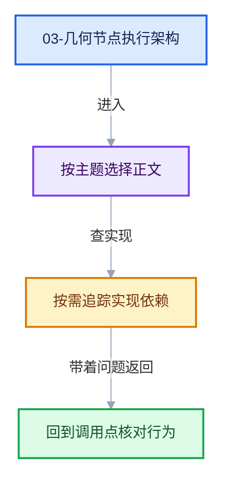

# 03-几何节点执行架构

本章回答：几何节点求值器如何把一个 Repeat 区域"编译"成可执行的 LazyFunction 图。这是全系列的核心章。

## 阅读顺序

- [03-01 ZoneBodyFunction与ZoneBuildInfo](01-ZoneBodyFunction与ZoneBuildInfo.md)
- [03-02 Repeat循环体函数构建详解](02-Repeat循环体函数构建详解.md)
- [03-03 执行图按迭代展开](03-执行图按迭代展开.md)

## 本章问题

- zone 构建顺序为什么按深度排序（先内后外）？
- 循环体函数（ZoneBodyFunction）的输入/输出分组：main、border_links、output_usages、reference_sets 各是什么？
- 为什么迭代数要等运行时才知道，执行图如何在第一次求值时按迭代数展开？
- 成对串联（body N → body N+1）与 LogicalOr 节点分别解决什么问题？

