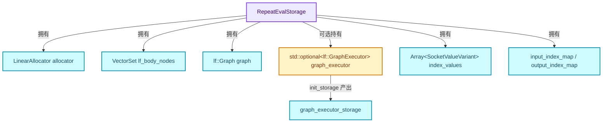
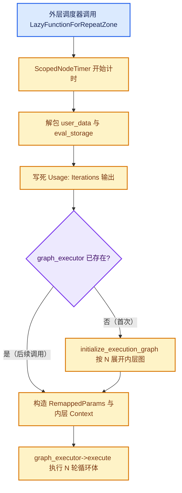
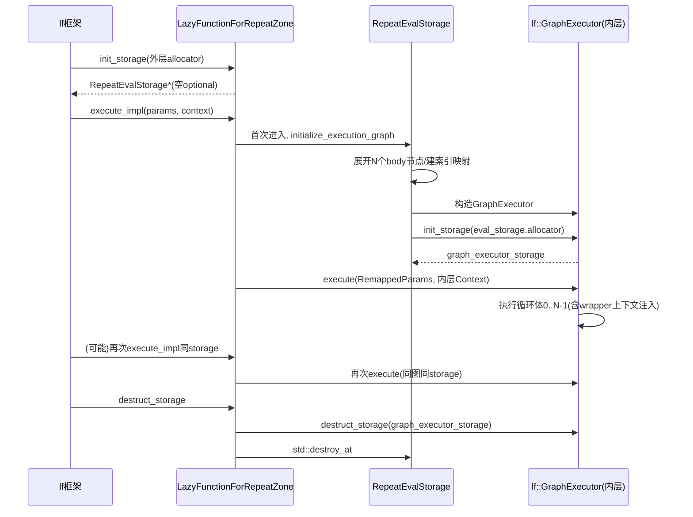

# RN-01 RepeatEvalStorage 与一次求值

[总入口](../README.md) · [本章导航](README.md) · [上一篇](README.md) · [下一篇](02-ComputeContext与迭代身份.md)

基准：Blender `5.4.0-alpha`，本地工作树。本篇逐行讲解
[source/blender/nodes/intern/geometry_nodes_repeat_zone.cc](../../../source/blender/nodes/intern/geometry_nodes_repeat_zone.cc)
中与"一次求值的存储与执行入口"相关的部分：`RepeatEvalStorage`、`init_storage`、
`destruct_storage`、`execute_impl`，以及 `LazyFunctionForRepeatZone` 的构造逻辑。

## 先回答一个具体问题

同一个 Repeat 区域在一次几何节点求值里可能"执行"多次（比如它嵌在另一个 Repeat
区域里，外层每一轮都会调到内层）。那么"这一层 Repeat 的内部执行图"存在哪里？
答案是：存在 `lf::Context::storage` 指向的 `RepeatEvalStorage` 里，由 LazyFunction
框架按需创建、按需销毁。理解它的生命周期，就理解了 Repeat 区域运行时的全部状态边界。

## 相关类与数据的职责

- **`RepeatEvalStorage`**：一次 zone 求值的全部可变状态容器。定义入口：
  [geometry_nodes_repeat_zone.cc · L98](../../../source/blender/nodes/intern/geometry_nodes_repeat_zone.cc#L98)。
- **`LazyFunctionForRepeatZone`**：代表整个 Repeat 区域的 LazyFunction（无状态，状态全在 storage）。定义入口：
  [geometry_nodes_repeat_zone.cc · L113](../../../source/blender/nodes/intern/geometry_nodes_repeat_zone.cc#L113)。
- **`lf::Context::storage`**：LazyFunction 框架为每次函数调用分配的存储槽，由 `init_storage` 构造。
- **`lf::GraphExecutor`**：内层执行图（N 份循环体拼成）的求值器，作为 storage 的一个字段持有。



上图箭头表示"拥有"关系，全部来自 `RepeatEvalStorage` 的字段声明；`graph_executor`
与 `or_function`、`side_effect_provider`、`body_execute_wrapper` 一样用
`std::optional` 包装，因为它们只在第一次执行后才被构造。

## 教学注释代码与分段机制

### 字段逐个讲：RepeatEvalStorage · L98—L111

```cpp
struct RepeatEvalStorage {
  LinearAllocator<> allocator;
  VectorSet<lf::FunctionNode *> lf_body_nodes;
  lf::Graph graph;
  std::optional<LazyFunctionForLogicalOr> or_function;
  std::optional<RepeatZoneSideEffectProvider> side_effect_provider;
  std::optional<RepeatBodyNodeExecuteWrapper> body_execute_wrapper;
  std::optional<lf::GraphExecutor> graph_executor;
  Array<SocketValueVariant> index_values;
  void *graph_executor_storage = nullptr;
  bool multi_threading_enabled = false;
  Vector<int> input_index_map;
  Vector<int> output_index_map;
};
```

逐字段解释：

| 字段 | 类型 | 作用 | 何时被填充 |
| --- | --- | --- | --- |
| `allocator` | `LinearAllocator<>` | 本 storage 的线性分配器，给内层 executor 的 storage 用 | 构造时随结构体创建 |
| `lf_body_nodes` | `VectorSet<lf::FunctionNode *>` | N 个循环体节点的集合，`index_of_try` 反查迭代号 | `initialize_execution_graph` |
| `graph` | `lf::Graph` | 内层执行图（N 份循环体拼成） | `initialize_execution_graph` |
| `or_function` | `std::optional<LazyFunctionForLogicalOr>` | border link usage 的"任一轮用即用"合并函数 | `initialize_execution_graph` |
| `side_effect_provider` | `std::optional<RepeatZoneSideEffectProvider>` | 告诉执行器哪些迭代因副作用必须执行 | `initialize_execution_graph` 末尾 |
| `body_execute_wrapper` | `std::optional<RepeatBodyNodeExecuteWrapper>` | 给循环体节点包上 per-iteration 上下文 | `initialize_execution_graph` 末尾 |
| `graph_executor` | `std::optional<lf::GraphExecutor>` | 内层图求值器 | `initialize_execution_graph` 末尾 |
| `index_values` | `Array<SocketValueVariant>` | 每轮的 Iteration 输出值（0..N-1），并行填充 | `initialize_execution_graph` |
| `graph_executor_storage` | `void *` | 内层 executor 自己的 storage | `init_storage` 转发 |
| `multi_threading_enabled` | `bool` | 传给 RemappedParams，控制内层是否允许并行 | 构造 executor 时 |
| `input_index_map` / `output_index_map` | `Vector<int>` | 外层参数到内层参数的索引重映射 | `initialize_execution_graph` 末尾 |

注意两个设计点：

1. **`std::optional` 的分界线**。storage 构造时（`init_storage`）什么都不做，只在
   字段里留空 optional。真正的图在第一次 `execute_impl` 时才构建。原因是
   `iterations` 是运行时输入，图的大小依赖它。
2. **`index_values` 是 `Array` 不是 `Vector`**。它按迭代数一次性 `reinitialize`，
   之后只读——每轮循环体节点通过 `set_default_value` 直接引用其中元素，没有写竞争。

### init_storage 与 destruct_storage · L139—L151

```cpp
void *init_storage(LinearAllocator<> &allocator) const override
{
  return allocator.construct<RepeatEvalStorage>().release();
}

void destruct_storage(void *storage) const override
{
  RepeatEvalStorage *s = static_cast<RepeatEvalStorage *>(storage);
  if (s->graph_executor_storage) {
    s->graph_executor->destruct_storage(s->graph_executor_storage);
  }
  std::destroy_at(s);
}
```

`[讲解]` 两个要点：

1. `init_storage` 收到的 `allocator` 是**外层调用链的分配器**，`RepeatEvalStorage`
   本身从它上面分配。而 storage 内部还有一个自己的 `allocator` 字段——这是给
   内层 `graph_executor->init_storage(eval_storage.allocator)` 用的，见
   [L400](../../../source/blender/nodes/intern/geometry_nodes_repeat_zone.cc#L400)。
   两层分配器、两层 storage，构成与函数嵌套一致的生命周期嵌套。
2. 析构顺序是显式的：先销毁内层 executor 的 storage，再 `std::destroy_at` 销毁
   本结构。`std::optional<lf::GraphExecutor>` 的析构会连带销毁 executor 对象，
   所以顺序不能颠倒——`graph_executor_storage` 的销毁需要活的 `graph_executor`。

<details>
<summary>核对原始源码：geometry_nodes_repeat_zone.cc · L139—L151</summary>

```cpp
  void *init_storage(LinearAllocator<> &allocator) const override
  {
    return allocator.construct<RepeatEvalStorage>().release();
  }

  void destruct_storage(void *storage) const override
  {
    RepeatEvalStorage *s = static_cast<RepeatEvalStorage *>(storage);
    if (s->graph_executor_storage) {
      s->graph_executor->destruct_storage(s->graph_executor_storage);
    }
    std::destroy_at(s);
  }
```

</details>

### 构造函数：接口组装 · L122—L137

```cpp
LazyFunctionForRepeatZone(const bNodeTree &btree,
                          const bke::bNodeTreeZone &zone,
                          ZoneBuildInfo &zone_info,
                          const ZoneBodyFunction &body_fn)
    : btree_(btree),
      zone_(zone),
      repeat_output_bnode_(*zone.output_node()),
      zone_info_(zone_info),
      body_fn_(body_fn)
{
  debug_name_ = "Repeat Zone";

  initialize_zone_wrapper(zone, zone_info, body_fn, true, inputs_, outputs_);
  /* Iterations input is always used. */
  inputs_[zone_info.indices.inputs.main[0]].usage = lf::ValueUsage::Used;
}
```

`[讲解]` 这里是"接口即语义"的浓缩表达：

- `initialize_zone_wrapper`（实现见
  [geometry_nodes_lazy_function.cc · L1704](../../../source/blender/nodes/intern/geometry_nodes_lazy_function.cc#L1704)）
  按固定顺序生成 wrapper 的输入/输出描述：main 输入、border link 输入、输出 usage
  输入、reference set 输入；main 输出、input usage 输出、border link usage 输出。
  `expose_all_reference_sets=true` 表示 Repeat 区域（与 Closure 不同）把循环体需要的
  全部引用集都暴露为 wrapper 输入。
- wrapper 的第一个 main 输入就是 `Iterations`。把它标成
  `lf::ValueUsage::Used` 是一个语义承诺：**无论外层要不要 Repeat 的输出，
  Iterations 都必须被求值**。直观理由：Repeat 是否执行、执行几轮，本身影响
  副作用与警告（比如 inspection_index 越界提示），不能因为输出没人用就整体跳过。
  与之配套，`execute_impl` 里还有一个 `output_was_set` 的兜底（下节）。

<details>
<summary>核对原始源码：geometry_nodes_repeat_zone.cc · L122—L137</summary>

```cpp
  LazyFunctionForRepeatZone(const bNodeTree &btree,
                            const bke::bNodeTreeZone &zone,
                            ZoneBuildInfo &zone_info,
                            const ZoneBodyFunction &body_fn)
      : btree_(btree),
        zone_(zone),
        repeat_output_bnode_(*zone.output_node()),
        zone_info_(zone_info),
        body_fn_(body_fn)
  {
    debug_name_ = "Repeat Zone";

    initialize_zone_wrapper(zone, zone_info, body_fn, true, inputs_, outputs_);
    /* Iterations input is always used. */
    inputs_[zone_info.indices.inputs.main[0]].usage = lf::ValueUsage::Used;
  }
```

</details>

### execute_impl：入口主流程 · L153—L185

```cpp
void execute_impl(lf::Params &params, const lf::Context &context) const override
{
  const ScopedNodeTimer node_timer{context, repeat_output_bnode_};

  auto &user_data = *static_cast<GeoNodesUserData *>(context.user_data);
  auto &local_user_data = *static_cast<GeoNodesLocalUserData *>(context.local_user_data);

  const NodeGeometryRepeatOutput &node_storage = *static_cast<const NodeGeometryRepeatOutput *>(
      repeat_output_bnode_.storage);
  RepeatEvalStorage &eval_storage = *static_cast<RepeatEvalStorage *>(context.storage);

  const int iterations_usage_index = zone_info_.indices.outputs.input_usages[0];
  if (!params.output_was_set(iterations_usage_index)) {
    /* The iterations input is always used. */
    params.set_output(iterations_usage_index, true);
  }

  if (!eval_storage.graph_executor) {
    /* Create the execution graph in the first evaluation. */
    this->initialize_execution_graph(
        params, eval_storage, node_storage, user_data, local_user_data);
  }

  /* Execute the graph for the repeat zone. */
  lf::RemappedParams eval_graph_params{*eval_storage.graph_executor,
                                       params,
                                       eval_storage.input_index_map,
                                       eval_storage.output_index_map,
                                       eval_storage.multi_threading_enabled};
  lf::Context eval_graph_context{
      eval_storage.graph_executor_storage, context.user_data, context.local_user_data};
  eval_storage.graph_executor->execute(eval_graph_params, eval_graph_context);
}
```

`[讲解]` 分四段读：

**第一段：计时与数据解包。** `ScopedNodeTimer` 把这次 zone 调用记到性能剖析
（Profile 编辑器里能看到 "Repeat Zone" 节点的耗时条）。`user_data` /
`local_user_data` 是几何节点求值链路的全局/线程局部上下文，原样透传给内层。

**第二段：iterations usage 兜底。** `iterations_usage_index` 是 wrapper 输出里的
"Usage: Iterations" 位。虽然构造函数已把输入标为 `Used`，但框架在某些路径
（例如 usage 推断晚于执行启动）仍可能没写这个输出；这里保证它永远被写。
注意这个输出在索引映射里被**跳过**（`output_index_map` 不含它），所以内层图
从不产生它——它由本函数直接写死。这正是"Iterations 输入永远被用"语义的另一半。

**第三段：惰性图构建。** `eval_storage.graph_executor` 为空 ⇔ 本 storage 的第一次
执行 ⇔ 第一次需要知道迭代数。构建函数 `initialize_execution_graph` 需要读
`params`（拿 Iterations 值）、`node_storage`（拿 items_num 与 inspection_index）、
`user_data`/`local_user_data`（拿日志器）——这也是它不能在构造函数里做的
原因之一：构造时这些还不可用。

**第四段：重映射执行。** `lf::RemappedParams` 把"wrapper 的参数视图"翻译成
"内层图的参数视图"：

- `input_index_map`：wrapper 输入 i → 内层图输入 `input_index_map[i]`（跳过
  iterations，因为 iterations 不进内层图，它已用于展开）；
- `output_index_map`：内层图输出 j → wrapper 输出 `output_index_map[j]`（跳过
  "Usage: Iterations"）;
- `multi_threading_enabled`：内层是否允许开并行任务。

内层的 `Context` 用 `eval_storage.graph_executor_storage` 作为自己的 storage 槽——
内外两层函数各有各的 storage，嵌套对应。

<details>
<summary>核对原始源码：geometry_nodes_repeat_zone.cc · L153—L185</summary>

```cpp
  void execute_impl(lf::Params &params, const lf::Context &context) const override
  {
    const ScopedNodeTimer node_timer{context, repeat_output_bnode_};

    auto &user_data = *static_cast<GeoNodesUserData *>(context.user_data);
    auto &local_user_data = *static_cast<GeoNodesLocalUserData *>(context.local_user_data);

    const NodeGeometryRepeatOutput &node_storage = *static_cast<const NodeGeometryRepeatOutput *>(
        repeat_output_bnode_.storage);
    RepeatEvalStorage &eval_storage = *static_cast<RepeatEvalStorage *>(context.storage);

    const int iterations_usage_index = zone_info_.indices.outputs.input_usages[0];
    if (!params.output_was_set(iterations_usage_index)) {
      /* The iterations input is always used. */
      params.set_output(iterations_usage_index, true);
    }

    if (!eval_storage.graph_executor) {
      /* Create the execution graph in the first evaluation. */
      this->initialize_execution_graph(
          params, eval_storage, node_storage, user_data, local_user_data);
    }

    /* Execute the graph for the repeat zone. */
    lf::RemappedParams eval_graph_params{*eval_storage.graph_executor,
                                         params,
                                         eval_storage.input_index_map,
                                         eval_storage.output_index_map,
                                         eval_storage.multi_threading_enabled};
    lf::Context eval_graph_context{
        eval_storage.graph_executor_storage, context.user_data, context.local_user_data};
    eval_storage.graph_executor->execute(eval_graph_params, eval_graph_context);
  }
```

</details>

## execute_impl 的执行时序



注意 P4 分支的含义：**同一个 storage 的后续调用不再重建图**。当 Repeat 嵌在
外层 Repeat 里，外层每轮调用内层 wrapper 一次，但内层 storage 是
`LazyFunction` 对象级的吗？不是——storage 属于"调用"而非"函数对象"。外层每轮
走到内层 zone 节点时，LazyFunction 框架会为那次调用走 `init_storage` →
`execute_impl` → `destruct_storage` 的完整生命周期。所以"首次构建图"的分支
只对**单次调用**成立；外层第 0 轮与第 1 轮的内层图是两次独立构建。
理解这一点对性能模型很重要（见 06-02 性能模型与开销分析）。

## 一次完整求值的走查

设：Repeat 区域有 1 个 Geometry item、无 border link、Iterations=3、输出被使用。

1. 外层图调度到 Repeat zone 节点，框架调用 `init_storage` → 新 `RepeatEvalStorage`。
2. `execute_impl`：写 Usage: Iterations = true。
3. `initialize_execution_graph`：
   - 读 `node_storage.items_num = 1`；
   - 读 iterations = 3；
   - 创建 3 个 body 节点（同一个 `body_fn_.function` 的 3 个实例节点）；
   - 无 border link ⇒ 无 or 节点；
   - Iteration 输出未直连 ⇒ `use_index_values=false`，全部 body 用 `static_unused_index`；
   - 成对串联：body0.main → body1.main → body2.main；
   - 首 body 接 graph 输入，末 body 接 graph 输出；
   - 建立 index map，构造 executor，分配内层 storage。
4. `graph_executor->execute`：内层按拓扑与需求传播执行——body0 先跑，
   body1 需要 body0 的输出才跑……同时 usage 需求决定哪些值实际被算。
5. wrapper 输出全部落位，`RepeatEvalStorage` 在调用结束时被 `destruct_storage`。

## 迭代数为 0 时的行为

`initialize_execution_graph` 在 `iterations == 0` 时走直通分支
（[L344—L358](../../../source/blender/nodes/intern/geometry_nodes_repeat_zone.cc#L344)）：

- 每个 main 输入直接连到对应 main 输出（值原样传出）；
- 输入 usage 直通到对应的 "input usage" 输出；
- border link usage 输出全部写常量 `false`。

即 0 次迭代时 Repeat 区域退化为恒等映射。注意与
`iterations` 负数的关系：`std::max<int>(0, ...)`（L205）先把负值钳成 0，
所以用户在 Iterations 里接一个 -5，行为等同 0 次迭代——值直通、不警告。

## 迭代数为 1 时的行为

`iterations == 1` 走正常展开路径，但成对串联循环
（`lf_body_nodes.index_range().drop_back(1)`）为空——没有任何 N→N+1 连接。
首 body 同时是末 body，既接 zone 输入也接 zone 输出。图形态上等价于
"把循环体包了一层"，开销是多次参数搬运与 usage 检查。

## 反例与边界

- **误解**：storage 是函数对象（`LazyFunctionForRepeatZone`）的成员，整个求值共用一份。
  **纠正**：storage 属于每次调用（`lf::Context::storage`），嵌套外层每轮都会
  走一次完整的 init/execute/destruct 生命周期。
- **误解**：`Usage: Iterations` 由内层图计算。
  **纠正**：内层图没有这个输出（被索引映射跳过），它由 `execute_impl` 直接
  `set_output` 写死 true。
- **误解**：iterations 为 0 是错误。
  **纠正**：0 次迭代是合法直通路径，输入值原样流向输出；只有 inspection_index
  越界这类配置问题才产生 Info 警告。
- **误解**：`index_values` 在每轮执行时重新计算。
  **纠正**：它在图构建阶段一次并行填充，之后只读；每轮 body 只是引用其中
  一个元素作为默认值。
- **误解**：负的 Iterations 会触发警告。
  **纠正**：先被 `std::max<int>(0, ...)` 钳位，静默按 0 处理。

## 用小数据走一遍

输入：Iterations = 2，1 个 Geometry item，输出被使用，Iteration 输出直连。

```mermaid
flowchart LR
  S0["storage: 空 optional"]:::input
  S1["execute_impl 首次进入"]:::compute
  S2["展开 2 个 body 节点"]:::compute
  S3["index_values = {0, 1} 并行填充"]:::data
  S4["body0.main -&gt; body1.main"]:::data
  S5["executor.execute"]:::compute
  S6["destruct_storage"]:::result
  S0 --> S1
  S1 --> S2
  S2 --> S3
  S3 --> S4
  S4 --> S5
  S5 --> S6
  classDef input fill:#DBEAFE,stroke:#2563EB,color:#172554,stroke-width:2px;
  classDef data fill:#CFFAFE,stroke:#0891B2,color:#164E63,stroke-width:2px;
  classDef abstraction fill:#EDE9FE,stroke:#7C3AED,color:#3B0764,stroke-width:2px;
  classDef compute fill:#FEF3C7,stroke:#D97706,color:#78350F,stroke-width:2px;
  classDef result fill:#DCFCE7,stroke:#16A34A,color:#14532D,stroke-width:2px;
  classDef error fill:#FEE2E2,stroke:#DC2626,color:#7F1D1D,stroke-width:2px;
```



这是明确输入条件下的教学推演，不是本地性能实测。数值核对点：
`index_values` 长度 = 2；成对串联边数 = 1；graph 输出中 main 通道 = 1；
usage 通道 = 2（item usage + iterations usage，后者在映射中跳过）。

## 历史背景阅读建议

Repeat Zone 的 storage 化执行方式与 Simulation Zone 共享同一套模式
（`SimulationZoneEvalStorage` 见
[geometry_nodes_simulation_zone.cc](../../../source/blender/nodes/intern/geometry_nodes_simulation_zone.cc)）。
阅读提交历史时，先找"把 zone 状态从函数对象移到 storage"的不变量变化，
再看新增的 `optional` 字段如何与析构顺序配套。教学时不要把历史签名与当前
源码混用。

## 验收自查

- 能默画 `RepeatEvalStorage` 的字段分组（图构建产物 / 执行期产物 / 索引映射）。
- 能解释为什么 `init_storage` 不构建图，而 `execute_impl` 才构建。
- 能手算一个 2-item、0-border-link、iterations=2 的 `input_index_map`。
- 能说出 0 次迭代与 1 次迭代图形态的差别。

<details>
<summary>参考思路</summary>

2-item、0-border-link、iterations=2：wrapper 输入 = iterations(1) + item 输入(2
个 main) + 无 border link + 输出 usage(2) + reference sets(0)。`input_index_map`
跳过第一个输入（iterations），对后续连续编号：item 输入 0→0、1→1，usage 输入
2→2、3→3。`output_index_map` 跳过 "Usage: Iterations" 的位置（它在
`input_usages` 的第 0 个），item usage 输出与 main 输出按各自位置连续映射。

</details>

## 继续阅读

- [RN-02 ComputeContext与迭代身份](02-ComputeContext与迭代身份.md)
- [RN-03 副作用迭代与按需执行](03-副作用迭代与按需执行.md)
- [RA-03 执行图按迭代展开](../03-几何节点执行架构/03-执行图按迭代展开.md)

---

## 深读篇：从 LazyFunction 框架视角看 storage

前面把 `RepeatEvalStorage` 当作"一个结构体"讲完了字段和入口。这一篇的后半部分
换个视角：站在 LazyFunction（下称 lf）框架的立场上，看 storage 是谁、在何时、
以什么顺序被创建和销毁的。这个视角是理解"嵌套 Repeat 为什么不共享图"的关键。

### lf 框架的调用模型速写

lf 框架的核心契约（见
[FN_lazy_function.hh](../../../source/blender/functions/FN_lazy_function.hh)）可以
压缩成四句话：

1. 一个 `LazyFunction` 描述"有 N 个输入、M 个输出的计算单元"，它是**无状态**
   的（可 const 共享、可多线程同时执行）。
2. 每次"调用"由 `lf::Params`（参数槽）与 `lf::Context`（storage + user_data +
   local_user_data）承载，**状态只允许放在 storage 里**。
3. `init_storage` / `destruct_storage` 由框架在调用的前后调用；两次调用之间
   storage 不存在。
4. `execute_impl` 可能被同一个调用**多次进入**（惰性执行：值请求分批到达），
   所以 storage 必须能跨"进入"存续——这正是 Repeat 用 storage 而不是局部变量
   存执行图的原因。

对 Repeat 区域来说，第 3、4 条直接决定了代码形态：

- 图构建依赖 `Iterations` 输入值 ⇒ 必须在拿到输入后才能构建 ⇒ 不能在
  构造函数或 `init_storage` 里做 ⇒ 放进 `execute_impl` 首次进入分支。
- 惰性执行可能分批请求不同输出 ⇒ 图、executor、索引映射必须活过整个
  调用 ⇒ 放 storage 而不是 `execute_impl` 栈上。

### storage 的创建时机：请求驱动的证据

`execute_impl` 什么时候被调用？lf 框架在**有输出被外部请求**时才调度执行。
对 Repeat wrapper 来说：

- 任一 main 输出（zone 的 item 输出）被请求；
- 任一 border link usage 输出被请求；
- "Usage: Iterations" 输出被请求（构造函数已把对应输入标 Used，但输出侧
  是 `execute_impl` 写死的）。

只要有一个请求到达，框架就完成 `init_storage → execute_impl` 的启动链。
这也是"Repeat 区域整体未被使用时完全不执行"的机制来源：没有输出请求 ⇒
没有 storage ⇒ 没有图 ⇒ 没有循环体调用。这与 usage inference（需求传播，
见 03 章）在图构建期的裁剪是两个互补的层次：构建期决定"要不要把 zone 函数
放进图"，执行期决定"放进图后有没有人要它的输出"。

### 双层 storage 的完整生命周期时序



上图的每一步都有源码对应：`init_storage` 在
[L139—L142](../../../source/blender/nodes/intern/geometry_nodes_repeat_zone.cc#L139)；
图构建在
[L170—L174](../../../source/blender/nodes/intern/geometry_nodes_repeat_zone.cc#L170)；
内层 storage 分配在
[L400—L401](../../../source/blender/nodes/intern/geometry_nodes_repeat_zone.cc#L400)；
析构在
[L144—L151](../../../source/blender/nodes/intern/geometry_nodes_repeat_zone.cc#L144)。

### "再次 execute_impl"什么时候发生

一个调用内 `execute_impl` 被多次进入，最常见的三种情况：

1. **输出分批就绪**。内层图先算完了部分输出，外层又来请求其余输出，框架
   再次进入 `execute_impl`。此时图已存在，直接走重映射执行。
2. **副作用驱动的补执行**。带 Viewer/警告节点的循环体在首轮执行时可能只
   被部分调度，`side_effect_provider` 在后续进入时补充需求根（详见 RN-03）。
3. **usage 演化**。lf 框架允许在执行中收到"某个 Maybe 输入实际被需要"的
   通知，导致新一轮执行推进。

对第 1、2 种情况，`execute_impl` 的代码路径完全相同——图复用是"同一次
调用内"的复用。**跨调用的复用不存在**：嵌套外层的每一轮内层调用都是新
storage、新图、新 executor。源码注释
[L187—L194](../../../source/blender/nodes/intern/geometry_nodes_repeat_zone.cc#L187)
明确讨论了"可以考虑按迭代数缓存图，但认为不值得"——这是有意的设计取舍，
不是遗漏。

### 与 Simulation Zone storage 的对照

| 维度 | RepeatEvalStorage | SimulationZoneEvalStorage |
| --- | --- | --- |
| 图构建时机 | 首次 execute_impl（需要 Iterations） | 首次 execute_impl |
| 图依赖运行时输入 | 是（迭代数决定 body 节点数） | 否（图结构固定） |
| 状态跨调用传递 | 无（每次调用独立） | 有（simulation state 存 blob） |
| 副作用补充 | RepeatZoneSideEffectProvider | SimulationZoneSideEffectProvider |
| 0 轮语义 | 直通分支 | skip 行为 |

对照的启示：两者是同一"zone storage 模式"的两个实例，差异全部来自语义
差异——Repeat 的图大小依赖运行时输入，Simulation 的图固定但状态要跨帧。
读 Simulation 源码时可以带着这张表逐项印证。

### multi_threading_enabled 的来源与影响

`RepeatEvalStorage::multi_threading_enabled` 默认 `false`，在 executor 构造处
（[L394—L399](../../../source/blender/nodes/intern/geometry_nodes_repeat_zone.cc#L394)）
也没有显式赋值——它保持 false，随 `RemappedParams` 传给内层。为什么内层默认
不开并行？

循环体之间是**串行依赖**的（body N 输出是 body N+1 输入），图结构本身
已经编码了这条依赖链，内层图的并行机会只剩"单轮循环体内部的独立分支"。
而外层调用往往已经处在并行任务中（外层 zone 或 group 的并行展开），
`iterations >= 10` 时的 `lazy_threading::send_hint()`
（[L210—L214](../../../source/blender/nodes/intern/geometry_nodes_repeat_zone.cc#L210)）
就是告诉外层调度器"我这边构建图还有一会儿，你们可以先干别的"。
理解这一点要区分三层并行边界：

1. **图构建并行**：`index_values` 的填充用了 `threading::parallel_for`
   （[L267—L271](../../../source/blender/nodes/intern/geometry_nodes_repeat_zone.cc#L267)），
   块大小 1024，只在 `use_index_values` 时发生。
2. **循环体间并行**：不存在（串行链）。
3. **循环体内并行**：由内层图本身的并行节点（如 For Each 元素域操作、
   并行化的几何节点）决定，受 `multi_threading_enabled=false` 约束——即
   Repeat 内层不再额外开任务组，复用外层线程池上下文。

这个"内层不开新并行域"的保守选择避免了任务风暴：嵌套两层 Repeat 若都
开并行域，任务数按迭代数乘积爆炸。`send_hint` 是替代方案：外层调度器
获得提示后在等待期间把空闲线程让给其他任务。

### index_values 的并行填充细节

```cpp
if (use_index_values) {
  eval_storage.index_values.reinitialize(iterations);
  threading::parallel_for(IndexRange(iterations), 1024, [&](const IndexRange range) {
    for (const int i : range) {
      eval_storage.index_values[i].emplace<int>(i);
    }
  });
}
```

`[讲解]` 三个细节：

- `reinitialize` 而非 resize：`Array<SocketValueVariant>` 按精确大小分配，
  不需要保留旧内容（storage 是新的）。
- `emplace<int>(i)`：SocketValueVariant 是类型擦除容器，就地构造 int 值。
  每个元素独立、无交叉引用，所以并行安全。
- 块 1024 的含义：一百万次迭代也只产生约 1000 个任务粒度，任务调度开销
  与填充开销的平衡点。迭代数本身受限于 int32，但实际使用中到不了这种量级
  （迭代数太大时瓶颈在循环体执行而非填充）。

`static_unused_index{-1}`（
[L275](../../../source/blender/nodes/intern/geometry_nodes_repeat_zone.cc#L275)）
是函数级 static 常量：Iteration 输出未直连时，所有 body 的 Iteration 输入
共用这一个 -1 值。static 的生命周期覆盖整个进程，而 body 执行期间只读，
多线程下也是安全的。但要注意：`static` 变量在多线程初始化上的安全性由
C++11 magic statics 保证，这里初始化是常量构造，无竞争。

### 索引映射的手算练习（扩展版）

设 Repeat 区域配置：2 个 item（Geometry、Float），1 条 border link，
Iterations 输入，输出侧全部被使用。wrapper 的接口由
`initialize_zone_wrapper`（
[geometry_nodes_lazy_function.cc · L1704—L1756](../../../source/blender/nodes/intern/geometry_nodes_lazy_function.cc#L1704)）
按如下顺序生成：

输入（inputs_）：

| # | 名称 | 来源 | usage |
| --- | --- | --- | --- |
| 0 | Iterations | main[0] | Used（构造函数强制） |
| 1 | Geometry | main[1] | Maybe |
| 2 | Float | main[2] | Maybe |
| 3 | Link from X | border_links[0] | Maybe |
| 4 | Usage: zone输出Geometry | output_usages[0] | Maybe |
| 5 | Usage: zone输出Float | output_usages[1] | Maybe |
| （6+） | Reference Set... | reference_sets | Maybe |

输出（outputs_）：

| # | 名称 | 来源 |
| --- | --- | --- |
| 0 | Geometry | main[0] |
| 1 | Float | main[1] |
| 2 | Usage: Iterations | input_usages[0] |
| 3 | Usage: Geometry | input_usages[1] |
| 4 | Usage: Float | input_usages[2] |
| 5 | Border Link Usage | border_link_usages[0] |

内层图的输入 = wrapper 输入去掉 Iterations（#0），即 5 个；内层图的输出 =
wrapper 输出去掉 "Usage: Iterations"（#2），即 5 个。于是：

- `input_index_map`（wrapper输入 → 内层输入）：`[_, 0, 1, 2, 3, 4, ...]`
  ——第一个位置不使用（iterations 不进内层），从 #1 起连续编号。代码用
  `fill_index_range(input_index_map, 1)` 实现"从 1 开始连续填充"
  （[L370—L372](../../../source/blender/nodes/intern/geometry_nodes_repeat_zone.cc#L370)）。
- `output_index_map`（内层输出 → wrapper输出）：先填 `#0,1 → 0,1`
  （`take_front(iteration_usage_index)`，iteration_usage_index=2），再填
  `#3,4,5 → 2,3,4`（`drop_front(iteration_usage_index + 1)` 的区间从
  `iteration_usage_index + 1` 开始编号，
  [L376—L385](../../../source/blender/nodes/intern/geometry_nodes_repeat_zone.cc#L376)）。
  注意输出映射方向是"内层输出 j → wrapper 输出 output_index_map[j]"。

`[讲解]` 为什么输入和输出的映射方向不同？`RemappedParams` 的输入重映射
按"wrapper 输入 i 取值写到内层输入 input_index_map[i]"，输出重映射按
"内层输出 j 的结果写到 wrapper 输出 output_index_map[j]"。两个方向都存在
"跳过一个特殊通道"的问题，但跳过的位置不同（输入跳头、输出跳中），
所以实现分别是"整体偏移"与"分段拼接"。

### execute_impl 中 usage 兜底的必要性再论证

有人会问：构造函数已经把 Iterations 输入标成 `Used`，为什么还要在
`execute_impl` 里写 `params.set_output(iterations_usage_index, true)`？

两个原因：

1. **输入 usage 与输出 usage 是两回事**。输入标 Used 是告诉上游"你必须
   把 Iterations 值准备好"；输出 usage 是告诉更外层"Repeat 自己消耗了
   Iterations"。lf 框架对 group 节点要求：被标记 Used 的输入，其对应的
   group-input usage 输出必须被写出，否则框架断言失败。Repeat wrapper
   伪装成一个"普通函数"，必须遵守这个协议。
2. **usage 传播的时序不确定性**。框架允许执行在 usage 传播完成前启动
   （Maybe 输入先为假）。`output_was_set` 检查 + 兜底写入保证了协议在
   任何时序下都成立。

同样的模式出现在 Simulation Zone 与 Foreach 的 execute_impl 里（各自对
第一个 usage 输出兜底），这是 zone wrapper 家族的公共协议，不是 Repeat 特例。

### ScopedNodeTimer 与性能剖析

`const ScopedNodeTimer node_timer{context, repeat_output_bnode_};`
（[L155](../../../source/blender/nodes/intern/geometry_nodes_repeat_zone.cc#L155)）

- RAII 语义：构造时开始计时，离开作用域自动结束。
- 记录到哪儿：几何节点执行期把计时事件写入 per-thread 的日志缓冲，
  Profile 编辑器聚合展示。Repeat 区域在时间线上显示为一个"Repeat Zone"
  区段；内层每轮循环体若也带计时（body 内节点各自有 timer），会嵌套展示。
- 对调优的意义：zone 级耗时 = 图构建（仅首次）+ N 轮循环体执行总和。
  若 Profile 中 "Repeat Zone" 远大于循环体耗时之和，差额主要是图构建与
  参数搬运——迭代数很小而 body 很复杂时这个差额占比最高。

### 求值日志里的 Repeat

`local_user_data.try_get_tree_logger(user_data)` 在两个地方出现：

1. `initialize_execution_graph` 的 inspection_index 越界警告
   （[L217—L227](../../../source/blender/nodes/intern/geometry_nodes_repeat_zone.cc#L217)），
   一次图构建最多发一条 Info。
2. 循环体内节点的警告/值日志经 `RepeatBodyNodeExecuteWrapper` 注入的
   per-iteration 上下文自动分组（详见 RN-02）。

对日志系统来说 Repeat wrapper 是"上下文改写者"：它不改变日志内容，
只改变日志归属。这使 Viewer 值、节点警告能按 (zone, iteration) 定位——
在 node editor 里悬停 Repeat 内部节点时显示的是 inspection_index 指定轮次
的值，实现机制见 RN-02 的上下文哈希部分。

### 常见崩溃/断言场景与 storage 的关系

| 现象 | 与 storage 的关联 | 排查入口 |
| --- | --- | --- |
| 断言 `graph_executor` 为空即解引用 | 图构建失败但未抛出（如 body_fn 为空） | 检查 zone 构建日志 |
| 析构段错误 | `destruct_storage` 顺序被改 | 保持先内层后 destroy_at |
| 迭代数变化后结果陈旧 | 误把 storage 当跨调用缓存 | 每次调用独立构建 |
| 嵌套 Repeat 死锁 | 内层并行域误开 | multi_threading_enabled 保持 false |

这些不是"预期会遇到的 bug"，而是改动源码时的护栏：知道每个字段的生命
周期边界，才知道哪些改法会越界。

### 练习：画出 2 轮迭代的完整调用序列

要求覆盖：init_storage、execute_impl 首次进入、图构建（节点数/边数）、
内层 storage 分配、body0 执行、body1 执行、usage 回传、destruct_storage。
画完后对照本篇时序图核对。常见漏项：内层 storage 分配、
"Usage: Iterations" 的写死时机、`send_hint` 的触发条件。

### 本篇小结

- `RepeatEvalStorage` 是"一次调用"的全部可变状态，生命周期与 lf 调用
  严格对齐；optional 字段的填充集中在首次 `execute_impl`。
- "首次构建图"是**调用内**复用；嵌套外层每轮都是全新构建——这是注释
  明确记录的取舍。
- 索引映射解决"iterations 通道被排除在展开图之外"的参数错位，输入
  整体偏移、输出分段拼接。
- `multi_threading_enabled=false` + `send_hint` 构成 Repeat 的并行策略：
  内层不开新并行域，把并行机会留给外层调度。

## 常见问题（FAQ）

**Q：Iterations 在执行中被改变（比如接了个随时间变化的值）会怎样？**
A：对同一次求值，Iterations 在首次 `execute_impl` 读取一次并用于展开；
之后它作为输入的更新不会重建图。跨求值（depsgraph 更新）自然重新走全流程。

**Q：Repeat 区域输出没人用时，Iterations 也不读吗？**
A：不读。没有输出请求就没有 storage 也没有 execute_impl。但注意
usage inference 层有独立保证（RN-03），两者层次不同。

**Q：为什么 0 次迭代不警告"没有迭代"？**
A：0 是合法值（`.min(0)`，见 node_geo_repeat.cc 的 Iterations 声明）。
与 Foreach 的"迭代域无元素"Info 不同，Repeat 的语义就是"循环零次=直通"。

**Q：Repeat 里再套 Repeat，内层图构建 N 外 层 × N 内 层次吗？**
A：外层每轮触发一次内层调用的完整生命周期，所以内层图构建总次数 =
外层迭代数（每次构建出 N 内 个 body 节点）。这证实了"小图快建"设计的
必要性：构建成本必须显著低于执行成本。

**Q：可以把图构建挪到 init_storage 用"上次的迭代数"预建吗？**
A：init_storage 拿不到输入值；预建还需要跨调用保存 storage——两者都
违背 lf 框架契约。源码注释的"per-iteration-count 缓存"设想是在框架外
加缓存表，作者评估后认为构建成本足够低，不值得。

---

## 深读篇二：zone 家族的 storage 对照与扩展指南

### 三种 zone storage 的字段级对照

Blender 的 zone 家族目前有四个成员：Repeat、Simulation、Foreach、Closure。
它们的 wrapper 都遵循"body 函数 + 包装函数"模式，但 storage 的内容差异很大。
下表把四个 storage 的关键字段并排列出（Repeat 本篇已详述，其余三个给出
定义入口供对照阅读）：

| 字段语义 | RepeatEvalStorage | SimulationZoneEvalStorage | ForeachGeometryElementEvalStorage | ClosureZoneEvalStorage |
| --- | --- | --- | --- | --- |
| 内层执行图 | `lf::Graph graph` | 同 | 同 | 同（但图按需实例化） |
| 图执行器 | `optional<lf::GraphExecutor>` | 同 | 同 | 同 |
| body 节点集合 | `VectorSet lf_body_nodes`（N 轮） | 无（单次执行） | 无（内部处理） | 无（捕获后延迟执行） |
| 迭代相关 | `index_values`、`or_function` | 无 | `total_iterations_num` | 无 |
| 跨调用状态 | 无 | 有（simulation state blob） | 无 | 无（Closure 值自带捕获） |
| 索引映射 | `input/output_index_map` | 无（图结构固定） | 有 | 有 |

对照入口：

- Simulation：
  [geometry_nodes_simulation_zone.cc](../../../source/blender/nodes/intern/geometry_nodes_simulation_zone.cc)
  中的 `SimulationZoneEvalStorage`；
- Foreach：
  [geometry_nodes_foreach_geometry_element_zone.cc](../../../source/blender/nodes/intern/geometry_nodes_foreach_geometry_element_zone.cc)
  中的 `ForeachGeometryElementEvalStorage`（L211 附近声明，本篇不展开）；
- Closure：
  [geometry_nodes_closure_zone.cc](../../../source/blender/nodes/intern/geometry_nodes_closure_zone.cc)。

`[讲解]` 三个观察：

1. **只有 Simulation 的 storage 跨调用携带状态**。Simulation 的语义是
   "跨帧（跨 depsgraph 求值）记住上一次的状态"，所以它的状态 blob 必须活
   得比单次调用久——这打破了 lf 的 storage 生命周期模型，实现上通过
   "从 modifier 数据里取回状态注入本次调用"绕开（注入发生在 execute_impl
   早期，仍是"本次调用"的 storage）。Repeat 没有这个需求，因此 storage
   可以完全遵守 lf 契约——这是两种 zone 最本质的复杂度差异。
2. **Repeat 是唯一"图大小依赖运行时输入"的 zone**。Foreach 的迭代数虽然
   也是运行时值，但它不复制 body——每轮共享同一个 body 节点、由专门的
   执行策略调度；Repeat 则老实复制 N 份。这使 Repeat 的 T_build 与 N 成
   正比，而 Foreach 的 T_build 与 N 无关。选型建议（详见 06-01）：元素级
   并行处理用 Foreach，需要状态传递的循环用 Repeat。
3. **Closure 的 storage 最薄**。Closure 区域在求值期只构建"捕获环境"，
   真正的 body 执行发生在 Evaluate Closure 节点被求值时——body 函数本身
   被封装进 Closure 值随数据流动。它的 storage 几乎只剩 executor 句柄。

### wrapper/provider/storage 三件套的职责边界

本篇与 RN-02、RN-03 合起来讲了三件套。这里给一张最终分工表，用于复习：

| 组件 | 生命周期 | 状态 | 职责 |
| --- | --- | --- | --- |
| `LazyFunctionForRepeatZone` | 每次树编译一份 | 无（const） | 定义接口、构建图、提供 input/output 名字 |
| `RepeatEvalStorage` | 每次调用一份 | 全部可变状态 | 内层图、executor、索引映射、迭代值数组 |
| `RepeatBodyNodeExecuteWrapper` | 随 storage | 只读引用 | 给 body 节点注入 per-iteration 上下文 |
| `RepeatZoneSideEffectProvider` | 随 storage | 只读引用 | 回答"哪些迭代有副作用" |

记忆口诀：**函数定义形状，storage 装载状态，wrapper 分配身份，provider
上报副作用**。四者的创建时机也按此排序：编译期 → 首次执行 → executor
装配时 → executor 装配时。

### 如果你要改 Repeat Zone：五条动线

以下假设你在 Blender 源码上做二次开发。每条动线给出"改哪里 + 波及什么"。

**动线一：给 Repeat 添加一种新的隐藏通道**（比如"上一轮的使用情况"
反馈通道）。需要改：

1. `ZoneFunctionIndices`（NOD_geometry_nodes_lazy_function.hh）加索引组——
   wrapper 与 body 两层都要登记；
2. `initialize_zone_wrapper` 与 `build_zone_body_function` 各加一段接口
   生成代码；
3. `initialize_execution_graph` 的连接代码决定这个通道如何跨轮/跨层流动；
4. `RemappedParams` 的索引映射自动跟随（只要严格跳过/包含对应位置）。
   波及：03 章全部三篇所述内容；Foreach/Closure 若共用 `initialize_zone_wrapper`
   会被连带改变行为——必须回归测试三种 zone。

**动线二：改变迭代数的读取方式**（比如支持表达式提前终止）。`iterations`
在 L205-L208 一次性读取并用于展开；"提前终止"意味着图结构在执行中变化，
这与 lf 的静态图模型冲突。现实路径是：保持展开数 = 上限，让"提前终止"
表现为后续轮的恒等化（数学上把收敛后的轮变成 pass-through），即 06-01
讨论的方案。动 storage 与 executor 的做法不推荐。

**动线三：让 0 迭代产生警告或特殊输出**。`initialize_execution_graph`
的 `iterations == 0` 分支（L344-L358）是直通；在这里加 `tree_logger` 警告
即可，模式参照 inspection_index 越界警告（L217-L227）。注意警告级别用
`NodeWarningType::Info` 还是 `Warning` 的选择会影响 depsgraph 重算行为。

**动线四：给内层图开并行**。`multi_threading_enabled` 字段与 `RemappedParams`
的传递链已就位（L108、L177-L181、L219），把 false 改 true 就能打开。
但必须先回答：内层图里有什么可并行？循环体串行链不会因此并行；可并行的
只有 body 内部独立的计算分支。收益通常为负（任务调度开销 > 收益），
06-02 有详细论证。

**动线五：支持按迭代缓存图**（性能优化实验）。lf 框架不支持跨调用 storage，
所以缓存放哪儿是核心问题：不能放 `RepeatEvalStorage`（每调用销毁），
也不能放函数对象（多线程共享且树可能重编译）。可行位置是
`GeometryNodesLazyFunctionGraphInfo` 或以 (tree_session_uid, zone_id,
iterations) 为键的全局 LRU——这是源码注释设想的"per-iteration-count
cache"，实验前先用 06-02 的成本模型确认 T_build 占比值得。

### 索引映射的几何解释

RN-01 与 RA-03 都算过索引映射。这里给一个"几何"视角帮助记忆：

- **输入方向**：wrapper 输入是一条有 N 个槽的带，其中第 0 槽（iterations）
  被"剪掉"，剩余槽整体左移一格贴到内层图输入上——`fill_index_range(map, 1)`
  就是"从 1 开始的恒等映射"。
- **输出方向**：wrapper 输出带中第 K 槽（K = iteration_usage_index，即
  "Usage: Iterations" 的位置）被"挖掉"，左右两段各自平移拼接——两个
  `fill_index_range`（take_front / drop_front）分别填左右段。
- **方向约定**：输入映射是"wrapper→内层"（`input_index_map[i]` 给出
  wrapper 第 i 个输入的内层位置），输出映射是"内层→wrapper"（
  `output_index_map[j]` 给出内层第 j 个输出的 wrapper 位置）。两个方向
  读起来别扭是历史形成的，改代码时以 `RemappedParams` 的构造参数注释为准。

验证方法：对任意配置手算映射后，用 `lf_graph.to_dot()`（debug 日志，见
L365 的注释与 L403-L409 的 logged_zone_graphs）对照实际图连接。

### execute_impl 的异常安全边界

lf 框架对异常的态度是"几何节点求值路径不抛 C++ 异常"（内存耗尽等走
BLI 全局处理）。但 storage 的析构路径仍值得审视：

- `destruct_storage` 先内层后本层（L144-L151），若内层 executor 的
  destruct 抛出（理论不应），本层 `std::destroy_at` 不会执行——泄漏一个
  storage。这是框架级已知边界，不是 Repeat 特有。
- `initialize_execution_graph` 中途失败（如 body_fn 为空）会留下半成品
  storage，下次 execute_impl 走"graph_executor 为空"分支重新构建——
  天然幂等，无损坏传播。
- 求值被取消（用户按 Esc）不影响 storage：lf 取消机制只是提前返回，
  storage 照常析构。

### 本篇练习的参考答案补全

上篇练习要求画出 2 轮迭代的完整调用序列。补全两处常见漏项：

1. **内层 storage 分配发生在 executor 构造之后、首次 execute 之前**
   （L400-L401），不在 execute_impl 的"执行"段——时序图上它是独立节点。
2. **"Usage: Iterations" 的写死发生在图构建之前**（L164-L168），即
   `initialize_execution_graph` 被调用的同一轮 execute_impl 里、但先于
   构建本身——因为构建函数内部也会检查这个 usage 输出是否已写。

### 收束：一句话记住 RepeatEvalStorage

**"每次调用一张图、一张图跑 N 个循环体、循环体共用一份函数、函数
外面一层 wrapper 发身份。"** 这四个"一/份/个/层"就是本篇全部内容的
骨架。理解了它，03 章的构建视角（图怎么来的）与 04 章的运行时视角
（图怎么跑的）就拼成了完整闭环。

## 附录：源码行号速查（本篇引用汇总）

| 主题 | 文件 | 行号 | 内容 |
| --- | --- | --- | --- |
| storage 结构 | geometry_nodes_repeat_zone.cc | L98-L111 | RepeatEvalStorage 全部字段 |
| init_storage | 同上 | L139-L142 | 外层分配器构造 storage |
| destruct_storage | 同上 | L144-L151 | 先内层后本层的析构顺序 |
| 构造函数 | 同上 | L122-L137 | initialize_zone_wrapper + Iterations 标 Used |
| execute_impl | 同上 | L153-L185 | 四段主流程 |
| usage 兜底 | 同上 | L164-L168 | Usage: Iterations 写死 |
| 惰性图构建入口 | 同上 | L170-L174 | graph_executor 为空判断 |
| 重映射执行 | 同上 | L177-L184 | RemappedParams 与内层 Context |
| 不缓存注释 | 同上 | L187-L194 | 构建快于执行的设计取舍 |
| 迭代数读取 | 同上 | L205-L208 | max(0, iterations) |
| send_hint | 同上 | L210-L214 | iterations>=10 提示调度器 |
| 检查索引警告 | 同上 | L217-L227 | inspection_index 越界 Info |
| 偏移常量 | 同上 | L230-L231 | main/body_inputs_offset=1 |
| 索引值填充 | 同上 | L263-L272 | 并行填 0..N-1，块 1024 |
| 未用索引哨兵 | 同上 | L275 | static_unused_index{-1} |
| 成对串联 | 同上 | L298-L311 | body N → N+1，usage 硬编码 true |
| 0 迭代直通 | 同上 | L344-L358 | 输入直通输出 |
| iterations usage 默认 | 同上 | L360 | static_true |
| 索引映射 | 同上 | L370-L385 | 输入偏移/输出分段 |
| executor 装配 | 同上 | L387-L401 | wrapper/provider/storage 三件 |
| 调试图导出 | 同上 | L403-L409 | logged_zone_graphs |
| wrapper 上下文注入 | 同上 | L40-L64 | execute_node（RN-02 详述） |
| 副作用 provider | 同上 | L70-L96 | get_nodes_with_side_effect（RN-03 详述） |
| wrapper 接口生成 | geometry_nodes_lazy_function.cc | L1704-L1756 | initialize_zone_wrapper |
| RemappedParams | FN_lazy_function_execute.hh | L49 起 | 重映射参数契约 |
| 对照实现 | geometry_nodes_simulation_zone.cc | storage 段 | SimulationZoneEvalStorage |

## 附录二：术语与本篇对照

| 术语 | 本篇中的位置 | 一句话定义 |
| --- | --- | --- |
| 调用（call） | lf 框架速写 | 一次 init→execute(可能多次进入)→destruct 的完整周期 |
| 进入（enter） | "再次 execute_impl" | 框架对同一调用的又一次 execute_impl 推进 |
| storage 槽 | 双层 storage 时序 | lf::Context 中存放函数调用状态的 void* |
| wrapper | 构造函数小节 | Repeat 区域对外伪装成的"普通函数"的接口层 |
| body | 字段表 lf_body_nodes | 循环体整体打包成的惰性函数 |
| 展开图 | 时序图 P5 | 把 body 复制 N 份串联成的内层执行图 |
| 索引映射 | 几何解释小节 | 外层参数位与内层参数位的翻译表 |
| 直通 | 0 次迭代小节 | iterations=0 时输入直接流向输出的退化形态 |
| 兜底 | usage 兜底小节 | execute_impl 里保证协议输出被写出的防御代码 |
| 首次构建 | 惰性图构建入口 | 同一调用的第一次 execute_impl 建图 |

## 附录三：三分钟自测

1. `RepeatEvalStorage` 里哪两个字段在图构建前就已存在？（`allocator` 与
   各 `optional` 的空壳——storage 构造本身不建图。）
2. 为什么 `destruct_storage` 顺序不能颠倒？（内层 storage 的销毁需要
   活着的内层 executor 来执行。）
3. `Usage: Iterations` 由谁写出、写在哪一步？（`execute_impl` 兜底，位于
   图构建调用之前。）
4. 0 次迭代时 border link usage 输出是什么值？（常量 false——没有任何
   一轮用到 border link。）
5. 嵌套外层 Repeat 3 轮、内层 2 轮，内层图被构建几次？（3 次——每次
   外层轮都是独立调用、独立 storage、独立构建。）
