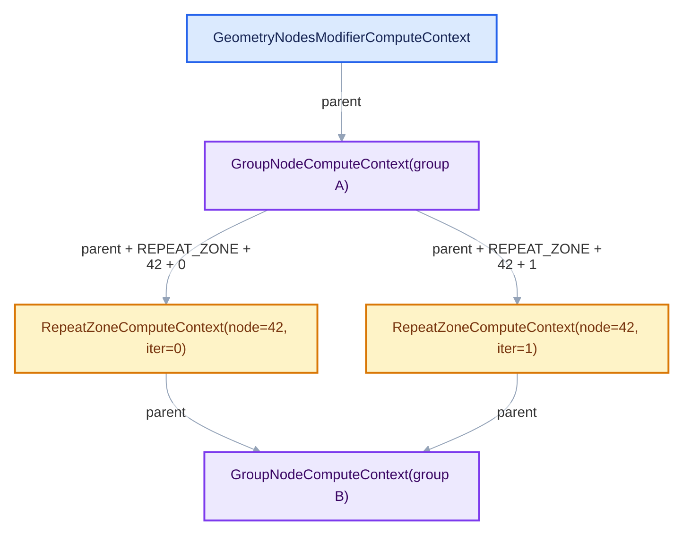
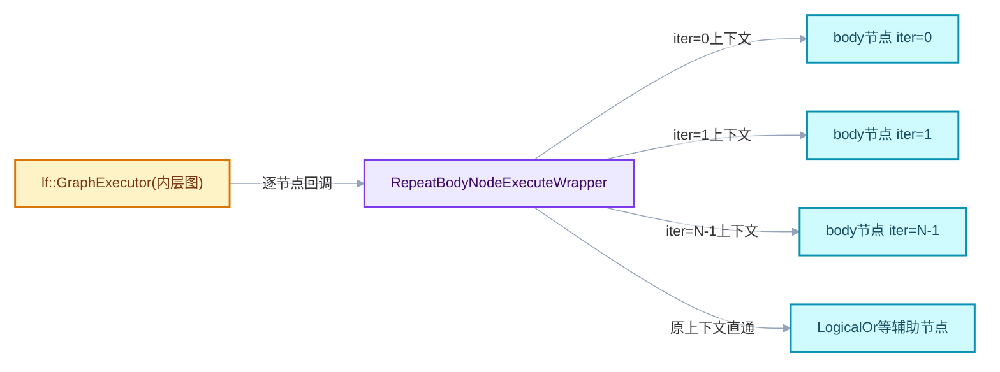

# RN-02 ComputeContext 与迭代身份

<div style="font-family:'Segoe UI','Microsoft YaHei',system-ui,-apple-system,sans-serif;display:flex;flex-wrap:wrap;align-items:center;gap:8px;margin:16px 0 20px;padding:10px 14px;background:#F8FAFC;border:1px solid #E2E8F0;border-radius:12px">
<span style="font-size:11px;font-weight:700;letter-spacing:.1em;color:#64748B;margin-right:2px">导航</span>
<a href="../README.md" style="font-size:13px;color:#334155;background:#F1F5F9;border:1px solid #E2E8F0;border-radius:999px;padding:3px 12px;text-decoration:none;white-space:nowrap">总入口</a>
<a href="./README.md" style="font-size:13px;color:#2563EB;background:#EFF6FF;border:1px solid #BFDBFE;border-radius:999px;padding:3px 12px;text-decoration:none;white-space:nowrap">本章 04-运行时机制</a>
<a href="./01-RepeatEvalStorage与一次求值.md" style="font-size:13px;color:#2563EB;background:#EFF6FF;border:1px solid #BFDBFE;border-radius:999px;padding:3px 12px;text-decoration:none;white-space:nowrap">‹ RepeatEvalStorage与一次求值</a>
<a href="./03-副作用迭代与按需执行.md" style="font-size:13px;color:#7C3AED;background:#F5F3FF;border:1px solid #DDD6FE;border-radius:999px;padding:3px 12px;text-decoration:none;white-space:nowrap">副作用迭代与按需执行 ›</a>
</div>

基准：Blender `5.4.0-alpha`，本地工作树。本篇回答一个贯穿日志、Viewer、副作用、
值追踪的核心问题：**同一个循环体节点被执行 N 次，系统如何区分"这是第几轮"**。
答案是一个对象：`bke::RepeatZoneComputeContext`，以及它背后层层派生的上下文哈希。

## 先回答一个具体问题

在一个 Repeat 区域里放一个 Value 节点并给它挂 Viewer。循环 3 轮后，你能在
node editor 里看到第 0、1、2 轮各自不同的值。可是 Viewer 记录值的机制是
"节点 + 上下文哈希"定位的——循环体在执行图里只有**一个** body 函数（复用
`body_fn_.function`），三次执行共享同一个 lf 节点。值是怎么被分开记录的？

答案：区分轮次的不是 lf 节点身份，而是**执行时注入的 ComputeContext**。
每次执行循环体前，`RepeatBodyNodeExecuteWrapper` 把当前上下文替换成带
`iteration` 的 Repeat 上下文；Viewer/日志按"节点 identifier + 上下文哈希"
写入，哈希不同 ⇒ 三轮的值落在三个桶里。

## 相关类与数据的职责

- **`ComputeContext`（基类）**：链条节点，持有 `parent_` 指针，纯虚
  `compute_hash()`。定义：
  [BLI_compute_context.hh](../../../source/blender/blenlib/BLI_compute_context.hh)。
- **`RepeatZoneComputeContext`**：Repeat 区域的链节点，附加
  `output_node_id_` 与 `iteration_`。定义：
  [BKE_compute_contexts.hh · L162](../../../source/blender/blenkernel/BKE_compute_contexts.hh#L162)。
- **`RepeatBodyNodeExecuteWrapper`**：执行期上下文注入者。定义：
  [geometry_nodes_repeat_zone.cc · L35](../../../source/blender/nodes/intern/geometry_nodes_repeat_zone.cc#L35)。
- **`ComputeContextCache`**：跨遍历的上下文缓存，保证"同一上下文同一指针"。定义：
  [BKE_compute_context_cache.hh · L29](../../../source/blender/blenkernel/BKE_compute_context_cache.hh#L29)。
- **`GeoNodesUserData`**：几何节点求值的 user_data，其中 `compute_context`
  字段是当前执行位置的上下文指针——wrapper 修改的就是它。



上图是嵌套结构示意：进入 group 换一层 `GroupNodeComputeContext`，进入
Repeat 的每一轮各换一层 `RepeatZoneComputeContext`。hash 自顶向下逐层派生，
所以两轮迭代从 Repeat 层开始分叉，其下所有节点（包括嵌套 group 内部）的
哈希都不同。

## 上下文哈希的构造

### RepeatZoneComputeContext 的实现

```cpp
RepeatZoneComputeContext::RepeatZoneComputeContext(const ComputeContext *parent,
                                                   const int32_t output_node_id,
                                                   const int iteration)
    : ComputeContext(parent), output_node_id_(output_node_id), iteration_(iteration)
{
}

ComputeContextHash RepeatZoneComputeContext::compute_hash() const
{
  return ComputeContextHash::from(parent_, "REPEAT_ZONE", output_node_id_, iteration_);
}
```

`[讲解]` 哈希输入四要素：

1. `parent_` 的哈希（不是指针值——`ComputeContextHash::from` 递归使用
   parent 的哈希，见下）；
2. 类型标签 `"REPEAT_ZONE"`（字符串字面量参与哈希，防止不同类型上下文
   撞车，比如同 node_id 的 Simulation 上下文）；
3. `output_node_id_`（Repeat Output 节点的 identifier，同一棵树里唯一）；
4. `iteration_`（轮次号）。

即：`hash(child) = H(hash(parent), tag, node_id, iteration)`。这是一个
Merkle 式结构——链条上任何一个环节的 node_id 或 iteration 变化，其下所有
哈希都变。这也解释了为什么复制一份节点树（identifier 变了）后，旧日志
不能与新日志混排。

<details>
<summary>核对原始源码：compute_contexts.cc · L154—L176</summary>

```cpp
RepeatZoneComputeContext::RepeatZoneComputeContext(const ComputeContext *parent,
                                                   const int32_t output_node_id,
                                                   const int iteration)
    : ComputeContext(parent), output_node_id_(output_node_id), iteration_(iteration)
{
}

RepeatZoneComputeContext::RepeatZoneComputeContext(const ComputeContext *parent,
                                                   const bNode &node,
                                                   const int iteration)
    : RepeatZoneComputeContext(parent, node.identifier, iteration)
{
}

ComputeContextHash RepeatZoneComputeContext::compute_hash() const
{
  return ComputeContextHash::from(parent_, "REPEAT_ZONE", output_node_id_, iteration_);
}

void RepeatZoneComputeContext::print_current_in_line(std::ostream &stream) const
{
  stream << "Repeat Zone ID: " << output_node_id_ << ", Iteration: " << iteration_;
}
```

</details>

### ComputeContextHash::from 的语义

`ComputeContextHash` 是固定长度的字节数组（实现见
[BLI_compute_context.hh](../../../source/blender/blenlib/BLI_compute_context.hh)）。
`from(parent, args...)` 的约定：

- `parent == nullptr` ⇒ 从零哈希起步（链条根）；
- 否则把 parent 的哈希字节与变参序列化后一起送入哈希函数。

注意两个性质：

1. **哈希碰撞空间**：固定长度哈希 + 海量 (node_id, iteration) 组合，理论上
   可碰撞；框架用哈希做日志/缓存的键时接受这个概率风险（工程折衷）。
2. **哈希≠身份**：两个不同上下文对象可能有相同哈希（碰撞）或相同内容
   （同链条）——缓存用 (parent 指针, node_id, iteration) 三元组做键保证
   指针唯一，哈希只用于日志与查找的快速比较。

## wrapper：执行期的上下文注入

### execute_node 全文精读

```cpp
void execute_node(const lf::FunctionNode &node,
                  lf::Params &params,
                  const lf::Context &context) const override
{
  GeoNodesUserData &user_data = *static_cast<GeoNodesUserData *>(context.user_data);
  // [讲解] 体节点映射确定当前迭代身份；不是仅按同一个节点identifier记日志。
  const int iteration = lf_body_nodes_->index_of_try(const_cast<lf::FunctionNode *>(&node));
  const LazyFunction &fn = node.function();
  if (iteration == -1) {
    /* The node is not a loop body node, just execute it normally. */
    fn.execute(params, context);
    return;
  }

  /* Setup context for the loop body evaluation. */
  bke::RepeatZoneComputeContext body_compute_context{
      user_data.compute_context, *repeat_output_bnode_, iteration};
  GeoNodesUserData body_user_data = user_data;
  // [讲解] 借用本次同步调用栈上的迭代上下文；异步化时需要重新处理寿命。
  body_user_data.compute_context = &body_compute_context;
  body_user_data.verbose_log = should_log_verbose_in_context(user_data,
                                                             body_compute_context.hash());

  GeoNodesLocalUserData body_local_user_data{body_user_data};
  lf::Context body_context{context.storage, &body_user_data, &body_local_user_data};
  fn.execute(params, body_context);
}
```

`[讲解]` 六个要点：

1. **非体节点直通**。内层图里除了 N 个 body 节点还有 LogicalOr 等辅助节点
   （见 RA-03），它们不属于任何一轮，`index_of_try` 返回 -1，按原上下文执行。
2. **iteration 来自 VectorSet 位置**。`lf_body_nodes_` 按创建顺序持有 body
   节点，位置 i 就是迭代 i。**节点身份与迭代号的绑定发生在图构建时**，
   执行期只是查表。
3. **上下文是"值覆盖"不是"修改"**。`body_user_data = user_data` 先复制，
   再替换 compute_context 指针。原 user_data 不动——外层其他节点（如
   LogicalOr）仍然用原上下文。
4. **栈借用**。`body_compute_context` 是栈对象，`fn.execute` 返回后失效。
   `GeoNodesLocalUserData` 构造时会基于上下文哈希预分配日志缓冲等资源，
   这些资源同样只在本帧有效。源码注释明确警告：若未来把 body 执行异步化
   （挂到任务队列后再跑），必须让上下文对象活得和任务一样久——常见做法
   是把上下文按值存进任务闭包。
5. **verbose log 的上下文过滤**。`should_log_verbose_in_context(user_data,
   hash)`：用户在编辑器里选中了某节点的某个值时，只有匹配上下文哈希的
   执行才记录详细日志。这防止 3 轮循环产生 3 份重复的详细日志。
6. **storage 原样透传**。`lf::Context body_context{context.storage, ...}`
   ——内层图的 storage（`RepeatEvalStorage`）与循环体共享同一个 storage
   槽。这是有意的：wrapper 不引入新的状态层。

<details>
<summary>核对原始源码：geometry_nodes_repeat_zone.cc · L40—L64</summary>

```cpp
  void execute_node(const lf::FunctionNode &node,
                    lf::Params &params,
                    const lf::Context &context) const override
  {
    GeoNodesUserData &user_data = *static_cast<GeoNodesUserData *>(context.user_data);
    const int iteration = lf_body_nodes_->index_of_try(const_cast<lf::FunctionNode *>(&node));
    const LazyFunction &fn = node.function();
    if (iteration == -1) {
      /* The node is not a loop body node, just execute it normally. */
      fn.execute(params, context);
      return;
    }

    /* Setup context for the loop body evaluation. */
    bke::RepeatZoneComputeContext body_compute_context{
        user_data.compute_context, *repeat_output_bnode_, iteration};
    GeoNodesUserData body_user_data = user_data;
    body_user_data.compute_context = &body_compute_context;
    body_user_data.verbose_log = should_log_verbose_in_context(user_data,
                                                               body_compute_context.hash());

    GeoNodesLocalUserData body_local_user_data{body_user_data};
    lf::Context body_context{context.storage, &body_user_data, &body_local_user_data};
    fn.execute(params, body_context);
  }
```

</details>

### wrapper 的挂载位置

wrapper 不是独立组件，它作为 `GraphExecutorNodeExecuteWrapper` 传给内层
`lf::GraphExecutor`（装配处见
[L387—L399](../../../source/blender/nodes/intern/geometry_nodes_repeat_zone.cc#L387)）。
GraphExecutor 在执行每个 FunctionNode 前调用 wrapper 的 `execute_node`，
等于给"节点级执行"插了一个拦截器。三个参与者：



一个容易忽略的点：wrapper 拦截的是**内层图的全部节点**。内层图里若嵌套
了子 zone（Repeat 套 Repeat），子 zone 的 wrapper 会在 body 执行期间继续
叠加更深的上下文——链条天然支持任意嵌套。

## 上下文缓存：同一身份同一指针

### 为什么需要缓存

`RepeatZoneComputeContext` 在多个彼此独立的代码路径中被构造：

- 执行期：wrapper 每轮构造一个（栈上）；
- socket usage inference：推断某轮某 socket 是否被使用时要"进入"迭代上下文；
- partial evaluation / trace values：编辑器追踪值时要重建上下文链；
- viewer path 解析：MOD_nodes.cc 把 viewer 路径逐层展开成上下文。

这些路径若各自 new 一个对象，"同一个上下文"就会有多个指针身份，基于
指针的 Map（如缓存的键）就会失效或浪费。`ComputeContextCache` 用
LinearAllocator 统一分配并按内容键缓存：

```cpp
Map<std::pair<const ComputeContext *, std::pair<int32_t, int>>, const RepeatZoneComputeContext *>
    repeat_zone_contexts_cache_;
```

键 = (parent 指针, (output_node_id, iteration))。首次构造后存入，
后续同键请求返回同一指针。`for_repeat_zone` 两个重载（node_id 版与
bNode 引用版）见
[BKE_compute_context_cache.hh · L83](../../../source/blender/blenkernel/BKE_compute_context_cache.hh#L83)。

`[讲解]` 注意缓存键用的是 **parent 指针**而非 parent 哈希。这是强约束：
要求所有路径都通过同一个缓存链构造上下文，否则同一逻辑上下文仍可能
出现两个指针。源码注释（文件头 L20-L28）说明了这个意图："ensure that the
same compute context will always have the same pointer, even if it's created
in two different places"。执行期 wrapper 的栈上上下文**不走缓存**（它生命
周期极短、不需要指针稳定性），这正是两套构造路径并存的原因——也是
为什么执行期哈希与缓存哈希必须算法一致：`compute_hash()` 是虚函数，
两者都调它，天然一致。

### 缓存与哈希的分工

| 用途 | 键 | 提供者 |
| --- | --- | --- |
| 指针稳定化（跨路径） | (parent指针, node_id, iteration) | ComputeContextCache |
| 日志/Viewer 值分组 | ComputeContextHash | compute_hash() |
| verbose log 过滤 | ComputeContextHash | compute_hash() |
| side effect 迭代表 | (ComputeContextHash, node_id) | iterations_by_iteration_zone |

分工原则：**要指针稳定性用缓存；只要内容等价性用哈希**。混淆两者会
写出"用哈希当 Map 键存上下文对象"的代码——碰撞时直接出错。

## 消费者全景

### 1. 日志与 Viewer 值

循环体内节点的警告、Viewer 值都带 `(node_identifier, context_hash)` 二元组
落盘。编辑器展示时用 inspection_index 选择轮次：Repeat Output 的
`inspection_index` 存储指定显示第几轮（DNA 字段见
[DNA_node_types.h · L3569](../../../source/blender/makesdna/DNA_node_types.h#L3569)），
执行端对越界值发 Info 警告（见 RA-03 小节 1）。

### 2. Viewer path 与副作用迭代

用户挂一个 Viewer 在循环体内某个节点上 ⇒ depsgraph 求值前要把"这个
Viewer 处于第几轮"解析出来，强制该轮执行。MOD_nodes.cc 的
`find_side_effect_nodes` 沿 viewer path 逐层走：

- 遇到 `RepeatZoneComputeContext` ⇒ 记录
  `iterations_by_iteration_zone.add({parent_hash, output_node_id}, iteration)`
  （[MOD_nodes.cc · L526-L528](../../../source/blender/modifiers/intern/MOD_nodes.cc#L526)）；
- RepeatZoneSideEffectProvider 在执行期查这张表，把对应轮的 body 节点
  加进需求根（详见 RN-03）。

这里体现了上下文身份的另一面：**它不仅描述"现在在哪执行"，还描述
"哪些执行必须发生"**。

### 3. 值追踪（trace_values）

编辑器的节点值追踪（`trace_values.cc`）在跨区域追踪时手工重建上下文：

```cpp
if (node->is_type("GeometryNodeRepeatInput"_ustr)) {
  const int index = socket->index();
  if (index >= 1) {
    const ComputeContext &repeat_compute_context = compute_context_cache.for_repeat_zone(
        socket.context, *node, 0);
    add_if_new({&repeat_compute_context, &node->output_socket(index)}, bundle_path);
    ...
```

`[讲解]` Repeat Input 的输出值处于"第 0 轮上下文"（值刚从区域外进来，
尚未参与任何一轮），所以追踪时用 `for_repeat_zone(..., 0)` 构造；而
Repeat Output 的输出回到 parent 上下文：

```cpp
if (node->is_type("GeometryNodeRepeatOutput"_ustr)) {
  BLI_assert(dynamic_cast<const bke::RepeatZoneComputeContext *>(socket.context));
  add_if_new({socket.context->parent(), &node->output_socket(socket->index())}, bundle_path);
```

断言同时暴露了不变量：**追踪到达 Repeat Output 的 socket 时，其上下文
必然已是 RepeatZoneComputeContext**（追踪从区域内向外走）。两条路径
（进入用固定 0 轮、离开回 parent）合起来就是"值跨越区域边界时的上下文
变换规则"，与执行语义（Iterations 输入在区域外、Iteration 输出在第 0 轮
有效）完全对应。

<details>
<summary>核对原始源码：trace_values.cc · L255—L275</summary>

```cpp
      if (node->is_type("GeometryNodeRepeatInput"_ustr)) {
        const int index = socket->index();
        if (index >= 1) {
          const ComputeContext &repeat_compute_context = compute_context_cache.for_repeat_zone(
              socket.context, *node, 0);
          add_if_new({&repeat_compute_context, &node->output_socket(index)}, bundle_path);
          const auto &storage = *static_cast<NodeGeometryRepeatInput *>(node->storage);
          if (const bNode *repeat_output_node = node->owner_tree().node_by_id(
                  storage.output_node_id))
          {
            add_if_new({socket.context, &repeat_output_node->output_socket(index - 1)},
                       bundle_path);
          }
        }
        continue;
      }
      if (node->is_type("GeometryNodeRepeatOutput"_ustr)) {
        BLI_assert(dynamic_cast<const bke::RepeatZoneComputeContext *>(socket.context));
        add_if_new({socket.context->parent(), &node->output_socket(socket->index())}, bundle_path);
        continue;
      }
```

</details>

注意上面代码里 `index >= 1` 与 `output_socket(index - 1)`：Repeat Input 的
输出 socket 0 是 Iteration，index-1 把 item 输出映射到 Repeat Output 对应
的输出 socket——两个节点的 socket 排布差一个 Iteration 通道。

### 4. should_log_verbose_in_context

```cpp
body_user_data.verbose_log = should_log_verbose_in_context(user_data,
                                                           body_compute_context.hash());
```

该函数（定义于几何节点求值基础设施）逻辑：若用户当前正在查看的值对应
这个上下文哈希，则本轮开启详细日志；否则关。效果：详细日志只属于被
观察的那一轮，其余轮次只记常规事件。若不做这个过滤，3 轮循环会把
每条详细日志写 3 遍。

## 用小数据走一遍

<div style="font-family:'Segoe UI','Microsoft YaHei',system-ui,-apple-system,sans-serif;display:inline-block;margin:6px 0 14px;padding:3px 12px;font-size:12px;color:#0891B2;background:#ECFEFF;border:1px solid #A5F3FC;border-radius:999px">教学推演 · 手算中间值，逐轮核对</div>
设置：几何节点修改器 → group "Loop" 内一个 Repeat 区域（Output 节点
identifier = 42），2 轮迭代，循环体内一个 Value 节点（identifier = 7）挂
Viewer，查看第 1 轮。

```mermaid
%%{init: {"theme":"base","themeVariables":{"fontFamily":"\"Segoe UI\",\"Microsoft YaHei\",sans-serif","fontSize":"15px","lineColor":"#94A3B8","edgeLabelBackground":"#FFFFFF","clusterBkg":"#F8FAFC","clusterBorder":"#CBD5E1"},"flowchart":{"htmlLabels":false,"curve":"basis","nodeSpacing":52,"rankSpacing":64,"padding":14,"diagramPadding":16,"useMaxWidth":true},"sequence":{"useMaxWidth":true,"wrap":true,"mirrorActors":false,"messageMargin":36}}}%%
flowchart LR
  S0["viewer path: modifier → group(Loop) → repeat(42, iter=1) → node 7"]:::input
  S1["MOD_nodes 解析路径逐层建上下文"]:::compute
  S2["记入 iterations_by_iteration_zone: {(hash_Loop, 42): [1]}"]:::data
  S3["执行到 Repeat zone: 构建内层图 2 个 body"]:::compute
  S4["body0: 上下文 iter=0, provider 不含此轮"]:::data
  S5["body1: 上下文 iter=1, provider 强制此轮"]:::compute
  S6["Viewer 值落桶 (7, hash(...,42,1))"]:::result
  S0 --> S1
  S1 --> S2
  S2 --> S3
  S3 --> S4
  S4 --> S5
  S5 --> S6
  classDef input fill:#DBEAFE,stroke:#2563EB,color:#172554,stroke-width:2px;
  classDef data fill:#CFFAFE,stroke:#0891B2,color:#164E63,stroke-width:2px;
  classDef abstraction fill:#EDE9FE,stroke:#7C3AED,color:#3B0764,stroke-width:2px;
  classDef compute fill:#FEF3C7,stroke:#D97706,color:#78350F,stroke-width:2px;
  classDef result fill:#DCFCE7,stroke:#16A34A,color:#14532D,stroke-width:2px;
  classDef error fill:#FEE2E2,stroke:#DC2626,color:#7F1D1D,stroke-width:2px;
```



核对点：

- viewer path 哈希链：`H0=hash(modifier)` → `H1=H(H0,"GROUP",loop_node_id)`
  → `H2=H(H1,"REPEAT_ZONE",42,1)`；
- 第 0 轮也会执行（因为第 1 轮的输入依赖第 0 轮的输出——串行链），但
  第 0 轮的 Viewer 值落桶用 `H(H1,"REPEAT_ZONE",42,0)`，编辑器只在用户
  切到第 0 轮时展示它；
- 若 Viewer 在 value 节点但用户没开"查看值"，副作用表为空 ⇒ 循环体
  按普通需求传播执行。

## 反例与边界

<div style="font-family:'Segoe UI','Microsoft YaHei',system-ui,-apple-system,sans-serif;display:inline-block;margin:6px 0 14px;padding:3px 12px;font-size:12px;color:#B45309;background:#FFFBEB;border:1px solid #FDE68A;border-radius:999px">边界情形 · 每条断言都可回到源码验证</div>
- **反例 1：只用节点 identifier 记日志。** 同一 body 函数执行 3 次，日志
  三次全落在 (7, 外层hash) 一个桶里，轮次信息丢失。正确做法必须含
  上下文哈希。源码注释（geometry_nodes_repeat_zone.cc 头部 L29-L34）正是
  为此引入 wrapper："necessary to support correct logging inside of a
  repeat zone"。
- **反例 2：为省开销给每轮建独立 LazyFunction。** 注释给出的替代方案：
  "An alternative would be to use a separate LazyFunction for every iteration,
  but that would have higher overhead." 每轮一个函数对象 = N 份函数描述
  与更多框架对象；wrapper 方案只付"每轮一次哈希计算"的代价。
- **反例 3：把栈上上下文传给异步任务。** `body_compute_context` 在
  `fn.execute` 返回后销毁。异步化（比如把 body 提交线程池后立即返回）
  会悬挂指针。改法是上下文按值进闭包，或经缓存取稳定指针。
- **反例 4：用哈希当 Map 键管理上下文对象生命周期。** 哈希可能碰撞；
  对象生命周期应由缓存（内容键）或调用栈管理，哈希只做内容等价判断。
- **反例 5：假设 iteration 从 1 开始。** `index_values` 填充是
  `emplace<int>(i)`，i 从 0 起；Iteration socket 的描述也是 "Starts counting
  at zero"（node_geo_repeat.cc L76-L77）。

## 历史背景阅读建议

ComputeContext 体系先于 Repeat Zone 存在（为 Simulation Zone 与 group
日志而建）。Repeat 的贡献是证明"上下文链可以由执行期 wrapper 动态注入"
而不只是"编辑期静态可枚举"。阅读相关提交时盯两条不变量：(1) 哈希输入
序列向后兼容（改输入格式 = 所有旧日志失效）；(2) 缓存键与哈希输入的
信息集一致（缓存键少了 tag，靠 Map 按类型分表补偿）。

## 验收自查

- 能默写 `RepeatZoneComputeContext` 的哈希输入四要素及其顺序。
- 能解释 wrapper 里三份"上下文变量"（原 user_data、body_user_data、
  body_local_user_data）各自的作用域。
- 能说出 trace_values 进入/离开 Repeat 区域时上下文的变换规则（进入固定
  iter=0、离开回 parent）。
- 能论证"缓存键不含类型标签为什么仍然安全"（按类型分表的 Map 字段）。

<details>
<summary>参考思路（最后一问）</summary>

`ComputeContextCache` 为每种上下文类型声明了独立的 Map 成员
（`repeat_zone_contexts_cache_`、`simulation_zone_contexts_cache_` 等），
类型信息编码在"查哪个 Map"里，不需要进键。若未来引入"同一节点既是
zone 输出又是其他上下文载体"的新类型，仍只需新增 Map 字段，键结构不变。

</details>

## 继续阅读

- [RN-03 副作用迭代与按需执行](03-副作用迭代与按需执行.md)
- [RA-03 执行图按迭代展开](../03-几何节点执行架构/03-执行图按迭代展开.md)
- [课程指南·术语表](../00-课程指南/02-图表配色与阅读约定.md)

<hr style="border:none;height:1px;background:linear-gradient(90deg,#BFDBFE,#E2E8F0 55%,transparent);margin:34px 0">

## 深读篇：ComputeContext 基础设施全解

前面聚焦 Repeat 的上下文注入。这一篇的后半部分把镜头拉远，讲清楚
`ComputeContext` 这套基础设施本身——它是所有 zone（以及 group、modifier）
共享的身份系统，理解了它的通用机制，Repeat 的特殊之处才真正显形。

### BLI 层的通用机制

ComputeContext 的基类与哈希定义在 BLI（基础库）层，不依赖节点系统：

- 基类：[BLI_compute_context.hh](../../../source/blender/blenlib/BLI_compute_context.hh)；
- 哈希实现：[compute_context.cc](../../../source/blender/blenlib/intern/compute_context.cc)。

文件头注释（L10-L35）给出了完整的问题陈述，值得逐句读：

1. **问题**：日志值需要知道"在哪里被计算"。同一个 socket 在 group 被多次
   使用时对应多个值——光存 socket 指针不够，还得存整条嵌套路径。
2. **路径存储不可行**：完整上下文路径可能很长，逐值存储内存与开销都太大，
   且变长标识难以做 Map。
3. **解法**：每条上下文链哈希成一个**定长** `ComputeContextHash`（碰撞概率
   工程上可忽略）；嵌套关系用**单链表**（子持父指针）——反向指针不可能，
   因为同一父上下文可能被多线程上的多个子上下文同时使用。

`[讲解]` 这段注释是理解整个身份系统的钥匙：**哈希是"路径"的定长代理，
链表是"结构"的最小表示**。Repeat 引入的只是链上一种新节点类型，没有
改变任何通用机制。

### 基类接口逐个讲

```cpp
class ComputeContext {
 protected:
  const ComputeContext *parent_ = nullptr;
  mutable ComputeContextHash hash_;
 private:
  mutable CacheMutex hash_mutex_;
  int parents_num_ = 0;
 public:
  ComputeContext(const ComputeContext *parent)
      : parent_(parent), parents_num_(parent ? parent->parents_num_ + 1 : 0) {}
  const ComputeContextHash &hash() const {
    hash_mutex_.ensure([&]() { hash_ = this->compute_hash(); });
    return hash_;
  }
  virtual ComputeContextHash compute_hash() const = 0;
  virtual void print_current_in_line(std::ostream &stream) const = 0;
  ...
};
```

四个要点：

1. **哈希惰性计算**。`hash()` 用 `CacheMutex` 保证多线程下只算一次
   （`ensure` 是"已算则跳过"的线程安全模式）。构造上下文很便宜，哈希
   按需才发生——对每轮迭代都建上下文的 Repeat 来说，这个设计把开销
   推迟到了真正需要身份的时刻。
2. **`mutable` + 锁**。hash 是缓存值，const 方法里也要能写，所以 mutable；
   CacheMutex 挡住并发重复计算。这意味着：多线程同时调 `hash()` 安全，
   但第一次会串行化。
3. **`parents_num_` 防爆栈**。链的深度被记录，`print_stack` 等递归操作
   可以用它限制深度，防止恶意深的嵌套把调用栈打爆。
4. **两个纯虚**：`compute_hash`（身份）与 `print_current_in_line`（调试
   打印）。每种上下文类型只提供这两样，其余全部由基类管。

### ComputeContextHash::from 的打包细节

```cpp
template<size_t N, typename... Args>
inline ComputeContextHash ComputeContextHash::from(const ComputeContext *parent,
                                                   const char (&type_str)[N],
                                                   Args &&...args)
{
  return ComputeContextHash::from_shallow_bytes(
      parent ? parent->hash() : ComputeContextHash{0, 0}, type_str, args...);
}
```

`from_shallow_bytes`（同文件 L153-L172）把所有实参的**浅层字节**依次
memcpy 进连续缓冲再哈希。三个值得注意的约束：

- `static_assert(std::has_unique_object_representations_v<Arg>)`：实参类型
  不能有填充字节歧义（padding 的字节值未定义，会导致同值不同哈希）。
  所以上下文字段都是 `int32_t`/`int` 这类无填充类型。
- **父哈希是值不是指针**：`parent->hash()` 取的是哈希值本身，所以哈希链
  与对象地址无关——两个独立构造的等价上下文链产生相同哈希（这正是
  日志跨路径一致的前提）。
- 根上下文用 `ComputeContextHash{0, 0}`（零哈希）起步。

Repeat 的 `from(parent_, "REPEAT_ZONE", output_node_id_, iteration_)` 中，
`"REPEAT_ZONE"` 是 `char[N]` 数组——模板按数组大小 N 特化，整个字符串
参与哈希（不是指针！），这是类型标签防碰撞的关键。

### bke 层的上下文类型总表

具体上下文类型定义在
[BKE_compute_contexts.hh](../../../source/blender/blenkernel/BKE_compute_contexts.hh)（283 行）。
全表如下（哈希标签从各 `compute_hash()` 实现读出）：

| 类型 | 字段 | 哈希标签 | 语义 |
| --- | --- | --- | --- |
| `DataBlockComputeContext` | orig_session_uid + ID* | "DATA_BLOCK" | 某个 ID 数据块（如场景）的根上下文 |
| `GeometryNodesModifierComputeContext` | modifier_uid | "GEOMETRY_NODES_MODIFIER" | 几何节点修改器 |
| `SceneCompositorEffectComputeContext` | effect 引用 | （效果名参与） | 合成器效果 |
| `NodeComputeContext` | node_id + tree | "NODE" | 通用节点上下文基座 |
| `GroupNodeComputeContext` | 继承 Node | 继承 | 进入 group |
| `SimulationZoneComputeContext` | output_node_id | "SIMULATION_ZONE" | Simulation 区域 |
| `RepeatZoneComputeContext` | output_node_id + iteration | "REPEAT_ZONE" | Repeat 第 N 轮 |
| `ForeachGeometryElementZoneComputeContext` | output_node_id + index | 同类标签 | Foreach 第 N 个元素 |
| `EvaluateClosureComputeContext` | node_id + source_location | 继承 Node | 调用 Closure |

`[讲解]` 两个家族规律：

1. **zone 家族统一为 (output_node_id, [迭代号])**：Simulation 只有 id、
   Repeat/Foreach 各加一个序号。三者共享"以 output 节点为锚"的设计——
   因为 item 定义与副作用归属都挂在 output 上。
2. **group 家族只有 node_id**：group 是静态结构，没有"第几轮"概念；
   嵌套 group 的路径天然由链长度表达。

### 缓存实现的完整形态

`for_repeat_zone` 的两个实现在
[compute_contexts.cc · L387-L405](../../../source/blender/blenkernel/intern/compute_contexts.cc#L387)：

```cpp
const RepeatZoneComputeContext &ComputeContextCache::for_repeat_zone(
    const ComputeContext *parent, const int32_t output_node_id, const int iteration)
{
  return *repeat_zone_contexts_cache_.lookup_or_add_cb(
      {parent, {output_node_id, iteration}},
      [&]() {
        return allocator_.construct<RepeatZoneComputeContext>(
            parent, output_node_id, iteration).release();
      });
}
```

`[讲解]` 实现只有四步：查缓存键 → 命中返回 → 未命中则从
LinearAllocator 构造 → 存入缓存。bNode 重载只是取 `node.identifier`
转调 id 版。注意：

- 缓存**不存哈希**——哈希是惰性属性，缓存保证的是指针身份；
- `lookup_or_add_cb` 的回调只在未命中时执行，构造次数 = 不同身份数；
- LinearAllocator 意味着**缓存没有逐项释放**，整批随缓存对象销毁——
  所以缓存的生命周期必须短于"一次完整的求值/推断会话"（调用方持有），
  不能做成全局单例，否则不同节点树版本的上下文会互相污染。

### 与 socket usage inference 的关系

usage 推断（RA 系列与 RN-03 讲过其保守性）在"进入"Repeat 上下文时也用
缓存构造上下文：推断器沿图传播时遇到 Repeat Output 节点，会为每轮
构造 `RepeatZoneComputeContext` 再问"这一轮的某输入是否被用"。因为
推断与执行共享同一缓存，推断期建立的上下文与执行期查询的上下文
**同指针**——任何按指针索引的辅助数据（如推断结果的 Map）在执行期
依然有效。这是缓存机制最大的工程收益。

### 调试打印的层级

`print_stack`（BLI_compute_context.cc）从当前上下文沿 parent 链回溯，
逐层调用 `print_current_in_line`。对 Repeat 的打印格式是
`Repeat Zone ID: 42, Iteration: 1`。调试技巧：在 lldb/gdb 里对任意
`ComputeContext*` 调 `print_stack` 的等价操作（或临时加日志），可以直接
打印出"当前执行位置"的完整路径——比在断点处手动翻 parent 链快得多。

`operator<<`（BLI 层）则打印单层。两个接口的分工：单层用于紧凑日志行，
整栈用于定位问题。

### 上下文与 depsgraph 的关系

上下文链的"根"由求值入口决定：

- 几何节点修改器求值：根是 `GeometryNodesModifierComputeContext`
  （modifier_uid 标识）；
- 合成器效果求值：根是 `SceneCompositorEffectComputeContext`；
- 手动执行节点树（编辑器）：根可能是 `OperatorComputeContext` 或
  带特殊标记的根。

同一棵节点树在不同根下的所有哈希都不同——所以"编辑器里看第 1 轮的
Viewer 值"与"渲染时第 1 轮产生的副作用"是两套日志桶，互不干扰。
这也是为什么 inspection_index 需要被编进上下文缓存键（02-02 提到过
space_node.cc 与 compositor.cc 的处理）：让"检查第 K 轮"这个意图成为
身份的一部分，而不是一个易失的查询参数。

### 常见问题补遗

**Q：为什么 Repeat 上下文不直接用 lf 节点指针做身份？**
A：lf 节点是执行图的产物，N 轮共享同一个 lf 节点；身份必须区分轮次，
所以要 (output_node_id, iteration) 这对"编辑器世界"的坐标。

**Q：iteration 会不会是负数或超大？**
A：执行期 iteration 来自 VectorSet 下标（0..N-1）；trace/viewer path 解析
时可能遇到越界 iteration（编辑器保存的 viewer path 指向已缩小的迭代数），
此时查表落空、静默不命中——与 GPU 端 zone 配对失配的行为（05-02 反例 2）
风格一致：身份系统只负责回答，不负责校验。

**Q：能自定义一种新上下文类型吗？**
A：继承 ComputeContext、实现两个纯虚、（可选）在 ComputeContextCache
加一个 Map 字段。Zone 家族每加一种 zone 都要走这套流程——Repeat 的
`RepeatZoneComputeContext` 就是最好的模板。

### 本篇总复习图


一句话收束：**编辑世界的坐标（树、节点、轮次）经上下文链映射为定长
哈希与稳定指针，所有"按位置找值/找副作用"的子系统都消费这两样东西。**
Repeat 的特殊之处只是坐标里多了一个"轮次"维度。

## 附录：本篇源码引用汇总

| 主题 | 文件 | 行号 |
| --- | --- | --- |
| 通用基类与哈希 | BLI_compute_context.hh | L45-L142、L144-L172 |
| 哈希打包实现 | 同上 | L153-L172 |
| print_stack | compute_context.cc | L35 起 |
| Repeat 上下文声明 | BKE_compute_contexts.hh | L162-L184 |
| Repeat 上下文实现 | compute_contexts.cc | L154-L176 |
| 上下文类型总表 | BKE_compute_contexts.hh | L39-L283 |
| 缓存声明 | BKE_compute_context_cache.hh | L47-L48、L83-L88 |
| 缓存实现 | compute_contexts.cc | L387-L405 |
| wrapper 注入 | geometry_nodes_repeat_zone.cc | L40-L64 |
| viewer path Repeat 分支 | MOD_nodes.cc | L509-L530 |
| trace_values Repeat 分支 | trace_values.cc | L255-L275 |
| verbose log 过滤 | geometry_nodes_repeat_zone.cc | L58-L59 |

<hr style="border:none;height:1px;background:linear-gradient(90deg,#BFDBFE,#E2E8F0 55%,transparent);margin:34px 0">

## 深读篇二：一次"查看第 1 轮 Viewer 值"的全程身份走查

把前面所有机制串成一条完整的链。场景设定：

- 几何节点修改器 `NodesModifier`（persistent_uid = 7）挂在物体上；
- 修改器的树里有 group 节点（identifier = 100）指向节点组 "Loop"；
- "Loop" 里有一个 Repeat 区域，Output 节点 identifier = 42，迭代 3 轮；
- 循环体内一个 Value 节点（identifier = 77）挂了 Viewer；
- 用户在编辑器里把 inspection_index 设为 1，想看第 1 轮的值。

### 阶段一：编辑器建立观察意图

用户改 inspection_index 时，编辑器为"查看这个 Viewer"构造上下文链
（space_node.cc 的 zone 上下文构造处）：

```
根: GeometryNodesModifierComputeContext(uid=7)
  └ GroupNodeComputeContext(node=100)
      └ RepeatZoneComputeContext(node=42, iteration=1)   ← inspection_index 参与
```

这条链经 ComputeContextCache 构造——每个节点从缓存拿稳定指针。
链尾哈希记作 `H_view`。

### 阶段二：depsgraph 求值前的副作用解析

修改器标记需要求值后，`MOD_nodes.cc` 的 `find_side_effect_nodes_for_viewer_path`
沿这条链走：

1. 遇 modifier 上下文 → 换树；
2. 遇 group 上下文 → 找到 lf 图中的 group 节点，登记
   `nodes_by_context.add(H_parent, lf_group_node)`；
3. 遇 Repeat 上下文（node=42, iteration=1）→ 三项检查
   （zone 存在 / parent_zone 匹配 / lf 节点存在）后登记
   `iterations_by_iteration_zone.add({H_group, 42}, 1)`；
4. 最后定位 Viewer 节点本身，登记到最终哈希 `H_view`。

注意第 3 步的键是 **H_group（Repeat 区域外层的哈希）**，不是
`H_view`——provider 执行期查询时，wrapper 的上下文正是区域外层的。
键与查询点严格对齐，这是 RN-03 反复强调的设计。

### 阶段三：执行期

求值推进到 Repeat zone 节点：

1. `execute_impl` 首次进入 → `initialize_execution_graph` 展开 3 个
   body 节点 → executor 装配 wrapper 与 provider；
2. 内层执行到 body #0：wrapper 用 `index_of_try` 得 iteration=0，构造
   **栈上** `RepeatZoneComputeContext(parent=H_group, 42, 0)`，hash 为
   `H_iter0`；Viewer 节点在 body #0 内执行时以 (77, H_iter0) 落桶；
3. body #1 同理得 `H_iter1`，Viewer 值落 (77, H_iter1)；
4. body #2 同理 `H_iter2`。

注意执行期的上下文是 wrapper **栈上新构造**的，不走缓存——但它们的
哈希与任何"经缓存构造的同链上下文"完全一致（哈希只看内容链）。
这就是"编辑世界坐标 → 执行期身份 → 编辑器再次查询"闭环成立的原因。

### 阶段四：日志回收与显示

求值结束后，编辑器用阶段一的 `H_view` 查日志桶：(77, H_view) 中存的
正是阶段三 body #1 执行时写入的值——因为 `H_view == H_iter1`
（同链同内容同哈希）。编辑器把值画到 socket 旁边，用户看到第 1 轮的
结果。若 inspection_index 改成 2，链变了 → `H_view` 变 → 查到的是
(77, H_iter2) 的桶。**inspection_index 不是"查询参数"而是"身份成分"**，
这是整个系统最不直观也最关键的一点。

### 阶段五：如果同时有两个 Viewer

Viewer A 在 Value（77）、Viewer B 在另一个节点（identifier=88）：
- 副作用解析阶段两条 viewer path 各走一遍，`iterations_by_iteration_zone`
  里 (H_group, 42) → {1} 去重合并（MultiValueMap 对同键多值）；
- 执行期两个 Viewer 的值分别落 (77, H*) 与 (88, H*) 两个独立的
  "节点 × 轮次"桶，互不干扰；
- 若 A 看 1 轮、B 看 2 轮：副作用表变为 {1, 2}，两轮都被强制执行；
  第 0 轮仍因串行链被连带执行，第 3..N-1 轮照常按需求传播。

### 走查中暴露的五个不变量

1. **哈希一致性**：执行期栈上构造与编辑期缓存构造的哈希算法与输入
   完全相同——任何一边改 `compute_hash` 都要同步另一边（它们共享实现，
   实际上只能一起改）。
2. **键对齐**：`iterations_by_iteration_zone` 的键是"区域外层哈希 +
   output id"；provider 查询点的 compute_context 恰好就是区域外层。
   改 wrapper 的注入层级会同时改变两边——但只改一边必错。
3. **inspection_index 进身份**：编辑器与合成器两条路径都要把
   inspection_index 编进缓存键；漏掉任一路径会出现"编辑器显示与
   执行日志对不上"的诡异现象。
4. **缓存作用域**：ComputeContextCache 持有于一次求值/推断会话；
   跨会话复用缓存会导致指针悬空（LinearAllocator 一次性销毁）。
5. **栈对象只借不同步**：wrapper 栈上上下文若被异步任务捕获即悬挂；
   异步化改造必须改为缓存取指针或值拷贝进闭包。

### 按这份走查做回归测试

如果你改动了上下文系统，以下最小测试集能覆盖本篇全部机制：

1. 单层 Repeat + Viewer，切 inspection_index 0/1/2，确认三个值都正确
   （覆盖哈希链与日志分组）；
2. group 嵌 Repeat + Viewer（覆盖多级链与副作用键对齐）；
3. Repeat 嵌 Repeat，外层 2 轮内层 2 轮，确认四个 (outer, inner) 组合
   的 Viewer 值互不串（覆盖哈希组合爆炸的正确性）；
4. 保存/重开文件后重复 1（覆盖上下文可从编辑数据重建）；
5. 并发开启两个 Viewer 分别看不同轮（覆盖 MultiValueMap 与强制执行）。

### 与其他 zone 上下文的对照复习

| 机制点 | Repeat | Simulation | Foreach |
| --- | --- | --- | --- |
| 上下文附加字段 | iteration | 无 | index |
| 每轮/每元素独立身份 | 是 | 否（单次求值单身份） | 是 |
| 副作用迭代表 | iterations_by_iteration_zone | 无此表（整体一个副作用节点） | 同 Repeat |
| 编辑器轮次参数 | inspection_index | 帧号（时间参数） | inspection_index |

三者的共同点：都以 output 节点为锚、都经同一缓存、都被 provider/
trace/viewer path 三类消费者消费。差异只在"序号"字段的有无与语义。

到这里，本篇连同深读篇把"迭代身份"从宏观看到了字节级：**下一层是
哈希函数本身**（BLI 的 UniqueHash 与混合哈希实现），它是纯算法问题、
与节点系统无关，本系列不再下探；再往上一层是"身份如何影响调度"，
那就是 RN-03 的主题。

## 附录二：身份系统速查卡

一页版速查，写代码时放在手边：

**构造**

| 你想要 | 写法 |
| --- | --- |
| 执行期临时上下文 | `bke::RepeatZoneComputeContext ctx{parent_ctx, output_bnode, iter};` |
| 缓存稳定上下文 | `bke::ComputeContextCache &cache; cache.for_repeat_zone(parent, node, iter);` |
| 拿哈希 | `ctx.hash()`（惰性，线程安全） |
| 打印整条链 | `ctx.print_stack(stream, "name");` |

**消费**

| 子系统 | 查询键 | 数据 |
| --- | --- | --- |
| 日志/Viewer 值 | (node_identifier, context_hash) | 值/警告桶 |
| verbose log | context_hash | 是否开启 |
| 副作用迭代 | (parent_hash, output_node_id) → iteration 列表 | iterations_by_iteration_zone |
| 副作用节点 | context_hash → lf 节点列表 | nodes_by_context |
| trace 值追踪 | 手工沿链进出区域 | bundle path |

**纪律**

1. 只比较哈希，不比较上下文对象（无 operator==）。
2. 栈上上下文不同步异步；异步走缓存。
3. 键与查询点的上下文层级严格对齐（区域外层 vs 区域内层）。
4. 改 `compute_hash` 的任何输入格式 = 全部历史日志作废，需在提交说明里声明。
5. 缓存生命周期 = 一次会话；禁止全局单例化。

## 附录三：三分钟自测

1. `RepeatZoneComputeContext` 的哈希输入四要素按顺序是什么？
2. 为什么缓存键不需要类型标签字符串？（答：按类型分表的 Map 字段
   承担了类型区分。）
3. 执行期的上下文对象在哪个内存区域？谁保证它活到什么时候？
4. 两个独立构造的等价上下文链，哈希相同吗？指针相同吗？
   （分别回答，并说明理由。）
5. viewer path 解析失败（比如中间某层 zone 已被删除）时，副作用表
   会登记部分结果吗？（答：不会——all-or-nothing，local 表整体丢弃。）

<details>
<summary>自测参考答案</summary>

1. `hash(parent), "REPEAT_ZONE", output_node_id, iteration`。
2. `ComputeContextCache` 为每种类型声明独立 Map 成员，类型信息编码在
   "查哪个 Map"。
3. wrapper 调用栈；`fn.execute(params, body_context)` 同步返回前有效。
4. 哈希相同（只看内容链）；指针通常不同（除非同经一个缓存）。
5. 见 MOD_nodes.cc 的 `try_add_side_effect_node`：任何一层解析失败直接
   return，`local_side_effect_nodes` 不并入结果。

</details>

**本篇完。** 下一篇 [RN-03](03-副作用迭代与按需执行.md) 接管"身份如何
变成强制执行"的另一半故事。

## 附录四：与系列其他篇目的交叉索引

| 你想深入了解 | 去哪篇 |
| --- | --- |
| wrapper 如何拿到 iteration 号（VectorSet 下标） | RA-03 执行图按迭代展开 |
| `index_values` 与 `static_unused_index` 的填充 | RA-03 第 5 节 |
| 副作用表如何被 provider 消费 | RN-03 全篇 |
| usage 推断为何保守 | RN-03 usage 特判节 |
| `trace_values` 的完整前后向规则 | 01-02 Zone输入输出与bundle迁移语义 |
| `NodeGeometryRepeatOutput::inspection_index` 的存储 | 02-02 DNA存储与NodeRepeatItem |
| 合成器如何构造同样的上下文 | 05-01 合成器RepeatZoneOperation |
| GPU 端为什么没有这套身份 | 05-02 GPU着色器（着色器无日志/Viewer） |

阅读路线建议：若按顺序读到本篇，交叉索引用于回头补细节；若按需跳读，
先读本篇正文与深读篇一，再按上表回溯前置概念。

## 附录五：源码阅读练习（动手题）

以下五道题需要打开源码动手完成，答案都可在本篇引用过的文件里找到。
做完后你对身份系统的掌握将超过"读过"级别。

**练习 1**：在 `compute_contexts.cc` 中找到 `SimulationZoneComputeContext`
的 `compute_hash`，写出它的标签字符串，并与 Repeat 的对比：两者的标签
为什么不共享？（提示：想象一棵树里同 identifier 不可能，但不同 zone
类型的输出节点 id 有可能撞语义。）

**练习 2**：在 `MOD_nodes.cc` 的 viewer path 循环里找出 Repeat 分支的
三个 `return`（检查失败即放弃）。逐个解释：哪个失败对应"用户删了
zone"、哪个对应"树还没编译"、哪个对应"zone 层级与路径不符"。

**练习 3**：在 `trace_values.cc` 中确认 Repeat Input 前向追踪使用
`for_repeat_zone(socket.context, *node, 0)` —— 为什么固定 iteration=0？
用 01-02 的"值进入区域时还没参与任何一轮"语义回答。

**练习 4**：在 `BKE_compute_context_cache.hh` 中数一数共有几个缓存
Map 字段。每个字段对应一种上下文类型吗？有没有类型没有专属缓存？
（提示：`for_any_uncached` 是给谁的。）

**练习 5**：临时修改 `RepeatZoneComputeContext::compute_hash` 把
`"REPEAT_ZONE"` 改成 `"SIMULATION_ZONE"`（仅实验，勿提交）：推测会
发生什么（Repeat 与 Simulation 上下文哈希互撞、日志错位），然后想
为什么源码用不同字符串就能杜绝这类事故。

做完这五题，你应该能不查资料画出本文的"本篇总复习图"，并给同事
讲清楚"为什么改 inspection_index 能切换查看轮次"。

## 结语

身份系统是 Blender 节点求值里"看不见的地基"：日志、Viewer、副作用、
值追踪、部分求值，全部踩在 `ComputeContext` 这条单链与那串定长哈希上。
Repeat Zone 的独特贡献是把"第几轮"变成身份的一等公民——从此循环体
不再是日志黑箱。理解本篇后，请带着一个问题进入下一篇：**当身份说
"第 5 轮必须执行"时，调度器凭什么信它、又能省掉谁？**

## 附录六：常见误用代码审查清单

如果你在 review 涉及上下文的补丁，按此清单过一遍（每条都对应本篇
讲过的一个真实陷阱）：

1. **哈希当 Map 键存对象指针**——碰撞时对象错乱；应存哈希关联的
   数据或用缓存指针。
2. **上下文对象逃逸出调用栈**——wrapper 栈对象被 lambda/任务捕获；
   应改缓存指针或值拷贝。
3. **缓存全局化**——ComputeContextCache 存成 static/单例；跨树版本
   污染，LinearAllocator 析构即悬空。
4. **键层级错位**——用区域内部哈希去查 `iterations_by_iteration_zone`
   （该表键是区域外层哈希）；现象是副作用迭代永不命中。
5. **哈希输入加浮点或含 padding 类型**——`from_shallow_bytes` 的
   static_assert 会拦 padding，但浮点参与身份通常本身就是设计错误。
6. **改 hash 输入未清日志缓存**——旧值桶成为永久孤儿；发布说明必须
   提示用户日志会被清空。
7. **在 print_current_in_line 里做重活**——它可能被调试路径高频调用，
   只应打印已有字段。
8. **绕过缓存手写单例上下文**——破坏"同身份同指针"承诺，推断与执行
   的共享 Map 失效。

清单到此。祝 review 顺利。

<div style="font-family:'Segoe UI','Microsoft YaHei',system-ui,-apple-system,sans-serif;margin:38px 0 4px;padding:13px 16px;background:#F8FAFC;border:1px solid #E2E8F0;border-radius:12px;display:flex;flex-wrap:wrap;align-items:center;gap:8px">
<span style="font-size:11px;font-weight:700;letter-spacing:.1em;color:#64748B;margin-right:2px">继续阅读</span>
<a href="./01-RepeatEvalStorage与一次求值.md" style="font-size:13px;color:#2563EB;background:#EFF6FF;border:1px solid #BFDBFE;border-radius:999px;padding:3px 12px;text-decoration:none;white-space:nowrap">‹ RepeatEvalStorage与一次求值</a>
<a href="./03-副作用迭代与按需执行.md" style="font-size:13px;color:#7C3AED;background:#F5F3FF;border:1px solid #DDD6FE;border-radius:999px;padding:3px 12px;text-decoration:none;white-space:nowrap">副作用迭代与按需执行 ›</a>
<span style="font-size:13px;color:#334155;background:#F1F5F9;border:1px solid #E2E8F0;border-radius:999px;padding:3px 12px;text-decoration:none;white-space:nowrap">回到顶部</span>
</div>
