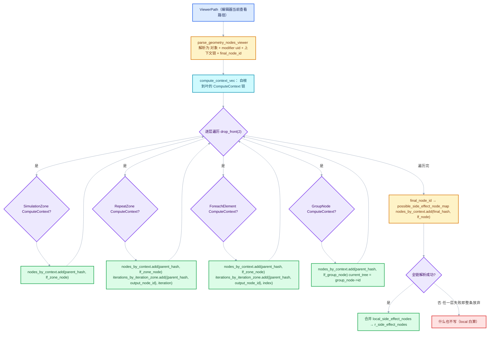
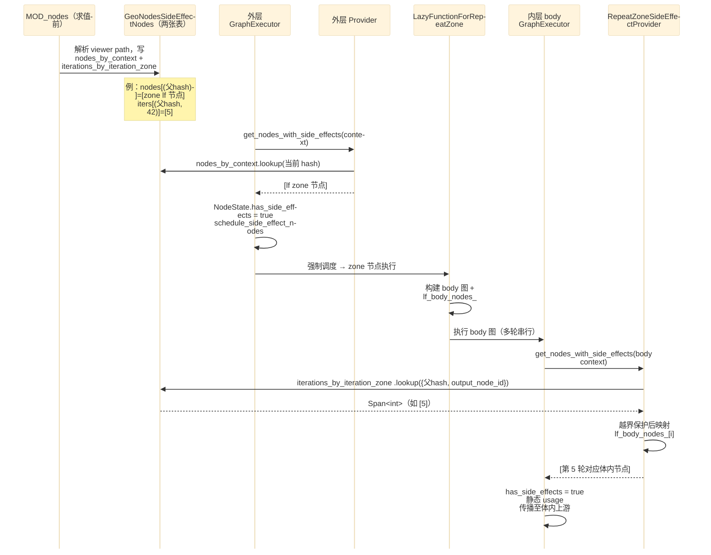
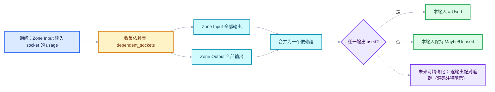

# RN-03 副作用迭代与按需执行

<div style="font-family:'Segoe UI','Microsoft YaHei',system-ui,-apple-system,sans-serif;display:flex;flex-wrap:wrap;align-items:center;gap:8px;margin:16px 0 20px;padding:10px 14px;background:#F8FAFC;border:1px solid #E2E8F0;border-radius:12px">
<span style="font-size:11px;font-weight:700;letter-spacing:.1em;color:#64748B;margin-right:2px">导航</span>
<a href="../README.md" style="font-size:13px;color:#334155;background:#F1F5F9;border:1px solid #E2E8F0;border-radius:999px;padding:3px 12px;text-decoration:none;white-space:nowrap">总入口</a>
<a href="./README.md" style="font-size:13px;color:#2563EB;background:#EFF6FF;border:1px solid #BFDBFE;border-radius:999px;padding:3px 12px;text-decoration:none;white-space:nowrap">本章 04-运行时机制</a>
<a href="./02-ComputeContext与迭代身份.md" style="font-size:13px;color:#2563EB;background:#EFF6FF;border:1px solid #BFDBFE;border-radius:999px;padding:3px 12px;text-decoration:none;white-space:nowrap">‹ 02-ComputeContext与迭代身份</a>
</div>

<div style="font-family:'Segoe UI','Microsoft YaHei',system-ui,-apple-system,sans-serif;margin:18px 0 22px;padding:14px 18px;background:#F5F3FF;border-left:4px solid #7C3AED;border-radius:10px">

系列定位：本篇是《重复区域（Repeat Zone）全面学习》系列 04 章第 3 篇。它回答：Viewer 挂第 5 轮时哪些轮必须执行、后续轮为何可跳过、两张副作用表各管什么。

</div>

<hr style="border:none;height:1px;background:linear-gradient(90deg,#BFDBFE,#E2E8F0 55%,transparent);margin:34px 0">

基准：Blender `5.4.0-alpha`，本地工作树。上一篇解决了"第几轮"的身份问题（`RepeatZoneComputeContext`），本篇回答它的直接后继问题：**Viewer 只关心第 5 轮，系统凭什么让前 5 轮全部执行？后面的轮次又凭什么可以不执行？** 答案由三块机制拼成：MOD_nodes 的 viewer path 解析（把迭代号写进两张副作用表）、执行期的 `SideEffectProvider`（把表里的迭代号翻译回 lf 节点）、以及 usage inference 对 repeat 节点的保守特判（决定循环体本身是否要跑）。

## 先回答一个具体问题

场景：Repeat 区域迭代 10 轮，循环体内有一个分支，你把 Viewer 挂在第 5 轮（iteration 5）的分支输出上。两个疑问：

1. **为什么前 4 轮（iteration 0..4）也要跑？** 我只看了第 5 轮啊。
2. **为什么第 6..9 轮（iteration 6..9）不跑？** 循环不是应该全跑完吗？

先给结论，再看源码：

**问题 1**：Repeat 区域的输出语义是"逐轮串联"。第 5 轮的输入是第 4 轮的状态输出（State 输出经过 Zone Input 的转发），第 4 轮的输入又来自第 3 轮……这是一条**串行依赖链**。要拿到第 5 轮的值，就必须先算出第 4 轮的输出；要算第 4 轮，就得先算第 3 轮。lazy execution 的 usage 请求从 Viewer 沿数据流回溯，一路把 iteration 0..4 全部标记为 `Used`——**不是"顺便跑了"，是数据依赖的必然**。所以"看第 5 轮"的代价从来不是一轮，而是五轮。

**问题 2**：第 6..9 轮的输出没有被任何人请求。Repeat 区域的最终输出（Zone Output 节点的输出 socket）只对应"最后一轮"（iteration 9）的结果——但注意，这里有个微妙点：**Viewer 不在最终输出上**，它挂在第 5 轮的中间分支上。对 geometry nodes 的**图输出**而言，只有最终轮的结果被下游消费；中间轮的输出只被下一轮消费，第 6 轮需要的"第 5 轮状态"早在第 5 轮执行时就已经算出来了。第 6..9 轮没有任何 `Used` 需求指向它们——直到最终轮（iteration 9）的输出被 Zone Output 转发到图外。若图输出本身未被使用（比如该 Repeat 区域的结果没有连到 Group Output），那么 6..9 轮在整个求值过程中根本不会被调度。

等等——上面第 2 点其实还有一层：**如果第 9 轮的输出被请求了呢？** 那第 6..9 轮也会跑（同样的串行链）。所以准确的说法是：

- 迭代是串行链：请求第 k 轮 ⇒ 必然执行 0..k 轮。
- 后续轮是否执行，取决于**是否有需求传播到它们的输出**——通常是 Zone Output 对"最后一轮"的转发，或嵌套在体内的另一个 Viewer/副作用。
- 本篇的主角 `iterations_by_iteration_zone` 表解决的是另一件事： **把"某个具体迭代号有副作用"这个信息，在执行前就告诉执行器**，让没有数据需求的那一轮也能被强制调度。第 5 轮之所以会跑，一半靠数据依赖（如果有人消费它的下游），一半靠这张表（就算没人消费，Viewer 本身也必须执行）。

把这个三元结构记住：**数据需求（usage 传播）· 副作用需求（side effect 表）· 串行依赖（轮与轮之间的链）**。三者共同决定"哪些轮真的执行"。

## 副作用的需求模型

### 普通需求传播 vs 副作用强制执行

lazy function 执行器的默认逻辑是**按需计算**：一个节点的输出没有被任何人声明 `ValueUsage::Used`，它就不该被执行。这在纯函数世界里天经地义——不消费就不计算，是惰性求值的全部意义。

但节点编辑器里存在**带副作用的节点**：Viewer（往编辑器里写值）、Bake（往磁盘写数据）、Simulation Output（更新缓存状态）。它们的输出完全可以没人消费，但它们**必须执行**。执行器无法从图结构里推断出这一点，所以设计了一个显式的注入点：

```cpp
// source/blender/functions/FN_lazy_function_graph_executor.hh · L62—L71（节选）
/**
 * Has to be implemented when some of the nodes in the graph may have side effects. The
 * #GraphExecutor has to know about that to make sure that these nodes will be executed even though
 * their outputs are not needed.
 */
class GraphExecutorSideEffectProvider {
 public:
  virtual ~GraphExecutorSideEffectProvider() = default;
  virtual Vector<const FunctionNode *> get_nodes_with_side_effects(const Context &context) const;
};
```

`[讲解]`
- 注释说得很直白：只要图里有节点可能有副作用，就必须实现这个 provider。关键词是 **may have**——同一个 Viewer 节点，在这次求值里有副作用，在下次求值里可能没有（取决于用户当前在编辑器里查看的是哪条 viewer path）。所以"哪些节点有副作用"不能在构建 lf 图时定死，必须在**每次执行开始时、按当时的 context** 询问 provider。
- `get_nodes_with_side_effects` 接收当前执行的 `Context`（里面有 `user_data`，几何节点求值时是 `GeoNodesUserData`，携带当前 `compute_context`），返回**本次求值中、本层图内**应当强制执行的 lf 节点列表。
- 返回类型是 `Vector<const FunctionNode *>`——具体节点，不是布尔标记。执行器拿到列表后会逐个把对应 `NodeState` 的 `has_side_effects` 置真并调度它们（下面 §provider 的执行期角色 有原文）。

<details> <summary>核对原始源码：FN_lazy_function_graph_executor.hh · L62—L71</summary>

```cpp
/**
 * Has to be implemented when some of the nodes in the graph may have side effects. The
 * #GraphExecutor has to know about that to make sure that these nodes will be executed even though
 * their outputs are not needed.
 */
class GraphExecutorSideEffectProvider {
 public:
  virtual ~GraphExecutorSideEffectProvider() = default;
  virtual Vector<const FunctionNode *> get_nodes_with_side_effects(const Context &context) const;
};
```

</details>

### 两张表各管什么

`GeoNodesSideEffectNodes` 是副作用信息的**全局容器**（一次 modifier 求值一份），由 MOD_nodes 在求值前填好、随 `call_data` 一路传下去：

```cpp
// source/blender/nodes/NOD_geometry_nodes_lazy_function.hh · L149—L156
struct GeoNodesSideEffectNodes {
  MultiValueMap<ComputeContextHash, const lf::FunctionNode *> nodes_by_context;
  /**
   * The repeat/foreach zone is identified by the compute context of the parent and the identifier
   * of the repeat output node.
   */
  MultiValueMap<std::pair<ComputeContextHash, int32_t>, int> iterations_by_iteration_zone;
};
```

`[讲解]` 这是本篇最核心的数据结构，两张表分工明确：

| 表 | 键 | 值 | 管什么 |
|---|---|---|---|
| `nodes_by_context` | `ComputeContextHash`（当前上下文哈希） | lf 节点指针 | "**在这个上下文里**，这个节点有副作用"——典型的例子是 group node、simulation output：它们在父上下文中作为整体节点被强制执行 |
| `iterations_by_iteration_zone` | `{父上下文哈希, repeat output 节点 identifier}` | **int 迭代号** | "**在这个 zone 的这一轮**，体内有副作用"——Repeat/Foreach 专用 |

为什么 Repeat 需要第二张表？因为循环体在 lf 图里**只有一个 body 函数节点** （RN-01 讲过 `lf_body_nodes` 是 body 内部节点列表，body 函数被复用 N 次）。"第 5 轮的 Viewer 有副作用"无法表达成 `nodes_by_context` 里的一条——body 节点指针是同一个，写进去就等于声明**所有轮**都有副作用，第 6..9 轮会被白白强制执行。所以这里存的不是节点指针，而是 **迭代号**（int），由 zone 自己在执行期把迭代号翻译回"本轮的 body 执行"。

注意键的构成：`{context_hash, output_node_id}` 中
- `context_hash` 是 **Repeat zone 的父上下文**哈希——因为 zone 内部每一轮的哈希都不同，若用某一轮的哈希做键，其他轮就查不到了；
- `output_node_id` 是 repeat output **bNode 的 identifier**（不是 lf 节点指针）——同一个 bNodeTree 可能被嵌套在多个上下文里求值，哈希 + identifier 才能唯一定位"哪一个 zone 实例"。

`MultiValueMap` 说明两类表的值都是**多值**：一个上下文里可以有多个副作用节点；一个 zone 里可以有多轮迭代带副作用（比如你同时看了第 1 轮和第 3 轮）。

<details> <summary>核对原始源码：NOD_geometry_nodes_lazy_function.hh · L149—L156</summary>

```cpp
struct GeoNodesSideEffectNodes {
  MultiValueMap<ComputeContextHash, const lf::FunctionNode *> nodes_by_context;
  /**
   * The repeat/foreach zone is identified by the compute context of the parent and the identifier
   * of the repeat output node.
   */
  MultiValueMap<std::pair<ComputeContextHash, int32_t>, int> iterations_by_iteration_zone;
};
```

</details>

### ValueUsage 的三值语义

usage 传播的"货币"是 `ValueUsage`，三个值贯穿整个 lazy 执行体系：

```cpp
// source/blender/functions/FN_lazy_function.hh · L61—L76
enum class ValueUsage : uint8_t {
  /**
   * The value is definitely used and therefore has to be computed.
   */
  Used,
  /**
   * It's unknown whether this value will be used or not. Computing it is ok but the result may be
   * discarded.
   */
  Maybe,
  /**
   * The value will definitely not be used. It can still be computed but the result will be
   * discarded in all cases.
   */
  Unused,
};
```

`[讲解]` 三值不是布尔，因为惰性求值的需求是**单向传播、逐步收紧**的：

- `Maybe` 是多数 socket 的初始状态："没人声明要用，但以后可能用"。执行器允许在 `Maybe` 状态下计算（结果可能被丢弃），这换取了更早的并行调度。
- `Used` 是最强需求：有人（通常是图输出、或带 `Used` 接口输入的函数）明确要这个值，必须算出来。
- `Unused` 是最强放弃：可以放心不调度。 FN_lazy_function.hh L162 的注释值得记住："Only an input that was not #ValueUsage::Used can become unused"——一旦声明 `Used` 就不能反悔。

副作用节点是这个体系里的"例外公民"：它的**输出可以全程 `Maybe` 甚至 `Unused`**，但 `has_side_effects = true` 的节点仍会被执行器调度。"第 6..9 轮不跑"是因为它们的需求既不是 `Used`（没人消费），也没有出现在副作用表里（Viewer 只在第 5 轮）；"第 5 轮跑"则因为它出现在了表里。

<details> <summary>核对原始源码：FN_lazy_function.hh · L61—L76</summary>

```cpp
enum class ValueUsage : uint8_t {
  /**
   * The value is definitely used and therefore has to be computed.
   */
  Used,
  /**
   * It's unknown whether this value will be used or not. Computing it is ok but the result may be
   * discarded.
   */
  Maybe,
  /**
   * The value will definitely not be used. It can still be computed but the result will be
   * discarded in all cases.
   */
  Unused,
};
```

</details>

### 副作用表是怎么填出来的（全流程）

把三段代码串成一条时间线：求值前 MOD_nodes 填表 → 求值开始执行器问 provider → provider 查表返回节点。先看填表流程图：



两个容易忽略的细节：

1. **all-or-nothing**：解析用 `local_side_effect_nodes` 暂存，只有整条链全部成功才合并进 `r_side_effect_nodes`（L462-L464 的注释解释了原因：直接往 r_ 里写，出错后还得撤销，不如最后一次性搬）。任何一层查不到 zone / lf 节点 / 节点被 mute，整条 viewer path 作废——**不会出现 "半个副作用链"**。
2. **Drop_front(2)**：上下文链的前两级（根 + modifier 级）不参与循环，从第三级开始才是树内结构（group / zone）。L450-L457 单独校验第二级必须是 `GeometryNodesModifierComputeContext` 且 uid 匹配当前 modifier。

## viewer path 解析

现在精读 MOD_nodes 的 `try_add_side_effect_node`。函数头注释先立了规矩：

```cpp
// source/blender/modifiers/intern/MOD_nodes.cc · L429—L448（节选）
/**
 * Setup side effects nodes so that the given node in the given compute context will be executed.
 * To make sure that it is executed, all parent group nodes and zones have to be set to have side
 * effects as well.
 */
static void try_add_side_effect_node(const ModifierEvalContext &ctx,
                                     const ComputeContext &final_compute_context,
                                     const int final_node_id,
                                     const NodesModifierData &nmd,
                                     nodes::GeoNodesSideEffectNodes &r_side_effect_nodes)
{
  if (nmd.node_group == nullptr || ID_MISSING(nmd.node_group)) {
    return;
  }

  Vector<const ComputeContext *> compute_context_vec;
  for (const ComputeContext *c = &final_compute_context; c; c = c->parent()) {
    compute_context_vec.append(c);
  }
  std::reverse(compute_context_vec.begin(), compute_context_vec.end());
```

`[讲解]` 头注释定义了本函数的**不变量**：要让最内层的 final_node 执行，**沿途所有父 group 节点和 zone 节点都必须标记副作用**。原因是结构性的：最内层节点存在于 body 函数内部，而 body 函数只有在外层 zone 节点被执行时才会运行；zone 节点又只在它的父 group 执行时运行。所以副作用是**链式登记**的——外层不执行，内层标记得再对也没用。

上下文链的构造是"沿 `parent()` 指针爬到根再反转"，得到自外向内的遍历顺序，与树结构嵌套顺序一致。

<details> <summary>核对原始源码：MOD_nodes.cc · L429—L448</summary>

```cpp
/**
 * Setup side effects nodes so that the given node in the given compute context will be executed.
 * To make sure that it is executed, all parent group nodes and zones have to be set to have side
 * effects as well.
 */
static void try_add_side_effect_node(const ModifierEvalContext &ctx,
                                     const ComputeContext &final_compute_context,
                                     const int final_node_id,
                                     const NodesModifierData &nmd,
                                     nodes::GeoNodesSideEffectNodes &r_side_effect_nodes)
{
  if (nmd.node_group == nullptr || ID_MISSING(nmd.node_group)) {
    return;
  }

  Vector<const ComputeContext *> compute_context_vec;
  for (const ComputeContext *c = &final_compute_context; c; c = c->parent()) {
    compute_context_vec.append(c);
  }
  std::reverse(compute_context_vec.begin(), compute_context_vec.end());
```

</details>

### Repeat 分支：三条检查 + 两条登记

这是本篇的核心代码段，L509—L530：

```cpp
// source/blender/modifiers/intern/MOD_nodes.cc · L509—L530
else if (const auto *compute_context = dynamic_cast<const bke::RepeatZoneComputeContext *>(
             compute_context_generic))
{
  const bke::bNodeTreeZone *repeat_zone = current_zones->get_zone_by_node(
      compute_context->output_node_id());
  if (repeat_zone == nullptr) {
    return;
  }
  if (repeat_zone->parent_zone != current_zone) {
    return;
  }
  const lf::FunctionNode *lf_zone_node = lf_graph_info->mapping.zone_node_map.lookup_default(
      *repeat_zone->output_node_id, nullptr);
  if (lf_zone_node == nullptr) {
    return;
  }
  local_side_effect_nodes.nodes_by_context.add(parent_compute_context_hash, lf_zone_node);
  local_side_effect_nodes.iterations_by_iteration_zone.add(
      {parent_compute_context_hash, compute_context->output_node_id()},
      compute_context->iteration());
  current_zone = repeat_zone;
}
```

`[讲解]` 逐段拆：

1. **dynamic_cast 分发**：上下文链每一层都是 `ComputeContext` 派生类，用 RTTI 判断这层是 group、simulation zone、repeat zone、foreach zone 还是 closure 求值，各走各的分支。本篇只看 Repeat 分支，但注意 Foreach 分支（L549-L551）的结构几乎逐行相同，只是 `iteration()` 换成 `index()`。
2. **检查一（zone 存在）**：`get_zone_by_node(output_node_id)` 用上下文里记录的 output 节点 id 反查 `bNodeTreeZone`。查不到说明上下文过期了（用户改了树、节点被删），立即放弃整条链。
3. **检查二（parent_zone 匹配）**：`repeat_zone->parent_zone != current_zone` ——上下文链的嵌套顺序必须和树的 zone 嵌套**逐层吻合**。这防的是 "上下文说它在 zone A 里，但按当前树结构这个节点其实在 zone B 里"的过期/伪造路径。
4. **检查三（lf 节点存在）**：`zone_node_map` 把 bNode identifier 映射到 lf 图里的 zone 包装节点。映射不到（比如该 zone 的 lf 构建失败）同样放弃。
5. **登记一（zone 节点本身）**：`nodes_by_context.add(parent_hash, lf_zone_node)`——让**父上下文**里的 zone 节点被强制执行。没有这条，整个循环体都不会跑，更别说某一轮了。注意键是 **parent** 哈希：zone 节点是父图里的一个节点，归父上下文管辖。
6. **登记二（迭代号）**：`iterations_by_iteration_zone.add({parent_hash, output_node_id}, iteration)`——键值对在这里出现，与 NOD 头文件里的注释完全对应："zone 由父上下文 + repeat output 节点 identifier 标识"。这一条只声明"这一轮体内有副作用"，具体是体内哪个节点，要到执行期由 zone 自己的 provider 决定。
7. **推进 current_zone**：进入下一层解析时，本 zone 成为新的"当前所在 zone"，供嵌套层的 `parent_zone` 检查使用。

<details> <summary>核对原始源码：MOD_nodes.cc · L509—L530</summary>

```cpp
    else if (const auto *compute_context = dynamic_cast<const bke::RepeatZoneComputeContext *>(
                 compute_context_generic))
    {
      const bke::bNodeTreeZone *repeat_zone = current_zones->get_zone_by_node(
          compute_context->output_node_id());
      if (repeat_zone == nullptr) {
        return;
      }
      if (repeat_zone->parent_zone != current_zone) {
        return;
      }
      const lf::FunctionNode *lf_zone_node = lf_graph_info->mapping.zone_node_map.lookup_default(
          *repeat_zone->output_node_id, nullptr);
      if (lf_zone_node == nullptr) {
        return;
      }
      local_side_effect_nodes.nodes_by_context.add(parent_compute_context_hash, lf_zone_node);
      local_side_effect_nodes.iterations_by_iteration_zone.add(
          {parent_compute_context_hash, compute_context->output_node_id()},
          compute_context->iteration());
      current_zone = repeat_zone;
    }
```

</details>

### 最终合并

```cpp
// source/blender/modifiers/intern/MOD_nodes.cc · L649—L655
/* Successfully found all side effect nodes for the viewer path. */
for (const auto item : local_side_effect_nodes.nodes_by_context.items()) {
  r_side_effect_nodes.nodes_by_context.add_multiple(item.key, item.value);
}
for (const auto item : local_side_effect_nodes.iterations_by_iteration_zone.items()) {
  r_side_effect_nodes.iterations_by_iteration_zone.add_multiple(item.key, item.value);
}
```

`[讲解]` 注释里的 "Successfully" 呼应 all-or-nothing：能走到这里说明链条每一层都通过了检查。`add_multiple` 而非 `add`，因为同一个键下可能已有多条（例如**两条** viewer path 都经过同一个 zone，但挂了不同轮的 Viewer——两张表都允许共存多值）。正是这个多值合并，让"第 1 轮和第 3 轮各有 Viewer"的场景能同时登记两个迭代号。

<details> <summary>核对原始源码：MOD_nodes.cc · L649—L655</summary>

```cpp
  /* Successfully found all side effect nodes for the viewer path. */
  for (const auto item : local_side_effect_nodes.nodes_by_context.items()) {
    r_side_effect_nodes.nodes_by_context.add_multiple(item.key, item.value);
  }
  for (const auto item : local_side_effect_nodes.iterations_by_iteration_zone.items()) {
    r_side_effect_nodes.iterations_by_iteration_zone.add_multiple(item.key, item.value);
  }
}
```

</details>

## provider 的执行期角色

表填好了，轮到执行期。有两个 provider 类，分属两层图，职责不同却同名同接口——先分清它们：

| Provider | 所在文件 | 服务的图 | 查什么 |
|---|---|---|---|
| `GeometryNodesLazyFunctionSideEffectProvider` | geometry_nodes_lazy_function.cc L1941 | **外层**几何节点整树 lf 图 | `nodes_by_context` |
| `RepeatZoneSideEffectProvider` | geometry_nodes_repeat_zone.cc L70 | **内层**单次迭代 body 图 | `iterations_by_iteration_zone` |

### 执行器何时询问 provider

先看通用执行器的调用时机（GenericGraphExecutor，头文件内联实现）：

```cpp
// source/blender/functions/intern/lazy_function_graph_executor_generic.hh · L414—L428（节选）
      /* Retrieve and tag side effect nodes. */
      Vector<const FunctionNode *> side_effect_nodes;
      if (self_.side_effect_provider_ != nullptr) {
        side_effect_nodes = self_.side_effect_provider_->get_nodes_with_side_effects(context);
        for (const FunctionNode *node : side_effect_nodes) {
          BLI_assert(self_.graph_.nodes().contains(node));
          const int node_index = node->index_in_graph();
          NodeState &node_state = *node_states_[node_index];
          node_state.has_side_effects = true;
        }
      }

      this->initialize_static_value_usages(side_effect_nodes);
      this->schedule_side_effect_nodes(side_effect_nodes, current_task, local_data);
```

`[讲解]` 三个关键时序事实：

1. **只在 `is_first_execution_` 时问一次**。这段代码在首次执行的初始化块里——同一次 `execute` 调用内 provider 只被询问一次，返回的节点列表在整个求值期间固定。副作用是"本次求值的属性"，不是逐节点动态决定的。
2. **问完立刻做三件事**：断言节点确实属于本图（`BLI_assert`，防 provider 返回别的图/别的层的节点——这是两层 provider 必须分开实现的类型安全原因之一）；把对应 `NodeState.has_side_effects` 置真；随后 `schedule_side_effect_nodes` 直接调度它们，**不等 usage 传播**。
3. **`initialize_static_value_usages(side_effect_nodes)`**：副作用节点收到静态 usage 种子，它们的关键输出被当作"有人要"处理，从而把需求沿数据流继续向上游传播（Viewer 的输入因此被计算——否则 Viewer 本身调度了也拿不到值）。

所以"副作用根的需求传播"是这么运作的：provider 给出**强制执行的种子节点** → 执行器调度它们 → 它们的输入因静态 usage 而产生 `Used` 需求 → 需求沿图回溯，把上游节点（包括串行链上的前几轮）也带进执行。副作用从不孤立执行，它总是附带一条向上的需求传播。

<details> <summary>核对原始源码：lazy_function_graph_executor_generic.hh · L414—L428</summary>

```cpp
      /* Retrieve and tag side effect nodes. */
      Vector<const FunctionNode *> side_effect_nodes;
      if (self_.side_effect_provider_ != nullptr) {
        side_effect_nodes = self_.side_effect_provider_->get_nodes_with_side_effects(context);
        for (const FunctionNode *node : side_effect_nodes) {
          BLI_assert(self_.graph_.nodes().contains(node));
          const int node_index = node->index_in_graph();
          NodeState &node_state = *node_states_[node_index];
          node_state.has_side_effects = true;
        }
      }

      this->initialize_static_value_usages(side_effect_nodes);
      this->schedule_side_effect_nodes(side_effect_nodes, current_task, local_data);
```

</details>

### 外层 provider：查 nodes_by_context

```cpp
// source/blender/nodes/intern/geometry_nodes_lazy_function.cc · L1941—L1966（节选）
class GeometryNodesLazyFunctionSideEffectProvider : public lf::GraphExecutor::SideEffectProvider {
 private:
  Span<const lf::FunctionNode *> local_side_effect_nodes_;

 public:
  GeometryNodesLazyFunctionSideEffectProvider(
      Span<const lf::FunctionNode *> local_side_effect_nodes = {})
      : local_side_effect_nodes_(local_side_effect_nodes)
  {
  }

  Vector<const lf::FunctionNode *> get_nodes_with_side_effects(
      const lf::Context &context) const override
  {
    GeoNodesUserData *user_data = dynamic_cast<GeoNodesUserData *>(context.user_data);
    BLI_assert(user_data != nullptr);
    const GeoNodesCallData &call_data = *user_data->call_data;
    if (!call_data.side_effect_nodes) {
      return {};
    }
    const ComputeContextHash &context_hash = user_data->compute_context->hash();
    Vector<const lf::FunctionNode *> side_effect_nodes =
        call_data.side_effect_nodes->nodes_by_context.lookup(context_hash);
    side_effect_nodes.extend(local_side_effect_nodes_);
    return side_effect_nodes;
  }
};
```

`[讲解]`
- 类注释（L1936-L1940）值得整段读：同一个 viewer 节点在一个 context 有副作用、在另一个没有，取决于编辑器当前查看的树路径。所以"查表"必须以**当前执行的 context hash** 为键——`user_data->compute_context->hash()`。
- 成员 `local_side_effect_nodes_` 是构建期就确定的"本地副作用节点"，查表结果再 extend 上它。L2248、L2259、L2271 显示 Repeat/Foreach/ Closure 的 body 执行器各自持有一个这样的本地 provider 实例——**body 图的 provider 是每 zone 一份的**，这就是双层结构的体现。
- 外层 provider **只查 `nodes_by_context`**。它对迭代号一无所知——迭代号是 zone 内部的细节，外层只需要知道"zone 节点要执行"。

<details> <summary>核对原始源码：geometry_nodes_lazy_function.cc · L1941—L1966</summary>

```cpp
class GeometryNodesLazyFunctionSideEffectProvider : public lf::GraphExecutor::SideEffectProvider {
 private:
  Span<const lf::FunctionNode *> local_side_effect_nodes_;

 public:
  GeometryNodesLazyFunctionSideEffectProvider(
      Span<const lf::FunctionNode *> local_side_effect_nodes = {})
      : local_side_effect_nodes_(local_side_effect_nodes)
  {
  }

  Vector<const lf::FunctionNode *> get_nodes_with_side_effects(
      const lf::Context &context) const override
  {
    GeoNodesUserData *user_data = dynamic_cast<GeoNodesUserData *>(context.user_data);
    BLI_assert(user_data != nullptr);
    const GeoNodesCallData &call_data = *user_data->call_data;
    if (!call_data.side_effect_nodes) {
      return {};
    }
    const ComputeContextHash &context_hash = user_data->compute_context->hash();
    Vector<const lf::FunctionNode *> side_effect_nodes =
        call_data.side_effect_nodes->nodes_by_context.lookup(context_hash);
    side_effect_nodes.extend(local_side_effect_nodes_);
    return side_effect_nodes;
  }
};
```

</details>

### 内层 provider：迭代号 → lf 节点

回到本篇开头的那段代码，现在可以逐行讲透：

```cpp
// source/blender/nodes/intern/geometry_nodes_repeat_zone.cc · L67—L96
/**
 * Knows which iterations of the loop evaluation have side effects.
 */
class RepeatZoneSideEffectProvider : public lf::GraphExecutorSideEffectProvider {
 public:
  const bNode *repeat_output_bnode_ = nullptr;
  Span<lf::FunctionNode *> lf_body_nodes_;

  Vector<const lf::FunctionNode *> get_nodes_with_side_effects(
      const lf::Context &context) const override
  {
    GeoNodesUserData &user_data = *static_cast<GeoNodesUserData *>(context.user_data);
    const GeoNodesCallData &call_data = *user_data.call_data;
    if (!call_data.side_effect_nodes) {
      return {};
    }
    const ComputeContextHash &context_hash = user_data.compute_context->hash();
    const Span<int> iterations_with_side_effects =
        call_data.side_effect_nodes->iterations_by_iteration_zone.lookup(
            {context_hash, repeat_output_bnode_->identifier});

    Vector<const lf::FunctionNode *> lf_nodes;
    for (const int i : iterations_with_side_effects) {
      if (i >= 0 && i < lf_body_nodes_.size()) {
        lf_nodes.append(lf_body_nodes_[i]);
      }
    }
    return lf_nodes;
  }
};
```

`[讲解]` 这是"迭代号翻译器"，五个要点：

1. **两个成员就是翻译材料**：`repeat_output_bnode_` 提供 identifier（组键的后半），`lf_body_nodes_` 提供迭代号 → lf 节点的下标映射（RN-01 讲过它按 body 内出现顺序收集体内节点）。
2. **键的哈希是 `user_data.compute_context->hash()`**——注意这里没有 "parent" 字样，但语义上它就是 MOD_nodes 写表时的 `parent_hash`。为什么？因为这个 provider 只在**进入 zone 之前**被外层图询问……不对，更准确地说：它服务的 body 图执行器是在 **zone 节点执行期间** 构建的，此时 `compute_context` 仍是 zone 的**父上下文**——body 内部每一轮的 Repeat 上下文是 `RepeatBodyNodeExecuteWrapper` 在执行体内节点时才注入的（RN-02 的内容），provider 查询发生在那之前。两边用同一个"父哈希"对上了。
3. **lookup 返回 `Span<int>`**：MultiValueMap 的多值视图。第 1 轮和第 3 轮都有 Viewer 时，这里拿到 `{1, 3}`。
4. **越界保护**：`i >= 0 && i < lf_body_nodes_.size()`。防御的是**表和图不同步**——MOD_nodes 填表用的 lf_graph_info 与执行期重建的 body 图理论上来自同一棵树，但节点顺序在树被修改后可能变化；此外迭代号来自编辑器的 viewer path，而编辑器状态与求值状态天然存在竞态窗口。越界的迭代号被**静默丢弃**而不是断言崩溃——副作用表是"尽力而为"的优化信息，坏了顶多少看一个 Viewer 的值，不能让 modifier 求值崩掉。
5. **返回的是 `lf_body_nodes_[i]`——body 的包装节点**，不是 Viewer 在外层图中的节点。也就是说，body 图执行器收到"第 i 个体内节点有副作用"后，调度的是 body 图内部的那个节点；它再通过静态 usage 把需求传给体内上游节点。两层 provider 各自服务各自那层图，从不越层返回节点——这正是通用执行器里那条 `BLI_assert(graph_.nodes().contains (node))` 要守住的不变量。

<details> <summary>核对原始源码：geometry_nodes_repeat_zone.cc · L67—L96</summary>

```cpp
/**
 * Knows which iterations of the loop evaluation have side effects.
 */
class RepeatZoneSideEffectProvider : public lf::GraphExecutorSideEffectProvider {
 public:
  const bNode *repeat_output_bnode_ = nullptr;
  Span<lf::FunctionNode *> lf_body_nodes_;

  Vector<const lf::FunctionNode *> get_nodes_with_side_effects(
      const lf::Context &context) const override
  {
    GeoNodesUserData &user_data = *static_cast<GeoNodesUserData *>(context.user_data);
    const GeoNodesCallData &call_data = *user_data.call_data;
    if (!call_data.side_effect_nodes) {
      return {};
    }
    const ComputeContextHash &context_hash = user_data.compute_context->hash();
    const Span<int> iterations_with_side_effects =
        call_data.side_effect_nodes->iterations_by_iteration_zone.lookup(
            {context_hash, repeat_output_bnode_->identifier});

    Vector<const lf::FunctionNode *> lf_nodes;
    for (const int i : iterations_with_side_effects) {
      if (i >= 0 && i < lf_body_nodes_.size()) {
        lf_nodes.append(lf_body_nodes_[i]);
      }
    }
    return lf_nodes;
  }
};
```

</details>

### 执行期 provider 查询全景



时间顺序上注意：MOD_nodes 填表发生在**求值开始前**（准备阶段），外层 provider 查询发生在**外层图首次执行时**，内层 provider 查询发生在 **zone 节点执行、body 图构建完之后**。三张时间表依次推进，两张副作用表是它们之间唯一的通信媒介。

## usage inference 的 Repeat 特判

前面讲的都是"已经决定要执行的轮次如何被强制"。但还有一个更前置的问题： **循环体本身要不要跑、跑几轮，是谁决定的？** 这由 socket usage inference 在求值前的**静态推断阶段**完成。Repeat 输入节点在这里有一个刻意的保守特判：

```cpp
// source/blender/nodes/intern/socket_usage_inference.cc · L437—L455
void usage_task__input__repeat_input_node(const SocketInContext &socket)
{
  const NodeInContext node = socket.owner_node();
  const bNodeTree &tree = socket->owner_tree();

  const NodeGeometryRepeatInput &storage = *static_cast<const NodeGeometryRepeatInput *>(
      node->storage);
  const bNode *repeat_output_node = tree.node_by_id(storage.output_node_id);
  if (!repeat_output_node) {
    all_socket_usages_.add_new(socket, false);
    return;
  }
  /* Assume that all repeat inputs are used when any of the outputs are used. This check could
   * become more precise in the future if necessary. */
  Vector<const bNodeSocket *, 16> dependent_sockets;
  dependent_sockets.extend(node->output_sockets());
  dependent_sockets.extend(repeat_output_node->output_sockets());
  this->usage_task__with_dependent_sockets(socket, dependent_sockets, {}, socket.context);
}
```

`[讲解]` 逐段拆解这个"保守推断"：

1. **场景**：Zone Input（repeat input）节点的**输入 socket** 的 usage 被询问。它的输入来自循环体内部（上一轮产出的 State 值要喂回来的那侧）。
2. **依赖集**：把 Zone Input 自己的**全部输出** + 配对 Zone Output 的 **全部输出** 打包成 `dependent_sockets`。含义是：这个输入 socket 的使用状态"寄生"在这组输出上。
3. **保守规则**（注释原话）：* Assume that all repeat inputs are used when any of the outputs are used*——**只要任何一个输出被使用，就假设全部输入都被使用**。不存在"第 2 个 State 输入其实没人要"的细分。
4. **为什么保守**：Zone Input 的第 k 个输入对应 Zone Output 的第 k 个输出，理论上一一对应。但精确推断需要证明"循环体内确实没有任何路径消费第 k 个输入"——这是一个跨轮、跨分支的数据流分析，成本高且容易在边角（muted 节点、开关分支、嵌套 zone）出错。注释里的 *This check could become more precise in the future* 明确承认这是有意为之的近似。
5. **代价**：如果循环体里只有一个 Zone Input 输出被下游用，其余 State 通道的输入也会被标记为 used。后果不是错误而是**多算了值**——上游为它们多传播了 `Used` 需求。实践中 State 通道通常全部被体内消费，所以这个近似很少真正浪费。
6. **`usage_task__with_dependent_sockets` 的机制**：它把当前 socket 的 usage 与依赖集绑定——任一依赖 socket 的 usage 确定为 used，当前 socket 跟着变 used；依赖集也参与反向传播。同名函数在 simulation input（L430 附近，注释同款 "Simulation inputs are also used when any of the simulation outputs are used"）上以完全相同的模式使用——zone 类节点的输入 usage 推断共享这一保守范式。

<details> <summary>核对原始源码：socket_usage_inference.cc · L437—L455</summary>

```cpp
  void usage_task__input__repeat_input_node(const SocketInContext &socket)
  {
    const NodeInContext node = socket.owner_node();
    const bNodeTree &tree = socket->owner_tree();

    const NodeGeometryRepeatInput &storage = *static_cast<const NodeGeometryRepeatInput *>(
        node->storage);
    const bNode *repeat_output_node = tree.node_by_id(storage.output_node_id);
    if (!repeat_output_node) {
      all_socket_usages_.add_new(socket, false);
      return;
    }
    /* Assume that all repeat inputs are used when any of the outputs are used. This check could
     * become more precise in the future if necessary. */
    Vector<const bNodeSocket *, 16> dependent_sockets;
    dependent_sockets.extend(node->output_sockets());
    dependent_sockets.extend(repeat_output_node->output_sockets());
    this->usage_task__with_dependent_sockets(socket, dependent_sockets, {}, socket.context);
  }
```

</details>

### usage 推断依赖集



把推断阶段和执行阶段合起来看：usage inference 决定"哪些 socket 的值要算"（含 zone 保守特判），副作用表决定"哪些节点不管 usage 都要跑"，执行器的串行链让"要算第 k 轮"自动级联为"要算 0..k 轮"。三层机制各管一段，互不越权。

## 用小数据走一遍

设计一个最小实验：

- Repeat 区域迭代 **5 轮**（iteration 0..4，输出节点 identifier 记为 42）。
- 体内有一个 Switch 分支，**Viewer A 挂在 iteration 1 的分支输出**， **Viewer B 挂在 iteration 3 的分支输出**。
- Repeat 区域的最终输出连接到 Group Output（即整条链的结果被消费）。

**第一步：求值前，MOD_nodes 解析两条 viewer path。**

Viewer A 的上下文链：`… → RepeatZoneComputeContext(42, iter=1)`，Viewer B 的是 `… → RepeatZoneComputeContext(42, iter=3)`。两次调用 `try_add_side_effect_node`，各自 all-or-nothing 地产生 local 表，再 `add_multiple` 合并。得到的副作用状态：

| 表 | 键 | 值 | 来源 |
|---|---|---|---|
| `nodes_by_context` | 树根上下文 hash | repeat zone 的 lf 节点 | A、B 各登记一次（多值共存） |
| `iterations_by_iteration_zone` | `{父 hash, 42}` | `1` | Viewer A |
| `iterations_by_iteration_zone` | `{父 hash, 42}` | `3` | Viewer B |

注意 `{父 hash, 42}` 是**同一个键**，值是多值 `[1, 3]`——这正是 MultiValueMap 存在的理由。

**第二步：外层图首次执行。**

执行器询问外层 provider，拿到 repeat zone 的 lf 节点（因为 Group Output 消费最终输出，zone 节点本来也会因 `Used` 被执行；副作用标记只是双保险）。zone 节点开始执行，构建 body 图与 `lf_body_nodes_`。

**第三步：body 图首次执行，内层 provider 介入。**

body 图执行器询问 `RepeatZoneSideEffectProvider`。此刻的 `compute_context` 仍是 zone 的父上下文，键匹配成功，拿到 `Span<int>{1, 3}`；两个迭代号都在 `lf_body_nodes_.size()` 内，映射为两个体内节点，它们的 `has_side_effects` 置真并被调度。

**第四步：推演每一轮的执行。**

| 迭代号 | 是否执行 | 为什么 |
|---|---|---|
| 0 | **是** | 串行链头：第 1 轮的 State 输入需要它；且 Viewer A 在第 1 轮，其输入需求回溯到第 0 轮 |
| 1 | **是** | 双重理由：Viewer A 的副作用强制 + 第 2 轮的数据依赖 |
| 2 | **是** | 纯数据依赖：Viewer B（第 3 轮）的 State 输入链经过它 |
| 3 | **是** | 双重理由：Viewer B 的副作用强制 + 第 4 轮的数据依赖 |
| 4 | **是** | 最后一轮：Zone Output 把它的结果转发给 Group Output，`Used` 需求直达 |

**第五步：做两个思想实验，验证机制边界。**

实验一：把 Group Output 的连线删掉（最终输出没人要）。此时第 4 轮失去 `Used` 需求——但 Viewer B 在第 3 轮，副作用表仍然要求第 3 轮执行，串行链级联到 0..3。**第 4 轮不执行**：既没有数据需求，也没有副作用登记。整个循环"跑 4 轮停住"，这正是惰性执行在 Repeat 上的正确表现。

实验二：把 Viewer B 从第 3 轮挪到第 6 轮（循环仍是 5 轮，迭代号 0..4）。viewer path 解析仍然成功（上下文链格式合法），表里登记了迭代号 6。内层 provider 查到 `Span<int>{1, 6}`，但 6 **越界**—— `i < lf_body_nodes_.size()` 失败，被静默丢弃。最终只有 Viewer A 生效。这个"看一个不存在的迭代号"的操作在 UI 层面通常会刷新失效，但机制层面的安全网就是那两行越界检查。

## 反例与边界

**反例一："输出未使用"不代表可以裁剪带副作用的体。** 有人会推理："第 3 轮的输出没连到任何地方，那这轮不用跑吧？"错。副作用的定义就是**绕过输出需求**的执行：Viewer 写日志、Bake 写缓存都不通过 zone 输出。只要 `iterations_by_iteration_zone` 里有这一轮，或者体内有 `has_side_effects` 的节点（如 Bake、Simulation Output），裁剪就是错的。判定一个循环体能否跳过，看的不是"输出是否被用"，而是"体内是否含副作用节点 + 输出是否被用"的**合取**——输出没用且无副作用，才可跳过。

**反例二：`iterations_by_iteration_zone` 的键是 hash 不是节点指针。** 很容易想当然地认为"第 5 轮的副作用记在 repeat output 节点名下"，于是用 `bNode*` 或 identifier 单独做键。源码明确是 `std::pair<ComputeContextHash, int32_t>`。原因：**同一棵子树会被多个上下文实例化**。同一个 Repeat zone 被嵌套在两个 group 实例里，或被两个 modifier 复用——节点 identifier 相同，但父上下文哈希不同，是 **两个独立的 zone 实例**，各自有自己的迭代号集合。用节点指针做键会把两者的副作用混在一起，导致 A 实例第 5 轮的 Viewer 让 B 实例第 5 轮也强制执行。

**反例三：内层 provider 返回的节点不能拿到外层用（反之亦然）。** `lf_body_nodes_` 里的指针属于 body 图，`zone_node_map` 里的指针属于外层图——两个图是**独立构建的对象**，指针空间不相交。通用执行器用 `BLI_assert(graph_.nodes().contains(node))` 防御这一点。跨层返回轻则断言失败，重则未定义行为。两层 provider 的存在本身就说明：副作用信息的"翻译"必须在拥有对应图的层完成。

**反例四：viewer path 解析是 all-or-nothing，不要指望部分生效。** 链条上任何一层的检查失败（zone 不存在、parent_zone 不匹配、lf 节点缺失、节点被 mute），**整条 path 的登记全部放弃**——包括已经成功解析的外层部分。这是 `local_side_effect_nodes` 暂存 + 最后合并的用意。反过来说，如果你调试时发现某个 Viewer 完全没生效，要检查的是**整条链**上最内层的失败点，而不是只看 zone 那一层。

**反例五：副作用表是求值前的快照，执行中不更新。** provider 只在图的**首次执行**时被询问一次；用户在求值过程中（多线程执行只有几毫秒，但 batch 处理/拖动滑块时是连续求值）改变 viewer path，本次求值不受影响。副作用是"本次求值的输入"而非"执行中的动态状态"。这也是为什么越界保护如此重要：表是快照，图是当下，两者允许短暂脱节。

**反例六：usage 的保守推断会造成"多算"而不是"漏算"，方向不能反。** `usage_task__input__repeat_input_node` 的规则是"任何输出 used ⇒ 全部输入 used"。把方向反过来（"任何输入 used ⇒ 全部输出 used"）就错了：那会让 Zone Output 无人消费的通道也强制计算体内上游。保守性的安全方向永远是**宁可多算、不可漏算**——多算浪费性能，漏算产生错误结果或丢失副作用。

**反例七：循环次数本身也是惰性的。** "Repeat 区域迭代 5 轮"不等于"5 轮都会执行"。实验一已经演示：最终输出不被消费时，最后一轮不执行。迭代次数是 zone 的**上限**，实际执行轮数由"最后一轮的输出是否被请求 + 各轮副作用登记"共同决定。靠 Grid Info 节点数"这个 modifier 执行了几轮"时，要意识到测到的是被需要的轮数，不一定是配置的轮数。

## 继续阅读

- 上一篇 [02-ComputeContext与迭代身份.md](02-ComputeContext与迭代身份.md)：本篇两张表的键（上下文哈希）与值（迭代号）从哪来。
- 下一篇 [90-实现依赖专题](../90-实现依赖专题/README.md)：汇总全部源码单元的教学版索引。
- 源码主线回顾：
  - [geometry_nodes_repeat_zone.cc · L67—L96](../../../source/blender/nodes/intern/geometry_nodes_repeat_zone.cc#L67) —— 内层 provider，迭代号翻译器。
  - [NOD_geometry_nodes_lazy_function.hh · L149—L156](../../../source/blender/nodes/NOD_geometry_nodes_lazy_function.hh#L149) —— 两张副作用表的定义。
  - [MOD_nodes.cc · L429—L656](../../../source/blender/modifiers/intern/MOD_nodes.cc#L429) —— viewer path 解析全流程。
  - [FN_lazy_function_graph_executor.hh · L62—L71](../../../source/blender/functions/FN_lazy_function_graph_executor.hh#L62) —— provider 契约。
  - [lazy_function_graph_executor_generic.hh · L414—L428](../../../source/blender/functions/intern/lazy_function_graph_executor_generic.hh#L414) —— 执行器询问与调度。
  - [geometry_nodes_lazy_function.cc · L1936—L1967](../../../source/blender/nodes/intern/geometry_nodes_lazy_function.cc#L1936) —— 外层 provider。
  - [socket_usage_inference.cc · L437—L455](../../../source/blender/nodes/intern/socket_usage_inference.cc#L437) —— repeat 输入的保守 usage 推断。
- 相关章节：01 章的 [Zone系统基础](../01-Zone系统基础/README.md) 解释 `bNodeTreeZone` 与 `parent_zone`——viewer path 检查二的基础；03 章 [几何节点执行架构](../03-几何节点执行架构/README.md) 覆盖 lf 图与 GraphExecutor 的总体结构。

