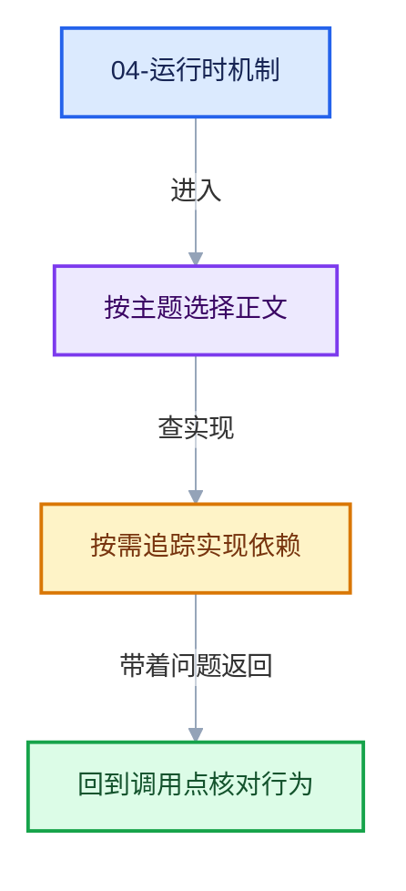

# 04-运行时机制

导航
<a href="../README.md" style="font-size:13px;color:#334155;background:#F1F5F9;border:1px solid #E2E8F0;border-radius:999px;padding:3px 12px;text-decoration:none;white-space:nowrap">总入口</a>
<a href="../03-几何节点执行架构/README.md" style="font-size:13px;color:#2563EB;background:#EFF6FF;border:1px solid #BFDBFE;border-radius:999px;padding:3px 12px;text-decoration:none;white-space:nowrap">‹ 03-几何节点执行架构</a>
<a href="../05-跨后端实现/README.md" style="font-size:13px;color:#7C3AED;background:#F5F3FF;border:1px solid #DDD6FE;border-radius:999px;padding:3px 12px;text-decoration:none;white-space:nowrap">05-跨后端实现 ›</a>

本章回答：Repeat 区域在每一次求值中如何运转——storage 生命周期、每轮迭代的上下文身份、副作用迭代如何被强制执行。

## 阅读顺序

- [04-01 RepeatEvalStorage与一次求值](01-RepeatEvalStorage与一次求值.md)
- [04-02 ComputeContext与迭代身份](02-ComputeContext与迭代身份.md)
- [04-03 副作用迭代与按需执行](03-副作用迭代与按需执行.md)

## 本章问题

- `RepeatEvalStorage` 何时创建、何时销毁？它里面的 `graph_executor` 为什么要在第一次 `execute_impl` 时才构建？
- `RepeatZoneComputeContext(parent, output_node_id, iteration)` 的 hash 如何构成？为什么同一循环体节点在第 0 轮与第 1 轮必须有不同的上下文身份？
- 只有一个 Viewer 挂在第 5 轮会用到的分支上，前 4 轮为什么也要跑？`iterations_by_iteration_zone` 如何记录这件事？

继续阅读
<a href="../03-几何节点执行架构/README.md" style="font-size:13px;color:#2563EB;background:#EFF6FF;border:1px solid #BFDBFE;border-radius:999px;padding:3px 12px;text-decoration:none;white-space:nowrap">‹ 03-几何节点执行架构</a>
<a href="../05-跨后端实现/README.md" style="font-size:13px;color:#7C3AED;background:#F5F3FF;border:1px solid #DDD6FE;border-radius:999px;padding:3px 12px;text-decoration:none;white-space:nowrap">05-跨后端实现 ›</a>
回到顶部

