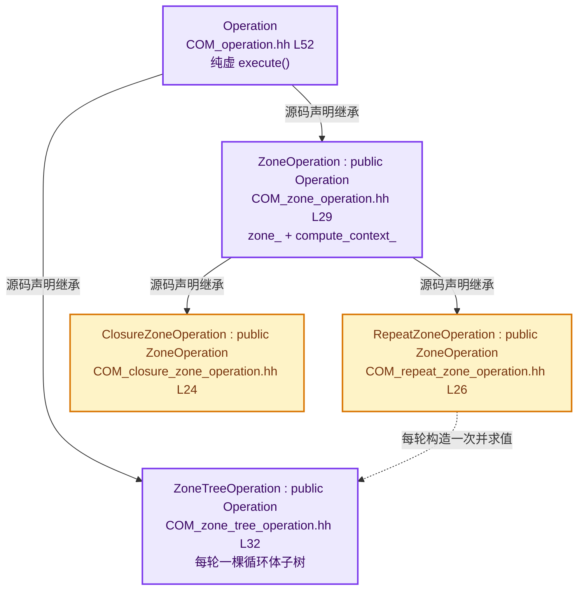
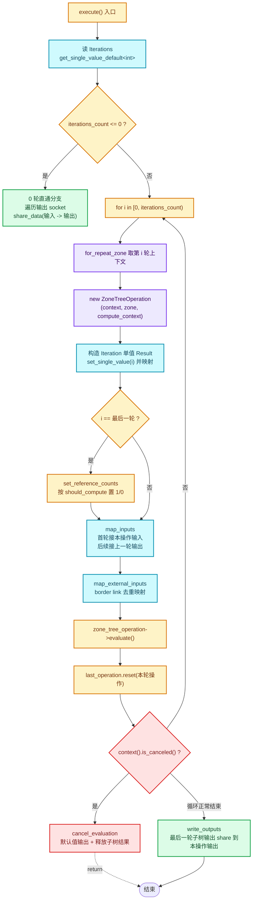
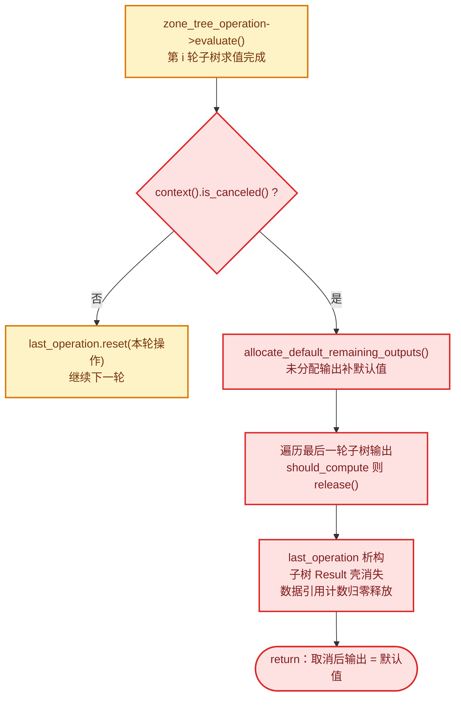
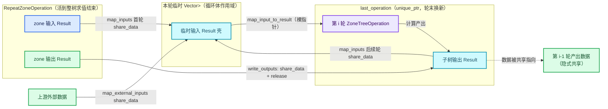
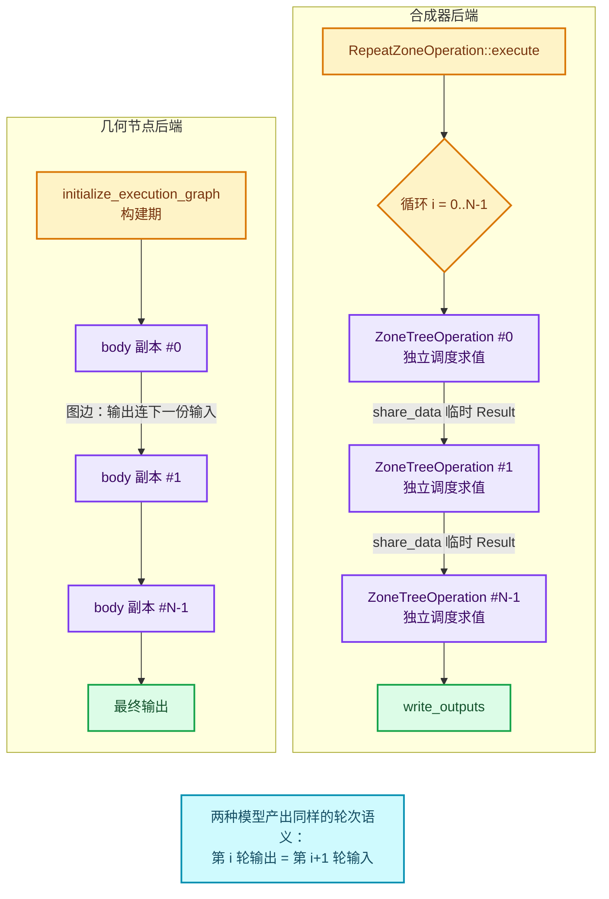

# CN-01 合成器 RepeatZoneOperation：逐轮求值一棵子树

[总入口](../README.md) · [本章导航](README.md) · [课程指南](../00-课程指南/README.md) · [下一篇：GPU着色器与GPU_stack_link_zone](02-GPU着色器与GPU_stack_link_zone.md)

> 基准：Blender `5.4.0-alpha`，本地工作树 `D:\Repository\blender-git\blender`。
> 本篇所有源码引用均为相对链接（从 `05-跨后端实现/` 回到仓库根需要 `../../../../`），
> 行号以当前工作树为准；图配色遵循系列约定的六个 classDef。
> 阅读前置：建议先读 04-02《ComputeContext与迭代身份》，本篇反复用到"每一轮迭代
> 拥有独立上下文身份"这一结论，但不再展开它的 hash 构造细节。

本篇回答第五章的第一个问题：**同一份 Repeat Zone 语义，合成器后端是怎么实现的？**
核心文件只有三个：

- [COM_repeat_zone_operation.hh](../../../source/blender/compositor/COM_repeat_zone_operation.hh)（58 行）与
  [repeat_zone_operation.cc](../../../source/blender/compositor/intern/repeat_zone_operation.cc)（184 行）；
- [COM_zone_tree_operation.hh](../../../source/blender/compositor/COM_zone_tree_operation.hh)（51 行）与
  [zone_tree_operation.cc](../../../source/blender/compositor/intern/zone_tree_operation.cc)（100 行）；
- [COM_zone_operation.hh](../../../source/blender/compositor/COM_zone_operation.hh)（52 行）与
  [zone_operation.cc](../../../source/blender/compositor/intern/zone_operation.cc)（115 行）。

外加两处调度侧代码：[node_tree_evaluator.cc](../../../source/blender/compositor/intern/node_tree_evaluator.cc)
里的 zone 操作创建点，以及 [BKE_compute_context_cache.hh](../../../source/blender/blenkernel/BKE_compute_context_cache.hh)
里的 `for_repeat_zone` 缓存入口。

---

## 先回答一个具体问题

**几何节点把循环体复制 N 份拼图，合成器为什么不这么干？**

先回顾几何节点后端（本系列 03-03 已逐段讲过）：`initialize_execution_graph`
会把 zone body 函数对应的 lf 节点**按迭代数复制 N 份**，第 i 份的输出连到第 i+1 份的
输入，串成一条静态执行图。图在求值开始前就已完全展开，之后就是普通的惰性求值。

合成器后端没有做这件事。看
[repeat_zone_operation.cc · L43](../../../source/blender/compositor/intern/repeat_zone_operation.cc#L43)：

```cpp
for (const int64_t i : iterations_range) {
  /* 每一轮都现场 new 一个 ZoneTreeOperation，求值完就丢 */
  ...
}
```

它是一个**真正的运行期逐轮循环**：每一轮现场构造一棵只包含循环体内部节点的
子树（`ZoneTreeOperation`），独立调度、独立求值，求值完把输出"接"到下一轮的
输入上，再构造下一棵子树。整个执行过程中，同一时刻只存在一棵循环体子树。

为什么合成器不能像几何节点那样图展开？三个结构性原因：

1. **结果域是像素缓冲，不是单值。** 几何节点的 socket 值是 `GVoidPointer`
   级别的轻量句柄（几何分量本身就是隐式共享的），复制 N 份连线的开销只是
   句柄传递。合成器的 `Result` 持有整张 GPU 纹理或 CPU 缓冲（见
   [COM_result.hh · L100-L124](../../../source/blender/compositor/COM_result.hh#L100-L124)），
   "复制 N 份节点"意味着调度器要一次性把 N 轮的缓冲需求都摊开——而
   合成器的调度器（`compute_schedule`）是**按当前树 + 当前上下文**做启发式
   内存估计的（见
   [COM_scheduler.hh · L47-L61](../../../source/blender/compositor/COM_scheduler.hh#L47-L61)
   的注释："post-order depth first traversal ... informed order of traversal of
   dependencies based on a heuristic estimation of the number of needed buffers"）。
   把 N 轮全部展开，这个估计就失去了意义。
2. **迭代数是运行期才知道的运行期单值。** 合成器的 `Iterations` 输入和其他
   输入一样来自上游操作求值出来的 `Result`（
   [repeat_zone_operation.cc · L24](../../../source/blender/compositor/intern/repeat_zone_operation.cc#L24)
   用 `get_single_value_default<int>` 读它）。几何节点那边 usage inference
   会把 `iterations` 强制求值，但展开图时拿到的也是确定的整数；而合成器的
   `ZoneTreeOperation` 是**按轮**调度的，每轮调度的输入集合、引用计数都依赖
   上一轮的实际输出，静态展开无法表达这种"轮间依赖"。
3. **GPU 端走的是完全不同的第三条路。** 着色器节点树里的 Repeat Zone 用
   `REPEAT_BEGIN/END` 宏在 GLSL 里生成真正的循环语句（下一篇 05-02 的主题）。
   也就是说三套后端各选了一种执行模型：几何节点选"编译期图展开"、合成器选
   "运行期逐轮子树求值"、GPU 选"着色器内真循环"。本篇只讲第二条路。

还有一个容易忽略的推论：因为每轮是**独立求值一棵子树**，循环体内部节点的
日志、Viewer 定位、副作用追踪全都天然落在 `RepeatZoneComputeContext(iter=i)`
这个上下文哈希下——和几何节点共享同一个语义（这就是 04-02 讲的机制在合成器
里的复用），但实现上没有经过任何 wrapper 注入，因为每轮子树的
`NodeTreeEvaluator` 拿到的 `compute_context` 参数本身就是第 i 轮的上下文
（[repeat_zone_operation.cc · L44-L48](../../../source/blender/compositor/intern/repeat_zone_operation.cc#L44-L48)）。

---

## ZoneOperation 家族

只画源码明确声明的继承，不加臆造的组合关系。

- `Operation`（[COM_operation.hh · L52](../../../source/blender/compositor/COM_operation.hh#L52)）：
  合成器所有操作的抽象基类，纯虚 `execute()`（L119），持有
  `results_` / `input_descriptors_` / `results_mapped_to_inputs_` 三张核心表。
- `ZoneOperation : public Operation`
  （[COM_zone_operation.hh · L29](../../../source/blender/compositor/COM_zone_operation.hh#L29)）：
  zone 操作的抽象基类，声明了 `zone_` 与 `compute_context_` 两个成员，
  提供按 zone 输出 socket 计算引用计数的 `compute_results_reference_counts`。
- `RepeatZoneOperation : public ZoneOperation`
  （[COM_repeat_zone_operation.hh · L26](../../../source/blender/compositor/COM_repeat_zone_operation.hh#L26)）：
  本篇主角，只覆写 `execute()`，五个私有方法做轮间胶水。
- `ClosureZoneOperation : public ZoneOperation`
  （[COM_closure_zone_operation.hh · L24](../../../source/blender/compositor/COM_closure_zone_operation.hh#L24)）：
  同一家族的另一个成员，对应 `NodeClosureOutput`，不在本篇展开。
- `ZoneTreeOperation : public Operation`
  （[COM_zone_tree_operation.hh · L32](../../../source/blender/compositor/COM_zone_tree_operation.hh#L32)）：
  **注意它不继承 `ZoneOperation`**，直接继承 `Operation`。它不是"对 zone 的
  操作"，而是"zone 内部那棵子树的操作"——它的输入/输出接口和 zone 节点
  镜像（见下文类注释精读），由 `RepeatZoneOperation` 每轮构造一次。



图中实线是源码里的 `class A : public B` 声明（系列约定第 2.4 条：只有这种
才允许标注继承），虚线是"每轮构造并求值"的调用关系，不是继承。

### ZoneOperation 的构造函数做了什么

[zone_operation.cc · L24-L67](../../../source/blender/compositor/intern/zone_operation.cc#L24-L67)
在构造期就把 `RepeatZoneOperation` 的全部接口声明完毕。接口由三部分组成：

**第一部分：zone 输入节点的每个输入 socket → 本操作的一个输入**
（L29-L38）。注意声明顺序：zone 的输入节点（Repeat Input）的 socket 类型用
`get_node_socket_result_type(input)` 取，`InputRealizationMode::None` 表示
不做任何隐式域整理——zone 边界上传递的就是"上一轮的原样输出"。

**第二部分：border link 去重后的外部输出 → 一个特殊命名的输入**
（L40-L57）。identifier 由
`ZoneTreeOperation::get_external_input_identifier(*output)` 生成，格式是
`"External Input: " + 节点名 + ":" + socket标识符`（
[zone_tree_operation.cc · L95-L98](../../../source/blender/compositor/intern/zone_tree_operation.cc#L95-L98)）。
`outputs_already_considered` 这个 `Set` 是去重的关键：zone 外的同一个输出
socket 可能通过多条 border link 连到 zone 内的多个输入，操作只需要**一个**
输入接口、每轮共享**一个** `Result`。这段去重逻辑在
`ZoneOperation` 构造、`ZoneTreeOperation` 构造、`map_external_inputs`、
`NodeTreeEvaluator::compute_zone_external_input_reference_counts` 四个地方
重复出现，是理解 border link 语义的固定套路。

**第三部分：zone 输出节点的每个输出 socket → 本操作的一个输出**
（L59-L66）。`populate_result(output->identifier, ...)` 逐个建好 `Result`
对象，此时都未分配数据。

`compute_results_reference_counts`（L69-L79）则是在操作被调度器挂入
`operations_stream_` 之后、`evaluate()` 之前由
`NodeTreeEvaluator::evaluate_zone` 调用的（
[node_tree_evaluator.cc · L352](../../../source/blender/compositor/intern/node_tree_evaluator.cc#L352)）：
对每个输出 socket 用 `compute_output_reference_count(*output, schedule)` 数出
下游有多少条边要消费它，写进对应 `Result` 的引用计数。这个计数决定
`should_compute()`，进而决定 0 轮直通时哪些输出要分配数据、最后一轮
`set_reference_counts` 给子树结果置 1 还是置 0。

### ZoneTreeOperation：镜像接口

[COM_zone_tree_operation.hh · L23-L31](../../../source/blender/compositor/COM_zone_tree_operation.hh#L23-L31)
的类注释值得逐句读（已翻译）：

> Zone Tree Operation 表示并求值一个 zone 的内部节点树。它的**输出**与 zone
> 输出节点（Repeat Output）的**输入** socket 的类型和 identifier 一一对应；
> 它的**输入**与 zone 输入节点（Repeat Input）的**输出** socket 的类型和
> identifier 一一对应。最后，它还拥有一些代表"穿越 zone 边界、连到 zone 外
> 输出"的连线的输入，这些输入的 identifier 由
> `get_external_input_identifier` 对那些连到 zone 内输入的 zone 外输出返回。

三个"一一对应"是理解整个轮间接线的钥匙：

| 视角 | ZoneTreeOperation 的输入 | ZoneTreeOperation 的输出 |
|---|---|---|
| 节点树视角 | Repeat Input 节点的**输出** socket | Repeat Output 节点的**输入** socket |
| 本操作视角 | `declare_input_descriptor(output->identifier, ...)` | `populate_result(input->identifier, ...)` |
| 谁来喂数据 | `RepeatZoneOperation` 每轮 `map_input_to_result` | `write_outputs` 在最后一轮收走 |

也就是说：**zone 的输入节点的输出 = 子树操作的输入；zone 的输出节点的输入 =
子树操作的输出**。Repeat Input/Output 两个节点在子树求值时不产生任何计算，
它们只是让 `ZoneTreeOperation::execute` 里的
`get_zone_result_for_socket`（
[zone_tree_operation.cc · L67-L78](../../../source/blender/compositor/intern/zone_tree_operation.cc#L67-L78)）
能静态回答"这个 socket 的 Result 在哪"——是 `operation.get_input(...)` 还是
`operation.get_result(...)`。

### ZoneTreeOperation::execute：每轮怎么跑一棵子树

[zone_tree_operation.cc · L80-L93](../../../source/blender/compositor/intern/zone_tree_operation.cc#L80-L93)：

```cpp
void ZoneTreeOperation::execute()
{
  auto socket_result_fn = [&](const bNodeSocket &socket) {
    return get_zone_result_for_socket(*this, zone_, socket);
  };
  const Schedule schedule = compute_schedule(
      this->context(), *zone_.owner->tree, compute_context_, socket_result_fn, &zone_);
  NodeTreeEvaluator node_tree_evaluator(this->context(), schedule, *this, compute_context_);
  node_tree_evaluator.evaluate();

  /* 某些需要的输出在执行结束后仍未分配。这可能发生在求值在输出写入前被取消
   * 的情况下。 */
  this->allocate_default_remaining_outputs();
}
```

四步：

1. `compute_schedule` 传入 `&zone_` 限定调度范围——只调度 zone 内部节点，
   zone 输出节点本身只以"子 zone 边界"的形式出现在调度里（嵌套 zone 时）。
   `socket_result_fn` 告诉调度器：Repeat Input 的输出、Repeat Output 的输入
   这些"已知 socket"的 Result 直接由本操作提供。
2. 构造 `NodeTreeEvaluator`，注意它拿到的 `*this`（本子树操作）与
   `compute_context_`（第 i 轮上下文）。
3. `evaluate()` 按调度顺序逐节点求值；遇到 zone 边界时递归
   `evaluate_zone`（嵌套 Repeat 的情形）。
4. `allocate_default_remaining_outputs()` 兜底：取消或按需裁剪导致的未分配
   输出补默认值，保证调用方（`write_outputs`）拿到的子树结果总是已分配的。

<details>
<summary>核对原始源码：ZoneTreeOperation::execute · zone_tree_operation.cc L80—L98</summary>

```cpp
void ZoneTreeOperation::execute()
{
  auto socket_result_fn = [&](const bNodeSocket &socket) {
    return get_zone_result_for_socket(*this, zone_, socket);
  };
  const Schedule schedule = compute_schedule(
      this->context(), *zone_.owner->tree, compute_context_, socket_result_fn, &zone_);
  NodeTreeEvaluator node_tree_evaluator(this->context(), schedule, *this, compute_context_);
  node_tree_evaluator.evaluate();

  /* Some of the needed outputs might not be allocated even after execution. This could happen for
   * instance when the evaluation gets canceled before the output is written. */
  this->allocate_default_remaining_outputs();
}

std::string ZoneTreeOperation::get_external_input_identifier(const bNodeSocket &output)
{
  return std::string("External Input: ") + output.owner_node().name + ":" + output.identifier;
}

}  // namespace blender::compositor
```

来源：[zone_tree_operation.cc](../../../source/blender/compositor/intern/zone_tree_operation.cc)。
</details>

---

## 调度侧：合成器如何走到 RepeatZoneOperation

调用链从调度器开始。合成器对整棵树做一次
`NodeTreeEvaluator::evaluate()`（根调度），循环体内节点**不会**出现在根调度
里——调度器遇到 zone 时只调度 zone 的输出节点。看
[node_tree_evaluator.cc · L53-L82](../../../source/blender/compositor/intern/node_tree_evaluator.cc#L53-L82)
的调度循环里这段分支：

```cpp
const bke::bNodeTreeZones &zones = *node->owner_tree().zones();
const bke::bNodeTreeZone *node_zone = zones.get_zone_by_node(node->identifier);
if (node_zone && node_zone != this->schedule().zone) {
  BLI_assert(node == node_zone->output_node());
  this->evaluate_zone(*node_zone);
  continue;
}
```

当前调度的节点属于某个 zone、又不属于**本**调度对应的 zone 时，被调到的
必然是该 zone 的输出节点（`BLI_assert` 直接断言了这一点），于是走
`evaluate_zone`。

`evaluate_zone`（L342-L355）做五件事：`create_zone_operation` 工厂按输出
节点类型实例化；注册到 `zone_operations_`；把 zone 操作的输入映射到上游
结果；把操作挂进 `operations_stream_`（生命周期由 unique_ptr 接管）；算引用
计数后 `operation->evaluate()`。

工厂函数在 L329-L340：

```cpp
ZoneOperation *NodeTreeEvaluator::create_zone_operation(const bke::bNodeTreeZone &zone)
{
  if (zone.output_node()->is_type("GeometryNodeRepeatOutput"_ustr)) {
    return new RepeatZoneOperation(this->context(), zone, compute_context_);
  }
  if (zone.output_node()->is_type("NodeClosureOutput"_ustr)) {
    return new ClosureZoneOperation(this->context(), zone, compute_context_);
  }

  BLI_assert_unreachable();
  return nullptr;
}
```

合成的 Repeat 区域判定条件就是**输出节点类型是 `GeometryNodeRepeatOutput`**——
同一个类同时服务于几何节点编辑器里搭的树和合成器里搭的树，因为两者是同一个
节点类型 `COM_repeat_zone_operation.hh` 的头文件里没有任何"几何"字样。

注意一个递归细节：`evaluate_zone` 内部的 `operation->evaluate()` 会同步地跑
完整个 `RepeatZoneOperation::execute()`——包括全部 N 轮子树求值。所以嵌套
Repeat 的求值深度是 zone 嵌套深度，而不是迭代轮数；第 i 轮内部若又遇到子
zone，由子树调度的 `NodeTreeEvaluator::evaluate` 再次触发 `evaluate_zone`。

<details>
<summary>核对原始源码：evaluate_zone 与 create_zone_operation · node_tree_evaluator.cc L329—L355</summary>

```cpp
ZoneOperation *NodeTreeEvaluator::create_zone_operation(const bke::bNodeTreeZone &zone)
{
  if (zone.output_node()->is_type("GeometryNodeRepeatOutput"_ustr)) {
    return new RepeatZoneOperation(this->context(), zone, compute_context_);
  }
  if (zone.output_node()->is_type("NodeClosureOutput"_ustr)) {
    return new ClosureZoneOperation(this->context(), zone, compute_context_);
  }

  BLI_assert_unreachable();
  return nullptr;
}

void NodeTreeEvaluator::evaluate_zone(const bke::bNodeTreeZone &zone)
{
  ZoneOperation *operation = this->create_zone_operation(zone);

  zone_operations_.add_new(zone.output_node(), operation);

  this->map_zone_operation_inputs_to_their_results(operation);

  operations_stream_.append(std::unique_ptr<Operation>(operation));

  operation->compute_results_reference_counts(this->schedule());

  operation->evaluate();
}
```

来源：[node_tree_evaluator.cc](../../../source/blender/compositor/intern/node_tree_evaluator.cc)。
include 位置在 [L31](../../../source/blender/compositor/intern/node_tree_evaluator.cc#L31)：
`#include "COM_repeat_zone_operation.hh"`。
</details>

`get_result_from_output_socket`（L84-L116）还有一个和 zone 相关的兜底分支：
当某个跨 zone 的连线要取"别的 zone 里输出 socket"的结果时，取不到任何节点
操作的 Result，于是回退到 `this->operation().get_input(get_external_input_identifier(output))`
（L106-L112）——即从**当前操作的 border link 输入**里拿。这正是 zone 操作
构造函数声明那些 `External Input: ...` 输入的原因之一：子树调度求值循环体
节点时，evaluator 用这个 identifier 把外部结果递给内部节点。

---

## ComputeContextCache::for_repeat_zone：每轮上下文从缓存取

[repeat_zone_operation.cc · L44-L46](../../../source/blender/compositor/intern/repeat_zone_operation.cc#L44-L46)：

```cpp
const bke::RepeatZoneComputeContext &compute_context =
    this->context().compute_context_cache().for_repeat_zone(
        &compute_context_, *this->zone().output_node(), i);
```

三个参数：父上下文 `&compute_context_`（`RepeatZoneOperation` 从基类继承来的
成员，是"调用这个 zone 操作的执行位置"的上下文）、输出节点引用、轮次 `i`。
返回 `RepeatZoneComputeContext` 的 **const 引用**，不是值。

为什么要经缓存拿引用？两个原因，写在
[BKE_compute_context_cache.hh · L83-L88](../../../source/blender/blenkernel/BKE_compute_context_cache.hh#L83-L88)
和 [compute_contexts.cc · L387-L405](../../../source/blender/blenkernel/intern/compute_contexts.cc#L387-L405)：

1. **指针身份一致性（pointer identity）**。`RepeatZoneComputeContext` 构造时
   会把 `(parent指针, output_node_id, iteration)` 混进自己的 hash；而日志、
   Viewer、缓存查找到处都在拿上下文的**指针**和 hash。如果每轮 `for_repeat_zone`
   都新建对象，同一轮（比如嵌套场景下第 0 轮被父求值触发多次）可能得到两个
   hash 相同但指针不同的上下文，日志桶就会分裂。缓存用
   `lookup_or_add_cb` 保证 `(parent, output_node_id, iteration)` 三元组唯一
   对应一个存活对象。04-02 已经用几何节点的例子讲过这一点，合成器完全复用
   同一个缓存与同一个类。
2. **与 usage/观察端一致**。Viewer 想看循环体第 k 轮的值时，
   [compositor.cc · L724-L757](../../../source/blender/blenkernel/intern/compositor.cc#L724-L757)
   的 `get_zone_viewer_compute_context` 用**同一个**缓存函数
   （L743-L744 传的是 `inspection_index`）构造观察上下文。求值端与观察端
   从同一缓存取同一对象，"看哪一轮"和"算哪一轮"才能对上号。

<details>
<summary>核对原始源码：for_repeat_zone 缓存实现 · compute_contexts.cc L387—L405</summary>

```cpp
const RepeatZoneComputeContext &ComputeContextCache::for_repeat_zone(const ComputeContext *parent,
                                                                     int32_t output_node_id,
                                                                     int iteration)
{
  return *repeat_zone_contexts_cache_.lookup_or_add_cb(
      std::pair{parent, std::pair{output_node_id, iteration}}, [&]() {
        return &this->for_any_uncached<RepeatZoneComputeContext>(
            parent, output_node_id, iteration);
      });
}

const RepeatZoneComputeContext &ComputeContextCache::for_repeat_zone(const ComputeContext *parent,
                                                                     const bNode &output_node,
                                                                     int iteration)
{
  return *repeat_zone_contexts_cache_.lookup_or_add_cb(
      std::pair{parent, std::pair{output_node.identifier, iteration}}, [&]() {
        return &this->for_any_uncached<RepeatZoneComputeContext>(parent, output_node, iteration);
      });
}
```

来源：[compute_contexts.cc](../../../source/blender/blenkernel/intern/compute_contexts.cc)。
头文件声明在 [BKE_compute_context_cache.hh L83-L88](../../../source/blender/blenkernel/BKE_compute_context_cache.hh#L83-L88)，
类本体在 [BKE_compute_contexts.hh L162-L169](../../../source/blender/blenkernel/BKE_compute_contexts.hh#L162-L169)。
</details>

顺带一提轮次编号从 0 开始：`IndexRange(iterations_count)` 的 `i` 直接作为
`iteration` 参数（L42-L46），所以第 0 轮的上下文是 `(parent, node, 0)`，与
几何节点侧 `RepeatZoneComputeContext` 的语义一致，Viewer 两个后端可以共用
同一套"轮次"心智模型。

---

## execute() 逐段精读

现在进入主角。[repeat_zone_operation.cc · L22-L73](../../../source/blender/compositor/intern/repeat_zone_operation.cc#L22-L73)
总共 52 行，切成四段讲。

### 第一段：读迭代数，0 轮直通

```cpp
void RepeatZoneOperation::execute()
{
  const int iterations_count = this->get_input("Iterations").get_single_value_default<int>();
  if (iterations_count <= 0) {
    /* Pass the inputs to the outputs directly. */
    ...
  }
```

`get_single_value_default<int>()` 定义在
[COM_result.hh · L538-L544](../../../source/blender/compositor/COM_result.hh#L538-L544)：
如果结果是单值就直接取，否则返回 `int` 类型的默认值（0）。合成器的单值传播
模型下，`Iterations` 上游通常是一个值节点或数学节点，结果就是单值；即便上游
异常地没产出单值，这里也不崩溃，而是当 0 轮处理。

`<= 0` 的分支是**输出直通**（pass-through）：遍历 zone 输出节点的每个可用
输出 socket，若本操作的对应结果 `should_compute()`，就把同名输入
`share_data` 到输出上。语义上"循环 0 次 = 恒等函数"——第 0 轮还没发生，
输出节点的值就是输入节点的值原样穿透。

注意这里对 `should_compute()` 的检查：如果这个输出下游根本没人用，引用计数
为 0，直通分支也**不**为它共享数据，避免无谓地把输入缓冲"钉住"一份用户。



（图 1：`execute()` 主流程。`ITERIN` 里的 Iteration 单值在任何一轮都注入，
包括第 0 轮；`SETREF` 只在最后一轮发生。）

### 第二段：轮循环的骨架

```cpp
std::unique_ptr<ZoneTreeOperation> last_operation;
const IndexRange iterations_range = IndexRange(iterations_count);
for (const int64_t i : iterations_range) {
```

`last_operation` 是**唯一**跨轮存活的状态：它持有上一轮 `ZoneTreeOperation`
的裸对象（unique_ptr）。轮与轮之间传递数据不靠这个指针直接搬缓冲——搬缓冲
的是 `map_inputs` 里那些共享数据的临时 `Result`——`last_operation` 的作用
只是让上一轮的输出 `Result` 活到"本轮的输入被映射完"那一刻。

每轮内五步，与图 1 一一对应：

**（a）取第 i 轮上下文**（L44-L46）。上文已详述 `for_repeat_zone`。这里
有个微妙点：`&compute_context_` 是本 zone 操作的上下文，也就是"第一次进入
这个 zone 的位置"；第 i 轮上下文的 hash 由它派生，嵌套时天然形成链。

**（b）构造子树操作**（L47-L48）：

```cpp
ZoneTreeOperation *zone_tree_operation = new ZoneTreeOperation(
    this->context(), this->zone(), compute_context);
```

裸 `new`，不用 unique_ptr 包——因为它要么在轮末被 `last_operation.reset`
接管，要么（构造后立刻出错的路径上没有这种分支，源码里构造不会抛）没人管。
这个"裸 new + 轮末 reset"的写法是刻意的寿命管理，见下文"Result 共享与寿命"。

**（c）注入 Iteration 单值**（L50-L53）：

```cpp
Result iteration_input = this->context().create_result(ResultType::Int);
iteration_input.allocate_single_value();
iteration_input.set_single_value(int(i));
zone_tree_operation->map_input_to_result("Iteration", &iteration_input);
```

每轮一个栈上的 `Result`（类型 `Int`，单值存储），值就是轮次本身。identifier
固定为 `"Iteration"`——这是 Repeat Input 节点上那个不可删除的 Iteration
输出 socket 的 identifier（02 章讲过它是静态 socket，不是 item 插槽）。
注意这个 `Result` 是**栈对象**，它映射进子树操作后，子树求值期间一直通过
`get_input("Iteration")` 访问它；轮结束它就析构。这没问题，因为下一轮会
重新造一个新的。这里没有隐式共享、没有引用计数参与——单值 `Result` 的
数据在 `std::variant` 里，析构无成本。

**（d）最后一轮才设引用计数**（L55-L57）：

```cpp
if (i == iterations_range.last()) {
  this->set_reference_counts(*zone_tree_operation);
}
```

为什么只有最后一轮？因为第 0..N-2 轮的子树输出**唯一**的消费者是下一轮
子树的输入，`map_inputs` 共享数据时不需要引用计数把关；而最后一轮的子树
输出要流出到 zone 外，`write_outputs` 里 `repeat_zone_result.should_compute()`
决定了要不要真正共享。`set_reference_counts` 就是把这个"要不要"提前写进
子树结果的引用计数，让子树求值期间的按需裁剪逻辑（调度器对引用计数为 0
的输出会跳过计算）能正确工作。

**（e）接线、求值、交接**（L58-L64）：

```cpp
Vector<std::unique_ptr<Result>> inputs = this->map_inputs(*zone_tree_operation,
                                                          last_operation.get());
Vector<std::unique_ptr<Result>> border_inputs = this->map_external_inputs(
    *zone_tree_operation);
zone_tree_operation->evaluate();

last_operation.reset(zone_tree_operation);
```

两个 `Vector<std::unique_ptr<Result>>` 各自持有本轮临时输入 Results。它们的
作用域是**循环体**——也就是说，第 i 轮的临时输入在 `map_inputs` 返回后、
`last_operation.reset` 之后仍活着，直到本轮循环体结束才随 Vector 析构。
这个顺序是精心安排的：`evaluate()` 执行期间这些结果必须活着，而
`last_operation`（上一轮）在本轮 `map_inputs` 读完它的输出之后才被 reset
释放。

<details>
<summary>核对原始源码：execute() 主体 · repeat_zone_operation.cc L22—L73</summary>

```cpp
void RepeatZoneOperation::execute()
{
  const int iterations_count = this->get_input("Iterations").get_single_value_default<int>();
  if (iterations_count <= 0) {
    /* Pass the inputs to the outputs directly. */
    for (const bNodeSocket *output : this->zone().output_node()->output_sockets()) {
      if (!is_socket_available(output)) {
        continue;
      }

      Result &result = this->get_result(output->identifier);
      if (result.should_compute()) {
        const Result &input = this->get_input(output->identifier);
        result.share_data(input);
      }
    }
    return;
  }

  std::unique_ptr<ZoneTreeOperation> last_operation;
  const IndexRange iterations_range = IndexRange(iterations_count);
  for (const int64_t i : iterations_range) {
    const bke::RepeatZoneComputeContext &compute_context =
        this->context().compute_context_cache().for_repeat_zone(
            &compute_context_, *this->zone().output_node(), i);
    ZoneTreeOperation *zone_tree_operation = new ZoneTreeOperation(
        this->context(), this->zone(), compute_context);

    Result iteration_input = this->context().create_result(ResultType::Int);
    iteration_input.allocate_single_value();
    iteration_input.set_single_value(int(i));
    zone_tree_operation->map_input_to_result("Iteration", &iteration_input);

    if (i == iterations_range.last()) {
      this->set_reference_counts(*zone_tree_operation);
    }
    Vector<std::unique_ptr<Result>> inputs = this->map_inputs(*zone_tree_operation,
                                                              last_operation.get());
    Vector<std::unique_ptr<Result>> border_inputs = this->map_external_inputs(
        *zone_tree_operation);
    zone_tree_operation->evaluate();

    last_operation.reset(zone_tree_operation);

    if (this->context().is_canceled()) {
      this->cancel_evaluation(*last_operation);
      return;
    }
  }

  this->write_outputs(*last_operation);
}
```

来源：[repeat_zone_operation.cc](../../../source/blender/compositor/intern/repeat_zone_operation.cc)。
</details>

<details>
<summary>核对原始源码：类声明与五个方法注释 · COM_repeat_zone_operation.hh L21—L56</summary>

```cpp
/* ------------------------------------------------------------------------------------------------
 * Repeat Zone Operation
 *
 * The repeat zone operation is a zone operation that evaluates a zone a certain number of times,
 * with the output of one evaluation being the inputs of the next. */
class RepeatZoneOperation : public ZoneOperation {
 public:
  using ZoneOperation::ZoneOperation;

  void execute() override;

 private:
  /* Sets the reference counts of the zone tree operation according to the needed status of the
   * outputs of the zone output node. This is only called for the last iteration, since the other
   * iterations supply their outputs back to the inputs of the next iteration. */
  void set_reference_counts(ZoneTreeOperation &zone_tree_operation);

  /* Maps the input results of the zone tree operation to the inputs of the repeat zone operation
   * through temporary results that share their data. The given last_zone_tree_operation is the
   * zone tree operation of the last iteration, which will be nullptr for the first iteration. For
   * any iteration other than the first one, the inputs will be taken from the outputs of the last
   * zone tree operation instead. */
  Vector<std::unique_ptr<Result>> map_inputs(ZoneTreeOperation &zone_tree_operation,
                                             ZoneTreeOperation *last_zone_tree_operation);

  /* Maps the inputs that cross the border of the zone. */
  Vector<std::unique_ptr<Result>> map_external_inputs(ZoneTreeOperation &zone_tree_operation);

  /* Writes the output results of the zone tree operation of the last iteration to this repeat zone
   * operation by sharing its data and freeing the results. */
  void write_outputs(ZoneTreeOperation &zone_tree_operation);

  /* Cancel evaluation by allocating default values for the outputs and freeing the results of the
   * last zone tree operation. */
  void cancel_evaluation(ZoneTreeOperation &last_zone_tree_operation);
};
```

要点（已翻译）：类注释说明语义——"按一定次数求值一个 zone，一次求值的输出
成为下一次求值的输入"；`set_reference_counts` 注释解释"只对最后一次迭代调用，
因为其他迭代的输出是供给下一次迭代的输入"；`map_inputs` 注释强调"通过**共享
数据的临时结果**来映射"，以及 `last_zone_tree_operation` 首轮为 nullptr、
其余轮取上一轮输出；`write_outputs` 注释点明"共享数据**并释放**这些结果"；
`cancel_evaluation` 注释说明取消 = "给输出分配默认值 + 释放最后一轮子树结果"。
来源：[COM_repeat_zone_operation.hh](../../../source/blender/compositor/COM_repeat_zone_operation.hh)。
</details>

---

## set_reference_counts：只给最后一轮发"通行证"

[repeat_zone_operation.cc · L75-L86](../../../source/blender/compositor/intern/repeat_zone_operation.cc#L75-L86)：

```cpp
void RepeatZoneOperation::set_reference_counts(ZoneTreeOperation &zone_tree_operation)
{
  for (const bNodeSocket *output : this->zone().output_node()->output_sockets()) {
    if (!is_socket_available(output)) {
      continue;
    }

    Result &zone_result = zone_tree_operation.get_result(output->identifier);
    Result &repeat_zone_result = this->get_result(output->identifier);
    zone_result.set_reference_count(repeat_zone_result.should_compute() ? 1 : 0);
  }
}
```

[讲解] 三个动作值得抠：

1. **遍历的是 zone 输出节点的输出 socket**（Repeat Output 的输出侧），对每个
   找到两个 Result：子树操作的同名**输出**（注意子树输出以"输出节点的输入
   socket"为 identifier，两者 identifier 相同，所以能对上）和本 zone 操作的
   同名输出。
2. **`repeat_zone_result.should_compute()`** 是本操作输出的引用计数是否非零
   （[COM_result.hh · L365-L368](../../../source/blender/compositor/COM_result.hh#L365-L368)）。
   这个计数在 `evaluate_zone` → `compute_results_reference_counts` 阶段就
   算好了（[zone_operation.cc · L69-L79](../../../source/blender/compositor/intern/zone_operation.cc#L69-L79)）。
3. **把 1 或 0 直接 `set_reference_count` 到子树结果上**。置 1 表示"最后一轮
   真的要算这个输出"；置 0 表示"下游没人用，子树调度可以直接跳过整条产线"。
   这就是合成器按需执行在循环里的落点：如果 zone 的某个输出从未被 zone 外
   使用，**每一轮**的调度都不会为它安排节点（子树调度器看到引用计数 0）。

一个容易想错的点：为什么不给前 N-1 轮也置计数？因为中间轮的输出 identifier
对应的 Result 的消费者是下一轮 `map_inputs` 建立的映射，而共享数据
（`share_data`）**不经过引用计数**——它是隐式共享的"加用户"操作，数据的
释放由 `sharing_info_` 的用户数管理，与 `reference_count_`（操作层的
"还有几个操作需要它"）是两套计数。合成器里 `reference_count_` 只服务
`should_compute()` 这个"要不要算"的判断，不服务内存寿命。

<details>
<summary>核对原始源码：set_reference_counts · repeat_zone_operation.cc L75—L86</summary>

```cpp
void RepeatZoneOperation::set_reference_counts(ZoneTreeOperation &zone_tree_operation)
{
  for (const bNodeSocket *output : this->zone().output_node()->output_sockets()) {
    if (!is_socket_available(output)) {
      continue;
    }

    Result &zone_result = zone_tree_operation.get_result(output->identifier);
    Result &repeat_zone_result = this->get_result(output->identifier);
    zone_result.set_reference_count(repeat_zone_result.should_compute() ? 1 : 0);
  }
}
```

来源：[repeat_zone_operation.cc](../../../source/blender/compositor/intern/repeat_zone_operation.cc)。
</details>

---

## map_inputs：轮间接线的两种形态

[repeat_zone_operation.cc · L88-L123](../../../source/blender/compositor/intern/repeat_zone_operation.cc#L88-L123)。
方法签名的第二个参数 `ZoneTreeOperation *last_zone_tree_operation` 是**可为
空的指针**——空表示第一轮。方法体因此分成两个对称分支。

### 分支一：有上一轮（i >= 1）

```cpp
if (last_zone_tree_operation) {
  for (const bNodeSocket *output : this->zone().output_node()->output_sockets()) {
    if (!is_socket_available(output)) {
      continue;
    }

    Result &last_result = last_zone_tree_operation->get_result(output->identifier);
    std::unique_ptr<Result> temporary_input = std::make_unique<Result>(
        this->context().create_result(last_result.type(), last_result.precision()));
    temporary_input->share_data(last_result);
    temporary_inputs.append(std::move(temporary_input));
    zone_tree_operation.map_input_to_result(output->identifier, temporary_inputs.last().get());
  }
  return temporary_inputs;
}
```

[讲解] 逐行拆：

- `last_result`：上一轮子树的输出 Result。它的数据（GPU 纹理或 CPU 缓冲）
  就在上一轮的 `ZoneTreeOperation` 对象里。
- `temporary_input`：新建的临时 Result，类型/精度抄 `last_result`。
  `context().create_result(...)` 只造"空壳"，不分配数据。
- `temporary_input->share_data(last_result)`：关键一行。`share_data` 的语义
  在 [COM_result.hh · L320-L323](../../../source/blender/compositor/COM_result.hh#L320-L323)：
  "Share the data of the given source result. This is done by simply adding a
  new user to the sharing info of the result."——**不拷贝像素**，只给源数据的
  隐式共享信息加一个用户。所以"第 i 轮的输入"和"第 i-1 轮的输出"此刻指向
  同一块 GPU 纹理/CPU 缓冲，零拷贝。
- `map_input_to_result(output->identifier, temporary_inputs.last().get())`：
  把本轮子树操作的输入 identifier 映射到这个临时 Result 的地址。子树求值
  时，Repeat Input 节点的输出 socket 一律从这张映射表取数。

为什么要中间垫一层临时 Result，而不是直接把 `&last_result` 映射给本轮？
因为 `map_input_to_result` 存的是**裸指针** `Result *`（
[COM_operation.hh · L66-L71](../../../source/blender/compositor/COM_operation.hh#L66-L71)），
而上一轮的 `ZoneTreeOperation` 在本轮结束时就要被 `last_operation.reset`
析构——直接映射等于悬挂指针。垫一层 `unique_ptr<Result>` 持有的、数据共享
的临时 Result，就把"数据的寿命"（隐式共享，大家都活着）与"Result 壳的寿命"
（本轮 Vector 管理）解耦了。

### 分支二：第一轮（i == 0）

```cpp
/* Otherwise, map the initial inputs of the operation. */
for (const bNodeSocket *output : this->zone().output_node()->output_sockets()) {
  ...
  const Result &input_result = this->get_input(output->identifier);
  std::unique_ptr<Result> temporary_input = std::make_unique<Result>(
      this->context().create_result(input_result.type(), input_result.precision()));
  temporary_input->share_data(input_result);
  temporary_inputs.append(std::move(temporary_input));
  zone_tree_operation.map_input_to_result(output->identifier, temporary_inputs.last().get());
}
```

与分支一逐行同构，唯一差别是数据源：`this->get_input(output->identifier)`
取的是**本 zone 操作自己的输入**——也就是 zone 外上游节点的结果。注意取数
用的是"输出节点的输出 socket identifier"，而 zone 输入节点的输入 socket 与
输出节点的输出 socket 是同名配对的（02 章讲过 item 插槽一一对应），所以
identifier 能直接对上。

两个分支的公共形状可以总结成一句话：**每轮的子树输入永远是一个新造的
Result 壳 + `share_data` 共享来的数据；壳每轮换新，数据按需共享。** 这带来
一个重要性质：如果循环体内部根本没有写某个输入（比如只读），那么 N 轮全部
共享同一块隐式共享数据，全程零拷贝；如果循环体写了（合成器节点都是"读入
→算出新 Result 写出"的纯函数风格，不会原地改输入），新一轮的输出会指向新
分配的数据，旧数据用户数减一，自然释放。

<details>
<summary>核对原始源码：map_inputs · repeat_zone_operation.cc L88—L123</summary>

```cpp
Vector<std::unique_ptr<Result>> RepeatZoneOperation::map_inputs(
    ZoneTreeOperation &zone_tree_operation, ZoneTreeOperation *last_zone_tree_operation)
{
  Vector<std::unique_ptr<Result>> temporary_inputs;
  /* If a last operation exist, map inputs to the outputs of the last iteration instead. */
  if (last_zone_tree_operation) {
    for (const bNodeSocket *output : this->zone().output_node()->output_sockets()) {
      if (!is_socket_available(output)) {
        continue;
      }

      Result &last_result = last_zone_tree_operation->get_result(output->identifier);
      std::unique_ptr<Result> temporary_input = std::make_unique<Result>(
          this->context().create_result(last_result.type(), last_result.precision()));
      temporary_input->share_data(last_result);
      temporary_inputs.append(std::move(temporary_input));
      zone_tree_operation.map_input_to_result(output->identifier, temporary_inputs.last().get());
    }
    return temporary_inputs;
  }

  /* Otherwise, map the initial inputs of the operation. */
  for (const bNodeSocket *output : this->zone().output_node()->output_sockets()) {
    if (!is_socket_available(output)) {
      continue;
    }

    const Result &input_result = this->get_input(output->identifier);
    std::unique_ptr<Result> temporary_input = std::make_unique<Result>(
        this->context().create_result(input_result.type(), input_result.precision()));
    temporary_input->share_data(input_result);
    temporary_inputs.append(std::move(temporary_input));
    zone_tree_operation.map_input_to_result(output->identifier, temporary_inputs.last().get());
  }
  return temporary_inputs;
}
```

来源：[repeat_zone_operation.cc](../../../source/blender/compositor/intern/repeat_zone_operation.cc)。
</details>

---

## map_external_inputs：border link 的去重与注入

[repeat_zone_operation.cc · L125-L150](../../../source/blender/compositor/intern/repeat_zone_operation.cc#L125-L150)：

```cpp
Vector<std::unique_ptr<Result>> temporary_inputs;
Set<const bNodeSocket *> outputs_already_considered;
for (const bNodeLink *link : this->zone().border_links) {
  const bNodeSocket *output = get_output_linked_to_input(*link->tosock);
  if (!output) {
    continue;
  }

  if (outputs_already_considered.contains(output)) {
    continue;
  }
  outputs_already_considered.add_new(output);

  const std::string input_identifier = ZoneTreeOperation::get_external_input_identifier(*output);
  const Result &input_result = this->get_input(input_identifier);
  std::unique_ptr<Result> temporary_input = std::make_unique<Result>(
      this->context().create_result(input_result.type(), input_result.precision()));
  temporary_input->share_data(input_result);
  temporary_inputs.append(std::move(temporary_input));
  zone_tree_operation.map_input_to_result(input_identifier, temporary_inputs.last().get());
}
```

[讲解] 与 `map_inputs` 的差异点：

1. **遍历对象是 `zone().border_links`**，不是输出 socket。border link 是
   `bNodeTreeZone` 预先收集好的"起点在 zone 外、终点在 zone 内"的连线
   （01 章讲过它的收集规则）。每条 link 的 `tosock` 往外追到真正提供数据的
   输出 socket（`get_output_linked_to_input`，能穿透 reroute）。
2. **去重集合 `outputs_already_considered`**：zone 外一个输出喂 zone 内多个
   输入时，只在第一轮遇到时处理一次。这不仅是省事——如果不去重，同一个
   外部输出会被映射两次到同一个 identifier 上（`get_external_input_identifier`
   是按输出 socket 确定的），后一次覆盖前一次，语义上没错但白造了临时
   Result；更重要的是**每轮只共享一次**，配合"外部值每轮共享同一份数据"的
   语义（见反例 #1）。
3. **identifier 带前缀 `External Input: `**：外部输入与 zone 输入输出用不同
   命名空间，避免与 zone 输入节点的输出 socket identifier 撞名。
4. **数据源是 `this->get_input(input_identifier)`**：本 zone 操作在构造期
   （[zone_operation.cc · L40-L57](../../../source/blender/compositor/intern/zone_operation.cc#L40-L57)）
   就声明了同名输入，`NodeTreeEvaluator::map_zone_operation_inputs_to_their_results`
   已经把 zone 外的上游结果映射上来了。也就是说 border link 数据是**从
   zone 外一次性拿进来的**，之后每轮子树都拿到共享同一块数据的临时 Result。

重点（也是本篇反例 #1）：`map_external_inputs` 在**每一轮**都被调用，但
`this->get_input(...)` 拿到的是同一个上游 Result——每轮的临时 Result 都
`share_data` 到同一块数据上。所以 border link 语义是"外部值在整个循环期间
冻结为进入时的那一份数据"，不是"每轮重新求值上游"。如果上游真的每轮都会
变，那也不影响：上游在 zone 操作求值**之前**就已经算完了一次。

<details>
<summary>核对原始源码：map_external_inputs · repeat_zone_operation.cc L125—L150</summary>

```cpp
Vector<std::unique_ptr<Result>> RepeatZoneOperation::map_external_inputs(
    ZoneTreeOperation &zone_tree_operation)
{
  Vector<std::unique_ptr<Result>> temporary_inputs;
  Set<const bNodeSocket *> outputs_already_considered;
  for (const bNodeLink *link : this->zone().border_links) {
    const bNodeSocket *output = get_output_linked_to_input(*link->tosock);
    if (!output) {
      continue;
    }

    if (outputs_already_considered.contains(output)) {
      continue;
    }
    outputs_already_considered.add_new(output);

    const std::string input_identifier = ZoneTreeOperation::get_external_input_identifier(*output);
    const Result &input_result = this->get_input(input_identifier);
    std::unique_ptr<Result> temporary_input = std::make_unique<Result>(
        this->context().create_result(input_result.type(), input_result.precision()));
    temporary_input->share_data(input_result);
    temporary_inputs.append(std::move(temporary_input));
    zone_tree_operation.map_input_to_result(input_identifier, temporary_inputs.last().get());
  }
  return temporary_inputs;
}
```

来源：[repeat_zone_operation.cc](../../../source/blender/compositor/intern/repeat_zone_operation.cc)。
</details>

---

## write_outputs：只收最后一轮的果实

[repeat_zone_operation.cc · L152-L166](../../../source/blender/compositor/intern/repeat_zone_operation.cc#L152-L166)：

```cpp
void RepeatZoneOperation::write_outputs(ZoneTreeOperation &zone_tree_operation)
{
  for (const bNodeSocket *output : this->zone().output_node()->output_sockets()) {
    if (!is_socket_available(output)) {
      continue;
    }

    Result &zone_tree_result = zone_tree_operation.get_result(output->identifier);
    Result &repeat_zone_result = this->get_result(output->identifier);
    if (repeat_zone_result.should_compute()) {
      repeat_zone_result.share_data(zone_tree_result);
      zone_tree_result.release();
    }
  }
}
```

[讲解] 循环结束后调用，入参是**最后一轮**的子树操作（`execute` 里传的
`*last_operation`）。每个输出两行核心：

- `repeat_zone_result.share_data(zone_tree_result)`：把子树结果的数据共享给
  本 zone 操作的输出 Result。这之后 zone 外的下游节点读到的就是最后一轮的
  产出。
- `zone_tree_result.release()`：把子树结果自己那份用户退掉（
  [COM_result.hh · L358-L359](../../../source/blender/compositor/COM_result.hh#L358-L359)：
  "Decrement the reference count of the result and free its data if it reaches
  zero"）。注释里说的 "sharing its data **and freeing** the results" 就是
  这个动作——数据没死（zone 输出还持有一个用户），只是子树 Result 这个
  "壳的注册用户"退了，让 ownership 干净地落到 zone 操作的输出上。

`should_compute()` 的分支保护：如果下游没人用（引用计数 0），既不共享也不
释放——子树结果的数据在 `last_operation` 析构时由 `Result` 析构函数统一
`free()`，这里不做多余动作。

<details>
<summary>核对原始源码：write_outputs · repeat_zone_operation.cc L152—L166</summary>

```cpp
void RepeatZoneOperation::write_outputs(ZoneTreeOperation &zone_tree_operation)
{
  for (const bNodeSocket *output : this->zone().output_node()->output_sockets()) {
    if (!is_socket_available(output)) {
      continue;
    }

    Result &zone_tree_result = zone_tree_operation.get_result(output->identifier);
    Result &repeat_zone_result = this->get_result(output->identifier);
    if (repeat_zone_result.should_compute()) {
      repeat_zone_result.share_data(zone_tree_result);
      zone_tree_result.release();
    }
  }
}
```

来源：[repeat_zone_operation.cc](../../../source/blender/compositor/intern/repeat_zone_operation.cc)。
</details>

---

## cancel_evaluation：取消后的"干净失败"

[repeat_zone_operation.cc · L168-L182](../../../source/blender/compositor/intern/repeat_zone_operation.cc#L168-L182)：

```cpp
void RepeatZoneOperation::cancel_evaluation(ZoneTreeOperation &last_zone_tree_operation)
{
  this->allocate_default_remaining_outputs();

  for (const bNodeSocket *output : this->zone().output_node()->output_sockets()) {
    if (!is_socket_available(output)) {
      continue;
    }

    Result &zone_tree_result = last_zone_tree_operation.get_result(output->identifier);
    if (zone_tree_result.should_compute()) {
      zone_tree_result.release();
    }
  }
}
```

[讲解] 触发点在 `execute` 轮循环末尾（L66-L69）：每轮子树求值完成后立刻查
`this->context().is_canceled()`，一旦取消就调用本方法并 `return`。两步：

1. `allocate_default_remaining_outputs()`（声明在
   [COM_operation.hh · L137](../../../source/blender/compositor/COM_operation.hh#L137)）：
   把本操作所有 `should_compute()` 但尚未分配数据的输出补成默认值。**取消后
   zone 的输出是默认值，不是已完成若干轮的"部分结果"**——这与几何节点取消
   时的行为对齐（整体求值作废），也与合成器根评估器的 `cancel_evaluation`
   （[node_tree_evaluator.cc · L58-L61](../../../source/blender/compositor/intern/node_tree_evaluator.cc#L58-L61)）
   的整体语义一致：取消是整棵树的失败，不是某个中间快照。
2. 遍历最后一轮子树的输出，对 `should_compute()` 的结果 `release()`。这一步
   是**释放资源**而不是转移：子树算出来的部分数据（最后一轮已经写出的那些
   Result）既然不会被任何下游消费，就趁 `last_operation` 还活着把它们退掉，
   GPU 纹理/CPU 缓冲回收到池里。`last_operation` 的 unique_ptr 随后析构，
   子树 Result 壳全部消失。

注意取消检查的**粒度是"每轮一次"**，不是每节点。循环体内部节点的取消由
子树求值自己的 `NodeTreeEvaluator::evaluate` 循环检查（L58-L61），zone 操作
只在轮边界做粗检查。这意味着一轮很长时，取消响应延迟以单轮为下限。



（图 2：取消路径。红色是失效与清理；正常路径走 `RESET` 回到轮循环。）

<details>
<summary>核对原始源码：cancel_evaluation · repeat_zone_operation.cc L168—L182</summary>

```cpp
void RepeatZoneOperation::cancel_evaluation(ZoneTreeOperation &last_zone_tree_operation)
{
  this->allocate_default_remaining_outputs();

  for (const bNodeSocket *output : this->zone().output_node()->output_sockets()) {
    if (!is_socket_available(output)) {
      continue;
    }

    Result &zone_tree_result = last_zone_tree_operation.get_result(output->identifier);
    if (zone_tree_result.should_compute()) {
      zone_tree_result.release();
    }
  }
}
```

来源：[repeat_zone_operation.cc](../../../source/blender/compositor/intern/repeat_zone_operation.cc)。
</details>

---

## Result 共享与寿命：一张所有权网

现在把散在各方法里的 `share_data` / `release` / `unique_ptr` 拼成一张网。
先复习 `Result` 的两套计数（[COM_result.hh · L147-L160](../../../source/blender/compositor/COM_result.hh#L147-L160)）：

- **`sharing_info_`（数据用户数）**：隐式共享信息持有数据本身；`share_data`
  加用户，`free` 减用户，归零时数据释放。**数据寿命由它管。**
- **`reference_count_`（操作需求数）**：`set_reference_count` 初始化，
  `release()` 减一，归零时触发 `free()`。**它只服务 `should_compute()`，
  是调度层的"要不要算"。**

Repeat Zone 执行期间出现的 Result 分四类，寿命各不相同：

| 类别 | 例子 | 谁拥有壳 | 数据来自哪 | 死亡时机 |
|---|---|---|---|---|
| zone 操作自己的输入/输出 | `this->get_input(...)` / `this->get_result(...)` | `RepeatZoneOperation`（基类 `results_` 表，Map 按值存） | 上游操作 / 最后一轮共享 | zone 操作析构（在 `operations_stream_` 里排到末尾） |
| 每轮临时输入 | `map_inputs` / `map_external_inputs` 返回的 Vector 元素 | 循环体内的 `Vector<unique_ptr<Result>>` | `share_data` 共享 | 每轮循环体结束时 |
| Iteration 单值 | `iteration_input` | **栈**（每轮一个） | 自身单值 variant | 每轮循环体结束时 |
| 子树操作的结果 | `zone_tree_operation->get_result(...)` | `last_operation`（unique_ptr，轮末换新） | 本轮子树计算产出 | 最后一轮数据被 `write_outputs` 收走或 `cancel_evaluation` 释放；壳随 `last_operation` 析构 |

四个方法在这张网上的动作：

- `map_inputs`：造壳（`make_unique`）+ 借数据（`share_data`）。
- `map_external_inputs`：同上，数据源换成 zone 外输入。
- `write_outputs`：**借数据给 zone 输出（share_data）+ 还回自己的用户
  （release）**——所有权从子树结果平移到 zone 输出，数据全程无拷贝。
- `cancel_evaluation`：造默认值 + 丢弃子树数据（release）。

`release()` 与 `free()` 的分工也值得一句：`release()`（
[COM_result.hh · L358-L359](../../../source/blender/compositor/COM_result.hh#L358-L359)）
减 `reference_count_`，归零时调 `free()`；`free()`（L361-L363）只减数据用户
（`sharing_info_`），未分配则什么都不做。所以 `write_outputs` 里
`share_data` + `release` 的组合效果是：数据用户数不变（zone 输出顶了子树
结果的缺），`reference_count_` 归零、壳失效，而数据继续活着。



（图 3：轮间数据流与所有权。实线是映射/共享方向；`OUT` 对 `ZR` 的箭头
发生在最后一轮，之后 `ZR` 壳可安全析构。）

---

## 与几何节点实现的对照表

同一个 Repeat Zone 语义，两套后端的关键机制对照。GPU 后端见下一篇。

| 维度 | 几何节点后端（03 章） | 合成器后端（本篇） |
|---|---|---|
| 迭代驱动方式 | **编译期图展开**：`initialize_execution_graph` 把 body 函数节点复制 N 份、成对串联，之后按普通执行图惰性求值 | **运行期逐轮循环**：每轮现场构造一棵 `ZoneTreeOperation` 子树，独立调度求值，N 次同步跑完 |
| 循环体表示 | 一个 `ZoneBodyFunction`（lazy function），被复制成 N 个 lf 节点实例 | N 棵串行求值的子树；循环体节点按轮被普通 `NodeOperation` 重新编译进各自的调度 |
| 状态传递 | 第 i 份 body 的输出 socket 连到第 i+1 份的输入 socket（图边） | `map_inputs`：上一轮子树输出 `share_data` 到本轮临时 Result，再 `map_input_to_result` |
| Iteration 值 | body 函数的 `Iteration` 参数，展开时每份绑常量 | 每轮新造一个 `Int` 单值 Result（栈上），值 = 轮次 |
| 0 轮行为 | 图展开 0 份，输入直连输出（or 节点选择默认分支） | `iterations_count <= 0` 时对每个可用输出 `share_data` 直通（L25-L39） |
| 上下文 | `RepeatBodyNodeExecuteWrapper` 执行期把 user_data 的上下文换成 `(parent, node, iteration)` | 直接把第 i 轮上下文作为参数传给 `ZoneTreeOperation` 构造 → 传给 `NodeTreeEvaluator`，无 wrapper |
| 上下文缓存 | `ComputeContextCache::for_repeat_zone`（同一函数） | 同一函数同一缓存（L44-L46），保证指针身份 |
| 按需执行 | usage inference 在构建期推导，`iterations` 强制求值 | 引用计数模型：仅最后一轮 `set_reference_counts` 按 `should_compute` 置 1/0，子树调度跳过无用输出 |
| 取消 | lazy function 图求值由外层取消机制整体处理 | 轮边界检查 `is_canceled()`；`cancel_evaluation` 补默认值 + 释放最后一轮子树数据 |
| 并行 | body 内部节点可并行（lf 执行器线程池）；轮与轮之间因数据依赖串行 | 子树内部按合成器调度可并行（多线程求值器）；轮与轮之间串行 |
| 值表示 | `GVoidPointer`/`GMutablePointer` 句柄，几何分量隐式共享 | `Result`：GPU 纹理 / CPU 缓冲 / 单值 variant，数据用隐式共享信息管理 |
| border link | 构建期识别为 border 参数，直接进 body 函数签名 | 每轮 `map_external_inputs` 去重映射，数据来自 zone 操作的 `External Input: ...` 输入，值整个循环期间冻结 |



（图 4：两种架构对照。左：几何节点在构建期把循环体摊进一张图；右：合成器
在运行期重复求值一棵子树。注意两边的"轮间连线"性质完全不同——图边是静态
的执行图结构，`share_data` 是运行期的数据共享。）

---

## 用小数据走一遍

设定：Repeat Zone，2 轮迭代，1 个 item（zone 输入/输出各有一个 `Value`
float 插槽 + 固定的 `Iteration` int）。外部有一个 border link 给循环体喂
一个常量 `Mask`。zone 的 `Value` 输出下游有人用；`Iterations` 输入为 2。
循环体内部：`Value_next = Value + Mask * Iteration`（示意，用数学节点搭）。

初始：zone 操作的输入 `Value` 是上游算好的 Result A（数据缓冲 α），
`Iterations` 是单值 2；输入 `External Input: 常量节点:Value` 映射到 Result B
（单值 mask）。

**第 0 轮（i = 0）**

1. `for_repeat_zone(parent, output_node, 0)` → 缓存命中或新建上下文 C0。
2. `new ZoneTreeOperation(Z0)`，声明输入 `Value`（float）、
   `External Input: 常量节点:Value`（float），输出 `Value`（float）。
3. 栈上造 `iteration_input`（Int 单值 0），映射到 Z0 的 `"Iteration"`。
4. `i != last`，不调 `set_reference_counts`。
5. `map_inputs`：`last_operation` 为空 → 走首轮分支。造临时 Result T0.0
   （float 空壳），`T0.0.share_data(A)`——T0.0 与 A 共享数据 α。Z0 的输入
   `Value` 映射到 `&T0.0`。
6. `map_external_inputs`：border link 一条，输出 socket 首次见 → 造 T0.1，
   `T0.1.share_data(B)`（共享 mask 单值）。Z0 的输入
   `External Input: ...` 映射到 `&T0.1`。
7. `Z0.evaluate()`：子树调度（上下文 C0），算出 Z0 的输出 `Value` =
   Result R0，数据缓冲 β = α + mask*0 = α 的内容但**新分配**（数学节点
   产出新缓冲；若实现某些恒等优化则可能共享，此处按一般情况）。
8. `last_operation.reset(Z0)`。临时 Vector 仍存活到本轮循环体结束。

**第 1 轮（i = 1）**

1. `for_repeat_zone(..., 1)` → C1。
2. `new ZoneTreeOperation(Z1)`。
3. 栈上 `iteration_input` = 1，映射到 Z1。
4. `i == last` → `set_reference_counts(Z1)`：zone 输出 `Value` 的
   `should_compute()` 为 true → Z1 输出引用计数置 1。
5. `map_inputs`：`last_operation` = Z0 → 走后续轮分支。对输出 socket `Value`：
   取 Z0 的输出 R0，造 T1.0，`T1.0.share_data(R0)`——T1.0 与 R0 共享 β。
   Z1 输入 `Value` 映射到 `&T1.0`。此时第 0 轮的临时 Vector（T0.0、T0.1）
   已随第 0 轮循环体结束析构，但 β 的数据用户：R0 与 T1.0 各一个，数据活着。
6. `map_external_inputs`：再遇同一条 border link 的输出 socket → 已在
   `outputs_already_considered`？——**注意这个 Set 是方法内的局部变量，每轮
   重新开始**，所以第 1 轮仍会处理一次：造 T1.1，`share_data(B)`。每轮共享
   同一份 mask 数据。
7. `Z1.evaluate()`：算出 Z1 输出 = Result R1，数据 γ = β + mask*1。
8. `last_operation.reset(Z1)`：Z0 析构，R0 壳消失；β 数据用户剩 T1.0 一个。
9. `is_canceled()` 为否 → 继续下一轮；循环结束。

**write_outputs(Z1)**

- 对输出 `Value`：`repeat_zone_result.share_data(R1)`——zone 输出与 R1 共享
  γ；`R1.release()`——R1 退掉自己的用户。数据 γ 的用户：zone 输出（+ T1.0
  一个，随循环体结束析构）。
- zone 外下游从此读到 γ。

**Result 共享关系总表**

| 对象 | 壳的拥有者 | 数据 | 数据用户（峰值） | 结局 |
|---|---|---|---|---|
| A（zone 输入 Value） | zone 操作 | α | 上游 + T0.0 | T0.0 析构后剩上游，上游 release 时释放 |
| B（外部 mask） | zone 操作（External Input 输入） | 单值 mask | T0.1 + T1.1 | 每轮临时析构后剩 zone 输入 |
| T0.0 / T1.0 | 第 0/1 轮临时 Vector | α / β | — | 循环体结束析构 |
| R0（第 0 轮输出） | Z0（last_operation） | β | T1.0 | Z0 被 reset 时壳消失；β 用户归零释放 |
| R1（第 1 轮输出） | Z1（last_operation） | γ | zone 输出 | `share_data` + `release` 后壳随 last_operation 析构，数据归 zone 输出 |
| zone 输出 Value | zone 操作 | γ | 下游消费者 | 正常 release 链 |

一句话总结这组数据流：**数据 α → β → γ 三次"产出"（每轮一次），其余全部
动作都是零拷贝共享。**

---

## 反例与边界

1. **误以为 border link 每轮重读外部值——它每轮 share 同一个结果。**
   `map_external_inputs` 虽然每轮都执行，但数据源永远是 `this->get_input(...)`
   的同一个 Result（进入 zone 前就算好的那一份），每轮只是再造一个共享壳。
   外部上游在循环期间"不会变"，因为它的求值早已完成。
2. **取消后输出是默认值，不是已完成轮次的部分结果。** `cancel_evaluation`
   先 `allocate_default_remaining_outputs()` 再丢弃最后一轮子树数据
   （L168-L182）。哪怕 8 轮循环已经算完 7 轮，输出也是 float(0) 之类的默认
   值。想要"最后一轮可用值"的语义在合成器里不存在。
3. **误以为迭代数必须是"单值"才行——不单值时静默按 0 处理。**
   `get_single_value_default<int>()` 在非单值时返回默认值 0（
   [COM_result.hh · L538-L544](../../../source/blender/compositor/COM_result.hh#L538-L544)），
   走直通分支。正常节点图里 `Iterations` 上游都是单值，但如果你在脚本化
   场景造出非常规输入，行为是"0 次直通"而不是报错。
4. **误以为每轮的 `outputs_already_considered` 去重跨轮生效——它每轮重新
   开始。** 那个 Set 是 `map_external_inputs` 的局部变量。跨轮的"共享同一
   份数据"不是这个 Set 保证的，而是"数据源是同一个 Result"这个事实保证的。
   Set 只负责单轮内多条 border link 收敛到一个外部输出时的去重。
5. **误以为中间轮的输出 Result 会被 `write_outputs` 碰到——不会，它只认
   最后一轮。** `write_outputs(*last_operation)` 传进来的只有最后一轮子树
   （L72）；前 N-1 轮的输出数据在下一轮 `map_inputs` 共享后、`reset` 析构后
   自然消亡。不存在"把所有轮的输出都收集起来"的路径——想要每轮中间结果，
   那是 Accumulate/Foreach 系语义，不是 Repeat。
6. **误以为 `ZoneTreeOperation` 继承 `ZoneOperation`——它直接继承
   `Operation`。** 两者的接口是对偶关系（zone 输入节点输出 ↔ 子树输入；
   zone 输出节点输入 ↔ 子树输出），但类型上没有继承（
   [COM_zone_tree_operation.hh · L32](../../../source/blender/compositor/COM_zone_tree_operation.hh#L32)）。
   `zone_` 与 `compute_context_` 两个成员在两个类里**各自声明**，不是共享
   基类成员。
7. **嵌套 zone 的引用计数语义差异。** 子树调度遇到嵌套 zone 的输出节点时
   会递归 `evaluate_zone`，嵌套 zone 操作的引用计数是**按子树调度**算的
   （`compute_results_reference_counts(this->schedule())`，此处 schedule 是
   第 i 轮子树的调度）。也就是说嵌套 zone 的"要不要算"是**逐轮**判定的，
   第 0 轮没用的输出不会阻止第 5 轮去算它——这与静态展开模型（一次判定、
   全图生效）结论可能不同，读日志时别混淆。
8. **`last_operation` 的裸 `new` 与 `reset` 是配对的寿命协议。** 若有人在
   `new ZoneTreeOperation(...)` 与 `last_operation.reset(...)` 之间插入会
   抛异常的代码，就会泄漏。当前 184 行里这段窗口只做不抛操作（构造映射、
   造单值 Result），协议成立；改这段代码时必须维持"窗口内不抛"或改成
   unique_ptr 先接管。

---

## 继续阅读

- 下一篇：[02-GPU着色器与GPU_stack_link_zone](02-GPU着色器与GPU_stack_link_zone.md)
  ——第三条执行模型：`REPEAT_BEGIN/END` 宏如何在 GLSL 里生成真循环，
  zone 的 GPU 编译路径，以及它与本篇 CPU 逐轮模型、几何节点图展开模型的
  三方差异。
- 机制回溯：轮次上下文如何构造与缓存，见
  [04-02 ComputeContext与迭代身份](../04-运行时机制/02-ComputeContext与迭代身份.md)；
  几何节点的图展开细节，见
  [03-03 执行图按迭代展开](../03-几何节点执行架构/03-执行图按迭代展开.md)。
- 本章导航：[05-跨后端实现 README](../README.md)。
