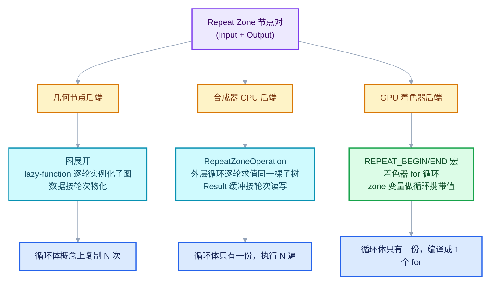
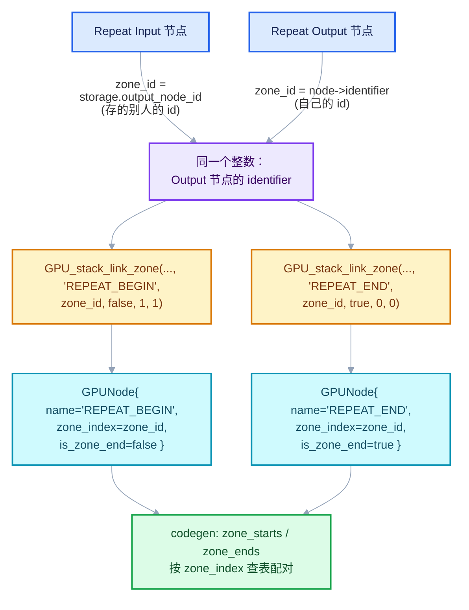
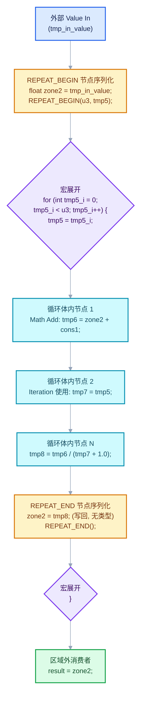
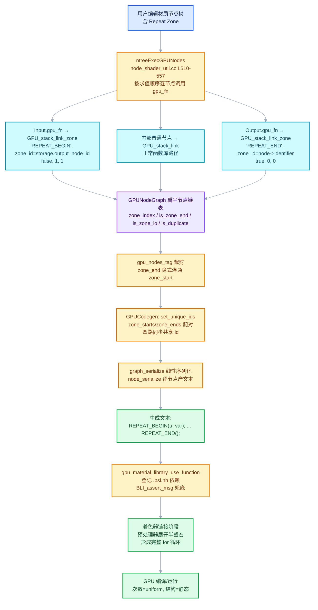

# 02 - GPU 着色器与 GPU_stack_link_zone

<div style="font-family:'Segoe UI','Microsoft YaHei',system-ui,-apple-system,sans-serif;display:flex;flex-wrap:wrap;align-items:center;gap:8px;margin:16px 0 20px;padding:10px 14px;background:#F8FAFC;border:1px solid #E2E8F0;border-radius:12px">
<span style="font-size:11px;font-weight:700;letter-spacing:.1em;color:#64748B;margin-right:2px">导航</span>
<a href="../README.md" style="font-size:13px;color:#334155;background:#F1F5F9;border:1px solid #E2E8F0;border-radius:999px;padding:3px 12px;text-decoration:none;white-space:nowrap">总入口</a>
<a href="./README.md" style="font-size:13px;color:#2563EB;background:#EFF6FF;border:1px solid #BFDBFE;border-radius:999px;padding:3px 12px;text-decoration:none;white-space:nowrap">本章 05-跨后端实现</a>
<a href="./01-合成器RepeatZoneOperation.md" style="font-size:13px;color:#2563EB;background:#EFF6FF;border:1px solid #BFDBFE;border-radius:999px;padding:3px 12px;text-decoration:none;white-space:nowrap">‹ 合成器RepeatZoneOperation</a>
</div>

<div style="font-family:'Segoe UI','Microsoft YaHei',system-ui,-apple-system,sans-serif;margin:18px 0 22px;padding:14px 18px;background:#F5F3FF;border-left:4px solid #7C3AED;border-radius:10px">

</div>

**基准说明**：本文基于当前工作区源码快照（`D:\Repository\blender-git\blender`，Blender 4.5/5.0 开发主线，Repeat Zone 于 2023 年引入、GPU zone 机制于 2025 年扩展）。文中所有行号均为调研时的快照行号，上游提交后可能漂移；请以链接指向的源文件为最终依据。所有"教学示意代码"均明确标注，不是编译器真实产物。

<hr style="border:none;height:1px;background:linear-gradient(90deg,#BFDBFE,#E2E8F0 55%,transparent);margin:34px 0">

## 先回答一个具体问题

**同一个 Repeat 区域，GPU 后端怎么实现循环？**

一句话答案：**GPU 后端把 Repeat 区域编译成着色器源码里一段真正的 `for` 循环**。具体分三步：

1. **打标**：Repeat 区域的 Input/Output 两个节点在编译 GPU 节点图时，各自调用 `GPU_stack_link_zone()` 生成一个特殊的 GPUNode，名字分别是 `REPEAT_BEGIN` 和 `REPEAT_END`，并带上同一个 `zone_index` 把两端配对；
2. **成对展开**：代码生成器（`gpu_codegen.cc`）按求值顺序线性序列化节点。`REPEAT_BEGIN` 节点在生成文本中展开为宏 `REPEAT_BEGIN(count, var)` —— 也就是一个**只写了左半边的 for 循环**（`for (int var_i = 0; var_i < count; var_i++) { var = var_i;`），随后序列化的所有内部节点代码**文本上自然落进这个 for 的循环体**；
3. **闭合**：`REPEAT_END` 节点生成 `REPEAT_END()`，宏展开只是一个闭括号 `}`，循环结束。

循环变量不是任意 zone item——它是 Repeat Input 节点的 **"Iteration" 输出**对应的临时变量；而区域端口（zone item）的数据则靠另一套机制在循环内外"续命"：Input 端和 Output 端的同名 item 会被 `set_unique_ids()` 分配**同一个变量 id**，生成同一个 `zone<id>` 变量，循环体里对它的写入就是循环携带值（loop-carried value）。

这在 Blender 里是**第三种循环执行模型**：不是几何节点的"把子图复制 N 份展开"，也不是合成器 CPU 端的"逐轮求值子树"，而是**静态生成的着色器循环**——循环体只编译一次，循环次数在运行期由 uniform 决定。

下面逐层拆解。你可以先记住本章的三个源码坐标：

| 源码坐标 | 角色 |
| --- | --- |
| [gpu_shader_material_repeat_zone.bsl.hh](../../../source/blender/gpu/shaders/material/gpu_shader_material_repeat_zone.bsl.hh)（全文 30 行） | `REPEAT_BEGIN`/`REPEAT_END` 宏与占位函数 |
| [node_geo_repeat.cc](../../../source/blender/nodes/geometry/nodes/node_geo_repeat.cc) 中两个 `node_shader_fn`（Input L139—L147、Output L309—L317） | 把节点转成带 zone 标记的 GPUNode |
| [gpu_node_graph.cc](../../../source/blender/gpu/intern/gpu_node_graph.cc) 的 `GPU_stack_link_zone`（L1076—L1121）与 [gpu_codegen.cc](../../../source/blender/gpu/intern/gpu_codegen.cc) 的序列化/配对逻辑 | 打标、共享 id、生成循环文本 |

<hr style="border:none;height:1px;background:linear-gradient(90deg,#BFDBFE,#E2E8F0 55%,transparent);margin:34px 0">

## 三种后端总览

Repeat Zone 是一个"跨后端"的节点结构：同一对 Input/Output 节点，在不同的执行后端里有完全不同的循环实现。Blender 目前有三种：



三种模型的对照表：

| 维度 | 几何节点后端 | 合成器 CPU 后端 | GPU 着色器后端 |
| --- | --- | --- | --- |
| 循环实现 | 图展开：每轮实例化一次子图（lazy-function 图逐轮求值） | `RepeatZoneOperation`：一个 operation 外层 for，逐轮调用子树求值 | 着色器源码里静态生成 `for` 循环 |
| 循环体代码份数 | 概念上 N 份（惰性，按需求值） | 1 份代码，执行 N 遍 | 1 份代码，编译成 1 个 GPU for |
| 循环次数决定时机 | 求值期（读 "Iterations" 输入） | 求值期（`execute()` 里读输入） | **编译期定结构、运行期定次数**（count 来自 uniform/链接） |
| 数据如何跨轮 | 端口数组 + 每轮的 field 上下文 | `Result` 图像缓冲，按轮次读写 | `zone<id>` 共享变量（循环携带值） |
| 关键源码 | `geometry_nodes_lazy_function.cc` | [repeat_zone_operation.cc](../../../source/blender/compositor/intern/repeat_zone_operation.cc) | 本章主角 |
| Iteration 输出来源 | 每轮实例化时绑定的索引 | operation 内轮次计数 | 宏参数 `var = var##_i` |
| 支持的数据 | 任意 geometry/field/匿名属性 | 图像 Result | 节点函数参数白名单内的标量/向量/采样器等（见"约束与限制"） |

> 注意一个容易混淆的点：合成器**复用**了 `GeometryNodeRepeatInput/Output` 这套节点类型（见 [node_tree_evaluator.cc L331](../../../source/blender/compositor/intern/node_tree_evaluator.cc#L331) 的类型判断），所以 `node_geo_repeat.cc` 里才会同时出现 `node_shader_fn`（GPU 路径）和懒函数图/合成器路径的代码。GPU 编译路径（`ntreeExecGPUNodes` → `gpu_fn`）是同一条节点类型注册表上的第三个"消费者"。

GPU 端这套 zone 机制也不是 Repeat Zone 专用的：着色器节点里还有一对内部节点 `LIGHT_ITER_INTERNAL_INPUT/OUTPUT`（[node_shader_light_iter_internal.cc](../../../source/blender/nodes/shader/nodes/node_shader_light_iter_internal.cc)）用完全相同的 `GPU_stack_link_zone` 机制生成 `LIGHT_ITER_BEGIN/END` 循环，用来遍历灯光。学完本章，这对节点你也顺带懂了。

<hr style="border:none;height:1px;background:linear-gradient(90deg,#BFDBFE,#E2E8F0 55%,transparent);margin:34px 0">

## REPEAT_BEGIN/END 宏

整个 GPU 循环的"语法"只有 30 行，全部在 [gpu_shader_material_repeat_zone.bsl.hh](../../../source/blender/gpu/shaders/material/gpu_shader_material_repeat_zone.bsl.hh) 里。

### [讲解] 逐段拆解

这个文件被两拨人读，所以要写成两个分支：

**第一拨：真正的着色器编译。** 当 `GPU_SHADER` 宏已定义（着色器依赖系统把 .bsl.hh 拼进最终 GLSL 时会定义它），读到的就是两个宏：

```hlsl
// [讲解] GPU_SHADER 分支：真正的循环语法（示意重排，原文是带续行符的单行宏）
#define REPEAT_BEGIN(count, var)                \
    for (int var##_i = 0;                       \
         var##_i < count;                       \
         var##_i++)                             \
    {                                           \
      var = var##_i;                            // 注意：只开括号，没有闭括号！

#define REPEAT_END() }
// REPEAT_END 只是一个闭括号，与 REPEAT_BEGIN 的开括号配对。
```

三个关键点：

1. **`var##_i` 是 C 预处理器 token 粘贴（token pasting）**。`##` 把 `var` 的实参和 `_i` 拼成一个新标识符。如果你写 `REPEAT_BEGIN(3, iter)`，展开就是 `for (int iter_i = 0; iter_i < 3; iter_i++) { iter = iter_i;`。粘贴的目的是让每个 `REPEAT_BEGIN` 得到**独立的循环计数变量**，两个嵌套的 Repeat 区域不会互相覆盖（`iter_i` vs `other_i`）。
2. **`var = var##_i` 是宏的"第二半"**。`var` 实参不是 zone item，而是 Repeat Input 节点 "Iteration" 输出对应的临时变量（后面"着色器生成结果"一节会看到生成的调用长什么样）。每轮循环开头把轮次索引赋给它，区域内读 "Iteration" 输出的节点拿到的就是这个值。
3. **宏故意只写半截**。`REPEAT_BEGIN` 展开文本以 `{` 结尾、没有 `}`；`REPEAT_END` 展开就是一个 `}`。两者之间的**任何生成代码**都文本上落进循环体。这是整套机制最"取巧"也最脆弱的地方——它依赖节点序列化顺序恰好把内部节点夹在两个调用之间（这一顺序由求值顺序保证，见后文）。

**第二拨：`gpu_shader_dependency` 反射系统。** 非着色器编译时（构建期/离线扫描 .bsl.hh 收集 `[[node]]` 函数元数据的场景），`GPU_SHADER` 未定义，读到的是两个占位函数：

```hlsl
// [讲解] 非 GPU_SHADER 分支：给 gpu_shader_dependency 反射用的占位
[[node]]
void REPEAT_BEGIN(int dummy)
{
}

[[node]]
void REPEAT_END(float dummy)
{
}
```

为什么需要占位？因为反射系统需要知道"存在一个叫 `REPEAT_BEGIN` 的节点函数、它有哪些参数"才能建立函数库条目，但宏定义对 C++ 侧的解析器是不可见的（`#ifdef GPU_SHADER` 之外的解析器不会展开 GLSL 宏）。原文件注释说得很直白：

> Dummy functions for gpu_shader_dependency. Functions need parameters to be reflected, but we don't really rely on the reflection data.

也就是说：占位函数的参数（`int dummy` / `float dummy`）**只为了让反射器接受这个函数**，参数本身没有语义。真正的参数匹配不靠它——因为 `GPU_stack_link_zone` 压根不走函数库的参数校验路径（见下一节）。

`[[node]]` 属性本身由 GPU shader tool（`shader_tool/processor.cc`）识别：带这个属性的 `void` 函数会被解析成节点函数库条目，且要求至少一个参数、返回类型必须是 `void`、参数类型必须在白名单内（float1—4、int1—4、bool1、float3x3、float4x4、sampler 系列、Closure、KernelGlobals、ShadingData），否则在**反射阶段直接报编译错误**（`report_error(...)`）。这其实是 zone 相关的第一道"错误处理"：如果谁把 `REPEAT_BEGIN` 的占位改成不合法的形态，构建期就会失败。

<details>
<summary>核对原始源码：gpu_shader_material_repeat_zone.bsl.hh · L1—L30（全文）</summary>

```hlsl
/* SPDX-FileCopyrightText: 2025 Blender Authors
 *
 * SPDX-License-Identifier: GPL-2.0-or-later */

#pragma once

#ifdef GPU_SHADER

#  define REPEAT_BEGIN(count, var) \
    for (int var##_i = 0; var##_i < count; var##_i++) { \
      var = var##_i;

#  define REPEAT_END() }

#else

/**
 * Dummy functions for gpu_shader_dependency.
 * Functions need parameters to be reflected, but we don't really rely on the reflection data.
 */
[[node]]
void REPEAT_BEGIN(int dummy)
{
}
[[node]]
void REPEAT_END(float dummy)
{
}

#endif
```

</details>

### 宏展开对照表

以 `REPEAT_BEGIN(3, iter)` 为例：

| 源文本（生成代码里写的） | 预处理展开后 |
| --- | --- |
| `REPEAT_BEGIN(3, iter);` | `for (int iter_i = 0; iter_i < 3; iter_i++) { iter = iter_i;` |
| ……中间任意着色器语句…… | （原样落在 for 循环体内） |
| `REPEAT_END();` | `}` |

一个典型的完整展开：

```hlsl
// 生成代码里的三行：
REPEAT_BEGIN(u_iterations, tmp7);
tmp8 = tmp7;                 /* 某个内部节点 */
REPEAT_END();

// 预处理之后：
for (int tmp7_i = 0; tmp7_i < u_iterations; tmp7_i++) {
  tmp7 = tmp7_i;
  tmp8 = tmp7;
}
```

（上面是宏语义演示，节点名/变量名是示意；真实生成的 `count` 与 `var` 实参来自 `REPEAT_BEGIN` 这个 GPUNode 的常规输入与常规输出，见下文。）

<hr style="border:none;height:1px;background:linear-gradient(90deg,#BFDBFE,#E2E8F0 55%,transparent);margin:34px 0">

## node_shader_fn 与 GPU_stack_link_zone

### 两个打标函数

Repeat Input/Output 两个节点的 GPU 路径入口是各自的 `node_shader_fn`（注册为 `ntype.gpu_fn`）。当材质/节点树被编译成 GPU 节点图时（`ntreeExecGPUNodes` 逐节点调用 `gpu_fn`，见 [node_shader_util.cc L510—L557](../../../source/blender/nodes/shader/node_shader_util.cc#L510)），这两个函数被调用。

**Input 节点**（[node_geo_repeat.cc L139—L147](../../../source/blender/nodes/geometry/nodes/node_geo_repeat.cc#L139)）：

```cpp
// [讲解] Repeat Input 的 GPU 打标函数
static int node_shader_fn(GPUMaterial *mat,
                          bNode *node,
                          bNodeExecData * /*execdata*/,
                          GPUNodeStack *in,
                          GPUNodeStack *out)
{
  // 取本节点 storage 里存的"配对 Output 节点的 identifier"
  int zone_id = node_storage(*node).output_node_id;
  // 名字 REPEAT_BEGIN；zone_index = zone_id；is_zone_end = false；
  // 1 个常规输入、1 个常规输出，其余 socket 都是 zone IO
  return GPU_stack_link_zone(mat, node, "REPEAT_BEGIN", in, out, zone_id, false, 1, 1);
}
```

**Output 节点**（[node_geo_repeat.cc L309—L317](../../../source/blender/nodes/geometry/nodes/node_geo_repeat.cc#L309)）：

```cpp
// [讲解] Repeat Output 的 GPU 打标函数
static int node_shader_fn(GPUMaterial *mat,
                          bNode *node,
                          bNodeExecData * /*execdata*/,
                          GPUNodeStack *in,
                          GPUNodeStack *out)
{
  // 取"自己"的 identifier
  int zone_id = node->identifier;
  // 名字 REPEAT_END；is_zone_end = true；
  // 0 个常规输入、0 个常规输出 —— 全部 socket 都是 zone IO
  return GPU_stack_link_zone(mat, node, "REPEAT_END", in, out, zone_id, true, 0, 0);
}
```

### zone_id 的两种取值如何配对

这是本章最容易答错的问题：**两端 `zone_id` 的取值来源不同，但值相同**。

- Input 端：`node_storage(*node).output_node_id` —— Input 节点的持久化存储里保存着它所属区域的 **Output 节点的 identifier**（这个字段在 UI 建立区域时写回，`NodeGeometryRepeatInput::output_node_id`）。
- Output 端：`node->identifier` —— Output 节点**自己的** identifier。

于是两端的 `zone_id` 最终都等于 **Output 节点的 identifier** 这个整数。配对逻辑是"Output 是锚点，Input 存锚点的地址"：



为什么这样设计而不是"两端都查自己的 storage"？因为区域配对的**权威数据**本来就在 Output 端：Repeat 的 item 列表（端口数量、类型、名字）存在 `NodeGeometryRepeatOutput` 里，Input 只持有对它的引用（`output_node_id`）。GPU 打标沿用同一个引用方向，天然不会出现两端 item 数目不一致以外的错位。

### GPU_stack_link_zone 的签名与参数

声明在 [GPU_material.hh L681—L689](../../../source/blender/gpu/GPU_material.hh#L681)：

```cpp
bool GPU_stack_link_zone(GPUMaterial *material,
                         const bNode *bnode,
                         const char *name,
                         GPUNodeStack *in,
                         GPUNodeStack *out,
                         int zone_index,
                         bool is_zone_end,
                         int in_argument_count,
                         int out_argument_count);
```

逐参数解释（对照下面的实现）：

| 参数 | 含义 | Input 节点传入 | Output 节点传入 |
| --- | --- | --- | --- |
| `material` | 正在编译的 GPUMaterial，决定节点挂到哪张图 | `mat` | `mat` |
| `bnode` | 源 bNode，用于给输入 socket 取默认值/链接 | `node` | `node` |
| `name` | 生成的 GPUNode 名字 = 着色器里被"调用"的函数名 | `"REPEAT_BEGIN"` | `"REPEAT_END"` |
| `in` / `out` | 节点的输入/输出栈（`GPUNodeStack` 数组，以 `end` 成员结尾），由 `ntreeExecGPUNodes` 从 bNodeSocket 构造 | 全部输入/输出 | 全部输入/输出 |
| `zone_index` | 区域配对键，两端必须相等 | `storage.output_node_id` | `node->identifier` |
| `is_zone_end` | 是否为区域结束端 | `false` | `true` |
| `in_argument_count` | 输入栈前 N 个是"常规参数"（会作为函数实参出现在生成的调用里），其余是 zone IO | `1`（即 "Iterations"） | `0` |
| `out_argument_count` | 输出栈前 N 个是"常规输出"（作为函数实参/宏实参出现），其余是 zone IO | `1`（即 "Iteration"） | `0` |

`in_argument_count`/`out_argument_count` 这两个数是**函数语义与 zone 语义的分界线**。对 `REPEAT_BEGIN` 而言，这个"函数"在宏语义上是 `REPEAT_BEGIN(count, var)`：`count` 来自第 0 个输入（"Iterations"），`var` 对应第 0 个输出（"Iteration"）。而剩下的 item 端口全部被标记为 zone IO，走完全不同的生成规则（共享变量，而不是函数实参）。

`GPU_STACK` 的栈布局回顾（以一个带 1 个 item "Value" 的 Input 节点为例）：

- 输入栈：`[0]="Iterations"`（常规）、`[1]="Item_x_Value"`（zone IO）、…
- 输出栈：`[0]="Iteration"`（常规）、`[1]="Item_x_Value"`（zone IO）、…

### [讲解] 实现逐段拆解

实现只有 46 行（[gpu_node_graph.cc L1076—L1121](../../../source/blender/gpu/intern/gpu_node_graph.cc#L1076)），做了四件事：建节点、打两个标记、搬 socket、划分常规/zone 边界。

```cpp
// [讲解] GPU_stack_link_zone 的核心逻辑（示意重排，保留原语义）
bool GPU_stack_link_zone(GPUMaterial *material, const bNode *bnode, const char *name,
                         GPUNodeStack *in, GPUNodeStack *out,
                         int zone_index, bool is_zone_end,
                         int in_argument_count, int out_argument_count)
{
  GPUNodeGraph *graph = gpu_material_node_graph(material);

  /* ① 建一个普通 GPUNode，名字就是将来着色器里"调用"的函数名。 */
  GPUNode *node = gpu_node_create(name);

  /* ② 打上 zone 标记——这是这个节点与普通节点唯一的区别。
   *    普通 gpu_node_create() 会初始化 zone_index = -1、is_zone_end = false，
   *    也就是说 -1 表示"不属于任何 zone"。 */
  node->zone_index = zone_index;
  node->is_zone_end = is_zone_end;

  /* ③ 把输入栈搬成 GPUInput 列表（跳过 GPU_NONE 类型的槽位）。 */
  if (in) {
    for (int i = 0; !in[i].end; i++) {
      if (in[i].type != GPU_NONE) {
        gpu_node_input_socket(material, bnode, node, &in[i], i);
      }
    }
  }
  /* ④ 把输出栈搬成 GPUOutput 列表。 */
  if (out) {
    for (int i = 0; !out[i].end; i++) {
      if (out[i].type != GPU_NONE) {
        gpu_node_output(node, out[i].type, &out[i].link);
      }
    }
  }

  /* ⑤ 划界：下标 >= argument_count 的一律标记为 zone IO。
   *    输入端：is_duplicate 只在"结束端"成立——zone 变量已在开始端声明过，
   *            结束端再出现时是"复用"而非"重新声明"。
   *    输出端：所有 zone IO 输出都算 is_duplicate。 */
  for (const auto [i, input] : node->inputs.enumerate()) {
    input.is_zone_io  = i >= in_argument_count;
    input.is_duplicate = input.is_zone_io && is_zone_end;
  }
  for (const auto [i, output] : node->outputs.enumerate()) {
    output.is_zone_io  = i >= out_argument_count;
    output.is_duplicate = output.is_zone_io;
  }

  BLI_addtail(&graph->nodes, node);
  return true;
}
```

值得强调的三个细节：

1. **没有函数库校验**。对比普通路径 `GPU_link`/`GPU_stack_link`（[gpu_node_graph.cc L953—L1074](../../../source/blender/gpu/intern/gpu_node_graph.cc#L953)），它们第一步就是 `gpu_material_library_get_function(name)` 查反射元数据、按元数据逐参数建输入；`GPU_stack_link_zone` **完全跳过这一步**，直接按 socket 栈建输入输出。所以 zone 节点的"函数签名"只存在于两处：宏定义（真实语义）和 `[[node]]` 占位（仅供反射系统收录，无实际约束）。函数库查找被推迟到代码生成阶段（`node_serialize` → `gpu_material_library_use_function`，用于把宏所在的 .bsl.hh 加进依赖），那里才有一个 `BLI_assert_msg(function != nullptr, "Requested function not in the function library")`（[gpu_shader_dependency.cc L638—L643](../../../source/blender/gpu/intern/gpu_shader_dependency.cc#L638)）兜底。
2. **`is_zone_io` 是"生成策略开关"**。代码生成器见到 `is_zone_io` 的输入/输出就不再按"函数实参"处理（`node_serialize` 的实参循环遇到第一个 zone IO 就 `break`），改按"共享 zone 变量"处理。
3. **`is_duplicate` 是"声明去重"**。同一个 `zone<id>` 变量会被开始端声明一次；结束端的同名输入如果再声明就重复定义了，所以结束端输入标 `is_duplicate`，生成时跳过类型、只生成赋值（或什么都不生成）。这与 UBO 字段命名的去重是同一套路（`u<id>` vs `u<id>b`，见 [gpu_codegen.cc L313](../../../source/blender/gpu/intern/gpu_codegen.cc#L313)）。

<details>
<summary>核对原始源码：gpu_node_graph.cc · L1076—L1121（GPU_stack_link_zone 全文）</summary>

```cpp
bool GPU_stack_link_zone(GPUMaterial *material,
                         const bNode *bnode,
                         const char *name,
                         GPUNodeStack *in,
                         GPUNodeStack *out,
                         int zone_index,
                         bool is_zone_end,
                         int in_argument_count,
                         int out_argument_count)
{
  GPUNodeGraph *graph = gpu_material_node_graph(material);
  GPUNode *node;

  node = gpu_node_create(name);
  node->zone_index = zone_index;
  node->is_zone_end = is_zone_end;

  if (in) {
    for (int i = 0; !in[i].end; i++) {
      if (in[i].type != GPU_NONE) {
        gpu_node_input_socket(material, bnode, node, &in[i], i);
      }
    }
  }

  if (out) {
    for (int i = 0; !out[i].end; i++) {
      if (out[i].type != GPU_NONE) {
        gpu_node_output(node, out[i].type, &out[i].link);
      }
    }
  }

  for (const auto [i, input] : node->inputs.enumerate()) {
    input.is_zone_io = i >= in_argument_count;
    input.is_duplicate = input.is_zone_io && is_zone_end;
  }
  for (const auto [i, output] : node->outputs.enumerate()) {
    output.is_zone_io = i >= out_argument_count;
    output.is_duplicate = output.is_zone_io;
  }

  BLI_addtail(&graph->nodes, node);

  return true;
}
```

</details>

<details>
<summary>核对原始源码：node_geo_repeat.cc · L139—L147（Input 的 node_shader_fn）</summary>

```cpp
static int node_shader_fn(GPUMaterial *mat,
                          bNode *node,
                          bNodeExecData * /*execdata*/,
                          GPUNodeStack *in,
                          GPUNodeStack *out)
{
  int zone_id = node_storage(*node).output_node_id;
  return GPU_stack_link_zone(mat, node, "REPEAT_BEGIN", in, out, zone_id, false, 1, 1);
}
```

</details>

<details>
<summary>核对原始源码：node_geo_repeat.cc · L309—L317（Output 的 node_shader_fn）</summary>

```cpp
static int node_shader_fn(GPUMaterial *mat,
                          bNode *node,
                          bNodeExecData * /*execdata*/,
                          GPUNodeStack *in,
                          GPUNodeStack *out)
{
  int zone_id = node->identifier;
  return GPU_stack_link_zone(mat, node, "REPEAT_END", in, out, zone_id, true, 0, 0);
}
```

</details>

### 数据结构层面：标记住在哪里

三个标记都住在 [gpu_node_graph.hh](../../../source/blender/gpu/intern/gpu_node_graph.hh) 里：

| 结构 | 字段 | 语义 |
| --- | --- | --- |
| `GPUNode`（L89—L91） | `int zone_index` | 区域配对键；`gpu_node_create()` 初始化为 `-1` 表示非 zone 节点 |
| `GPUNode` | `bool is_zone_end` | 是否区域结束端 |
| `GPUInput`（L173—L176） | `bool is_zone_io` | 该输入是 zone 端口而非函数实参（注释原文：*True for Zone Items.*） |
| `GPUInput` | `bool is_duplicate` | 变量与别处共享、无需重复声明（注释原文：*This variable is shared with other socket/s and doesn't need to be declared.*） |
| `GPUOutput`（L133—L136） | 同上两个字段 | 同上 |

<hr style="border:none;height:1px;background:linear-gradient(90deg,#BFDBFE,#E2E8F0 55%,transparent);margin:34px 0">

## 着色器生成结果

现在把打标后的节点图交给代码生成器，看它怎么变成带 `for` 的 GLSL。这一节先讲清三个机制，再给示意代码。

### 机制一：线性序列化 + 半截宏 = 循环体

`GPUCodegen::graph_serialize`（[gpu_codegen.cc L491—L527](../../../source/blender/gpu/intern/gpu_codegen.cc#L491)）按 `graph.nodes` 列表顺序逐个调 `node_serialize`。源码注释明确说明顺序来源：

> NOTE: The node order is already top to bottom (or left to right in node editor) because of the evaluation order inside ntreeExecGPUNodes().

即节点列表本身已按拓扑/求值顺序排好。于是只要 `REPEAT_BEGIN` 排在所有内部节点之前、`REPEAT_END` 排在之后，半截宏就自然把中间的生成文本"圈"进循环体。**GPU 节点图里并没有嵌套的"循环体"数据结构**——循环体是序列化文本的产物。

### 机制二：set_unique_ids 让两端共享同一个 zone 变量

zone item 要在"循环外进入 → 循环体内读写 → 循环外流出"，就必须是**同一个变量**。这由 `GPUCodegen::set_unique_ids()`（[gpu_codegen.cc L608—L655](../../../source/blender/gpu/intern/gpu_codegen.cc#L608)）完成：

```cpp
// [讲解] set_unique_ids 的 zone 配对部分（示意重排）
void GPUCodegen::set_unique_ids()
{
  Map<int, GPUNode *> zone_starts;   // zone_index -> REPEAT_BEGIN 节点
  Map<int, GPUNode *> zone_ends;    // zone_index -> REPEAT_END 节点

  /* 第一遍：给全图所有 input/output 分配全局唯一 id（1,2,3,...），
   * 同时把 zone 两端节点按 zone_index 收进两张表。 */
  for (GPUNode &node : graph.nodes) {
    for (GPUInput &input : node.inputs)  { input.id = id++; }
    for (GPUOutput &output : node.outputs) { output.id = id++; }
    if (node.zone_index != -1) {
      (node.is_zone_end ? zone_ends : zone_starts).add(node.zone_index, &node);
    }
  }

  /* 找到第一个 zone IO 槽位的辅助函数——
   * 因为 argument_count 之前的槽位是常规参数，zone IO 从某个下标才开始。 */
  auto find_zone_io = [](auto first) {
    while (first && !first->is_zone_io && first->next) { first = first->next; }
    return first;
  };

  /* 第二遍：对每个区域，把开始端与结束端的 zone IO 槽位
   *   start_input / start_output / end_input / end_output
   * 一一对应，全部改写成同一个 id（取 start_input 的 id）。
   * 变量名由 id 派生（zone<id>），id 相同 = 同一个变量。 */
  for (GPUNode *end : zone_ends.values()) {
    GPUInput  *end_input   = find_zone_io(end->inputs.first());
    GPUOutput *end_output  = find_zone_io(end->outputs.first());
    GPUNode   *start       = zone_starts.lookup(end->zone_index);
    GPUInput  *start_input  = find_zone_io(start->inputs.first());
    GPUOutput *start_output = find_zone_io(start->outputs.first());

    for (; start_input;
         start_input = start_input->next,  start_output = start_output->next,
         end_input  = end_input->next,    end_output  = end_output->next)
    {
      start_output->id = start_input->id;
      end_input->id    = start_input->id;
      end_output->id   = start_input->id;
    }
  }
}
```

这个"四路同步"的赋值正是 Repeat 区域数据流的命脉：

- `start_output`（Input 节点的 item 输出）与 `start_input`（Input 节点的 item 输入）同 id → 外部进来的值在开始端被装进 `zone<id>`，区域内读 Input item 端口实际读 `zone<id>`；
- `end_input`（Output 节点的 item 输入）同 id → 区域内最后一个节点的结果在结束端被**写回** `zone<id>`；
- `end_output`（Output 节点的 item 输出）同 id → 区域外读 Output item 端口读到的就是循环结束后的最终值。

注意这是**按槽位顺序一一对应**的（两端的 item 数量本来就一致——都来自同一个 Output 节点的 item 列表），不做名字匹配。

<details>
<summary>核对原始源码：gpu_codegen.cc · L608—L655（set_unique_ids 全文）</summary>

```cpp
/* Sets id for unique names for all inputs, resources and temp variables. */
void GPUCodegen::set_unique_ids()
{
  Map<int, GPUNode *> zone_starts;
  Map<int, GPUNode *> zone_ends;

  int id = 1;
  for (GPUNode &node : graph.nodes) {
    for (GPUInput &input : node.inputs) {
      input.id = id++;
    }
    for (GPUOutput &output : node.outputs) {
      output.id = id++;
    }
    if (node.zone_index != -1) {
      auto &map = node.is_zone_end ? zone_ends : zone_starts;
      map.add(node.zone_index, &node);
    }
  }

  auto find_zone_io = [](auto first) {
    while (first && !first->is_zone_io && first->next) {
      first = first->next;
    }
    return first;
  };

  /* Assign the same id to inputs and outputs of start and end zones. */
  for (GPUNode *end : zone_ends.values()) {

    GPUInput *end_input = find_zone_io(end->inputs.first());
    GPUOutput *end_output = find_zone_io(end->outputs.first());

    GPUNode *start = zone_starts.lookup(end->zone_index);

    GPUInput *start_input = find_zone_io(start->inputs.first());
    GPUOutput *start_output = find_zone_io(start->outputs.first());

    for (; start_input; start_input = start_input->next,
                        start_output = start_output->next,
                        end_input = end_input->next,
                        end_output = end_output->next)
    {
      start_output->id = start_input->id;
      end_input->id = start_input->id;
      end_output->id = start_input->id;
    }
  }
}
```

</details>

### 机制三：node_serialize 里的 zone 变量生成规则

`GPUCodegen::node_serialize`（[gpu_codegen.cc L339—L478](../../../source/blender/gpu/intern/gpu_codegen.cc#L339)）为每个节点生成三段文本：变量声明、函数调用、（zone 场景下的）写回。zone 相关规则浓缩如下（均已核对原文）：

1. **变量命名**：`operator<<(GPUInput*)`/`operator<<(GPUOutput*)`（L44—L79）按 `is_zone_io` 选前缀——zone IO 输出 `zone<id>`，普通临时量输出 `tmp<id>`（常量是 `cons<id>`、结构是 `strct<id>`）。**`zone<id>` 就是跨循环边界的那个变量。**
2. **实参截断**：生成函数调用 `name(args...)` 时，输入实参循环遇到第一个 `is_zone_io` 输入就 `break`（L436—L438），输出实参同理（L456—L458）。所以 `REPEAT_BEGIN` 生成的调用只带 `Iterations`（count）和 `Iteration`（var）两个实参；`REPEAT_END` 一个实参都不带。
3. **zone 输入的声明/赋值**（L401—L413）：
   - 来源是链接输出（`GPU_SOURCE_OUTPUT`）或属性（`GPU_SOURCE_ATTR`）且 `is_zone_io` → 生成 `zone<id> = <来源>;`。这一行发生在 `REPEAT_BEGIN` 节点序列化时，就是"外部值装进 zone 变量"；发生在 `REPEAT_END` 节点序列化时（其 item 输入链接自循环体内部节点），就是"循环体结果写回 zone 变量"。`type()` 辅助函数对 `is_duplicate` 返回空串，所以结束端写回**不带类型**（`zone1 = tmp8;` 而不是 `float zone1 = tmp8;`），避免重复声明；
   - 其他来源（常量、uniform 等）→ 仅当 `is_zone_io && (!is_duplicate || !input.link)` 时声明赋值，即结束端的常量/uniform 型 item 不会再生成任何东西（变量在开始端已初始化）。
4. **常规参数照常生成**：`Iterations` 若是 uniform 则实参形如 `node_tree.u<id>`，若是链接则形如 `tmp<id>`。

### 生成结果示意（Value 相加 3 次）

设一个最小 Repeat 区域：

- 外部：`Value In = 10.0` 接入 Input 的 item 端口 "Value"；`Iterations = 3`；
- 区域内：Math 节点 `Add(Value, 2.0)`，结果接回 Output 的 item 端口；"Iteration" 输出接一个除法节点演示轮次使用；
- 区域外：Output 的 "Value" 流向材质输出。

下面是**生成的 GLSL 概念形态**——变量名（`tmp1`、`zone2`、`node_tree.u3`）和语句顺序是按上述源码规则推演的教学示意，**不是任何一次真实编译的逐字节产物**（真实产物里还有类型转换包装、行号指令、依赖库 include 等）：

```glsl
/* ===== 教学示意：非真实编译产物 ===== */

/* uniform 缓冲（NodeTree UBO）里携带 Iterations 的值 */
/* struct NodeTree { ... float u3; ... }; */

float cons1 = 2.0;                 /* Math 节点的 2.0 常量输入 */

/* REPEAT_BEGIN 节点的序列化：
 *  - item 输入链接自外部 tmp（Value In）→ 声明并初始化 zone 变量（无 duplicate） */
float zone2 = tmp_in_value;        /* zone item "Value" 的共享变量 */

/* 函数调用：实参循环在第一个 zone IO 输入处 break，
 * 只剩 Iterations（uniform）和 Iteration（输出 tmp）两个实参 */
REPEAT_BEGIN(node_tree.u3, tmp5);
/* 宏展开 →  for (int tmp5_i = 0; tmp5_i < node_tree.u3; tmp5_i++) { tmp5 = tmp5_i;
 *
 * ↓↓↓ 以下全部是循环体（序列化顺序恰好夹在 BEGIN/END 之间）↓↓↓ */

tmp6 = zone2 + cons1;              /* Math Add：读共享变量，算本轮结果 */
tmp7 = tmp5;                       /* 某节点读 "Iteration" 输出（var 实参的值） */
tmp8 = tmp6 / (tmp7 + 1.0);        /* 除以 (轮次+1)，演示 Iteration 的用法 */

/* REPEAT_END 节点的 item 输入链接自 tmp8：
 * is_zone_io && is_duplicate → 不带类型地写回 zone 变量 */
zone2 = tmp8;

/* REPEAT_END 节点的函数调用：全部实参都是 zone IO → 零实参 */
REPEAT_END();
/* 宏展开 →  }
 *
 * ↑↑↑ 循环体结束 ↑↑↑ */

/* 区域外消费者读 Output 的 item 端口 → 读的还是 zone2（共享 id） */
float result = zone2;              /* 3 轮后 = 16.0，见"用小数据走一遍" */
```

循环体的生成结构一图流：



<details>
<summary>核对原始源码：gpu_codegen.cc · L395—L414（zone 输入的声明/赋值规则）</summary>

```cpp
      case GPU_SOURCE_CONSTANT:
        if (!input.is_duplicate) {
          eval_ss << type() << " " << &input << " = " << static_cast<GPUConstant *>(&input)
                  << ";\n";
        }
        break;
      case GPU_SOURCE_OUTPUT:
      case GPU_SOURCE_ATTR:
        if (input.is_zone_io) {
          eval_ss << type() << " " << &input << " = ";
          source_reference(&input);
          eval_ss << ";\n";
        }
        break;
      default:
        if (input.is_zone_io && (!input.is_duplicate || !input.link)) {
          eval_ss << type() << " zone" << input.id << " = " << &input << ";\n";
        }
        break;
```

其中 `type()` 是紧邻其前的 lambda：`if (!input.is_duplicate) ss << input.type;` —— duplicate 时空类型串，正好实现"赋值不重复声明"。

</details>

<details>
<summary>核对原始源码：gpu_codegen.cc · L432—L474（函数调用生成与 zone IO 截断）</summary>

```cpp
  /* Function call. */
  eval_ss << node->name << "(";
  /* Input arguments. */
  for (GPUInput &input : node->inputs) {
    if (input.is_zone_io) {
      break;
    }
    switch (input.source) {
      case GPU_SOURCE_OUTPUT:
      case GPU_SOURCE_ATTR: {
        source_reference(&input);
        break;
      }
      default:
        eval_ss << &input;
        break;
    }
    GPUOutput *output = node->outputs.first();
    if ((input.next && !input.next->is_zone_io) || (output && !output->is_zone_io)) {
      eval_ss << ", ";
    }
  }
  /* Output arguments. */
  for (GPUOutput &output : node->outputs) {
    if (output.is_zone_io) {
      break;
    }
    switch (output.type) {
      case GPU_KERNEL_GLOBALS:
        eval_ss << "kg";
        break;
      case GPU_SHADING_DATA:
        eval_ss << "sd";
        break;
      default:
        eval_ss << &output;
        break;
    }
    if (output.next && !output.next->is_zone_io) {
      eval_ss << ", ";
    }
  }
  eval_ss << ");\n\n";
```

</details>

<details>
<summary>核对原始源码：gpu_codegen.cc · L44—L79（zone/tmp 变量命名）</summary>

```cpp
static std::ostream &operator<<(std::ostream &stream, const GPUInput *input)
{
  switch (input->source) {
    case GPU_SOURCE_FUNCTION_CALL:
    case GPU_SOURCE_OUTPUT:
      return stream << (input->is_zone_io ? "zone" : "tmp") << input->id;
    case GPU_SOURCE_CONSTANT:
      return stream << (input->is_zone_io ? "zone" : "cons") << input->id;
    case GPU_SOURCE_UNIFORM:
      return stream << "node_tree.u" << input->id << (input->is_duplicate ? "b" : "");
    case GPU_SOURCE_ATTR:
      return stream << "var_attrs.v" << input->attr->id;
    case GPU_SOURCE_UNIFORM_ATTR:
      return stream << "UNI_ATTR(unf_attrs[resource_id].attr" << input->uniform_attr->id << ")";
    case GPU_SOURCE_LAYER_ATTR:
      return stream << "attr_load_layer(kg, " << input->layer_attr->hash_code << ")";
    case GPU_SOURCE_STRUCT:
      return stream << (input->is_zone_io ? "zone" : "strct") << input->id;
    case GPU_SOURCE_SHADING_DATA:
      return stream << "sd";
    case GPU_SOURCE_KERNEL_GLOBALS:
      return stream << "kg";
    case GPU_SOURCE_TEX:
      return stream << input->texture->sampler_name;
    case GPU_SOURCE_TEX_TILED_MAPPING:
      return stream << input->texture->tiled_mapping_name;
    default:
      BLI_assert(0);
      return stream;
  }
}

static std::ostream &operator<<(std::ostream &stream, const GPUOutput *output)
{
  return stream << (output->is_zone_io ? "zone" : "tmp") << output->id;
}
```

</details>

### 机制四（补）：未使用节点裁剪时的隐式连通

`gpu_nodes_tag`（[gpu_node_graph.cc L1197—L1236](../../../source/blender/gpu/intern/gpu_node_graph.cc#L1197)）从最终输出反向标记存活节点。zone 有一个特殊处理，源码注释原文：

> Zone input nodes are implicitly linked to their corresponding zone output nodes, even if there is no GPUNodeLink between them.

实现：遇到 `is_zone_end` 节点时，遍历全图把**同 `zone_index` 且非 end** 的节点（即区域开始端）一并打标，并把开始端的上游压进专用 `zone_stack` 继续回溯。为什么需要它？因为**Output 节点的 item 输出在区域外可能没有任何 GPUNodeLink 消费者仍然连着 Input**——数据靠共享 `zone<id>` 变量传递，链接层面是断的；如果不做这个隐式连通，整个循环体可能被当作死代码裁掉。用一个独立的 `zone_stack` 而不是直接往主栈里压，保证了从 zone 内部上游继续回溯时优先处理完整个区域相关子图。

<hr style="border:none;height:1px;background:linear-gradient(90deg,#BFDBFE,#E2E8F0 55%,transparent);margin:34px 0">

## 约束与限制

GPU 版 Repeat 区域的"能与不能"，几乎全部由三个层面的白名单决定。

### 1. 节点函数参数类型白名单（反射期）

`[[node]]` 函数的参数类型必须是：`float1—float4`、`int1—int4`、`bool1`、`float3x3`、`float4x4`、`sampler1DArray/2D/2DArray/3D`、`Closure`、`KernelGlobals`、`ShadingData`（[processor.cc L1285—L1310](../../../source/blender/gpu/shader_tool/processor.cc#L1285) 的显式 switch 白名单）。不在这个列表里的类型（比如任何自定义 struct、几何类型）在**构建期反射**直接 `report_error("Invalid type for node function ...")`。这就是"结构类型必须 single/标量类"约束的源头：GPU 端没有几何、没有字段（field）、没有匿名属性的表示。

### 2. 函数形态约束（反射期）

- 返回类型必须是 `void`，否则报错（`"Expected void return type for node function"`）；
- 必须至少有一个参数，否则报错（`"Expected at least one argument for node function"`）——占位函数特意塞了个 `dummy` 参数就是为了满足这条；
- 不支持数组参数（`"Array arguments are not supported in node functions."`）；
- 函数名上限 `MAX_FUNCTION_NAME = 64`，参数上限 `MAX_PARAMETER = 39`（[gpu_material_library.hh L18—L19](../../../source/blender/gpu/intern/gpu_material_library.hh#L18)）。zone item 数量多时，`REPEAT_BEGIN/END` 节点的 socket 数随之膨胀，会先在节点系统层面受 `MAX_SOCKET` 限制，再在反射层面受 `MAX_PARAMETER` 约束。

### 3. zone 端口类型约束（节点声明期）

Repeat 的 item 端口在声明时是 `.structure_type(StructureType::Dynamic)`（[node_geo_repeat.cc L92—L101](../../../source/blender/nodes/geometry/nodes/node_geo_repeat.cc#L92)），这是给几何/合成器后端用的；GPU 端真正能跨 zone 边界的，只有能落进 `GPUInput`/`GPUOutput` 并能被 `zone<id>` 变量承载的类型——标量、向量、矩阵、颜色等"值类型"。几何 socket、field 依赖、匿名属性（`Attributes`）在 GPU 材质图里根本没有对应物，自然也就不可能循环携带。

### 4. 与几何节点后端的功能差异清单

| 能力 | 几何节点 Repeat Zone | GPU 端 |
| --- | --- | --- |
| 携带 Geometry | ✅（每轮新几何） | ❌ 无几何概念 |
| Field / 匿名属性 | ✅ | ❌ GPU 材质图无 field 求值上下文 |
| 每轮分支逻辑（break/continue 语义） | 可用 Switch 类节点模拟，每轮独立图 | 只有静态 for，控制流固定 |
| 循环次数 | 运行期，任意 | 运行期（uniform），但循环体静态、无提前退出 |
| 携带值类型 | 任意 item socket 类型 | 参数白名单内的值类型 |
| 嵌套 Repeat | 支持 | 宏可嵌套（token 粘贴保证计数变量不重名），但同样受类型约束 |

### 5. zone GPU 编译的错误处理盘点

grep 全链路后，zone 相关的错误处理分布如下（按发生时机排序）：

| 时机 | 位置 | 形式 |
| --- | --- | --- |
| 构建期反射 | [processor.cc L1144—L1153、L1253—L1260、L1266—L1310](../../../source/blender/gpu/shader_tool/processor.cc#L1250) | `report_error` + 抛 `ParserException`：非 void 返回、无参数、非法参数类型、数组参数 |
| 编译期函数查找（代码生成） | [gpu_shader_dependency.cc L641](../../../source/blender/gpu/intern/gpu_shader_dependency.cc#L641) | `BLI_assert_msg(function != nullptr, "Requested function not in the function library")` —— 若 .bsl.hh 没进构建（CMake 漏登记），debug 断言失败 |
| 普通节点编译（非 zone 路径） | [gpu_node_graph.cc L964、L1004](../../../source/blender/gpu/intern/gpu_node_graph.cc#L953) | `fprintf(stderr, "GPU failed to find function %s\n", name)` + 返回 false |
| 运行期变量命名 | [gpu_codegen.cc L71](../../../source/blender/gpu/intern/gpu_codegen.cc#L44) | `BLI_assert(0)`：未知的输入 source 类型 |
| 引用计数 | [gpu_node_graph.cc L147](../../../source/blender/gpu/intern/gpu_node_graph.cc#L142) | `fprintf(stderr, "gpu_node_link_free: negative refcount\n")` |

值得注意的"静默退化"路径（依据代码推断，非断言保证）：`set_unique_ids` 里 `zone_starts.lookup(end->zone_index)` 查不到开始端时返回 `nullptr`，`find_zone_io(nullptr)` 返回 `nullptr`，后面的同步循环直接不执行——**不会崩溃也不会报错**，但 zone 变量将拿不到共享 id，生成的着色器大概率因为引用不存在的变量而让驱动报编译错误。也就是说：GPU 端 zone 的 begin/end 配对**没有专门的配对断言**，正确性靠 `zone_id` 两端取值约定（见"反例与边界"）。

<hr style="border:none;height:1px;background:linear-gradient(90deg,#BFDBFE,#E2E8F0 55%,transparent);margin:34px 0">

## 用小数据走一遍

<div style="font-family:'Segoe UI','Microsoft YaHei',system-ui,-apple-system,sans-serif;display:inline-block;margin:6px 0 14px;padding:3px 12px;font-size:12px;color:#0891B2;background:#ECFEFF;border:1px solid #A5F3FC;border-radius:999px">教学推演 · 手算中间值，逐轮核对</div>
沿用上一节的例子：`Value In = 10.0`，区域内 `Add(Value, 2.0)`，`Iterations = 3`，区域外读 "Value"。

初始：`zone2 = 10.0`（REPEAT_BEGIN 序列化时装入），`cons1 = 2.0`，`tmp5_i` 未创建。

| 阶段 | `tmp5_i`（宏计数） | `tmp5`（Iteration 输出 = var） | `zone2` 进入本轮时 | 本轮计算 `tmp6 = zone2 + 2.0` | 写回后 `zone2` |
| --- | --- | --- | --- | --- | --- |
| 循环前 | — | — | 10.0 | — | 10.0 |
| 第 1 轮 | 0 | 0 | 10.0 | 12.0 | 12.0 |
| 第 2 轮 | 1 | 1 | 12.0 | 14.0 | 14.0 |
| 第 3 轮 | 2 | 2 | 14.0 | 16.0 | 16.0 |
| 循环后 | — | 保持 2（块外不可见的是 `tmp5_i`） | — | — | **16.0** |

最终区域外读到 `result = zone2 = 16.0`。验证两点：

1. **循环携带**：每轮读到的 `zone2` 是上一轮写回的值——如果 zone 变量没共享 id（`set_unique_ids` 失效），每轮读到的都还是循环前的 10.0，结果会错成 12.0；
2. **Iteration 从 0 计数**：`tmp5` 依次是 0、1、2，与 "Iteration" 端口文档描述（"Index of the current iteration. Starts counting at zero"）一致。

把 `Iterations` 换成 0 会怎样？for 循环条件 `0 < 0` 不成立，循环体一次都不执行，`zone2` 保持装入值 10.0——区域等价于直通。这也是几何节点端 `Iterations` 默认值为 1（而非 0）在 GPU 端的行为对应物。

<hr style="border:none;height:1px;background:linear-gradient(90deg,#BFDBFE,#E2E8F0 55%,transparent);margin:34px 0">

## 反例与边界

<div style="font-family:'Segoe UI','Microsoft YaHei',system-ui,-apple-system,sans-serif;display:inline-block;margin:6px 0 14px;padding:3px 12px;font-size:12px;color:#B45309;background:#FFFBEB;border:1px solid #FDE68A;border-radius:999px">边界情形 · 每条断言都可回到源码验证</div>
**反例 1："GPU 端支持任意几何操作"。** 有同学会在 Repeat 区域里放网格布尔、实例化，然后期待 EEVEE/GPU 合成器里循环生效。事实上 GPU 材质图里根本没有 Geometry 数据类型：item 端口类型白名单只覆盖值类型，几何 socket 的连接在 GPU 编译路径上无法表达（没有对应的 `GPUType` 与变量表示）。Repeat Zone 的"每轮产出新几何"只在几何节点后端成立；GPU 端它是**着色器数值循环**。

**反例 2："zone_id 两端取值相同来源"。** Input 端是 `node_storage(*node).output_node_id`，Output 端是 `node->identifier`——来源不同，只是值恰好转相同。理解这一点才能解释两个现象：(a) 为什么配对锚点是 Output（item 列表存在 Output 的 storage 里，Input 只存引用）；(b) 为什么"Input 存的 id 指向一个已删除的 Output"理论上会产生失配——两端 `zone_index` 对不上，`zone_starts`/`zone_ends` 查表落空，按上文分析会静默跳过 id 共享，最终着色器编译报变量未定义。实际使用中 UI 层会维护这个引用，但你写自动化脚本批量改节点时要知道这层脆弱性。

**反例 3："REPEAT_BEGIN 的 var 是某个 zone item"。** 从宏签名 `REPEAT_BEGIN(count, var)` 直觉上容易以为 `var` 是区域端口变量。错。`var` 对应的是 Input 节点**第 0 个输出 "Iteration"** 的临时变量（`out_argument_count = 1` 划出的那一个常规输出）；zone item 变量根本不经过宏参数，它们靠 `set_unique_ids` 共享 id 直接以 `zone<id>` 出现在生成文本里。证据链：宏体只写 `var = var##_i`（赋轮次号），而 item 值的进出全部发生在 `REPEAT_BEGIN/END` 节点各自的 item 输入/输出生成规则里（声明、赋值、写回）。

**反例 4："循环次数是编译期常量，所以改 Iterations 要重编译"。** 恰好相反。`count` 实参来自 "Iterations" 输入——若它是 uniform，就是运行期可变的 `node_tree.u<id>`；循环次数每帧都可以不同，**不需要重新编译着色器**。需要"编译期"的是循环体结构（区域内部节点拓扑），不是次数。当然，这也意味着 GPU 无法根据次数做循环展开优化或提前退出。

**反例 5："区域内部节点真的被圈进了某个循环体结构"。** GPU 节点图（`GPUNodeGraph`）是**扁平链表**，`GPUNode` 上没有"我属于哪个循环体"的父指针（只有 `zone_index`/`is_zone_end` 两个平标记）。"循环体"纯粹是序列化文本顺序的副产品：BEGIN 的文本先写、内部节点依次写、END 的文本最后写，预处理器再把半截宏拼成完整的 for。这个设计成立的前提是 `ntreeExecGPUNodes` 给出的求值顺序严格保证 BEGIN 在所有内部节点之前、END 在之后——这是几何/合成器端不存在、GPU 端独有的隐式契约。

**反例 6："REPEAT_BEGIN/END 之间可以像普通函数一样校验参数个数"。** 普通 `GPU_link` 路径按反射元数据逐参数校验并返回 `false` 表示失败；`GPU_stack_link_zone` 不查函数库、永远返回 `true`（[gpu_node_graph.cc L1120](../../../source/blender/gpu/intern/gpu_node_graph.cc#L1076)），参数合法性完全不在这层把关。唯一兜底是代码生成阶段 `gpu_material_library_use_function` 的 assert——而那只检查"函数存在于库中"，不检查实参匹配。所以 zone 节点的 `in_argument_count`/`out_argument_count` 写错（比如把 Input 的 1,1 写成 0,0）不会在打标时报错，而是生成出语义错误的着色器（Iteration 不再被赋轮次值、item 变量边界错乱），问题会推迟到驱动编译 GLSL 时才暴露。

<hr style="border:none;height:1px;background:linear-gradient(90deg,#BFDBFE,#E2E8F0 55%,transparent);margin:34px 0">

## 深挖：同机制的另一个用户——LIGHT_ITER 内部节点

前文反复提到 `GPU_stack_link_zone` 不是 Repeat Zone 的私有 API。把它和灯光遍历内部节点并排放着看，能帮你分清"机制本身"和"Repeat 的具体用法"各自的边界。

### 两对节点、同一个机制

| 对照项 | Repeat Zone | Light Iter Internal |
| --- | --- | --- |
| 打标函数位置 | [node_geo_repeat.cc](../../../source/blender/nodes/geometry/nodes/node_geo_repeat.cc) | [node_shader_light_iter_internal.cc](../../../source/blender/nodes/shader/nodes/node_shader_light_iter_internal.cc) |
| BEGIN 节点 zone_id 来源 | `storage.output_node_id` | `*reinterpret_cast<int *>(&node->custom3)`（L28） |
| END 节点 zone_id 来源 | `node->identifier`（L315） | `node->identifier`（L44） |
| BEGIN 常规 in/out 数量 | `1, 1` | `0, 1` |
| END 常规 in/out 数量 | `0, 0` | `0, 0` |
| 着色器侧函数名 | `REPEAT_BEGIN` / `REPEAT_END` | `LIGHT_ITER_BEGIN` / `LIGHT_ITER_END` |
| 宏真实定义处 | 同文件 `#ifdef GPU_SHADER` 分支 | [eevee_nodetree_lib.bsl.hh L1081、L1104](../../../source/blender/draw/engines/eevee/shaders/eevee_nodetree_lib.bsl.hh)（引擎上下文里定义，还能被 `#undef` 后重定义出第二个版本） |
| 占位函数文件 | gpu_shader_material_repeat_zone.bsl.hh | [gpu_shader_material_light_iter_internal.bsl.hh](../../../source/blender/gpu/shaders/material/gpu_shader_material_light_iter_internal.bsl.hh) |
| 面向用户 | 是（节点编辑器可见） | 否（`add_ui_poll` 返回 false，内部专用） |

三个观察值得写进你的笔记：

1. **zone_id 的"存储位置"可以各选各的**。Repeat 用 storage 里的 `output_node_id`（节点间引用），Light Iter 用 `custom3`（bNode 的通用自定义整数字段）。机制只要求"两端最终得到同一个整数"，不关心你从哪儿拿到它。END 端两个用户都用 `node->identifier`，这暗示了惯例：**Output/END 端是配对锚点**。
2. **常规参数数量由语义决定**。`LIGHT_ITER_BEGIN` 的 `0, 1` 意味着它有 0 个输入实参、1 个输出实参（`LightIndex`），宏签名是 `LIGHT_ITER_BEGIN(light_index)`——只有轮次变量、没有 count，因为循环范围由引擎的灯光列表在运行期决定，宏体在 EEVEE 库里展开成对每盏灯的迭代。Repeat 是 `1, 1`，因为多一个 `Iterations` 实参。
3. **占位函数的参数是"签名形状"不是语义**。Repeat 的占位是 `(int dummy)` / `(float dummy)`，Light Iter 的占位是 `(float &light_index)` / `(Closure shader, Closure &r_shader)`——后者用真实形状的参数让反射器推断出 in/out 限定（引用且非 const 即 out，见 [processor.cc L1273—L1278](../../../source/blender/gpu/shader_tool/processor.cc#L1273)）。Repeat 的注释直言"we don't really rely on the reflection data"，因为 `GPU_stack_link_zone` 路径不消费这些元数据。

<details>
<summary>核对原始源码：node_shader_light_iter_internal.cc · L22—L46（两个 node_shader_fn）</summary>

```cpp
static void node_shader_fn_input(GPUMaterial *mat,
                                 bNode *node,
                                 bNodeExecData * /*execdata*/,
                                 GPUNodeStack *in,
                                 GPUNodeStack *out)
{
  int zone_id = *reinterpret_cast<int *>(&node->custom3);
  return GPU_stack_link_zone(mat, node, "LIGHT_ITER_BEGIN", in, out, zone_id, false, 0, 1);
}
```

（Input 版原文 L22—L30，函数名实为 `node_shader_fn`；Output 版 L38—L46 为：

```cpp
static int node_shader_fn(GPUMaterial *mat,
                          bNode *node,
                          bNodeExecData * /*execdata*/,
                          GPUNodeStack *in,
                          GPUNodeStack *out)
{
  int zone_id = node->identifier;
  return GPU_stack_link_zone(mat, node, "LIGHT_ITER_END", in, out, zone_id, true, 0, 0);
}
```

）

</details>

<details>
<summary>核对原始源码：gpu_shader_material_light_iter_internal.bsl.hh · L9—L25（占位分支）</summary>

```hlsl
#ifdef GPU_SHADER

#else

/**
 * Dummy functions for gpu_shader_dependency.
 */
[[node]]
void LIGHT_ITER_BEGIN(float &light_index)
{
}

[[node]]
void LIGHT_ITER_END(Closure shader, Closure &r_shader)
{
}

#endif
```

注意 `#ifdef GPU_SHADER` 分支是**空的**——Repeat 版在这里放宏，Light Iter 版的宏由 EEVEE 引擎着色器库在更外层提供。这正说明 `.bsl.hh` 的"占位函数"与"真实实现"可以分离存放，反射系统只认占位。

</details>

## 深挖：生成流水线全程走查

把本章出现过的所有环节串成一条时间线，方便你回头定位"某一步发生在哪个文件"：



时间线对应的文件速查表：

| 步骤 | 文件 | 关键函数/位置 |
| --- | --- | --- |
| 逐节点调 gpu_fn | [node_shader_util.cc](../../../source/blender/nodes/shader/node_shader_util.cc) | `ntreeExecGPUNodes` L510—L557 |
| zone 打标 | [gpu_node_graph.cc](../../../source/blender/gpu/intern/gpu_node_graph.cc) | `GPU_stack_link_zone` L1076—L1121 |
| 普通节点打标 | [gpu_node_graph.cc](../../../source/blender/gpu/intern/gpu_node_graph.cc) | `GPU_link` L953—L986、`gpu_stack_link_v` L988—L1074 |
| 裁剪 + 隐式连通 | [gpu_node_graph.cc](../../../source/blender/gpu/intern/gpu_node_graph.cc) | `gpu_nodes_tag` L1197—L1236 |
| id 分配与 zone 配对 | [gpu_codegen.cc](../../../source/blender/gpu/intern/gpu_codegen.cc) | `set_unique_ids` L608—L655 |
| 文本序列化 | [gpu_codegen.cc](../../../source/blender/gpu/intern/gpu_codegen.cc) | `graph_serialize` L491—L541、`node_serialize` L339—L478 |
| 函数库/依赖登记 | [gpu_shader_dependency.cc](../../../source/blender/gpu/intern/gpu_shader_dependency.cc) | L638—L651 |
| 反射元数据收集 | [processor.cc](../../../source/blender/gpu/shader_tool/processor.cc) | `parse_library_functions(_ast)` L1136—L1319 |
| 宏展开 | [gpu_shader_material_repeat_zone.bsl.hh](../../../source/blender/gpu/shaders/material/gpu_shader_material_repeat_zone.bsl.hh) | L9—L13 |

<details>
<summary>核对原始源码：gpu_node_graph.cc · L1197—L1236（gpu_nodes_tag 与 zone 隐式连通）</summary>

```cpp
void gpu_nodes_tag(GPUNodeGraph *graph, GPUNodeLink *link_start, GPUNodeTag tag)
{
  if (!link_start || !link_start->output) {
    return;
  }

  Stack<GPUNode *> stack;
  Stack<GPUNode *> zone_stack;
  stack.push(link_start->output->node);

  while (!stack.is_empty() || !zone_stack.is_empty()) {
    GPUNode *node = !stack.is_empty() ? stack.pop() : zone_stack.pop();

    if (node->tag & tag) {
      continue;
    }

    node->tag |= tag;
    for (GPUInput &input : node->inputs) {
      if (input.link && input.link->output) {
        stack.push(input.link->output->node);
      }
    }

    /* Zone input nodes are implicitly linked to their corresponding zone output nodes,
     * even if there is no GPUNodeLink between them. */
    if (node->is_zone_end) {
      for (GPUNode &node2 : graph->nodes) {
        if (node2.zone_index == node->zone_index && !node2.is_zone_end && !(node2.tag & tag)) {
          node2.tag |= tag;
          for (GPUInput &input : node2.inputs) {
            if (input.link && input.link->output) {
              zone_stack.push(input.link->output->node);
            }
          }
        }
      }
    }
  }
}
```

</details>

## 用小数据走一遍（扩展：逐节点状态快照）

<div style="font-family:'Segoe UI','Microsoft YaHei',system-ui,-apple-system,sans-serif;display:inline-block;margin:6px 0 14px;padding:3px 12px;font-size:12px;color:#0891B2;background:#ECFEFF;border:1px solid #A5F3FC;border-radius:999px">教学推演 · 手算中间值，逐轮核对</div>
上一节按"轮"看了循环行为。这里再按"节点序列化顺序"走一遍同一例子（`Value In=10.0`、`Iterations=3`、区域内 `Add(Value, 2.0)`），把每个节点被 `node_serialize` 处理时产出的文本逐行对上源码规则。教学示意，非真实产物。

序列化前提：`graph.nodes` 已按求值顺序排列（BEGIN → Add → END），`set_unique_ids` 已把 item 相关槽位统一为 id=2（`zone2`），Add 的输出 id=6（`tmp6`），Iteration 输出 id=5（`tmp5`）。

| 序 | 被序列化的节点 | 生成的声明/赋值 | 生成的调用 | 依据的规则 |
| --- | --- | --- | --- | --- |
| 1 | `REPEAT_BEGIN` | `float zone2 = tmp_in_value;`（item 输入，非 duplicate，带类型） | `REPEAT_BEGIN(node_tree.u3, tmp5);` | 实参循环在第一个 zone IO 输入处 break |
| 2 | Math `Add` | `float cons1 = 2.0;`、`float tmp6;` | `math_add(tmp_in_value2, cons1, tmp6);`（示意） | 普通节点路径：常量声明 + 调用 |
| 3 | `REPEAT_END` | `zone2 = tmp8;`（item 输入，is_duplicate → 无类型前缀） | `REPEAT_END();`（零实参） | 输出实参循环遇到 zone IO 立即 break |

逐条对应源码锚点：

- 序 1 的声明来自 [gpu_codegen.cc L401—L407](../../../source/blender/gpu/intern/gpu_codegen.cc#L401)：`GPU_SOURCE_OUTPUT` 且 `is_zone_io` → `type() + " zone" + id + " = " + 来源;`。此刻 `is_duplicate=false`（BEGIN 端），`type()` 返回 `float`；
- 序 1 的调用实参截断来自 L436—L438 与 L456—L458；
- 序 3 的无类型赋值来自同一处声明逻辑，但 `is_duplicate=true` 使 `type()` 返回空串 → `zone2 = tmp8;`；
- 序 3 的零实参调用：输入实参循环第一个就是 zone IO（`in_argument_count=0`）直接 break，输出同理。

对照宏展开后的最终文本（前面"着色器生成结果"已给全文），三次循环里各变量的取值复述一遍结论：

- `zone2`：10.0 → 12.0 → 14.0 → 16.0，跨轮存活，循环携带；
- `tmp6`：每轮重算（12.0/14.0/16.0），循环内局部；
- `tmp5` / `tmp5_i`：0/1/2，循环计数与轮次输出；
- 区域外 `result = zone2 = 16.0`。

## FAQ：写文档时被问倒的三个问题

**Q1：`REPEAT_BEGIN` 生成的调用带不带分号？宏体结尾要不要分号？**

生成器输出 `REPEAT_BEGIN(...);`（`node_serialize` 的调用行以 `");\n\n"` 结尾，L474）。宏体最后是 `var = var##_i;` 自带分号，所以展开后 `...tmp5 = tmp5_i;;` 是两个连续分号——C 语言里空语句合法，无副作用。这类"多一个分号"的怪相是半截宏设计的常见伴生现象，读生成代码时不要被吓到。

**Q2：两个嵌套 Repeat 区域，宏的 `var` 会冲突吗？**

不会。token 粘贴保证每个 `REPEAT_BEGIN(count, var)` 的计数变量是 `var_i`，只要两个区域的 "Iteration" 输出变量 id 不同（`set_unique_ids` 的全局 id 保证），`var` 本身就不同名，`var_i` 自然也不同名。真正要小心的是 zone item 变量：嵌套时两层区域各有自己的 `zone_index`（两个不同 Output 节点的 identifier），`set_unique_ids` 按区域独立配对，互不干扰。

**Q3：为什么 `REPEAT_END` 的 `in_argument_count=0, out_argument_count=0`？**

因为 END 节点的所有 socket 都是 zone IO：输入是"区域内结果的汇入端"（写回 zone 变量），输出是"区域外消费者的来源"（读同一个 zone 变量）。它生成的"调用" `REPEAT_END()` 零实参——宏体也确实不需要实参，就是一个 `}`。这个 `0, 0` 与 Input 端的 `1, 1` 是理解"常规参数 vs zone IO 划界"的最小对照样本。

<hr style="border:none;height:1px;background:linear-gradient(90deg,#BFDBFE,#E2E8F0 55%,transparent);margin:34px 0">

## 继续阅读

- 下一篇：[06 实战与性能](../06-实战与性能/README.md) —— 用完整案例把三种后端串起来，并讨论循环规模对编译与运行性能的影响。
- 上一篇：[01 合成器 RepeatZoneOperation](01-合成器RepeatZoneOperation.md) —— CPU 合成器如何逐轮求值子树、管理 Result 生命周期。
- 同机制参照物：[node_shader_light_iter_internal.cc](../../../source/blender/nodes/shader/nodes/node_shader_light_iter_internal.cc) 与 [gpu_shader_material_light_iter_internal.bsl.hh](../../../source/blender/gpu/shaders/material/gpu_shader_material_light_iter_internal.bsl.hh) —— 灯光遍历内部节点复用了同一套 `GPU_stack_link_zone` + 半截宏机制（其真正的宏体在 [eevee_nodetree_lib.bsl.hh](../../../source/blender/draw/engines/eevee/shaders/eevee_nodetree_lib.bsl.hh) 中按引擎上下文定义，比 Repeat 版复杂）。
- 延伸源码：[gpu_codegen.cc](../../../source/blender/gpu/intern/gpu_codegen.cc)（序列化主逻辑）、[gpu_node_graph.hh](../../../source/blender/gpu/intern/gpu_node_graph.hh)（标记字段定义）、[node_shader_util.cc L510—L557](../../../source/blender/nodes/shader/node_shader_util.cc#L510)（`ntreeExecGPUNodes` 求值顺序的来源）。
- 系列导航：[总入口](../README.md) · [本章 README](README.md)。

<hr style="border:none;height:1px;background:linear-gradient(90deg,#BFDBFE,#E2E8F0 55%,transparent);margin:34px 0">

*本篇为「重复区域（Repeat Zone）全面学习」系列 05 章第 2 篇。源码行号以调研时快照为准，欢迎对照仓库最新代码校正。*

<div style="font-family:'Segoe UI','Microsoft YaHei',system-ui,-apple-system,sans-serif;margin:38px 0 4px;padding:13px 16px;background:#F8FAFC;border:1px solid #E2E8F0;border-radius:12px;display:flex;flex-wrap:wrap;align-items:center;gap:8px">
<span style="font-size:11px;font-weight:700;letter-spacing:.1em;color:#64748B;margin-right:2px">继续阅读</span>
<a href="./01-合成器RepeatZoneOperation.md" style="font-size:13px;color:#2563EB;background:#EFF6FF;border:1px solid #BFDBFE;border-radius:999px;padding:3px 12px;text-decoration:none;white-space:nowrap">‹ 合成器RepeatZoneOperation</a>
<span style="font-size:13px;color:#334155;background:#F1F5F9;border:1px solid #E2E8F0;border-radius:999px;padding:3px 12px;text-decoration:none;white-space:nowrap">回到顶部</span>
</div>
