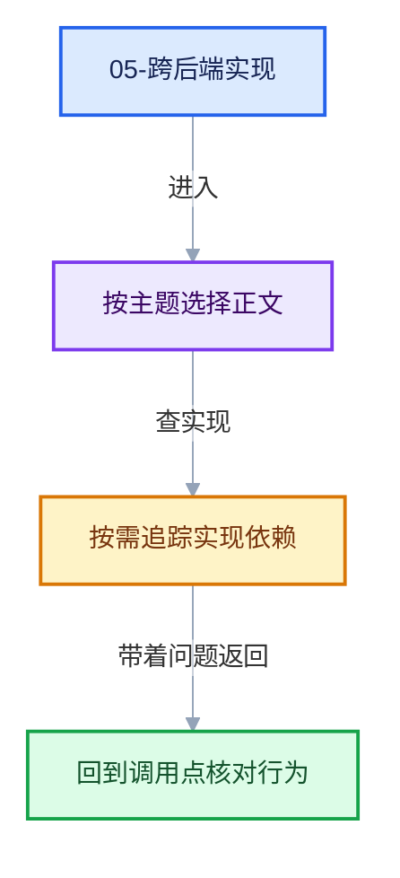

# 05-跨后端实现

导航
<a href="../README.md" style="font-size:13px;color:#334155;background:#F1F5F9;border:1px solid #E2E8F0;border-radius:999px;padding:3px 12px;text-decoration:none;white-space:nowrap">总入口</a>
<a href="../04-运行时机制/README.md" style="font-size:13px;color:#2563EB;background:#EFF6FF;border:1px solid #BFDBFE;border-radius:999px;padding:3px 12px;text-decoration:none;white-space:nowrap">‹ 04-运行时机制</a>
<a href="../06-实战与性能/README.md" style="font-size:13px;color:#7C3AED;background:#F5F3FF;border:1px solid #DDD6FE;border-radius:999px;padding:3px 12px;text-decoration:none;white-space:nowrap">06-实战与性能 ›</a>

同一套 Repeat 区域语义，在三个执行后端里有三种截然不同的实现方式。本章逐个拆解。

## 阅读顺序

- [05-01 合成器RepeatZoneOperation](01-合成器RepeatZoneOperation.md)
- [05-02 GPU着色器与GPU_stack_link_zone](02-GPU着色器与GPU_stack_link_zone.md)

## 本章问题

- 几何节点把循环体复制 N 份拼成一张图，合成器为什么不这么干？
- 合成器逐轮之间如何传递数据（Result 共享）？取消时输出是什么？
- GPU 后端如何把 Repeat 区域编译成着色器循环（REPEAT_BEGIN/END 宏）？
- 三种后端各自的约束与限制是什么？

继续阅读
<a href="../04-运行时机制/README.md" style="font-size:13px;color:#2563EB;background:#EFF6FF;border:1px solid #BFDBFE;border-radius:999px;padding:3px 12px;text-decoration:none;white-space:nowrap">‹ 04-运行时机制</a>
<a href="../06-实战与性能/README.md" style="font-size:13px;color:#7C3AED;background:#F5F3FF;border:1px solid #DDD6FE;border-radius:999px;padding:3px 12px;text-decoration:none;white-space:nowrap">06-实战与性能 ›</a>
回到顶部

