# 06-实战与性能 · 01 使用模式与迭代设计

<div style="font-family:'Segoe UI','Microsoft YaHei',system-ui,-apple-system,sans-serif;display:flex;flex-wrap:wrap;align-items:center;gap:8px;margin:16px 0 20px;padding:10px 14px;background:#F8FAFC;border:1px solid #E2E8F0;border-radius:12px">
<span style="font-size:11px;font-weight:700;letter-spacing:.1em;color:#64748B;margin-right:2px">导航</span>
<a href="../README.md" style="font-size:13px;color:#334155;background:#F1F5F9;border:1px solid #E2E8F0;border-radius:999px;padding:3px 12px;text-decoration:none;white-space:nowrap">总入口</a>
<a href="./README.md" style="font-size:13px;color:#2563EB;background:#EFF6FF;border:1px solid #BFDBFE;border-radius:999px;padding:3px 12px;text-decoration:none;white-space:nowrap">本章 06-实战与性能</a>
<a href="./02-性能模型与开销分析.md" style="font-size:13px;color:#7C3AED;background:#F5F3FF;border:1px solid #DDD6FE;border-radius:999px;padding:3px 12px;text-decoration:none;white-space:nowrap">性能模型与开销分析 ›</a>
</div>

<div style="font-family:'Segoe UI','Microsoft YaHei',system-ui,-apple-system,sans-serif;margin:18px 0 22px;padding:14px 18px;background:#F5F3FF;border-left:4px solid #7C3AED;border-radius:10px">

**本章定位**：前五章把 Repeat Zone（重复区域）的"是什么"和"怎么实现"讲清楚了。从这一篇开始进入"怎么用好"——把 Repeat Zone 当作节点树里的通用循环结构，系统地梳理六种典型使用模式、每种模式的迭代设计要点，以及在动手搭图之前就该有的性能意识。

</div>

<hr style="border:none;height:1px;background:linear-gradient(90deg,#BFDBFE,#E2E8F0 55%,transparent);margin:34px 0">

**基准说明**

- 本文基于 Blender 主线源码（本仓库工作副本），关键论断都给出源码相对链接，便于对照阅读。
- 节点图用 mermaid `flowchart` 模拟：一个方框代表一个节点或一组节点，连线上的文字是 socket 名，颜色区分角色（蓝色=接口/输入，青色=item 数据流，紫色=区域抽象，橙色=计算体，绿色=结果，红色=错误示范）。
- 所有配色统一为：

  - `input`：`#DBEAFE / #2563EB / #172554` —— 区域接口节点（Repeat Input/Output、外部输入）
  - `data`：`#CFFAFE / #0891B2 / #164E63` —— item 数据流、批次数据
  - `abstraction`：`#EDE9FE / #7C3AED / #3B0764` —— 区域本体、抽象控制结构
  - `compute`：`#FEF3C7 / #D97706 / #78350F` —— 循环体内的计算节点
  - `result`：`#DCFCE7 / #16A34A / #14532D` —— 输出与结果
  - `error`：`#FEE2E2 / #DC2626 / #7F1D1D` —— 反例与错误接法

- 文中的"轮"（iteration）指 Repeat Zone 单次求值内的一次循环体执行；"帧"指时间轴上的一帧，两者严格区分——这是本文最重要的术语约定之一。

<hr style="border:none;height:1px;background:linear-gradient(90deg,#BFDBFE,#E2E8F0 55%,transparent);margin:34px 0">

## 先回答一个具体问题

**"Repeat、Simulation、Foreach 都是循环，什么时候用哪个？"**

这是学 Repeat Zone 的人最先撞上的困惑。三个结构在节点编辑器里看起来都像"循环"，但它们回答的是三个完全不同的问题：

| 结构 | 它回答的问题 | 状态的寿命 | 并行性 | 典型场景 |
| --- | --- | --- | --- | --- |
| **Repeat Zone** | "同一个操作重复 K 轮，后一轮要用前一轮的结果" | 只在一次节点树求值内 | 整轮之间串行（轮内可并行） | 数值积分收敛、迭代细分、分批处理 |
| **Simulation Zone** | "状态要跨帧存续，每帧更新一次" | 跨帧持久（缓存到文件/内存） | 帧间天然串行，帧内可并行 | 粒子模拟、布料式增长、随时间演化 |
| **Foreach Geometry Element** | "对每个元素做同样（或按域变化）的处理" | 无状态，元素间互不影响 | 元素域上并行 | 按点/边/面生成结构、逐元素场求值 |
| **Closure Zone** | "把一段子图封装成可传递、可多次调用的值" | 无状态（被调用时才执行） | 取决于调用方 | 子图复用、惰性求值、把"算法"当数据传 |

一句话记忆：

- 要**收敛**，用 Repeat；
- 要**演化**（时间维度），用 Simulation；
- 要**遍历**（空间维度、无状态），用 Foreach；
- 要**复用**一段子图本身，用 Closure。

决策流程图如下：

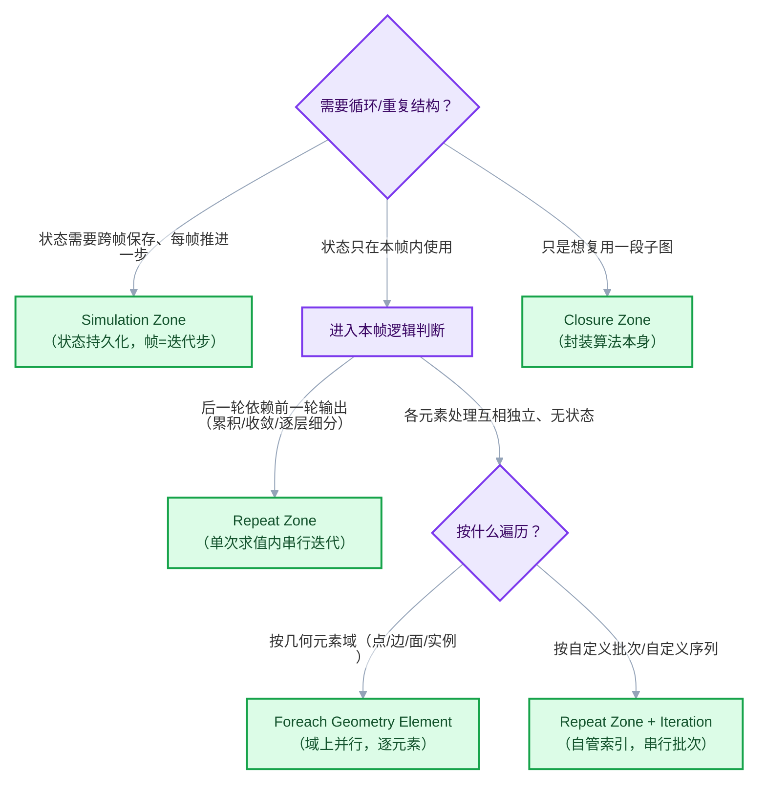

注意上表中一个容易混淆的分支："按自定义批次遍历"虽然本质也是遍历，但因为批次的划分方式（每批的点数、批次数量、批次间的依赖）往往需要动态计算，Foreach 的元素域表达不了，所以落到 Repeat + `Iteration` 索引上。第 [批次处理模式](#模式二批次处理模式分批治之) 一节展开。

还有一个补充判断：**如果你发现自己在 Repeat 循环体里塞了一个 Simulation 想做的事（比如"每一轮都读上一轮"且总轮数等于帧数），先停下来想想这到底是一次求值内的收敛，还是跨帧的动画状态。** 判断标准见 [模式四](#模式四物理动画积分repeat-与-simulation-zone)。

<hr style="border:none;height:1px;background:linear-gradient(90deg,#BFDBFE,#E2E8F0 55%,transparent);margin:34px 0">

## 心智模型回顾：三条源码事实

写实战文档也要先对齐底座。Repeat Zone 有三条直接影响"怎么搭图"的源码事实，全部来自 `node_geo_repeat.cc` 与 `geometry_nodes_repeat_zone.cc`。

### 事实一：Repeat Zone 没有原生的 break

Repeat Output 的 `Iterations` 输入声明是：

```cpp
b.add_input<decl::Int>("Iterations"_ustr).min(0).default_value(1);
```

见 [`node_geo_repeat.cc#L78`](../../../source/blender/nodes/geometry/nodes/node_geo_repeat.cc#L78)。执行时，Repeat Zone 会**一次性为每一轮各创建一个循环体节点**，然后两两串联：

```cpp
/* Handle body nodes pair-wise. */
for (const int iter_i : lf_body_nodes.index_range().drop_back(1)) {
    ...
    lf_graph.add_link(lf_node.output(...main[i]),
                      lf_next_node.input(...main[i + body_inputs_offset]));
}
```

见 [`geometry_nodes_repeat_zone.cc#L298`](../../../source/blender/nodes/intern/geometry_nodes_repeat_zone.cc#L298)。也就是说，轮数在执行图构建时就固定了，**没有任何机制在运行中提前退出**。这也是所有"收敛判断"技巧的存在前提——见 [累积模式的收敛技巧](#收敛判断与等效提前退出)。

### 事实二：item 是轮间串联的，border link 是每轮直连的

这是本文反复用到的核心区分。源码里两类连线走的是完全不同的路：

**border link（穿越连线，区域外直接拉进区域内的连线）**——每一个循环体节点都从**同一个区域级输入**取值：

```cpp
for (const int i : IndexRange(num_border_links)) {
    lf_graph.add_link(*lf_inputs[zone_info_.indices.inputs.border_links[i]],
                      lf_node.input(body_fn_.indices.inputs.border_links[i]));
    ...
}
```

见 [`geometry_nodes_repeat_zone.cc#L282`](../../../source/blender/nodes/intern/geometry_nodes_repeat_zone.cc#L282)。每一轮看到的都是**同一个外部值**，值在轮间不会变。

**item（Repeat Item，Repeat Output 上添加的 socket）**——第 N 轮循环体的输出连到第 N+1 轮的输入（即上面的"pair-wise"代码）。item 是**轮间传递状态的通道**。

### 事实三：item 支持任意静态可支持的 socket 类型，Iteration 从 0 起数

Repeat item 的类型检查是通用的：

```cpp
static bool supports_socket_type(const eNodeSocketDatatype socket_type, const int ntree_type)
{
    return bke::node_tree_type_supports_socket_type_static(ntree_type, socket_type);
}
```

见 [`NOD_geo_repeat.hh#L67`](../../../source/blender/nodes/geometry/include/NOD_geo_repeat.hh#L67)。所以 item 可以是 Geometry、Float、Vector、Color、甚至闭包等任何该树类型支持的类型——这直接支撑了"累积模式可以同时携带几何与数值状态"的设计。

`Iteration` 输出的声明：

```cpp
b.add_output<decl::Int>("Iteration"_ustr)
    .description("Index of the current iteration. Starts counting at zero");
```

见 [`node_geo_repeat.cc#L76`](../../../source/blender/nodes/geometry/nodes/node_geo_repeat.cc#L76)。从 0 起数，且源码里还能看到（[`geometry_nodes_repeat_zone.cc#L263`](../../../source/blender/nodes/intern/geometry_nodes_repeat_zone.cc#L263)）：**只有当 Repeat Input 的 `Iteration` 输出实际被连接时，执行器才会生成索引值数组**——不连它就没有开销，这是一个"按需付费"的设计。

### 三条事实对应的使用纪律

| 源码事实 | 使用纪律 |
| --- | --- |
| 无 break，轮数先定 | 迭代数 = 上限 + 数学方式让多余轮变成恒等操作 |
| border link 每轮直连、值固定 | 常量参数走 border link；轮间状态走 item |
| item 任意类型、Iteration 从 0 起数 | 状态可以打包成多个 item；索引类应用放心依赖 0 起数 |

<hr style="border:none;height:1px;background:linear-gradient(90deg,#BFDBFE,#E2E8F0 55%,transparent);margin:34px 0">

## 模式一：累积模式（Accumulate）

### 意图

累积模式是 Repeat Zone 最本质的用法：**把 item 当作"寄存器"，每一轮读旧值、算新值、写回去**。凡是数学上的迭代法、物理上的显式积分、几何上的逐层加工，都属于这一类。

核心形状：

```
状态(item) → 本轮计算(读旧值) → 新状态 → 写回 item → 下一轮
```

### 图 1-A：数值积分（位置 += 速度 × dt）

最典型的累积：模拟一个质点做匀加速运动，每轮推进一小步 `dt`。

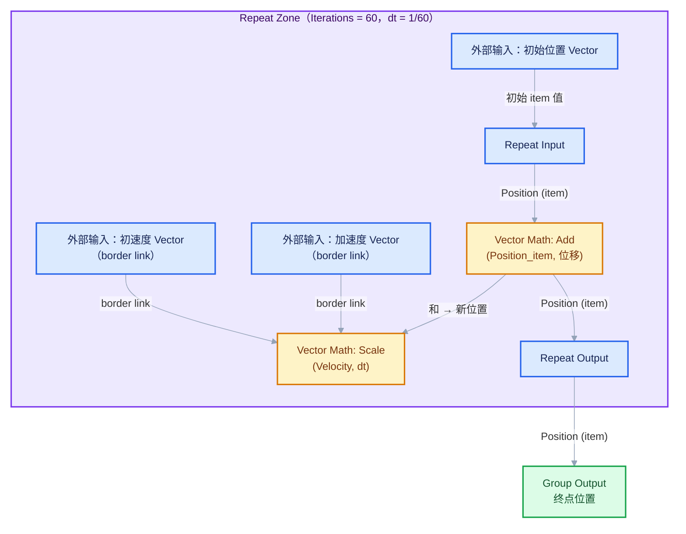

要点：

- `Velocity`、`Acceleration` 是**常量**（本例中不随轮变化），走 border link 从区域外直连进循环体——每一轮读到的都是同一个外部值。
- `Position` 是**状态**，做成 item，从 Repeat Input 出来、经过加法、回到 Repeat Output。
- 若要累积"轨迹"而不只是终点，就再加一个 Geometry 类型的 item，每轮往里合并新点——见 [图 1-C](#图-1-c逐轮细分对上一轮的几何继续加工) 的同类结构。

### 图 1-B：Iterative 拟合（牛顿法开平方）

数值迭代的代表。求 `sqrt(a)`，迭代式 `x_{n+1} = (x_n + a/x_n) / 2`，状态是标量 `x`。

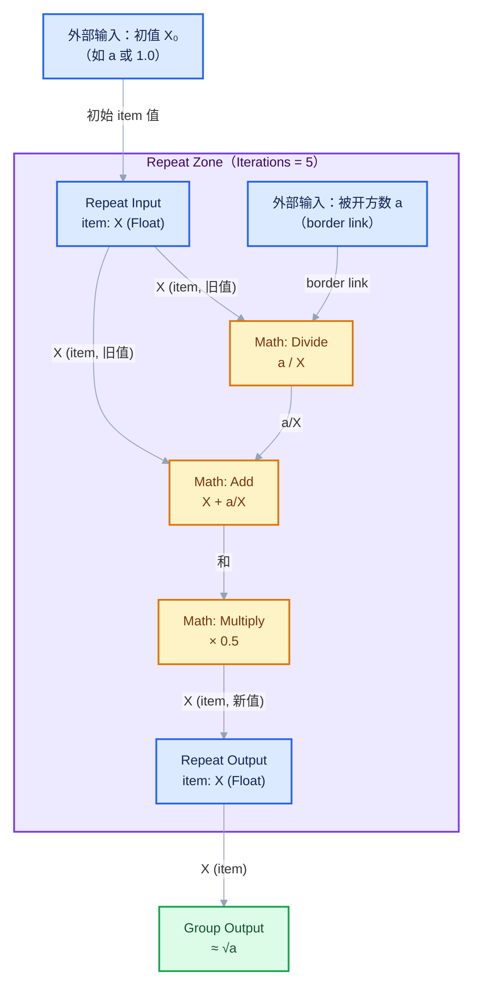

这个图在 [用小数据走一遍](#用小数据走一遍三轮牛顿迭代的数值表) 里有完整的手推数值表，强烈建议对着表在 Blender 里搭一遍。

### 图 1-C：逐轮细分（对上一轮的几何继续加工）

状态本身是几何。每轮对上一轮输出的几何做一次操作（细分、噪波、收缩复制……），轮数就是"加工次数"。

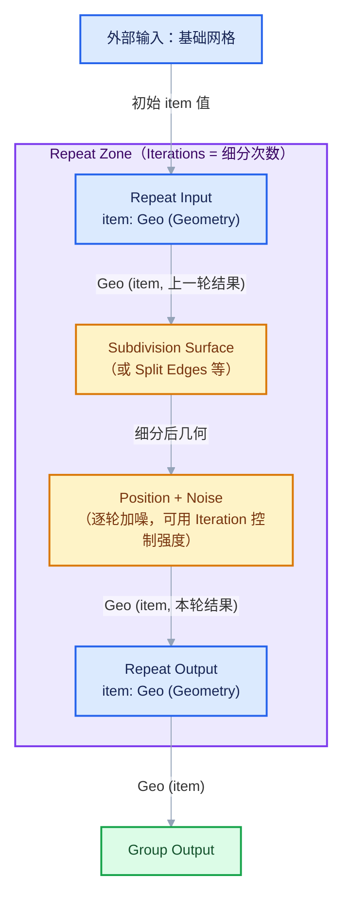

**警告（红线）**：逐轮细分是指数级增长的典型来源。每轮细分一次面数 ×4，10 轮就是 ×10⁴ 级别。迭代设计时必须先心算几何量的增长曲线，见 [性能意识初步](#性能意识初步)。

### 迭代设计要点

1. **先写数学式，再搭图**。把迭代式写成 `s_{n+1} = f(s_n, 常量…)` 的形式，`s` 对应 item，常量对应 border link。写不出来就说明这个问题的形状不适合累积模式。
2. **迭代数选保守上限，不选"刚刚好"**。因为 Repeat 没有提前退出（[事实一](#事实一repeat-zone-没有原生的-break)），轮数是硬预算。选一个"再多也无害"的上限，配合下面的恒等化技巧。
3. **每轮成本要稳定**。累积模式的性能模型是 `总成本 ≈ 轮数 × 单轮成本`（见 [性能意识初步](#性能意识初步)）。如果单轮成本本身随轮数增长（比如逐轮加几何），乘积模型要换成求和模型，更要谨慎。
4. **状态 item 的初值别忘接**。Repeat Input 的 item 输入不连的话取默认值（Geometry 为空、Float 为 0）——有时这就是 bug：积分从 0 开始而不是从初值开始。

### 收敛判断与等效提前退出

Repeat 没有 break，但"提前收敛"的需求可以用**数学恒等化**满足：让第 N 轮之后的循环体执行"什么也不做"的操作。

**方案一：步长归零（推荐）**。在循环体开头计算一个有效步长：

```
有效dt = map_range(Iteration, 收敛轮数N, N, dt, 0.0)
```

当 `Iteration >= N` 时有效步长为 0，`位置 += 速度 × 0` 是恒等操作——几何上多余轮只产生读与写，不改变结果。对几何型状态同理：把"本轮要应用的变化量"乘一个 0/1 开关系数。

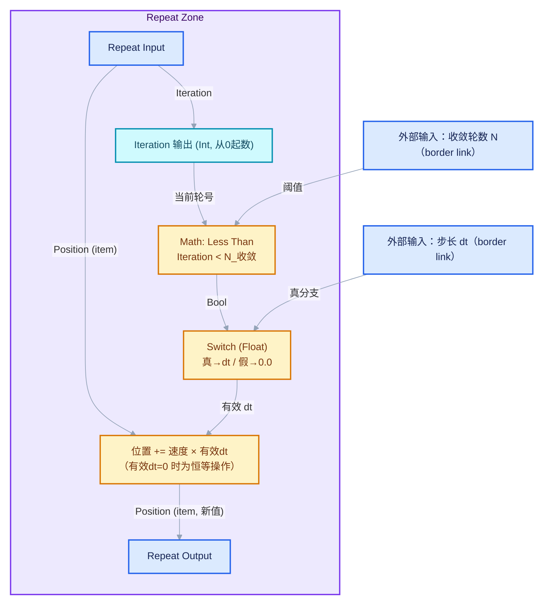

**方案二：用 Clamp/Compare 把结果"钉死"**。对于收敛型迭代（如牛顿法），每轮先算误差 `|f(x)|`，用 `Map Range`（Clamp）把**增量**乘上 `误差 > ε ? 1 : 0`。效果与方案一等价：收敛后增量归零，后续轮是恒等操作。数值结果在视觉/精度意义上已经"提前退出"了，只是执行图上轮数没少。

**方案三（谨慎）：把收敛轮数作为动态 Iterations**。`Iterations` 是个普通输入，可以接任何整数计算的结果——包括"上一帧算出的收敛轮数"这种缓存值。但这引入了帧间状态，就滑向 Simulation Zone 的领地了，见 [模式四](#模式四物理动画积分repeat-与-simulation-zone)。

**一个诚实的提醒**：以上方案都不减少实际执行的轮数，只是让多余轮变便宜。如果"单轮很贵 + 轮数很多 + 收敛很快"三者同时成立，Repeat Zone 就是错误的工具——考虑拆成多级节点树、用 Python 驱动轮数、或干脆用 Simulation 的缓存机制（缓存可回放，不必重算）。这也是 [02-性能模型与开销分析](02-性能模型与开销分析.md) 要展开的话题。

### 变体

- **多状态并行累积**：item 列表里放多个 item（位置、速度、几何……），一轮内同时更新。注意更新顺序：同一轮内所有计算读的都是**本轮开始时**的旧值（因为 Repeat Input 是每轮状态的快照），这是"同步更新"语义，正好符合显式欧拉积分的要求。
- **带衰减的累积**：`状态 = 状态 × 衰减 + 增量`，一行的差别，但从"无限增长"变成"有界收敛"。
- **嵌套 Repeat**：外层轮里再放一层 Repeat（如外层遍历对象、内层做收敛）。可以，但成本是乘法关系，务必先算总账。

### 常见坑

- **把常量接成 item**：常量被串进轮间链条后，要么被覆盖（有人顺手把它更新了），要么造成"每轮多一次无意义读写"。常量走 border link，见 [模式五](#模式五border-link-的正确使用轮间状态与外部值的分界线)。
- **把状态接成 border link**：状态走 border link 后每轮读到的是同一个初始值，"累积"静默失效——图不报错、结果不对，是最阴险的一类 bug。
- **迭代数直接拉大掩盖设计问题**：轮数从 10 改成 1000 不是调参，是性能自杀。先确认收敛行为，再定上限。

<hr style="border:none;height:1px;background:linear-gradient(90deg,#BFDBFE,#E2E8F0 55%,transparent);margin:34px 0">

## 用小数据走一遍（三轮牛顿迭代的数值表）

<div style="font-family:'Segoe UI','Microsoft YaHei',system-ui,-apple-system,sans-serif;display:inline-block;margin:6px 0 14px;padding:3px 12px;font-size:12px;color:#0891B2;background:#ECFEFF;border:1px solid #A5F3FC;border-radius:999px">教学推演 · 手算中间值，逐轮核对</div>
对 [图 1-B](#图-1-biterative-拟合牛顿法开平方) 手推 `sqrt(10)`，初值 `X₀ = 1.0`，Iterations = 3。

迭代式：`x_{n+1} = (x_n + 10 / x_n) / 2`，真值 `√10 ≈ 3.1622776601…`

| 轮 n | Iteration 输出 | 进入本轮的 X（旧值） | 本轮计算 a/X = 10/X | 本轮计算 X + 10/X | 写回的 X（新值） | 与真值误差 |
| ---: | ---: | ---: | ---: | ---: | ---: | ---: |
| 第 1 轮 | 0 | 1.0 | 10.0 | 11.0 | 5.5 | 2.3377 |
| 第 2 轮 | 1 | 5.5 | 1.8181818… | 7.3181818… | 3.6590909… | 0.4968 |
| 第 3 轮 | 2 | 3.6590909… | 2.7330207… | 6.3921116… | 3.1960558… | 0.0338 |

再补 2 轮看收敛速度（说明"轮数=上限+恒等化"策略的意义）：

| 轮 n | 进入本轮的 X | 写回的 X | 与真值误差 |
| ---: | ---: | ---: | ---: |
| 第 4 轮 | 3.1960558… | 3.1624382… | 0.00016 |
| 第 5 轮 | 3.1624382… | 3.1622777… | ≈ 4×10⁻⁹ |

观察三个教学点：

1. **初值影响轮数**。若初值取 `X₀ = a`（10.0），第 1 轮就直接落到 5.5，等效省掉一轮。收敛型迭代里"好初值"比"多几轮"便宜得多。
2. **平方收敛**。误差大约每轮平方一次（0.03 → 0.00016 → 4×10⁻⁹），所以牛顿法的轮数设计几乎总是"给个 6~8 就够了"，而不是越多越好。
3. **每轮读旧、写新**。第 2 轮里 `DIV` 和 `ADD` 读到的都是 5.5——同一轮内对旧值的一致快照，这正是 item"同步更新"语义的体现。如果你发现某轮结果对不上这张表，第一件事就是检查是否不小心把中间值绕回了当轮输入。

在 Blender 里验证：搭好图 1-B，Iterations 设 3，在 Repeat Output 的 item 上用检查器（inspection）逐轮查看。源码中检查索引超出轮数会给出 Info 警告（[`geometry_nodes_repeat_zone.cc#L216`](../../../source/blender/nodes/intern/geometry_nodes_repeat_zone.cc#L216)）——如果看到 "Inspection index is out of range"，说明你把检查轮设得比总轮数还大。

<hr style="border:none;height:1px;background:linear-gradient(90deg,#BFDBFE,#E2E8F0 55%,transparent);margin:34px 0">

## 模式二：批次处理模式（分批治之）

### 意图

把一个大数据集（通常是点云或高面数网格）切成 K 个批次，每轮处理一批。动机通常是：

- 某个昂贵操作（如逐点射线检测、复杂场求值）在**全量**上一次执行代价过高或内存峰值过大；
- 想要**逐批可视化/逐批入场**的动画效果（这其实已经滑向模拟语义，见下文选型讨论）；
- 算法本身有"轮间依赖的批间结构"（如先处理近处批次再处理远处批次）。

### 图 2-A：按索引切批

核心是利用 `Iteration`（0 起数）构造每个批次的索引区间，用域选择只让本批点参与计算。

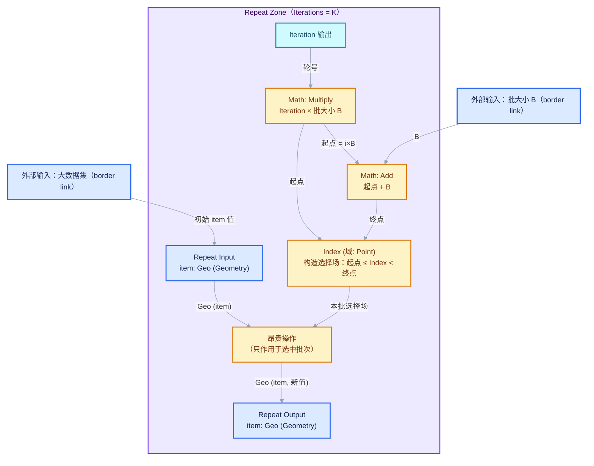

实现细节：

- 选择场可以直接用 `Index`（Point 域）配合两个 `Math: Less Than` 与一个 `Boolean Math: And`，或者用 `Named Attribute` 存的批次号字段做相等比较。
- `Iterations = ceil(点数 / B)`：用 `Math: Divide` + `Math: Ceiling` 从数据本身推导轮数，批次数随数据规模自适应——这是 Repeat 相比手写 10 层节点最大的工程优势。
- 若每批要产出**新**几何而非修改原几何，就在 item 列表里加一个"累积结果"几何 item，每轮 `Join Geometry` 上本批产出。

### 与 Foreach Geometry Element 的选型

两者都能"逐份处理数据"，选择依据是**轮间的语义与并行结构**：

| 判断维度 | Foreach Geometry Element | Repeat Zone |
| --- | --- | --- |
| 遍历单位 | 几何元素域（Point/Edge/Face/Instance/Spline），由 Iteration Domain 决定 | 你自己定义的批次（任意大小、任意划分逻辑） |
| 元素间关系 | 无状态，元素之间互相独立 | 有状态，轮与轮之间通过 item 串联 |
| 并行性 | 元素域上并行，元素越多越能吃满多核 | 轮间串行（源码中循环体两两串联成链），单轮内部可并行 |
| 输入数据的形态 | 每个 item 是"在迭代域上求值的场"，输出是逐元素结果 | item 是普通 socket 值，每轮完整读写 |
| 典型成本陷阱 | 官方注释明说：把大几何拆成大量单元素几何"可能相当低效"（[`node_geo_foreach_geometry_element.cc#L134`](../../../source/blender/nodes/geometry/nodes/node_geo_foreach_geometry_element.cc#L134)） | 轮数 × 单轮成本的乘积；批太小则轮数暴涨 |

选型口诀：

- **"每个元素独立处理，处理完拼回去"** → Foreach。它的 body 收到的是单元素几何/域上场值，引擎负责 join，且元素间并行。
- **"要分批，且批次之间有顺序或状态"** → Repeat。比如"第 i 批的处理依赖第 i-1 批的结果"（波前推进式），Foreach 表达不了。
- **"只是想控制单次操作的输入规模"** → 先问自己能不能不拆。很多"分批"需求其实来自对某节点复杂度的恐惧，而那节点本身是并行实现的，拆批反而引入 K 次固定开销。见 [02-性能模型与开销分析](02-性能模型与开销分析.md) 中"拆批是否划算"一节的讨论。

还有一个反向案例值得记住：**如果你把批切得极小（比如每批 1 个点），Repeat 就退化成了一个串行版 Foreach——得到了它的串行性，却没得到它的任何好处**。批次大小要在"轮数开销"与"单轮峰值内存/耗时"之间找平衡，通常从"每批几千到几万元素"起步实验。

### 变体

- **分层批次**：外层 Repeat 按空间区块（Bounding Box 分桶）切，内层 Foreach 对区块内元素逐个处理。适合"跨元素有局部交互"的场景。
- **优先级批次**：用 `Sort Elements` 先给元素算优先级，批次按优先级切。轮间状态可以记录"预算已用多少"，实现"每轮处理预算内的重要元素"。

### 常见坑

- **批大小写死**：数据规模一变，轮数与批大小的乘积不再覆盖全部索引，尾部批次静默丢失。用 `ceil` 推导轮数，并在选择场里用 `>= 终点` 兜底。
- **忘了批次是"串行"的**：指望用批次法把耗时除以 K（并行幻想）——Repeat 的轮间是串行的，拆批只会把总耗时切成 K 段，不减少总量（还可能因多次求值固定开销而增加）。
- **在批次轮里 realize 整个数据集**：每轮都把大数据转成实几何，K 轮就是 K 次全量拷贝。保持实例化或只处理选中域，见 [分形模式的 realize 讨论](#实例化-vs-realize-的取舍)。

<hr style="border:none;height:1px;background:linear-gradient(90deg,#BFDBFE,#E2E8F0 55%,transparent);margin:34px 0">

## 模式三：分形/递归结构

### 意图

每轮对**上一轮的全部输出**继续施加同类操作，产生自相似或指数生长的结构：逐轮收缩复制（类似分形树）、逐轮加噪细分、逐轮分支生长。与累积模式的区别在于：累积模式通常维护一个"当前值"，分形模式维护的是"一整个几何集合"，且操作往往是**复制 + 变换**。

### 图 3-A：逐轮收缩复制（分形树骨架）

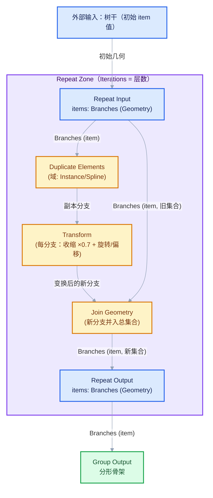

设计要点：

- **增长公式先算后搭**。若每轮每个分支复制 C 份，第 N 轮结束共有 `1 + C + C² + … + Cᴺ` 个分支。C=2、N=8 就是 511 个分支；C=3、N=6 就是 1093 个。这个数乘以"每个分支的元素数"才是真实成本。
- **用实例化承载"形状相同、变换不同"的分支**：循环体内只复制实例引用并做变换，真实几何只存一份。
- **用 `Iteration` 做层级属性**：给每轮新生成的分支写一个 `generation` 整数属性（值即 `Iteration`），下游可以用它做按层着色、按层缩放、按层延迟显示。

### 图 3-B：逐轮加噪细分（地形式细化）

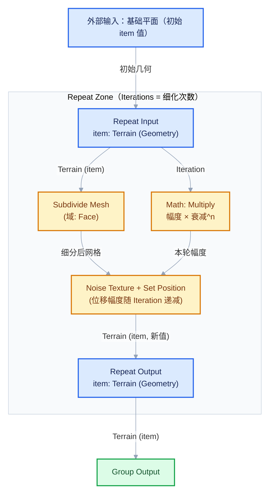

这是累积模式与分形模式的合体：几何状态逐轮细化，噪声幅度是逐轮衰减的数值状态。衰减系数（幅度 × 衰减^n）走 border link 进来，`Iteration` 提供指数。

### 实例化 vs realize 的取舍

分形/递归是"realize 滥用"重灾区，取舍原则：

| 做法 | 优点 | 代价 | 适用 |
| --- | --- | --- | --- |
| **全程实例化**（循环体里只复制 Instance 引用 + Transform） | 内存 O(轮数)；下游仍可整体变换；轮便宜 | 不能对单个实例的内部几何做编辑；Realize 前无法做域级细节 | 分形树、阵列、重复结构 |
| **每轮 realize** | 本轮能对新几何做任意域操作 | 每轮全量展开，成本随几何量滚动放大 | 确实需要在循环体内编辑内部几何时 |
| **realize 一次（循环外）** | 兼顾循环体效率与下游编辑需求 | 最终展开成本仍要付一次 | 大多数分形工作流的正确出口 |

**纪律**：realize 应该出现在 Repeat Output **之后**，而不是循环体内。如果某轮操作"必须" realize 才能做（例如需要对上一轮展开后的点云做域选择），先确认这个操作能不能用实例域（Instance 域）上的属性与变换等价表达——大多数"看起来必须 realize"的场景，其实是把域选错了。

### 常见坑

- **增长失控**：没算增长公式就拉轮数，Blender 直接无响应。先在纸上算 Cᴺ。
- **在循环体内 realize**：见上表，滚动放大成本。
- **把"每轮的中间几何"全部保留**：若下游只需要最终结果，中途轮次的几何是纯开销；若确实要保留每层（分层显示），考虑用多个 item 或把"是否并入总集合"做成可开关的选择。
- **用 Join 模拟"分支删除"**：想让某分支死亡不该靠"不 join 它"（它上一轮已经进了集合），而是靠删除操作（Delete Geometry）作用于集合。

<hr style="border:none;height:1px;background:linear-gradient(90deg,#BFDBFE,#E2E8F0 55%,transparent);margin:34px 0">

## 模式四：物理/动画积分（Repeat 与 Simulation Zone）

### 意图

物理积分（速度、重力、碰撞）既能在 Repeat 里做，也能在 Simulation 里做，选错会导致架构性返工。判断标准只有一条：

- **Repeat**：状态只活在一次节点树求值内。适合"确定性、可重算、单帧出结果"的迭代——例如求值时把 60 个物理步一口气算完，得到一个最终姿态。
- **Simulation Zone**：状态跨帧存续。第 N 帧的输入是第 N-1 帧的输出（由模拟缓存承载），用户可以播放、暂停、逐帧步进。适合"随时间演化、需要与时间轴交互"的动画。

源码侧的印证：Simulation Zone 的输出节点带 `Skip` 语义（"直接把 Simulation Input 的输出转发到输出、跳过区域内部"，[`node_geo_simulation.cc#L616`](../../../source/blender/nodes/geometry/nodes/node_geo_simulation.cc#L616)）和整套模拟状态条目（items）的烘焙读写逻辑——这些基础设施的存在本身就是因为 Simulation 的状态必须**跨帧持久化**，而 Repeat 的 item 只是求值栈上的临时值。

### 两个对照图

**Repeat 做单帧内积分**（确定性、一次性）：

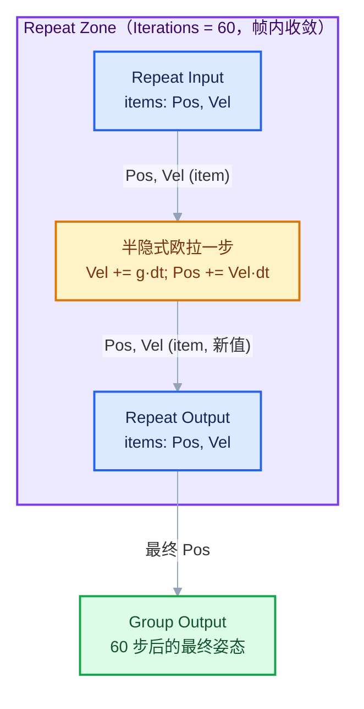

**Simulation 做跨帧演化**（状态随时间轴推进）：

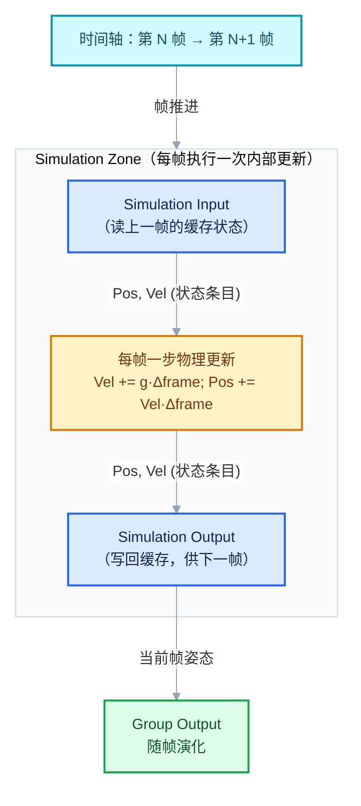

### 何时选谁

| 需求特征 | 选 Repeat | 选 Simulation |
| --- | --- | --- |
| 结果是"一个最终值/最终姿态"，与时间轴无关 | ✅ | ❌（过度设计，还引入缓存管理负担） |
| 结果要随帧演化、可播放可暂停 | ❌（Repeat 每帧从头算，帧间无记忆） | ✅ |
| 需要"每帧之内再细分多个子步"提高稳定率 | ✅（嵌在 Simulation 内部做子步） | 作为外层框架 |
| 求值必须是纯函数（换帧/换参数可精确重算） | ✅ | ⚠️（有缓存后行为依赖历史） |
| 用户要能回退到任意帧继续模拟 | ❌ | ✅（缓存天然支持） |

**组合用法（重要）**：Simulation Zone 内部嵌一个 Repeat Zone 是完全合法且常见的架构——Simulation 负责"帧 = 大步"，Repeat 负责"帧内子步 = 小步收敛"。这样既拿到时间轴交互，又保留子步积分的稳定性。

### 常见坑

- **在 Repeat 里模拟"动画"**：每帧重算全部轮次且帧间无记忆，既慢又不能暂停交互。
- **在 Simulation 里做"收敛"**：把本该一次求值内完成的收敛拆到帧上，用户会看到收敛过程一帧帧"直播"出来，且拖动时间轴时行为诡异。
- **混淆 dt 与 Δframe**：Repeat 内的子步用自定 dt；Simulation 每帧的步长应从场景帧率/Delta Seconds 推导。两套时间尺度混用是物理节点树的头号 bug 来源。

<hr style="border:none;height:1px;background:linear-gradient(90deg,#BFDBFE,#E2E8F0 55%,transparent);margin:34px 0">

## 模式五：border link 的正确使用（轮间状态与外部值的分界线）

### 意图

这是本文最值得刻进肌肉记忆的一节。Repeat Zone 里每条从区域外拉进区域的连线，必须先回答：**这个值是"每轮可见的外部值"，还是"轮间传递的状态"？**

源码给出了明确答案（重复一次 [事实二](#事实二item-是轮间串联的border-link-是每轮直连的) 的关键代码）：

- border link：**每个循环体都直连同一个区域级输入**（[`geometry_nodes_repeat_zone.cc#L282`](../../../source/blender/nodes/intern/geometry_nodes_repeat_zone.cc#L282)）——每一轮读到的值相同，与轮次无关；
- item：**第 N 轮的输出连第 N+1 轮的输入**（[`geometry_nodes_repeat_zone.cc#L298`](../../../source/blender/nodes/intern/geometry_nodes_repeat_zone.cc#L298)）——值沿轮次流动。

### 图 5-A：正确的分界

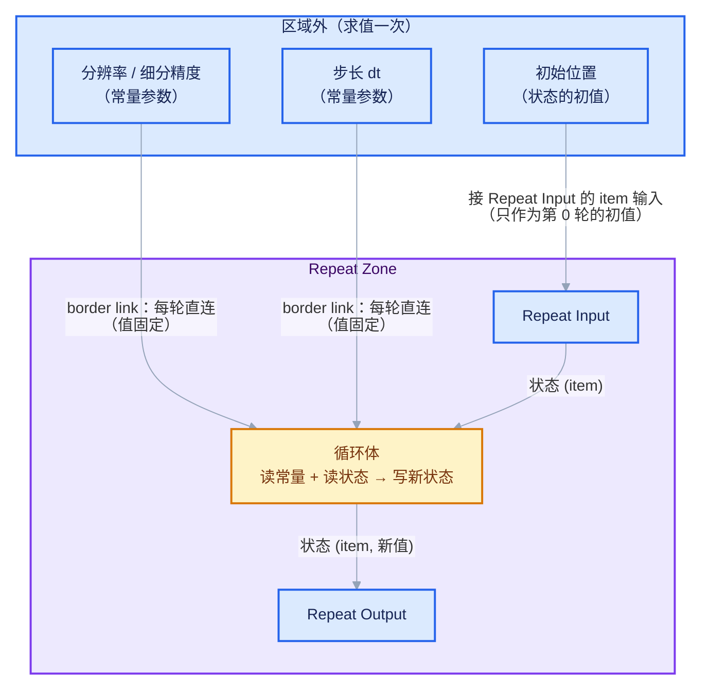

### 图 5-B：两种错误接法

```mermaid
%%{init: {"theme":"base","themeVariables":{"fontFamily":"\"Segoe UI\",\"Microsoft YaHei\",sans-serif","fontSize":"15px","lineColor":"#94A3B8","edgeLabelBackground":"#FFFFFF","clusterBkg":"#F8FAFC","clusterBorder":"#CBD5E1"},"flowchart":{"htmlLabels":false,"curve":"basis","nodeSpacing":52,"rankSpacing":64,"padding":14,"diagramPadding":16,"useMaxWidth":true},"sequence":{"useMaxWidth":true,"wrap":true,"mirrorActors":false,"messageMargin":36}}}%%
flowchart TB
    subgraph WRONG1["错误一：把状态接成 border link"]
        R1["Repeat Input"]:::input
        B1["循环体"]:::compute
        EXT1["区域外：初始位置"]:::input
        EXT1 -- "border link（每轮都读同一个初值！）" --> B1
        B1 -- "计算结果被丢弃，不回流" --> LOSE["累积静默失效<br/>60 轮 ≈ 1 轮"]:::error
    end

    subgraph WRONG2["错误二：把外部常量做成 item"]
        R2["Repeat Input<br/>item: dt"]:::input
        B2["循环体"]:::compute
        R2 -- "dt (item)" --> B2
        B2 -- "dt (item, 新值)" --> W2["Repeat Output<br/>一旦有人误更新 dt<br/>后续轮全部用错值"]:::error
    end

    classDef input fill:#DBEAFE,stroke:#2563EB,color:#172554,stroke-width:2px;
    classDef data fill:#CFFAFE,stroke:#0891B2,color:#164E63,stroke-width:2px;
    classDef abstraction fill:#EDE9FE,stroke:#7C3AED,color:#3B0764,stroke-width:2px;
    classDef compute fill:#FEF3C7,stroke:#D97706,color:#78350F,stroke-width:2px;
    classDef result fill:#DCFCE7,stroke:#16A34A,color:#14532D,stroke-width:2px;
    classDef error fill:#FEE2E2,stroke:#DC2626,color:#7F1D1D,stroke-width:2px;
```

### 判定口诀

问一个问题：**"这个值在 60 轮里会变吗？它变了吗？"**

- 不会变，也没人更新它 → border link（常量：分辨率、步长、阈值、目标几何……）
- 会变，且新值来自循环体的计算 → item（状态：位置、误差、累积几何、计数器……）
- 会变，但变化来自**轮号本身**（而不是上一轮的值）→ 不需要 item，用 `Iteration` 输出现算（如衰减系数 `衰减^n`）

第三种最容易被漏掉：很多人把"逐轮变化的量"习惯性做成 item，但它如果只是轮号的函数，直接用 `Iteration` 现场计算更简单、更不容易出状态 bug。

### 补充：border link 的求值时机

由于 border link 被所有轮共享，它的"是否被使用"也是全轮共享的——源码用一个 OR 节点聚合每轮的使用标记（[`geometry_nodes_repeat_zone.cc#L254`](../../../source/blender/nodes/intern/geometry_nodes_repeat_zone.cc#L254)：`A border link is used when any of the loop bodies uses the border link`）。使用方语义上的推论：**只要有一轮用到某个 border link，整个求值就要为它付一次求值成本**；反过来，一个没有任何循环体使用的 border link 不会强制外部子图求值（惰性求值会裁掉它）。所以"往 Repeat Zone 里塞一堆只偶尔用的 border link"不如"把确需的常量收敛成少数几个"。

### 常见坑

- **状态接成 border link**：图 5-B 错误一。结果不报错、只是"循环白做"。
- **外部常量做成 item**：图 5-B 错误二。风险来自未来——半年后改图的人顺手更新了这个 item。
- **初值忘了接**：border link 常量不需要"初值"，但 item 状态需要。Repeat Input 的 item 输入悬空 = 从类型默认值起步。
- **把大几何走 border link 又每轮全量重读**：border link 每轮直连意味着每轮都要消费这个输入。若循环体其实只需要它的某个小属性，先在区域外把小属性抽出来，再走 border link 进去。

<hr style="border:none;height:1px;background:linear-gradient(90deg,#BFDBFE,#E2E8F0 55%,transparent);margin:34px 0">

## 模式六：Iteration socket 的使用（索引类应用与 Index Switch 组合）

### 意图

`Iteration` 输出（从 0 起数，见 [事实三](#事实三item-支持任意静态可支持的-socket-类型iteration-从-0-起数)）让"第几轮"成为循环体内的可用信息。两大用途：

1. **按轮生成不同内容**：第 0 轮做 A，第 1 轮做 B……（阶梯式逻辑）
2. **从序列里取值**：让每轮从一组候选参数/几何中按序取一个。

### 图 6-A：Iteration + Index Switch（每轮换一种处理方式）

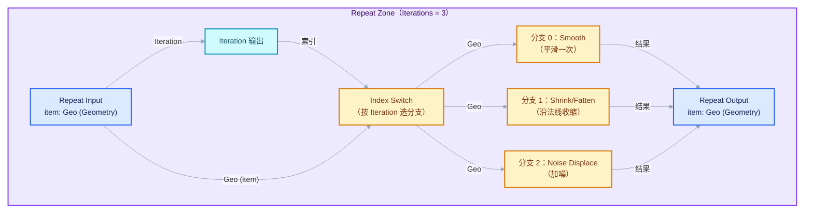

注意惰性求值在这里的价值：Index Switch 只激活被选中分支的子图，未选分支不求值。所以"三个分支都连上"不会导致三轮都执行三个分支——每轮只执行被 `Iteration` 选中的那个。

### 图 6-B：Iteration 做查表（从序列参数里取每轮参数）

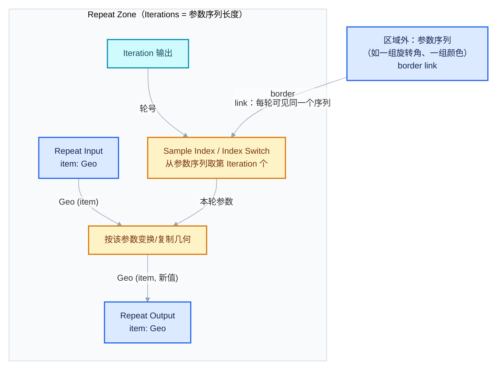

参数序列在区域外构建（可以是 Group Input 的一组值，也可以是另一棵子树的输出），走 border link 进来——每轮看到的是**同一个完整序列**，`Iteration` 负责"取第几个"。这正体现了分界原则：序列是常量（border link），"取到哪"是轮号（Iteration），两者都不是 item。

### Iteration 的其他惯用法

- **衰减/增强系数**：`强度 × 衰减^Iteration`（分形一节已用）。
- **写层级属性**：给本轮新增元素写 `generation = Iteration` 属性，供下游按层筛选。
- **奇偶分流**：`Iteration % 2` 做交替处理（配合 Index Switch 的两分支）。
- **进度指示**：`Iteration / Iterations` 归一化，写入属性供下游驱动显示进度（注意 Iterations 也从 Repeat Input 拿得到）。

### 常见坑

- **以为 Iteration 是域上场**：`Iteration` 是普通整数 socket（每轮一个值），不是能在点域上变化的场。想让每个点拿到"自己属于第几批"，要把 `Iteration` 写成属性（Store Named Attribute）再在点域消费。
- **轮数超过 Index Switch 分支数**：超出的轮会落到 default 分支或报错（取决于 Switch 设置）。用 `Math: Wrap/Modulo` 把 Iteration 包回分支范围，是让模式循环重复的标准手法。
- **把 Iteration 用于"随机数种子"后又依赖可复现性**：改轮数会改变所有后续轮的种子。需要稳定随机序列时，用 `Random Value` 并把种子本身存成 item 累积（每轮从上轮种子派生），而不是直接用轮号。

<hr style="border:none;height:1px;background:linear-gradient(90deg,#BFDBFE,#E2E8F0 55%,transparent);margin:34px 0">

## 性能意识初步

本节只建立三个心智工具，量化分析留给 [02-性能模型与开销分析](02-性能模型与开销分析.md)。

### 工具一：乘积模型

```
总成本 ≈ Iterations × 单轮成本
```

设计任何 Repeat 图之前先做乘法：60 轮 × 单轮 2ms = 120ms（可接受）；60 轮 × 单轮 80ms = 4.8s（要警惕）；轮数是几何量的指数函数时（分形），先算指数再算乘法。**单轮成本不是常数时要警惕**：循环体输出几何逐轮变大的模式（逐轮细分、逐轮 Join），成本更像 `Σ 单轮成本(n)` 而非简单乘积，末几轮 dominate 总耗时。

### 工具二：隐性共享让"纯读轮"变便宜

Blender 几何数据是引用计数的（用户为零时才真正复制）。Repeat Zone 的 item 串联链条上，如果某一轮的循环体**没有实际修改**某个几何 item（比如本轮只在选择场上做了判断、没有写几何），那么"写回"的只是同一个几何的引用——没有深拷贝发生。源码层面这也体现在重复求值图的构建方式上：循环体之间是惰性函数图里的引用传递（[`geometry_nodes_repeat_zone.cc#L298`](../../../source/blender/nodes/intern/geometry_nodes_repeat_zone.cc#L298)），配合几何系统的隐式共享，未修改的数据在轮间只是指针搬家。

推论：

- **"读了不改"的轮是廉价的**。恒等化收敛技巧（方案一/二）之所以可行，就是因为收敛后的轮只做"读 item → 算出零增量 → 写回原值"，隐式共享让它们几乎不花内存与拷贝成本（循环体的求值本身仍要花，但省掉了几何复制的大头）。
- **"复制再改"要付全款**。一旦某轮真正修改了几何（哪怕只改一个点），写时复制（copy-on-write）会触发该几何的实际拷贝。逐轮细分类模式的成本曲线陡增的根源就在这里。
- **因此"少改"是 Repeat 优化第一原则**：能合并的轮次合并，能不改的组件别碰（比如只需要动 Position 时别触发整网重建）。

### 工具三：串行链是 Repeat 的本质约束

从执行图看（[事实一](#事实一repeat-zone-没有原生的-break)），Repeat 的 N 个循环体在 lazy-function 图里首尾相连成一条链——**轮与轮之间没有并行空间**（这正是它与 Foreach 的根本差别）。Repeat 的并行性只存在于**单轮内部**（循环体内的场求值、并行化节点）。所以：

- 提速方向一：减少轮数（更好的初值、更快的收敛、恒等化）；
- 提速方向二：降低单轮成本（拆批给 Foreach 做、避免 realize、减少几何复制）；
- 提速方向三（高级）：把"轮间无依赖"的部分识别出来交给 Foreach 或并行节点，把 Repeat 留给真正串行的核心。

源码里还有一个有趣的细节：当轮数 ≥ 10 时，Repeat Zone 会主动发出"可以切换执行其他任务"的提示（[`geometry_nodes_repeat_zone.cc#L210`](../../../source/blender/nodes/intern/geometry_nodes_repeat_zone.cc#L210) 的 `lazy_threading::send_hint()`）——这是引擎层面的协作式调度，不改变上述串行本质，但说明官方也意识到长循环会占住线程。这对使用者的启示是：**Repeat 前后的兄弟子图依然能并行推进，长循环不必孤立恐慌，但循环体内部要保持"可并行节点优先"的写法。**

### 埋个伏笔

本篇所有性能论述都停留在"心算"层面。02 篇将给出：Repeat Zone 的固定开销从哪来（求值图逐轮实例化）、单轮内的场求值与几何复制如何拆解计时、隐性共享何时会"失效"、以及如何用 Blender 内置的节点性能视口（Node Timing）验证乘积模型。如果读完本篇你已经想问"那我到底该拆成几批、轮数上限定多少"——那就是 02 篇要回答的问题。

<hr style="border:none;height:1px;background:linear-gradient(90deg,#BFDBFE,#E2E8F0 55%,transparent);margin:34px 0">

## 常见错误清单

逐条自查，每条都对应前文的一个模式：

| # | 错误 | 症状 | 出处 |
| ---: | --- | --- | --- |
| 1 | 把状态接成 border link | 累积静默失效，N 轮 ≈ 1 轮，无任何报错 | [模式五](#图-5-b两种错误接法) |
| 2 | 把外部常量做成 item | 现在没事，但任何一次"顺手更新"都会污染后续所有轮 | [模式五](#图-5-b两种错误接法) |
| 3 | 迭代数过大且无收敛判断 | 单帧求值数秒级；没有恒等化时多余轮全额付费 | [模式一](#收敛判断与等效提前退出) |
| 4 | 在循环体内 realize 大几何 | 成本随轮数滚动放大，末几轮 dominate | [模式三](#实例化-vs-realize-的取舍) |
| 5 | item 初值没接 | 状态从类型默认值（空几何/0）起步，积分/累积结果错误 | [模式一](#迭代设计要点) |
| 6 | 把批切到极小（每批 1 元素） | Repeat 退化成串行版 Foreach，只有串行没有收益 | [模式二](#与-foreach-geometry-element-的选型) |
| 7 | 在 Repeat 里做跨帧动画 | 每帧全量重算、帧间无记忆、无法暂停交互 | [模式四](#何时选谁) |
| 8 | 逐轮细分类模式不算增长公式 | Cᴺ 指数增长失控，Blender 无响应 | [模式三](#图-3-a逐轮收缩复制分形树骨架) |
| 9 | 把 Iteration 当点域上的场 | 接线类型不符或行为与预期不符；应先写属性再在域上消费 | [模式六](#常见坑-1) |
| 10 | 用"重复的 border link"替代参数收敛 | 只要有一轮用到就全额求值（OR 聚合语义），无用连线拖累惰性裁剪 | [模式五](#补充border-link-的求值时机) |

<hr style="border:none;height:1px;background:linear-gradient(90deg,#BFDBFE,#E2E8F0 55%,transparent);margin:34px 0">

## 反例与边界

<div style="font-family:'Segoe UI','Microsoft YaHei',system-ui,-apple-system,sans-serif;display:inline-block;margin:6px 0 14px;padding:3px 12px;font-size:12px;color:#B45309;background:#FFFBEB;border:1px solid #FDE68A;border-radius:999px">边界情形 · 每条断言都可回到源码验证</div>
六个以上的真实边界情况，说明"模式在哪里失效"与"失效时该怎么办"。

**反例 1：需要真正 break 的搜索问题。**
"在一堆候选里找第一个满足条件的解就停"——Repeat 做不了（没有 break），恒等化只是让找到之后的部分变得无害，找不到时的轮数上限就是硬上限。边界结论：搜索型问题若候选集是几何元素，交给 Foreach（并行、无状态）；若是自定义序列且需要短路，考虑用 Bake/缓存 + 分帧，或承认"全扫一遍"的成本并优化单轮。

**反例 2：轮数依赖本轮计算结果。**
"循环到误差小于 ε 为止，轮数事先不知道"。可以恒等化（本文方案），但若 ε 很小导致理论上限极大，乘积模型爆炸。边界结论：先把收敛速度类型搞清楚（线性收敛的迭代式不值得用大轮数硬扛，改迭代式；平方收敛通常 6~10 轮够用）。

**反例 3：跨元素有强耦合的"遍历"。**
"每个点的处理依赖其他点的当前状态"（如逐点局部碰撞响应，且点间互相影响）。Foreach 的元素间独立假设破产；Repeat 的批次模式也只能近似（批间串行但批内并行，批内耦合被忽略）。边界结论：这是数值方法问题不是节点问题——要么接受近似（分批 + 多轮外层迭代逼近），要么用 Simulation 把状态演化摊到帧上。

**反例 4：状态不是树状而是图状。**
item 链条天然是线性的（第 N+1 轮只吃第 N 轮）。若算法需要"第 N 轮读第 N-2 轮的值"，item 链表达不了（源码注释里也有对应的 TODO：回链尚待无环检测支持，[`geometry_nodes_repeat_zone.cc#L306`](../../../source/blender/nodes/intern/geometry_nodes_repeat_zone.cc#L306)）。边界结论：多开一个 item 保存"上上轮快照"（每轮把旧状态先复制进延迟槽，再更新主状态）——用双缓冲手动模拟多步延迟。

**反例 5：每轮产物是"递增的输出流"而非"最终值"。**
想要"每一轮的中间结果都留下来"（比如逐层分形要分层展示）。Repeat Output 只输出最后一轮的 item 值，中途轮次的产物不会自动留存。边界结论：在循环体内用 Join 把本轮产物并入"累积几何" item（图 3-A 的做法），或者用 Simulation 的缓存逐帧留痕——后者其实是把"层"映射到"帧"，是合法但语义要清醒的映射。

**反例 6：Iterations = 0 的行为。**
源码明确处理了零轮情况：没有任何循环体执行，item 的输入直接直通输出（[`geometry_nodes_repeat_zone.cc#L344`](../../../source/blender/nodes/intern/geometry_nodes_repeat_zone.cc#L344)：`There are no iterations, just link the input directly to the output`）。边界结论：Iterations 允许接任意动态表达式（min 0），所以"批次数 = ceil(数量/B)"在空数据时自然得到 0 轮、空结果直通——这是健壮性来源，但也意味着下游要能接受"空几何直通"的情况，别在下游假设结果非空。

**反例 7：把 Repeat 当"函数调用"用。**
"这段逻辑要被三处复用，我就复制三份 Repeat Zone？"——复用子图应该用 Group / Closure Zone（Closure 的存在意义就是把子图封装成值，[`node_geo_closure.cc`](../../../source/blender/nodes/geometry/nodes/node_geo_closure.cc)）。Repeat 的价值在轮间状态，不在封装。边界结论：没有轮间状态就不是循环，是函数。

**反例 8：几何类型 item 与组件丢失。**
item 传递几何时，跨轮的组件（如体积）如果中途某轮的节点链不支持它（比如经过只处理网格的节点），会在那一轮静默丢失，后续轮都拿不到。边界结论：状态几何要"全程用同一条组件安全的链"维护；确需跨类型操作时，把不可丢失的组件拆到独立 item 里旁路传递。

<hr style="border:none;height:1px;background:linear-gradient(90deg,#BFDBFE,#E2E8F0 55%,transparent);margin:34px 0">

## 模式速查卡

一页版总结，贴在脑子里的那种：

| 模式 | 状态形状 | Iterations 怎么定 | 关键纪律 |
| --- | --- | --- | --- |
| 累积 | 数值/向量/几何寄存器 | 收敛上限 + 恒等化 | 状态走 item，常量走 border link |
| 批次 | "处理到哪了"由索引表达 | `ceil(数量/批大小)` | 别把批切太小；轮间是串行 |
| 分形 | 一整个几何集合 | 先算 Cᴺ 再定 | 实例化优先，realize 出循环体再做 |
| 物理积分 | 位置/速度对 | 帧内子步数 | 跨帧演化用 Simulation，别硬撑 |
| 参数序列 | 无状态（序列是常量） | 序列长度 | Iteration 取第几个，序列走 border link |
| 检索/搜索 | "是否已找到"标志 | 理论上限 | Repeat 无 break，搜索考虑 Foreach |

<hr style="border:none;height:1px;background:linear-gradient(90deg,#BFDBFE,#E2E8F0 55%,transparent);margin:34px 0">

## 继续阅读

- **[02-性能模型与开销分析](02-性能模型与开销分析.md)** —— 下一篇直接把本篇的"乘积模型""隐性共享""串行链"三个心算工具量化：Repeat 的固定开销、几何复制计时、性能视口实测方法。
- 源码入口（本文引用过的）：
  - [`node_geo_repeat.cc`](../../../source/blender/nodes/geometry/nodes/node_geo_repeat.cc) —— Iteration/Iterations 声明、Repeat Items UI、item 类型支持。
  - [`geometry_nodes_repeat_zone.cc`](../../../source/blender/nodes/intern/geometry_nodes_repeat_zone.cc) —— 求值图构建：border link 直连（L282-L287）、item 逐轮串联（L298-L311）、零轮直通（L344-L358）。
  - [`node_geo_foreach_geometry_element.cc`](../../../source/blender/nodes/geometry/nodes/node_geo_foreach_geometry_element.cc) —— Main/Generation 结构、Iteration Domain、单元素几何的低效警告。
  - [`node_geo_simulation.cc`](../../../source/blender/nodes/geometry/nodes/node_geo_simulation.cc) —— 状态条目与跨帧缓存语义、Skip 语义。
  - [`node_geo_closure.cc`](../../../source/blender/nodes/geometry/nodes/node_geo_closure.cc) —— 子图封装为值的抽象。
- 系列导航：[总入口](../README.md) · [本章 README](README.md)

<hr style="border:none;height:1px;background:linear-gradient(90deg,#BFDBFE,#E2E8F0 55%,transparent);margin:34px 0">

## 附录 A：模式组合实战（两个综合案例）

单一模式解决单一问题；真实项目几乎总是**两三种模式的组合**。这里给两个从需求出发、逐步推导出结构组合的完整案例，作为全篇的收束练习。

### 案例 A1：Simulation 外层 + Repeat 子步的弹跳球

**需求**：一个球做重力弹跳，要求：① 能在时间轴上播放/暂停；② 每帧内部用小步长积分避免穿透；③ 弹跳衰减可调。

**推导过程**（这个推导顺序本身就是方法论）：

1. "能播放/暂停" → 状态必须跨帧 → 外层用 **Simulation Zone**（模式四）。
2. "帧内小步积分" → 一次帧更新内要重复 N 个子步 → Simulation 体内嵌 **Repeat Zone**（模式一）。
3. "弹跳衰减" → 碰撞时速度取反乘系数 → 子步内加一个条件判断，判断所需的几何信息（地面高度）走 border link。

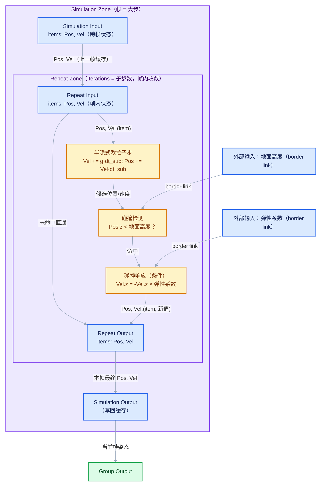

**这个案例里每条连线都值得追问归属**（用模式五的口诀）：

| 值 | 归属 | 理由 |
| --- | --- | --- |
| Pos, Vel（Simulation 层） | Simulation 状态条目 | 跨帧存续 |
| Pos, Vel（Repeat 层） | Repeat item | 帧内子步间传递 |
| 地面高度、弹性系数 | border link | 常量，每轮每帧可见 |
| dt_sub（子步长） | border link | 常量；帧级 Δframe 只在 Simulation 层用 |

**迭代设计要点**：子步数 = `ceil(Δframe / dt_max)`，用 `Math: Divide + Ceiling` 从场景帧时间推导，保证无论 24fps 还是 60fps 都满足最大步长约束——这比写死"每帧 8 步"健壮得多。

### 案例 A2：批次生长 + 分形细节的"程序化藤蔓"

**需求**：藤蔓从根部开始，每轮向目标方向生长一段（批次推进），每段上再长出带衰减的分形小枝。

**推导过程**：

1. "每轮生长一段，依赖上一轮的尖端位置" → 状态 = 尖端位置 + 累积几何 → **Repeat 累积**（模式一）。
2. "每段上的小枝是自相似复制" → 段内结构 → 段内用普通节点组或**嵌套 Repeat**（模式三）。
3. "生长方向随轮变化"（比如追逐一个目标点）→ 轮号相关但不是状态 → **Iteration 现算方向**（模式六）。
4. "枝条形状相同、变换不同" → 实例化，realize 出循环体（模式三的取舍表）。

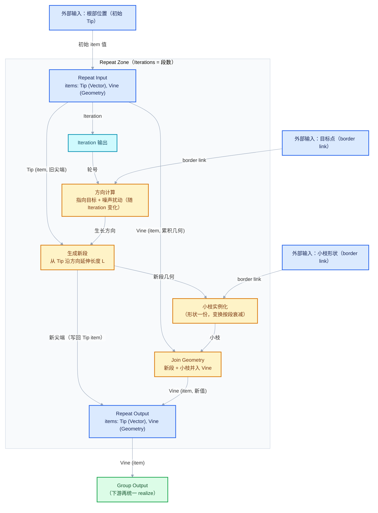

**为什么它不是批次模式**：虽然也是"每轮处理一段"，但轮间有强状态依赖（尖端位置、累积几何），本质是累积模式的空间变体。批次模式（模式二）的状态只是"处理进度"，处理的各批互相独立——这条界线在选型时要能一眼分清。

<hr style="border:none;height:1px;background:linear-gradient(90deg,#BFDBFE,#E2E8F0 55%,transparent);margin:34px 0">

## 附录 B：迭代设计开工清单

搭任何 Repeat Zone 之前，按顺序过一遍这张清单（每一条都对应正文的一节）：

1. **写迭代式**：能否把问题写成 `s_{n+1} = f(s_n, c₁…cₖ)`？`s` 有几个？（[模式一](#模式一累积模式accumulate)）
2. **分类每个输入**：哪个是状态（item）、哪个是常量（border link）、哪个只是轮号的函数（Iteration 现算）？（[模式五](#模式五border-link-的正确使用轮间状态与外部值的分界线)）
3. **接初值**：每个状态 item 的 Repeat Input 输入都接了吗？默认值起步是否符合预期？
4. **定轮数**：乘积模型心算（`Iterations × 单轮成本`）；分形类先算 `Cᴺ`；批次类用 `ceil` 推导。（[性能意识初步](#性能意识初步)）
5. **定恒等化**：多余轮如何变成恒等操作？收敛阈值多少？（[收敛判断](#收敛判断与等效提前退出)）
6. **查几何增长**：循环体输出的几何量是常数、线性还是指数？realize 在循环体内吗？（[模式三](#模式三分形递归结构)）
7. **问时间轴**：状态需要跨帧吗？需要 → 换/套 Simulation。（[模式四](#模式四物理动画积分repeat-与-simulation-zone)）
8. **问遍历**：轮间真的有依赖吗？没有 → 考虑 Foreach。（[先回答一个具体问题](#先回答一个具体问题)）
9. **留检查点**：把 Repeat Output 的 inspection index 设到中间某轮，方便逐轮调试。（[用小数据走一遍](#用小数据走一遍三轮牛顿迭代的数值表)）
10. **小数据先行**：先用 3 个点、3 轮验证行为（像本文的牛顿法手推表一样），再放大规模。

<hr style="border:none;height:1px;background:linear-gradient(90deg,#BFDBFE,#E2E8F0 55%,transparent);margin:34px 0">

## 附录 C：常见问答（FAQ）

**Q：Repeat Zone 的轮数可以是 0 吗？**
可以。`Iterations` 声明就是 `min(0)`，且零轮时输入直通输出（源码 [`geometry_nodes_repeat_zone.cc#L344`](../../../source/blender/nodes/intern/geometry_nodes_repeat_zone.cc#L344)）。这让"批次数 = ceil(数量/批大小)"在空数据时天然安全。见[反例 6](#反例与边界)。

**Q：item 可以有几个？有上限吗？**
没有硬上限，但有纪律上限：每个 item 每轮都要"读旧值、写新值"一次。item 数量多本身不贵（引用传递），但每个几何 item 如果每轮都被真正修改，就会各自触发写时复制。建议：能合并成单个几何+属性的，别拆成多个几何 item；数值类 item 按语义拆（位置/速度分开比打包成一个向量更可读）。

**Q：Repeat Zone 里能逐轮看中间结果吗？**
可以。Repeat Output 节点面板上有 inspection index（源码 [`node_geo_repeat.cc#L54`](../../../source/blender/nodes/geometry/nodes/node_geo_repeat.cc#L54) 的 UI 逻辑），指定检查第几轮后，检查器显示的就是该轮进入输出节点时的值。超范围会提示 "Inspection index is out of range"（[源码 L216-L227](../../../source/blender/nodes/intern/geometry_nodes_repeat_zone.cc#L216)）。

**Q：为什么我的 Repeat 比手写 10 层同样的节点还慢？**
两层固定开销：① 每次求值要按轮数实例化求值图（[源码注释 L187-L194](../../../source/blender/nodes/intern/geometry_nodes_repeat_zone.cc#L187) 明确说图依赖轮数、不易缓存复用）；② 循环体是通用实现，缺少针对特殊场景的特化路径。轮数少（几轮）时这些开销占比可观；轮数多时占比缩小。所以"少轮数场景"优先考虑展开成普通节点，"多轮数场景"Repeat 才是净赚。量化见 [02-性能模型与开销分析](02-性能模型与开销分析.md)。

**Q：Repeat Zone 能嵌套吗？有深度限制吗？**
能嵌套（外层一轮执行一次完整的内层循环），语义上就是二重循环。没有刻意的深度限制，但成本是内外轮数的乘积，三层嵌套就要先做三次乘法心算。另一个实际约束是可读性——嵌套超过两层时，先把内层抽成节点组（Group）通常更清晰，且节点组可以在区域外单独测试。

**Q：Iteration 从 0 数还是从 1 数？为什么我的衰减公式差一轮？**
从 0 数（源码描述："Starts counting at zero"，[L76-L77](../../../source/blender/nodes/geometry/nodes/node_geo_repeat.cc#L76)）。写 `衰减^Iteration` 时第 0 轮系数是 1（不衰减），第 N-1 轮是 `衰减^(N-1)`。如果你期望"第一轮就衰减"，应该写 `衰减^(Iteration + 1)`。这类差一错误建议在搭图时先用 2 轮 + 极端衰减系数（如 0.01）肉眼验证。

**Q：能把 Group Input 直接拉进 Repeat Zone 吗？**
能，拉进去的就是 border link（每轮直连、值固定）。但注意模式五的纪律：Group Input 输出的是"外部值"就正常走 border link；如果你想让它当状态，它必须先进 Repeat Input 的 item 输入做初值，而不是直接横穿区域。直接横穿的状态 = 累积静默失效（[图 5-B 错误一](#图-5-b两种错误接法)）。

<hr style="border:none;height:1px;background:linear-gradient(90deg,#BFDBFE,#E2E8F0 55%,transparent);margin:34px 0">

## 附录 D：术语对照表

| 本文术语 | 英文/源码对应 | 一句话定义 |
| --- | --- | --- |
| 轮 | iteration | 循环体的一次执行，从 0 计数 |
| 迭代数 | Iterations | 总轮数，Repeat Output 的输入，先定后跑 |
| item | Repeat Item | 轮间传递状态的具名 socket（[`RepeatItemsAccessor`](../../../source/blender/nodes/geometry/nodes/node_geo_repeat.cc#L348)） |
| border link / 穿越连线 | zone.border_links | 区域外直连区域内的连线，每轮同值 |
| 循环体 | loop body / body_fn_ | Repeat Input 与 Output 之间的子图 |
| 恒等化 | （本文术语） | 让多余轮等价于"什么都没做"的数学技巧 |
| 隐性共享 | implicit sharing | 引用计数的几何复用，未修改不拷贝 |
| 累积 | accumulate | 状态在轮间传递的模式 |
| 收敛 | convergence | 状态趋于稳定值，增量趋于零 |
| 写时复制 | copy-on-write | 真正修改时才发生的深拷贝 |

<hr style="border:none;height:1px;background:linear-gradient(90deg,#BFDBFE,#E2E8F0 55%,transparent);margin:34px 0">

## 附录 E：mermaid 图索引与阅读路线

本文共 16 张 mermaid 图，按用途归组，便于复习时直接跳转：

| 图 | 位置 | 用途 |
| --- | --- | --- |
| 决策流程图 | [先回答一个具体问题](#先回答一个具体问题) | Repeat/Simulation/Foreach/Closure 选型 |
| 图 1-A | [模式一](#图-1-a数值积分位置--速度--dt) | 数值积分（item 状态 + border link 常量） |
| 图 1-B | [模式一](#图-1-biterative-拟合牛顿法开平方) | 牛顿法开平方（配合手推数值表） |
| 图 1-C | [模式一](#图-1-c逐轮细分对上一轮的几何继续加工) | 逐轮细分（几何状态累积） |
| 收敛恒等化图 | [收敛判断与等效提前退出](#收敛判断与等效提前退出) | 步长归零技巧 |
| 图 2-A | [模式二](#图-2-a按索引切批) | 按索引切批 + 域选择 |
| 图 3-A | [模式三](#图-3-a逐轮收缩复制分形树骨架) | 分形收缩复制（复制+变换+Join） |
| 图 3-B | [模式三](#图-3-b逐轮加噪细分地形式细化) | 逐轮加噪细分（衰减 × Iteration） |
| Repeat 积分对照图 | [模式四](#模式四物理动画积分repeat-与-simulation-zone) | 单次求值内的积分 |
| Simulation 对照图 | [模式四](#模式四物理动画积分repeat-与-simulation-zone) | 跨帧演化的对照 |
| 图 5-A | [模式五](#图-5-a正确的分界) | 状态/常量/初值的正确分界 |
| 图 5-B | [模式五](#图-5-b两种错误接法) | 两种错误接法对照 |
| 图 6-A | [模式六](#图-6-aiteration--index-switch每轮换一种处理方式) | Iteration + Index Switch 分支 |
| 图 6-B | [模式六](#图-6-biteration-做查表从序列参数里取每轮参数) | Iteration 查表取参数 |
| 案例 A1 | [附录 A](#案例-a1simulation-外层--repeat-子步的弹跳球) | Simulation 嵌套 Repeat 综合架构 |
| 案例 A2 | [附录 A](#案例-a2批次生长--分形细节的程序化藤蔓) | 累积 + 分形综合架构 |

**推荐阅读路线**：

- **快速上手**（20 分钟）：[先回答一个具体问题](#先回答一个具体问题) → [心智模型回顾：三条源码事实](#心智模型回顾三条源码事实) → [模式一](#模式一累积模式accumulate) 的图 1-A/1-B → [常见错误清单](#常见错误清单)。
- **系统学习**（1.5 小时）：全文顺序读，边读边在 Blender 里复现图 1-B 并对照[数值手推表](#用小数据走一遍三轮牛顿迭代的数值表)。
- **复习/查漏**（10 分钟）：[模式速查卡](#模式速查卡) → [附录 B 开工清单](#附录-b迭代设计开工清单) → [附录 D 术语表](#附录-d术语对照表)，卡在哪一条就回正文对应小节。

下一篇 [02-性能模型与开销分析](02-性能模型与开销分析.md) 把本文定性论述的三个心算工具（乘积模型、隐性共享、串行链）全部定量化——读完本篇就带着这些问题过去。

<div style="font-family:'Segoe UI','Microsoft YaHei',system-ui,-apple-system,sans-serif;margin:38px 0 4px;padding:13px 16px;background:#F8FAFC;border:1px solid #E2E8F0;border-radius:12px;display:flex;flex-wrap:wrap;align-items:center;gap:8px">
<span style="font-size:11px;font-weight:700;letter-spacing:.1em;color:#64748B;margin-right:2px">继续阅读</span>
<a href="./02-性能模型与开销分析.md" style="font-size:13px;color:#7C3AED;background:#F5F3FF;border:1px solid #DDD6FE;border-radius:999px;padding:3px 12px;text-decoration:none;white-space:nowrap">性能模型与开销分析 ›</a>
<span style="font-size:13px;color:#334155;background:#F1F5F9;border:1px solid #E2E8F0;border-radius:999px;padding:3px 12px;text-decoration:none;white-space:nowrap">回到顶部</span>
</div>
