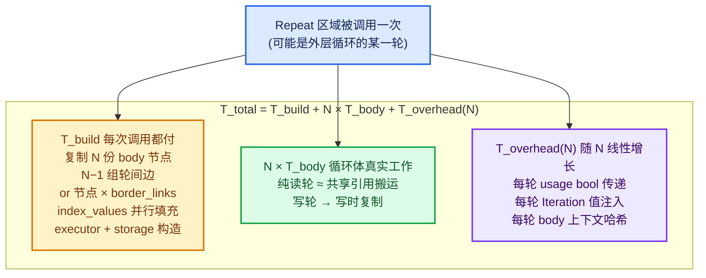
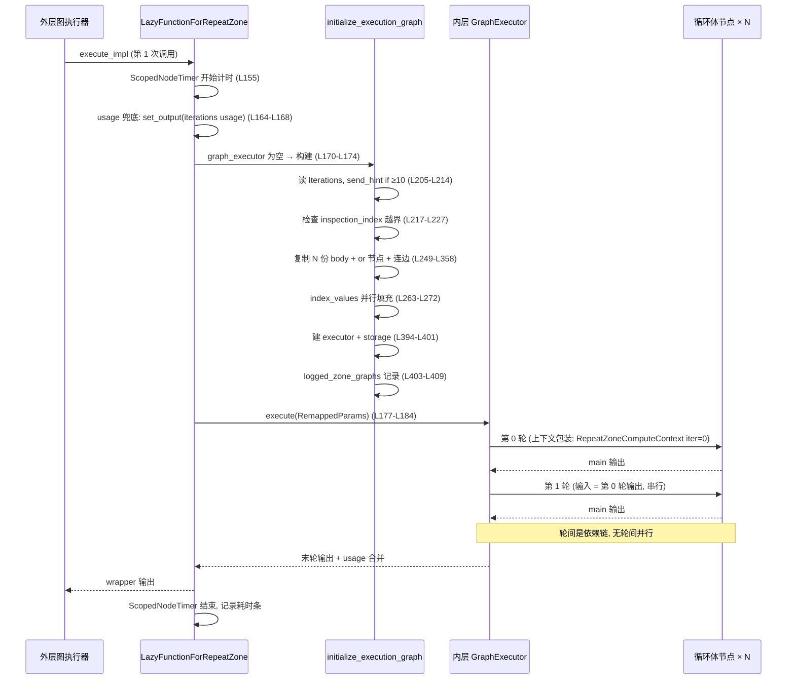
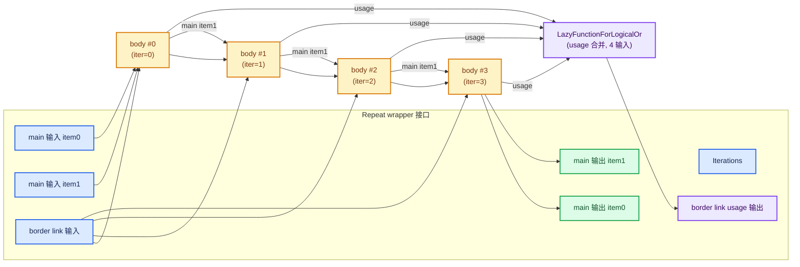
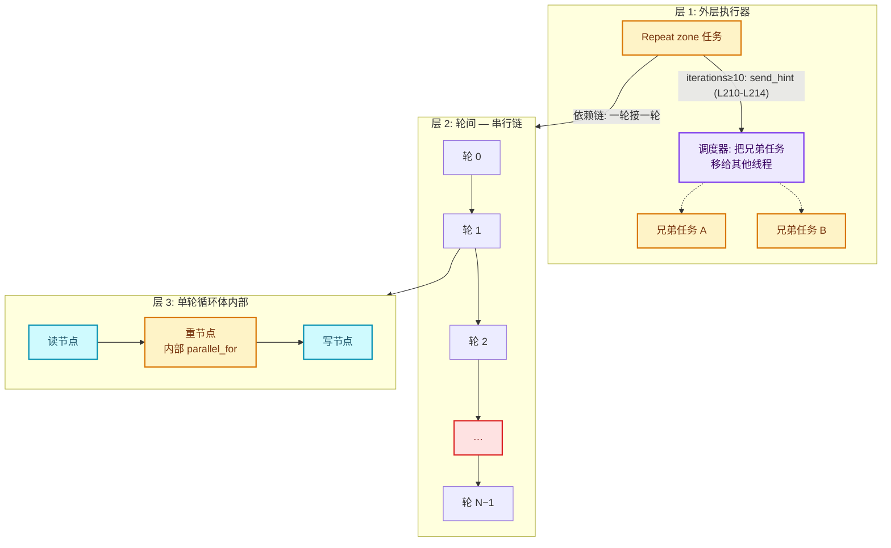
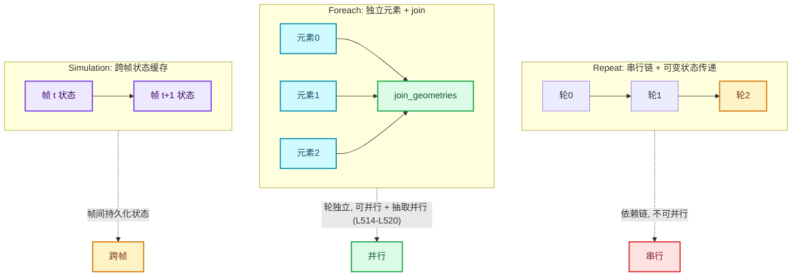

# RN-06-02 性能模型与开销分析

[总入口](../README.md) · [本章导航](README.md) · [上一篇](01-使用模式与迭代设计.md) · [下一篇](../90-实现依赖专题/README.md)

基准：Blender `5.4.0-alpha`，本地工作树。本篇是"重复区域（Repeat Zone）全面学习"
系列 06 章第 2 篇，也是收尾实战篇。前面各章回答了"Repeat 区域是什么、怎么表示、
怎么执行"，本篇回答最后一个问题：**它到底贵在哪里、便宜在哪里、怎么用才不亏**。

核心源码文件：

- [source/blender/nodes/intern/geometry_nodes_repeat_zone.cc](../../../source/blender/nodes/intern/geometry_nodes_repeat_zone.cc)
  （Repeat 区域运行时本体，全文 432 行，本篇大量引用）
- [source/blender/blenlib/BLI_lazy_threading.hh](../../../source/blender/blenlib/BLI_lazy_threading.hh)
  （惰性并行提示机制）
- [source/blender/blenlib/BLI_implicit_sharing.hh](../../../source/blender/blenlib/BLI_implicit_sharing.hh)
  与 [source/blender/blenkernel/BKE_geometry_set.hh](../../../source/blender/blenkernel/BKE_geometry_set.hh)
  （隐式共享 / 写时复制）
- [source/blender/nodes/intern/socket_usage_inference.cc](../../../source/blender/nodes/intern/socket_usage_inference.cc)
  （socket 用途推断，决定裁剪）

> **基准声明**：本篇所有结论来自源码阅读（结构性分析），**不含任何实测计时数据**。
> 文中"小数据走一遍"的算术推演是教学性估算，量级方向可靠，具体倍数依机器与
> 场景而变。这一边界也在[验收报告](../91-验收报告.md)中明确登记。

---

## 目录

- [先回答一个具体问题](#先回答一个具体问题)
- [成本模型](#成本模型)
- [固定开销清单](#固定开销清单)
- [并行边界](#并行边界)
- [内存行为](#内存行为)
- [诊断工具](#诊断工具)
- [优化策略](#优化策略)
- [与其他 Zone 的性能对照](#与其他-zone-的性能对照)
- [用小数据走一遍](#用小数据走一遍)
- [反例与边界](#反例与边界)
- [继续阅读](#继续阅读)

---

## 先回答一个具体问题

**Repeat 区域为什么不能像编程语言里的 for 循环那样便宜？**

写 C 或 Python 的人直觉是：循环本身几乎免费，成本全在循环体。`for (int i = 0; i < N; i++) { ... }`
的骨架开销是几条比较和跳转指令。那 Blender 几何节点里的 Repeat 区域，把循环体节点
执行 N 次，是不是也"循环骨架免费"？

**不是。Repeat 区域的"循环骨架"本身有实打实的构建与调度成本**，而且随 N 线性增长。
原因在源码里写得明明白白——[geometry_nodes_repeat_zone.cc · L187—L194](../../../source/blender/nodes/intern/geometry_nodes_repeat_zone.cc#L187-L194)
的注释：

> Generate a lazy-function graph that contains the loop body (`body_fn_`) as many times
> as there are iterations. Since this graph depends on the number of iterations, it can't be
> reused in general. We could consider caching a version of this graph per number of iterations,
> but right now that doesn't seem worth it. In practice, it takes much less time to create the
> graph than to execute it (for intended use cases of this generic implementation, more special
> case repeat loop evaluations could be implemented separately).

翻译成教学语言：**Repeat 区域的通用实现是"每次调用都把循环体 lazy-function
复制 N 份、拼成一张内层执行图，再交给图执行器跑"。因为图的大小依赖迭代数 N
（运行时才知道），这张图没法提前缓存；源码作者评估过按 N 缓存图，认为不值得**。

所以每次调用 Repeat 区域，都要付三类固定开销：

1. **图构建**：N 份循环体节点 + N−1 组边 + border link 的 or 节点 + 索引映射表 +
   executor 对象与它的 storage。
2. **参数搬运**：外层参数经 `RemappedParams` 重映射进内层图，每轮循环体之间的
   main 输出→下一轮 main 输入由图边承担。
3. **用途检查**：每个 repeat item 的"输出有没有人用"以 bool 形式在图里传递，
   border link 的 usage 还要经过 or 节点合并。

这三项是**语言级 for 循环根本没有**的成本。它们换来的是通用性：循环体可以是
任意节点子图、可以在编辑器里可视化调试、可以与任意 zone 组合。理解"骨架不免费"
是理解 Repeat 性能的第一课。

还有一个反直觉点要提前说：**轮与轮之间是串行的**。第 k 轮的输入是第 k−1 轮的
输出（[L298—L311](../../../source/blender/nodes/intern/geometry_nodes_repeat_zone.cc#L298-L311)
的 pair-wise 连接），所以 N 轮循环体在依赖图里是一条链，**轮间没有并行度**。
并行度只存在于三处：图构建时的 index 填充、循环体内部的节点调度、以及外层
调用者获得的"打断"提示（send_hint）。这是本章"并行边界"一节的主题。

---

## 成本模型

我们把一次 Repeat 区域求值的总时间拆成三项：

```text
T_total = T_build + N × T_body + T_overhead(N)
```

- **T_build**：构建内层执行图的一次性成本（每次 zone 调用都付，不只是第一次）。
- **T_body**：单个循环体的真实工作量 × N。
- **T_overhead(N)**：随 N 增长（或受 N 影响）的其余杂项：usage bool 传递、
  Iteration 值注入、上下文哈希计算等。

先给一张全景分解图，然后逐项分析：



### T_build：图构建成本

构建发生在
[`initialize_execution_graph`](../../../source/blender/nodes/intern/geometry_nodes_repeat_zone.cc#L195-L410)，
每次 `execute_impl` 里 `eval_storage.graph_executor` 为空时触发（L170—L174）。
注意：**"为空"是指这个 storage 槽第一次执行**。如果 Repeat 区域嵌在另一个
Repeat 区域里，外层每转一轮，内层 zone 就获得一个新 storage、重新走一遍完整
构建。所以嵌套时的总构建成本是 `T_build × 外层轮数`——这一点和"只建一次、
反复执行"的直觉相反，也是系列 [04-02](../04-运行时机制/02-ComputeContext与迭代身份.md)
讲 storage 生命周期时强调过的。

T_build 的构成，按源码顺序逐项数：

| # | 构建步骤 | 源码位置 | 成本量级 |
| --- | --- | --- | --- |
| 1 | 读 Iterations 输入（`ensure_type<int>`） | L204—L208 | O(1) |
| 2 | 建图输入/输出 socket（wrapper 接口每个一个） | L238—L245 | O(接口数) |
| 3 | 复制 N 份循环体 lazy-function 节点 | L249—L252 | **O(N)** |
| 4 | 每 border link 一个 or 节点（输入数 = N） | L256—L261 | O(border_links) 个节点，各自 O(N) 输入 |
| 5 | index_values 并行填充 N 个 SocketValueVariant | L263—L272 | O(N)，已并行 |
| 6 | 每个 body 节点：注入 Iteration 值、连 border link、连 reference set | L274—L294 | **O(N × (1 + border_links + ref_sets))** |
| 7 | pair-wise 轮间连线：N−1 组 main 边 + usage 默认值 | L298—L311 | **O(N × items)** |
| 8 | border link usage 输出连线 | L314—L317 | O(border_links) |
| 9 | 首轮连外层输入、末轮连外层输出（或 0 迭代直通） | L319—L358 | O(items) |
| 10 | `update_node_indices()` 重排节点索引 | L363 | O(图节点数) = O(N) |
| 11 | 建 input/output index map | L367—L385 | O(接口数) |
| 12 | 构造 `lf::GraphExecutor` + `init_storage` | L394—L401 | O(N)（executor 要索引全图） |
| 13 | logged_zone_graphs 导出（仅调试开启时） | L403—L409 | O(图大小) + 字符串化 |

前 12 步对每次 zone 调用都要走一遍。量级合计：**O(N × (items + border_links + ref_sets) + N)**
——每个迭代数都对应一批节点、边、默认值注入。注意这是"构建"不是"执行"：
建一个 `lf::FunctionNode` 只是往图结构里塞一个指针节点，远比执行循环体便宜。
这正是 L191—L193 注释说 "takes much less time to create the graph than to execute it"
的含义——但"远便宜于执行"不等于"免费"，N 很大时纯构建时间也会显形。

**一个重要的分摊细节**：storage 是按 `lf::Context::storage` 槽存活的。如果同一次
几何节点求值中，这张 Repeat 区域的 wrapper 节点只被调用一次（最常见情形），那
T_build 只付一次；如果它被调用多次（嵌套在外层循环里、或者 closure/组内多次调用），
**每次调用都要从零建图**。源码注释 L189—L193 明确说了图依赖 N、不能复用，所以
不存在"同一个 N 就复用图"的优化。

### T_body：循环体真实工作

这是用户设计的算法本身。关键问题是：循环体里"读上一轮几何"到底花多少钱？

答案由**隐式共享（implicit sharing）**决定。机制链条：

1. 几何节点 socket 间传的复杂值是 `SocketValueVariant`，其中 GeometrySet 是
   主要成员之一（[BKE_node_socket_value.hh · L94—L110](../../../source/blender/blenkernel/BKE_node_socket_value.hh#L94-L110)
   说明该容器承载 socket 值的类型擦除存储）。
2. `GeometrySet` 本身是"轻容器"：它不直接拥有几何数据，而是持有若干
   `GeometryComponentPtr`（`ImplicitSharingPtr<GeometryComponent>`），复制
   GeometrySet 只是给各组件的引用计数 +1（[BKE_geometry_set.hh · L132—L149](../../../source/blender/blenkernel/BKE_geometry_set.hh#L132-L149)）：
   > Copying a geometry set is a relatively cheap operation, because it does not copy
   > the referenced geometry components, so #GeometrySet can often be passed or moved
   > by value.
3. `ImplicitSharingPtr` 的拷贝就是 `add_user`（引用计数原子 +1），移动则只是
   指针搬运（[BLI_implicit_sharing_ptr.hh · L39—L64](../../../source/blender/blenlib/BLI_implicit_sharing_ptr.hh#L39-L64)）。
4. 只有当某代码请求**写访问**且引用计数 > 1 时，才发生真正的深拷贝——
   "copy on write"（[BLI_implicit_sharing.hh · L23—L32](../../../source/blender/blenlib/BLI_implicit_sharing.hh#L23-L32)：
   "If some code wants to modify data that is currently shared, it has to make a copy
   first. This behavior is also called 'copy on write'"）。运行时入口是
   `ensure_mutable_inplace`（[BLI_implicit_sharing_ptr.hh · L144—L154](../../../source/blender/blenlib/BLI_implicit_sharing_ptr.hh#L144-L154)）
   与 GeometrySet 的 `get_component_for_write` / `ensure_owns_direct_data`
   （[BKE_geometry_set.hh · L179、L249](../../../source/blender/blenkernel/BKE_geometry_set.hh#L179)）。

把这条链套到循环上：**第 k 轮把 GeometrySet 传给第 k+1 轮，如果第 k+1 轮的
循环体"只读不写"这个几何（比如只算个包围盒、只取属性统计值），那么传输成本
≈ 一次引用计数操作，零数据拷贝**。反之，一旦循环体里出现任何一个请求写访问
的节点（多数几何处理节点都写），写时复制立刻触发，拷贝全量数据。

这给出一个非常有用的性能直觉：

- **纯读轮 ≈ 免费**（数据层面；骨架开销照付）。
- **写轮 = T_body 的主体**，因为深拷贝 + 重算。
- 循环体里"改一下再传下去"的写节点越靠后越好——如果倒数第二轮不再写，
  最后一轮的输出就与前一轮共享，省一次拷贝。

### T_overhead(N)：随迭代数增长的杂项

除了建图和循环体本身，还有一批随 N 线性增长的小成本：

- **usage bool 的传递**。每个 repeat item 在 wrapper 上有一对
  "output usage 输入 / input usage 输出"。展开时，除末轮外的每个 body 节点的
  output usage 输入被写死 `&static_true`（[L309](../../../source/blender/nodes/intern/geometry_nodes_repeat_zone.cc#L309)），
  意思是"每一轮都假设下游要用你的输出"——这是保守但正确的做法，因为轮间
  依赖链意味着任何一轮的输出都可能被后续轮消费。每个 or 节点要收 N 个
  bool 输入（border link usage 合并，L285—L286）。
- **Iteration 值注入**。若 Iteration 输出有连线（`use_index_values`，L263），
  N 个 `SocketValueVariant` 被并行填充为 0..N−1（L266—L272），每个 body 节点
  通过 `set_default_value` 引用其中一个（L278—L281）。这是 O(N) 的分配与原子
  引用计数，虽然并行化了，仍然是真内存写入。
- **每轮循环体的上下文构造与哈希**。循环体执行不是裸调 `fn.execute`，而是经过
  `RepeatBodyNodeExecuteWrapper::execute_node`（L40—L64）：每轮构造一个
  `RepeatZoneComputeContext`（带 iteration 号）、复制 `GeoNodesUserData`、
  计算 `body_compute_context.hash()` 用于日志（L54—L59）。
  `ComputeContext::hash()` 是父哈希 + 字段字节的逐层哈希
  （[BLI_compute_context.hh · L145—L150](../../../source/blender/blenlib/BLI_compute_context.hh#L145-L150)），
  结果按 `CacheMutex` 缓存（同文件 L111—L114），但每轮的"新上下文对象"仍要
  算一次自己的层。这是**每轮 O(1) 但乘 N** 的常数成本，也是编辑器日志/警告能
  定位到"第几轮"的根基——一致性换来的税。
- **executor 调度**。N 份 body 节点构成一条依赖链，图执行器要为每个节点维护
  node state、处理懒请求与阻塞等待。节点数越多，调度簿记越多。

### 三个成本项的相对量级（结构性判断）

结合源码注释与机制，可以给出**方向性**结论（非实测）：

| 场景 | 主导项 | 理由 |
| --- | --- | --- |
| N 小（1~10）、循环体重 | N × T_body | 建图只有十几个节点，可忽略 |
| N 大（10²~10³）、循环体轻（纯读/简单数学） | T_build + T_overhead 可与 T_body 同量级 | 源码注释 L191—L193 承认通用实现是为"重循环体"设计的 |
| N 大、循环体重 | N × T_body（可能含 N 次写时复制） | 建图成本被真实工作淹没 |
| 嵌套 Repeat | T_build × 外层 N_outer | 内层每外层轮重建 |

这张表同时是"优化策略"一节的路线图：**要么减小 N，要么减重循环体，要么避开
嵌套放大**。

### 每轮执行的时间线



### N=4 时内层图长什么样



这就是 `initialize_execution_graph` 产出的图的形状：一条 N 节点的主体链、
挂在链上的 border/link 边、以及每 border link 一个 or 合并节点。**图的大小
随 N 线性膨胀，这就是"骨架不免费"的图形化解释**。

---

## 固定开销清单

把所有开销来源按"何时付"分类汇总。行号均指
[geometry_nodes_repeat_zone.cc](../../../source/blender/nodes/intern/geometry_nodes_repeat_zone.cc)，
另注明的除外。

### 每次 zone 调用（per-call）

| 开销 | 源码依据 | 说明 |
| --- | --- | --- |
| 读 Iterations 输入并 `ensure_type<int>` | L204—L208 | 类型不匹配时还要走隐式转换 |
| `send_hint` 判断（N≥10 时发出） | L210—L214 | 本身 O(1)，但会改变调度行为 |
| inspection_index 越界检查 | L217—L227 | O(1)；越界时才追加一条 Info 警告 |
| 建图 socket ×（wrapper 接口数） | L238—L245 | 接口数固定，与 N 无关 |
| `update_node_indices()` | L363 | O(全图节点数) = O(N) |
| index map 构建 | L367—L385 | O(接口数) |
| `lf::GraphExecutor` 构造 | L394—L399 | 要索引整个内层图 |
| executor `init_storage`（含内层 storage 链） | L400—L401 | O(N) |
| `logged_zone_graphs` 字符串化（仅调试开启） | L403—L409 | O(图大小)，含互斥锁 |
| `RemappedParams` 构造 | L177—L181 | O(1)，仅索引映射引用 |
| `ScopedNodeTimer` 起止计时 | L155 | O(1)；是否落日志看阈值 |

### 每次迭代（per-iteration）

| 开销 | 源码依据 | 说明 |
| --- | --- | --- |
| 复制一份 body lazy-function 节点 | L249—L252 | O(1) 结构操作 ×N |
| 注入 Iteration 值（`set_default_value`） | L278—L281 | 引用 `index_values[i]`，共享 Variant |
| `index_values[i]` 的 emplace 写入 | L266—L272 | O(N) 但已 1024 块并行 |
| 连 border link 输入边 + usage 边 | L282—L287 | ×border_links |
| 连 reference set 输入边 | L290—L293 | ×ref_sets |
| pair-wise main 连边 + `static_true` usage | L298—L311 | ×items |
| or 节点的一个输入 | L256—L261, L285—L286 | 每轮给每个 or 节点喂一个 bool |
| 每轮执行时的上下文包装 | L40—L64 | `RepeatZoneComputeContext` 构造 + hash 计算 + user_data 复制 |
| 每轮的 usage bool 判定与传递 | L309（写死 true）+ 执行期判定 | 保守：轮间链上任何输出都默认可能被用 |

### 每个节点（per-node，循环体内部）

| 开销 | 源码依据 | 说明 |
| --- | --- | --- |
| node state / 懒请求簿记 | lf 图执行器通用机制（[lazy_function_graph_executor_generic.hh](../../../source/blender/functions/intern/lazy_function_graph_executor_generic.hh)） | N 份 body 就是 N 份簿记 |
| 几何值的隐式共享引用计数 | [BLI_implicit_sharing_ptr.hh · L39—L64](../../../source/blender/blenlib/BLI_implicit_sharing_ptr.hh#L39-L64) | 拷贝 +1 / 移动 0 / 析构 −1 |
| 写时复制深拷贝（仅写轮） | `ensure_mutable_inplace`（L144—L154） | T_body 的真正大头 |

### 一次性或可选

| 开销 | 触发条件 | 源码依据 |
| --- | --- | --- |
| 嵌套重建 | Repeat 在另一个 Repeat/Closure/组内被多次调用 | L170—L174（storage 为空即重建）+ L189—L193 注释 |
| 调试图导出 | `bNodeTreeRuntime::logged_zone_graphs` 非空 | [BKE_node_runtime.hh · L156—L157](../../../source/blender/blenkernel/BKE_node_runtime.hh#L156-L157) |
| 越界警告字符串 | `inspection_index >= iterations` | L217—L227 |
| Profile 耗时条落盘 | `verbose_log` 或耗时 > 100µs | [NOD_geometry_nodes_lazy_function.hh · L516, L562—L574](../../../source/blender/nodes/NOD_geometry_nodes_lazy_function.hh#L516) |

---

## 并行边界

Repeat 区域的并行结构是"外层可并行、轮间串行、轮内看循环体"。三层拆开讲。

### 层 1：外层并行 —— send_hint

[geometry_nodes_repeat_zone.cc · L210—L214](../../../source/blender/nodes/intern/geometry_nodes_repeat_zone.cc#L210-L214)：

```cpp
if (iterations >= 10) {
  /* Constructing and running the repeat zone has some overhead so that it's probably worth
   * trying to do something else in the meantime already. */
  lazy_threading::send_hint();
}
```

`send_hint` 的机制语义在 [BLI_lazy_threading.hh](../../../source/blender/blenlib/BLI_lazy_threading.hh)
文件头注释里讲得非常完整（L10—L57），核心思想：

> By default, all work stays on a single thread. If an individual task notices that it is
> about to start a computation that will take a while, it notifies the task scheduler further
> up on the stack. The scheduler then allows other threads to take over other tasks that were
> originally meant for the current thread.

也就是说：默认一切单线程（零线程开销、CPU 缓存友好）；当某个任务"预感自己
要跑很久"，它通知上层调度器，**把本线程积压的其他任务让给别的线程**。接收端
在 lazy-function 图执行器里：
[lazy_function_graph_executor_generic.hh · L1477—L1490](../../../source/blender/functions/intern/lazy_function_graph_executor_generic.hh#L1477-L1490)
注册了 `HintReceiver`，收到 hint 且确实有待调度节点时，调
`try_enable_multi_threading()` 并把任务推进任务池。

Repeat 区域选择 `iterations >= 10` 作为阈值，注释理由是"构建 + 运行 Repeat
区域有开销，期间让别的活先干起来大概值得"。**这个 hint 不是"把 N 轮并行跑"，
而是"把同一执行器里排在 Repeat 之后的兄弟任务移到其他线程"**——比如外层图里
Repeat 旁边还有一条独立分支，那条分支可以在 Repeat 跑的时候并行推进。

### 层 2：轮间 —— 串行，不可并行

轮与轮是数据依赖链：第 k 轮的 main 输入 = 第 k−1 轮的 main 输出
（L298—L311 的 pair-wise 连接）。这在依赖图里是**一条链**，任何图调度器都
不可能并行执行链上的节点。这是 Repeat 语义本身决定的：每轮都"看到"上一轮
的结果。**没有任何开关能打开"轮间并行"——那会改变结果，不是性能选项**。

诚实的例外是 Foreach（下一节对照）：它的轮间没有数据依赖，所以那边能并行、
还能按元素抽取几何。Repeat 的串行是语义税。

### 层 3：循环体内部 —— 依然可以并行

注意一个微妙但重要的区别：`multi_threading_enabled = false`（L108，传入
`RemappedParams`，L181）限制的是**内层图执行器作为整体是否主动开多线程**，
不是"循环体内部的每个节点都不许并行"。理由与机制分两层：

1. **为什么默认 false**：Repeat 的内层图刚被构建出来，图执行器还处于
   "刚开跑"状态；如果立刻允许它孵化并行任务，而它的父执行器（同一个线程上）
   还有别的任务在排队，就会出现任务风暴——N 份 body 节点各自诱发子任务，
   线程池被打满，上下文切换与缓存失效吃掉收益。BLI_lazy_threading.hh 的
   文件头注释（L10—L14）把这笔账算得很清楚：
   > Using threads can lead to worse overall performance by introducing inter-thread
   > communication overhead. Keeping all work on a single thread reduces this overhead
   > to zero and also makes better use of the CPU cache.

2. **并行怎么被重新打开**：`send_hint` 触发后，执行器侧的 `blocking_hint_fn`
   （[lazy_function_graph_executor_generic.hh · L1480—L1488](../../../source/blender/functions/intern/lazy_function_graph_executor_generic.hh#L1480-L1488)）
   会调 `try_enable_multi_threading()`：逐层向外询问 `Params` 是否支持
   （`RemappedParams::try_enable_multi_threading_impl` 会穿透到 base_params，
   [lazy_function_execute.cc · L130—L138](../../../source/blender/functions/intern/lazy_function_execute.cc#L130-L138)），
   且要求系统线程数 > 1（同文件 L1277）。一旦打开，**循环体内部的普通并行
   节点（内部用 `threading::parallel_for` 的那些）照常并行**——因为它们的
   并行发生在节点函数内部，不经过图执行器的任务池。图执行器层面保守，
   节点内部并行不受影响。



三层总结成一句话：**Repeat 把"并行决策"交给外层与循环体内部，自己只保留
一条串行主干**。这是在"通用实现"约束下最稳的调度姿态。

### 教学注释代码：send_hint 与 lazy_threading

`[讲解]` 下面这段把"谁发 hint、谁收 hint"串成完整闭环。发送侧只有一行，
但语义要配着接收侧注释一起读：

```cpp
// 发送侧: geometry_nodes_repeat_zone.cc · L210—L214
if (iterations >= 10) {
  /* Constructing and running the repeat zone has some overhead so that it's probably worth
   * trying to do something else in the meantime already. */
  lazy_threading::send_hint();
}

// 接收侧: lazy_function_graph_executor_generic.hh · L1477—L1490 (节选)
/* This is run when the execution of the node calls `lazy_threading::send_hint` to indicate that
 * the execution will take a while. In this case, other tasks waiting on this thread should be
 * allowed to be picked up by another thread. */
auto blocking_hint_fn = [&]() {
  if (!current_task.has_scheduled_nodes.load()) {
    return;                                   // 本线程没有积压任务 → hint 无事可做
  }
  if (!this->try_enable_multi_threading()) {
    return;                                   // 调用链/系统不允许并行 → 保持单线程
  }
  this->push_all_scheduled_nodes_to_task_pool(current_task);  // 放手, 任务入池
};

lazy_threading::HintReceiver blocking_hint_receiver{blocking_hint_fn};
```

要点：

1. `send_hint` 是**建议不是命令**：接收方有三个前置条件（有积压任务、
   调用链允许并行、多核），任何一条不满足就当没听见。这保证 hint 在最坏
   情况下也无害。
2. 阈值 `10` 是经验值。Repeat 的注释解释了为什么不能设 0：小 N 时构建开销
   低、执行快，提前惊动线程池反而亏（线程间通信开销 > 收益）。
3. `HintReceiver` 是栈对象——它的生命周期就是"这个节点执行期间"。节点执行
   完，hint 通道自动关闭，不会污染之后的执行。

<details>
<summary>核对原始源码：geometry_nodes_repeat_zone.cc · L210—L214 与 lazy_function_graph_executor_generic.hh · L1477—L1490</summary>

```cpp
// geometry_nodes_repeat_zone.cc · L210—L214
    if (iterations >= 10) {
      /* Constructing and running the repeat zone has some overhead so that it's probably worth
       * trying to do something else in the meantime already. */
      lazy_threading::send_hint();
    }

// lazy_function_graph_executor_generic.hh · L1477—L1490
  /* This is run when the execution of the node calls `lazy_threading::send_hint` to indicate that
   * the execution will take a while. In this case, other tasks waiting on this thread should be
   * allowed to be picked up by another thread. */
  auto blocking_hint_fn = [&]() {
    if (!current_task.has_scheduled_nodes.load()) {
      return;
    }
    if (!this->try_enable_multi_threading()) {
      return;
    }
    this->push_all_scheduled_nodes_to_task_pool(current_task);
  };

  lazy_threading::HintReceiver blocking_hint_receiver{blocking_hint_fn};
```

</details>

### 教学注释代码：multi_threading_enabled 的保守传递

`[讲解]` `RepeatEvalStorage` 里这个 `bool multi_threading_enabled = false`（L108）
看似不起眼，实际是"内层图不主动并行"的开关。它被传给 `RemappedParams`
（L177—L181），后者把它塞进 `Params` 基类机制：

```cpp
// repeat zone 侧: 构造重映射参数时把 bool 传下去 (L177—L181)
lf::RemappedParams eval_graph_params{*eval_storage.graph_executor,
                                     params,
                                     eval_storage.input_index_map,
                                     eval_storage.output_index_map,
                                     eval_storage.multi_threading_enabled};

// 通用机制侧: lazy_function_execute.cc · L130—L138
bool RemappedParams::try_enable_multi_threading_impl()
{
  if (multi_threading_enabled_) {
    return true;                                   // 内层已打开 → 直接通过
  }
  if (base_params_.try_enable_multi_threading()) { // 询问外层 Params
    multi_threading_enabled_ = true;               // 外层同意 → 记住, 以后不再问
    return true;
  }
  // 外层拒绝 → 内层保持单线程
  ...
}
```

`[讲解]` 三个细节：

1. `multi_threading_enabled` 是**引用**传递（`bool &multi_threading_enabled_`，
   [FN_lazy_function_execute.hh · L53—L65](../../../source/blender/functions/FN_lazy_function_execute.hh#L53-L65)），
   所以"打开"状态在内外两层共享，且一旦打开就粘住。
2. Repeat 初始化它为 `false`，意味着内层图执行器**不会自发**申请并行；
   只有当某个节点（含 Repeat 自己的 `send_hint`）触发 hint 链路，外层同意后
   才翻转。这符合"能单线程就单线程"的惰性并行哲学。
3. 结合层 3 的说明再强调一次：这个开关管的是**图执行器层面的任务孵化**。
   循环体里某个节点的 multi-function 内部调 `threading::parallel_for` 时，
   并行由 BLI 任务系统直接承担，与这个 bool 无关。所以"内层不并行"更准确的
   表述是"内层图不额外孵化跨节点任务"。

<details>
<summary>核对原始源码：geometry_nodes_repeat_zone.cc · L98—L111（storage 字段）与 lazy_function_execute.cc · L130—L138</summary>

```cpp
// geometry_nodes_repeat_zone.cc · L98—L111
struct RepeatEvalStorage {
  LinearAllocator<> allocator;
  VectorSet<lf::FunctionNode *> lf_body_nodes;
  lf::Graph graph;
  std::optional<LazyFunctionForLogicalOr> or_function;
  std::optional<RepeatZoneSideEffectProvider> side_effect_provider;
  std::optional<RepeatBodyNodeExecuteWrapper> body_execute_wrapper;
  std::optional<lf::GraphExecutor> graph_executor;
  Array<SocketValueVariant> index_values;
  void *graph_executor_storage = nullptr;
  bool multi_threading_enabled = false;
  Vector<int> input_index_map;
  Vector<int> output_index_map;
};

// lazy_function_execute.cc · L130—L138
bool RemappedParams::try_enable_multi_threading_impl()
{
  if (multi_threading_enabled_) {
    return true;
  }
  if (base_params_.try_enable_multi_threading()) {
    multi_threading_enabled_ = true;
    return true;
  }
  return false;
}
```

</details>

---

## 内存行为

### GeometrySet 隐式共享：为什么"传几何"很便宜

系列前面章节已讲过 `SocketValueVariant` 的结构，这里只从性能视角复述要点：

1. **复制 GeometrySet 是浅操作**。`GeometrySet` 只持有一个组件指针数组
   （`std::array<GeometryComponentPtr, ...>`），`GeometryComponentPtr` 是
   `ImplicitSharingPtr`，拷贝 = 引用计数 +1（[BKE_geometry_set.hh · L132—L149](../../../source/blender/blenkernel/BKE_geometry_set.hh#L132-L149)：
   "Copying a geometry set is a relatively cheap operation … so #GeometrySet can
   often be passed or moved by value"）。
2. **移动更便宜**：`ImplicitSharingPtr` 的移动构造只偷指针，零原子操作
   （[BLI_implicit_sharing_ptr.hh · L44—L48](../../../source/blender/blenlib/BLI_implicit_sharing_ptr.hh#L44-L48)）。
   lazy-function 参数传递大量走移动路径。
3. **写才拷贝**。共享状态（`strong_users_ > 1`）下的数据是只读的；请求写访问
   时经 `ensure_mutable_inplace` → `data_->copy()` 触发深拷贝
   （[BLI_implicit_sharing_ptr.hh · L144—L154](../../../source/blender/blenlib/BLI_implicit_sharing_ptr.hh#L144-L154)；
   机制总述见 [BLI_implicit_sharing.hh · L23—L32](../../../source/blender/blenlib/BLI_implicit_sharing.hh#L23-L32)）。

对循环的意义（重述"成本模型"一节的结论并具体化）：

- 循环体**只读**上一轮几何 → 每轮传输 ≈ 一次引用计数原子操作。
- 循环体**写**上一轮几何 → 首次写访问触发整份数据深拷贝。
- N 轮全写 → N 次深拷贝（每轮一份新数据），内存峰值与时间都是 N 倍。

**优化含义**：把"只读分析"与"写入修改"分开。如果算法是"每轮根据几何算一个
统计值，最后合并"——统计节点不写几何，N 轮共享同一份几何，理想情况整条循环
只有一份 mesh 数据。如果算法是"每轮位移顶点 1 毫米"——每轮写时复制，N 份
中间 mesh（前 N−1 份在下轮开始后理论上可释放，但峰值仍受调度影响）。

### SocketValueVariant 的移动语义

`SocketValueVariant` 是类型擦除容器（[BKE_node_socket_value.hh · L94—L110](../../../source/blender/blenkernel/BKE_node_socket_value.hh#L94-L110)），
几何值以 `GeometrySet` 成员形式存在其中。它提供 `extract()`（取出后本 variant
进入 moved-from 状态，L165—L172）与 `from(T&&)` 等移动友好接口。lazy-function
框架在参数就绪后把值从生产者搬到消费者，能移动就不拷贝。循环间传递的
`Array<SocketValueVariant> index_values` 更是**预分配一次、所有轮共享**（L266—L272
一次性 `reinitialize`，body 节点用 `set_default_value` 借用，L278—L281）——
N 个 Iteration 值只有一份存储。

### LinearAllocator storage 复用

`RepeatEvalStorage` 内嵌一个 `LinearAllocator<>`（L99），它只服务一个客户：
内层 `graph_executor->init_storage(eval_storage.allocator)`（L400—L401）。
线性分配器的特点是只进不出、统一释放——内层 executor 运行期间的所有小对象
（node state 等）都从这块"竞技场"里分配，析构时整块回收。这把"每节点一次
malloc"变成"整场求值少数几次大块分配"，是框架层面对 per-node 簿记成本
（固定开销清单第三张表）的系统性缓解。

### 什么样的循环体模式产生内存峰值

**峰值模式：每轮新建大几何且不释放。** 典型构造：

- 循环体里放一个"生成"类节点（比如按上轮结果再实例化一组对象、或每轮
  join 一份新几何），输出累积式增长；
- 又用不到"只保留最近一轮"的语义——比如把每轮输出都连进一个被最终输出
  依赖的 accumulate 链。

此时第 k 轮结束时，系统同时持有：第 k−1 轮结果（可能还被第 k 轮的输入边
引用着）+ 第 k 轮新结果 + 所有生成节点内部临时数据。若循环体每轮新建一份
与上轮同量级的几何，最坏内存占用近似 **O(N × 轮几何大小)**。

**缓解模式**（与"优化策略"一节呼应）：

- 让循环体输出"等量替换"而非"累积叠加"：每轮的输出直接覆盖 main item
  （替换几何内容而不是 join），第 k−1 份在无他人引用后引用计数归零即释放。
- 生成类数据（如实例）尽量引用共享的原型（对象/集合引用是隐式共享的），
  而不是每轮展开成实际网格。
- 大几何的"改"挪到循环外一次做，循环内只算参数（"把不变计算移出循环体"
  的内存版）。

---

## 诊断工具

性能问题不能靠猜，Repeat 区域在四个层面提供了观测入口。

### 1. Profile 计时条：ScopedNodeTimer

[geometry_nodes_repeat_zone.cc · L155](../../../source/blender/nodes/intern/geometry_nodes_repeat_zone.cc#L155)
在 `execute_impl` 第一行构造
`ScopedNodeTimer node_timer{context, repeat_output_bnode_}`。它的析构函数
（[NOD_geometry_nodes_lazy_function.hh · L550—L575](../../../source/blender/nodes/NOD_geometry_nodes_lazy_function.hh#L550-L575)）
把 `{节点 identifier, 开始时间, 结束时间}` 追加到 `tree_logger->node_execution_times`，
条件是 `verbose_log` 打开或耗时超过 `node_timer_log_threshold = 100µs`
（同文件 L516）。编辑器 Profile 布局里就能看到 "Repeat Zone" 节点的耗时条。

实用读法：

- **计时覆盖整个 zone 调用**（含图构建！）。如果你改了循环体之外的东西导致
  N 变化，Profile 里 Repeat 节点的时长会包含重建内层图的时间——别把这部分
  误读成"循环体变慢了"。
- 对比"Repeat Zone 总时长"与"循环体内单个重节点的时长"（重节点也有各自的
  timer），差值 ≈ 骨架 + 调度 + 建图成本。差值占比高 = 骨架成本显形 = 该考虑
  减 N 或减接口了。

### 2. logged_zone_graphs：导出 zone 内部 lf 图

[BKE_node_runtime.hh · L111—L119](../../../source/blender/blenkernel/BKE_node_runtime.hh#L111-L119)
定义了 `LoggedZoneGraphs`：一个互斥锁保护的
`Map<int, std::string> graph_by_zone_id`，键是 zone 输出节点的 identifier，
值是 `lf_graph.to_dot()` 的 **dot 格式字符串**。开关是
`bNodeTreeRuntime::logged_zone_graphs`（同文件 L156—L157，注释：
"Allows logging zone graphs purely for debugging purposes"）。

Repeat 侧的写入点在 [geometry_nodes_repeat_zone.cc · L403—L409](../../../source/blender/nodes/intern/geometry_nodes_repeat_zone.cc#L403-L409)：
建完图后，如果开关打开，就把这张图的 dot 文本挂到原树（`DEG_get_original`
取原始 bNodeTree，避免写评估副本）的 map 里。注释还交代了一个实现取舍：
同一 zone 理论上可能在多个上下文里被调用、产生多张不同的图（N 不同），
但调试用途下"每次只留一张"就够了——`lookup_or_add_cb` 语义是先到先得。

**用途**：这张 dot 图就是本章"N=4 内层图"示意图的真身。当你在排查
"为什么这么慢"时，导出它可以直接数：循环体被复制了几份？border link 的
or 节点有几个输入？usage 边怎么连的？哪些输入其实没被循环体用（本可断开
却仍占接口）？结构问题在图上一目了然。

### 3. Viewer / inspection_index：检查中间轮

Repeat 输出节点的 `inspection_index` 存储（`NodeGeometryRepeatOutput`，L160—L161
读取）指定"查看第几轮"。配合 Viewer 节点可以在编辑器里检查任意中间轮的
循环体输出。源码对越界有兜底（[L217—L227](../../../source/blender/nodes/intern/geometry_nodes_repeat_zone.cc#L217-L227)）：
`inspection_index >= iterations` 时追加一条 Info 级警告
"Inspection index is out of range"。注意这个检查**只在图构建时做一次**
（它发生在 `initialize_execution_graph` 里），不在每轮执行时重复——这是
"把每轮检查摊薄成一次构建检查"的小例子。

诊断上的提醒：开启 Viewer/inspection 会让对应轮的值被强制求值并记录
（供编辑器显示），这**改变了懒执行的自然裁剪边界**。性能测量时应关闭
Viewer，否则你测的是"带观测开销"的执行。

### 4. usage 推断对裁剪的影响

裁剪（哪些输入根本不用求值）由 socket 用途推断驱动。Repeat 输入节点的
推断策略在 [socket_usage_inference.cc · L437—L455](../../../source/blender/nodes/intern/socket_usage_inference.cc#L437-L455)：

```cpp
void usage_task__input__repeat_input_node(const SocketInContext &socket)
{
  ...
  /* Assume that all repeat inputs are used when any of the outputs are used. This check could
   * become more precise in the future if necessary. */
  Vector<const bNodeSocket *, 16> dependent_sockets;
  dependent_sockets.extend(node->output_sockets());
  dependent_sockets.extend(repeat_output_node->output_sockets());
  this->usage_task__with_dependent_sockets(socket, dependent_sockets, {}, socket.context);
}
```

`[讲解]` 注释自己承认这是**保守推断**："只要 repeat 输出有任何一个被用，
就假设所有 repeat 输入都被用"。它把输入节点的全部输出 socket 和输出节点的
全部输出 socket 绑成依赖组。后果：

- 即使你的循环体只消费 item0、从不碰 item1 的输入，只要 Repeat 有任何输出
  被下游用，item1 的输入也会被求值。若 item1 输入挂着一条昂贵的子图，
  这条子图**不会被裁掉**。
- 这是 T_overhead 与"无效工作"的交叉点：usage bool 在图里全程传递
  （成本模型一节），而推断层的保守性又让"没人用的输入"免于裁剪。
- 缓解方式：把"昂贵但低频使用"的输入用 Switch 节点包一层（Switch 的推断是
  精确的，见 socket_usage_inference.cc 里 switch 系列任务），或者在组接口
  层面拆分，让"要不要这条昂贵链"成为显式选择。

<details>
<summary>核对原始源码：socket_usage_inference.cc · L437—L455</summary>

```cpp
  void usage_task__input__repeat_input_node(const SocketInContext &socket)
  {
    const NodeInContext node = socket.owner_node();
    const bNodeTree &tree = socket->owner_tree();

    const NodeGeometryRepeatInput &storage = *static_cast<const NodeGeometryRepeatInput *>(
        node->storage);
    const bNode *repeat_output_node = tree.node_by_id(storage.output_node_id);
    if (!repeat_output_node) {
      all_socket_usages_.add_new(socket, false);
      return;
    }
    /* Assume that all repeat inputs are used when any of the outputs are used. This check could
     * become more precise in the future if necessary. */
    Vector<const bNodeSocket *, 16> dependent_sockets;
    dependent_sockets.extend(node->output_sockets());
    dependent_sockets.extend(repeat_output_node->output_sockets());
    this->usage_task__with_dependent_sockets(socket, dependent_sockets, {}, socket.context);
  }
```

</details>

### 诊断速查表

| 你观察到 | 先查 | 依据 |
| --- | --- | --- |
| Repeat 节点耗时长但循环体节点都不长 | 骨架成本：N 是否过大、接口是否过多 | T_build/T_overhead 分析；Profile 差值读法 |
| 内存随轮数线性涨 | 循环体是否每轮新建大几何/累积 join | 内存行为一节的峰值模式 |
| 改动无关节点后 Repeat 变慢 | N 是否间接变了 → 内层图重建 | L170—L174 + L189—L193 |
| 想看循环体复制后的真实结构 | logged_zone_graphs 导出 dot | L403—L409 + BKE_node_runtime.hh L111—L119 |
| 某条昂贵输入链"关不掉" | usage 推断保守绑定 | socket_usage_inference.cc L449—L454 |
| 中间轮值对不上 | inspection_index 是否越界（会告警） | L217—L227 |

---

## 优化策略

以下每条都标注了原理与本篇对应过的源码依据。按"通常收益从大到小"排序。

### 策略 1：能减 N 先减 N——这是唯一的线性杠杆

**原理**：T_build、T_overhead、T_body 的"N 倍部分"全部随 N 线性增长
（成本模型一节）。N 从 1000 减到 100，三项同时除以 10。
**做法**：算法层面重新设计迭代步长（每步推进 10 倍距离、只走 1/10 轮）；
或用数学收敛条件代替固定轮数（见策略 4）。
**源码依据**：L249—L252（N 份节点复制）、L298—L311（N−1 组轮间边）、
L191—L193 注释（图大小依赖 N、无法缓存）。

### 策略 2：把不变计算移出循环体（用 border link 只传"会变的"）

**原理**：循环体被复制 N 份，循环体里任何"与迭代无关"的重计算都会被
重复执行 N 次。把不变部分移到 Repeat 区域外（或经 border link 从区域外
传入——border link 在所有轮之间共享同一份外层输入，L282—L284 每轮都连
同一条外层边），这些计算只做一次。
**做法**：检查循环体里是否有"输入只来自区域外、不随轮变"的节点子图；
有就移出去。判断标准：该子图的输入没有任何一条来自 Repeat 输出节点。
**源码依据**：展开机制本身（每轮是独立 body 节点，各自完整求值）；
border link 语义（L282—L287）。

### 策略 3：循环体内避免 realize / 展开实例

**原理**：realize 类操作把轻量的实例引用物化成完整几何数据，破坏隐式共享。
循环体每轮 realize = 每轮深拷贝全量数据（内存行为一节的峰值模式）。
保持实例化形态时，轮间传递的是共享引用，纯读轮近乎免费。
**做法**：循环体末尾尽量保持 Instances 组件形态；确需逐实例处理时，
考虑把处理下沉到"实例的原型几何"上一次性做（原型只此一份，所有轮共享）。
**源码依据**：写时复制机制（BLI_implicit_sharing.hh L23—L32；
BKE_geometry_set.hh L132—L149——复制共享组件的自动拷贝正是 realize 类
写访问的路径）。

### 策略 4：用数学收敛 / 分级步进替代固定大 N

**原理**：通用实现的成本模型对"大 N + 轻循环体"最不友好（骨架占比最高）。
把"迭代 1000 次每次微调"换成"迭代 50 次每次按解析解大步调整"或
"两轮：粗步 + 一次精修"，N 直接降一个量级。
**做法**：能写出闭式解/收敛判据的（如阻尼弹簧、指数衰减、比例控制），
别用固定轮数模拟。固定轮数只用于确实无解析解的离散过程。
**源码依据**：成本模型一节的量级表（N 大、循环体轻 → 骨架主导）；
L210—L214 注释从侧面印证作者预期的是"重循环体"用例。

### 策略 5：嵌套 Repeat——外层大轮数、内层小轮数

**原理**：嵌套时内层 zone 每个外层轮都重建图（storage 语义，L170—L174；
04-01 篇详析），内层总构建成本 = T_build_inner × N_outer。外层轮数决定
内层重建次数，所以**大轮数放外层、小轮数放内层**能让重建发生得少。
此外外层大 N 还会触发 send_hint（≥10），让外层各轮的兄弟任务并行起来。
**做法**：设计嵌套循环时，把"精细、轮数多"的维度放外层；内层保持
小 N（个位数到十位数）。
**源码依据**：L170—L174（每次调用重建）、L210—L214（外层大 N 的 hint）、
[04-01-RepeatEvalStorage与一次求值](../04-运行时机制/01-RepeatEvalStorage与一次求值.md)
的 storage 生命周期分析。

### 策略 6：复用匿名属性 / 避免每轮重新捕获属性

**原理**：属性捕获（capture）会在几何上写入匿名属性——这是写操作，
在共享几何上触发写时复制。循环体每轮都捕获 = 每轮拷贝全量几何。
而循环外捕获一次、循环内只读引用，全程共享。
**做法**：把"捕获"挪到 Repeat 区域之前；循环体内用普通只读属性访问。
确需逐轮产生新属性时，检查是否真的每轮都要（很多算法只需要首轮或末轮）。
**源码依据**：写时复制（BLI_implicit_sharing_ptr.hh L144—L154：
非可变状态下的写请求 → `data_->copy()`）；SocketValueVariant 的
`ensure_owns_direct_data` 语义（BKE_node_socket_value.hh L211—L213）。

### 策略 7：精简 Repeat items 与 border links——接口越少，N 倍项越小

**原理**：T_build 与 T_overhead 的系数里有 `items` 与 `border_links`：
每轮每 item 一组 pair-wise 边（L298—L311）、每 border link 一条输入边 + 一条
usage 边 + or 节点输入（L282—L287）。items=3、border_links=2 时，系数是
"每轮 3×2 + 2×2 = 10 条边"；减到 items=1、border_links=1 就是 4 条。
**做法**：只让"真正随轮变化"的数据走 repeat item；常量数据改用 border
link（只连一次边）；更静态的数据干脆走区域外传入。
**源码依据**：L298—L311（pair-wise 连边 ×items）、L282—L287
（border link 连边）、固定开销清单 per-iteration 表。

### 策略 8：检查 usage 推断是否"绑架"了昂贵输入链

**原理**：repeat 输入的 usage 推断是保守绑定（socket_usage_inference.cc
L449—L454），一条昂贵的输入子图即使"逻辑上没人用"也不会被裁。
**做法**：Repeat 输入若挂着昂贵子图但多数时候不用，套一个 Switch（用
Boolean 控制），把"用不用"变成精确推断能吃到的显式信号；或拆组，让
不同分支各自带输入。
**源码依据**：socket_usage_inference.cc L437—L455；Switch 系列精确推断
（同文件 L238—L252 附近的 switch 任务）。

### 策略 9：性能测量时关闭 Viewer / inspection

**原理**：inspection_index 与 Viewer 会让被检查轮的值被强制求值并记录，
破坏懒执行裁剪；同时越界检查、日志记录都有成本（虽小）。
**做法**：测性能前移除 Viewer 节点、把 inspection 归零；发布/烘焙用的
树保持"干净"状态。
**源码依据**：L217—L227（inspection 检查与警告）；
诊断工具一节的观测开销说明。

### 策略 10：警惕"0 轮直通"的意外重建

**原理**：N=0 时图退化为输入直连输出（L344—L358），但**图的构建本身
还是完整走一遍**（直到 L358 才知道要直通）。如果某参数抖动导致 N 在
0 和正值之间反复横跳（比如外层每轮都重算 Repeat），每次都要重建 executor。
**做法**：让 N 的来源尽量稳定；动态 N 值大起大落的场景，考虑在数学上
钳制到"最小有用轮数"。
**源码依据**：L170—L174（storage 为空即重建，包括上一次 N=0 的情形）、
L344—L358（0 轮分支）。

---

## 与其他 Zone 的性能对照

三个迭代/跨帧类 zone 的性能画像各不相同。依据各实现文件的头部注释与
核心展开逻辑（Repeat：geometry_nodes_repeat_zone.cc；Foreach：
[geometry_nodes_foreach_geometry_element_zone.cc](../../../source/blender/nodes/intern/geometry_nodes_foreach_geometry_element_zone.cc)；
Simulation：geometry_nodes_lazy_function.cc L1560—L1610）。

| 维度 | Repeat Zone | For Each Geometry Element | Simulation Zone |
| --- | --- | --- | --- |
| 轮数来源 | 用户输入 Iterations（运行时确定） | 输入几何的元素数（mask 决定） | 帧推进次数（跨 depsgraph 求值） |
| 轮间数据依赖 | **有**（链式：本轮输入=上轮输出，L298—L311） | **无**（每轮独立处理一个元素） | 有（本帧=上帧状态的推进） |
| 轮间并行 | 不可能（语义决定） | 可能：元素几何抽取按 256 块并行（foreach 文件 L514—L520） | 不可能（时序依赖） |
| 每轮输出合并方式 | 直通：末轮 main 输出即 zone 输出（L333—L342） | join 全部轮输出（foreach 文件 L1179—L1184） | 状态存储，跨帧读写 |
| 每轮几何输入 | 上轮输出（共享，可写时复制） | 抽取的单元素几何（新建，可共享原型数据） | 上帧缓存状态 |
| 内层图构建 | 每次 zone 调用重建 N 份 body（L189—L193） | 同样展开 total_iterations_num 份 body（foreach 文件 L668—L670） | 不展开多轮——单次执行 + 状态注入（lazy_function.cc L1574—L1589） |
| 状态持续性 | 单次求值内 | 单次求值内 | **跨帧**（simulation 状态缓存） |
| send_hint | 有（N≥10，L210—L214） | 有类似机制（元素抽取大数组场景） | 场景不同（每帧一次调用） |
| 典型成本画像 | N × T_body + 骨架 O(N)；写轮深拷贝 | 元素数 × T_body，轮间无依赖可并行，join 一次性成本 | 每帧 O(1) 次 zone 执行 + 状态搬运 |
| 适用 | 算法迭代、松弛、细分逼近 | 对每个元素做同样处理（无元素间依赖） | 物理模拟、帧间演化 |

**选型速记**：轮与轮之间没有数据依赖 → 用 Foreach（它专为此设计，元素抽取
与轮执行都能并行）；有依赖 → Repeat；依赖跨越帧边界 → Simulation。
选错的最大代价就是本篇讲的：用 Repeat 跑了本可并行的 Foreach 任务，
白白吃下串行链。

对照图：



---

## 用小数据走一遍

**声明：以下全部是教学性算术推演，基于本篇建立的符号与结构性结论，
不是任何机器上的实测数据。** 设：

- `b` = 单个循环体轻量节点的平均执行成本（含其 per-node 簿记），
  设循环体含 `k` 个节点，则 T_body ≈ `k·b`。
- `s` = 图构建中"每份 body 摊到的结构成本"（节点对象、边、usage 注入、
  executor 索引），`o` = 每轮执行期杂项（上下文包装、usage 传递、Iteration 注入）。
- `F` = 与 N 无关的固定项（wrapper socket、index map、Repeat 自身计时等）。

于是模型具体化为：

```text
T_total(N) ≈ F + N·s + N·k·b + N·o = F + N·(s + k·b + o)
```

骨架占比（不含循环体工作的开销 / 总时长）：

```text
骨架占比(N) = (F + N·(s + o)) / (F + N·(s + o + k·b))
```

**N=1**：占比 = (F + s + o) / (F + s + o + k·b)。循环体成本 k·b 占绝对主导
（这正是源码注释 L191—L193 "创建远快于执行" 成立的领域）。骨架是常数小项。

**N=10**：占比 = (F + 10(s+o)) / (F + 10(s+o+k·b))。循环体项同步放大 10 倍，
占比几乎不变——**只要循环体不轻到可以和 s+o 打擂台，N 的增长不改变骨架占比**。
这一段是 Repeat 的舒适区：每轮都有足够的工作"消化"骨架。

**N=100**：占比 ≈ (s+o) / (s+o+k·b)（F 被 N 摊薄，两边同除以 N 后 F 消失）。
骨架占比趋向一个由循环体轻重决定的常数：
- 若循环体重（k·b >> s+o），占比仍低，Repeat 依旧划算；
- 若循环体极轻（k·b ≈ s+o，比如循环体只有一两个纯数学节点），占比逼近 50%；
- 若循环体轻到近乎空（k·b → 0），占比 → 1，**几乎全部时间花在搭图和调度上**。

**N=1000**：F 彻底无关紧要，但绝对值上 F 之外的骨架项 N·(s+o) 已是千倍于
单轮水平。同时记住嵌套放大：这个 Repeat 若在另一个 N_outer=100 的外层里，
内层重建 100 次，骨架总成本 ×100。以及被 N=1000 触发的 send_hint（L210—L214）
提示的是**兄弟任务**并行，循环链本身依旧一条道走到黑。

**推演的三个可操作结论**：

1. 骨架占比不随 N 恶化的前提是"循环体有活干"。**轻循环体 + 大 N 是反模式**，
   优先用策略 4（合并轮次）而不是硬调 N。
2. `s`（每轮结构成本）与 items/border_links 数成正比——接口多的 Repeat
   在大 N 下骨架膨胀更快（策略 7）。
3. 骨架占比的"分母"里写轮的深拷贝费用也算进 k·b；纯读轮把 k·b 压到很小，
   骨架就显形——**"为什么我的循环全是 Set Position，N=500 就卡"** 与
   **"为什么我的循环只做 Vector Math，N=100 就卡"** 是两种不同的病，
   前者查写时复制，后者查轮次设计。

再次强调：以上是结构推演，具体数值因机器、节点实现、几何规模而异。
诊断实际场景请回到"诊断工具"一节用 Profile 实测。

---

## 反例与边界

**反例 1："迭代数大就该想办法并行化轮间。"**
不行，也不存在这个选项。轮间是依赖链（L298—L311：本轮输入连上轮输出），
并行会直接改变结果。send_hint（L210—L214）做的是让**兄弟任务**并行，
不是轮间并行。想并行化"无依赖的重复处理"，那叫 Foreach，去用 Foreach。

**反例 2："纯读轮是零成本。"**
不是零，是"数据层面近零"。引用计数、参数搬运、usage bool 传递、上下文
包装每轮照付（T_overhead 全项 + T_body 的骨架部分）。纯读轮省的是**深拷贝**，
不是**轮本身**。1000 轮纯读循环依然有 1000 份 body 节点要调度。

**反例 3："Repeat 区域的图建一次就能反复用。"**
只有当 wrapper 节点"被调用一次"时成立。storage 的生命周期 = 一次 wrapper
调用（L170—L174），嵌套在外层 Repeat 里时内层每个外层轮都完整重建
（系列 04-01 篇的核心结论）。源码注释 L189—L193 还明确否掉了按 N 缓存图：
"right now that doesn't seem worth it"。

**反例 4："循环体里的节点在 Repeat 内自然并行。"**
分两层：图执行器层面，内层默认 `multi_threading_enabled = false`（L108），
不主动孵化并行任务，需要 send_hint 链路逐层申请；节点内部层面
（multi-function 的 parallel_for），与这个开关无关，照常并行。
"循环体内部有可并行节点就能并行"是对的，但"Repeat 会自动把 N 轮铺到多核"
是错的。

**反例 5："把 N 设成 0 就没有开销。"**
N=0 时输出直通输入（L344—L358），循环体确实不执行；但**图的构建、
executor 的创建照样完整发生**（L170—L174 → 一直走到 L358 才分叉到直通分支），
wrapper 接口、index map、计时、usage 兜底一样不少。0 轮省的是 N·(s+o+k·b)，
不是 F + s（最后一轮图的构建本身）。

**反例 6："usage 推断会帮我裁掉循环体不用的输入。"**
对 repeat 输入恰恰相反——推断是保守绑定的（socket_usage_inference.cc
L449—L454："Assume that all repeat inputs are used when any of the outputs
are used"）。循环体不用某 item 输入，不等于这条输入子图会被裁；挂在
Repeat 输入上的昂贵链照样求值。要裁剪请用 Switch 显式控制（策略 8）。

**反例 7："Profile 里 Repeat 节点的时长就是循环体耗时。"**
该时长是 `ScopedNodeTimer` 覆盖的整个 `execute_impl`（L155），**包含图
构建**。N 变化引起的重建成本也算在内。要用它定位循环体问题，先对比
循环体内重节点自己的耗时条，再读差值。

**反例 8："开 Viewer 看看每轮结果，顺便测性能。"**
Viewer/inspection 会强制求值被检查的值并记录供显示，破坏懒裁剪边界
（诊断工具一节）。测量必须关掉观测。inspection_index 越界虽然只是 Info
警告（L217—L227），但它说明你看的轮根本不存在——数据不对时先查这个。

---

## 继续阅读

- [90-实现依赖专题](../90-实现依赖专题/README.md)：本篇用到的底层机制
  （隐式共享、LinearAllocator、lazy-threading、ComputeContext 哈希）在
  各专题中有独立深读，特别是 03-FN函数与求值 与 02-BKE几何与数据。
- [91-验收报告](../91-验收报告.md)：本篇的结论边界（无实测数据、
  结构性分析）已在报告"已知边界与未覆盖项"第 5 条登记。
- 本章上一篇：[01-使用模式与迭代设计](01-使用模式与迭代设计.md)——
  什么时候该用 Repeat、什么时候不该。
- 系列运行时前置：[04-01 RepeatEvalStorage与一次求值](../04-运行时机制/01-RepeatEvalStorage与一次求值.md)、
  [04-03 副作用迭代与按需执行](../04-运行时机制/README.md)。
