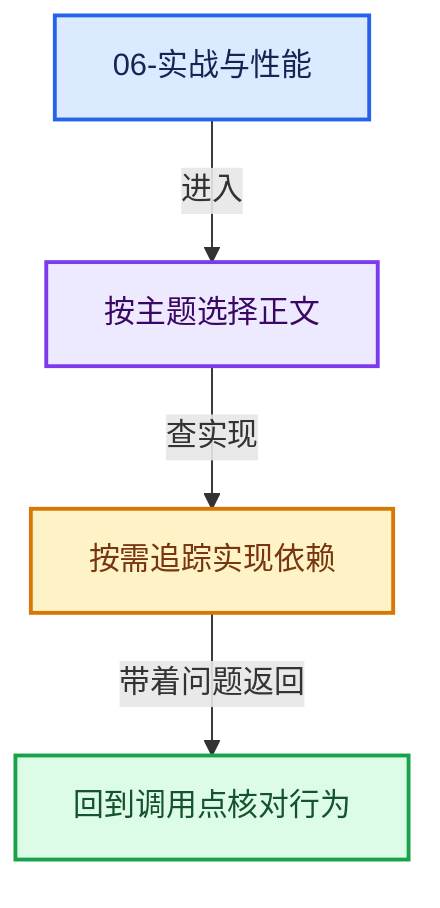

# 06-实战与性能

[总入口](../README.md) · [课程指南](../00-课程指南/README.md) · [上一章](../05-跨后端实现/README.md)

本章从源码转向应用：Repeat 区域的典型使用模式、迭代设计纪律与性能成本模型。

## 阅读顺序

- [06-01 使用模式与迭代设计](01-使用模式与迭代设计.md)
- [06-02 性能模型与开销分析](02-性能模型与开销分析.md)

## 本章问题

- Repeat、Simulation、Foreach 都是循环，什么时候用哪个？
- "轮间传递的状态"与"每轮可见的外部值"（border link）如何区分使用？
- 一次 Repeat 求值的总成本由哪几项构成？哪些是固定开销、哪些随迭代数线性增长？
- 有哪些诊断工具能定位 Repeat 的性能问题？

