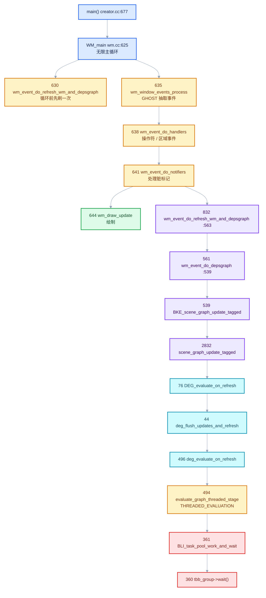
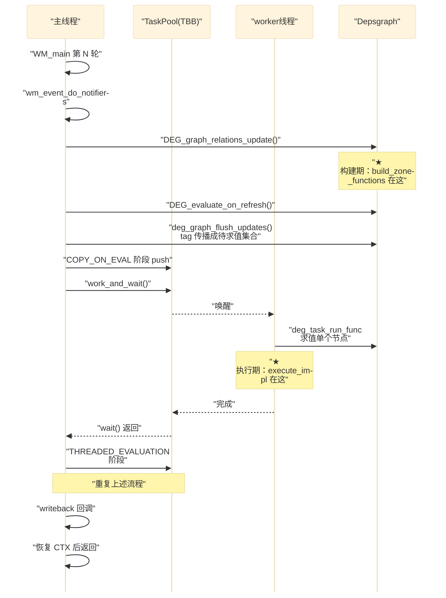

# CS-01 主线程栈与 depsgraph 求值链路

<div style="font-family:'Segoe UI','Microsoft YaHei',system-ui,-apple-system,sans-serif;display:flex;flex-wrap:wrap;align-items:center;gap:8px;margin:16px 0 20px;padding:10px 14px;background:#F8FAFC;border:1px solid #E2E8F0;border-radius:12px">
<span style="font-size:11px;font-weight:700;letter-spacing:.1em;color:#64748B;margin-right:2px">导航</span>
<a href="../README.md" style="font-size:13px;color:#334155;background:#F1F5F9;border:1px solid #E2E8F0;border-radius:999px;padding:3px 12px;text-decoration:none;white-space:nowrap">总入口</a>
<a href="./README.md" style="font-size:13px;color:#2563EB;background:#EFF6FF;border:1px solid #BFDBFE;border-radius:999px;padding:3px 12px;text-decoration:none;white-space:nowrap">本章 07-调用栈与调试</a>
</div>

<div style="font-family:'Segoe UI','Microsoft YaHei',system-ui,-apple-system,sans-serif;margin:18px 0 22px;padding:14px 18px;background:#F5F3FF;border-left:4px solid #7C3AED;border-radius:10px">

**基准说明**：本文行号与代码基于 Blender **5.4.0-alpha** 本地工作树。
剖析对象是主线程在几何节点求值期间的一张完整调用栈（`WM_main` → `TaskPool::work_and_wait`），
以及它上面四层的职责边界、关键函数周围的代码，和这些设计为什么长成这样。

**前置阅读**：03-几何节点执行架构（循环如何被编译）、04-运行时机制（每一轮如何执行）。
本文不重复 lazy-function 内部机制，只讲"**谁在什么时候把求值任务推起来**"。

</div>

## 先明确一件事：这张栈不是崩溃栈

打断点看到的栈和崩溃栈长得一样，但含义完全不同。

| | 崩溃栈 | 断点栈（本文） |
| --- | --- | --- |
| 停在 | 出问题的那一行 | 你选中的那一行 |
| 其他线程 | 可能已死 | 正常工作 |
| 主线程停在 `wait()` | 异常信号 | **正常等待 worker** |

关键推论：

> 主线程停在 `TaskPool::work_and_wait()`，说明真正干活的是 **worker 线程**。
> 在 worker 上打断点，主线程就会永远停在这个 wait 上——于是你会看到一张"毫不相关"的主线程栈。

这是理解 Blender 多线程求值的第一个门槛：**调度者与执行者分属不同线程，栈也是分开的。**

## 五层职责切分

整张栈可以按职责切成五层。每层之间靠一个明确契约隔离，上层不知道下层的实现：

| 层 | 帧 | 只关心 | 不知道 |
| --- | --- | --- | --- |
| ① 主循环 | `main` → `WM_main` | 事件、绘制、刷新节奏 | 什么是 depsgraph |
| ② 窗口/上下文 | `wm_event_do_refresh_wm_and_depsgraph` | 窗口、屏幕、活动场景 | 求值细节 |
| ③ 场景 | `scene_graph_update_tagged` | 哪些 view layer 需要刷 | 单个节点怎么算 |
| ④ 求值 | `deg_evaluate_on_refresh` | 阶段划分、线程池 | 物体、修改器 |
| ⑤ 任务 | `TaskPool::work_and_wait` | 怎么把函数丢给线程 | 函数里是什么 |

**最重要的观察**：`TaskPool` 是唯一知道线程的层；上面四层全是"串行描述"。
Blender 把并行度集中收敛在一个点上，这是它能同时维持"逻辑串行可推理"和"实际多线程"的原因。



<hr style="border:none;height:1px;background:linear-gradient(90deg,#BFDBFE,#E2E8F0 55%,transparent);margin:34px 0">

## §1 第一层：`main()` → `WM_main()` 主循环

源码：[source/blender/creator/creator.cc · L677](../../../source/blender/creator/creator.cc)、
[source/blender/windowmanager/intern/wm.cc · L625](../../../source/blender/windowmanager/intern/wm.cc#L625)

```cpp
// creator.cc:677
int main(int argc, const char **argv) {
  ...
  WM_main(C);      // [讲解] 永不返回
}
```

```cpp
// wm.cc:625
void WM_main(bContext *C)
{
  PRF_scope(ProfileCategory::Core);
  /* Single refresh before handling events.
   * This ensures we don't run operators before the depsgraph has been evaluated. */
  wm_event_do_refresh_wm_and_depsgraph(C);

  while (true) {

    /* Get events from ghost, handle window events, add to window queues. */
    wm_window_events_process(C);

    /* Per window, all events to the window, screen, area and region handlers. */
    wm_event_do_handlers(C);

    /* Events have left notes about changes, we handle and cache it. */
    wm_event_do_notifiers(C);

    /* Execute cached changes draw. */
    wm_draw_update(C);

    PRF_frame_mark;
  }
}
```

### 设计点一：进循环前先刷一次

注释写得明确：*"This ensures we don't run operators before the depsgraph has been evaluated."*

启动时第一帧没有"上一轮 notifiers"，如果不先刷一次，第一个事件处理就可能读到尚未求值的数据。这一行是**冷启动正确性**的保证。

### 设计点二：notifiers 在 draw 之前

```dml-ignore
事件 → 改数据/打标记 → 求值（notifiers 里） → 绘制（用新数据）
```

如果顺序反过来，每次操作都会看到**上一帧的画面**——延迟一帧的经典症状。顺序在这里不是风格问题，是正确性问题。

### 设计点三：`while (true)` 永不返回

所以任何主线程栈的底部一定是 `WM_main`。这也意味着：**Blender 的"退出"是跳出循环后走 `WM_exit`，而不是从 `WM_main` 返回**。

### 附：CRT 启动样板

```
invoke_main() → __scrt_common_main_seh() → __scrt_common_main() → mainCRTStartup()
```

MSVC 运行时启动流程：`__scrt_common_main_seh()` 负责 SEH（结构化异常处理）初始化并调用 `main`。
栈里的 `d:\a\_work\1\s\src\vctools\crt\...` 路径是 Azure Pipelines 的构建目录，
说明用的是微软官方构建的 CRT，而非自行编译。

<hr style="border:none;height:1px;background:linear-gradient(90deg,#BFDBFE,#E2E8F0 55%,transparent);margin:34px 0">

## §2 第二层：通知系统与窗口上下文

源码：[source/blender/windowmanager/intern/wm_event_system.cc](../../../source/blender/windowmanager/intern/wm_event_system.cc)

### `wm_event_do_notifiers` · L834

这是整个编辑体验的中枢。核心模型：

> **操作符不直接改数据，而是往队列里丢"通知（notifier）"，由这里统一处理。**

好处：
- 一个操作改 10 个物体的属性，求值只发生一次（批处理）
- 多窗口 / 多区域可以合并处理
- 撤销 / 重做只需要回滚标记

代价：**改一个参数后值不会立刻变**，要等下一轮 notifier 处理。

### `wm_event_do_refresh_wm_and_depsgraph` · L563

```cpp
void wm_event_do_refresh_wm_and_depsgraph(bContext *C)
{
  wmWindowManager *wm = CTX_wm_manager(C);
  /* Cached: editor refresh callbacks now, they get context. */
  for (wmWindow &win : wm->windows) {
    const bScreen *screen = WM_window_get_active_screen(&win);

    CTX_wm_window_set(C, &win);
    for (ScrArea &area : screen->areabase) {
      if (area.do_refresh) {
        CTX_wm_area_set(C, &area);
        ED_area_do_refresh(C, &area);       // [讲解] ① 先刷区域 UI
      }
    }
  }

  wm_event_do_depsgraph(C, false);          // [讲解] ② 再刷数据

  CTX_wm_window_set(C, nullptr);
}
```

两个设计点：

1. **先 UI 后数据**。区域刷新可能改数据（例如树视图重建条目），depsgraph 需要看到最新状态。
2. **`CTX_wm_window_set` / 恢复为 `nullptr` 成对出现**。这是 Blender 里到处可见的"临时切换上下文再还原"模式，用于在循环里切换 active window / area。

### `wm_event_do_depsgraph` · L539

#### 守卫：界面锁定时不求值

```cpp
void wm_event_do_depsgraph(bContext *C, bool is_after_open_file)
{
  const Main *bmain = CTX_data_main(C);
  wmWindowManager *wm = CTX_wm_manager(C);
  /* The whole idea of locked interface is to prevent viewport and whatever thread from
   * modifying the same data. Because of this, we can not perform dependency graph update. */
  if (wm->runtime->is_interface_locked) {
    return;      // [讲解] 界面锁定时直接跳过求值
  }
```

`is_interface_locked` 在有 modal 操作（拖拽、输入框编辑、滚动）时被置位。
此时**不刷新 depsgraph**，防止求值线程改动正在被拖拽的数据。

> 这解释了一个常见现象：拖拽参数时如果卡顿，可能是这里被跳过导致的延迟刷新。

#### datamask 必须先合并再写

```cpp
  /* Combine data-masks so one window doesn't disable UVs in another #26448. */
  CustomData_MeshMasks win_combine_v3d_datamask = {0};
  for (wmWindow &win : wm->windows) {
    const Scene *scene = WM_window_get_active_scene(&win);
    ViewLayer *view_layer = WM_window_get_active_view_layer(&win);
    const bScreen *screen = WM_window_get_active_screen(&win);

    ED_view3d_screen_datamask(*bmain, scene, view_layer, screen, &win_combine_v3d_datamask);
  }
```

`CustomData_MeshMasks` 是"我需要哪些网格属性层"的位掩码（UV、法线、顶点色…）。
如果每个窗口各自写 `scene->customdata_mask`，后写的会**覆盖**前一个，
导致 UV 在另一个窗口消失。所以必须先 OR 合并（对应 bug `#26448`）。

**这是一类典型问题：全局状态被多方写，正确的合并语义是"或"而不是"赋值"。**

#### 逐窗口求值

```cpp
  for (wmWindow &win : wm->windows) {
    Scene *scene = WM_window_get_active_scene(&win);
    ViewLayer *view_layer = WM_window_get_active_view_layer(&win);
    Main *bmain = CTX_data_main(C);

    /* Update dependency graph of sequencer scene. */
    Scene *sequencer_scene = CTX_data_sequencer_scene(C);
    if (sequencer_scene && sequencer_scene != scene) {
      Depsgraph *depsgraph = BKE_scene_ensure_depsgraph(
          bmain, sequencer_scene, BKE_view_layer_default_render(sequencer_scene));
      if (is_after_open_file) {
        DEG_graph_relations_update(depsgraph);
        DEG_tag_on_visible_update(bmain, depsgraph);
      }
      DEG_make_active(depsgraph);
      BKE_scene_graph_update_tagged(depsgraph, bmain);
    }

    /* Copied to set's in #scene_update_tagged_recursive(). */
    scene->customdata_mask = win_combine_v3d_datamask;
    CustomData_MeshMasks_update(&scene->customdata_mask, &scene->customdata_mask_modal);
    ...
    Depsgraph *depsgraph = BKE_scene_ensure_depsgraph(bmain, scene, view_layer);
    if (is_after_open_file) {
      DEG_graph_tag_on_visible_update(depsgraph, true);
    }
    DEG_make_active(depsgraph);
    BKE_scene_graph_update_tagged(depsgraph, bmain);      // [讲解] ← 本文栈中的帧
  }
```

#### `DEG_make_active`：一个容易被忽略的全局单例

depsgraph 有"活动图"概念（`DEG_is_active` / `DEG_make_active`）。为什么需要？

因为部分代码（驱动、Python 回调、GPU 资源）拿不到 depsgraph 参数，只能问
"当前活动的那个是谁"。所以求值前必须显式标记。

**代价**：多窗口时每个窗口的图轮流被标为 active，任何依赖它的代码都可能拿到
"另一个窗口的图"。这是 Blender 的已知架构债，相关 TODO 在
[scene.cc · L2793](../../../source/blender/blenkernel/intern/scene.cc#L2793) 附近也有体现。

<hr style="border:none;height:1px;background:linear-gradient(90deg,#BFDBFE,#E2E8F0 55%,transparent);margin:34px 0">

## §3 第三层：场景级更新 `scene_graph_update_tagged`

源码：[source/blender/blenkernel/intern/scene.cc · L2799](../../../source/blender/blenkernel/intern/scene.cc#L2799)

```cpp
static void scene_graph_update_tagged(Depsgraph *depsgraph, Main *bmain, bool only_if_tagged)
{
  if (only_if_tagged && DEG_is_fully_evaluated(depsgraph)) {
    return;                                     // [讲解] 快路径：没变化直接返回
  }

  Scene *scene = DEG_get_input_scene(depsgraph);
  ViewLayer *view_layer = DEG_get_input_view_layer(depsgraph);
  bool used_multiple_passes = false;

  bool run_callbacks = DEG_id_type_any_updated(depsgraph);
  if (run_callbacks) {
    BKE_callback_exec_id(bmain, &scene->id, BKE_CB_EVT_DEPSGRAPH_UPDATE_PRE);
  }

  BKE_main_view_layers_synced_ensure(bmain);

  for (int pass = 0; pass < 2; pass++) {
    /* (Re-)build dependency graph if needed. */
    DEG_graph_relations_update(depsgraph);
    /* Flush editing data if needed. */
    prepare_mesh_for_viewport_render(bmain, scene, view_layer);
    /* Update all objects: drivers, matrices, etc. */
    DEG_evaluate_on_refresh(depsgraph, DEG_EVALUATE_SYNC_WRITEBACK_YES);   // [讲解] ← 本文栈
    /* Update sound system. */
    BKE_scene_update_sound(depsgraph, bmain);
    /* Notify python about depsgraph update. */
    if (run_callbacks) {
      BKE_callback_exec_id_depsgraph(
          bmain, &scene->id, depsgraph, BKE_CB_EVT_DEPSGRAPH_UPDATE_POST);

      /* It is possible that the custom callback modified scene and removed some IDs... */
      DEG_graph_relations_update(depsgraph);
    }

    /* If user callback did not tag anything for update we can skip second iteration. */
    if (DEG_is_fully_evaluated(depsgraph)) {
      break;
    }

    /* Clear recalc flags for second pass, but back them up for editors update. */
    const bool backup = true;
    DEG_ids_clear_recalc(depsgraph, backup);
    used_multiple_passes = true;
    run_callbacks = false;
  }

  /* Inform editors about changes, using recalc flags from both passes. */
  if (used_multiple_passes) {
    DEG_ids_restore_recalc(depsgraph);
  }
}
```

### 设计点一：`only_if_tagged` 快路径

```cpp
if (only_if_tagged && DEG_is_fully_evaluated(depsgraph)) { return; }
```

**绝大多数帧走这里就返回了。** 注意 `wm_event_do_depsgraph` 调用的是
`BKE_scene_graph_update_tagged`（[scene.cc · L2879](../../../source/blender/blenkernel/intern/scene.cc#L2879)），
默认不带 `only_if_tagged`，所以 UI 驱动的这条路径每次都会真的跑；
而其他调用点会用 `only_if_tagged = true` 来跳过无变化的刷新。

### 设计点二：为什么要求值两遍

`for (int pass = 0; pass < 2; pass++)` 处理的是"**求值过程中又产生了新的脏标记**"：

- Python 回调（`BKE_CB_EVT_DEPSGRAPH_UPDATE_POST`）在求值后改了数据
- 驱动（driver）的求值结果触发了新的依赖

第二遍会**关掉回调**（`run_callbacks = false`），防止无限循环。
注释（L2852-2854）原话：

> *"If user callback did not tag anything for update we can skip second iteration.
> Otherwise we update scene once again, but without running callbacks to bring
> scene to a fully evaluated state with user modifications taken into account."*

### 设计点三：`clear_recalc(backup) + restore_recalc` 的妥协

```cpp
const bool backup = true;
DEG_ids_clear_recalc(depsgraph, backup);
...
if (used_multiple_passes) { DEG_ids_restore_recalc(depsgraph); }
```

同一个 `recalc` 标志同时承担两个职责：

1. 驱动求值（"这东西脏了，要重算"）
2. 驱动编辑器 UI（"这东西变了，要重绘"）

第二遍要重新求值，就必须先清空，否则 `DEG_is_fully_evaluated()` 永远为 false；
但清空后编辑器不知道哪些 ID 变了。于是：**备份 → 清空 → 求值 → 恢复**，
让编辑器最终拿到两遍累积的变更。

### 与前文两张栈的关系

```cpp
DEG_graph_relations_update(depsgraph);   // L2823  ← 构建期从这里进入
...
DEG_evaluate_on_refresh(depsgraph, ...); // L2830  ← 执行期从这里进入
```

这两行相邻，但分属两个阶段：

- **构建期**：在 L2823 内，`build_nodetree` 被调度，最终跑到
  `build_zone_functions` / `build_repeat_zone_function`
- **执行期**：在 L2830 内，跑到 `execute_impl` / `RepeatBodyNodeExecuteWrapper`

<hr style="border:none;height:1px;background:linear-gradient(90deg,#BFDBFE,#E2E8F0 55%,transparent);margin:34px 0">

## §4 第四层：depsgraph 求值

源码：[source/blender/depsgraph/intern/depsgraph_eval.cc](../../../source/blender/depsgraph/intern/depsgraph_eval.cc)、
[source/blender/depsgraph/intern/eval/deg_eval.cc](../../../source/blender/depsgraph/intern/eval/deg_eval.cc)

### `deg_flush_updates_and_refresh` · depsgraph_eval.cc L30

整个求值流程的真正主干，五步：

```cpp
static void deg_flush_updates_and_refresh(deg::Depsgraph *deg_graph,
                                          const DepsgraphEvaluateSyncWriteback sync_writeback)
{
  BLI_assert(!deg_graph->need_update_relations);      // [讲解] 关系必须已更新

  /* 1. 时间同步：把帧号写进 COW 场景 */
  if (deg_graph->scene_cow) {
    BKE_scene_frame_set(deg_graph->scene_cow, deg_graph->frame);
  }

  deg::graph_tag_ids_for_visible_update(deg_graph);   // 2. 可见性 tag
  deg::deg_graph_flush_updates(deg_graph);            // 3. ★ tag 传播成待求值集合
  BLI_assert(deg_graph->sync_writeback_callbacks.is_empty());
  deg_graph->sync_writeback = sync_writeback;
  deg::deg_evaluate_on_refresh(deg_graph);            // 4. ★ 真正执行

  if ((deg_graph->sync_writeback == DEG_EVALUATE_SYNC_WRITEBACK_YES) && deg_graph->is_active) {
    for (std::function<void()> &fn : deg_graph->sync_writeback_callbacks) {
      fn();                                           // 5. 回写原始数据
    }
  }
  deg_graph->sync_writeback = DEG_EVALUATE_SYNC_WRITEBACK_NO;
  deg_graph->sync_writeback_callbacks.clear();
}
```

**第 3 步是依赖图的核心价值所在**：改一个物体的位置只是在那个节点上打一个
`recalc` 位；`flush` 阶段沿关系边**向后传播**这个标记，最终得到一个"待求值节点集合"。
于是只算脏的部分，不算全部。

**第 5 步 writeback**：几何节点算出的结果在 COW 副本里，要写回原始数据编辑器才能显示。
渲染时不需要回写，所以 `sync_writeback` 是可选项。

### `DEG_evaluate_on_refresh` · L76：先检查时间

```cpp
void DEG_evaluate_on_refresh(Depsgraph *graph,
                             const DepsgraphEvaluateSyncWriteback sync_writeback)
{
  deg::Depsgraph *deg_graph = reinterpret_cast<deg::Depsgraph *>(graph);
  const Scene *scene = DEG_get_input_scene(graph);
  const float frame = BKE_scene_frame_get(scene);
  const float ctime = BKE_scene_ctime_get(scene);

  if (deg_graph->frame != frame || ctime != deg_graph->ctime) {
    deg_graph->tag_time_source();
    deg_graph->frame = frame;
    deg_graph->ctime = ctime;
  }
  else if (scene->id.recalc & ID_RECALC_FRAME_CHANGE) {
    /* Comparing depsgraph & scene frame fails in the case of undo,
     * since the undo state is stored before updates from the frame change have been applied. ...
     * Use #ID_RECALC_FRAME_CHANGE to detect that recalculation is necessary. see: #66913. */
    deg_graph->tag_time_source();
  }
```

- **帧号变化 → 标记整个时间源脏**：所有随时间求值的东西（动画、驱动、粒子）全部重算。
- 那个 `else if` 是 undo 的补丁（`#66913`）：撤销后帧号可能"看起来相同"，但实际仍需重算，
  于是改用 `ID_RECALC_FRAME_CHANGE` 标志来判断。

### `deg_evaluate_on_refresh` 后段 · L456-498：分阶段

```cpp
  /* Evaluation happens in several incremental steps:
   *
   * - Start with the copy-on-evaluation operations which never form dependency cycles. This will
   *   ensure that if a dependency graph has a cycle evaluation functions will always "see" valid
   *   expanded datablock. ...
   *
   * - If there is potentially dynamically changing visibility in the graph update the actual
   *   nodes visibilities, so that actual heavy data evaluation can benefit from knowledge that
   *   something heavy is not currently visible.
   *
   * - Multi-threaded evaluation of all possible nodes.
   *   Certain operations (and their subtrees) could be ignored. For example, meta-balls are not
   *   safe from threading point of view, so the threaded evaluation will stop at the metaball
   *   operation node.
   *
   * - Single-threaded pass of all remaining operations. */

  TaskPool *task_pool = deg_evaluate_task_pool_create(&state);

  evaluate_graph_threaded_stage(&state, task_pool, EvaluationStage::COPY_ON_EVAL);

  if (graph->has_animated_visibility || graph->need_update_nodes_visibility) {
    state.need_update_parents = true;
    evaluate_graph_threaded_stage(&state, task_pool, EvaluationStage::DYNAMIC_VISIBILITY);
    deg_graph_flush_visibility_flags_if_needed(graph);
    state.need_update_pending_parents = true;
  }

  evaluate_graph_threaded_stage(&state, task_pool, EvaluationStage::THREADED_EVALUATION);  // L494
  BLI_task_pool_free(task_pool);

  evaluate_graph_single_threaded_if_needed(&state);
```

| 阶段 | 目的 | 为什么不能合并 |
| --- | --- | --- |
| `COPY_ON_EVAL` | 先建好所有 COW 数据块 | 后续求值需要"看得见"合法的数据结构 |
| `DYNAMIC_VISIBILITY` | 先确定哪些物体可见 | 不可见的东西不该花时间算（大场景优化） |
| `THREADED_EVALUATION` | 多线程跑所有能跑的 | 最大化并行度 |
| `SINGLE_THREADED_WORKAROUND` | 兜底跑不安全的 | metaball 等非线程安全操作 |

两个细节：

1. **`task_pool` 在三个阶段间复用**。创建/销毁池有成本（TBB 要初始化 arena），
   复用还能保持任务缓存与线程本地状态有效。
2. **`BLI_task_pool_free` 在第二个 threaded stage 之后、单线程兜底之前**。
   所以兜底阶段没有池，用纯单线程的 `GSQueue`（见 §5）。

### 对几何节点求值的直接意义

几何节点求值发生在 `THREADED_EVALUATION` 阶段，这意味着：

> `execute_impl` **完全可能被多个 worker 线程同时调用**（不同物体、不同 depsgraph 实例）。

- 每个求值各有一份 storage（`RepeatEvalStorage`），所以天然安全；
- 但任何 **static / 全局可变缓存**都会是数据竞争。

`repeat_zone.cc` 里的 `static bool static_true`、`static_unused_index` 是**只读**的，安全。
若要加"按迭代数缓存图"，必须先考虑线程安全。

<hr style="border:none;height:1px;background:linear-gradient(90deg,#BFDBFE,#E2E8F0 55%,transparent);margin:34px 0">

## §5 第五层：任务池

源码：[source/blender/blenlib/intern/task_pool.cc](../../../source/blender/blenlib/intern/task_pool.cc)

### `evaluate_graph_threaded_stage` · deg_eval.cc L350

```cpp
void evaluate_graph_threaded_stage(DepsgraphEvalState *state,
                                   TaskPool *task_pool,
                                   const EvaluationStage stage)
{
  state->stage = stage;
  calculate_pending_parents_if_needed(state);

  schedule_graph(state, [&](OperationNode *node) {
    BLI_task_pool_push(task_pool, deg_task_run_func, node, false, nullptr);   // [讲解] 推任务
  });
  BLI_task_pool_work_and_wait(task_pool);                                     // [讲解] 等完成
}
```

**`state->stage = stage` 这一行是"分阶段"的真正实现方式**：不是分开建图，
而是共享一张图，用 `stage` 在 `deg_task_run_func` 里过滤"这个节点该不该在这个阶段跑"。
这样能省掉反复遍历图的开销。

### 任务结构体：只有 5 个字段

```cpp
// task_pool.cc · L114-L121
void operator()() const;   // 声明

void Task::operator()() const
{
  run(pool, taskdata);      // [讲解] 一行调用，所以栈里紧接 deg_task_run_func
}
```

`Task` 是轻量 POD：`pool` / `run` / `taskdata` / `free_taskdata` / `freedata`。
它刻意不携带任何类型信息——类型信息在 `run` 函数指针里，`taskdata` 只是 `void *`。

### 五种池类型 · L153

```cpp
enum TaskPoolType {
  TASK_POOL_TBB,               // 标准多线程，立即开始
  TASK_POOL_TBB_SUSPENDED,     // 推任务但不开始，等 work_and_wait
  TASK_POOL_NO_THREADS,        // 强制单线程
  TASK_POOL_BACKGROUND,        // 独立后台线程队列
  TASK_POOL_BACKGROUND_SERIAL, // 后台串行
};
```

`TASK_POOL_TBB_SUSPENDED` 的存在理由（L423-428 注释）：

> *"Similar to `BLI_task_pool_create()` but does not schedule any tasks for execution
> for until `BLI_task_pool_work_and_wait()` is called. This helps reducing threading
> overhead when pushing huge amount of small initial tasks from the main thread."*

**这是纯性能考量**：要推上万个小任务时，边推边让 worker 抢会产生大量同步开销；
先攒着一次性放行更高效。depsgraph 用普通 TBB，几何节点批量任务可能用 suspended 变体。

### `use_threads` 的判定 · L183

```cpp
this->use_threads = BLI_task_scheduler_num_threads() > 1 && type != TASK_POOL_NO_THREADS;
```

**`-t 1` 启动参数会让 `num_threads() == 1`，整个 Blender 退化为单线程。**
这是排查"是不是线程问题"的标准手段：

```pwsh
blender.exe -t 1
```

`-t 1` 下正常、多线程下出错 → 几乎确定是**数据竞争**。

### `work_and_wait` · L275 → `tbb_task_pool_work_and_wait` · L341

```cpp
void TaskPool::work_and_wait()
{
  switch (this->type) {
    case TASK_POOL_TBB:
    case TASK_POOL_TBB_SUSPENDED:
    case TASK_POOL_NO_THREADS:
      this->tbb_task_pool_work_and_wait();
      break;
    case TASK_POOL_BACKGROUND:
    case TASK_POOL_BACKGROUND_SERIAL:
      this->background_task_pool_work_and_wait();
      break;
  }
}
```

```cpp
void TaskPool::tbb_task_pool_work_and_wait()
{
  BLI_assert(ELEM(this->type, TASK_POOL_TBB, TASK_POOL_TBB_SUSPENDED, TASK_POOL_NO_THREADS));
  /* Start any suspended task now. */
  if (!this->suspended_tasks.is_empty()) {
    BLI_assert(this->is_suspended);
    this->is_suspended = false;

    for (Task &task : this->suspended_tasks) {
      this->tbb_task_pool_run(std::move(task));
    }
    this->suspended_tasks.clear();
  }

#ifdef WITH_TBB
  if (this->use_threads) {
    /* This is called wait(), but internally it can actually do work. This
     * matters because we don't want recursive usage of task pools to run
     * out of threads and get stuck. */
    this->tbb_group->wait();      // [讲解] 主线程栈顶端
  }
#endif
}
```

### 最重要的一段注释：`wait()` 会干活

> *"This is called wait(), but internally it can actually do work."*

TBB 的 `wait()` 是 **work-stealing / wait-with-work**：它不睡眠，
而是去执行任务队列里的活，直到等待计数归零。

**为什么必须这样？** 因为求值会嵌套：

```dml-ignore
主线程:  推任务 → wait()          ← 若纯阻塞，就没人推进了
         ↑
worker:  执行物体求值 → 内部又建 TaskPool → wait()
         ↑
         若所有线程都在等，而队列里还有活 → 死锁
```

TBB 保证至少有一个线程总在推进任务。相关机制：

| 机制 | 作用 |
| --- | --- |
| `tbb::task_arena` | 线程可"加入"一个 arena 帮忙执行任务 |
| `tbb::task_group_context` | 任务的取消 / 优先级传播 |
| `tbb::task_arena::isolate` | **反向**：禁止帮助，用于持锁场景 |

`isolate` 的典型用例就是几何节点图的缓存构建：
[BLI_cache_mutex.hh · L91](../../../source/blender/blenlib/BLI_cache_mutex.hh#L91) 的
`CacheMutex::ensure` 在持锁时用 `threading::isolate_task` 包住构建过程，
避免"持锁线程被调度去执行别处的任务、而那个任务又在等同一把锁"。

### 其他相关类速览

| 类 / 类型 | 位置 | 职责 |
| --- | --- | --- |
| `TBBTaskGroup` | task_pool.cc · L128 | `tbb::task_group` 子类，仅为设置优先级 |
| `TaskPool` | task_pool.cc · L161 | 池的本体：类型、TBB group、后台线程、优先级 |
| `GSQueue` | deg_eval.cc · L375 | 单线程兜底用的轻量队列，比 TaskPool 便宜得多 |
| `Task` | task_pool.cc · L114 | 5 字段 POD，`operator()` 只做一次函数指针调用 |
| `EvaluationStage` | deg_eval.cc | 阶段枚举，用 `state->stage` 过滤共享图 |

<hr style="border:none;height:1px;background:linear-gradient(90deg,#BFDBFE,#E2E8F0 55%,transparent);margin:34px 0">

## §6 一次求值的时间线



## §7 症状与成因速查

| 现象 | 成因 | 位置 |
| --- | --- | --- |
| 拖参数时 UI 不刷新 | `is_interface_locked` 时跳过 depsgraph | wm_event_system.cc · L494 |
| 某窗口 UV 消失 | datamask 被覆盖而非合并 | wm_event_system.cc · L498 |
| 求值跑两遍 | 回调里又改了数据 | scene.cc · L2821 |
| 改一个参数就整树重建 | 关系变化判定命中 `DEG_graph_relations_update` | scene.cc · L2823 |
| 多线程下随机崩溃 | 数据竞争，先用 `-t 1` 复测 | task_pool.cc · L183 |
| 主线程栈看起来"没在干活" | 它正在 `wait()` 里帮忙推进任务 | task_pool.cc · L357 |
| 撤销后必须重算却判为空闲 | `ID_RECALC_FRAME_CHANGE` 兜底 | depsgraph_eval.cc · L67 |

## §8 调试建议（针对几何节点 / 重复区域）

| 目标 | 做法 | 原因 |
| --- | --- | --- |
| 只停在重复区域求值 | 在 `execute_impl` 上设条件断点 | 它会被每个物体每次求值调用很多次 |
| 不想每次命中 | 命中一次后禁用断点，或设"命中次数 = 1" | 图只在首次求值构建，之后复用 |
| 不想停主线程 | 调试器里只对 worker 线程下断点 | 主线程永远在 `wait()`，停它无意义 |
| 确认是否走了某条分支 | 在目标函数的 `return` / `break` 上设断点看返回值 | 比加 printf 干净 |
| 怀疑线程问题 | `blender.exe -t 1` 复测 | 单线程下复现即排除竞争 |

## 附录：本篇符号与源码对照

| 符号 | 文件 | 行 |
| --- | --- | --- |
| `main` | creator.cc | 677 |
| `WM_main` | wm.cc | 625 |
| `wm_event_do_notifiers` | wm_event_system.cc | 834 |
| `wm_event_do_refresh_wm_and_depsgraph` | wm_event_system.cc | 563 |
| `wm_event_do_depsgraph` | wm_event_system.cc | 539 |
| `is_interface_locked` 守卫 | wm_event_system.cc | 494 |
| datamask 合并 | wm_event_system.cc | 498 |
| `scene_graph_update_tagged` | scene.cc | 2799 |
| 两遍求值循环 | scene.cc | 2821 |
| `BKE_scene_graph_update_tagged` | scene.cc | 2879 |
| `deg_flush_updates_and_refresh` | depsgraph_eval.cc | 30 |
| `DEG_evaluate_on_refresh` | depsgraph_eval.cc | 76 |
| 阶段注释块 | deg_eval.cc | 456-471 |
| `evaluate_graph_threaded_stage` | deg_eval.cc | 350 |
| THREADED_EVALUATION 调用 | deg_eval.cc | 494 |
| `evaluate_graph_single_threaded_if_needed` | deg_eval.cc | 365 |
| `Task::operator()` | task_pool.cc | 118 |
| `TaskPoolType` | task_pool.cc | 153 |
| `use_threads` 判定 | task_pool.cc | 183 |
| `task_push` | task_pool.cc | 254 |
| `work_and_wait` | task_pool.cc | 275 |
| `tbb_task_pool_work_and_wait` | task_pool.cc | 341 |
| "wait 也会干活" 注释 | task_pool.cc | 357-359 |
| `CacheMutex::ensure` | BLI_cache_mutex.hh | 91 |

## 附录二：术语表

| 术语 | 一句话定义 |
| --- | --- |
| depsgraph | Dependency Graph，Blender 的场景级求值依赖图系统（不是任何单个图对象） |
| notifier | 操作符留下的"变更通知"，由主循环统一消费 |
| COW | Copy-on-Write / copy-on-evaluation，求值在副本上做，结果回写原始数据 |
| tag / flush | 打脏标记 / 沿关系边传播脏标记得到待求值集合 |
| recalc | 每个 ID 上的"需要重算"位，同时驱动求值与 UI 刷新 |
| TaskPool | Blender 对线程池的封装，五类型，唯一知道线程的层 |
| Task | 5 字段 POD，承载一个"函数 + 参数"，`operator()` 只做一次调用 |
| work-stealing | 空闲线程主动偷取其他队列的任务，TBB 的默认调度策略 |
| isolate | 反向操作：禁止当前线程"帮忙"，用于持锁期间避免死锁 |
| EvaluationStage | 求值阶段枚举，用共享图 + stage 过滤实现分阶段 |
| writeback | 把 COW 副本的求值结果写回原始数据，供编辑器显示 |

## 附录三：三分钟自测

1. 为什么 `wm_event_do_notifiers` 必须在 `wm_draw_update` 之前？
   （答：否则绘制用的是上一帧数据，表现为固定延迟一帧。）
2. `scene_graph_update_tagged` 为什么会执行两遍？第二遍为什么关掉回调？
   （答：第一遍的回调可能又改了数据；关掉回调防止无限循环。）
3. `DEG_ids_clear_recalc(depsgraph, true)` 的 `true` 是什么含义？
   （答：backup，备份后清空；第二遍求值结束再 `restore`，让编辑器拿到累积变更。）
4. 主线程停在 `tbb_group->wait()` 时，几何节点求值在哪个线程上跑？
   （答：worker 线程，通过 `deg_task_run_func`。）
5. `-t 1` 有什么用？
   （答：让 `num_threads() == 1`，`use_threads` 为 false，全局退化单线程，用于排除数据竞争。）
6. 为什么 datamask 必须先合并再写入 `scene->customdata_mask`？
   （答：多窗口各自写入会互相覆盖，导致某窗口需要的 UV/顶点色层被禁用。）
7. 求值阶段的"分阶段"是怎么实现的——分开建图还是共享图？
   （答：共享一张图，用 `state->stage` 在任务执行时过滤。）

<div style="font-family:'Segoe UI','Microsoft YaHei',system-ui,-apple-system,sans-serif;margin:38px 0 4px;padding:13px 16px;background:#F8FAFC;border:1px solid #E2E8F0;border-radius:12px;display:flex;flex-wrap:wrap;align-items:center;gap:8px">
<span style="font-size:11px;font-weight:700;letter-spacing:.1em;color:#64748B;margin-right:2px">继续阅读</span>
<a href="../README.md" style="font-size:13px;color:#334155;background:#F1F5F9;border:1px solid #E2E8F0;border-radius:999px;padding:3px 12px;text-decoration:none;white-space:nowrap">总入口</a>
<a href="../04-运行时机制/README.md" style="font-size:13px;color:#2563EB;background:#EFF6FF;border:1px solid #BFDBFE;border-radius:999px;padding:3px 12px;text-decoration:none;white-space:nowrap">‹ 04-运行时机制</a>
<span style="font-size:13px;color:#334155;background:#F1F5F9;border:1px solid #E2E8F0;border-radius:999px;padding:3px 12px;text-decoration:none;white-space:nowrap">回到顶部</span>
</div>
