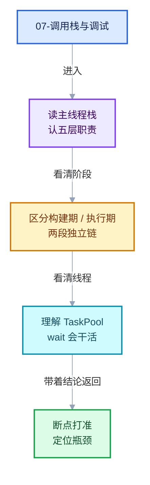

# 07-调用栈与调试

导航
<a href="../README.md" style="font-size:13px;color:#334155;background:#F1F5F9;border:1px solid #E2E8F0;border-radius:999px;padding:3px 12px;text-decoration:none;white-space:nowrap">总入口</a>
<a href="../06-实战与性能/README.md" style="font-size:13px;color:#2563EB;background:#EFF6FF;border:1px solid #BFDBFE;border-radius:999px;padding:3px 12px;text-decoration:none;white-space:nowrap">‹ 06-实战与性能</a>
<a href="../90-实现依赖专题/README.md" style="font-size:13px;color:#7C3AED;background:#F5F3FF;border:1px solid #DDD6FE;border-radius:999px;padding:3px 12px;text-decoration:none;white-space:nowrap">90-实现依赖专题 ›</a>

本章回答：**在真实的 Blender 进程里，重复区域的代码是在什么时机、被哪条调用链、在哪个线程上执行的。**

前面各章讲的是"代码是什么"，本章讲的是"代码怎么被跑起来"。理解这一层之后，
断点才打得准，栈才读得懂，性能瓶颈才定位得到。

## 阅读顺序

- [07-01 主线程栈与depsgraph求值链路](01-主线程栈与depsgraph求值链路.md)
- [07-02 Task、POD 与"wait 会干活"](02-Task与任务隔离.md)

## 本章问题

- 打断点看到的主线程栈为什么停在 `tbb_group->wait()`，而不是正在执行的几何节点代码？
- 从 `WM_main` 到 `execute_impl` 之间要经过哪五层？每层各自不知道什么？
- `build_zone_functions`（构建期）和 `execute_impl`（执行期）分别由哪两行代码触发？
- 为什么求值要分四个阶段，而不能一次多线程跑完？
- `wait()` 里为什么还会"干活"？这和嵌套求值死锁是什么关系？
- POD 到底指什么？`Task` 算不算？为什么它要 delete 拷贝构造？
- 持锁时为什么必须 `isolate`，而且光有 TBB 的 isolate 还不够？

## 本章要建立的三个心智模型

1. **调度者 ≠ 执行者**。主线程负责推任务与等待，worker 线程负责执行；屏上看到的主线程栈
   通常"看起来没在干活"，那是因为它在 `wait()` 里帮忙推进任务队列。
2. **构建期与执行期是两段完全独立的调用链**，在 `scene_graph_update_tagged` 里相邻两行
   触发，但走的是截然不同的代码路径，频率也差几个数量级。
3. **并行度收敛在 `TaskPool` 一层**，上面四层全是串行描述。这是"逻辑可推理 + 实际多线程"
   能够共存的关键设计。

继续阅读
<a href="./01-主线程栈与depsgraph求值链路.md" style="font-size:13px;color:#7C3AED;background:#F5F3FF;border:1px solid #DDD6FE;border-radius:999px;padding:3px 12px;text-decoration:none;white-space:nowrap">主线程栈与depsgraph求值链路 ›</a>
回到顶部

