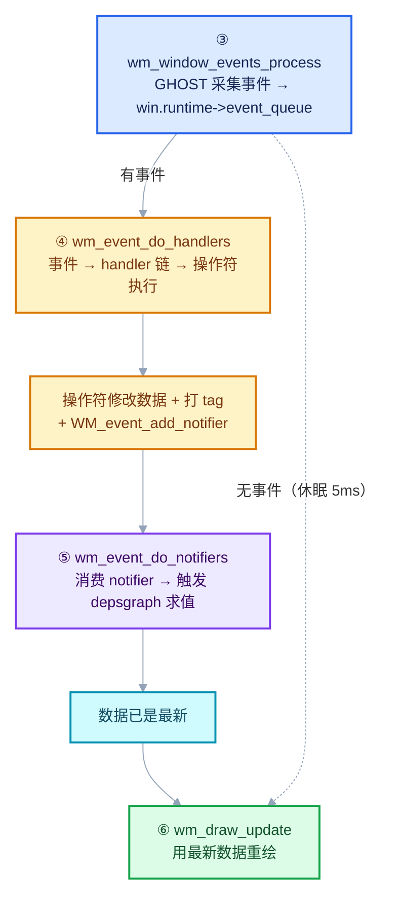
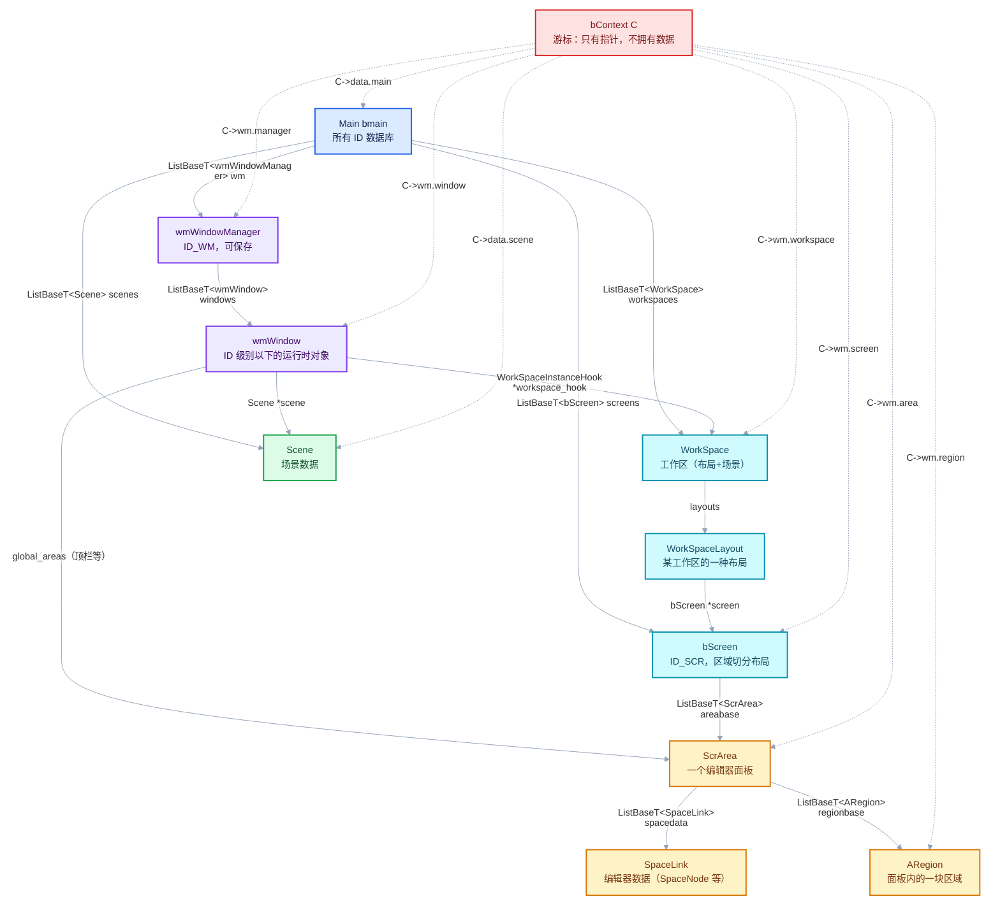

# WS-01 WM_main 主循环与核心数据类

<div style="font-family:'Segoe UI','Microsoft YaHei',system-ui,-apple-system,sans-serif;display:flex;flex-wrap:wrap;align-items:center;gap:8px;margin:16px 0 20px;padding:10px 14px;background:#F8FAFC;border:1px solid #E2E8F0;border-radius:12px">
<span style="font-size:11px;font-weight:700;letter-spacing:.1em;color:#64748B;margin-right:2px">导航</span>
<a href="../README.md" style="font-size:13px;color:#334155;background:#F1F5F9;border:1px solid #E2E8F0;border-radius:999px;padding:3px 12px;text-decoration:none;white-space:nowrap">总入口</a>
<a href="./README.md" style="font-size:13px;color:#2563EB;background:#EFF6FF;border:1px solid #BFDBFE;border-radius:999px;padding:3px 12px;text-decoration:none;white-space:nowrap">本章 08-窗口系统与核心类型</a>
</div>

<div style="font-family:'Segoe UI','Microsoft YaHei',system-ui,-apple-system,sans-serif;margin:18px 0 22px;padding:14px 18px;background:#F5F3FF;border-left:4px solid #7C3AED;border-radius:10px">

**基准说明**：Blender **5.4.0-alpha** 本地工作树。

本文从 [wm.cc · L625-L648](../../../source/blender/windowmanager/intern/wm.cc#L625) 那 20 行主循环出发，
回答三组问题：

1. **`WM_main` 的四步各做什么**，每个被调函数的实现骨架；
2. **`bContext` / `wmWindowManager` / `wmWindow` / `bScreen` / `ScrArea` / `ARegion` / `Main` / `Scene`
   到底是什么**，谁创建、谁赋值、谁修改；
3. **为什么这样设计**——这些类型的分层依据、为什么用链表、为什么 `bContext` 是"游标"。

**前置阅读**：[07-01 主线程栈与depsgraph求值链路](../07-调用栈与调试/01-主线程栈与depsgraph求值链路.md)
（本文解释 07-01 里那些帧"操作的是什么数据"）。

</div>

## §0 那 20 行在做什么

[wm.cc · L625-L648](../../../source/blender/windowmanager/intern/wm.cc#L625)

```cpp
void WM_main(bContext *C)
{
  PRF_scope(ProfileCategory::Core);                    // ① 性能剖析作用域
  /* Single refresh before handling events.
   * This ensures we don't run operators before the depsgraph has been evaluated. */
  wm_event_do_refresh_wm_and_depsgraph(C);             // ② 进循环前先刷一次

  while (true) {

    /* Get events from ghost, handle window events, add to window queues. */
    wm_window_events_process(C);                       // ③ 采集事件 + 空闲休眠

    /* Per window, all events to the window, screen, area and region handlers. */
    wm_event_do_handlers(C);                           // ④ 分发事件给处理器

    /* Events have left notes about changes, we handle and cache it. */
    wm_event_do_notifiers(C);                          // ⑤ 处理脏标记 → 触发求值

    /* Execute cached changes draw. */
    wm_draw_update(C);                                 // ⑥ 重绘

    PRF_frame_mark;                                    // ⑦ 帧标记
  }
}
```

### 四步的因果链



**整条链的核心不变量**：**绘制永远发生在求值之后**。
步骤 ⑤ → ⑥ 的顺序就是"先算完再画"，否则会画上一帧的内容。

<hr style="border:none;height:1px;background:linear-gradient(90deg,#BFDBFE,#E2E8F0 55%,transparent);margin:34px 0">

## §1 四个被调函数

### ③ `wm_window_events_process` · wm_window.cc L2228

```cpp
void wm_window_events_process(const bContext *C)
{
  PRF_scope(ProfileCategory::Core);
  BLI_assert(BLI_thread_is_main());          // [讲解] 必须在主线程
  GPU_render_begin();

  bool has_event = g_system->processEvents(false);   // [讲解] false = 不等待

  if (has_event) {
    g_system->dispatchEvents();              // [讲解] GHOST 回调 → wm_event_add
  }

  wm_jobs_handle_finished(C);                // [讲解] 后台任务（job）完成回调

  /* When there is no event, sleep 5 milliseconds not to use too much CPU when idle. */
  const int sleep_us_default = 5000;
  int sleep_us = has_event ? 0 : sleep_us_default;
  has_event |= wm_window_timers_process(C, &sleep_us);   // [讲解] 定时器
#ifdef WITH_XR_OPENXR
  has_event |= wm_xr_events_handle(CTX_wm_manager(C));
#endif
  GPU_render_end();

  if ((has_event == false) && (sleep_us != 0) && !(G.f & G_FLAG_EVENT_SIMULATE)) {
    BLI_time_sleep_precise_us(sleep_us);     // [讲解] 空闲休眠
  }
}
```

四个要点：

| 设计 | 原因 |
| --- | --- |
| **`processEvents(false)` 非阻塞** | 立即返回，不等待事件。UI 必须保持响应 |
| **无事件时睡 5ms** | 否则主循环空转 100% CPU。5ms ≈ 200Hz 上限，够用又不浪费 |
| **`G_FLAG_EVENT_SIMULATE` 时不睡** | 自动化测试/事件模拟需要尽快跑完 |
| **`wm_jobs_handle_finished`** | 后台任务（如批量导入）不占主线程，但完成通知要在这里回到主线程 |

`g_system` 是 **GHOST**（Generic Handles Of System Technology）系统对象——
Blender 自己定义的跨平台窗口/输入抽象层，具体实现是 `GHOST_SystemWin32` / `GHOST_SystemX11` / `GHOST_SystemCocoa`。

**为什么用 `g_system->processEvents` 而不是 `PeekMessage`**？因为 Blender 要同时支持 Win/macOS/Linux/Wayland/XR，
输入、窗口、光标、剪贴板都要抽象。GHOST 就是这层的名字。

> GHOST 回调 `dispatchEvents` 时会把事件塞进 `win.runtime->event_queue`，
> 这就是 ④ 的输入。

### ④ `wm_event_do_handlers` · wm_event_system.cc L4240

```cpp
void wm_event_do_handlers(bContext *C)
{
  PRF_scope(ProfileCategory::Core);
  wmWindowManager *wm = CTX_wm_manager(C);
  BLI_assert(ED_undo_is_state_valid(C));

  wm->runtime->break_events_handling = false;

  GPU_render_begin();                       // [讲解] 某些 handler 要用 GPU

  WM_keyconfig_update(wm);                  // [讲解] 先刷键位配置
  WM_gizmoconfig_update(CTX_data_main(C));

  for (wmWindow &win : wm->windows) {
    if (wm->runtime->break_events_handling) { break; }

    bScreen *screen = WM_window_get_active_screen(&win);

    /* Some safety checks - these should always be set! */
    BLI_assert(WM_window_get_active_scene(&win));
    ...

    wmEvent *event;
    while ((event = win.runtime->event_queue.first())) {     // [讲解] 逐个事件
      ...
      /* 大量事件语义处理：拖拽阈值、连续手势、修饰键等 */
      ...
    }
  }
}
```

结构是**三层嵌套**：

```dml-ignore
for window in wm->windows:
    for event in win.runtime->event_queue:
        handler 链（从最具体到最通用）
          └─ region handler → area handler → window handler → screen handler → global handler
```

**为什么是"窗口 → 事件 → handler 链"三层**？

因为 Blender 的事件路由是**从具体到一般**的冒泡模型：
你点了一个按钮，先给那个 `ARegion` 的 handler，没人处理再上到 `ScrArea`，再到 `wmWindow`，再到全局。
这与 DOM 事件冒泡完全同构。

`win.event_queue_check_drag`、`event_queue_consecutive_gesture_type` 这些字段
（在 `wmWindow` 里，见 §2）就是**跨事件保持的状态**——
拖拽判定需要"上一个事件"的信息，所以状态必须挂在窗口上而不是事件上。

### ⑤ `wm_event_do_notifiers` · wm_event_system.cc L834

```cpp
  /* Handle message bus. */
  {
    for (wmWindow &win : wm->windows) {
      CTX_wm_window_set(C, &win);
      WM_msgbus_handle(wm->runtime->message_bus, C);
    }
    CTX_wm_window_set(C, nullptr);
  }

  wm_event_do_refresh_wm_and_depsgraph(C);      // [讲解] ★ 触发 depsgraph

  RE_FreeUnusedGPUResources();
  ...
```

这个函数很长（数百行），核心是遍历 **notifier 队列**，按 category 分发：

```cpp
// 中间部分（约 L744-L790）
wm->runtime->notifier_queue_set.remove_contained(note);
for (wmWindow &win : wm->windows) {
  Scene *scene = WM_window_get_active_scene(&win);
  bScreen *screen = WM_window_get_active_screen(&win);
  WorkSpace *workspace = WM_window_get_active_workspace(&win);

  /* Filter out notifiers. */
  if (note->category == NC_SCREEN && note->reference && note->reference != screen &&
      note->reference != workspace && note->reference != WM_window_get_active_layout(&win))
  {
    /* Pass. */
  }
  else if (note->category == NC_SCENE && note->reference &&
           !ELEM(note->reference, scene, workspace->sequencer_scene))
  {
    /* Pass. */
  }
  else {
    CTX_wm_window_set(C, &win);
    ED_workspace_do_listen(C, note);
    ED_screen_do_listen(C, note);

    for (ARegion &region : screen->regionbase) {
      wmRegionListenerParams region_params{};
      region_params.window = &win;
      ...
    }
  }
}
```

**`note->reference` 的过滤是性能关键**：一个"屏幕变了"的 notifier 只需要通知**那个**屏幕，
不是所有窗口的全部区域。这就是为什么 `WM_event_add_notifier(type, reference)` 要带引用指针。

### ⑥ `wm_draw_update` · wm_draw.cc L1691

```cpp
void wm_draw_update(bContext *C)
{
  PRF_scope(ProfileCategory::Draw);
  Main *bmain = CTX_data_main(C);
  wmWindowManager *wm = CTX_wm_manager(C);

  const bool rna_disallow_writes = true;
  CTX_rna_disallow_write_set_p(C, &rna_disallow_writes);   // [讲解] 绘制期间禁止 RNA 写入

  GPU_context_main_lock();
  GPU_render_begin();
  GPU_render_step();

  for (wmWindow &win : wm->windows) {
#ifdef WIN32
    const GHOST_IWindow *ghost_window = static_cast<GHOST_IWindow *>(win.runtime->ghostwin);
    if (ghost_window->getState() == GHOST_kWindowStateMinimized) {
      continue;    // [讲解] 最小化窗口不绘制
    }
#endif

    CTX_wm_window_set(C, &win);

    if (wm_draw_update_test_window(bmain, C, &win)) {     // [讲解] 是否需要重绘？
      wm_window_make_drawable(wm, &win);
      wm_window_swap_buffer_acquire(&win);
      ED_screen_ensure_updated(C, wm, &win);              // [讲解] 屏幕刷新（含区域重建）
      wm_draw_window(C, &win);
      wm_draw_update_clear_window(C, &win);               // [讲解] 清 do_draw 等标志
      wm_window_swap_buffer_release(&win);
    }
  }
}
```

三个要点：

| 设计 | 原因 |
| --- | --- |
| **`CTX_rna_disallow_write_set_p(C, &true)`** | 绘制是只读阶段，若某绘图代码意外通过 RNA 改数据，直接报错 |
| **`wm_draw_update_test_window`** | **按需重绘**：没变化的窗口直接跳过（省 GPU） |
| **最小化窗口跳过** | 见注释里的 `#33223` / `#50856`：Intel/AMD 驱动在这些情况下有问题 |

`wm_window_swap_buffer_acquire/release` 是**双缓冲交换**的临界区：
acquire 拿到后台缓冲，绘制，release 提交并交换。这期间不能有别的线程碰这个缓冲。

<hr style="border:none;height:1px;background:linear-gradient(90deg,#BFDBFE,#E2E8F0 55%,transparent);margin:34px 0">

## §2 核心数据类图谱

先给全图，再逐个讲。



**实线 = 真实的拥有/引用关系；虚线 = `bContext` 的"游标"指向。**

<hr style="border:none;height:1px;background:linear-gradient(90deg,#BFDBFE,#E2E8F0 55%,transparent);margin:34px 0">

## §3 逐个类型：定义、创建、赋值、修改

### `Main` — 全局数据库

**定义**：[BKE_main.hh · L243](../../../source/blender/blenkernel/BKE_main.hh#L243)

```cpp
struct Main : NonCopyable, NonMovable {
  std::shared_ptr<VectorSet<Main *>> split_mains = {};
  char filepath[1024] = "";
  short versionfile = 0;
  ...
  ListBaseT<Scene> scenes = {};             // [讲解] 每种 ID 类型一个链表
  ListBaseT<bScreen> screens = {};
  ListBaseT<WorkSpace> workspaces = {};
  ListBaseT<wmWindowManager> wm = {};       // [讲解] 只有一个（first()）
  ...
};
```

| 问题 | 答案 |
| --- | --- |
| **是什么** | 整个 .blend 文件的内存镜像。所有 `ID`（`ID_Scene`、`ID_Object`、`ID_Mesh`…）都挂在它的某个链表里 |
| **谁创建** | `BKE_main_new()`（启动时）/ 文件读取时由 `blendfile.cc` 填充 |
| **谁赋值** | `BKE_libblock_alloc(bmain, ID_XXX, ...)` 把新 ID 链进对应链表 |
| **谁修改** | 几乎任何地方。这是 Blender 的"全局变量" |

**为什么每个 ID 类型一个链表，而不是一个大 `Vector<ID*>`**？
因为遍历时几乎总是"我要所有 Scene"，分类链表让 `bmain->scenes` 直接可用，无需过滤。
代价是每个类型多两个指针。

**为什么不是 `DNA` 里的 struct**？这是 5.x 的新变化——`Main` 现在放在 `BKE_main.hh`，
含 C++ 成员（`shared_ptr`、`VectorSet`），不再是纯 POD DNA 结构。
但 `.blend` 里存的仍然只是各 ID 的内容，`Main` 本身不入盘（它是容器）。

### `wmWindowManager` — 窗口管理器（唯一的）

**定义**：[DNA_windowmanager_types.h · L113](../../../source/blender/makesdna/DNA_windowmanager_types.h#L113)

```cpp
/** Window-manager is saved, tag WMAN. */
struct wmWindowManager {
  static constexpr ID_Type id_type = ID_WM;

  ID id;
  ListBaseT<wmWindow> windows = {nullptr, nullptr};    // [讲解] 所有窗口
  eWM_InitFlag init_flag = {};                          // [讲解] 初始化阶段标志
  short file_saved = 0;
  short op_undo_depth = 0;                              // [讲解] 嵌套 undo 抑制
  eWM_OutlinerSyncSelectDirty outliner_sync_select_dirty = {};
  eWM_ExtensionsUpdates extensions_updates = {};
  int extensions_blocked = 0;
  struct wmTimer *autosavetimer = nullptr;
  char autosave_scheduled = 0;
  wmXrData xr;
  bke::WindowManagerRuntime *runtime = nullptr;         // [讲解] 非持久化部分
};
```

| 问题 | 答案 |
| --- | --- |
| **是什么** | 一个特殊的 `ID`（`ID_WM`），**整个 Blender 只有一个**。持有窗口列表与全局按键配置 |
| **谁创建** | `wm_add_default()`，[wm.cc · L555](../../../source/blender/windowmanager/intern/wm.cc#L555) |
| **谁赋值** | `BKE_libblock_alloc(bmain, ID_WM, "WinMan", 0)` 创建；文件读取时从 .blend 恢复 |
| **谁修改** | `wm_window_new`（加窗口）、`wm_window_free`（删窗口）、`WM_keyconfig_*` |

创建代码：

```cpp
// wm.cc · L555
void wm_add_default(Main *bmain, bContext *C)
{
  wmWindowManager *wm = static_cast<wmWindowManager *>(
      BKE_libblock_alloc(bmain, ID_WM, "WinMan", 0));   // [讲解] 分配 + 链进 bmain->wm

  bScreen *screen = CTX_wm_screen(C);
  WorkSpaceLayout *layout = BKE_workspace_layout_find_global(bmain, screen, &workspace);

  CTX_wm_manager_set(C, wm);                            // [讲解] 挂进 context
  win = wm_window_new(bmain, wm, nullptr, false);
  win->scene = CTX_data_scene(C);
  STRNCPY_UTF8(win->view_layer_name, CTX_data_view_layer(C)->name);
  BKE_workspace_active_set(win->workspace_hook, workspace);
  BKE_workspace_active_layout_set(win->workspace_hook, win->winid, workspace, layout);
  screen->winid = win->winid;

  wm->runtime = MEM_new<bke::WindowManagerRuntime>(__func__);
  wm->runtime->winactive = win;
  wm->file_saved = 1;
  wm_window_make_drawable(wm, win);
}
```

**注意 `runtime` 是单独分配的、不在 DNA 里**。
这是 Blender 的一个重要模式：**DNA 结构只放需要存盘的内容，运行时数据放 `xxxRuntime *runtime`**。
好处是：
- `.blend` 格式稳定（加运行时字段不影响文件）
- 可以把 C++ 类型（`Vector`、`shared_ptr`）放进 runtime，而 DNA 必须保持 C 兼容

### `wmWindow` — 一个窗口

**定义**：[DNA_windowmanager_types.h · L167](../../../source/blender/makesdna/DNA_windowmanager_types.h#L167)

```cpp
/**
 * The saveable part, the rest of the data is local in GHOST.
 */
struct wmWindow {
  struct wmWindow *next = nullptr, *prev = nullptr;    // [讲解] 链表节点（ListBaseT 需要）
  struct wmWindow *parent = nullptr;                   // [讲解] 子窗口（对话框）
  struct Scene *scene = nullptr;                       // [讲解] 这个窗口显示的场景
  struct Scene *new_scene = nullptr;                   // [讲解] 切换中的临时场景
  char view_layer_name[64] = "";
  struct Scene *unpinned_scene = nullptr;
  struct WorkSpaceInstanceHook *workspace_hook = nullptr;  // [讲解] 工作区实例
  ScrAreaMap global_areas;                             // [讲解] 不属于 screen 的全局区域（顶栏）
  DNA_DEPRECATED struct bScreen *screen = nullptr;     // [讲解] 已废弃，改用 workspace_hook
  int winid = 0;                                       // [讲解] 窗口标识（1 起）
  short posx = 0, posy = 0;
  short sizex = 0, sizey = 0;
  char windowstate = 0;
  char active = 0;
  ...
};
```

**注意它是 C++ class 但**没有 `ID`**——`wmWindow` 不是独立 ID，只是 `wmWindowManager` 的一部分。

| 问题 | 答案 |
| --- | --- |
| **是什么** | 一个操作系统窗口在 Blender 侧的持久化描述 |
| **谁创建** | `wm_window_new()`，[wm_window.cc · L348](../../../source/blender/windowmanager/intern/wm_window.cc#L348) |
| **谁赋值** | 创建时 + 文件读取 + `wm_window_copy`（分屏） |
| **谁修改** | 窗口大小/位置（`wm_window_set_size` 等）、`win->scene` 切换、`ws` 切换 |

```cpp
// wm_window.cc · L348
wmWindow *wm_window_new(const Main *bmain, wmWindowManager *wm, wmWindow *parent, bool dialog)
{
  wmWindow *win = MEM_new<wmWindow>("window");

  BLI_addtail(&wm->windows, win);                    // [讲解] 链入窗口列表
  win->winid = find_free_winid(wm);                  // [讲解] 找空闲 ID
  win->parent = (!dialog && parent && parent->parent) ? parent->parent : parent;
  win->stereo3d_format = MEM_new<Stereo3dFormat>("Stereo 3D Format (window)");
  win->workspace_hook = BKE_workspace_instance_hook_create(bmain, win->winid);
  win->runtime = MEM_new<bke::WindowRuntime>(__func__);   // [讲解] 运行时部分

  return win;
}
```

**`win.runtime->ghostwin` 是真正的 OS 窗口**——它不在 DNA 里，只在内存。
所以 `wmWindow` 是"os 窗口的 Blender 侧影子"，两者通过 `runtime->ghostwin` 关联。

### `bContext` — 上下文"游标"

**定义**：[context.cc · L65](../../../source/blender/blenkernel/intern/context.cc#L65)

```cpp
struct bContext {
  int thread = 0;

  /* windowmanager context */
  struct {
    wmWindowManager *manager = nullptr;
    wmWindow *window = nullptr;
    WorkSpace *workspace = nullptr;
    bScreen *screen = nullptr;
    ScrArea *area = nullptr;
    ARegion *region = nullptr;
    ARegion *region_popup = nullptr;
    wmGizmoGroup *gizmo_group = nullptr;
    const bContextStore *store = nullptr;

    std::optional<std::string> operator_poll_msg = {};
    bContextPollMsgDyn_Params operator_poll_msg_dyn_params;
  } wm;

  /* data context */
  struct {
    Main *main = nullptr;
    Scene *scene = nullptr;
    int recursion = 0;
    bool ui_data_access_deny = false;
    bool py_init = false;
    void *py_context = nullptr;
    void *py_context_orig = nullptr;
    CTX_LogFlag log_flag = {};
    const bool *rna_disallow_writes = nullptr;
  } data;
};
```

**这是全篇最重要的一个类型。** 它的本质是：

> **一个"我现在在哪"的游标（cursor），不拥有任何数据。**

| 问题 | 答案 |
| --- | --- |
| **是什么** | 一组指针，描述"当前在哪个窗口/屏幕/区域，操作哪个场景" |
| **谁创建** | `CTX_create()`，[context.cc · L119](../../../source/blender/blenkernel/intern/context.cc#L119)。在 `main()` 里调（[creator.cc · L446](../../../source/creator/creator.cc#L446)） |
| **谁赋值** | `CTX_wm_window_set` / `CTX_wm_manager_set` 等，**大量地方** |
| **谁修改** | 事件循环、操作符、编辑器代码，几乎任何时候 |

关键 setter：

```cpp
// context.cc · L1175
void CTX_wm_manager_set(bContext *C, wmWindowManager *wm)
{
  C->wm.manager = wm;
  C->wm.window = nullptr;      // [讲解] 换 manager 就把下面全清空
  C->wm.screen = nullptr;
  C->wm.area = nullptr;
  C->wm.region = nullptr;
}

// context.cc · L1191
void CTX_wm_window_set(bContext *C, wmWindow *win)
{
  C->wm.window = win;
  if (win) {
    C->data.scene = win->scene;                                        // [讲解] 联动 scene
  }
  C->wm.workspace = (win) ? BKE_workspace_active_get(win->workspace_hook) : nullptr;
  C->wm.screen = (win) ? BKE_workspace_active_screen_get(win->workspace_hook) : nullptr;
  C->wm.area = nullptr;
  ...
}
```

**这个"联动设置"是核心设计**：调 `CTX_wm_window_set` 会**自动**把 `workspace` / `screen` / `scene` 一起更新，
因为它们都由窗口派生。如果允许单独设 `screen` 而不设 `window`，就会产生不一致状态。

### `bContext` 里藏的 Python 覆盖机制

Getter 并不直接返回字段，而是过一层：

```cpp
// context.cc · L423
static void *ctx_wm_python_context_get(const bContext *C, const char *member,
                                       const StructRNA *member_type, void *fall_through)
{
  ...
#ifdef WITH_PYTHON
  if (CTX_py_dict_get(C)) [[unlikely]] {
    if (BPY_context_member_get(C, member, &result)) {     // [讲解] Python 可以覆盖
      found_member = true;
      if (result.ptr && RNA_struct_is_a(result.ptr.type, member_type)) {
        return_data = result.ptr.data;
      }
      ...
    }
  }
#endif
  if (!found_member) { return_data = fall_through; }      // [讲解] 否则用 C 字段

  /* Don't allow UI context access from non-main threads. */
  if (!BLI_thread_is_main()) { return nullptr; }          // [讲解] ★ 线程保护

  return return_data;
}
```

两个设计点：

1. **Python 可覆盖**：Python 脚本可以构造一个"假的 context"（比如 `bpy.context.temp_override(area=...)`），
   让操作符以为自己在别的地方。这就是 Blender 2.8+ 的 **context override** 机制。
2. **非主线程返回 `nullptr`**：防止求值线程访问 UI 上下文——
   这是多线程安全的一道**运行时防线**。

### `bScreen` — 屏幕布局

**定义**：[DNA_screen_types.h · L95](../../../source/blender/makesdna/DNA_screen_types.h#L95)

```cpp
struct bScreen {
  static constexpr ID_Type id_type = ID_SCR;

  ID id;

  /* TODO: Should become ScrAreaMap now.
   * NOTE: KEEP ORDER IN SYNC WITH #ScrAreaMap! */
  ListBaseT<struct ScrVert> vertbase = {nullptr, nullptr};   // [讲解] 区域切分的顶点
  ListBaseT<struct ScrEdge> edgebase = {nullptr, nullptr};   // [讲解] 切分的边
  ListBaseT<struct ScrArea> areabase = {nullptr, nullptr};   // [讲解] 区域列表
  /* End variables that must be in sync with #ScrAreaMap. */

  ListBaseT<ARegion> regionbase = {nullptr, nullptr};        // [讲解] 屏幕级菜单
  DNA_DEPRECATED struct Scene *scene = nullptr;
  eScreen_Flag flag = {};
  short winid = 0;
  eScreen_Redraws_Flag redraws_flag = {};
  char temp = 0;
  eScreen_State state = SCREENNORMAL;
  char do_draw = 0;                     // [讲解] 各类 "要重绘" 标志
  char do_refresh = 0;
  char do_draw_gesture = 0;
  char do_draw_paintcursor = 0;
  char do_draw_drag = 0;
  ...
  struct ARegion *active_region = nullptr;
  ...
};
```

| 问题 | 答案 |
| --- | --- |
| **是什么** | 一个 `ID`（`ID_SCR`），描述**窗口内区域如何切分**。注意：一个 `bScreen` 可以被多个窗口共享 |
| **谁创建** | 文件读取 / `ED_screen_add` / `BKE_screen_duplicate` |
| **谁赋值** | `screen->winid = win->winid`（`wm_add_default` 里）；布局编辑时 |
| **谁修改** | 分屏/合屏操作符、区域类型切换 |

**关键点：`bScreen` 是 `ID`，所以能被存盘、能共享。**
同一个 `bScreen` 可以同时显示在两个窗口里。这就是为什么 `wmWindow` 不直接持有 `bScreen*`
（那个字段已废弃），而是通过 `workspace_hook` 间接查——
因为窗口实际显示哪个 screen 取决于"当前激活的 workspace 的激活 layout"。

### `ScrVert` / `ScrEdge` / `ScrAreaMap` — 区域切分几何

```cpp
// DNA_screen_types.h · L161
struct ScrVert {
  struct ScrVert *next = nullptr, *prev = nullptr, *newv = nullptr;
  vec2s vec = {};                  // [讲解] 坐标（short 对）
  short flag = 0, editflag = 0;
};

struct ScrEdge {
  struct ScrEdge *next = nullptr, *prev = nullptr;
  ScrVert *v1 = nullptr, *v2 = nullptr;   // [讲解] 连接两个顶点
  short border = 0;                        // [讲解] 是否屏幕边缘
  short flag = 0;
};

struct ScrAreaMap {
  /* ** NOTE: KEEP ORDER IN SYNC WITH LISTBASES IN bScreen! ** */
  ListBaseT<ScrVert> vertbase = {nullptr, nullptr};
  ListBaseT<ScrEdge> edgebase = {nullptr, nullptr};
  ListBaseT<ScrArea> areabase = {nullptr, nullptr};
};
```

**这是 Blender 最"古老"的设计之一**：屏幕区域用**平面图（planar graph）**表示——
顶点 + 边 + 面（`ScrArea`）。这样分屏（split）、合并（join）都是在图上操作。

那个 `AREAMAP_FROM_SCREEN` 宏很能说明问题：

```cpp
/* TODO: Doing this is quite ugly :)
 * Once the top-bar is merged bScreen should be refactored to use ScrAreaMap. */
#define AREAMAP_FROM_SCREEN(screen) ((ScrAreaMap *)&(screen)->vertbase)
```

**这是"结构体前缀兼容"技巧**：`bScreen` 的 `vertbase/edgebase/areabase` 三个字段
与 `ScrAreaMap` 的三个字段顺序、类型完全一致，所以可以把 `&screen->vertbase`
强转成 `ScrAreaMap*`，当成 `ScrAreaMap` 用。

目的是让 `wmWindow::global_areas`（顶栏等，不属于任何 screen）能用同一套代码。
**代价是两个结构必须永远同步**——所以两边都写了 "KEEP ORDER IN SYNC" 的注释。

> 这是一个**已知的技术债**，注释里 `TODO: Doing this is quite ugly :)` 就是作者的自嘲。

### `ScrArea` — 一个编辑器面板

**定义**：[DNA_screen_types.h · L610](../../../source/blender/makesdna/DNA_screen_types.h#L610)

```cpp
struct ScrArea {
  DNA_DEFINE_CXX_METHODS(ScrArea)

  struct ScrArea *next = nullptr, *prev = nullptr;
  /** Ordered (bottom-left, top-left, top-right, bottom-right). */
  ScrVert *v1 = nullptr, *v2 = nullptr, *v3 = nullptr, *v4 = nullptr;  // [讲解] 四个角
  /** If area==full, this is the parent. */
  bScreen *full = nullptr;                    // [讲解] 最大化时保存父 screen
  rcti totrct = {};                           // [讲解] 由四角算出的矩形

  char spacetype = 0;                         // [讲解] SPACE_VIEW3D / SPACE_NODE ...
  char butspacetype = 0;                      // [讲解] 切换中的类型
  short butspacetype_subtype = 0;
  short winx = 0, winy = 0;
  char do_refresh = 0;
  eScrArea_Flag flag = {};
  short region_active_win = 0;
  struct SpaceType *type = nullptr;           // [讲解] 编辑器类型的回调表
  ScrGlobalAreaData *global = nullptr;        // [讲解] 非 null 表示是全局区域
  ListBaseT<SpaceLink> spacedata = {nullptr, nullptr};   // [讲解] 编辑器数据（可多个，切换时保留）
  ListBaseT<ARegion> regionbase = {nullptr, nullptr};    // [讲解] 区域列表
  ListBaseT<struct wmEventHandler> handlers = {nullptr, nullptr};  // [讲解] 此面板的 handler
  ListBaseT<struct AZone> actionzones = {nullptr, nullptr};        // [讲解] 可点击热区
  ScrArea_Runtime runtime;
};
```

| 问题 | 答案 |
| --- | --- |
| **是什么** | 一个编辑器面板（3D 视图、节点编辑器、属性面板…） |
| **谁创建** | `BKE_area_region_...` / 分屏操作符 / 文件读取 |
| **谁赋值** | `ED_area_newspace`（切换编辑器类型）、`ED_area_initialize` |
| **谁修改** | 区域切换、最大化、拖拽分割线 |

**`spacedata` 为什么是链表而不是单个 `SpaceLink*`？**

注释（L658-667）说明：

```cpp
/**
 * A list of space links (editors) that were open in this area before. When
 * changing the editor type, we try to reuse old editor data from this list.
 * The first item is the active/visible one.
 */
ListBaseT<SpaceLink> spacedata = {nullptr, nullptr};
```

**这是"编辑器切换不丢状态"的实现**：你在 3D 视图里调好角度，切到节点编辑器，再切回来——
视角还在。因为 `SpaceView3D` 对象没被销毁，只是从链表的第一个位置挪走了。

### `ARegion` — 面板内的一块区域

**定义**：[DNA_screen_types.h · L811](../../../source/blender/makesdna/DNA_screen_types.h#L811)

```cpp
struct ARegion {
  struct ARegion *next = nullptr, *prev = nullptr;
  View2D v2d;                            // [讲解] 2D 滚动/缩放
  rcti winrct = {};                      // [讲解] 在窗口中的矩形
  short winx = 0, winy = 0;
  eRegion_Type regiontype = RGN_TYPE_WINDOW;   // [讲解] WINDOW/HEADER/TOOLBAR...
  eRegion_Alignment alignment = RGN_ALIGN_NONE;
  eRegion_Flag flag = {};
  short sizex = 0, sizey = 0;
  ...
  ListBaseT<Panel> panels = {nullptr, nullptr};             // [讲解] 属性面板的各个 panel
  ListBaseT<PanelCategoryStack> panels_category_active = {nullptr, nullptr};
  ListBaseT<uiList> ui_lists = {nullptr, nullptr};
  ListBaseT<uiPreview> ui_previews = {nullptr, nullptr};
  ...
};
```

| 问题 | 答案 |
| --- | --- |
| **是什么** | 自动布局产生的一块子区域：主区域（`RGN_TYPE_WINDOW`）、工具栏、侧栏、页眉、脚注 |
| **谁创建** | `ED_region_...` / `BKE_area_region_...` |
| **谁赋值** | 区域类型定义表 `ARegionType` 决定；`region->regiondata` 存编辑器私有数据 |
| **谁修改** | 显隐、大小调整、滚动缩放 |

**为什么 `ARegion` 是"自动布局"的？**

因为面板里各块区域的位置不是用户手工拖的，而是由**区域类型定义**（`SpaceType`/`ARegionType`）
声明的（"我要一个 200px 的左侧栏"）。用户只能拖动分隔条改大小。

这与 `ScrArea` 形成对比：

| | `ScrArea` | `ARegion` |
| --- | --- | --- |
| 布局来源 | 用户手工分割（`ScrVert`/`ScrEdge`） | 编辑器类型声明（自动） |
| 是否存盘 | 是（属于 `bScreen`，有 ID） | 部分（面板状态存，几何存） |
| 能否跨窗口共享 | 是（`bScreen` 可共享） | 否，属于 `ScrArea` |

<hr style="border:none;height:1px;background:linear-gradient(90deg,#BFDBFE,#E2E8F0 55%,transparent);margin:34px 0">

## §4 创建与赋值的完整时间线

用户问的"这就开始用了？哪里创建赋值修改的"——这里给完整答案。

### 启动时

```dml-ignore
main()                                         creator.cc:342
├─ C = CTX_create()                            creator.cc:446   ← bContext 诞生
├─ WM_init(C, argc, argv)                      creator.cc:615
│    ├─ BKE_main_new()                                          ← Main 诞生
│    ├─ wm_add_default(bmain, C)               wm.cc:555        ← wmWindowManager 诞生
│    │    ├─ BKE_libblock_alloc(bmain, ID_WM)                   ← 链进 bmain->wm
│    │    ├─ CTX_wm_manager_set(C, wm)         context.cc:1175  ← 挂进 context
│    │    └─ wm_window_new(bmain, wm, ...)     wm_window.cc:348 ← wmWindow 诞生
│    └─ WM_check(C)                            wm.cc:491
│         ├─ bmain->wm.first()                                  ← 从 bmain 取回
│         ├─ CTX_wm_manager_set(C, wm)                          ← 再挂一次
│         ├─ wm_window_ghostwindows_ensure(wm)                  ← 真正的 OS 窗口
│         └─ ED_screens_init(C, bmain, wm)     screen_edit.cc:838
│              └─ 遍历窗口 → ED_screen_refresh                   ← bScreen/ScrArea/ARegion 诞生
└─ WM_main(C)                                  creator.cc:677   ← 进入主循环
```

### 运行时（每次 `CTX_wm_window_set`）

```dml-ignore
CTX_wm_window_set(C, &win)                     context.cc:1191
├─ C->wm.window = win
├─ C->data.scene = win->scene                  ← 联动
├─ C->wm.workspace = BKE_workspace_active_get(win->workspace_hook)
├─ C->wm.screen = BKE_workspace_active_screen_get(win->workspace_hook)
└─ C->wm.area = nullptr                        ← 清空下级
```

**注意这是"从窗口往下推"的单向关系**：

```dml-ignore
wmWindow.scene           →  bContext.data.scene
wmWindow.workspace_hook  →  bContext.wm.workspace
                         →  bContext.wm.screen（经 layout）
```

所以 `bContext` 里的 `area` / `region` 是由调用方在具体位置**额外**设的，
因为它们取决于"鼠标在哪"。

### `wm->windows` 的 getter 为什么不直接读字段

```cpp
// wm_window.cc · L3442
bScreen *WM_window_get_active_screen(const wmWindow *win)
{
  const WorkSpace *workspace = WM_window_get_active_workspace(win);
  /* May be null in rare cases like closing Blender. */
  return (LIKELY(workspace != nullptr) ? BKE_workspace_active_screen_get(win->workspace_hook) :
                                         nullptr);
}
```

因为**窗口显示的 screen 是间接的**：

```dml-ignore
wmWindow
  └─ workspace_hook（Windows 实例）
       └─ WorkSpace（当前工作区）
            └─ WorkSpaceLayout（当前布局）
                 └─ bScreen（真正的布局数据）
```

这是 2.8 引入 workspace 后的三层间接。`wmWindow.screen` 字段被标记 `DNA_DEPRECATED`
就是这段历史的残留。

<hr style="border:none;height:1px;background:linear-gradient(90deg,#BFDBFE,#E2E8F0 55%,transparent);margin:34px 0">

## §5 为什么这样设计：设计决策清单

用户问"都有哪些设计？为什么选了这种？"——这里逐项列。

### 决策 1：ID 系统 —— 一切可存盘的东西都是 `ID`

```cpp
struct wmWindowManager { ID id; ... };   // ID_WM
struct bScreen        { ID id; ... };    // ID_SCR
struct Scene          { ID id; ... };    // ID_SC
```

**为什么**：统一的存盘、链接、引用计数、撤销、库覆盖（library override）、Python 访问
都只需要实现一次。任何不是 `ID` 的东西（`wmWindow`、`ScrArea`、`ARegion`）都无法被独立引用。

**代价**：任何需要"被别的文件引用"的东西都必须升格成 `ID`，这让类型层次变复杂。

### 决策 2：DNA 结构 vs Runtime 结构

| | DNA 结构 | Runtime 结构 |
| --- | --- | --- |
| 位置 | `makesdna/DNA_*.h` | `BKE_*_runtime.hh` |
| 内容 | 需要存盘的字段 | 纯运行时状态 |
| 约束 | C 兼容、布局固定、无 C++ 类型 | 任意 C++ |
| 例 | `wmWindow::scene` | `wmWindow::runtime->ghostwin` |

**为什么**：`.blend` 文件兼容性是 Blender 的最高优先级之一。
把运行时字段隔离出去，加字段就不会破坏旧文件。

**代价**：每个结构都要多一次指针跳转，且 runtime 要手动分配/释放。

### 决策 3：`ListBase` 而不是 `std::vector`

```cpp
template<typename T> struct ListBaseT : public ListBase {
  T *first();  T *last();
  ListBaseTIterator<T> begin() const;
  ...
};
```

**为什么用双向链表**：

| 理由 | 说明 |
| --- | --- |
| **DNA 兼容** | 链表节点就在结构体里（`next`/`prev`），不需要额外内存 |
| **指针稳定** | 插入删除后，其他元素的地址不变。可能被外部持有的指针不会失效 |
| **O(1) 插入删除** | 编辑器里频繁增删区域、面板、ID |
| **免分配** | 元素本身带着 `next/prev`，不需要链表自己的节点结构 |

**代价**：随机访问 O(n)、遍历缓存不友好（每个节点跳一次内存）。
所以**性能敏感的代码会先转成 `Vector` 或 `Span`**。

`ListBaseT<T>` 是 C++ 类型安全包装，但**底层布局与 `ListBase` 完全一致**：

```cpp
// DNA_listBase.h · L36
struct ListBase {
  void *first_, *last_;
};

// DNA_listBase.h · L52
template<typename T> struct ListBaseT : public ListBase { ... };
```

注释明确说：*"It is written as untyped `ListBase` in .blend files for compatibility."*
所以存盘时是裸 `void*`，运行时是类型安全视图。**这种"同一份内存、两种视图"的做法在 Blender 里很常见。**

### 决策 4：`bContext` 是游标，不是容器

**这是理解整个前端的关键。**

```dml-ignore
错误直觉:  bContext 里存着窗口和屏幕的数据
正确理解:  bContext 里存着"指向"窗口和屏幕的指针，数据在别处
```

**好处**：

| 好处 | 说明 |
| --- | --- |
| **廉价复制** | 操作符可以随便复制 context（`CTX_copy`），只复制指针 |
| **临时覆盖** | Python 的 `temp_override` 只需改指针，不动数据 |
| **无所有权问题** | context 生命周期间不需管理任何数据 |
| **可嵌套** | 调用操作符时可以造一个临时 context |

**代价**：**所有访问都要经过 getter，且必须保证指针有效**。
这就是为什么有 `BLI_assert(WM_window_get_active_scene(&win))` 这种密集断言，
以及 `ctx_wm_python_context_get` 里的非主线程保护。

### 决策 5：三层嵌套的事件-求值-绘制循环

**为什么不像很多 UI 框架那样"事件立刻触发重绘"？**

因为 Blender 的求值很贵（几何节点、物理、动画）。如果每个事件都触发一次求值，
拖滑块时就会卡死。

**因此采用"延迟批处理"**：

```dml-ignore
事件 ──> 只改数据 + 打标记（很便宜）
        ↓
   一轮结束
        ↓
   统一求值（一次，处理所有标记）
        ↓
   统一绘制
```

这就是 `WM_main` 里 ④→⑤→⑥ 分离的根本原因。

### 决策 6：`do_draw` / `do_refresh` 这些"脏标志"

`bScreen` 里有 `do_draw`/`do_refresh`/`do_draw_gesture`/... 一堆 `char` 标志，
`ScrArea` 有 `do_refresh`，`ARegion` 有 `flag`。

**为什么不直接调用重绘函数？**

因为**重绘必须在主线程、必须在一轮结束时**。用标志位来"申请重绘"，
让 `wm_draw_update` 统一处理。这是**命令队列 vs 标志位**的经典取舍——
标志位更简单（不会被重复请求放大）。

### 决策 7：GHOST 抽象层

```cpp
g_system->processEvents(false);
g_system->dispatchEvents();
```

**为什么不用平台 API 直接写**：Win32 / X11 / Wayland / macOS Cocoa / 各种 XR 运行时，
输入与窗口语义差异极大。GHOST 统一成 `processEvents` / `dispatchEvents` / `GHOST_IWindow*`。

**代价**：一层间接，以及 GHOST 事件 → `wmEvent` 的转换成本。

<hr style="border:none;height:1px;background:linear-gradient(90deg,#BFDBFE,#E2E8F0 55%,transparent);margin:34px 0">

## §6 一份对照表：谁拥有谁

| 类型 | 是 ID？ | 存盘？ | 拥有者 | 数量 |
| --- | --- | --- | --- | --- |
| `Main` | ❌ | ❌（容器） | 全局（`main()`） | 1（+ split mains） |
| `wmWindowManager` | ✅ `ID_WM` | ✅ | `Main::wm` | 1 |
| `wmWindow` | ❌ | ✅（随 wm） | `wmWindowManager::windows` | N |
| `WorkSpace` | ✅ `ID_WS` | ✅ | `Main::workspaces` | N |
| `WorkSpaceLayout` | ✅ `ID_WS_LAYOUT` | ✅ | `WorkSpace::layouts` | N |
| `bScreen` | ✅ `ID_SCR` | ✅ | `Main::screens` | N（可共享） |
| `ScrArea` | ❌ | ✅（随 screen） | `bScreen::areabase` | N |
| `ScrVert` / `ScrEdge` | ❌ | ✅（随 screen） | `bScreen::vertbase/edgebase` | N |
| `SpaceLink` | ❌ | ✅（随 area） | `ScrArea::spacedata` | 1..N |
| `ARegion` | ❌ | 部分 | `ScrArea::regionbase` | N |
| `Scene` | ✅ `ID_SCE` | ✅ | `Main::scenes` | N |
| `bContext` | ❌ | ❌ | 全局（`CTX_create`） | 1（+ 临时副本） |

**规律**：**是 `ID` 的类型都能被跨文件引用、能进撤销、能存盘；不是 `ID` 的类型只能活在父对象里。**

<hr style="border:none;height:1px;background:linear-gradient(90deg,#BFDBFE,#E2E8F0 55%,transparent);margin:34px 0">

## §7 一句话总结每个类型

| 类型 | 一句话 |
| --- | --- |
| `Main` | 整个 .blend 文件的内存镜像，按 ID 类型分链表 |
| `wmWindowManager` | 唯一的 `ID_WM`，装着窗口列表和按键配置 |
| `wmWindow` | 一个 OS 窗口的 Blender 侧影子（真正的窗口在 `runtime->ghostwin`） |
| `bContext` | "我现在在哪"的游标，只有指针不拥有数据 |
| `bScreen` | 一个可存盘的屏幕布局（区域切分图） |
| `ScrVert`/`ScrEdge` | 区域切分的平面图顶点/边 |
| `ScrArea` | 一个编辑器面板（3D 视图、节点编辑器…） |
| `ARegion` | 面板内自动布局出的子块（主区、工具栏、页眉…） |
| `SpaceLink` | 编辑器私有数据，切换编辑器时保留以便复用 |
| `Scene` | 场景数据（对象、集合、世界、时间轴） |
| `ListBaseT<T>` | 类型安全的双向链表视图，底层与 DNA `ListBase` 布局一致 |
| `GHOST_IWindow` | OS 窗口对象，在 `wmWindow::runtime->ghostwin` |

## 附录：源码索引

| 符号 | 文件 | 行 |
| --- | --- | --- |
| `WM_main` | wm.cc | 625 |
| `wm_add_default` | wm.cc | 555 |
| `WM_check` | wm.cc | 491 |
| `wm_window_events_process` | wm_window.cc | 2228 |
| `wm_event_do_handlers` | wm_event_system.cc | 4240 |
| `wm_event_do_refresh_wm_and_depsgraph` | wm_event_system.cc | 563 |
| `wm_event_do_depsgraph` | wm_event_system.cc | 539 |
| `wm_event_do_notifiers` | wm_event_system.cc | 834 |
| notifier 过滤与分发 | wm_event_system.cc | 744-790 |
| `wm_draw_update` | wm_draw.cc | 1691 |
| `wm_window_new` | wm_window.cc | 348 |
| `WM_window_get_active_screen` | wm_window.cc | 3442 |
| `ED_screens_init` | screen_edit.cc | 838 |
| `struct bContext` | context.cc | 65 |
| `CTX_create` | context.cc | 119 |
| `ctx_wm_python_context_get` | context.cc | 423 |
| `CTX_wm_manager_set` | context.cc | 1175 |
| `CTX_wm_window_set` | context.cc | 1191 |
| `CTX_wm_manager` | context.cc | 928 |
| `ctx_wm_python_context_get` 线程保护 | context.cc | 472 |
| `struct Main` | BKE_main.hh | 243 |
| `struct wmWindowManager` | DNA_windowmanager_types.h | 113 |
| `struct wmWindow` | DNA_windowmanager_types.h | 167 |
| `struct bScreen` | DNA_screen_types.h | 95 |
| `AREAMAP_FROM_SCREEN` 宏 | DNA_screen_types.h | 93 |
| `struct ScrVert` | DNA_screen_types.h | 161 |
| `struct ScrEdge` | DNA_screen_types.h | 168 |
| `struct ScrAreaMap` | DNA_screen_types.h | 177 |
| `struct ScrArea` | DNA_screen_types.h | 610 |
| `struct ARegion` | DNA_screen_types.h | 811 |
| `struct ListBase` | DNA_listBase.h | 36 |
| `ListBaseT` | DNA_listBase.h | 52 |

## 附录二：三分钟自测

1. `WM_main` 里 ⑤ notifiers 和 ⑥ draw 为什么不能交换顺序？
2. `g_system->processEvents(false)` 的 `false` 是什么意思？为什么无事件时要睡 5ms？
3. `wm_draw_update` 里那句 `CTX_rna_disallow_write_set_p(C, &true)` 是防御什么？
4. `bContext` 为什么被称作"游标"而不是"容器"？它的字段是数据还是指针？
5. `CTX_wm_window_set` 为什么要顺便设置 `workspace` / `screen` / `scene`？
6. `Main` 为什么按 ID 类型分成很多链表，而不是一个大数组？
7. `wmWindow::screen` 为什么被标记 `DNA_DEPRECATED`？现在怎么查窗口显示的屏幕？
8. `ScrArea::spacedata` 为什么是链表？这实现了什么用户体验？
9. `bScreen` 和 `ScrArea` 的布局来源有什么本质区别？
10. `ListBase` 相比 `std::vector` 的优势和代价各是什么？
11. `ctx_wm_python_context_get` 里的 `BLI_thread_is_main()` 检查防止什么？
12. `wmWindow` 里真正的 OS 窗口在哪？为什么它不在 DNA 里？

<div style="font-family:'Segoe UI','Microsoft YaHei',system-ui,-apple-system,sans-serif;margin:38px 0 4px;padding:13px 16px;background:#F8FAFC;border:1px solid #E2E8F0;border-radius:12px;display:flex;flex-wrap:wrap;align-items:center;gap:8px">
<span style="font-size:11px;font-weight:700;letter-spacing:.1em;color:#64748B;margin-right:2px">继续阅读</span>
<a href="../README.md" style="font-size:13px;color:#334155;background:#F1F5F9;border:1px solid #E2E8F0;border-radius:999px;padding:3px 12px;text-decoration:none;white-space:nowrap">总入口</a>
<a href="../07-调用栈与调试/01-主线程栈与depsgraph求值链路.md" style="font-size:13px;color:#2563EB;background:#EFF6FF;border:1px solid #BFDBFE;border-radius:999px;padding:3px 12px;text-decoration:none;white-space:nowrap">‹ 07-01 主线程栈</a>
<span style="font-size:13px;color:#334155;background:#F1F5F9;border:1px solid #E2E8F0;border-radius:999px;padding:3px 12px;text-decoration:none;white-space:nowrap">回到顶部</span>
</div>
