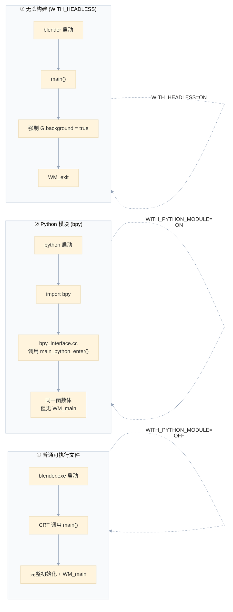
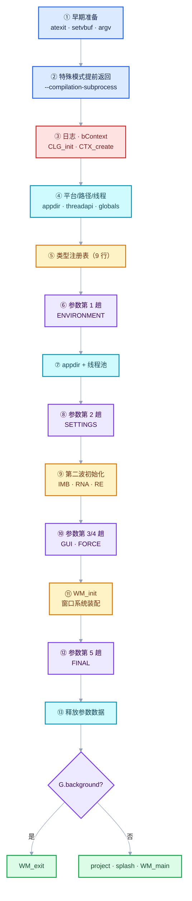

# WS-02 main() 全文解析：Blender 启动的 300 行

<div style="font-family:'Segoe UI','Microsoft YaHei',system-ui,-apple-system,sans-serif;display:flex;flex-wrap:wrap;align-items:center;gap:8px;margin:16px 0 20px;padding:10px 14px;background:#F8FAFC;border:1px solid #E2E8F0;border-radius:12px">
<span style="font-size:11px;font-weight:700;letter-spacing:.1em;color:#64748B;margin-right:2px">导航</span>
<a href="../README.md" style="font-size:13px;color:#334155;background:#F1F5F9;border:1px solid #E2E8F0;border-radius:999px;padding:3px 12px;text-decoration:none;white-space:nowrap">总入口</a>
<a href="./README.md" style="font-size:13px;color:#2563EB;background:#EFF6FF;border:1px solid #BFDBFE;border-radius:999px;padding:3px 12px;text-decoration:none;white-space:nowrap">本章 08-窗口系统与核心类型</a>
<a href="./01-WM主循环与核心数据类.md" style="font-size:13px;color:#7C3AED;background:#F5F3FF;border:1px solid #DDD6FE;border-radius:999px;padding:3px 12px;text-decoration:none;white-space:nowrap">‹ WM主循环与核心数据类</a>
</div>

<div style="font-family:'Segoe UI','Microsoft YaHei',system-ui,-apple-system,sans-serif;margin:18px 0 22px;padding:14px 18px;background:#F5F3FF;border-left:4px solid #7C3AED;border-radius:10px">

**基准说明**：Blender **5.4.0-alpha** 本地工作树。
主文件 [source/creator/creator.cc](../../../source/creator/creator.cc)（共 688 行）。
本文覆盖 **L325–L687**，即 `main()` 函数全文，并额外解释文件头部的宏定义（L61-L172）。

**为什么值得读这 300 行**：它是整个 Blender 的"装配说明书"。
每个子系统什么时候初始化、谁依赖谁、背景模式与 GUI 在哪分叉、
`--python` 为什么必须延后执行——答案全在这里。

**本文的组织方式**：先花两节回答你提的语法疑问（§0、§1），
再按 `main()` 的执行顺序逐段精读（§2 起），每段都给出
"代码 → 逐行解释 → 为什么这样写 → 代价是什么"四层。

**前置阅读**：[08-01 WM主循环与核心数据类](01-WM主循环与核心数据类.md)。

</div>

## §0 先回答：`main(argc, argv)` 到底几个参数

### 标准签名

C/C++ 标准规定了**两种**合法的 `main` 形式：

```cpp
int main()                          // 形式 A：无参数
int main(int argc, char *argv[])    // 形式 B：带参数
```

**只有这两个是标准保证的。** 第三个参数（环境变量）`int main(int argc, char **argv, char **envp)`
是 POSIX 扩展，不是 C 标准，Windows 上不保证可用。

Blender 用的是形式 B，参数名是习惯叫法：

| 名字 | 类型 | 含义 | 读音 |
| --- | --- | --- | --- |
| `argc` | `int` | **arg**ument **c**ount = 参数**个数** | "arg-C" |
| `argv` | `char **` | **arg**ument **v**ector = 参数**数组** | "arg-V" |

### `argv` 为什么是 `char **` 而不是 `char *`

因为它是**字符串数组**。展开看：

```cpp
argv[0]  →  char*   "blender.exe"
argv[1]  →  char*   "-b"
argv[2]  →  char*   "myfile.blend"
argv[3]  →  nullptr  ← 数组以空指针结尾（标准保证）
```

所以 `char **argv` 的类型读法是从右往左：**"指向 char 指针的指针"**。
它等价于 `char *argv[]`（数组语法在函数参数里退化成指针）。

### `argc` 与 `argv` 的关系

```dml-ignore
argc = 3

argv ──┐
       ↓
     ┌────────┬────────┬────────┬────────┐
     │ argv[0]│ argv[1]│ argv[2]│ argv[3]│
     ├────────┼────────┼────────┼────────┤
     │  ptr   │  ptr   │  ptr   │  NULL  │
     └───┬────┴───┬────┴───┬────┴────────┘
         ↓        ↓        ↓
      "blender"  "-b"   "file.blend"
```

**关键规则**：

1. `argv[0]` 是**程序自身路径**（不保证一定是路径，可能被调用方伪造，但习惯上总是这样）
2. `argv[1]` 到 `argv[argc-1]` 是真正的用户参数
3. `argc` **至少为 1**（即至少包含 `argv[0]`）
4. `argv[argc]` 保证是 `nullptr`——所以可以写 `while (*argv)` 遍历

### 为什么 `argc` 是必需的

因为**光有 `argv` 不知道长度**。虽然有 `argv[argc] == nullptr` 的保证，
但显式传长度更高效（不用每次都遍历到结尾），也是标准做法。

### Blender 里 `argv[0]` 的实际用途

```cpp
// L492
BKE_appdir_program_path_init(argv[0]);   // 从 argv[0] 反推安装目录
```

这里用 `argv[0]` 找到 `blender.exe` 的位置，再往上推得到 `2.xx/` 资源目录。
**所以如果在 PATH 里通过相对路径启动，或者用符号链接，这里可能得到意外的结果**——
Blender 通常会用平台 API 校正（`/proc/self/exe`、`GetModuleFileName`、`_NSGetExecutablePath`）。

### `const char **` 是什么

```cpp
int main(int argc, const char **argv)
```

C 标准写的是 `char *argv[]`，Blender 写了 `const char **`。区别：

| 写法 | 能否修改字符串内容 | 能否修改指针 |
| --- | --- | --- |
| `char **` | ✅ 可以（危险） | ✅ |
| `const char **` | ❌ 不能 | ✅ |

**`const char **`（不是 `char *const *`）**：字符串内容只读，但指针数组本身可改。

**为什么 Blender 要加 `const`**：
参数解析过程中大量传递 `argv`，加 `const` 能防止某处意外改了参数字符串
（那会破坏 `CommandLineToArgvW` 分配的内存布局）。

---

## §1 为什么有些语法看起来"丑陋"

你提的三处，我逐个解释。它们都不是风格问题，而是**历史包袱 + 预处理器局限**的必然产物。

<hr style="border:none;height:1px;background:linear-gradient(90deg,#BFDBFE,#E2E8F0 55%,transparent);margin:34px 0">

### §1.1 `const char ** /*argv_c*/` —— 为什么参数名被注释掉

```cpp
// L332-L338
int main(int argc,
#ifdef USE_WIN32_UNICODE_ARGS
         const char ** /*argv_c*/
#else
         const char **argv
#endif
)
```

#### 第一层：为什么要写 `/*argv_c*/`

**因为参数名不能重复声明，也不能"未使用"而触发警告。**

具体场景：

- **非 Windows**：`argv` 直接用，后面 L492 用它，正常。
- **Windows + Unicode**：`argv` **会重新生成**（见 §2.3），
  所以函数**开头**那个参数完全没用。但 C++ 不允许省略参数名（否则没法写默认值/某些模板场景），
  所以必须写个占位名。

**为什么用 `/*argv_c*/`（注释掉）而不是写 `argv_c`？**

这是关键：如果写成 `const char **argv_c`，编译器会警告
`unused parameter 'argv_c'`（在 `-Wunused-parameter` 下）。

而如果写成 `const char **`（**真的省略名字**），这是合法的——C++ 允许命名参数省略名字：

```cpp
void f(int, double);   // 合法！参数无名字，只是不能用
```

**那为什么不干脆省略成 `const char **`？**

因为这段代码在**两种配置下**都要编译，而两种配置下这段文本必须能统一处理。
用 `/*argv_c*/` 的好处是：**读代码的人能看到"这里本来该有个名字，叫 argv_c"**。
纯粹的可读性注释，不参与编译。

#### 第二层：为什么不用 `#if` 直接改整个签名

也可以这么写：

```cpp
#ifdef USE_WIN32_UNICODE_ARGS
int main(int argc, const char **)
#else
int main(int argc, const char **argv)
#endif
{
  ...
}
```

但这样**函数体的大括号会重复**，而且 `#if` 跨越了参数列表和函数体的边界——
维护时容易出错。当前写法把 `#if` 局限在参数列表内部，范围更小。

#### 第三层：那个 `#ifdef USE_WIN32_UNICODE_ARGS` 从哪来

```cpp
// L166-L170
/* When building as a Python module, don't use special argument handling
 * so the module loading logic can control the `argv` & `argc`. */
#if defined(WIN32) && !defined(WITH_PYTHON_MODULE)
#  define USE_WIN32_UNICODE_ARGS
#endif
```

**这个宏是"本地定义"（Local Defines 区块）**，不是 CMake 传进来的。
它的含义：**Windows 且不是 Python 模块**时，才启用 Unicode 参数处理。

为什么 Python 模块要排除？因为 `import bpy` 时**没有 `main()`被调用**，
`argv` 由宿主的 Python 进程控制，Blender 不该去改写它。

> **这一处"丑陋"的根源是：C 预处理器不支持"条件命名参数"。**
> 现代 C++ 没有任何语法能表达"这个参数名只在某个宏为假时存在"。
> 所以只能靠注释和 `#if` 硬拼。

<hr style="border:none;height:1px;background:linear-gradient(90deg,#BFDBFE,#E2E8F0 55%,transparent);margin:34px 0">

### §1.2 `#ifndef NDEBUG` —— 双重否定为什么烦

```cpp
// L354-L361
/* Un-buffered `stdout` makes `stdout` and `stderr` better synchronized, and helps
 * when stepping through code in a debugger (prints are immediately
 * visible). However disabling buffering causes lock contention on windows
 * see #76767 for details, since this is a debugging aid, we do not enable
 * the un-buffered behavior for release builds. */
#ifndef NDEBUG
  setvbuf(stdout, nullptr, _IONBF, 0);
#endif
```

#### 为什么是双重否定

因为 `NDEBUG` 是**标准库规定的宏**，它的语义是：

> **`NDEBUG` = "No DEBUG" = 已经定义了 `NDEBUG` 就表示"不是调试构建"**

这个宏的存在原因：`<cassert>` 里的 `assert()` 是这么定义的——

```cpp
#ifdef NDEBUG
#  define assert(expr) ((void)0)     // Release：assert 完全消失
#else
#  define assert(expr) ...           // Debug：assert 真的检查
#endif
```

**关键点：`assert` 的"生效条件"是 `NDEBUG` 未定义**。
所以标准库只能用"负向"宏——它描述的是"关掉什么"，不是"开启什么"。

于是"调试构建"的判断就成了双重否定：

```
#ifndef NDEBUG   →  "如果没有定义 NDEBUG"  →  "如果是 Debug"
```

#### 为什么大家都这么写

因为**这是 C 标准定的**，不是 Blender 的选择。全世界所有 C/C++ 项目的
"debug-only 代码"都是 `#ifndef NDEBUG`。

Blender 里另一种常见写法是自定义宏：

```cpp
#if defined(DEBUG)      // Blender 自己也有 DEBUG 宏，但用得少
```

但 `NDEBUG` 无法替代——因为编译器（`gcc -DNDEBUG`、`cl.exe /DNDEBUG`）
和构建系统（CMake 的 `CMAKE_CXX_FLAGS_RELEASE` 默认加 `-DNDEBUG`）
都认 `NDEBUG`。

#### 心智转换表

| 你看到的 | 翻译 |
| --- | --- |
| `#ifdef NDEBUG` | Release 构建 |
| `#ifndef NDEBUG` | Debug 构建 |
| `#if defined(NDEBUG)` | 同上，等价写法 |
| `#if !defined(NDEBUG)` | Debug 构建 |

**记法**：**`NDEBUG` 是"不要调试"，所以 `ifndef NDEBUG` = "要调试"**。

<hr style="border:none;height:1px;background:linear-gradient(90deg,#BFDBFE,#E2E8F0 55%,transparent);margin:34px 0">

### §1.3 为什么 `WITH_PYTHON_MODULE` 出现 20 次

我统计了这个文件：**共 20 处**（`#ifdef` / `#ifndef` / `defined(...)` 都算）。

| 行号 | 形式 | 内容 |
| --- | --- | --- |
| 61 | `#ifndef` | 不包含 `BLI_args.hh` |
| 112 | `defined() && defined()` | macOS `environ` 处理 |
| 168 | `defined(WIN32) && !defined()` | 定义 `USE_WIN32_UNICODE_ARGS` |
| 218 | `#ifndef` | `CreatorAtExitData::ba` 字段 |
| 238 | `#ifndef` | 释放 `ba` |
| 297 | `#ifdef` | Python 模块的私有区段 |
| 311 | `#endif` | 结束 |
| 343 | `#ifndef` | `bArgs *ba` 变量 |
| 450 | `#ifdef` | `main_python_evil_C` |
| 473 | `defined(__APPLE__) && !defined() && !defined(WITH_HEADLESS)` | macOS `-psn_` |
| 511 | `#ifndef` | `BLI_args_create` |
| 535 | `#ifdef` | `flush_denormals` 的取值 |
| 545 | `#ifndef` | `ARG_PASS_SETTINGS` 解析 |
| 588 | `defined() \\|\\| defined(WITH_HEADLESS)` | 强制后台模式 |
| 608 | `#ifndef` | `ARG_PASS_SETTINGS_GUI` |
| 632 | `#ifndef` | `ARG_PASS_FINAL` |
| 645 | `#ifndef` | `ba = nullptr` |
| 655 | `#ifndef` | 背景/GUI 分叉 |
| 682 | `#endif` | 文件末尾总收尾 |

#### 根本原因：`main()` 在 Python 模块模式下根本不会被调用

这是理解全部 20 处的钥匙。看 L290-L311：

```cpp
/* -------------------------------------------------------------------- */
/** \name Blender as a Stand-Alone Python Module (bpy)
 * \{ */

/* Called in `bpy_interface.cc` when building as a Python module. */
int main_python_enter(int argc, const char **argv);

void main_python_exit()
{
  WM_exit_ex((bContext *)main_python_evil_C, true, false);
  main_python_evil_C = nullptr;
}

/* Rename the `main(..)` function, allowing Python initialization to call it. */
#  define main blender::main_python_enter
#endif /* WITH_PYTHON_MODULE */

/** \} */
```

**`#define main blender::main_python_enter`** —— 这是全文最巧妙的一行。

它做的事：**把 `main` 这个名字重命名成 `main_python_enter`**。
于是：

| 构建模式 | `int main(...)` 实际定义成 | 谁调用它 |
| --- | --- | --- |
| 普通可执行文件 | `main`（真正的进程入口） | CRT 启动代码 |
| Python 模块（`bpy`） | `main_python_enter` | Python 的 `bpy_interface.cc` |

**为什么这样做**：`import bpy` 时，Python 解释器**已经在运行**，
不存在"进程入口"这回事。但 Blender 需要执行与普通启动相同的初始化逻辑。
所以**复用同一个函数体**，只是改个名字，由 Python 侧在合适的时机调用。

而 `#undef main`（L455）就是在函数体内部把这个重命名撤销——
否则函数体内写 `main` 会展开成 `main_python_enter` 造成语法错误。

#### 三种运行形态



#### 20 处条件编译分布在四类职责上

| 类别 | 涉及行 | 原因 |
| --- | --- | --- |
| **A. 参数解析**（11 处） | 61, 168, 218, 238, 343, 511, 545, 608, 632, 645, 655 | 模块模式不解析命令行（`argv` 由宿主控制） |
| **B. 进程入口**（3 处） | 297, 311, 450 | 入口函数改名 + 全局 `C` 传递 |
| **C. 强制后台**（1 处） | 588 | 模块模式没有窗口 |
| **D. 浮点行为**（1 处） | 535 | 不该改变宿主程序的计算结果 |
| **E. 平台交集**（2 处） | 112, 473 | macOS 特例 |
| **F. 收尾配对**（2 处） | 682 + 若干 `#endif` | — |

#### 为什么"这么多"是无法避免的

理想情况当然是把 `main()` 拆成：

```cpp
int main(...) { return app_main(argc, argv, /*is_module=*/false); }
```

但这里的困难是：

1. **`WITH_PYTHON_MODULE` 是编译期常量**，用运行时 `if` 会引入不可达代码警告
   （`bArgs` 在模块模式下根本不存在，无法写成运行时分支）
2. **很多分支影响的是"变量是否存在"**（`bArgs *ba` 只在非模块模式存在），
   这只能靠预处理器
3. **变量作用域跨越整函数**（`ba` 从 L343 活到 L646），
   局部 `#if` 无法收束

**所以这 20 处是"一个函数承担两种构建形态的职责"必然的代价。**
如果重构，正确方向是把两种形态拆成两个函数、共享一个 `app_init_common()`——
但那是大规模改动，收益不足以驱动。

> **这是一个可以接受的现实**：启动代码本来就只写一次、读很多次，
> 预处理器噪声虽然难看，但每一处都有明确理由。

<hr style="border:none;height:1px;background:linear-gradient(90deg,#BFDBFE,#E2E8F0 55%,transparent);margin:34px 0">

## §2 整体结构

### §2.1 `main()` 的三件事（L325-L331）

```cpp
/**
 * Blender's main function responsibilities are:
 * - setup subsystems.
 * - handle arguments.
 * - run #WM_main() event loop,
 *   or exit immediately when running in background-mode.
 */
```

这段注释是全文的目录。三件事对应三大块：

| 职责 | 代码范围 | 内容 |
| --- | --- | --- |
| **setup subsystems** | L347-L615 | 分配器、日志、类型表、路径、线程、IMB/RNA/RE… |
| **handle arguments** | 穿插在各阶段 | 五趟解析，每趟后面跟一段依赖它的初始化 |
| **run WM_main / exit** | L631-L687 | 最终分叉 |

**注意这里没有"init → parse → run"这种干净的三段式**——
参数解析和初始化是**交织**的（见 §6）。这是本文要解释的重点之一。

### §2.2 执行流程图



---

## §3 第一段：声明与早期准备（L342-L352）

### 先说清「钩子」这个词

这一节常被概括成"早期钩子"，但**只有 `atexit` 是真正的钩子**：

| 代码 | 是不是钩子 | 本质 |
| --- | --- | --- |
| `BKE_blender_atexit_register(...)` | ✅ **真钩子** | 登记回调，退出时由框架调用 |
| `setvbuf(stdout, ...)`（§4.1） | ❌ | 全局状态配置，改变 `stdout` 的缓冲模式 |
| `argv` 转 UTF-8（§4.2） | ❌ | 数据预处理，自己造一份参数 |
| `bContext *C; bArgs *ba;` | ❌ | 只是变量声明，尚未赋值 |

**钩子（hook）的定义**：在别人写好的执行流程里插入自己的代码。
特征是**控制反转**——你的函数不由你调用，而由框架在特定时机回调。

```dml-ignore
普通调用：  你的代码 → 调 A() → 调 B()
钩子：      框架 → （某个时机）→ 回头调你的代码
                    ↑ 你只"登记"，不"触发"
```

**所以本节标题用"早期准备"更准确。** 下面讲的三项里，只有退出回调登记是钩子。

### 代码

```cpp
int main(int argc, const char **argv)
{
  using namespace blender;

  bContext *C;
#ifndef WITH_PYTHON_MODULE
  bArgs *ba;
#endif

  /* Ensure we free data on early-exit. */
  CreatorAtExitData app_init_data = {nullptr};
  BKE_blender_atexit_register(callback_main_atexit, &app_init_data);

  CreatorAtExitData_EarlyExit app_init_data_early_exit = {nullptr};
  app_init_data.early_exit = &app_init_data_early_exit;
```

### 逐行解释

| 行 | 作用 |
| --- | --- |
| `using namespace blender;` | 整个 Blender 核心都在 `blender` 命名空间。**只在 `main` 里用这个写法**，其他文件都用 `blender::` 前缀 |
| `bContext *C;` | **未初始化**声明。注意不是 `= nullptr` |
| `bArgs *ba;` | 参数解析器句柄，只在非模块模式存在 |
| `CreatorAtExitData app_init_data = {nullptr};` | 聚合初始化，把所有字段置 0 |
| `BKE_blender_atexit_register(...)` | 登记退出回调 |
| `app_init_data.early_exit = &...` | 二级结构挂上去 |

### 为什么 `C` 不初始化成 `nullptr`

这是**故意的**。理由有两层：

**第一层**：编译器警告。如果写 `bContext *C = nullptr;`，
那么后面 `C = CTX_create();` 就被认为是"从 null 赋值到有效值"，
某些静态分析会认为前面的初始化是死代码。

**第二层（更重要）**：**这是 C 时代的习惯**。
在 C 里 `bContext *C;` 是"我要用这个变量，稍后赋值"，语义清晰。
写 `= nullptr` 反而暗示"可能不赋值就使用"。

> **注意这里有个隐患**：`C` 在 L446 之前是**未初始化**的。
> 如果 L446 之前有任何 early return 并且触碰 `C`，就是未定义行为。
> 实际代码里 L390-L396 那个 `return 0` 就在 `C` 赋值之前——
> 但那条路径不碰 `C`，所以安全。这是**靠人工纪律维持的安全性**。

### 两级 atexit 的完整设计

#### 数据结构

```cpp
// L211-L232
/** Data to free when Blender exits early on. */
struct CreatorAtExitData_EarlyExit {
  bContext *C;
};

/** Free data on early exit (if Python calls `sys.exit()` while parsing args for eg). */
struct CreatorAtExitData {
#ifndef WITH_PYTHON_MODULE
  bArgs *ba;
#endif

#ifdef USE_WIN32_UNICODE_ARGS
  char **argv;
  int argv_num;
#endif

  /**
   * When non-null, run additional exit logic.
   * Cleared once early initialization is over.
   */
  CreatorAtExitData_EarlyExit *early_exit = nullptr;
};
```

**两个结构体，两份职责**：

| 结构 | 内容 | 什么时候要释放 |
| --- | --- | --- |
| `CreatorAtExitData` | `ba`、`argv` | **总是在退出时**释放 |
| `CreatorAtExitData_EarlyExit` | `C` + 一堆子系统 | **只在早期退出时**释放 |

#### 回调实现

```cpp
// L234-L265
static void callback_main_atexit(void *user_data)
{
  CreatorAtExitData *app_init_data = static_cast<CreatorAtExitData *>(user_data);

  /* 第一组：总是释放 */
#ifndef WITH_PYTHON_MODULE
  if (app_init_data->ba) {
    BLI_args_destroy(app_init_data->ba);
    app_init_data->ba = nullptr;
  }
#endif

#ifdef USE_WIN32_UNICODE_ARGS
  if (app_init_data->argv) {
    while (app_init_data->argv_num) {
      free((void *)app_init_data->argv[--app_init_data->argv_num]);
    }
    free((void *)app_init_data->argv);
    app_init_data->argv = nullptr;
  }
#endif

  /* 第二组：只在早期退出时释放 */
  if (CreatorAtExitData_EarlyExit *early_exit = app_init_data->early_exit) {
    CTX_free(early_exit->C);
    DEG_free_node_types();
    BKE_blender_globals_clear();
    BKE_appdir_exit();
    CLG_exit();
  }
}
```

**为什么 `while (argv_num) { free(argv[--argv_num]); }` 要倒着释放**？

因为 `argv` 是 `char**` 数组，每个元素是独立 `malloc` 的字符串。
倒着释放本身不重要（它们互不依赖），**但 `--argv_num` 有个副作用**：
它同时把这个计数变量递减到 0，于是函数**可以重复调用而无副作用**（幂等）。
第二次调用时 `argv_num == 0`，循环不执行，直接 `free(argv)` 时 `argv` 已是 `nullptr`。

**这是一个"用计数器同时表达状态和进度"的小技巧**。

#### 为什么普通 atexit 不够

C 标准有 `atexit()`，但 Blender 用的是**自己的 `BKE_blender_atexit_register`**。
为什么？

| | `atexit()` | `BKE_blender_atexit_register` |
| --- | --- | --- |
| 触发时机 | 只在 `exit()` 正常返回时 | **也能在崩溃处理器里主动触发** |
| 参数 | 无 | `void *user_data` |
| 能否注销 | ❌ | ✅ `_unregister` |
| 能否手动触发 | ❌ | ✅ 直接调用回调函数 |

**最后一条是关键**：Blender 需要在**不同阶段手动触发这个回调**
（L641 就是手动调的），而 `atexit` 只能等进程退出。

#### 那个 `early_exit` 指针的生命周期

```dml-ignore
时刻                                          early_exit 值     回调行为
─────────────────────────────────────────────────────────────────────────
L352 挂上                                     指向 _EarlyExit    释放全部
...参数解析中，Python 脚本调用 sys.exit()...   → exit 触发回调     释放全部 ✅
L561 app_init_data.early_exit = nullptr        nullptr            只释放 argv/ba
L641 手动调用回调（主动）                       nullptr            只释放 argv/ba
L642 _unregister                               —                  以后不再调用
L666/677 WM_exit / WM_main                      —                  WM_exit 负责释放子系统
```

**注意 L641 是"主动手动调用"**——不是为了退出，而是为了**提前释放 `ba` 和 `argv`**，
减少主循环期间的常驻内存。

---

## §4 第二段：输出缓冲与特殊模式（L354-L420）

### §4.1 `setvbuf` 的详细解释

```cpp
// L354-L361
/* Un-buffered `stdout` makes `stdout` and `stderr` better synchronized, and helps
 * when stepping through code in a debugger (prints are immediately
 * visible). However disabling buffering causes lock contention on windows
 * see #76767 for details, since this is a debugging aid, we do not enable
 * the un-buffered behavior for release builds. */
#ifndef NDEBUG
  setvbuf(stdout, nullptr, _IONBF, 0);
#endif
```

#### `setvbuf` 的参数

```cpp
int setvbuf(FILE *stream, char *buffer, int mode, size_t size);
```

| 参数 | 这里传的 | 含义 |
| --- | --- | --- |
| `stream` | `stdout` | 要改哪个流 |
| `buffer` | `nullptr` | 不提供缓冲区（让标准库自己处理） |
| `mode` | `_IONBF` | **I**nput/**O**utput **N**o **B**uf**f**ering = 无缓冲 |
| `size` | `0` | 无缓冲时忽略 |

**三种缓冲模式**：

| 模式 | 行为 | 典型用途 |
| --- | --- | --- |
| `_IOFBF` | 全缓冲（攒满才写） | 文件、重定向到文件时的 stdout |
| `_IOLBF` | 行缓冲（遇 `\n` 就写） | 终端上的 stdout |
| `_IONBF` | 无缓冲（每次都写） | **调试**、stderr |

#### 为什么 Debug 要无缓冲

**三个具体原因**：

1. **调试器里看不见输出**。如果用全缓冲，`printf` 的内容留在内存里，
   你在断点处停下来时看不到。无缓冲则立刻可见。
2. **`stdout` 与 `stderr` 顺序错乱**。如果你写：
   ```cpp
   printf("step 1\n");       // stdout，缓冲
   fprintf(stderr, "err\n"); // stderr，无缓冲
   ```
   在终端上会看到 `err` 先出现。**顺序错了，调试信息就无法用来推断执行流**。
3. **崩溃时丢日志**。缓冲的内容在崩溃时不会刷出。无缓冲能保留最后几句。

#### 为什么 Release 不能用

注释里给了具体 bug 号 `#76767`。原因是：**Windows 上 `stdout` 无缓冲会导致锁竞争**。

具体机制：`printf` 每次都要加锁写控制台。如果程序有多个线程在打日志
（Blender 的 TBB worker 会），无缓冲意味着**每次都抢锁**，而缓冲能把 N 次写合并成 1 次。
在 Windows 控制台（`WriteConsole`）上这个开销特别大。

**这是一条非常典型的"调试便利 vs 生产性能"取舍**，注释把两边都写清了。

### §4.2 SYCL 环境变量

```cpp
// L365-L368
/* Use the v2 Level Zero adapter of the SYCL unified runtime. As a fix for #159584, the v1 Level
 * Zero adapter is not included. While the Cycles oneAPI device sets this as well, we also need
 * the environment variable for the use of Open Image Denoise in the compositor. */
BLI_setenv_if_new("SYCL_UR_USE_LEVEL_ZERO_V2", "1");
```

#### 背景：SYCL 是什么

SYCL 是一个跨厂商的 GPU 编程标准。Intel 的 oneAPI 实现通过 **Level Zero**（一个低层驱动接口）
与 GPU 通信。Level Zero 有 v1 和 v2 两版适配器，v1 在 #159584 里被移除了，
所以必须显式要求 v2。

#### `BLI_setenv_if_new` 的语义

```cpp
// 概念实现
void BLI_setenv_if_new(const char *key, const char *value)
{
  if (getenv(key) == nullptr) { setenv(key, value, 1); }
}
```

**`_if_new` = 只在变量不存在时设置**。这给用户留了覆盖的机会：

```bash
# 用户想用 v1（虽然可能已移除），可以：
set SYCL_UR_USE_LEVEL_ZERO_V2=0
blender
```

**为什么不直接 `setenv`**：那会**强暴用户配置**，让用户无法在自己的脚本/系统里
统一设置环境变量。`_if_new` 是"给默认值"的正确做法。

#### 为什么必须在这么早

因为 SYCL 运行时库**在第一次被加载时**就读取这个变量。
Cycles 的 oneAPI 设备和 OIDN（Open Image Denoise，降噪器）都会初始化 SYCL，
而这两者的初始化发生在后面。**如果等到了再说，就太晚了。**

> 这条体现了一个通用原则：**给第三方库的环境变量必须在库加载之前设置**。

### §4.3 GPU 编译子进程（L390-L396）

```cpp
#if defined(WITH_OPENGL_BACKEND) && BLI_SUBPROCESS_SUPPORT
  if (STREQ(argv[0], "--compilation-subprocess")) {
    BLI_assert(argc == 2);
    GPU_compilation_subprocess_run(argv[1]);
    return 0;
  }
#endif
```

#### 这个模式的完整形状

```dml-ignore
主进程                                    子进程（自己）
──────────────────────────────────────────────────────────
需要编译着色器
  ├─ fork/exec 自己
  │   参数: --compilation-subprocess job.txt
  │                                        └→ 进入 main()
  │                                             ↓
  │                                          命中这个 if
  │                                             ↓
  │                                          GPU_compilation_subprocess_run(job.txt)
  │                                             ↓
  │                                          编译 → 写结果 → return 0
  │   等待子进程退出
  ├─ 读结果文件
  └─ 继续
```

#### 为什么需要这个

因为**GPU 驱动的着色器编译器有 bug**，编译某些着色器时会**段错误/崩溃**。
如果直接在主进程编译，用户看到的是"Blender 崩溃了"。
隔离到子进程后：

| 情况 | 主进程体验 |
| --- | --- |
| 子进程正常 | 编译成功，一切正常 |
| 子进程崩溃 | "着色器编译失败"，**Blender 继续运行** |
| 子进程超时 | 可以杀掉，主进程不受影响 |

#### `BLI_assert(argc == 2)` 的含义

`argc == 2` 表示：`argv[0] = "--compilation-subprocess"`，`argv[1] = 任务文件路径`。
**这是内部协议**，只可能由 Blender 自己调用，所以可以断言。

> 注意这里 `argv[0]` 不是程序路径！因为这是 Blender **自己重新 exec 自己的特殊模式**，
> 第一个参数就是模式标记。这打破了 `argv[0] = 程序路径` 的惯例，
> 但因为这个分支在极早的位置（`BKE_appdir_program_path_init` 之前）就返回了，
> 不会有代码依赖 `argv[0]` 是路径。

### §4.4 大页内存（L398-L401）

```cpp
#if defined(WITH_TBB_MALLOC) && defined(__linux__)
  /* Enable huge pages for performance. */
  scalable_allocation_mode(TBBMALLOC_USE_HUGE_PAGES, 1);
#endif
```

#### Huge pages 是什么

现代 CPU 用**页表**把虚拟地址翻译成物理地址。x86-64 的常规页是 **4 KiB**，
而 huge page 是 **2 MiB**（甚至 1 GiB）。

| | 4 KiB 页 | 2 MiB 页 |
| --- | --- | --- |
| 覆盖 4 GiB 需要 | 1,048,576 个页表项 | 2,048 个页表项 |
| TLB（地址缓存）覆盖范围 | 很小 | 大 512 倍 |
| 缺页次数 | 多 | 少 512 倍 |

**TLB miss 是很贵的**（要访问内存里的页表，甚至多级）。
对"大量随机访问"的数据（几何数据、BVH、渲染缓冲），huge pages 收益明显。

#### 为什么只 Linux

因为 `TBBMALLOC_USE_HUGE_PAGES` 这个选项在 Linux 上用 `madvise(MADV_HUGEPAGE)`
实现，Windows 的对应机制（`MEM_LARGE_PAGES`）需要特权和不同的分配路径，
TBB 没有封装。

### §4.5 分配器切换循环（L403-L420）—— 逐行

```cpp
/* NOTE: Special exception for guarded allocator type switch:
 *       we need to perform switch from lock-free to fully guarded allocator before any
 *       allocation happened. */
{
  int i;
  for (i = 0; i < argc; i++) {
    if (STR_ELEM(argv[i], "-d", "--debug", "--debug-memory", "--debug-all")) {
      printf("Switching to fully guarded memory allocator.\n");
      MEM_use_guarded_allocator();
      break;
    }
    if (STR_ELEM(argv[i], "--", "-c", "--command")) {
      break;
    }
  }
  MEM_init_memleak_detection();
}
```

#### `STR_ELEM` 是什么

```cpp
// 概念：STR_ELEM(str, a, b, c) 等价于 (str == a || str == b || str == c)
```

它是 Blender 的便利宏，把"字符串匹配多个候选"写得更短。
**注意它不处理 `--debug-memory` 这种带值的参数**——这里只做名称匹配。

#### 为什么必须在任何分配之前

`MEM_use_guarded_allocator()` 切换的是**分配器实现**：

| 分配器 | 特点 | 用途 |
| --- | --- | --- |
| 无守护（默认） | 快，`malloc` 包装 | 正常运行的性能 |
| 完全守护 | 每个分配加前后哨兵字节、跟踪调用栈 | 检测越界写、泄漏 |

**切换后，之前分配的指针若被守护分配器释放就会出错**（因为守护分配器需要头部信息）。
所以必须在**任何分配发生之前**切换。

#### 两个 `break` 的区别（重要）

```cpp
if (STR_ELEM(argv[i], "-d", ...)) { ...; break; }   // ← break ①
if (STR_ELEM(argv[i], "--", "-c", "--command")) { break; }  // ← break ②
```

| | break ① | break ② |
| --- | --- | --- |
| 触发条件 | 找到了调试开关 | 遇到了"参数分界" |
| 含义 | **已完成任务**，不必再找 | **停止搜索**，后面的参数不属于 Blender |
| 后续 | 已切换守护分配器 | 保持默认分配器 |

#### 为什么 `--` 和 `-c` 要终止搜索

**`--`**：Unix 惯例，表示"选项结束，后面全是位置参数"。
如果 `blender -- -d`，那么 `-d` 应该被当成文件名，不是调试开关。

**`-c` / `--command`**：这是"子命令"模式（如 `blender -c help`）。
子命令有自己的参数空间，`blender -c render -d` 里的 `-d` 属于 `render` 子命令，
不该影响 Blender 主体的分配器。

#### 这个循环为什么手写而不用 `BLI_args`

因为 **`BLI_args` 依赖分配器**，而这里正是决定用哪个分配器的地方。**鸡生蛋问题**。

> **这是启动代码里反复出现的模式**：越早的代码越"原始"。
> 手写循环、裸 `malloc`、裸 `printf`——不是作者偷懒，是没得选。

#### `MEM_init_memleak_detection()`

它在循环**外面**，无条件调用。作用是初始化泄漏检测的记账结构
（是否真正启用取决于编译选项和 `-d`）。放在外面是为了保证"即使没找到 `-d`，也初始化了"。

---

## §5 第三段：日志与 `bContext`（L422-L471）

### §5.1 构建日期（L422-L436）

```cpp
#ifdef BUILD_DATE
  {
    const time_t temp_time = build_commit_timestamp;
    const tm *tm = gmtime(&temp_time);
    if (tm) [[likely]] {
      strftime(build_commit_date, sizeof(build_commit_date), "%Y-%m-%d", tm);
      strftime(build_commit_time, sizeof(build_commit_time), "%H:%M", tm);
    }
    else {
      const char *unknown = "date-unknown";
      STRNCPY(build_commit_date, unknown);
      STRNCPY(build_commit_time, unknown);
    }
  }
#endif
```

#### `[[likely]]` 是什么

C++20 属性，给编译器分支预测提示。**注意它写在 `if` 条件之后、语句之前**：

```cpp
if (tm) [[likely]] { ... }
```

等价于 GCC 的 `__builtin_expect(!!(tm), 1)`。

**为什么需要**：`gmtime` 失败极其罕见（只有当时间戳超出 `time_t` 可表示范围）。
标记 `likely` 让编译器把成功路径放在"顺序执行"位置，减少跳转。

#### 为什么用 `gmtime` 而不是 `localtime`

| | `gmtime` | `localtime` |
| --- | --- | --- |
| 时区 | UTC | 系统本地时区 |
| 结果 | **所有机器一致** | 依赖运行环境 |

构建时间戳是**构建机器**产生的一个绝对时刻。如果用 `localtime`：

- 同一份二进制，在中国显示 `2025-10-24 18:00`
- 在美国显示 `2025-10-24 06:00`

**这会让"这个版本是什么时候构建的"变成一个环境相关问题。** 所以用 UTC。

#### 为什么有 `else` 分支

因为 `gmtime` **可能返回 `nullptr`**（标准规定）。虽然几乎不会发生，
但 `strftime(tm)` 传 null 是未定义行为。**这是防御式编程**——
用 `"date-unknown"` 而不是留空或崩溃。

#### `[[likely]]` 与 `else` 的"矛盾"

看起来有点怪：标了 `likely` 却还认真处理 `else`。
**这是正确的做法**：分支预测提示是**性能优化**，`else` 是**正确性保证**。两者不冲突。

### §5.2 日志系统（L438-L444）

```cpp
  /* Initialize logging. */
  CLG_init();
  CLG_output_use_timestamp_set(true);
  CLG_output_use_memory_set(false);
  CLG_output_use_source_set(false);
  CLG_output_use_basename_set(false);
  CLG_fatal_fn_set(callback_clg_fatal);
```

#### CLG 是什么

**CLG = C Logging**，Blender 自研的日志系统（`source/blender/clog/`）。
设计目标是**零成本**：每条日志有一个全局的"启用的最低级别"，
未启用的日志在**调用点**就被一个 `if` 挡掉，不产生任何格式化开销。

#### 四个 `_set` 的作用

| 调用 | 设置 | 典型输出 |
| --- | --- | --- |
| `use_timestamp_set(true)` | 显示时间戳 | `2025-10-24 18:00:00.123` |
| `use_memory_set(false)` | 不显示内存信息 | （关闭） |
| `use_source_set(false)` | 不显示源文件名 | （关闭） |
| `use_basename_set(false)` | 不显示 basename | （关闭，与上条配合） |

**为什么关掉内存/源文件**：那些是深度调试时才需要。
默认打开会让日志冗长，而 Blender 的常规日志反而更难读。

**注意这些是"全局默认值"**，用户可以通过 `--debug-log` 参数覆盖。

#### `CLG_fatal_fn_set(callback_clg_fatal)`

```cpp
// L267-L270
static void callback_clg_fatal(void *fp)
{
  BLI_system_backtrace(static_cast<FILE *>(fp));
}
```

**当日志级别为 `fatal` 时，打印调用栈**。

为什么需要：`CLG_FATAL` 通常表示"无法继续"，程序即将 `abort()`。
此时调试器可能没附加（尤其是用户机器上的 release 构建），
**栈回溯是唯一的诊断信息**。`BLI_system_backtrace` 本身就是跨平台的栈回溯实现。

### §5.3 `C = CTX_create()`

```cpp
  C = CTX_create();
```

```cpp
// context.cc · L119
bContext *CTX_create()
{
  bContext *C = MEM_new<bContext>(__func__);
  return C;
}
```

#### 这一刻 `C` 的状态

**所有字段都是 `nullptr`（或默认值）**。具体地：

```cpp
C->thread = 0;
C->wm.manager = nullptr;      // 还没窗口管理器
C->wm.window = nullptr;
C->wm.screen = nullptr;
C->wm.area = nullptr;
C->wm.region = nullptr;
C->data.main = nullptr;       // 还没 Main
C->data.scene = nullptr;
```

**它是个空壳**。这印证了 [08-01](01-WM主循环与核心数据类.md) 的判断：

> **`bContext` 是游标，本身不拥有数据。** 它装的是"指向别处的指针"。

**什么会填进去**：

| 时机 | 谁填 |
| --- | --- |
| `WM_check` 里 | `wm = bmain->wm.first(); CTX_wm_manager_set(C, wm);` |
| `wm_add_default` | `CTX_wm_manager_set` + `CTX_wm_window_set` |
| 每帧事件处理 | `CTX_wm_window_set(C, &win)` 等 |

### §5.4 Python 模块的三处特殊处理（L450-L457）

```cpp
#ifdef WITH_PYTHON_MODULE
#  ifdef __APPLE__
  environ = *_NSGetEnviron();
#  endif

#  undef main
  main_python_evil_C = C;
#endif
```

#### 三处逐个解释

**① `environ = *_NSGetEnviron();`**

`environ` 是 POSIX 的环境变量数组（`char **`）。
在普通可执行文件里，它由启动代码设置好。

但 **macOS 的动态库（`.dylib`）里 `environ` 符号指向错误位置**：
`<crt_externs.h>` 里声明了它但没定义，实际定义在 dyld 的私有区域。
`_NSGetEnviron()` 返回正确的地址。

配套的头文件声明在 L112-L116：

```cpp
#if defined(WITH_PYTHON_MODULE) && defined(__APPLE__)
/* Environment is not available in macOS shared libraries. */
#  include <crt_externs.h>
char **environ = nullptr;    // ← 自己定义一个
#endif
```

**注意：Blender 自己定义了一个 `environ` 变量**，然后用 `_NSGetEnviron()` 得到真正的指针赋给它。
这样库内部代码访问 `environ` 就对了。

**② `#undef main`**

```cpp
// L310（前面）
#  define main blender::main_python_enter
```

这个宏把 `main` 重定义。现在函数体内部需要写真正的 `main` 相关代码吗？

实际上这里 `#undef main` 的目的更微妙：**函数体里有些代码可能间接展开 `main` 宏**
（比如某些系统头文件里的声明）。`#undef` 保证从这行之后 `main` 不再被替换。

**③ `main_python_evil_C = C;`**

```cpp
// 前面某处
static bContext *main_python_evil_C = nullptr;

// L303-L307
void main_python_exit()
{
  WM_exit_ex((bContext *)main_python_evil_C, true, false);
  main_python_evil_C = nullptr;
}
```

**为什么"evil"**：名字是作者的自嘲。这个全局变量的存在是因为
**`PyInit_bpy` 和 `main_python_enter` 之间没有参数传递通道**——
Python C API 的初始化函数签名是固定的 `PyObject *PyInit_bpy(void)`，
拿不到 `argv`，所以只能用全局变量。

`main_python_exit` 是 Python 模块卸载时调用的清理函数，需要那个 `C`。

### §5.5 平台杂项（L459-L471）

```cpp
#ifdef WITH_BINRELOC
  br_init(nullptr);
#endif

#ifdef WITH_LIBMV
  libmv_initLogging(argv[0]);
#endif

#if defined(WITH_TBB_MALLOC) && defined(_MSC_VER) && defined(NDEBUG) && defined(WITH_GMP)
  gmp_blender_init_allocator();
#endif

  main_callback_setup();
```

#### 逐个解释

**`br_init(nullptr)` — BinReloc**

Linux 上 Blender 需要找到自己的资源目录（`/path/to/blender/5.4/datafiles/`）。
传统方法是用编译时写死的路径（不可移动）或 `argv[0]`（不可靠）。
**BinReloc** 通过读取 `/proc/self/maps` 找到可执行文件的真实位置，
支持任意位置部署（移动版、AppImage）。

**`libmv_initLogging` — Libmv**

Libmv 是 Blender 的运动跟踪库。它有自己的日志（用的可能是 `glog` 风格）。
需要初始化，否则运动跟踪的调试信息不输出。

**`gmp_blender_init_allocator` — GMP + TBB**

```cpp
// L130-L158
#if (defined(WITH_TBB_MALLOC) && defined(_MSC_VER) && defined(NDEBUG) && defined(WITH_GMP)) || \
    defined(DOXYGEN)
void *gmp_alloc(size_t size) { return scalable_malloc(size); }
void *gmp_realloc(void *ptr, size_t, size_t new_size) { return scalable_realloc(ptr, new_size); }
void gmp_free(void *ptr, size_t) { scalable_free(ptr); }

/**
 * Use TBB's scalable_allocator on Windows.
 * `TBBmalloc` correctly captures all allocations already,
 * however, GMP is built with MINGW since it doesn't build with MSVC,
 * which TBB has issues hooking into automatically.
 */
void gmp_blender_init_allocator()
{
  mp_set_memory_functions(gmp_alloc, gmp_realloc, gmp_free);
}
#endif
```

**这是一个非常具体的工程 hack**，注释写得很清楚：

1. TBB 的分配器通过 **链接时替换（link-time interposition）** 捕获所有 `malloc`
2. 但 **GMP 用 MinGW 编译**（因为它不支持 MSVC），MinGW 的 GMP 直接调 `malloc`，
   **绕过了 TBB 的拦截**
3. 于是多线程下 GMP 的 `malloc` 和 TBB 的 `malloc` 混用 → **崩溃**
4. 解决：用 `mp_set_memory_functions` 显式把 GMP 的分配函数指向 TBB 的 `scalable_malloc`

**`main_callback_setup()`**

```cpp
// L205-L209
static void main_callback_setup()
{
  /* Error output from the guarded allocation routines. */
  MEM_set_error_callback(callback_mem_error);
}
```

把分配器的错误输出重定向到 `callback_mem_error`（其实就是 `fputs(stderr)` + `fflush`）。
**为什么要包装一层**：守护分配器的错误可能在**崩溃处理器里**发生，
那时不能依赖 `printf` 的缓冲，必须立刻 `fflush`。

### §5.6 macOS `-psn_` hack（L473-L485）

```cpp
#if defined(__APPLE__) && !defined(WITH_PYTHON_MODULE) && !defined(WITH_HEADLESS)
  /* Patch to ignore argument finder gives us (PID?). */
  if (argc == 2 && STRPREFIX(argv[1], "-psn_")) {
    static char firstfilebuf[512];

    argc = 1;

    if (GHOST_HACK_getFirstFile(firstfilebuf)) {
      argc = 2;
      argv[1] = firstfilebuf;
    }
  }
#endif
```

#### `-psn_` 是什么

**Process Serial Number**。macOS 经典（Carbon 时代）用 PSN 标识进程，
Finder 启动应用时会传 `-psn_0_12345` 这样的参数。

现代 macOS 已经不需要它了，但**Finder 仍然会传**（为了向后兼容老应用）。
Blender 不使用 PSN，所以必须**丢弃**它，否则参数解析会认为"要打开名为 `-psn_0_12345` 的文件"。

#### `GHOST_HACK_getFirstFile` 做什么

通过 Carbon 的 AppleEvent 机制拿到"用户双击的那个文件"。
Finder 双击文件启动时，文件路径不在命令行里，而是通过 AppleEvent 传递。

**这个函数名里的 `HACK_` 就是诚实的标记。**

#### 逻辑拆解

```dml-ignore
初始:  argc == 2, argv[1] == "-psn_0_12345"

argc = 1;                         // ← 先假设"没有文件参数"
if (GHOST_HACK_getFirstFile(...))  // ← 尝试通过 AppleEvent 拿文件
    argc = 2;  argv[1] = 文件路径 //    拿到了，覆盖 argv[1]

结果 A: 用户双击 Blender 图标       → argc=1，无文件
结果 B: 用户双击 .blend 文件        → argc=2，argv[1]=那个文件
```

**注意 `static char firstfilebuf[512]`** 必须是 `static`（或至少活得比函数长），
因为 `argv[1] = firstfilebuf` 让 `argv` 指向它，后面会持续使用。

### §5.7 路径、线程、全局（L491-L497）

```cpp
  /* Initialize path to executable. */
  BKE_appdir_program_path_init(argv[0]);

  BLI_threadapi_init();

  BKE_blender_globals_init(); /* `blender.cc` */
```

**顺序有讲究**：

| 调用 | 依赖 |
| --- | --- |
| `BKE_appdir_program_path_init(argv[0])` | 只需 `argv` |
| `BLI_threadapi_init()` | 无依赖（但必须在使用任何线程设施之前） |
| `BKE_blender_globals_init()` | 初始化全局 `G`（`Global` 结构），后面到处用 `G.background` 等 |

**`BKE_blender_globals_init` 必须在 `G.background` 被读取之前**——
而 `G.background` 是在 `ARG_PASS_SETTINGS`（L555）里设置的，所以这里的顺序没问题。

---

## §6 第四段：类型与注册表（L498-L508）

```cpp
  BKE_cpp_types_init();
  fn::multi_function::register_common_functions();
  compositor::init();
  BKE_idtype_init();
  BKE_modifier_init();
  seq::modifiers_init();
  BKE_shaderfx_init();
  BKE_volumes_init();
  DEG_register_node_types();

  BKE_callback_global_init();
```

### 逐行详解

#### ① `BKE_cpp_types_init()`

注册 Blender 的 **运行时类型系统** `CPPType`。

`CPPType` 描述"一个 C++ 类型多大、怎么构造、怎么析构、是否 trivial、名字是什么"。
它是这些能力的基础：

| 用到它的东西 | 用途 |
| --- | --- |
| `GPointer` / `GMutablePointer` | 类型擦除的指针（只知道 `CPPType*` + `void*`） |
| `GSpan` / `GMutableSpan` | 类型擦除的连续内存视图 |
| `SocketValueVariant` | socket 值的类型安全容器 |
| `MultiFunction` | 参数类型检查 |
| lazy-function 的 socket | 每个 socket 有 `const CPPType *type` |

**为什么必须第一个**：上面所有东西都依赖它。没有 `CPPType`，
后面注册多播函数都没法表达参数类型。

#### ② `fn::multi_function::register_common_functions()`

注册**全局数学函数注册表**。这些是"无状态、可向量化"的纯函数：

```cpp
registry::add("add(int, int)", ...)
registry::add("min(float, float)", ...)
registry::add("length(float3)", ...)
```

**这是几何节点的命门**（呼应本系列前几章）：

```cpp
// node_fn_integer_math.cc · L175
case NODE_INTEGER_MATH_ADD:  return &fn::multi_function::registry::lookup("add(int, int)"_ustr);
```

`node_build_multi_function` 靠**字符串名字**查表。如果这行没执行，
`lookup` 返回空指针 → 几何节点字段求值失败。

> **调试技巧**：几何节点报"找不到函数"类错误时，首先查这里的初始化顺序。

#### ③ `compositor::init()`

注册合成器节点/操作的类型。合成器在 5.x 经历了大规模重构（新的 zone 系统），
需要显式初始化。

#### ④ `BKE_idtype_init()`

注册所有 **`ID` 类型**的元信息。每个 `ID` 类型（`ID_Scene`、`ID_Object`、`ID_Mesh`…）
有一张 `IDTypeInfo` 表：

```cpp
struct IDTypeInfo {
  ID_Type id_type;
  const char *id_name;
  const char *id_code;
  int id_filter;
  /* 一堆回调：copy、free、read、write、blend_read、... */
};
```

**`BKE_idtype_init` 就是把这张表填满。** 后面所有"按 ID 类型做某事"
（存盘、复制、释放、RNA 访问）都靠它。

#### ⑤ `BKE_modifier_init()`

注册修改器类型表。每个修改器有一个 `ModifierTypeInfo`，含
`modifyGeometry` / `modifyMesh` / `isDisabled` 等回调。

**7 章讲过的 `modifyGeometry` 就在这张表里**：
[07-01](../07-调用栈与调试/01-主线程栈与depsgraph求值链路.md) 栈里的 `MOD_nodes.cc:1812` 就是这个回调的实现。

#### ⑥ `seq::modifiers_init()`

序列器（VSE）的修改器。与 ⑤ 类似但独立的表。

#### ⑦ `BKE_shaderfx_init()`

着色器特效（`ShaderFx`）类型表——用于 EEVEE 的风格化效果。

#### ⑧ `BKE_volumes_init()`

体积网格（OpenVDB）相关类型。

#### ⑨ `DEG_register_node_types()`

**depsgraph 的节点类型**。这一条对理解 7 章至关重要。

depsgraph 里有多种节点类型（`NodeType` 枚举），每种有自己的求值语义：

| 类型 | 作用 |
| --- | --- |
| `OPERATION` | 普通操作（`build_nodetree`、`build_object_data_geometry` 等） |
| `COPY_ON_EVAL` | COW 数据块 |
| `ID_NODE` | 一个 `ID` 的代表节点 |
| `TIME_SOURCE` | 时间源（帧变化时传播脏标记） |
| `PARAMETERS` | 参数（动画）节点 |

`DEG_register_node_types` 建立"类型 → 求值函数"的映射表。
**7 章那张栈里的 `evaluate_node`（`deg_eval.cc:101`）就是查这张表来分发的。**

#### ⑩ `BKE_callback_global_init()`

初始化**全局回调槽**（`BKE_cb_*`）。这是 Blender 的一种轻量观察者机制：

```cpp
BKE_callback_exec_id(bmain, &scene->id, BKE_CB_EVT_DEPSGRAPH_UPDATE_PRE);
```

7 章的 `scene_graph_update_tagged` 就调了它。用途包括：
- 插件监听 depsgraph 更新
- 文件加载前后钩子
- 渲染前后钩子

### 为什么用显式 `xxx_init()` 而不是静态构造

**核心原因：跨模块的静态初始化顺序无法保证。**

C++ 标准只保证**同一个翻译单元内**的静态对象按声明顺序初始化。
**跨翻译单元的初始化顺序是未定义的**（static initialization order fiasco）。

想象如果 `MultiFunction` 注册表是静态对象：

```cpp
// registry.cc
static Map<std::string, MultiFunction*> g_registry;   // 什么时候构造？

// some_node.cc
static bool registered = []() {
  g_registry.add("add(int, int)", ...);   // 可能在 g_registry 构造之前执行！
  return true;
}();
```

如果 `some_node.cc` 的静态初始化先于 `registry.cc`，就会在未构造的 `Map` 上操作 → 崩溃。

**显式 `init` 函数把顺序变成代码里的书写顺序**，完全可控：

```cpp
BKE_cpp_types_init();               // 先有类型系统
register_common_functions();        // 才能注册函数
```

**代价**：忘记调用某个 `init` 就会得到运行时的"类型找不到"错误，
而不是编译错误。这类 bug 往往很难定位。

---

## §7 第五段：命令行的五趟解析（L510-L558）

### §7.1 为什么必须多趟

**核心矛盾**：有些参数**影响初始化行为本身**。

```dml-ignore
参数                         影响的初始化
─────────────────────────────────────────────────
--env-*                       BKE_appdir 的路径解析
-t N                          BLI_task_scheduler 的线程数
--background                  G.background → 后续几乎所有子系统
--debug-*                     MOV/IMB 等的调试行为
--factory-startup             是否读用户配置
```

**如果只解析一次**：
- 解析完才能读 `-t`，但 `BLI_task_scheduler_init` 在解析之前就该调 → 冲突
- 或者：先初始化线程池再解析，那 `-t` 就没用了

**所以只能"解析一部分 → 初始化 → 再解析 → 再初始化"**。

### §7.2 五趟的完整定义

```cpp
// creator_intern.h · L70-L91
/**
 * Passes for use by #main_args_setup.
 * Keep in order of execution.
 */
enum {
  /** Run before sub-system initialization. */
  ARG_PASS_ENVIRONMENT = 1,
  /** General settings parsing, also animation player. */
  ARG_PASS_SETTINGS = 2,
  /** Windowing & graphical settings (ignored in background mode). */
  ARG_PASS_SETTINGS_GUI = 3,
  /** Currently use for audio devices. */
  ARG_PASS_SETTINGS_FORCE = 4,

  /**
   * Actions & fall back to loading blend file.
   *
   * \note arguments in the final pass must use #WM_exit instead of `exit()`  environment is
   * properly shut-down (temporary directory deleted, etc).
   */
  ARG_PASS_FINAL = 5,
};
```

**注意枚举值从 1 开始**，因为 `BLI_args.hh` 里说 *"Pass starts at 1, -1 means valid all the time"*。

### §7.3 每趟做什么、后面跟什么初始化

| 趟 | 值 | 内容 | 之后立刻做的初始化 | 若跳过会怎样 |
| --- | --- | --- | --- | --- |
| `ENVIRONMENT` | 1 | `--env-*`、`--python-use-system-env` 等 | `BKE_appdir_init()` | 路径解析用错默认值 |
| `SETTINGS` | 2 | `--background`、`-t`、`--debug-*`、`--factory-startup` | `BLI_task_scheduler_init()`、`fftw::initialize_float()` | 线程数/调试标志无效 |
| `SETTINGS_GUI` | 3 | 窗口大小、GPU 后端、色彩管理等 | （WM_init 会读） | GUI 设置丢失 |
| `SETTINGS_FORCE` | 4 | `-noaudio`、`-setaudio` | — | 音频设置无效 |
| `FINAL` | 5 | 文件加载、`--python`、`-f` 渲染、`-c` 命令 | — | 什么都不做 |

### §7.4 代码与注释细节

#### 第一趟（L511-L520）

```cpp
#ifndef WITH_PYTHON_MODULE
  ba = BLI_args_create(argc, argv); /* Skip binary path. */

  /* Ensure we free on early exit. */
  app_init_data.ba = ba;

  main_args_setup(C, ba, false);

  /* Parse environment handling arguments. */
  BLI_args_parse(ba, ARG_PASS_ENVIRONMENT, nullptr, nullptr);
#else
  /* Using preferences or user startup makes no sense for #WITH_PYTHON_MODULE. */
  G.factory_startup = true;
#endif
```

**`BLI_args_create(argc, argv)` 注释 "Skip binary path"**：
创建时会跳过 `argv[0]`（程序路径），只处理 `argv[1..]`。

**`main_args_setup(C, ba, false)` 的第三个参数 `all`**：
- `false` = 只注册**通用参数**（不含 `--help` 的完整列表？实际是分阶段注册）
- 后面的 `WM_init` 之后可能还会补注册

**`#else` 分支的 `G.factory_startup = true`**：
Python 模块模式下**不读用户配置、不读启动文件**。
因为 `import bpy` 应该是一个干净的、可预测的环境，不该受用户配置影响。

#### `BKE_appdir_init()`（L527-L529）

```cpp
  /* After parsing #ARG_PASS_ENVIRONMENT such as `--env-*`,
   * since they impact `BKE_appdir` behavior. */
  BKE_appdir_init();
```

**`appdir` 是什么**：Blender 的"安装目录/资源路径"管理模块。
它决定：

- 用户配置目录（`~/.config/blender/` / `%APPDATA%\Blender Foundation\`）
- 临时目录
- 系统资源目录（图标、字体、色彩管理配置）
- 脚本目录（`scripts/addons/`）

**`--env-*` 参数直接改这些**（如 `--env-system-datafiles`），
所以 `appdir` 必须在解析之后调。

#### `BLI_task_scheduler_init`（L531-L540）

```cpp
  /* After parsing number of threads argument.
   *
   * Denormal handling is not enabled for the Python module because just writing `import bpy`
   * should not change the result of unrelated computations. */
#ifdef WITH_PYTHON_MODULE
  const bool use_flush_denormals_to_zero = false;
#else
  const bool use_flush_denormals_to_zero = true;
#endif
  BLI_task_scheduler_init(use_flush_denormals_to_zero);
```

**这个 `denormals` 取舍非常值得记**：

| 场景 | 设置 | 理由 |
| --- | --- | --- |
| Blender 可执行 | `true` | denormal 浮点运算慢 10-100 倍，刷零能显著提速 |
| `import bpy` | `false` | 宿主的 Python 程序可能依赖精确的浮点语义 |

**denormal（次正规数）是什么**：比最小正规数还小的浮点数（接近 0 但非 0）。
IEEE 754 规定它们的运算可能走"慢路径"（硬件不直接支持，需要软件模拟）。

**刷零（flush to zero）**：把 denormal 结果直接变成 0。这会**改变计算结果**，
只是对图形/几何计算影响可忽略。

**所以库不该偷偷开启它**——这正是"库不该有全局副作用"的具体落地。

**注意它必须在 `ARG_PASS_SETTINGS` 之后**：因为 `-t N` 在那里解析，
而 `BLI_task_scheduler_init` 要读线程数。

#### `fftw::initialize_float()`（L542-L543）

FFTW 是快速傅里叶变换库（用于音频、图像处理）。
`initialize_float` 初始化单精度版本。**必须在多线程开始前调用**
（FFTW 的 planner 不是线程安全的）。

#### 第二趟（L545-L558）

```cpp
#ifndef WITH_PYTHON_MODULE
  /* The settings pass includes:
   * - Background-mode assignment (#Global.background), checked by other subsystems
   *   which may be skipped in background mode.
   * - The animation player may be launched which takes over argument passing,
   *   initializes the sub-systems it needs which have not yet been started.
   *   The animation player will call `exit(..)` too, so code after this call
   *   never runs when it's invoked.
   * - All the `--debug-*` flags.
   */
  BLI_args_parse(ba, ARG_PASS_SETTINGS, nullptr, nullptr);

  main_signal_setup();
#endif
```

**这段注释信息量很大，逐条解读**：

**① "Background-mode assignment ... checked by other subsystems"**

`G.background` 在这里被设置。后面所有 `if (G.background)` 的分支才有效。
比如 `IMB_init` 里可能跳过 GPU 相关初始化。

**② "The animation player may be launched which takes over argument passing"**

`blender -a file.blend` 启动的是**动画播放器**，不是主程序。
它有自己的参数处理、自己的初始化、自己的事件循环。

**关键：它会调用 `exit()`，所以这行之后的代码永远不会执行。**

这是一个**极早的退出路径**，用于让动画播放器快速启动（不初始化 RNA/Python/GUI 全套）。

**③ "All the `--debug-*` flags"**

调试标志在这里生效。注意前面 L410 那个手写循环也检查了 `-d`，
但那是为了"分配器"这一个特殊用途（必须在任何分配之前）。
其他的 `--debug-*`（如 `--debug-gpu`、`--debug-python`）在这里统一处理。

#### `main_signal_setup()`（L557）

注册信号处理器（`SIGINT`、`SIGTERM`、崩溃时的 `SIGSEGV` 等）。
在 `ARG_PASS_SETTINGS` 之后，因为 `--debug` 可能影响信号处理（如是否安装崩溃处理器）。

---

## §8 第六段：第二波初始化（L560-L586）

```cpp
  /* Continue with regular initialization, no need to use "early" exit. */
  app_init_data.early_exit = nullptr;

#ifdef WITH_CYCLES
  CCL_log_init();
  CCL_implicit_sharing_init();
#endif

  /* Set max open files to better handle production files that may use many
   * open geometry or texture cache file handles. After logging since it's used .*/
  BLI_system_max_open_files_ensure();

  /* Must be initialized after #BKE_appdir_init to account for color-management paths. */
  IMB_init();
  /* Keep after #ARG_PASS_SETTINGS since debug flags are checked. */
  MOV_init();

  /* After #ARG_PASS_SETTINGS arguments, this is so #WM_main_playanim skips #RNA_init. */
  RNA_init();

  RE_texture_rng_init();
  RE_engines_init();
  bke::node_system_init();

  BKE_brush_system_init();
  BKE_particle_init_rng();
  /* End second initialization. */
```

### §8.1 `app_init_data.early_exit = nullptr` —— 阶段切换点

**这一行是整个启动流程的分水岭。**

```dml-ignore
之前：任何退出都必须走"早期退出"路径（释放 C + 子系统）
之后：正常退出由 WM_exit 负责
```

`callback_main_atexit` 的行为从这一行开始改变：

| 时刻 | `early_exit` | 回调做什么 |
| --- | --- | --- |
| L352 之后 | 非空 | 释放 `argv`/`ba` + 释放 `C`/子系 |
| **L561 之后** | `nullptr` | **只释放 `argv`/`ba`** |

**为什么现在可以清空**：
因为从这里开始，所有"如果崩溃就没人清理"的子系统都已经初始化好了，
而 `WM_exit` 有能力处理它们的释放。

### §8.2 Cycles（L563-L566）

```cpp
#ifdef WITH_CYCLES
  CCL_log_init();
  CCL_implicit_sharing_init();
#endif
```

- **`CCL_log_init`**：Cycles 自己的日志系统（独立于 CLG）
- **`CCL_implicit_sharing_init`**：隐式共享（implicit sharing）——
  Cycles 用引用计数在多个 depsgraph 副本间共享几何数据，避免复制

### §8.3 `BLI_system_max_open_files_ensure()`（L568-L570）

```cpp
  /* Set max open files to better handle production files that may use many
   * open geometry or texture cache file handles. After logging since it's used .*/
  BLI_system_max_open_files_ensure();
```

**做什么**：把进程的文件描述符上限调到系统允许的最大值。

**为什么需要**：生产级 .blend 文件可能引用几百个纹理/缓存文件，
默认上限（Linux 常见 1024）不够。调高后不会"打开文件失败"。

**为什么在 logging 之后**：调高过程会打日志，所以日志系统得先就绪。

### §8.4 `IMB_init()`

```cpp
  /* Must be initialized after #BKE_appdir_init to account for color-management paths. */
  IMB_init();
```

**IMB = Image Buffer**（图像缓冲）。初始化包括：

- 图像格式读写器注册（PNG/JPEG/EXR/TIFF…）
- **色彩管理（OCIO）配置加载** ← 这就是为什么必须在 `appdir` 之后
- 缩略图生成器

**色彩管理路径来自 `appdir`**（`datafiles/colormanagement/`），
所以顺序不能反。

### §8.5 `MOV_init()`

```cpp
  /* Keep after #ARG_PASS_SETTINGS since debug flags are checked. */
  MOV_init();
```

**MOV = Movie**（视频读写，基于 FFmpeg）。初始化时会检查调试标志
（如 `--debug-ffmpeg`），所以必须在 `SETTINGS` 之后。

### §8.6 `RNA_init()` —— 最重要的顺序说明

```cpp
  /* After #ARG_PASS_SETTINGS arguments, this is so #WM_main_playanim skips #RNA_init. */
  RNA_init();
```

**注释揭示了动画播放器的快速路径**：

```dml-ignore
普通启动:    ... → ARG_PASS_SETTINGS → IMB_init → MOV_init → RNA_init → ... → WM_main
动画播放器:  ... → ARG_PASS_SETTINGS → [播放器接管] → exit()
                                        ↑
                                  在这里退出，永远走不到 RNA_init
```

**为什么播放器不需要 RNA**：它只是循环显示帧、解码视频、同步音频。
不需要 Python 绑定、不需要节点系统、不需要完整的数据模型操作。

**把 `RNA_init` 放在 `SETTINGS` 之后**，就能让播放器"跳过"它——
**这是通过"代码位置"实现的快速路径，而不是 `if` 判断**。

> 这是一个很聪明的设计：**用语句顺序表达依赖，用提前退出跳过不需要的部分。**

### §8.7 `RE_*` 与 `node_system_init`

```cpp
  RE_texture_rng_init();     // 纹理随机数（程序化纹理的噪声）
  RE_engines_init();         // 渲染引擎注册（EEVEE/Cycles/workbench）
  bke::node_system_init();   // 节点系统（节点类型注册表）
```

**`RE_engines_init()`** 注册所有渲染引擎。这解释了为什么渲染引擎是"可插拔"的——
它们在注册表里，不是硬编码。

**`bke::node_system_init()`** 是**几何节点/着色器节点/合成器节点的共同基础**。
它注册：

- 所有 `bNodeType`（节点类型）
- socket 类型（`SOCK_FLOAT` 等）
- 节点树类型（`NTREE_GEOMETRY` 等）

**本系列前几章讲的 `GeometryNodeRepeatInput` 等节点类型，就是在这一步注册的。**

### §8.8 最后一组

```cpp
  BKE_brush_system_init();   // 笔刷系统（雕刻/绘制）
  BKE_particle_init_rng();   // 粒子随机数
```

---

## §9 第七段：背景/GUI 分叉（L588-L613）

### §9.1 强制后台模式（L588-L597）

```cpp
#if defined(WITH_PYTHON_MODULE) || defined(WITH_HEADLESS)
  /* Python module mode ALWAYS runs in background-mode (for now). */
  G.background = true;
  /* Manually using `--background` also forces the audio device. */
  BKE_sound_force_device("None");
#else
  if (G.background) {
    main_signal_setup_background();
  }
#endif
```

#### 两种构建形态的差异

| 形态 | `G.background` | 音频设备 | 信号处理 |
| --- | --- | --- | --- |
| 普通可执行 + `-b` | 由命令行设 | 强制 `"None"` | `main_signal_setup_background` |
| `bpy` 模块 | **强制 `true`** | 强制 `"None"` | — |
| 无头构建 | **强制 `true`** | 强制 `"None"` | — |

**`BKE_sound_force_device("None")` 为什么在这里**：后台模式没有用户交互，
不需要音频输出。强制 `"None"` 避免打开音频设备（那会有启动延迟，甚至在某些
无音频设备的环境里失败）。

#### `main_signal_setup_background` 与 `main_signal_setup` 的区别

`main_signal_setup`（L557，普通模式）会安装完整的信号处理，
包括窗口系统相关的、崩溃时保存文件的。
`main_signal_setup_background` 更简单——后台模式不需要处理窗口关闭事件。

### §9.2 字体与声音（L599-L604）

```cpp
  /* Background render uses this font too. */
  BKE_vfont_builtin_register(datatoc_bfont_pfb, datatoc_bfont_pfb_size);

  /* Initialize FFMPEG if built in, also needed for background-mode if videos are
   * rendered via FFMPEG. */
  BKE_sound_init_once();

  BKE_materials_init();
```

#### `BKE_vfont_builtin_register` —— 内嵌字体

`datatoc_bfont_pfb` 是**编译进二进制的字体文件**（通过 `datatoc` 工具把 `.pfb` 转成 C 数组）。

**为什么需要内嵌**：文本对象（Text object）即使在后台渲染时也需要字体。
如果依赖外部文件，后台渲染在没有资源目录的环境里就会失败。

**`datatoc` 是什么**：Blender 的构建工具，把二进制文件转成 C 数组。
Blender 用它把图标、字体、色彩管理配置、Python 标准库等全部嵌进可执行文件。

#### `BKE_sound_init_once`

初始化音频子系统（FFmpeg 后端、OpenAL、SDL 等）。
注释说明：**即使后台模式也需要**——因为可能渲染视频（需要音频编码）。

### §9.3 最后两趟解析（L608-L613）

```cpp
#ifndef WITH_PYTHON_MODULE
  if (G.background == 0) {
    BLI_args_parse(ba, ARG_PASS_SETTINGS_GUI, nullptr, nullptr);
  }
  BLI_args_parse(ba, ARG_PASS_SETTINGS_FORCE, nullptr, nullptr);
#endif
```

**注意 `if (G.background == 0)`**：GUI 专属参数在后台模式下**完全不解析**。
这意味着 `blender -b --window-geometry 100 100 800 600` 里的 `--window-geometry`
会被当成未知参数（或文件名）。

**`SETTINGS_FORCE` 无条件解析**：因为 `-noaudio` / `-setaudio` 在后台模式也有意义。

---

## §10 第八段：`WM_init`（L615）

```cpp
  WM_init(C, argc, argv);
```

### §10.1 `WM_init` 的四个阶段

```cpp
// wm_init_exit.cc · L236
void WM_init(bContext *C, int argc, const char **argv)
{
  /* ── 阶段 1：GHOST 与光标（仅 GUI） ── */
  if (!G.background) {
    wm_ghost_init(C);       /* NOTE: it assigns C to ghost! */
    wm_init_cursor_data();
    BKE_sound_jack_sync_callback_set(sound_jack_sync_callback);
  }

  /* ── 阶段 2：类型注册表 ── */
  BKE_addon_pref_type_init();
  BKE_keyconfig_pref_type_init();
  wm_operatortypes_register();       // 所有操作符

  WM_paneltype_init();               // 面板类型（查找表）
  WM_menutype_init();                // 菜单类型
  WM_uilisttype_init();              // UI 列表类型
  wm_gizmotype_init();               // gizmo 类型
  wm_gizmogrouptype_init();
  ED_undosys_type_init();            // 撤销步骤类型

  /* ── 阶段 3：回调注册 ── */
  BKE_library_callback_free_notifier_reference_set(WM_main_remove_notifier_reference);
  BKE_region_callback_free_gizmomap_set(wm_gizmomap_remove);
  BKE_region_callback_refresh_tag_gizmomap_set(WM_gizmomap_tag_refresh);
  BKE_library_callback_remap_editor_id_reference_set(WM_main_remap_editor_id_reference);
  BKE_spacedata_callback_id_remap_set(ED_spacedata_id_remap_single);
  DEG_editors_set_update_cb(ED_render_id_flush_update, ED_render_scene_update);

  ED_spacetypes_init();              // 所有编辑器类型
  ED_node_init_butfuncs();

  /* ── 阶段 4：UI 基础设施 ── */
  BLF_init();                        // 字体渲染
  ...
  BKE_icons_init(BIFICONID_LAST_STATIC);
  BKE_preview_images_init();
  WM_msgbus_types_init();
  BKE_studiolight_init();

  /* ── 阶段 5：读启动文件（见 §10.3） ── */
  ...
}
```

### §10.2 `NOTE: it assigns C to ghost!` 是什么意思

```cpp
wm_ghost_init(C);
```

注释说"它把 `C` 赋给了 ghost"——意思是 **GHOST 系统会保存一个 `bContext*`**，
以便在事件回调里访问。这是必要的，因为 GHOST 的回调签名是 C 风格的
（`void (*)(void *data)`），只能传一个 `void*`。

**这是一个隐式的全局依赖**：`g_system` 里存了一个 `bContext*`，
如果 `C` 被释放而 `g_system` 还在用，就是悬空指针。
实际不会发生（`C` 活到进程结束）。

### §10.3 那段著名的注释（L294-L311）

```cpp
  /**
   * NOTE(@ideasman42): Startup file and order of initialization.
   *
   * Loading #BLENDER_STARTUP_FILE, #BLENDER_USERPREF_FILE, starting Python and other sub-systems,
   * have inter-dependencies, for example.
   *
   * - Some sub-systems depend on the preferences (initializing icons depend on the theme).
   * - Add-ons depends on the preferences to know what has been enabled.
   * - Add-ons depends on the window-manger to register their key-maps.
   * - Evaluating the startup file depends on Python for animation-drivers (see #89046).
   * - Starting Python depends on the startup file so key-maps can be added in the window-manger.
   *
   * Loading preferences early, then application subsystems and finally the startup data would
   * simplify things if it weren't for key-maps being part of the window-manager
   * which is blend file data.
   * Creating a dummy window-manager early, or moving the key-maps into the preferences must
   * resolve this and may be worth looking into long-term, see: D12184 for details.
   */
```

#### 循环依赖的全貌


#### 根本原因

**keymap 存放在 `wmWindowManager` 里，而 `wmWindowManager` 是 blend 文件数据。**

于是：

```dml-ignore
加载 startup.blend  →  得到窗口管理器（含 keymap）
Python 启动          →  需要 keymap 已注册（插件要加自己的快捷键）
                      ↑ 但 Python 也是驱动求值的前提
求值 startup.blend   →  需要 Python（动画驱动）
```

**三方循环：startup.blend ↔ Python ↔ keymap。**

#### 作者的长期方案（D12184）

注释里给了两条路：

1. **造一个临时 window-manager**（dummy wm）：在真正的文件加载之前先用一个空壳
2. **把 keymap 挪到 preferences**：脱离 blend 文件

**两者都是大重构**，所以短期内只能靠"精心安排加载顺序 + hack"绕过去。

> 这段注释是一个**优秀代码注释的范本**：它不隐藏问题，而是把
> 循环依赖的每一环、根本原因、以及已知的长期方案都写清楚。
> 后来者读到这里就知道"这不是随便写的顺序，是妥协的结果"。

### §10.4 `WM_init` 的后半段（L312-L375）

```cpp
  wmFileReadPost_Params *params_file_read_post = nullptr;
  wmHomeFileRead_Params read_homefile_params{};
  read_homefile_params.use_data = true;
  read_homefile_params.use_userdef = true;
  read_homefile_params.use_factory_settings = G.factory_startup;
  read_homefile_params.use_empty_data = false;
  read_homefile_params.filepath_startup_override = nullptr;
  read_homefile_params.app_template_override = WM_init_state_app_template_get();
  read_homefile_params.is_first_time = true;

  wm_homefile_read_ex(C, &read_homefile_params, nullptr, &params_file_read_post);
```

**`wmHomeFileRead_Params` 各字段的含义**：

| 字段 | 值 | 含义 |
| --- | --- | --- |
| `use_data` | `true` | 加载 startup 的数据 |
| `use_userdef` | `true` | 同时加载用户偏好 |
| `use_factory_settings` | `G.factory_startup` | 是否用出厂设置（忽略用户配置） |
| `use_empty_data` | `false` | 不加载空场景 |
| `filepath_startup_override` | `nullptr` | 不用自定义 startup |
| `app_template_override` | 来自 `WM_init_state` | 应用模板（用于自定义 UI 布局） |
| `is_first_time` | `true` | 标记首次加载（影响默认值处理） |

**这一步同时解决了 keymap 问题**：加载 startup.blend 会带来 `wmWindowManager`
和它的 keymap，之后 `BPY_python_start` 就能正常工作了。

之后的检查和 GPU 初始化：

```cpp
  if (!G.background) {
    wmWindowManager *wm = CTX_wm_manager(C);
    if (wm != nullptr) {
      wm_window_ghostwindows_remove_invalid(C, wm);
    }
    if (wm == nullptr || wm->windows.is_empty()) {
      ...
      WM_exit(C, EXIT_FAILURE);      // 没有窗口 = 无法继续
    }

    GPU_render_begin();
    WM_init_gpu_offscreen();
    if (!WM_platform_support_perform_checks()) { WM_exit(C, -1); }
    GPU_context_begin_frame(GPU_context_active_get());
    ui::init();                       // Immediate-mode UI 系统
    GPU_context_end_frame(GPU_context_active_get());
    GPU_render_end();
  }
```

**`ui::init()` 需要 GPU 上下文**，所以被包在 `GPU_context_begin_frame/end_frame` 里。

**为什么"没有窗口就退出"**：某些损坏的 .blend 或平台问题会导致窗口创建失败，
此时无法继续（GUI 模式必须有窗口）。

### §10.5 Python 启动（L369-L375）

```cpp
#ifdef WITH_PYTHON
  BPY_python_start(C, argc, argv);
  BPY_python_reset(C);
#else
  UNUSED_VARS(argc, argv);
#endif
```

**`BPY_python_start`** 初始化 Python 解释器、`bpy` 模块、注册所有 RNA 绑定。

**`BPY_python_reset`** 立刻重置一次——**清除启动过程中 Python 产生的状态**，
让用户拿到一个干净的 Python 环境。

---

## §11 第九段：`ARG_PASS_FINAL`（L632-L635）

```cpp
/* OK we are ready for it. */
#ifndef WITH_PYTHON_MODULE
  /* Handles #ARG_PASS_FINAL. */
  BLI_args_parse(ba, ARG_PASS_FINAL, main_args_handle_load_file, C);
#endif
```

### §11.1 第三个参数是 default callback

```cpp
void BLI_args_parse(struct bArgs *ba, int pass, BA_ArgCallback default_cb, void *default_data);
```

`default_cb` 是"**所有已注册参数都没匹配上时**"的回调。

```cpp
// creator_args.cc · L3040
int main_args_handle_load_file(int /*argc*/, const char **argv, void *data)
{
  bContext *C = static_cast<bContext *>(data);
  const char *filepath = argv[0];

  /* NOTE: we could skip these, but so far we always tried to load these files. */
  if (argv[0][0] == '-') {
    fprintf(stderr, "unknown argument, loading as file: %s\n", filepath);
  }

  if (!handle_load_file(C, filepath, true)) {
    return -1;
  }
  return 0;
}
```

**效果**：任何不以 `-` 开头的参数都被当成"要打开的 .blend 文件"。

```bash
blender a.blend b.blend    # 两个都试着加载（后者覆盖前者）
blender --unknown          # 警告 + 尝试当文件加载
```

### §11.2 `return -1` 停止解析

`BLI_args.hh` 的注释：

```cpp
/**
 * Returns the number of extra arguments consumed by the function.
 * -  0 is normal value,
 * - -1 stops parsing arguments, other negative indicates skip
 */
```

**所以 `return -1` = 立刻停止解析所有剩余参数。**
用于"文件加载失败，后面的参数也没意义了"。

### §11.3 为什么 `--python` 必须在这一趟

```cpp
// creator_args.cc · L3414-L3418
BLI_args_add(ba, "-P", "--python", CB(arg_handle_python_file_run), C);
BLI_args_add(ba, nullptr, "--python-text", CB(arg_handle_python_text_run), C);
BLI_args_add(ba, nullptr, "--python-expr", CB(arg_handle_python_expr_run), C);
BLI_args_add(ba, nullptr, "--python-console", CB(arg_handle_python_console_run), C);
```

**因为 Python 脚本几乎总是要操作数据**：

```python
import bpy
bpy.data.objects["Cube"].location.x = 1.0
bpy.ops.export_scene.gltf(filepath="/tmp/out.glb")
```

要执行这些，必须：

| 前提 | 由谁保证 |
| --- | --- |
| Python 解释器就绪 | `BPY_python_start`（在 `WM_init` 里，L615 已完成） |
| `bpy.data` 有数据 | startup.blend 已加载（`wm_homefile_read_ex`，也在 `WM_init` 里） |
| 文件参数已加载 | **同一趟的 default callback** |

**注意"同一趟"这个细节**：`main_args_handle_load_file` 是 default callback，
而 `--python` 是注册的具名参数。`BLI_args_parse` 会**按顺序遍历 `argv`**，
所以 `blender a.blend --python script.py` 里，`a.blend` 先被 default callback 处理，
然后才是 `--python`。

**这解释了参数顺序的重要性**：

```bash
blender --python script.py a.blend     # ❌ Python 先跑，a.blend 还没加载
blender a.blend --python script.py     # ✅ 文件先加载，Python 能看到数据
```

> **这是一个非常实用的知识点**：写 Blender 批处理脚本时，**文件参数要放在 `--python` 之前**。

---

## §12 第十段：释放参数数据（L637-L653）

```cpp
  /* Explicitly free data allocated for argument parsing:
   * - `ba`
   * - `argv` on WIN32.
   */
  callback_main_atexit(&app_init_data);
  BKE_blender_atexit_unregister(callback_main_atexit, &app_init_data);

/* Paranoid, avoid accidental re-use. */
#ifndef WITH_PYTHON_MODULE
  ba = nullptr;
  (void)ba;
#endif

#ifdef USE_WIN32_UNICODE_ARGS
  argv = nullptr;
  (void)argv;
#endif
```

### §12.1 为什么"手动调用 + 注销"

```cpp
callback_main_atexit(&app_init_data);                    // ① 手动触发
BKE_blender_atexit_unregister(callback_main_atexit, ...); // ② 注销
```

**两步的意义不一样**：

| 步 | 目的 |
| --- | --- |
| ① | **提前释放** `ba` 和 `argv`（主循环期间不再需要） |
| ② | 防止退出时**再次调用**（虽然回调是幂等的，但省一次无意义调用） |

**为什么能安全手动调用**：因为回调里所有释放都是"判断非空 → 释放 → 置空"，
可以重复调用。这是**幂等设计**的价值。

### §12.2 "Paranoid, avoid accidental re-use"

```cpp
  ba = nullptr;
  (void)ba;
```

**为什么置空**：`ba` 的内存已经被 `BLI_args_destroy` 释放了。
如果后面某处不小心用了 `ba`，**置空能让它立刻崩溃（nullptr 解引用）而不是用野指针**。
**崩溃比静默的未定义行为好定位。**

**为什么 `(void)ba;`**：消除编译器警告
`variable 'ba' set but not used`（因为之后再没读过 `ba`）。

这个小模式在 Blender 里很常见：**释放 + 置空 + `(void)` 强转**。

### §12.3 `argv` 只在 Windows 置空

```cpp
#ifdef USE_WIN32_UNICODE_ARGS
  argv = nullptr;
  (void)argv;
#endif
```

**为什么只在 Windows**：因为只有 Windows 上 `argv` 是 Blender **自己 `malloc` 的**
（L377），需要手动释放。其他平台上 `argv` 由 CRT 提供，不属于 Blender，
也不该置空（虽然置空无害，但没意义）。

---

## §13 第十一段：最终分叉（L655-L687）

### §13.1 代码全文

```cpp
#ifndef WITH_PYTHON_MODULE
  if (G.background) {
    int exit_code;
    if (app_state.main_arg_deferred != nullptr) {
      exit_code = main_arg_deferred_handle();
      main_arg_deferred_free();
    }
    else {
      exit_code = G.is_break ? EXIT_FAILURE : EXIT_SUCCESS;
    }
    /* Using window-manager API in background-mode is a bit odd, but works fine. */
    WM_exit(C, exit_code);
  }
  else {
    /* Not supported, although it could be made to work if needed. */
    BLI_assert(app_state.main_arg_deferred == nullptr);

    WM_init_project_on_startup(C);

    /* Shows the splash as needed. */
    WM_init_splash_on_startup(C);

    WM_main(C);
  }
  /* Neither #WM_exit, #WM_main return, this quiets CLANG's `unreachable-code-return` warning. */
  BLI_assert_unreachable();

#endif /* !WITH_PYTHON_MODULE */

  return 0;
```

### §13.2 背景模式：延迟命令机制

#### `main_arg_deferred` 是什么

```cpp
// creator_intern.h · L64-L65
/** Store the argument state for later handling. */
struct BA_ArgCallback_Deferred *main_arg_deferred;
```

```cpp
// creator_args.cc · L473-L480
struct BA_ArgCallback_Deferred {
  BA_ArgCallback func;
  int argc;
  const char **argv;
  void *data;
  /** Return-code. */
  int exit_code;
};
```

#### 为什么需要延迟

看 `-c` / `--command` 的处理：

```cpp
// creator_args.cc · L1133-L1162
static int arg_handle_command_set(int argc, const char **argv, void *data)
{
  if (!main_arg_deferred_is_set()) {
    /* 第一次调用：只记录，不执行 */
    if (argc < 2) {
      fprintf(stderr, "%s requires at least one argument...\n", argv[0]);
      exit(EXIT_FAILURE);
    }
    /* Application "info" messages get in the way of command line output, suppress them. */
    CLG_quiet_set(true);

    background_mode_set();

    main_arg_deferred_setup(arg_handle_command_set, argc, argv, data);   // ← 记录
  }
  else {
    /* 第二次调用：真正执行 */
    bContext *C = static_cast<bContext *>(data);
    const char *id = argv[1];
    int exit_code;
    if (STREQ(id, "help")) {
      BKE_blender_cli_command_print_help();
      exit_code = EXIT_SUCCESS;
    }
    else {
      exit_code = BKE_blender_cli_command_exec(C, id, argc - 2, argv + 2);
    }
    main_arg_deferred_exit_code_set(exit_code);
  }
  return 0;
}
```

**同一个函数被调用两次**：

| 调用时机 | 发生了什么 |
| --- | --- |
| 参数解析期间（`ARG_PASS_ENVIRONMENT` 之类） | 第一次：只记录到 `app_state.main_arg_deferred` |
| 所有初始化完成后（L658） | 第二次：`main_arg_deferred_handle()` 真正执行 |

**为什么不能立即执行**：因为 `-c` 的参数解析发生在 `ARG_PASS_SETTINGS` 甚至更早，
那时 `bContext` 还没挂上 `wmWindowManager`、`Main` 还没加载、Python 还没启动。
`BKE_blender_cli_command_exec` 需要完整的环境。

#### `G.is_break` 是什么

```cpp
exit_code = G.is_break ? EXIT_FAILURE : EXIT_SUCCESS;
```

`G.is_break` 表示"用户中断了"（如 `SIGINT`）。用于给脚本/CI 一个正确的退出码。

#### "Using window-manager API in background-mode is a bit odd, but works fine"

**这句注释很诚实**：`WM_exit` 是窗口管理器的 API，
但后台模式根本没有窗口管理器（GUI 部分没初始化）。

为什么能用：`WM_exit` 的前半部分做的是通用清理（音频、GPU、文件）。
它内部有大量 `if (G.background)` 和空指针检查，所以能在后台模式安全运行。

### §13.3 GUI 模式：三个调用

#### ① `WM_init_project_on_startup(C)`

```cpp
// wm_init_exit.cc · L449
void WM_init_project_on_startup(bContext *C)
{
  if (!(U.pref_flag & USER_PREF_FLAG_PROJECT_REMEMBER)) { return; }  // ① 功能开关
  if (BKE_main_blendfile_path_from_global()[0] != '\0' || BKE_blender_project_get(G_MAIN)) {
    return;                                                           // ② 已在项目里
  }

  const std::string root_path = recents::Section("project").get<std::string>("last");
  if (root_path.empty() || !BLI_is_dir(root_path.c_str())) { return; } // ③ 目录有效
  ...
}
```

**"项目"是 Blender 4.x 后期引入的概念**：一个目录，含多个 .blend 和资源，
统一管理。这里实现"启动时恢复上次的项目"。

**三层 early return 的防御式编程**：

| 检查 | 防止什么 |
| --- | --- |
| 功能开关 | 用户没启用就别管 |
| 已在项目里 | 从命令行打开文件时不该覆盖 |
| 目录存在 | 项目可能被移动/删除 |

#### ② `WM_init_splash_on_startup(C)`

```cpp
void WM_init_splash_on_startup(bContext *C)
{
  if (!wm_init_splash_show_on_startup_check()) { return; }
  WM_init_splash(C);
}
```

**为什么要放在 `WM_main` 之前**：

splash 是一个**模态窗口**。如果在主循环开始后才创建，会这样：

```dml-ignore
第一帧：主窗口绘制空白界面 → 用户看到闪烁
第二帧：splash 出现
```

放在之前：

```dml-ignore
主循环第一帧：主窗口 + splash 一起出现
```

**这是"避免首帧闪烁"的经典处理。**

#### ③ `WM_main(C)`

进入主循环（见 [08-01](01-WM主循环与核心数据类.md)）。**永不返回。**

### §13.4 `BLI_assert_unreachable()`

```cpp
/* Neither #WM_exit, #WM_main return, this quiets CLANG's `unreachable-code-return` warning. */
BLI_assert_unreachable();
```

#### 双重目的

| 目的 | 说明 |
| --- | --- |
| 消除警告 | 编译器看到 `if/else` 两个分支都不返回，会觉得后面的 `return 0` 不可达 |
| 文档 | 明确告诉读者"这里出不来" |

**为什么还留着 `return 0`**：因为 `main` 的返回类型是 `int`，
有些编译器/静态分析要求所有路径都有返回值（即使不可达）。

**`BLI_assert_unreachable()` 的实现**：Debug 下 `assert(false)`，
Release 下 `__builtin_unreachable()`（告诉编译器"这里不可能执行"，允许激进优化）。

---

## §14 全部设计决策汇总

| # | 决策 | 位置 | 为什么 | 代价 |
| --- | --- | --- | --- | --- |
| 1 | Windows 重取 UTF-8 参数 | L370-L388 | 系统代码页 ≠ UTF-8 | 平台分支 |
| 2 | 参数转换用裸 `malloc` | L377 | 分配器尚未初始化（自举依赖） | 要手动 `free` |
| 3 | 两级 atexit | L211-L265 | `sys.exit()` 可能在任何阶段 | 两个结构体 |
| 4 | `early_exit` 可空指针切换阶段 | L561 | 比状态机轻，比全局标志局部 | 隐式时机 |
| 5 | `setvbuf` 仅 Debug | L354-L361 | 调试可见性 vs Windows 锁竞争 | Release 崩溃时丢日志 |
| 6 | 子进程编译着色器 | L390-L396 | 隔离驱动崩溃 | 通信开销 |
| 7 | `_if_new` 环境变量 | L368 | 允许用户覆盖 | — |
| 8 | 手写参数扫描 | L403-L420 | `BLI_args` 依赖分配器 | 重复代码 |
| 9 | 两个 `break` 语义不同 | L414/L416 | `-d` 是完成，`--`/`-c` 是分界 | 容易误读 |
| 10 | 显式 `xxx_init()` | L498-L508 | 跨模块静态初始化顺序不可控 | 忘记调用是运行时错误 |
| 11 | 五趟参数解析 | L510-L558 | 参数影响初始化行为本身 | 复杂 |
| 12 | `flush_denormals` 两模式不同 | L535-L540 | 库不该有全局浮点副作用 | 两种行为 |
| 13 | `RNA_init` 放在 SETTINGS 后 | L577-L578 | 让动画播放器提前 `exit()` 跳过它 | 依赖代码顺序 |
| 14 | 延迟命令 | L656-L664 | 参数解析时系统未就绪 | 状态挂在全局 |
| 15 | 提前释放 `ba`/`argv` | L641-L653 | 最小化常驻内存 | — |
| 16 | 释放后置空 + `(void)` | L646-L652 | 误用立刻崩溃而非野指针 | 3 行样板 |
| 17 | splash 在 `WM_main` 前 | L675 | 避免首帧闪烁 | — |
| 18 | `BLI_assert_unreachable()` 收尾 | L680 | 消除不可达警告 | — |
| 19 | `#define main` 重命名 | L310 | 复用同一函数体给 bpy | 20 处条件编译 |
| 20 | keymap 依赖妥协 | wm_init_exit.cc L294 | 承认循环依赖，记录长期方案 | 加载顺序脆弱 |

## §15 依赖顺序速查

写新初始化代码时对着看：

```dml-ignore
CLG_init                       →  最早的日志
CTX_create                     →  bContext（空壳）
BKE_appdir_program_path_init   →  安装目录
BLI_threadapi_init             →  线程设施
BKE_blender_globals_init       →  G 全局
BKE_cpp_types_init             →  CPPType（一切泛型的前提）
register_common_functions      →  MultiFunction 注册表
BKE_idtype_init                →  ID 类型表
DEG_register_node_types        →  depsgraph 节点类型
────────────────────────────────────────────────────
ARG_PASS_ENVIRONMENT           →  --env-*
BKE_appdir_init                ← 必须 after ENVIRONMENT
────────────────────────────────────────────────────
ARG_PASS_SETTINGS              →  -t / --background / --debug-*
BLI_task_scheduler_init        ← 必须 after SETTINGS（读线程数）
fftw::initialize_float         ← 必须单线程时调
────────────────────────────────────────────────────
IMB_init                       ← 必须 after BKE_appdir_init（色彩路径）
MOV_init                       ← 必须 after SETTINGS（检查 debug flags）
RNA_init                       ← after SETTINGS，让播放器跳过
RE_engines_init
bke::node_system_init          →  节点类型注册（重复区域在这）
────────────────────────────────────────────────────
ARG_PASS_SETTINGS_GUI          （仅 GUI）
ARG_PASS_SETTINGS_FORCE        →  -noaudio / -setaudio
WM_init                        →  窗口系统全装配
  └─ wm_homefile_read_ex       →  startup.blend（含 keymap）
  └─ BPY_python_start          →  Python（此时 keymap 已就绪）
────────────────────────────────────────────────────
ARG_PASS_FINAL                 →  a.blend / --python / -f
```

## 附录：源码索引

| 符号 | 文件 | 行 |
| --- | --- | --- |
| `USE_WIN32_UNICODE_ARGS` 定义 | creator.cc | 166-170 |
| `#define main ...` | creator.cc | 310 |
| `main()` 注释与签名 | creator.cc | 325-338 |
| `CreatorAtExitData` | creator.cc | 217-232 |
| `callback_main_atexit` | creator.cc | 234-265 |
| `callback_clg_fatal` | creator.cc | 267-270 |
| `main_python_exit` | creator.cc | 303-307 |
| `setvbuf` | creator.cc | 354-361 |
| SYCL 环境变量 | creator.cc | 365-368 |
| Win32 Unicode 参数 | creator.cc | 370-388 |
| GPU 编译子进程 | creator.cc | 390-396 |
| Huge pages | creator.cc | 398-401 |
| 分配器切换 | creator.cc | 403-420 |
| 构建日期 | creator.cc | 422-436 |
| CLG 初始化 | creator.cc | 438-444 |
| `CTX_create` | creator.cc | 446 |
| Python 模块特殊处理 | creator.cc | 450-457 |
| GMP 分配器 hack | creator.cc | 128-158 |
| `main_callback_setup` | creator.cc | 205-209 |
| macOS `-psn_` | creator.cc | 473-485 |
| 路径/线程/全局 | creator.cc | 491-497 |
| 类型注册表 | creator.cc | 498-508 |
| `ARG_PASS_*` 枚举 | creator_intern.h | 74-91 |
| 第一趟解析 | creator.cc | 510-525 |
| `BKE_appdir_init` | creator.cc | 527-529 |
| `BLI_task_scheduler_init` | creator.cc | 531-540 |
| FFTW | creator.cc | 542-543 |
| 第二趟解析 | creator.cc | 545-558 |
| `early_exit = nullptr` | creator.cc | 561 |
| Cycles 初始化 | creator.cc | 563-566 |
| 文件句柄上限 | creator.cc | 568-570 |
| IMB/MOV/RNA | creator.cc | 572-578 |
| RE/node_system | creator.cc | 580-582 |
| 笔刷/粒子 | creator.cc | 584-585 |
| 后台模式强制 | creator.cc | 588-597 |
| 内嵌字体 | creator.cc | 600 |
| GUI/FORCE 趟 | creator.cc | 608-613 |
| `WM_init` 调用 | creator.cc | 615 |
| `ARG_PASS_FINAL` | creator.cc | 632-635 |
| 参数数据释放 | creator.cc | 637-653 |
| 背景/GUI 分叉 | creator.cc | 655-682 |
| `WM_init` 实现 | wm_init_exit.cc | 236 |
| 启动顺序循环依赖注释 | wm_init_exit.cc | 294-311 |
| `WM_init_splash_on_startup` | wm_init_exit.cc | 440 |
| `WM_init_project_on_startup` | wm_init_exit.cc | 449 |
| `main_args_handle_load_file` | creator_args.cc | 3040 |
| `main_arg_deferred_setup` | creator_args.cc | 487 |
| `main_arg_deferred_handle` | creator_args.cc | 519 |
| `arg_handle_command_set` | creator_args.cc | 1133 |
| `--python` 参数注册 | creator_args.cc | 3414-3418 |

## 附录二：三分钟自测

**语法类**

1. `main()` 有几种标准形式？`argc` 和 `argv` 分别是什么的缩写？
2. 为什么 `argv[argc]` 保证是 `nullptr`？这有什么用？
3. `const char **` 和 `char **` 的区别是什么？能否修改字符串内容？
4. 为什么 `const char ** /*argv_c*/` 要把参数名注释掉，而不直接省略？
5. `#ifndef NDEBUG` 为什么是双重否定？`NDEBUG` 是谁定义的？
6. 为什么 `WITH_PYTHON_MODULE` 出现 20 次？根本原因是什么？
7. `#define main blender::main_python_enter` 这行在做什么？

**启动流程类**

8. Windows 上为什么要重新用 `GetCommandLineW()` 取参数？为什么用裸 `malloc`？
9. 两级 atexit 分别负责什么？`early_exit = nullptr` 这一行改变了什么行为？
10. 分配器切换循环里两个 `break` 的语义有何不同？
11. 为什么类型注册全部用显式 `xxx_init()`，而不是静态构造函数？
12. 命令行为什么分五趟？举一个"不分趟就会出问题"的例子。
13. `flush_denormals_to_zero` 为什么在 `bpy` 模块模式下为 `false`？
14. `RNA_init()` 为什么放在 `ARG_PASS_SETTINGS` 之后？
15. `WM_init` 那段注释承认的循环依赖是什么？根本原因在哪？
16. `--command` 为什么不能立即执行？延后到哪里？
17. 为什么 `blender --python x.py a.blend` 会让脚本看不到 `a.blend` 的数据？
18. splash 为什么必须在 `WM_main` 之前创建？

<div style="font-family:'Segoe UI','Microsoft YaHei',system-ui,-apple-system,sans-serif;margin:38px 0 4px;padding:13px 16px;background:#F8FAFC;border:1px solid #E2E8F0;border-radius:12px;display:flex;flex-wrap:wrap;align-items:center;gap:8px">
<span style="font-size:11px;font-weight:700;letter-spacing:.1em;color:#64748B;margin-right:2px">继续阅读</span>
<a href="../README.md" style="font-size:13px;color:#334155;background:#F1F5F9;border:1px solid #E2E8F0;border-radius:999px;padding:3px 12px;text-decoration:none;white-space:nowrap">总入口</a>
<a href="./01-WM主循环与核心数据类.md" style="font-size:13px;color:#2563EB;background:#EFF6FF;border:1px solid #BFDBFE;border-radius:999px;padding:3px 12px;text-decoration:none;white-space:nowrap">‹ WM主循环与核心数据类</a>
<span style="font-size:13px;color:#334155;background:#F1F5F9;border:1px solid #E2E8F0;border-radius:999px;padding:3px 12px;text-decoration:none;white-space:nowrap">回到顶部</span>
</div>
