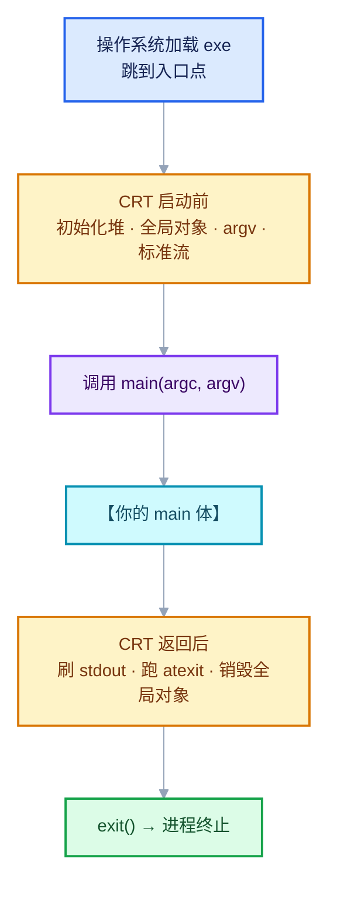
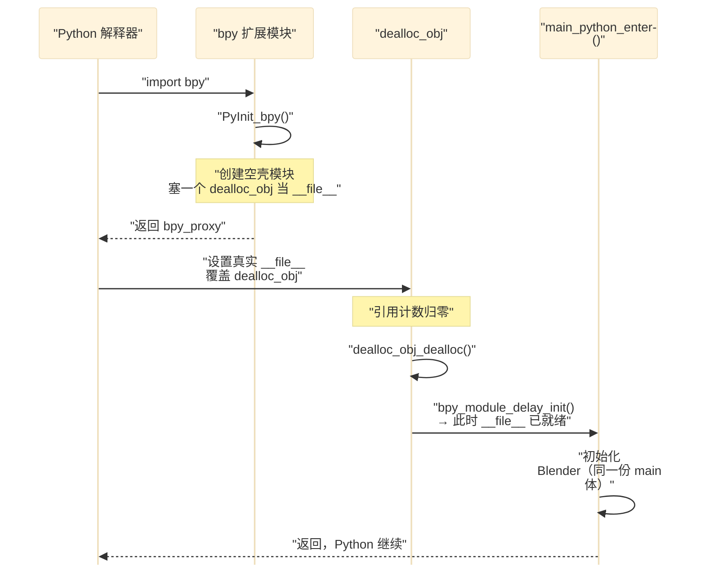
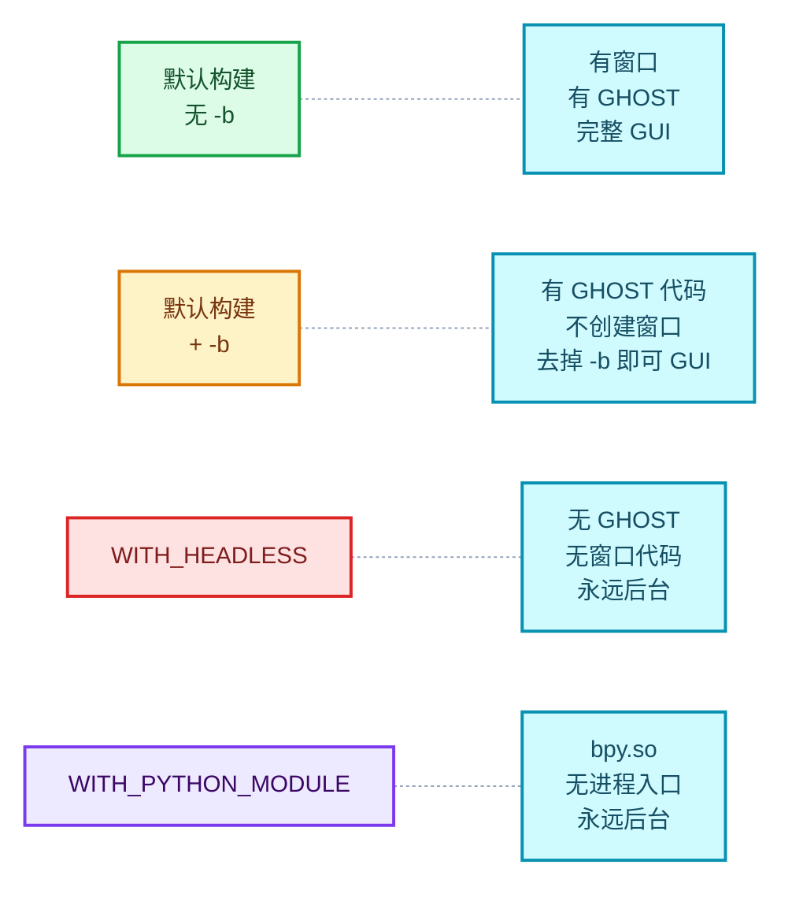
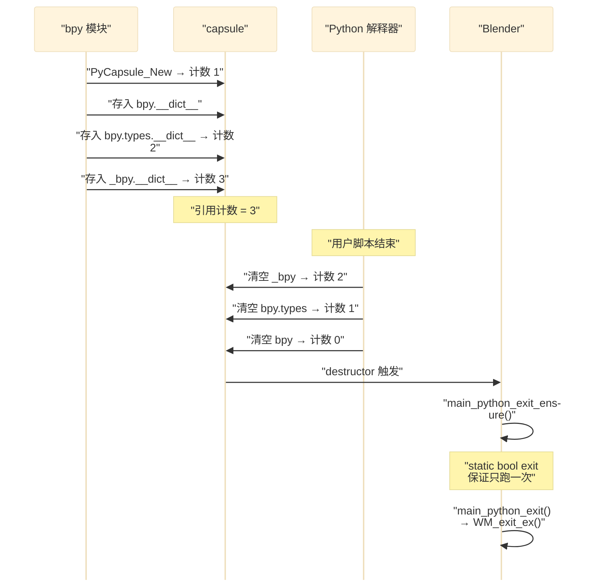

# WS-03 启动术语与构建形态详解

<div style="font-family:'Segoe UI','Microsoft YaHei',system-ui,-apple-system,sans-serif;display:flex;flex-wrap:wrap;align-items:center;gap:8px;margin:16px 0 20px;padding:10px 14px;background:#F8FAFC;border:1px solid #E2E8F0;border-radius:12px">
<span style="font-size:11px;font-weight:700;letter-spacing:.1em;color:#64748B;margin-right:2px">导航</span>
<a href="../README.md" style="font-size:13px;color:#334155;background:#F1F5F9;border:1px solid #E2E8F0;border-radius:999px;padding:3px 12px;text-decoration:none;white-space:nowrap">总入口</a>
<a href="./README.md" style="font-size:13px;color:#2563EB;background:#EFF6FF;border:1px solid #BFDBFE;border-radius:999px;padding:3px 12px;text-decoration:none;white-space:nowrap">本章 08-窗口系统与核心类型</a>
<a href="./02-main函数全文解析.md" style="font-size:13px;color:#7C3AED;background:#F5F3FF;border:1px solid #DDD6FE;border-radius:999px;padding:3px 12px;text-decoration:none;white-space:nowrap">‹ main函数全文解析</a>
</div>

<div style="font-family:'Segoe UI','Microsoft YaHei',system-ui,-apple-system,sans-serif;margin:18px 0 22px;padding:14px 18px;background:#F5F3FF;border-left:4px solid #7C3AED;border-radius:10px">

**基准说明**：Blender **5.4.0-alpha** 本地工作树 + MSVC **14.44.35207** 本机 CRT 源码。

本文是 [08-02](02-main函数全文解析.md) 的**配套术语手册**，专门解答读启动代码时
最常见的六类困惑：

1. `CRT` / `__scrt` / `SEH` 到底是什么，为什么命名风格不统一；
2. 调用栈里那些 `d:\a\_work\1\s\...` 路径为什么本机没有；
3. `main_python_enter` 到底在什么时候被调用；
4. `WITH_HEADLESS` 和 `-b` 的区别；
5. `GHOST` 是什么、为什么存在；
6. `-b` 和 `--background` 为什么不一致。

</div>

## §0 术语速查表

| 缩写 | 全称 | 中文 | 归属 |
| --- | --- | --- | --- |
| **CRT** | C Runtime | C 运行时库 | 微软 / C 标准 |
| **`__scrt`** | **s**tatic **C** **r**un**t**ime | 静态 CRT 实现 | MSVC 内部 |
| **SEH** | Structured Exception Handling | 结构化异常处理 | Windows 平台 |
| **GHOST** | Generic Handy Operating System Toolkit | 通用便利操作系统工具箱 | Blender 自研 |
| **POD** | Plain Old Data | 平凡旧数据 | C++ 语言 |
| **RNA** | RNA's Not DNA（自嘲式递归缩写） | Blender 运行时反射层 | Blender 自研 |
| **DNA** | （无官方展开） | Blender 可存盘数据结构 | Blender 自研 |
| **OCIO** | OpenColorIO | 开源色彩管理 | 第三方库 |

> **注意 GHOST 的全称**：不是 "Generic Handles Of System Technology"。
> 源码里的权威定义是 **"Generic Handy Operating System Toolkit"**，
> 见 [GHOST_ISystem.hh · L28-L30](../../../intern/ghost/GHOST_ISystem.hh#L28)。

<hr style="border:none;height:1px;background:linear-gradient(90deg,#BFDBFE,#E2E8F0 55%,transparent);margin:34px 0">

## §1 CRT 是什么

**CRT = C Runtime（C 运行时库）**。

每个 C/C++ 程序启动时，`main()` **不是操作系统直接调用的**。中间隔着一层库代码。

### §1.1 CRT 的完整职责



| 阶段 | CRT 做的事 | 对 Blender 的影响 |
| --- | --- | --- |
| **启动前** | 初始化堆（`malloc` 的基础） | 所以 `malloc` 在 `main` 里能用 |
| | 执行 C++ 全局对象构造 | `static Foo g_foo;` 在 `main` 前构造好 |
| | 解析命令行成 `argc/argv` | 但**是窄字符**，Blender 要自己重取 UTF-8 |
| | 打开 `stdin/stdout/stderr` | 所以 `printf` 能用 |
| | 初始化 `__security_init_cookie`（栈保护） | — |
| **调用** | `main(argc, argv)` | 进入 Blender |
| **返回后** | 刷 `stdout` 缓冲 | 缓冲模式下崩溃会丢最后一段输出 |
| | 运行 `atexit` 回调 | Blender 用自己的 `BKE_blender_atexit` 替代 |
| | 销毁全局对象 | — |

### §1.2 CRT 的三种版本

| 版本 | 库文件 | 特点 | 何时用 |
| --- | --- | --- | --- |
| Debug | `ucrtbased.dll` / `msvcrtd.lib` | 带断言、堆检查、无优化 | 开发调试 |
| Release | `ucrtbase.dll` / `msvcrt.lib` | 优化过 | 发布 |
| Static | 编译进 exe | 不依赖 DLL，体积大 | 便携版、特殊分发 |

> **从栈里认版本**：看到 `ucrtbased.dll`（末尾有 `d`）= Debug 构建。
> Blender 的调用栈里出现它，说明你跑的是 Debug 版。

### §1.3 与 Blender "自举依赖"的关系

[08-02 §4.5](02-main函数全文解析.md) 讲的分配器切换问题，根源就在这里：

```cpp
// creator.cc · L374-L377
/* NOTE: Can't use `guardedalloc` allocation here, as it's not yet initialized
 * (it depends on the arguments passed in, which is what we're getting here!). */
app_init_data.argv = static_cast<char **>(malloc(argc * sizeof(char *)));
```

**`malloc` 是 CRT 提供的，`MEM_mallocN` 是 Blender 建立在 CRT 之上的。**
所以"决定用哪个 Blender 分配器"的时候，只能用 CRT 的 `malloc`。

<hr style="border:none;height:1px;background:linear-gradient(90deg,#BFDBFE,#E2E8F0 55%,transparent);margin:34px 0">

## §2 `__scrt` 与 SEH

### §2.1 `__scrt` = static C runtime

| 前缀 | 含义 |
| --- | --- |
| `__scrt` | **s**tatic **C** **r**un**t**ime |
| `__cdecl` | x86 调用约定（参数从右往左压栈，调用方清栈） |
| `__forceinline` | 强制内联 |
| `__declspec(noinline)` | 强制不内联 |

**为什么叫 "static"**：这些函数**不是**在某个 DLL 里，而是被链接器**直接搬进
`blender.exe`**。所以：

- 栈上能看到准确函数名
- 调试器能加载到源码（在 PDB 里有记录）
- 每个 exe 都有一份副本（DLL 版本则是共享的）

**这解释了为什么 Blender 的调用栈底部能看到 CRT 源码行号**，
而 `tbb12_debug.dll` 那几帧只有裸地址。

### §2.2 SEH = Structured Exception Handling

**Windows 专有的异常处理机制**，比 C++ 的 `try/catch` 更底层。

| | C++ 异常 | SEH |
| --- | --- | --- |
| 语法 | `try { } catch (...) { }` | `__try { } __except (...) { }` |
| 标准 | ISO C++ | **Windows 扩展**（MSVC 专有） |
| 能捕获 `throw` | ✅ | ✅ |
| 能捕获**访问违例**（`0xC0000005`） | ❌ | ✅ |
| 能捕获除零、栈溢出 | ❌ | ✅ |
| 跨语言 | 否 | 是（C/C++/汇编通用） |
| 依赖 | 栈展开表（unwind tables） | OS 级异常链 |

**所以 `__scrt_common_main_seh` 的含义是**：

> "公共 main 实现中，**用 SEH 保护起来**的那一层"

### §2.3 真实源码：本机就有

你电脑上有这套源码，路径：

```
D:\Soft\Visual Studio\VC\Tools\MSVC\14.44.35207\crt\src\vcruntime\
    ├─ exe_main.cpp        ← mainCRTStartup
    └─ exe_common.inl      ← 其余全部
```

#### `exe_main.cpp` 全文骨架

```cpp
//
// exe_main.cpp
//
//      Copyright (c) Microsoft Corporation. All rights reserved.
//
// The mainCRTStartup() entry point, linked into client executables that
// uses main().
//
#define _SCRT_STARTUP_MAIN
#include "exe_common.inl"

extern "C" DWORD mainCRTStartup(LPVOID)
{
    return __scrt_common_main();
}
```

**两个关键点**：

1. **`#define _SCRT_STARTUP_MAIN`** — 这个宏决定 `exe_common.inl` 里
   哪一个 `invoke_main` 变体被编译（见 §2.4）
2. **`extern "C"`** — 必须禁掉 C++ name mangling。否则符号名会变成
   `?mainCRTStartup@@YAKPEAX@Z` 这类，**链接器找不到入口点**。

#### `__scrt_common_main_seh` 的真实实现

`exe_common.inl` · L235（节选，保留关键行）

```cpp
static __declspec(noinline) int __cdecl __scrt_common_main_seh()
{
    if (!__scrt_initialize_crt(__scrt_module_type::exe))
        __scrt_fastfail(FAST_FAIL_FATAL_APP_EXIT);

    bool has_cctor = false;
    __try                                                  // ← SEH 开始
    {
        bool const is_nested = __scrt_acquire_startup_lock();

        if (__scrt_current_native_startup_state == __scrt_native_startup_state::initializing)
        {
            __scrt_fastfail(FAST_FAIL_FATAL_APP_EXIT);
        }
        else if (__scrt_current_native_startup_state == __scrt_native_startup_state::uninitialized)
        {
            __scrt_current_native_startup_state = __scrt_native_startup_state::initializing;

            if (_initterm_e(__xi_a, __xi_z) != 0)          // ← C 全局初始化 + 失败检查
                return 255;

            _initterm(__xc_a, __xc_z);                     // ← ★ C++ 全局对象构造在这里

            __scrt_current_native_startup_state = __scrt_native_startup_state::initialized;
        }
        else
        {
            has_cctor = true;
        }

        __scrt_release_startup_lock(is_nested);

        /* 动态初始化的 __declspec(thread) 变量 */
        _tls_callback_type const* const tls_init_callback = __scrt_get_dyn_tls_init_callback();
        if (*tls_init_callback != nullptr && __scrt_is_nonwritable_in_current_image(tls_init_callback))
        {
            (*tls_init_callback)(nullptr, DLL_THREAD_ATTACH, nullptr);
        }

        /* 线程本地析构回调 */
        _tls_callback_type const * const tls_dtor_callback = __scrt_get_dyn_tls_dtor_callback();
        if (*tls_dtor_callback != nullptr && __scrt_is_nonwritable_in_current_image(tls_dtor_callback))
        {
            _register_thread_local_exe_atexit_callback(*tls_dtor_callback);
        }

        //
        // Initialization is complete; invoke main...
        //

        int const main_result = invoke_main();             // ← ★★★ 调你的 main

        //
        // main has returned; exit somehow...
        //

        if (!__scrt_is_managed_app())
            exit(main_result);                             // ← 刷缓冲 + atexit

        if (!has_cctor)
            _cexit();

        __scrt_uninitialize_crt(true, false);
        return main_result;
    }
    __except (_seh_filter_exe(GetExceptionCode(), GetExceptionInformation()))   // ← SEH 过滤器
    {
        // Note:  We should never reach this except clause.
        int const main_result = GetExceptionCode();

        if (!__scrt_is_managed_app())
            _exit(main_result);

        if (!has_cctor)
            _c_exit();

        return main_result;
    }
}
```

#### `__scrt_common_main` — 只有两件事

```cpp
// exe_common.inl · L323
static __forceinline int __cdecl __scrt_common_main()
{
    // The /GS security cookie must be initialized before any exception handling
    // targeting the current image is registered.  No function using exception
    // handling can be called in the current image until after this call:
    __security_init_cookie();

    return __scrt_common_main_seh();
}
```

**注释解释了一个顺序约束**：

> `/GS` 安全 cookie（栈溢出检测用）**必须在任何 SEH 注册之前初始化**。
> 因为 SEH 本身依赖 cookie 来检测栈破坏。

所以 `__scrt_common_main` 存在的唯一理由就是**把 cookie 初始化插在 SEH 之前**。

### §2.4 `_seh_filter_exe` 的返回值

```cpp
__except (_seh_filter_exe(GetExceptionCode(), GetExceptionInformation()))
```

`_seh_filter_exe` 决定「这个异常该不该被我处理」：

| 返回值 | 常量 | 含义 |
| --- | --- | --- |
| `1` | `EXCEPTION_EXECUTE_HANDLER` | **我处理**，进入 `__except` 块 |
| `0` | `EXCEPTION_CONTINUE_SEARCH` | 不归我管，向上抛 |
| `-1` | `EXCEPTION_CONTINUE_EXECUTION` | 忽略，从出错点继续执行 |

**实际行为**：对于致命错误（访问违例、栈溢出），它返回 `CONTINUE_SEARCH`，
于是异常被 **Windows 错误报告（WER）**接手 —— 你看到的"程序已停止工作"对话框。

**这就是为什么注释说 "We should never reach this except clause"**：
`__except` 块实际上是**理论上不可达的兜底**。

### §2.5 为什么命名风格不统一

```cpp
mainCRTStartup()                    // PascalCase，无分隔
__scrt_common_main_seh()            // 双下划线 + snake_case
__scrt_common_main()                // 同上
invoke_main()                       // snake_case，无前缀
```

**根本原因：四个函数属于三个不同的"命名域"。**

| 函数 | 归属 | 命名规矩 | 为什么 |
| --- | --- | --- | --- |
| `mainCRTStartup` | **操作系统 ABI 约定** | PascalCase | 符号名写死在链接器默认值里；Windows API 传统 |
| `__scrt_common_main_seh` | **CRT 内部实现** | `__` 前缀 + snake_case | `__` 表示"保留给实现" |
| `__scrt_common_main` | 同上 | 同上 | 同上 |
| `invoke_main` | **`static` 本地辅助** | snake_case | 只在本翻译单元可见，不会冲突，不需要前缀 |

#### 入口点符号是链接器约定的

| 入口点符号 | 用户函数 |
| --- | --- |
| `mainCRTStartup` | `int main(int, char**)` |
| `wmainCRTStartup` | `int wmain(int, wchar_t**)` |
| `WinMainCRTStartup` | `int WinMain(...)` |
| `wWinMainCRTStartup` | `int wWinMain(...)` |

**你改名成 `my_startup` 链接器就找不到入口**，除非显式 `/ENTRY:`。

#### `invoke_main` 是编译期多态

`exe_common.inl` 里有**多个** `invoke_main` 定义，由 `_SCRT_STARTUP_*` 宏选择：

```cpp
#if defined _SCRT_STARTUP_MAIN
    static int __cdecl invoke_main()
    {
        return main(__argc, __argv, _get_initial_narrow_environment());
    }
#elif defined _SCRT_STARTUP_WMAIN
    static int __cdecl invoke_main()
    {
        return wmain(__argc, __wargv, _get_initial_wide_environment());
    }
#elif defined _SCRT_STARTUP_WINMAIN
    static int __cdecl invoke_main()
    {
        return WinMain(reinterpret_cast<HINSTANCE>(&__ImageBase), nullptr,
                       _get_narrow_winmain_command_line(),
                       __scrt_get_show_window_mode());
    }
#elif defined _SCRT_STARTUP_WWINMAIN
    ...
```

**`invoke_main` 是"用 `#if` 实现的编译期多态"**——避免虚函数、避免模板、零运行时开销。

> Blender 走 `_SCRT_STARTUP_MAIN` 分支，所以拿到的是**窄字符 `char**`**。
> 这正是 Blender 必须在 [08-02 §2](02-main函数全文解析.md) 里
> 用 `GetCommandLineW()` 重新取参数的根本原因。

### §2.6 完整调用链（附真实行号）

```dml-ignore
mainCRTStartup            exe_main.cpp:17        ← 入口点（ABI 约定，PascalCase）
└─ __scrt_common_main()   exe_common.inl:323     ← __security_init_cookie + 转发
   └─ __scrt_common_main_seh()  exe_common.inl:235  ← SEH 保护 + CRT 初始化
      ├─ __scrt_initialize_crt()
      ├─ _initterm_e(__xi_a, __xi_z)              ← C 初始化 + 失败检查
      ├─ _initterm(__xc_a, __xc_z)                ← C++ 全局对象构造
      ├─ TLS 回调注册
      ├─ invoke_main()        exe_common.inl:288  ← 调你的 main
      │  └─ main(argc, argv)                      ← Blender 的 main()
      └─ exit(main_result)                        ← 刷缓冲 + atexit
```

**`_initterm` 两行值得记住**：它们遍历 `.CRT$XCU` 段的函数指针数组。
**这就是 C++ 全局对象构造函数被执行的地方**，也是为什么
"静态初始化顺序问题（static initialization order fiasco）"存在——
**顺序由链接器排列这些指针的顺序决定，跨翻译单元时未定义**。

这正是 Blender 坚持用显式 `xxx_init()` 而不用静态构造的原因
（详见 [08-02 §6](02-main函数全文解析.md)）。

### §2.7 为什么栈里是 `d:\a\_work\1\s\...`，本机却没有

**这是正常的。** 那个路径是**微软构建 CRT 时用的目录**：

```
_work        ← Azure Pipelines 流水线工作根目录
  1          ← 第 1 个 job
    s        ← sources（源码检出目录）
```

**为什么你的调试器会显示它**：PDB（调试符号文件）里记录了
"编译这个函数时的源文件路径"。调试器读到 PDB，如实显示，**但指向的是构建机的路径**。

#### 让调试器找到本机源码

**方法 A：微软符号服务器（推荐）**

```
工具 → 选项 → 调试 → 符号
  ✓ Microsoft 符号服务器（首次下载较慢，之后有缓存）

工具 → 选项 → 调试 → 常规
  ✓ 启用源服务器支持
  ✓ 要求源文件与原始版本完全匹配（可关闭以容忍路径差异）
```

**方法 B：手工路径映射**

```
调试 → 选项 → 调试 → 常规 → 取消"要求源文件与原始版本完全匹配"
右键栈帧 → "源文件路径映射"
  从: d:\a\_work\1\s\src\vctools\crt\
  到: D:\Soft\Visual Studio\VC\Tools\MSVC\14.44.35207\crt\
```

**注意**：微软内部目录结构和你拿到的**不完全一致**——
栈里是 `crt\vcstartup\src\startup\exe_main.cpp`，
你本机是 `crt\src\vcruntime\exe_main.cpp`。文件名相同，子目录不同。

#### 方法 C：直接打开读

最简单。既然路径映射烦，直接打开：

```
D:\Soft\Visual Studio\VC\Tools\MSVC\14.44.35207\crt\src\vcruntime\exe_common.inl
```

**这个文件只有 300 多行，是整个 exe 启动过程的全貌**，值得通读一遍。

<hr style="border:none;height:1px;background:linear-gradient(90deg,#BFDBFE,#E2E8F0 55%,transparent);margin:34px 0">

## §3 `main_python_enter` 什么时候调用

### §3.1 只有一条触发路径



### §3.2 代码逐段

#### ① `PyInit_bpy` — 造一个空壳

```cpp
// bpy_interface.cc · L1163
PyMODINIT_FUNC PyInit_bpy()
{
  if (!bpy_module_ensure_compatible_version()) {
    return nullptr;          /* 版本不匹配，错误已设置 */
  }

  /* Assign dummy type. */
  dealloc_obj_Type.tp_name = "dealloc_obj";
  dealloc_obj_Type.tp_basicsize = sizeof(dealloc_obj);
  dealloc_obj_Type.tp_dealloc = dealloc_obj_dealloc;
  dealloc_obj_Type.tp_flags = Py_TPFLAGS_DEFAULT;

  if (PyType_Ready(&dealloc_obj_Type) < 0) {
    return nullptr;
  }

  PyObject *bpy_proxy = PyModule_Create(&bpy_proxy_def);
  ...
  /* Assign an object which is freed after `__file__` is assigned. */
  dealloc_obj *dob;
  dob = (dealloc_obj *)dealloc_obj_Type.tp_alloc(&dealloc_obj_Type, 0);
  dob->mod = bpy_proxy;                                       /* borrow */
  PyModule_AddObject(bpy_proxy, "__file__", (PyObject *)dob); /* borrow */

  return bpy_proxy;
}
```

#### ② 为什么要绕这一圈

源码注释（L1181-L1193）列了三个问题：

```cpp
/* Problem:
 * 1) This initializing function is expected to have a private member defined - `md_def`
 *    but this is only set for CAPI defined modules (not Python packages)
 *    so we can't return `bpy_package_py` as is.
 *
 * 2) There is a `bpy` CAPI module for python to load which is basically all of blender,
 *    and there is `scripts/bpy/__init__.py`,
 *    we may end up having to rename this module so there is no naming conflict here eg:
 *    `from blender import bpy`
 *
 * 3) We don't know the file-path at this point, workaround by assigning a dummy value
 *    which calls back when its freed so the real loading can take place.
 */
```

| # | 问题 | 对策 |
| --- | --- | --- |
| 1 | `bpy` 实际是 Python **包**（`scripts/bpy/__init__.py`），不是纯 C 模块 | 先返回 C 空壳，稍后合并包的 dict |
| 2 | 存在两个 `bpy`（CAPI 的 / Python 包的） | 用 `PyDict_Update` 合并 |
| 3 | **`PyInit_bpy` 时不知道模块磁盘路径** | 用"析构时回调"的假对象占位 `__file__` |

**第 3 条是核心。** `main_python_enter` 需要 `argv[0]` = 模块路径
（用于 `BKE_appdir` 定位资源目录），但 `PyInit_bpy` 被调用时
Python **还没设置 `__file__`**。

#### ③ 精妙的时序利用

```dml-ignore
PyInit_bpy 返回 bpy_proxy（__file__ 是假的 dealloc_obj）
  ↓
Python 的 import 机制设置真实 __file__
  ↓
假对象被覆盖 → 引用计数归零
  ↓
dealloc_obj_dealloc() 被调用        bpy_interface.cc:1152
  ↓
bpy_module_delay_init(mod)          :1154
  ├─ PyModule_GetFilenameObject()   ← 此时拿到真实路径！
  ├─ argv[0] = filepath_abs
  ├─ main_python_enter(argc, argv)  :1088  ★★★
  ├─ PyDict_Update(合并 bpy_package_py 的 dict)
  └─ 给 bpy / bpy.types / _bpy 各塞一个 capsule
```

**这就是答案：`main_python_enter` 在"Python 第一次 import bpy 时、
`__file__` 刚被设置好"那一瞬间被调用。**

#### ④ 延迟初始化的代码

```cpp
// bpy_interface.cc · L1069
static void bpy_module_delay_init(PyObject *bpy_proxy)
{
  const int argc = 1;
  const char *argv[2];

  /* Updating the module dict below will lose the reference to `__file__`. */
  PyObject *filepath_obj = PyModule_GetFilenameObject(bpy_proxy);

  /* The file can be a relative path. */
  const char *filepath_rel = PyUnicode_AsUTF8(filepath_obj);
  char filepath_abs[1024];

  STRNCPY(filepath_abs, filepath_rel);
  BLI_path_abs_from_cwd(filepath_abs, sizeof(filepath_abs));
  Py_DECREF(filepath_obj);

  argv[0] = filepath_abs;
  argv[1] = nullptr;

  main_python_enter(argc, argv);          // ← L1088 ★

  /* Initialized in #BPy_init_modules(). */
  PyDict_Update(PyModule_GetDict(bpy_proxy), PyModule_GetDict(bpy_package_py));

  {
    /* Modules which themselves require access to Blender
     * allocated resources to be freed should be included in this list. ... */
    const char *bpy_modules_array[] = {
        "bpy.types",
        "_bpy",
    };
    PyObject *sys_modules = PyImport_GetModuleDict();
    for (int i = 0; i < ARRAY_SIZE(bpy_modules_array); i++) {
      PyObject *mod = PyDict_GetItemString(sys_modules, bpy_modules_array[i]);
      BLI_assert(mod);
      bpy_detect_exit_singleton_add_to_module(mod);
    }
  }
}
```

**注意 `argc = 1`**——**只有 `argv[0]` 一个参数，没有任何命令行参数**。
这是模块模式的本质：宿主程序控制一切，Blender 不该解析命令行。

### §3.3 只调用一次

**不是在 `import bpy` 的每一处都调**，而是**第一次 import 时一次**。
之后 `import bpy` 直接从 `sys.modules` 取缓存对象，零成本。

### §3.4 退出时：双保险

```cpp
// bpy_interface.cc · L1205
static void bpy_module_free(void * /*mod*/)
{
  main_python_exit_ensure();
}
```

```cpp
// bpy_interface.cc · L1001
static void bpy_detect_exit_singleton_cleanup(PyObject * /*capsule*/)
{
  main_python_exit_ensure();
}
```

```cpp
// bpy_interface.cc · L1040
static void main_python_exit_ensure()
{
  static bool exit = false;
  if (exit) { return; }
  exit = true;
  main_python_exit();
}
```

**两条路都通向 `main_python_exit_ensure`，靠 `static bool exit` 保证幂等。**

| 路径 | 可靠性 |
| --- | --- |
| `bpy_module_free`（`m_free`） | Python **不保证**调用 |
| capsule 析构 | Python **保证**清空命名空间 → 一定触发 |

**所以 capsule 是主路径，`m_free` 是补充。**

### §3.5 三种"进入 Blender"的对照

| 触发 | 入口函数 | 触发时机 | 有窗口 |
| --- | --- | --- | --- |
| `blender.exe` 双击 | `main()`（经 CRT 链） | 进程启动 | ✅ |
| `python -c "import bpy"` | `main_python_enter()` | **第一次 import bpy** | ❌ |
| Blender 内 `--python x.py` | 无独立入口 | `ARG_PASS_FINAL` | ✅ |

<hr style="border:none;height:1px;background:linear-gradient(90deg,#BFDBFE,#E2E8F0 55%,transparent);margin:34px 0">

## §4 `WITH_HEADLESS` 与 `-b` 的区别

### §4.1 一句话

| | `WITH_HEADLESS` | `-b` / `--background` |
| --- | --- | --- |
| 层级 | **编译时** | **运行时** |
| 本质 | **根本没有窗口代码** | **有窗口代码，只是不创建窗口** |

### §4.2 详细对比

| 维度 | `WITH_HEADLESS=ON` | `-b` |
| --- | --- | --- |
| 何时决定 | `cmake -DWITH_HEADLESS=ON` | 每次启动时 |
| GHOST 编进来吗 | ❌ **完全没有** | ✅ 有 |
| `g_system` | 永远 `nullptr` | 后台模式下也是 `nullptr`（不初始化） |
| 能切成 GUI 吗 | ❌ **永远不能** | ✅ 去掉 `-b` 就行 |
| 产物大小 | 更小 | 一样 |
| 依赖库 | 不需要 X11 / Wayland / Cocoa | 需要 |
| 谁设 `G.background` | `#if` **强制** `= true` | 命令行回调设 |

### §4.3 代码证据

#### `WITH_HEADLESS` 强制后台（creator.cc L588）

```cpp
#if defined(WITH_PYTHON_MODULE) || defined(WITH_HEADLESS)
  /* Python module mode ALWAYS runs in background-mode (for now). */
  G.background = true;
  /* Manually using `--background` also forces the audio device. */
  BKE_sound_force_device("None");
#else
  if (G.background) {
    main_signal_setup_background();
  }
#endif
```

**注意这是 `#if`（编译期）而不是 `if`（运行期）**——`WITH_HEADLESS` 构建设有
GUI 分支的任何代码。

#### `-b` 是运行时回调（creator_args.cc L3191）

```cpp
BLI_args_add(ba, "-b", "--background", CB(arg_handle_background_mode_set), nullptr);
```

```cpp
// creator_args.cc · L1089
/** Shared by `--background` & `--command`. */
static void background_mode_set()
{
  G.background = true;

  /* Background Mode Defaults:
   *
   * In general background mode should strive to match the behavior of running
   * Blender inside a graphical session, any exception to this should have a well
   * justified reason and be noted in the docstring. */
  ...
  BKE_sound_force_device("None");
}
```

### §4.4 编译期裁剪有多彻底

#### ① CMake 强制关掉所有窗口后端（CMakeLists.txt L1392-L1407）

```cmake
set_and_warn_incompatible(WITH_HEADLESS WITH_GHOST_WAYLAND OFF)
set_and_warn_incompatible(WITH_HEADLESS WITH_GHOST_X11 OFF)
set_and_warn_incompatible(WITH_HEADLESS WITH_GHOST_DBUS OFF)
set_and_warn_incompatible(WITH_HEADLESS WITH_GHOST_SDL OFF)
set_and_warn_incompatible(WITH_HEADLESS WITH_INPUT_IME OFF)
set_and_warn_incompatible(WITH_HEADLESS WITH_XR_OPENXR OFF)
```

连**输入法（IME）**和**XR**都被关掉——它们都依赖窗口系统。

#### ② 源码里整段裁掉 UI 代码

```
wm_cursors.cc:38      #ifndef WITH_HEADLESS
wm_cursors.cc:222     #ifdef WITH_HEADLESS       ← 提供空实现
wm_cursors.cc:264     #endif
wm_cursors.cc:967     #ifndef WITH_HEADLESS
wm_splash_screen.cc:86    #ifndef WITH_HEADLESS
wm_splash_screen.cc:176   #endif
wm_splash_screen.cc:229   #ifndef WITH_HEADLESS
wm_splash_screen.cc:244   #ifndef WITH_HEADLESS
wm_splash_screen.cc:298   #ifndef WITH_HEADLESS
```

**`wm_cursors.cc:222` 那个 `#ifdef WITH_HEADLESS` 很关键**：它提供**光标的空实现**
（返回 `nullptr` 或什么都不做），这样其他代码调用光标 API 时不会**链接失败**。

### §4.5 为什么需要 `WITH_HEADLESS`（`-b` 不够）

| 场景 | 为什么 `-b` 不够 |
| --- | --- |
| Docker 容器（无 X11/Wayland） | `-b` 仍需要**编译时链接** X11 库；运行时会因 `dlopen` 失败报错 |
| 精简嵌入式系统 | 想减小二进制体积 |
| 渲染农场 | 不想在每台机器装 GUI 依赖 |
| 交叉编译 | 目标平台根本没有窗口系统 |

**核心区别**：

```dml-ignore
-b              = "不要创建窗口"（但能力还在，库依赖还在）
WITH_HEADLESS   = "根本没有创建窗口的能力"（代码和依赖都被删了）
```

### §4.6 三种构建形态



<hr style="border:none;height:1px;background:linear-gradient(90deg,#BFDBFE,#E2E8F0 55%,transparent);margin:34px 0">

## §5 GHOST 是什么

### §5.1 权威定义（源码原文）

[GHOST_ISystem.hh · L28-L40](../../../intern/ghost/GHOST_ISystem.hh#L28)

```cpp
/**
 * \page GHOSTPage GHOST
 *
 * \section intro Introduction
 *
 * GHOST is yet another acronym. It stands for "Generic Handy Operating System
 * Toolkit". It has been created to replace the OpenGL utility tool kit
 * <a href="http://www.opengl.org/resources/libraries/glut/">GLUT</a>.
 * GLUT was used in <a href="http://www.blender3d.com">Blender</a> until the
 * point that Blender needed to be ported to Apple's Mac OSX. Blender needed
 * a number of modifications in GLUT to work but the GLUT sources for OSX were
 * unavailable at the time. The decision was made to build our own replacement
 * for GLUT. In those days, NaN Technologies BV was the company that developed
 * Blender.
 * ...
 */
```

**GHOST = Generic Handy Operating System Toolkit**（通用便利操作系统工具箱）。

> **纠正一个常见误记**：不是 "Generic Handles Of System Technology"。

### §5.2 为什么存在（历史）

| 时期 | 状态 |
| --- | --- |
| 早期 | Blender 用 **GLUT**（OpenGL Utility Toolkit）处理窗口和输入 |
| 2001 前后 | Blender 要移植到 **macOS**（当时叫 Mac OS X） |
| 障碍 | GLUT 需要改动才能工作，但 **macOS 版 GLUT 源码拿不到** |
| 决定 | **自己写替代品** → GHOST |
| 公司 | NaN Technologies BV（当时 Blender 的母公司） |

**关键洞察**：GHOST 不是"为了抽象而抽象"，是**被平台移植逼出来的**。

### §5.3 它提供什么

源码注释的清单（L41-L53）：

| 能力 | 说明 | 对应 Blender 模块 |
| --- | --- | --- |
| **时间 / 定时器管理** | 定时器任务 | `wmTimer` |
| **显示 / 窗口管理** | 窗口只在主显示器创建 | `wmWindow` |
| **事件管理** | 键盘/鼠标/触摸 | `wmEvent` |
| **光标形状管理** | 标准光标（不支持自定义） | `wm_cursors.cc` |
| **键鼠状态访问** | 当前按键状态 | — |
| **窗口菜单** | 部分实现（work in progress） | — |
| **视频模式切换** | 全屏等 | — |
| **剪贴板** | 复制粘贴 | — |
| **系统路径** | 用户目录、临时目录 | `BKE_appdir` |

**注意注释里说「字体管理已移到单独库」** —— 那是 `BLF`（Blender Font），
在 `WM_init` 里 `BLF_init()` 初始化。

### §5.4 支持的平台

```
 * - macOS Cocoa.
 * - Microsoft Windows.
 * - X11 (Linux).
 * - Wayland (Linux).
 * - SDL3.
 * - null (headless mode).
```

| 平台 | 实现类 |
| --- | --- |
| Windows | `GHOST_SystemWin32` |
| macOS | `GHOST_SystemCocoa` |
| X11 | `GHOST_SystemX11` |
| Wayland | `GHOST_SystemWayland` |
| SDL3 | `GHOST_SystemSDL` |
| 无头 | `GHOST_SystemNULL` / headless |

**"null (headless mode)" 这一条直接对应 `WITH_HEADLESS`** —— 提供一个什么都不做的实现。

### §5.5 核心接口

`intern/ghost/` 下的 `GHOST_I*.hh` 就是接口：

| 接口 | 职责 |
| --- | --- |
| `GHOST_ISystem` | **系统级**：创建/销毁窗口、事件循环、定时器、路径 |
| `GHOST_IWindow` | **窗口级**：大小、标题、光标、上下文、事件队列 |
| `GHOST_IContext` | **GPU 上下文**：OpenGL / Vulkan / Metal |
| `GHOST_IEvent` | 事件对象 |
| `GHOST_IEventConsumer` | 事件消费者（回调注册） |
| `GHOST_ITimerTask` | 定时器任务 |
| `GHOST_Types.hh` | 枚举与类型定义 |

### §5.6 在 Blender 里的位置

```dml-ignore
wmWindow（DNA，可存盘）
   └─ runtime->ghostwin  →  GHOST_IWindow*    ← 真正的 OS 窗口

g_system（wm_window.cc 的 static 全局）
   →  GHOST_ISystem*                          ← 系统单例
```

**`ghostwin` 为什么不进 DNA**：它是操作系统资源句柄，无法序列化。
`.blend` 里存"窗口大小、位置、显示哪个场景"，**不存"那个 OS 窗口对象"**。

### §5.7 初始化过程

```cpp
// wm_window.cc · L2301
void wm_ghost_init(bContext *C)
{
  if (g_system) { return; }        // 幂等，只初始化一次

  BLI_assert(C != nullptr);
  BLI_assert_msg(!G.background, "Use wm_ghost_init_background instead");

  GHOST_CallbackEventConsumer *ghost_event_consumer = new GHOST_CallbackEventConsumer(
      ghost_event_proc, C);                       // ← 回调里带着 C
  GHOST_ISystem::setBacktraceFn(BLI_system_backtrace);
  GHOST_ISystem::setUseWindowFrame(wm_init_state.window_frame);

  GHOST_ISystem::createSystem();                  // ← 创建具体平台实现
  g_system = GHOST_ISystem::getSystem();          // ← 取全局单例
  GPU_backend_ghost_system_set(g_system);         // ← GPU 后端也知道 GHOST

  if (g_system == nullptr) [[unlikely]] {
    /* GHOST will have reported the back-ends that failed to load. */
    CLOG_STR_ERROR(&LOG_GHOST_SYSTEM, "Unable to initialize GHOST, exiting!");
    /* This will leak memory, it's preferable to crashing. */
    exit(EXIT_FAILURE);
  }
  ...
  g_system->addEventConsumer(ghost_event_consumer);
```

**四个值得注意的点**：

| 行 | 含义 |
| --- | --- |
| `if (g_system) { return; }` | 幂等，多次调用安全 |
| `BLI_assert_msg(!G.background, "Use wm_ghost_init_background instead")` | **后台模式不该走这里** |
| `new GHOST_CallbackEventConsumer(ghost_event_proc, C)` | **「it assigns C to ghost」的具体位置**（见 08-02 §10.2） |
| `/* This will leak memory, it's preferable to crashing. */` | 诚实：宁愿泄漏也不崩 |

### §5.8 与 `WM_main` 的接口

回顾 [08-01](01-WM主循环与核心数据类.md) 的 `wm_window_events_process`：

```cpp
bool has_event = g_system->processEvents(false);   // ← GHOST 抽事件（非阻塞）
if (has_event) {
  g_system->dispatchEvents();                       // ← GHOST 派发给回调
}
```

**主循环第一步「采集事件」就是调 GHOST。** `g_system` 就是上节初始化的那个。

<hr style="border:none;height:1px;background:linear-gradient(90deg,#BFDBFE,#E2E8F0 55%,transparent);margin:34px 0">

## §6 为什么 `-b` 和 `--background` 不一致

### §6.1 先看注册代码：两者完全等价

```cpp
// creator_args.cc · L3191
BLI_args_add(ba, "-b", "--background", CB(arg_handle_background_mode_set), nullptr);
```

函数签名（[BLI_args.hh · L44](../../../source/blender/blenlib/BLI_args.hh#L44)）：

```cpp
/**
 * Pass short_arg or long_arg can be null to specify no short or long versions
 */
void BLI_args_add(struct bArgs *ba,
                  const char *short_arg,
                  const char *long_arg,
                  const char *doc,
                  BA_ArgCallback cb,
                  void *data);
```

**短名和长名指向同一个回调，行为完全一样。**

### §6.2 为什么短名是 `-b`

`b` = **b**ackground 的首字母。但更重要的是**历史原因**：

| 年代 | 命令行风格 |
| --- | --- |
| 1990s–2000s | 单字母参数（Unix 传统：`ls -l`、`tar -xvf`） |
| 2010s 后 | 逐步补充 GNU 风格的 `--long-option` 别名 |

**为什么不改成两个字母**（如 `-bg`）：**会破坏兼容性**。
全世界有海量脚本写着 `blender -b`。**Blender 的策略是：新名字加，旧名字永久保留。**

### §6.3 完整短名/长名对照表

| 短名 | 长名 | 短名从哪来 | 语义类别 |
| --- | --- | --- | --- |
| `-b` | `--background` | **b**ackground | 模式 |
| `-a` | `--render-anim` | **a**nimation | 动作 |
| `-f` | `--render-frame` | **f**rame | 动作 |
| `-S` | `--scene` | **S**cene | 目标 |
| `-s` | `--frame-start` | **s**tart | 范围 |
| `-e` | `--frame-end` | **e**nd | 范围 |
| `-j` | `--frame-jump` | **j**ump | 范围 |
| `-o` | `--render-output` | **o**utput | 输出 |
| `-E` | `--engine` | **E**ngine | 输出 |
| `-F` | `--render-format` | **F**ormat | 输出 |
| `-P` | `--python` | **P**ython | 脚本 |
| `-c` | `--command` | **c**ommand | 命令 |
| `-t` | （无长名） | **t**hreads | 性能 |
| `-d` | `--debug` | **d**ebug | 诊断 |
| `-noaudio` | （无短名） | — | 音频 |

### §6.4 三处"不一致"的典型

#### ① `-b` vs `--background`：缩略 vs 全词

短名取首字母（`b`），长名用完整单词（`background`）。
**短名求"短且好记"，长名求"自解释"。优化目标不同，必然不一致。**

#### ② `-a` vs `--render-anim`：名词 vs 动宾

`-a` 只取了 animation 的首字母；长名写成 `render-anim`（渲染动画）。
**长名多了 `render-` 前缀，说明"做什么"，而不只是"操作对象"。**

同理 `-f` vs `--render-frame`。

#### ③ `-S` 与 `-s` 大小写区分

| 参数 | 含义 |
| --- | --- |
| `-S`（大写） | **s**cene（场景） |
| `-s`（小写） | frame **s**tart（起始帧） |

**这类大小写区分是 Unix 早期风格**（如 `-h` 与 `-H` 语义不同）。
今天已很少见，但 Blender 保留 —— 因为改了就破坏兼容。

### §6.5 记忆技巧

| 类型 | 规律 |
| --- | --- |
| 大写短名 | 大多是**名词**（`-S` scene、`-E` engine、`-F` format、`-P` python） |
| 小写短名 | 大多是**动词/属性**（`-b` background、`-a` anim、`-f` frame、`-s` start、`-e` end） |
| 长名 | 一律"完整单词 + 连字符"（`--render-anim`） |

**但这只是经验规律，不是规则**（`-c` command 是小写名词）。

<hr style="border:none;height:1px;background:linear-gradient(90deg,#BFDBFE,#E2E8F0 55%,transparent);margin:34px 0">

## §7 pyCapsule 与退出检测

### §7.1 PyCapsule 是什么

**PyCapsule 是 Python C API 提供的一种「不透明指针容器」。**

```c
PyObject *PyCapsule_New(void *pointer, const char *name, PyCapsule_Destructor destructor);
```

| 参数 | 含义 |
| --- | --- |
| `pointer` | 任意 C 指针（可以是 `void*`） |
| `name` | 字符串标识（用于类型检查） |
| `destructor` | **capsule 被回收时调用的函数** |

### §7.2 Blender 的非常规用法

```cpp
// bpy_interface.cc · L1006-L1028
static void bpy_detect_exit_singleton_add_to_module(PyObject *mod)
{
  static PyObject *singleton = nullptr;

  const char *bpy_detect_exit_singleton_id = "_bpy_detect_exit_singleton";
  if (singleton == nullptr) {
    /* This is ignored, but must be non-null,
     * set an address that is non-null and easily identifiable. */
    void *pointer = reinterpret_cast<void *>(uintptr_t(-1));   // ← 假指针！
    singleton = PyCapsule_New(
        pointer, bpy_detect_exit_singleton_id, bpy_detect_exit_singleton_cleanup);
    BLI_assert(singleton);
  }
  else {
    Py_INCREF(singleton);      // 已存在就加引用计数
  }
  PyModule_AddObject(mod, bpy_detect_exit_singleton_id, singleton);
}
```

**注意 `pointer = (void*)-1`**：

> *"This is ignored, but must be non-null, set an address that is non-null and easily identifiable."*

**它不指向任何东西。** `PyCapsule_New` 要求非空，所以塞个 `-1` 糊弄。
这个 capsule 的唯一用途是**提供析构回调的触发点**。

### §7.3 为什么需要这个机制

源码注释（L986-L997）讲得很清楚：

```cpp
/* -------------------------------------------------------------------- */
/** \name Detect Exit Singleton
 *
 * Python does not reliably free all modules on exit.
 * This means we can't rely on #PyModuleDef::m_free running to clean-up
 * Blender data when Python exits.
 *
 * However Python *does* reliably clear the modules name-space.
 * Store a singleton in modules which may reference Blender owned memory,
 * calling #main_python_exit once the singleton has been cleared from the
 * name-space of all modules.
 * \{ */
```

| 事实 | 后果 |
| --- | --- |
| Python **不保证**调用模块的 `m_free` | 不能用 `m_free` 收尾 |
| Python **保证**清空模块命名空间 | 可以用"命名空间里对象析构"来收尾 |

### §7.4 引用计数时序



### §7.5 其他常见 capsule 用途（对照）

| 用途 | 例子 |
| --- | --- |
| 传递 C 指针 | `numpy` 的 `PyArrayInterface` |
| 跨扩展传递 C API 表 | `CPython` 的 `datetime` C API |
| **保存析构回调** | **Blender 这里** |
| 绑定第三方库对象 | `_ssl` 的 `SSL_CTX` 包装 |

## §8 一张总表：三种构建 × 三种启动

| 构建产物 | 启动方式 | 入口 | `G.background` | 有窗口 |
| --- | --- | --- | --- | --- |
| `blender`（默认） | 双击 / 终端 | `main()` | `false` | ✅ |
| `blender`（默认） | `blender -b` | `main()` | `true` | ❌ |
| `blender`（默认） | Blender 内 `--python` | 无（环境已建好） | 依当前模式 | 依当前模式 |
| `blender`（`WITH_HEADLESS`） | 终端 | `main()` | **强制 `true`** | ❌ **不可能** |
| `bpy.so` / `bpy.pyd` | `import bpy` | `main_python_enter()` | **强制 `true`** | ❌ **不可能** |

## 附录：源码索引

| 符号 | 文件 | 行 |
| --- | --- | --- |
| `mainCRTStartup` | `%VS%\VC\Tools\MSVC\*\crt\src\vcruntime\exe_main.cpp` | 17 |
| `__scrt_common_main` | 同上目录 `exe_common.inl` | 323 |
| `__scrt_common_main_seh` | 同上 | 235 |
| `invoke_main` 各变体 | 同上 | 76 / 88 / 100 / 116 / 133 |
| `invoke_main()` 调用点 | 同上 | 288 |
| `_initterm` / `_initterm_e` | 同上 | 256 / 254 |
| `_seh_filter_exe` | 同上 | 304 |
| GHOST 官方定义注释 | intern/ghost/GHOST_ISystem.hh | 28-70 |
| `PyInit_bpy` | source/blender/python/intern/bpy_interface.cc | 1163 |
| `dealloc_obj_dealloc` | 同上 | 1152 |
| `bpy_module_delay_init` | 同上 | 1069 |
| `main_python_enter` 调用 | 同上 | 1088 |
| `main_python_exit_ensure` | 同上 | 1040 |
| capsule 创建 | 同上 | 1006-1028 |
| `bpy_module_free` | 同上 | 1205 |
| `b_modules` inittab | 同上 | 320 |
| `BPY_python_start` | 同上 | 374 |
| `WITH_HEADLESS` 选项 | CMakeLists.txt | 389 |
| `WITH_HEADLESS` 依赖关闭 | CMakeLists.txt | 1392-1407 |
| `wm_ghost_init` | source/blender/windowmanager/intern/wm_window.cc | 2301 |
| 光标 `#ifdef WITH_HEADLESS` 空实现 | source/blender/windowmanager/intern/wm_cursors.cc | 222 |
| `-b` / `--background` 注册 | source/creator/creator_args.cc | 3191 |
| `background_mode_set` | source/creator/creator_args.cc | 1089 |
| `BLI_args_add` 文档 | source/blender/blenlib/BLI_args.hh | 40-49 |

## 附录二：三分钟自测

**CRT / SEH**

1. CRT 在 `main` 之前做了哪四件事？在 `main` 之后又做了什么？
2. `__scrt` 的 "static" 指什么？为什么这决定了栈上能看到源码行号？
3. SEH 和 C++ `try/catch` 最大的区别是什么？举一个 SEH 能捕获而 C++ 不能的例子。
4. `_initterm(__xc_a, __xc_z)` 在做什么？为什么它导致了"静态初始化顺序问题"？
5. `__scrt_common_main` 只有两行实质代码，为什么它必须存在？
6. `mainCRTStartup` 为什么必须 `extern "C"`？
7. 为什么栈里 `d:\a\_work\1\s\...` 你本机没有？怎么让调试器找到源码？

**main_python_enter**

8. `main_python_enter` 被调用几次？由谁调用？
9. 为什么 `PyInit_bpy` 不能直接调它？用了什么 trick 延迟？
10. 为什么退出检测用 capsule 而不是 `m_free`？

**构建形态**

11. `WITH_HEADLESS` 和 `-b` 的本质区别是什么？
12. 为什么 Docker 里必须用 `WITH_HEADLESS` 而不能只加 `-b`？
13. `wm_cursors.cc` 里 `#ifdef WITH_HEADLESS` 那段空实现是干什么用的？

**GHOST**

14. GHOST 全称是什么？为什么 Blender 要自己写它而不是用 GLUT？
15. `ghostwin` 为什么不能进 DNA？
16. `wm_ghost_init` 里 `GHOST_CallbackEventConsumer(ghost_event_proc, C)` 那行，
    和 08-02 里「it assigns C to ghost」是什么关系？

**命令行**

17. `-b` 和 `--background` 是同一个参数吗？为什么短名和长名不一致？
18. `-S` 和 `-s` 分别是什么？为什么用大小写区分？

<div style="font-family:'Segoe UI','Microsoft YaHei',system-ui,-apple-system,sans-serif;margin:38px 0 4px;padding:13px 16px;background:#F8FAFC;border:1px solid #E2E8F0;border-radius:12px;display:flex;flex-wrap:wrap;align-items:center;gap:8px">
<span style="font-size:11px;font-weight:700;letter-spacing:.1em;color:#64748B;margin-right:2px">继续阅读</span>
<a href="../README.md" style="font-size:13px;color:#334155;background:#F1F5F9;border:1px solid #E2E8F0;border-radius:999px;padding:3px 12px;text-decoration:none;white-space:nowrap">总入口</a>
<a href="./02-main函数全文解析.md" style="font-size:13px;color:#2563EB;background:#EFF6FF;border:1px solid #BFDBFE;border-radius:999px;padding:3px 12px;text-decoration:none;white-space:nowrap">‹ main函数全文解析</a>
<span style="font-size:13px;color:#334155;background:#F1F5F9;border:1px solid #E2E8F0;border-radius:999px;padding:3px 12px;text-decoration:none;white-space:nowrap">回到顶部</span>
</div>
