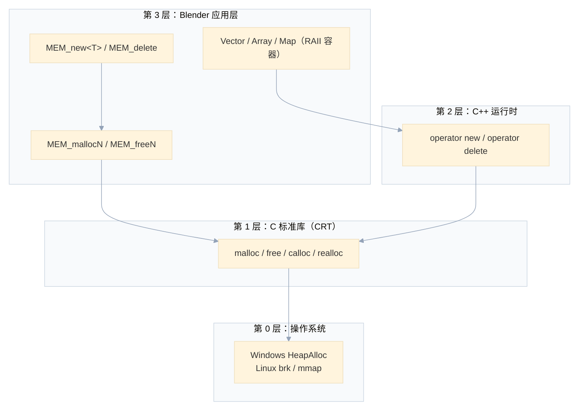
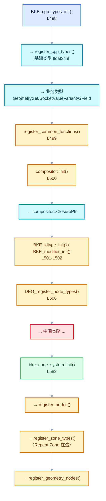

# WS-05 内存模型、Global 与类型注册

<div style="font-family:'Segoe UI','Microsoft YaHei',system-ui,-apple-system,sans-serif;display:flex;flex-wrap:wrap;align-items:center;gap:8px;margin:16px 0 20px;padding:10px 14px;background:#F8FAFC;border:1px solid #E2E8F0;border-radius:12px">
<span style="font-size:11px;font-weight:700;letter-spacing:.1em;color:#64748B;margin-right:2px">导航</span>
<a href="../README.md" style="font-size:13px;color:#334155;background:#F1F5F9;border:1px solid #E2E8F0;border-radius:999px;padding:3px 12px;text-decoration:none;white-space:nowrap">总入口</a>
<a href="./README.md" style="font-size:13px;color:#2563EB;background:#EFF6FF;border:1px solid #BFDBFE;border-radius:999px;padding:3px 12px;text-decoration:none;white-space:nowrap">本章 08-窗口系统与核心类型</a>
<a href="./04-inl与调用约定与命名约束.md" style="font-size:13px;color:#7A3AED;background:#F5F3FF;border:1px solid #DDD6FE;border-radius:999px;padding:3px 12px;text-decoration:none;white-space:nowrap">‹ .inl、调用约定与命名约束</a>
</div>

<div style="font-family:'Segoe UI','Microsoft YaHei',system-ui,-apple-system,sans-serif;margin:18px 0 22px;padding:14px 18px;background:#F5F3FF;border-left:4px solid #7C3AED;border-radius:10px">

**基准说明**：Blender **5.4.0-alpha** 本地工作树。

本文回答三层问题：

1. **内存层**：`malloc` 是谁实现的？和 `new` 有什么区别？Blender 的 `MEM_*` 又是什么关系？
2. **全局状态层**：`Global` 是什么？`G_MAIN` 宏为什么存在？
3. **类型注册层**：`CPPType` 是什么？为什么有多个同名 `register_cpp_types`？

</div>

## §0 三层内存体系：一张图先建立框架

很多人会被 `malloc` / `new` / `MEM_new` 的关系搞晕。先看全貌：



**关键点：`malloc` 是 C 标准库（CRT）提供的，不是操作系统直接给的。**
CRT 的 `malloc` 再向操作系统要内存（Windows 上是 `HeapAlloc`，Linux 上是 `brk`/`mmap`）。

**Blender 的 `MEM_*` 全部最终都落在 `malloc` 上**——只是加了记账、哨兵、泄漏检测。

<hr style="border:none;height:1px;background:linear-gradient(90deg,#BFDBFE,#E2E8F0 55%,transparent);margin:34px 0">

## §1 `malloc` 是 CRT 实现的吗

### §1.1 是的，而且是标准强制的

**C 标准规定 `malloc` 由"实现"提供。** 对 MSVC 来说，"实现"就是 CRT。

```
你的代码 → malloc() → CRT 的 malloc 实现 → HeapAlloc() → Windows 内核
                        ↑
                    ucrtbase.dll / msvcrt.lib
```

### §1.2 CRT 的 `malloc` 做了什么

它远不止"调一个系统 API"：

| 职责 | 说明 |
| --- | --- |
| **管理堆区** | 向 OS 申请大块内存（segment），切成小块分给用户 |
| **维护空闲链表** | 记录哪些块空闲、哪些已分配 |
| **处理碎片** | 合并相邻空闲块 |
| **对齐保证** | 保证返回值至少 8/16 字节对齐 |
| **调试支持** | Debug CRT 里加哨兵字节、填充模式 |
| **线程安全** | 内部加锁（或 per-thread heap） |

**所以 `malloc` 本身是一个相当复杂的子系统**，`HeapAlloc` 只是它下面的"批发商"。

### §1.3 为什么栈里会显示 `ucrtbased.dll`

```dml-ignore
blender.exe!main
...
ucrtbased.dll!00007ff85c162ec5()
kernel32.dll!...
ntdll.dll!...
```

**当你 malloc 时发生缺页/扩堆，调用链会进入 CRT 的 DLL**，它再去调 `kernel32`。

`ucrtbased` 末尾的 `d` = **Debug 版**（"based" 是 Universal CRT 的命名）。

### §1.4 `malloc` 的两个变体家族

| 家族 | 头文件 | 特点 |
| --- | --- | --- |
| **C 标准** | `<stdlib.h>` | `malloc` / `free` / `calloc` / `realloc` |
| **Windows 扩展** | `<malloc.h>` | `_aligned_malloc` / `_recalloc` / `_expand` |

**Blender 的 `MEM_mallocN_aligned` 在 Windows 上会用到 `_aligned_malloc`**：

```cpp
// mallocn_lockfree_impl.cc
/* Some OS specific aligned allocators require a certain minimal alignment. */
if (alignment < ALIGNED_MALLOC_MINIMUM_ALIGNMENT) {
  alignment = ALIGNED_MALLOC_MINIMUM_ALIGNMENT;
}
```

**因为 XMM/YMM 寄存器要求 16/32 字节对齐，超出了普通 `malloc` 的保证。**

<hr style="border:none;height:1px;background:linear-gradient(90deg,#BFDBFE,#E2E8F0 55%,transparent);margin:34px 0">

## §2 `malloc` 和 `new` 的区别

### §2.1 一张核心对照表

| 维度 | `malloc` | `new` |
| --- | --- | --- |
| **语言** | C | C++ |
| **所在层** | C 标准库（CRT） | C++ 运行时（`operator new`） |
| **返回类型** | `void*`（需要强转） | `T*`（类型安全） |
| **大小** | **手动**算 `sizeof(T)` | **编译器自动**算 |
| **调用构造函数** | ❌ **不调用** | ✅ **调用** |
| **调用析构函数** | ❌（`free` 不调） | ✅（`delete` 调用） |
| **失败时** | 返回 `nullptr` | **抛 `std::bad_alloc`** |
| **可重载** | ❌ | ✅ `operator new` 可重载 |
| **可替换** | ✅ 可链接替换 | ✅ 同上（内部就调 `malloc`） |
| **数组** | `malloc(n * sizeof(T))` | `new T[n]` |
| **配对释放** | `free` | `delete` / `delete[]` |

### §2.2 最关键的区别：构造/析构

```cpp
// malloc：只给内存，对象"没活过来"
Foo *p = (Foo *)malloc(sizeof(Foo));
// p 指向的内存是原始的，Foo 的构造函数没有执行
// 如果 Foo 有指针成员 → 指针是垃圾值
// 如果 Foo 有虚函数 → vtable 指针是垃圾 → 崩溃

// new：内存 + 构造，对象真正存在
Foo *q = new Foo();
// 构造函数执行了，成员初始化了，vtable 设置好了
```

**这是"POD 之外的类型绝对不能用 malloc"的根本原因。**

### §2.3 `new` 内部就是 `malloc`

**在 MSVC 里，`operator new` 的实现大致是**：

```cpp
void *operator new(size_t size)
{
  void *p = malloc(size);
  if (!p) throw std::bad_alloc();
  return p;
}
```

**所以 `new` ≠ "另一个分配器"，而是"`malloc` + 构造 + 异常语义"。**

```dml-ignore
new Foo()
  ├─ operator new(sizeof(Foo))     →  malloc
  └─ Foo::Foo()                     ← 构造
```

### §2.4 placement new：两者之间的桥梁

```cpp
void *buffer = malloc(sizeof(Foo));    // 只分配
Foo *p = new (buffer) Foo();            // 在这块内存上构造（不再分配）
```

**这就是 `MEM_new` 用的技术**：

```cpp
template<typename T, typename... Args>
inline T *MEM_new(const char *allocation_name, Args &&...args)
{
  void *buffer = mem_guarded::internal::mem_mallocN_aligned_ex(...);  // 用 Blender 的分配器
  return new (buffer) T(std::forward<Args>(args)...);                 // placement new 构造
}
```

**`MEM_new` = `MEM_mallocN` + placement new。** 它把"Blender 的记账能力"和"`new` 的构造语义"组合起来。

### §2.5 为什么 Blender 不用 `new`

| 原因 | 说明 |
| --- | --- |
| **需要记账** | `new` 不记录"这是谁分配的"、"多大"（虽然 `msize` 能查，但不可靠） |
| **需要泄漏检测** | 退出时列出所有未释放块 |
| **需要哨兵字节** | 检测越界写（Debug） |
| **需要分配名** | `"window"`、`__func__` 用于定位泄漏 |
| **`msize` 不跨平台** | Linux 上查块大小要 `malloc_usable_size`，行为不一致 |

**所以 Blender 自己包了一层，但底层仍然是 `malloc`**：

```cpp
// mallocn_lockfree_impl.cc
void *MEM_lockfree_mallocN(size_t len, const char *str)
{
  MemHead *memh;
  len = SIZET_ALIGN_4(len);
  memh = (MemHead *)malloc(len + sizeof(MemHead));   // ← 仍然是 CRT 的 malloc
  ...
}
```

**注意 `MemHead`**：`malloc` 时**多分配一点**，在开头放一个头部记录大小/名字/哨兵。
用户拿到的指针是 `memh + 1`。

### §2.6 三种分配器的对照（回到 08-03 的话题）

| | 分配函数 | 头部开销 | 记账 | 速度 |
| --- | --- | --- | --- | --- |
| **CRT `malloc`** | 直接 | 8-16 字节（CRT 自己） | ❌ | 快 |
| **Blender lockfree** | `MEM_mallocN` | `sizeof(MemHead)`（约 32 字节） | 数量 + 字节数 | 较快 |
| **Blender guarded** | `MEM_use_guarded_allocator()` 后 | **更大**（链表指针 + 名字 + 哨兵） | **每块完整记录** | 慢（每块加锁） |

**三者都是 `malloc` 之上的包装，层层递进。**

<hr style="border:none;height:1px;background:linear-gradient(90deg,#BFDBFE,#E2E8F0 55%,transparent);margin:34px 0">

## §3 `Global` 是什么，为什么需要它

### §3.1 定义

[source/blender/blenkernel/BKE_global.hh · L30](../../source/blender/blenkernel/BKE_global.hh#L30)

```cpp
/**
 * Global data, typically accessed from #G.
 * See: #BKE_blender_globals_init & #BKE_blender_globals_clear.
 *
 * \note This is run-time only but some global data is written
 * to #FileGlobal which is used to initialize members of #Global.
 */
struct Global {
  /** Data for the current active blend file.
   *  Note that `CTX_data_main(C)` should be used where possible.
   *  Otherwise access via #G_MAIN. */
  Main *main = nullptr;

  /** Preview main is stored to avoid loading the preview file in multiple scenarios. */
  Main *pr_main = nullptr;

  char filepath_last_image[1024] = "";
  char filepath_last_library[1024] = "";
  char filepath_last_blend[1024] = "";

  ListBaseT<RecentFile> recent_files = {};

  bool is_break = false;      // Escape / Ctrl-C
  bool background = false;    // -b / 模块模式
  short moving = 0;
  bool is_rendering = false;
  int debug_value = 0;
  ...
};
```

**一句话：`Global` 是整个 Blender 进程级别的运行时状态，`G` 是它唯一的实例。**

### §3.2 为什么需要它（三个理由）

**① 有些状态"无处可放"**

`bContext` 是"游标"（08-01 讲过），**只在有 UI 上下文时存在**。但很多状态在
**没有 context** 时也要访问：

| 场景 | 没有 context 时怎么拿 `Main`？ |
| --- | --- |
| 后台渲染（`-b`） | 没有 window/screen/area |
| 信号处理器（`Ctrl-C`） | 只能访问全局 |
| 崩溃处理器 | 同上 |
| 线程池 worker | **明确禁止**访问 UI context |
| Python 脚本的某些路径 | 可能构造不出临时 context |

**所以必须有 `G_MAIN` 做最终兜底。**

**② 生命周期比 `bContext` 长**

```dml-ignore
进程启动 → BKE_blender_globals_init()   ← Global 生效
           ↓
           CTX_create()                 ← bContext 生效
           ↓
           ...运行...
           ↓
           WM_exit()                    ← bContext 释放
           ↓
           BKE_blender_globals_clear()  ← Global 清理
```

**③ 有些值是"进程级常量"**

`background`、`debug_value`、`f`（标志位）——这些没有"每个文档"的概念，全局一份即可。

### §3.3 `G` 的声明与定义

```cpp
// BKE_global.hh · L496
extern Global G;            // 声明

// blender.cc · L57
Global G;                   // 定义（全局作用域 → 零初始化）

// 使用
G.background = true;
```

**`Global G;` 在全局作用域，所以保证零初始化**（这是 [08-04 §4](04-inl与调用约定与命名约束.md)
讲过的规则）。

<hr style="border:none;height:1px;background:linear-gradient(90deg,#BFDBFE,#E2E8F0 55%,transparent);margin:34px 0">

## §3a Debug / Release 下这些机制还生效吗

**这是最容易误解的地方。答案分层，而且比想象的更精细。**

### §3.1 三个层次的条件

```dml-ignore
第 1 层：MemHead 结构体字段
  → 无条件编译（但 lockfree 和 guarded 是两个不同实现）

第 2 层：API（MEM_name_ptr / MEM_name_ptr_set）
  → #ifndef NDEBUG 包着，Release 里完全不存在

第 3 层：泄漏检测（MemLeakPrinter）
  → 无条件编译，Release 也打印
```

### §3.2 真正的分界不是 Debug/Release，而是 guarded/lockfree

**Blender 有两种分配器实现，它们的 `MemHead` 结构完全不同。**

#### lockfree 的 `MemHead`（只有 8 字节）

[intern/guardedalloc/intern/mallocn_lockfree_impl.cc · L39](../../intern/guardedalloc/intern/mallocn_lockfree_impl.cc#L39)

```cpp
typedef struct MemHead {
  /* Length of allocated memory block. */
  size_t len;
} MemHead;
```

**只有一个 `len` 字段。** 没有名字、没有哨兵、没有链表指针。

#### guarded 的 `MemHead`（约 60 字节）

[intern/guardedalloc/intern/mallocn_guarded_impl.cc · L115](../../intern/guardedalloc/intern/mallocn_guarded_impl.cc#L115)

```cpp
/* NOTE(@hos): keep this struct aligned (e.g., IRIX/GCC). */
typedef struct MemHead {
  int tag1;                 // ← 前置哨兵
  size_t len;
  MemHead *next, *prev;     // ← 双向链表（能遍历所有块）
  const char *name;         // ← 分配名
  const char *nextname;
  int tag2;                 // ← 后置哨兵
  uint16_t flag;
  short alignment;
  ...
} MemHead;
```

**10 个字段，能记录名字、能检测越界、能遍历所有块。**

### §3.3 完整条件链

```dml-ignore
Debug 构建 + 启动加 -d 参数
  ↓
MEM_use_guarded_allocator() 被调用（creator.cc L412）
  ↓
走 guarded 实现
  ↓
MemHead 有完整字段（name/tag1/tag2/链表）
  ↓
✅ 能记录名字  ✅ 能检测越界  ✅ 能列出所有块
```

**只要缺一环**（Release 构建、**或**不加 `-d`），就退化到 lockfree：

```dml-ignore
Release 构建  或  不加 -d
  ↓
走 lockfree 实现
  ↓
MemHead 只有 { size_t len }
  ↓
❌ 没有名字  ❌ 没有哨兵  ❌ 无法遍历
```

> **重要**：`-d` 参数在 Debug 构建里也有意义！
> 默认（不加 `-d`）走 lockfree；加 `-d` 才切到 guarded。

### §3.4 "记录分配名"在 Release 下真的失效

**证据在 lockfree 的实现里**：

```cpp
// mallocn_lockfree_impl.cc · L607
void MEM_lockfree_name_ptr_set(void * /*vmemh*/, const char * /*str*/) {}
```

**空函数！`str` 参数被直接丢弃。**

而且 `MEM_name_ptr` 这个函数指针**在 Release 下根本不存在**：

```cpp
// mallocn.cc · L72
#ifndef NDEBUG
const char *(*MEM_name_ptr)(void *vmemh) = MEM_lockfree_name_ptr;
void (*MEM_name_ptr_set)(void *vmemh, const char *str) = MEM_lockfree_name_ptr_set;
#endif
```

**所以 Release 里连"查询名字"的 API 都没有。**

### §3.5 一个例外：泄漏检测在 Release 也生效

[intern/guardedalloc/intern/leak_detector.cc](../../intern/guardedalloc/intern/leak_detector.cc)

```cpp
class MemLeakPrinter {
 public:
  ~MemLeakPrinter()
  {
    leak_detector_has_run = true;
    const uint leaked_blocks = MEM_get_memory_blocks_in_use();
    if (leaked_blocks == 0) {
      return;
    }
    const size_t mem_in_use = MEM_get_memory_in_use();
    printf("Error: Not freed memory blocks: %u, total unfreed memory %f MB\n",
           leaked_blocks,
           double(mem_in_use) / 1024 / 1024);
    MEM_printmemlist();
    ...
```

**整个文件没有任何 `#ifdef NDEBUG`。**

**所以 Release 版 Blender 退出时也会打印**：

```dml-ignore
Error: Not freed memory blocks: 3, total unfreed memory 0.002 MB
```

**这解释了很多人见过的现象。** 但详细的差异在于：

| 模式 | 泄漏统计 | 能列出每块的名字？ |
| --- | --- | --- |
| Release + lockfree | ✅ 数量和总字节（`memory_usage.cc` 维护） | ❌ **不能**（没名字数据） |
| Debug + `-d` + guarded | ✅ 完整 | ✅ 能 |

**`MEM_printmemlist()` 在不同模式下输出详细程度不同**——因为数据本身多少不同。

### §3.6 修正之前的说法

| 我先前说的 | 更准确的说法 |
| --- | --- |
| "Debug 下会前后加哨兵字节" | ⚠️ **Debug + `-d` 才走 guarded 才有哨兵**。Debug 不加 `-d` 也没有 |
| "记录分配名" | ⚠️ 只在 **guarded（`-d`）** 下真正记录；lockfree 下 `str` 被丢弃；Release 里 API 都不存在 |
| "检测越界写" | ✅ 但只在 guarded 下 |

**准确的表述应该是**：

> **`MEM_new` 分配的对象，在"guarded 分配器"下会：加哨兵、记名字、可遍历。
> 而 guarded 分配器只在"Debug 构建 + `-d` 参数"三者都满足时启用。**
> **Release 下退化为 lockfree，只记录数量和总字节，用于泄漏统计。**

<hr style="border:none;height:1px;background:linear-gradient(90deg,#BFDBFE,#E2E8F0 55%,transparent);margin:34px 0">

## §3b POSIX 是什么，`pthread_self` 从哪来

### §3b.1 POSIX = Portable Operating System Interface

**一组 IEEE 标准**（IEEE 1003），规定"操作系统应该提供哪些 API"。

| 标准 | 年份 | 内容 |
| --- | --- | --- |
| POSIX.1 | 1988 | 系统调用、文件、进程 |
| POSIX.1b | 1993 | 实时扩展（信号量、共享内存） |
| **POSIX Threads (pthreads)** | 1995 | **线程 API** |

**它解决的问题**：1970-80 年代每个 Unix 厂商（Sun/HP/IBM/DEC）的 API 都不一样，
换个平台就编译不过。POSIX 就是"大家统一按这个标准实现"。

### §3b.2 `pthread_self` 就在这个标准里

```c
pthread_t pthread_self(void);                                   // 当前线程句柄
int pthread_create(pthread_t *, ..., void *(*)(void *), void *); // 创建线程
int pthread_equal(pthread_t, pthread_t);                        // 比较
int pthread_join(pthread_t, void **);                           // 等待
```

### §3b.3 哪些平台有 POSIX

| 平台 | 原生 POSIX |
| --- | --- |
| Linux | ✅ |
| macOS | ✅（基于 BSD） |
| **Windows** | ❌ **没有** |

**Windows 的线程 API 是 `CreateThread` / `_beginthreadex`。**

### §3b.4 Blender 在 Windows 上怎么用 `pthread_t`

**Blender 在 Windows 上模拟了 pthread 接口。** 看 `threads.cc` 的实现思路：

- 用 `_beginthreadex`（MSVC 的线程创建）
- `pthread_t` 伪装成整数或句柄
- `pthread_create` / `pthread_join` / `pthread_self` 都是 Blender 自己的包装

**所以 `pthread_self()` 在 Windows 上也是 Blender 提供的。**

### §3b.5 为什么 Blender 用 pthread 而不是 `std::thread`

| 原因 | 说明 |
| --- | --- |
| **历史** | Blender 的线程代码早于 C++11 |
| **控制粒度** | `pthread` 能设栈大小、分离属性；`std::thread` 抽象掉了 |
| **与 TBB 共存** | TBB 也用底层线程 API |

**`std::thread` 是 C++11 才有的，而 Blender 的线程设施在 C++11 之前就存在了。**

### §3b.6 `BLI_thread_is_main` 的完整实现

```cpp
// threads.cc · L101-L119
static pthread_t mainid;                  // 文件级静态变量（零初始化）

void BLI_threadapi_init()
{
  mainid = pthread_self();                // 记录调用者（主线程）的 ID
}

// threads.cc · L184
int BLI_thread_is_main()
{
  return pthread_equal(pthread_self(), mainid);
}
```

### §3b.7 为什么用 `pthread_equal` 而不是 `==`

**POSIX 标准明确规定**：

> `pthread_t` 是不透明类型（opaque type），**不能假设可以用 `==` 比较**。

**虽然大多数平台上它就是 `unsigned long`、`==` 能用，但标准不保证。**
（例如某些实现用结构体表示线程 ID。）

**这是"遵守标准 vs 图方便"的选择，Blender 选了遵守标准。**

### §3b.8 谁在用这个判断

**这正是 08-03 §3.4 讲的线程保护的具体实现**：

```cpp
// context.cc · L471-L474
/* Don't allow UI context access from non-main threads. */
if (!BLI_thread_is_main()) {
  return nullptr;
}
```

| 场景 | 结果 |
| --- | --- |
| 主线程访问 `CTX_wm_area(C)` | 返回真实指针 |
| **worker 线程访问** | **返回 `nullptr`** |

**这个设计把"线程安全"从"靠自觉"变成了"靠 API"**：

| 传统做法 | Blender 的做法 |
| --- | --- |
| 文档说"别在子线程访问 UI" | **子线程访问会拿到 `nullptr`** |
| 出错时是随机的内存损坏 | **确定性的空指针**，容易发现 |

### §3b.9 初始化前的安全默认值

```cpp
static pthread_t mainid;    // 全局作用域 → 零初始化
```

**在 `BLI_threadapi_init()` 之前，`mainid` 是 0。**
`pthread_equal(任意线程, 0)` 返回 false → **初始化前一切都是"不是主线程"**。

**这是安全的默认行为**：宁可误判为"非主线程"（拿不到指针），
也不要误判为"是主线程"（拿到无效指针）。

<hr style="border:none;height:1px;background:linear-gradient(90deg,#BFDBFE,#E2E8F0 55%,transparent);margin:34px 0">

## §4 `G = Global{};` vs `U.savetime = 1;`

```cpp
// blender.cc · L194
void BKE_blender_globals_init()
{
  blender_version_init();

  G = Global{};         // ① 整体重置
  U.savetime = 1;       // ② 单点修改

  BKE_blender_globals_main_replace(BKE_main_new());
  STRNCPY(G.filepath_last_image, "//");
  ...
}
```

### §4.1 为什么不一样

**它们做的是完全不同的事。**

| | `G = Global{};` | `U.savetime = 1;` |
| --- | --- | --- |
| 对象 | `G`（进程状态） | `U`（用户偏好） |
| 操作 | **整体重置** | **单点修改** |
| 效果 | 所有字段回默认值 | 只改一个字段 |
| 原因 | 要保证"干净的进程状态" | 只做一处特殊修正 |

### §4.2 `G = Global{};` 的语义

```dml-ignore
Global{}  →  值初始化，创建一个临时对象，所有字段用默认值
  ↓
G = 那个临时对象  →  拷贝赋值，覆盖 G 的全部字段
```

**为什么必须整体重置**：`BKE_blender_globals_init()` 可能被**多次调用**：

| 场景 | 说明 |
| --- | --- |
| 正常启动 | 第一次 |
| `WM_file_read` 读新文件 | 可能重新初始化 |
| 测试框架 | 每个测试用例之间重置 |
| 从"打开文件失败"恢复 | 需要干净状态 |

**如果只改几个字段，残留的旧值会造成极难定位的 bug。**

### §4.3 `U.savetime = 1` 之前，`U` 在哪初始化

**这需要分三层看，因为 `U` 的值被改写了三次。**

#### 层次 1：全局变量零初始化

```cpp
// blender.cc · L58
UserDef U;                 // 全局作用域
```

**CRT 启动时保证零初始化**（[08-04 §4](04-inl与调用约定与命名约束.md) 讲过的规则）。

#### 层次 2：`UserDef` 的 NSDMI 覆盖零值

```cpp
// DNA_userdef_types.h · L960
struct UserDef {
  DNA_DEFINE_CXX_METHODS(UserDef)

  int versionfile = 0, subversionfile = 0;

  eUserPref_Flag flag = USER_AUTOSAVE | USER_TOOLTIPS | USER_RELPATHS | USER_RELEASECONFIRM |
                        USER_SCRIPT_AUTOEXEC_DISABLE | USER_NONEGFRAMES | USER_FILECOMPRESS |
                        USER_HIDE_DOT_DATABLOCK;
  unsigned int dupflag = USER_DUP_MESH | ... ;
  eUserPref_PrefFlag pref_flag = USER_PREF_FLAG_SAVE | USER_PREF_FLAG_PROJECT_SAVE;
  char savetime = 2;        // ← 这里！默认值 2
  ...
};
```

**`NSDMI`** = Non-Static Data Member Initializer（非静态数据成员初始化器）。

**`DNA_DEFINE_CXX_METHODS` 提供了默认构造**：

```cpp
// DNA_defs.h · L104
#define DNA_DEFINE_CXX_METHODS(class_name) \
  DNA_DEPRECATED_IGNORE(class_name() = default;) \     // ← 默认构造（执行 NSDMI）
  ~class_name() = default; \
  class_name(const class_name &other) = delete; \      // ← 禁止拷贝
  class_name(class_name &&other) noexcept = delete; \  // ← 禁止移动
  ...
```

**所以 `main()` 之前，`U.savetime` 已经是 `2`，不是 0。**

```dml-ignore
CRT 启动 → 全局对象构造
  → UserDef::UserDef()（defaulted）
    → 每个字段执行 NSDMI
      → savetime = 2
```

#### 层次 3：真正加载 `userpref.blend`

```dml-ignore
main()                              creator.cc L496
├─ BKE_blender_globals_init()
│    └─ U.savetime = 1               ← 覆盖 NSDMI 的 2（兜底值）
└─ WM_init()                         wm_init_exit.cc L236
     └─ wm_homefile_read_ex()
          ├─ if (use_userdef)        wm_files.cc L1378
          │    ├─ BKE_blendfile_userdef_read(filepath_userdef, nullptr)
          │    └─ BKE_blender_userdef_data_set_and_free(userdef)
          │         └─ BKE_blender_userdef_data_set()      blender.cc L280
          │              ├─ BKE_blender_userdef_data_swap(&U, userdef)   ← 字节级交换
          │              └─ BKE_blender_userdef_data_free(userdef, true)
          └─ 加载 startup.blend
```

**关键：用 `swap` 而不是拷贝。**

```cpp
// blender.cc · L280
void BKE_blender_userdef_data_set(UserDef *userdef)
{
  BKE_blender_userdef_data_swap(&U, userdef);   // ← 交换，不是拷贝
  BKE_blender_userdef_data_free(userdef, true);  // ← 释放旧内容
}

// blender.cc · L275
void BKE_blender_userdef_data_swap(UserDef *a, UserDef *b)
{
  dna::shallow_swap(*a, *b);      // 字节级交换
}
```

**为什么不能 `U = *userdef`**：`DNA_DEFINE_CXX_METHODS` **把拷贝和移动都 `= delete` 了**。

**swap 一次完成"赋值 + 保留旧值待释放"**——`U` 的旧内容进入 `userdef`，
紧接着 `_data_free(userdef)` 释放掉，不泄漏。

#### 三层汇总

| 阶段 | `U.savetime` | 谁设的 |
| --- | --- | --- |
| 全局构造完成 | **2** | NSDMI：`char savetime = 2;` |
| `BKE_blender_globals_init()` | **1** | `U.savetime = 1;` |
| `WM_init()` 读 userpref 后 | **文件里的值** | `shallow_swap` |

**所以 `U.savetime = 1` 只在"没有用户配置"时有效**（首次启动、`--factory-startup`）。
它是**兜底默认值**。

### §4.4 一个狠招：函数内禁止使用全局 `U`

```cpp
// blender.cc · L349
void BKE_blender_userdef_data_free(UserDef *userdef, bool clear_fonts)
{
#define U BLI_STATIC_ASSERT(false, "Global 'U' not allowed, only use arguments passed in!")
#ifdef U
  ...
#endif
  ...
#undef U
}
```

**它在函数内临时把 `U` 定义成一个必定编译失败的断言！**

| 效果 | 说明 |
| --- | --- |
| 正常情况 | 宏 `U` 定义了但没用 → 编译通过 |
| **误写 `U.xxx`** | **宏展开成 `BLI_STATIC_ASSERT(false, ...)` → 编译立即失败** |

**目的**：这个函数操作的是**传进来的 `userdef`**，不是全局 `U`。
如果有人图省事写 `U.flag`，编译会立刻报错并显示"only use arguments passed in"。

**用宏把误用变成编译错误**——比代码审查和注释都可靠。

### §4.5 `U.savetime` 是什么

**`savetime` = "自动保存前等待的分钟数"**（Blender 的自动保存间隔）。
这里把它从默认的 2 改成 1，是更频繁地自动保存。

| 原因 | 说明 |
| --- | --- |
| `U` 是**用户偏好**，从 `userpref.blend` 读取 | 不该被整体重置 |
| 此时可能**已经读入了用户配置** | 重置会覆盖用户设置 |
| 这里只是**一处特殊修正** | 单独改比整体重置安全 |

### §4.6 一般规律

| 写法 | 含义 | 何时用 |
| --- | --- | --- |
| `obj = Type{};` | **整体重置** | 要清除所有旧状态 |
| `obj.field = value;` | **单点修改** | 只关心某个字段 |

**`G = Global{};` = "我要一个干净的进程状态"。**
**`U.savetime = 1;` = "用户配置里这一项特殊处理"。**

<hr style="border:none;height:1px;background:linear-gradient(90deg,#BFDBFE,#E2E8F0 55%,transparent);margin:34px 0">

## §4a 声明与定义：`extern Global G;` vs `Global G;`

**这是 C++ 里最容易被术语绕晕的地方。先破除一个误解：**

> **「`int a;` 是声明还是定义？」——这个问题本身预设了错误的前提。**
> **`int a;` 既是声明，也是定义。**

### §4a.1 定义是声明的子集

```mermaid
%%{init: {"theme":"base","themeVariables":{"fontFamily":"\"Segoe UI\",\"Microsoft YaHei\",sans-serif","fontSize":"15px","lineColor":"#94A3B8","edgeLabelBackground":"#FFFFFF","clusterBkg":"#F8FAFC","clusterBorder":"#CBD5E1"},"flowchart":{"htmlLabels":false,"curve":"basis","nodeSpacing":52,"rankSpacing":64,"padding":14,"diagramPadding":16,"useMaxWidth":true},"sequence":{"useMaxWidth":true,"wrap":true,"mirrorActors":false,"messageMargin":36}}}%%
flowchart TB
  D["声明 Declaration<br/>引入名字，告诉编译器'有这个符号'"]:::abstraction
  E["定义 Definition<br/>让实体真正存在<br/>分配存储 / 提供函数体"]:::result
  N["非定义性声明<br/>extern int a;<br/>void f();<br/>typedef ..."]:::compute
  D --> E
  D --> N
  E -->|\"int a;  Global G;  int f(){}\"| E2["分配存储或提供本体"]:::data
  N -->|\"只暴露签名\"| N2["不分配任何存储"]:::error
  classDef input fill:#DBEAFE,stroke:#2563EB,color:#172554,stroke-width:2px;
  classDef data fill:#CFFAFE,stroke:#0891B2,color:#164E63,stroke-width:2px;
  classDef abstraction fill:#EDE9FE,stroke:#7C3AED,color:#3B0764,stroke-width:2px;
  classDef compute fill:#FEF3C7,stroke:#D97706,color:#78350F,stroke-width:2px;
  classDef result fill:#DCFCE7,stroke:#16A34A,color:#14532D,stroke-width:2px;
  classDef error fill:#FEE2E2,stroke:#DC2626,color:#7F1D1D,stroke-width:2px;
```

| 术语 | 定义 | 判断依据 |
| --- | --- | --- |
| **声明** | **引入名字**，告诉编译器「有这个东西」 | 语法上出现即算 |
| **定义** | **让实体真正存在**：分配存储 / 提供函数体 | **是否产生实际存储/代码** |
| **非定义性声明** | 声明但**不**定义 | `extern` 且无初始化器 |

**所以 `extern Global G;` 不是「不是声明」，而是「不是定义」——
准确名称是「非定义性声明」（non-defining declaration）。**

### §4a.2 完整判据表

| 写法 | 是声明吗 | 是定义吗 | 分配存储吗 | 字节数(x64) |
| --- | --- | --- | --- | --- |
| `int a;`（文件作用域） | ✅ | ✅ | ✅ | 4 |
| `int a;`（函数内） | ✅ | ✅ | ✅（未初始化） | 4 |
| `extern int a;` | ✅ | ❌ | ❌ | 0 |
| `extern int a = 1;` | ✅ | **✅** | ✅ | 4 |
| `void f();` | ✅ | ❌ | ❌ | 0 |
| `void f() {}` | ✅ | ✅ | ✅（代码） | — |
| **`int *a;`** | ✅ | **✅** | ✅ | **8** |
| **`Global G;`** | ✅ | **✅** | ✅ | `sizeof(Global)` |
| `extern Global G;` | ✅ | ❌ | ❌ | 0 |
| `static int a;` | ✅ | ✅ | ✅（内部链接） | 4 |
| `struct Foo { ... };` | ✅ | ✅ | 类型，不占运行时 | 0 |
| `typedef int myint;` | ✅ | ❌ | ❌ | 0 |

### §4a.3 唯一判据：有没有 `extern`（且无初始化器）

```dml-ignore
有 extern 且无初始化器  →  非定义性声明（不分配）
其他所有情况            →  定义（分配存储）
```

**注意第三条特例**：

```cpp
extern int x = 5;      // ← 这是定义！初始化器让 extern 失效
```

**C++ 标准明确规定**：带初始化器的 `extern` 声明**就是定义**。

### §4a.4 `int *a;` 为什么是定义

**很多人以为指针"只是引用"，不分配内存。这是错的。**

```cpp
int *a;          // 分配 8 字节 —— 用来存"指向哪里"这个地址
```

**分配的是「装指针的那 8 字节」，不是「装 int 的那 4 字节」。**

| 概念 | 谁分配 | 大小（x64） |
| --- | --- | --- |
| **指针变量 `a` 自身** | `int *a;` 这一行 | **8 字节** |
| `a` 指向的 `int` | **没人分配** | — |

**指向的 `int` 要自己分配**：

```cpp
int *a;              // a 存在（8 字节），值为 nullptr（全局）或垃圾（局部）
a = new int(42);     // 现在才有 4 字节的 int
delete a;            // 释放那 4 字节
```

**所有指针在 x64 上都是 8 字节**，与指向类型无关：

| 声明 | 指针自身大小 |
| --- | --- |
| `int *p;` | 8 |
| `double *p;` | 8 |
| `Global *p;` | 8 |
| `void *p;` | 8 |
| `int **p;` | 8 |
| `int (*p)[10];` | 8 |
| `int (*p)(int);` | 8 |

### §4a.5 实测证据（`dumpbin` 符号表）

**实验**：编译下面 9 个用例，两个 TU 都包含同一个头文件。

```cpp
// cases.h
struct Global { int x = 7; long y = 8; };

int  i_nodef_;                 // ①  无 extern
int *p_nodef_;                 // ②  指针，无 extern
Global g_nodef_;               // ③  类对象，无 extern
int  i_init = 42;              // ④  有非零初始化器
int *p_init = nullptr;         // ⑤  指针 + 零初始化器

extern int  i_decl_;           // ⑥  非定义性声明
extern int *p_decl_;           // ⑦  非定义性声明（指针）
extern Global g_decl_;         // ⑧  非定义性声明（类）

extern int i_force_def_ = 99;  // ⑨  extern + 初始化器
```

**`dumpbin /symbols def.obj`**：

```text
009 00000000 SECT3  notype  External  | ?i_nodef_@@3HA (int i_nodef_)
00A 00000008 SECT3  notype  External  | ?p_nodef_@@3PEAHEA (int * p_nodef_)
00D 00000000 SECT4  notype  External  | ?g_nodef_@@3UGlobal@@A (struct Global g_nodef_)
00E 00000008 SECT4  notype  External  | ?i_init@@3HA (int i_init)
00F 00000010 SECT3  notype  External  | ?p_init@@3PEAHEA (int * p_init)
010 0000000C SECT4  notype  External  | ?i_force_def_@@3HA (int i_force_def_)
```

**`dumpbin /symbols use.obj`**（另一个 TU）：

```text
（前 6 行与 def.obj 完全相同 —— 因为它也包含了同一个头文件）
014 00000000 UNDEF  notype  External  | ?i_decl_@@3HA (int i_decl_)
015 00000000 UNDEF  notype  External  | ?g_decl_@@3UGlobal@@A (struct Global g_decl_)
```

**结论**：

| 用例 | 符号状态 | 判定 |
| --- | --- | --- |
| ① `int i_nodef_;` | `SECT3`（已定义） | **定义** |
| ② `int *p_nodef_;` | `SECT3`，偏移 8 | **定义**（8 字节指针） |
| ③ `Global g_nodef_;` | `SECT4` | **定义** |
| ④ `int i_init = 42;` | `SECT4`（非零 → `.data`） | **定义** |
| ⑤ `int *p_init = nullptr;` | `SECT3`（零 → `.bss`） | **定义** |
| ⑥ `extern int i_decl_;` | **`UNDEF`** | 非定义性声明 |
| ⑦ `extern int *p_decl_;` | **`UNDEF`** | 非定义性声明 |
| ⑧ `extern Global g_decl_;` | **`UNDEF`** | 非定义性声明 |
| ⑨ `extern int i_force_def_ = 99;` | `SECT4`（已定义） | **仍是定义！** |

**`UNDEF` = undefined external = "我不知道它在哪，链接时再找"。这就是非定义性声明的实证。**

### §4a.6 为什么头文件里只能写 `extern`

**上面的实验还暴露了一个问题**：①③④⑤⑨ 在**两个 TU 里都被定义了**
（因为都包含了同一个头文件）。

**编译期不报错，但链接期报错**。最小复现：

```cpp
// dupA.cc
int dup_var = 1;

// dupB.cc
int dup_var = 2;
```

```text
link /out:dup.exe dupA.obj dupB.obj

dupB.obj : error LNK2005: "int dup_var" (?dup_var@@3HA) 已经在 dupA.obj 中定义
```

**这就是 Blender 写法的原因**：

```cpp
// BKE_global.hh · L496 —— 被上百个 .cc 包含
extern Global G;        // 声明，重复包含安全

// blender.cc · L57 —— 只有一个文件
Global G;               // 定义，分配 sizeof(Global) 字节
```

## §4b `.data` 和 `.bss` 是什么，怎么看的

**这两个是 PE 文件的段名，不是 C++ 概念。**

### §4b.1 常见段

| 段 | 全称 | 放什么 | 占文件体积吗 |
| --- | --- | --- | --- |
| `.text` | code | 机器码 | ✅ |
| **`.data`** | initialized data | **有非零初始值的全局/静态变量** | ✅ 要写零 |
| **`.bss`** | Block Started by Symbol | **初始值为零的全局/静态变量** | ❌ **不占**，运行时清零 |
| `.rdata` | read-only data | 字符串字面量、常量表 | ✅ |
| `.debug$S` | debug symbols | 调试信息 | ✅ |

### §4b.2 `.bss` 为什么不占文件体积

```dml-ignore
int big[1000000];           → 4 MB 全零 → 放 .bss
                              exe 只记录"需要 4 MB 零初始化空间"
                              加载时 OS 映射成零页

int small[3] = {1,2,3};     → 放 .data，exe 里真写 12 字节
```

**所以大数组零初始化不会让 exe 变大。**

### §4b.3 三种查看方法

**方法 1：`dumpbin /symbols` 看段号，再对照 `/headers`**

```powershell
dumpbin /symbols def.obj
# 输出里有一行：
# 007 00000000 SECT3  Static  | .bss      ← 段号 3 就是 .bss
```

**方法 2：`dumpbin /headers` 直接看段名和大小**

```powershell
dumpbin /headers def.obj | Select-String "\.data|\.bss|size of raw data"
```

输出示例：

```text
007 00000000 SECT3  Static  | .bss
    Section length   10                      ← 十六进制 0x10 = 16 字节
00B 00000000 SECT4  Static  | .data
    Section length   10
```

**方法 3：`/section` 精确过滤**

```powershell
dumpbin /section:.data /headers def.obj
```

**如果该段不存在**：

```text
LINK : warning LNK4039: 用 /SECTION 选项指定的节".data"不存在
```

**这个警告本身就是证据**——说明那个 `.obj` 里没有任何需要初始化的数据。

### §4b.4 段的选择由初始值决定

| 初始化 | 段 |
| --- | --- |
| 无初始化器 / 零值 / `nullptr` | **`.bss`** |
| 非零常量 | **`.data`** |

**实测对照**：

| 变量 | 段 |
| --- | --- |
| `int i_nodef_;` | SECT3 (`.bss`) |
| `int *p_init = nullptr;` | SECT3 (`.bss`) |
| `int i_init = 42;` | **SECT4 (`.data`)** |
| `extern int i_force_def_ = 99;` | **SECT4 (`.data`)** |

## §5 `G_MAIN` 宏为什么大量使用

```cpp
// BKE_global.hh · L498-L502
/**
 * Stupid macro to hide the few *valid* usages of `G.main` (from startup/exit code e.g.),
 * helps with cleanup task.
 */
#define G_MAIN (G).main
```

**作者自己说这是 "Stupid macro"——但它是刻意的。**

### §5.1 规范：三级优先级

| 优先级 | 写法 | 场景 |
| --- | --- | --- |
| **首选** | `CTX_data_main(C)` | 有 `bContext` 时 |
| 次选 | `G_MAIN` | 没有 context（启动/退出/后台） |
| **禁止** | `G.main` | — |

**`Global::main` 的注释明确写了**：

> *"Note that `CTX_data_main(C)` should be used where possible. Otherwise access via `#G_MAIN`."*

### §5.2 宏的用途：清理任务的一部分

```dml-ignore
目标：将来某天把 Global::main 彻底移除
方法：先用宏把所有"合法用法"标记出来
      然后静态搜索 G_MAIN 就知道还剩多少处
```

| 收益 | 说明 |
| --- | --- |
| **可搜索** | `G_MAIN` 只出现在"确实需要"的地方，比 `G.main` 好数 |
| **可标记** | 打开宏就看到注释，解释了为什么存在 |
| **防止滥用** | 想用的人会看到 "Stupid macro"，意识到不推荐 |
| **重构友好** | 将来换机制，只改宏定义 |

**同样的模式在 Blender 里还有很多**：

| 宏 | 隐藏什么 | 原因 |
| --- | --- | --- |
| `G_MAIN` | `G.main` | 淘汰全局访问 |
| `U` | `UserDef` 全局 | 用户偏好快速访问 |
| `G_DEBUG_*` | `G.debug & ...` | 简化位检查 |

### §5.3 为什么是 `(G).main` 而不是 `G.main`

**`G` 是变量名不是宏，括号其实不必要。但这是防御性写法**——
万一将来有人定义 `#define G something`，括号能保证正确。

**统一规则：宏定义里用到的参数一律加括号。**

<hr style="border:none;height:1px;background:linear-gradient(90deg,#BFDBFE,#E2E8F0 55%,transparent);margin:34px 0">

## §6 `BKE_blender_globals_init` 逐行

```cpp
void BKE_blender_globals_init()
{
  blender_version_init();

  G = Global{};

  U.savetime = 1;

  BKE_blender_globals_main_replace(BKE_main_new());

  STRNCPY(G.filepath_last_image, "//");

#ifndef WITH_PYTHON_SECURITY /* default */
  G.f |= G_FLAG_SCRIPT_AUTOEXEC;
#else
  G.f &= ~G_FLAG_SCRIPT_AUTOEXEC;
#endif

  G.log.level = CLG_LEVEL_WARN;
}
```

### §6.1 `blender_version_init()` — 真的只是"打印"吗

**不是打印。它填充两个静态字符串缓冲区。**

[blender.cc · L105](../../source/blender/blenkernel/intern/blender.cc#L105)

```cpp
static char blender_version_string[48] = "";
static char blender_version_string_compact[48] = "";

static void blender_version_init()
{
  const char *version_cycle = "";
  const char *version_cycle_compact = "";
  if (STREQ(STRINGIFY(BLENDER_VERSION_CYCLE), "alpha")) {
    version_cycle = " Alpha";
    version_cycle_compact = " a";
  }
  else if (STREQ(STRINGIFY(BLENDER_VERSION_CYCLE), "beta")) { ... }
  else if (STREQ(STRINGIFY(BLENDER_VERSION_CYCLE), "rc")) {
    version_cycle = " Release Candidate";
    version_cycle_compact = " RC";
  }
  else if (STREQ(STRINGIFY(BLENDER_VERSION_CYCLE), "release")) { }
  else {
    BLI_assert_msg(0, "Invalid Blender version cycle");
  }

  const char *version_suffix = BKE_blender_version_is_lts() ? " LTS" : "";

  SNPRINTF_UTF8(blender_version_string, "%d.%01d.%d%s%s",
                BLENDER_VERSION / 100, BLENDER_VERSION % 100,
                BLENDER_VERSION_PATCH, version_suffix, version_cycle);

  SNPRINTF_UTF8(blender_version_string_compact, "%d.%01d.%d%s",
                BLENDER_VERSION / 100, BLENDER_VERSION % 100,
                BLENDER_VERSION_PATCH, version_cycle_compact);
}
```

**它做的事**：

| 步 | 动作 |
| --- | --- |
| ① | 读**编译期宏** `BLENDER_VERSION_CYCLE` |
| ② | 决定后缀（`" Alpha"` / `" Beta"` / `" Release Candidate"` / 空） |
| ③ | 检查是否 LTS |
| ④ | **写进两个静态 `char[48]` 缓冲区** |

**没有 `printf`、没有任何输出。**

**两个字符串的区别**：

| 变量 | 格式 | 例子 | 用途 |
| --- | --- | --- | --- |
| `blender_version_string` | 完整 | `"5.4.0 Alpha"` | UI、`--version` |
| `blender_version_string_compact` | 紧凑 | `"5.4.0 a"` | **路径名**（带空格麻烦） |

**谁在读**：

```cpp
const char *BKE_blender_version_string()         { return blender_version_string; }
const char *BKE_blender_version_string_compact() { return blender_version_string_compact; }
```

用于：窗口标题、`--version`、用户配置路径、启动文件路径、
Python 的 `bpy.app.version_string`、`.blend` 文件头、崩溃报告。

**所以你看到"仅打印"是因为它在别处被打印——它本身只是让字符串就绪。**

### §6.1b `STRINGIFY` 到底怎么工作（宏展开两阶段）

这是 C 预处理器里最容易误解的机制。**必须理解"两阶段"才能懂为什么需要两层宏。**

#### 预处理器对宏参数的两个阶段

```dml-ignore
阶段 1：参数展开（argument expansion）
  → 把实参里能展开的宏先展开

阶段 2：替换（substitution）
  → 用（展开后的）参数替换宏体
```

#### `#` 运算符的特殊规则

> **`#`（字符串化）前面的参数，跳过阶段 1，直接用原始文本。**

**这就是陷阱所在。**

#### 单层 `#` 为什么失败

```c
#define STRINGIFY(x) #x

#define BLENDER_VERSION_CYCLE alpha

STRINGIFY(BLENDER_VERSION_CYCLE)
```

**预处理器的行为**：

```dml-ignore
因为 x 前面有 #，所以【不展开】 BLENDER_VERSION_CYCLE
直接字符串化参数原文
  → "BLENDER_VERSION_CYCLE"        ← ❌ 不是 "alpha"！
```

**你期望 `"alpha"`，实际得到 `"BLENDER_VERSION_CYCLE"`。**

#### Blender 的实际写法（三层）

[source/blender/blenlib/BLI_utildefines.hh · L441-L443](../../source/blender/blenlib/BLI_utildefines.hh#L441)

```c
#define STRINGIFY_ARG(x) "" #x
#define STRINGIFY_APPEND(a, b) "" a #b
#define STRINGIFY(x) STRINGIFY_APPEND("", x)
```

**注意这是"三层"，比经典的两层更绕。** 先看经典两层为什么能工作：

```c
#define XSTRINGIFY(x) STRINGIFY(x)    // 外层：x 前面没有 #，所以先展开 x
#define STRINGIFY(x) #x                // 内层：此时 x 已是最终文本
```

**Blender 用 `STRINGIFY_APPEND` 实现了同样的效果，但多一个能力：**

```c
#define STRINGIFY_APPEND(a, b) "" a #b
                            ^^^^   ^^
                            |      └─ b 字符串化
                            └──────── a 原样拼接（不字符串化）
```

**`a` 不字符串化**，所以 `STRINGIFY_APPEND` 既能拼接字符串、又能字符串化第二个参数。

#### 完整展开过程

```dml-ignore
输入：STRINGIFY(BLENDER_VERSION_CYCLE)

第 1 步：STRINGIFY(x) 的宏体是 STRINGIFY_APPEND("", x)
        x 前面【没有】 #，所以先展开 x
        BLENDER_VERSION_CYCLE → alpha
        变成 STRINGIFY_APPEND("", alpha)

第 2 步：STRINGIFY_APPEND(a, b) 的宏体是 "" a #b
        a = ""      （空字符串字面量）
        b = alpha   （前面有 #，但 alpha 已是最终文本，不是宏名）
        展开得："" "" "alpha"

第 3 步：C 语言规则——相邻字符串字面量自动拼接
        "" "" "alpha"  →  "alpha"        ✅
```

#### 逐层验证另一个例子

```dml-ignore
STRINGIFY(float3)
  → STRINGIFY_APPEND("", float3)
  → "" "" "float3"
  → "float3"
```

**这就是 `BLI_CPP_TYPE_REGISTER(float3, ...)` 里 `"float3"` 的来源。**

#### 为什么 `BLENDER_VERSION_CYCLE` 不能加引号

**`BKE_blender_version.h` 的注释直接说明了**：

```c
/**
 * The lines below use regex from scripts to extract their values,
 * Keep this in mind when modifying this file and keep this comment above the defines.
 *
 * \note Use #STRINGIFY() rather than defining with quotes.
 */

/** Blender major and minor version. */
#define BLENDER_VERSION 504
/** Blender patch version for bug-fix releases. */
#define BLENDER_VERSION_PATCH 0
/** Blender release cycle stage: alpha/beta/rc/release. */
#define BLENDER_VERSION_CYCLE alpha        // ← 没有引号！
/** Blender release type suffix. LTS or blank. */
#define BLENDER_VERSION_SUFFIX
```

**两个理由**：

| 理由 | 说明 |
| --- | --- |
| ① `BLENDER_VERSION` 是**数字**（`504`），必须是数值而不是 `"504"`（用于算术和 `#if`） | 同组的 `CYCLE` 也保持无引号，风格统一 |
| ② **外部脚本用正则从 C 源码提取版本** | 需要 `#define BLENDER_VERSION_CYCLE alpha` 这种形式，加引号会破坏正则 |

**所以"无引号 + `STRINGIFY`"让同一组宏既能用于编译期逻辑，又能被外部工具解析。**

#### 为什么不直接用 `#if`

**预处理器做不到**：

```c
#if BLENDER_VERSION_CYCLE == alpha      // ❌
```

**`#if` 只能比较整数。** 而 `BLENDER_VERSION_CYCLE` 展开成 `alpha`，
`alpha` 不是数字 → 预处理器把它当作 **0** → `#if 0 == 0` → **永远为真**！

**所以只能"字符串化 + 运行时 `strcmp`"。**

#### 如果真需要编译期分支该怎么做

```c
#define BLENDER_VERSION_IS_ALPHA 1
// 或
#define BLENDER_VERSION_CYCLE_ALPHA 1

#if BLENDER_VERSION_IS_ALPHA
  ...
#endif
```

**但 Blender 选字符串，因为它需要的是"打印出 alpha 这个词"，不只是"编译期分支"。**

`STRINGIFY` 的返回值**同时用于两件事**：

| 用途 | 代码 |
| --- | --- |
| 判断阶段 | `STREQ(STRINGIFY(BLENDER_VERSION_CYCLE), "alpha")` |
| 拼接版本串 | `SNPRINTF(..., version_cycle)` → `"5.4.0 Alpha"` |

**一份数据两用，所以用字符串化而不是多个布尔宏。**

### §6.2 `BKE_blender_globals_main_replace(BKE_main_new())`

```cpp
// blender.cc · L226
void BKE_blender_globals_main_replace(Main *bmain)
{
  BLI_assert(!bmain->is_global_main);
  BKE_blender_globals_clear();        // 释放旧的 G_MAIN（如果有）

  bmain->is_global_main = true;
  G.main = bmain;
}
```

**四步**：新建空 `Main` → 释放旧的 → 标记"全局主数据库" → 挂到 `G.main`。

**为什么需要**：`Global` 初始化时 `main = nullptr`，但 Blender **总是要有一个 `Main`**
（哪怕空的）——很多代码直接访问 `G_MAIN->xxx`。

**`is_global_main` 的作用**：防止把"临时读文件用的 `Main`"误当成全局的。

### §6.3 `STRNCPY(G.filepath_last_image, "//")`

**`"//"` 在 Blender 里是特殊路径**：

```dml-ignore
"//"   = 相对于当前 .blend 文件所在目录
"/"    = 文件系统根目录
"~/ "  = 用户主目录
```

**设为 `"//"`** 意味着"新文件的图片默认存到当前 blend 文件旁边"。

### §6.4 `G_FLAG_SCRIPT_AUTOEXEC` — 安全 vs 便利

```cpp
#ifndef WITH_PYTHON_SECURITY /* default */
  G.f |= G_FLAG_SCRIPT_AUTOEXEC;     // 开启
#else
  G.f &= ~G_FLAG_SCRIPT_AUTOEXEC;    // 关闭
#endif
```

**允许 `.blend` 文件内嵌的 Python 脚本自动运行。**

| 构建 | 行为 |
| --- | --- |
| **默认** | **开启**（`\|=`） |
| `WITH_PYTHON_SECURITY` 构建 | **关闭**（`&= ~`） |

**为什么默认开启**：很多生产流程依赖自动执行（驱动、脚本节点）。

**为什么有安全模式**：恶意 .blend 可以包含任意 Python 代码，等于**执行任意程序**。

**这是"安全 vs 便利"的经典取舍**，用编译期开关让用户自己选。

### §6.5 `G.log.level = CLG_LEVEL_WARN`

| 级别 | 内容 |
| --- | --- |
| `DEBUG` | 最详细 |
| `INFO` | 常规信息 |
| **`WARN`** | **警告及以上（默认）** |
| `ERROR` | 只有错误 |
| `FATAL` | 只有致命错误 |

**为什么默认 WARN**：INFO 级别在正常运行时会产生大量输出，对终端用户没用。

**用户可以覆盖**：`--debug-log` / `--log-level` 参数（在 `ARG_PASS_SETTINGS` 里解析，
**在这行之后** —— 顺序正确）。

<hr style="border:none;height:1px;background:linear-gradient(90deg,#BFDBFE,#E2E8F0 55%,transparent);margin:34px 0">

## §7 `BKE_main_free` 为什么只是一层包装

```cpp
// main.cc · L202
void BKE_main_free(Main *bmain)
{
  MEM_delete(bmain);
}
```

**确实只是一层包装。但这层有它的价值。**

| 理由 | 说明 |
| --- | --- |
| **符号可见性** | `MEM_delete` 是模板（必须在头文件）。`BKE_main_free` 可在 `.cc` 里，减少头文件依赖 |
| **命名语义** | `BKE_main_free(bmain)` 一眼知道在释放 `Main` |
| **未来扩展点** | 将来要加检查/统计，只改这一处 |
| **ABI 稳定** | 模板实例化产生内部符号；`BKE_main_free` 是稳定 API |
| **调试断点** | 可以在它上面打断点，一次拦住所有释放路径 |

**这是 Blender 里非常普遍的做法：模板/内联实现 + 一个具名的 C API 包装。**

### §7.1 一个值得深挖的问题

```cpp
// blender.cc · L221
BKE_main_free(G_MAIN); /* free all lib data */
```

**注释说 "free all lib data"，但 `MEM_delete(bmain)` 只释放 `Main` 结构本身！**

`Main` 有 30 多个 `ListBaseT<Xxx>` 链表，而 **`ListBaseT` 的析构不释放元素**
（它只是两个指针，没有 RAII）。

**所以"释放所有库数据"要么在 `Main::~Main()` 里，要么注释不准确。**
**改这块代码前必须先确认。**

<hr style="border:none;height:1px;background:linear-gradient(90deg,#BFDBFE,#E2E8F0 55%,transparent);margin:34px 0">

## §8 `CPPType` 是什么

[source/blender/blenlib/intern/cpp_types.cc · L32](../../source/blender/blenlib/intern/cpp_types.cc#L32)

```cpp
void BKE_cpp_types_init()
{
  static bool initialized = false;
  if (initialized) { return; }
  initialized = true;

  register_cpp_types();          // ← 基础类型（bool/float/float3/int...）

  BLI_CPP_TYPE_REGISTER(bke::GeometrySet, ...);
  BLI_CPP_TYPE_REGISTER(bke::InstanceReference, ...);
  BLI_CPP_TYPE_REGISTER(nodes::MenuValue, ...);
  ...
}
```

### §8.1 `CPPType` 是"运行期的类型描述符"

```cpp
class CPPType {
  std::string name_;
  size_t size_;
  size_t alignment_;
  bool is_trivial_;
  /* 各种函数指针 */
  void (*default_construct_)(void *ptr);
  void (*destruct_)(void *ptr);
  void (*copy_construct_)(const void *src, void *dst);
  ...
};
```

**它告诉系统：这个类型多大、怎么构造、怎么析构、怎么拷贝、是否 trivial。**

### §8.2 为什么需要它

**因为很多系统需要"不知道具体类型也能操作数据"。**

| 场景 | 需要什么 |
| --- | --- |
| `SocketValueVariant` 存任意 socket 值 | 运行时知道"这 16 字节是 float3 还是 int" |
| lazy-function 的 socket | 泛型传值 |
| `MultiFunction` 参数 | 类型检查、批量拷贝 |
| `GPointer` / `GSpan` | 类型擦除的指针/内存视图 |
| 序列化 | 知道怎么深拷贝 |
| 属性系统 | 属性可能是任意类型 |

**没有 `CPPType`，这些系统只能用 `void*` + 手写 switch——根本没法维护。**

### §8.3 注册宏的实现

```cpp
// BLI_cpp_type_make.hh
template<typename T, CPPTypeFlags FLAGS>
inline void register_cpp_type(const StringRef type_name)
{
  /* Check that it was not registered before already. */
  BLI_assert(!is_cpp_type_registered<T>);        // ← 重复注册直接断言
  is_cpp_type_registered<T> = true;

  static CPPType *cpp_type = new (detail::cpp_type_impl<T>.ptr())
      CPPType(TypeTag<T>(), TypeForValue<CPPTypeFlags, FLAGS>(), type_name);

  /* Call destructor on exit. */
  struct CPPTypeDestructor {
    ~CPPTypeDestructor() { std::destroy_at(cpp_type); }
  };
  static CPPTypeDestructor cpp_type_destructor;
}

#define BLI_CPP_TYPE_REGISTER(TYPE_NAME, FLAGS) \
  blender::detail::register_cpp_type<TYPE_NAME, FLAGS>(STRINGIFY(TYPE_NAME))
```

**四个要点**：

| 要点 | 说明 |
| --- | --- |
| **静态断言检查** | `BLI_assert(!is_cpp_type_registered<T>)` — 重复注册崩溃 |
| **placement new** | 在 `cpp_type_impl<T>` 的静态缓冲区上构造，**不堆分配** |
| **`static CPPTypeDestructor`** | 靠静态对象析构在退出时销毁 `CPPType` |
| **`STRINGIFY(TYPE_NAME)`** | 类型表达式 → 字符串（`"float3"`、`"bke::GeometrySet"`） |

**这个模式很值得学**：`static 变量 + 局部 RAII 类型` 实现"构造后自动注册析构"。

### §8.4 `CPPTypeFlags` 的语义

```cpp
BLI_CPP_TYPE_REGISTER(bke::GeometrySet,
                      CPPTypeFlags::Printable | CPPTypeFlags::EqualityComparable);
BLI_CPP_TYPE_REGISTER(bke::InstanceReference, CPPTypeFlags::None);
BLI_CPP_TYPE_REGISTER(nodes::MenuValue,
                      CPPTypeFlags::Hashable | CPPTypeFlags::EqualityComparable);
```

| Flag | 含义 | 启用后能做什么 |
| --- | --- | --- |
| `BasicType` | 基础数值类型 | 可用于向量化路径 |
| `Printable` | 可打印 | `CPPType::print()` |
| `EqualityComparable` | 可比较 | `==` 优化（"值未变则跳过重算"） |
| `Hashable` | 可哈希 | 用作 `Map` 的 key |
| `None` | 无特殊能力 | — |

**这些 flag 是"能力声明"，用于编译期/运行期优化。**

<hr style="border:none;height:1px;background:linear-gradient(90deg,#BFDBFE,#E2E8F0 55%,transparent);margin:34px 0">

## §9 为什么有多个同名 `register_cpp_types`

**这是最容易踩的陷阱之一：三个同名函数，分属不同命名空间，注册不同内容。**

| 函数 | 命名空间 | 位置 | 注册内容 |
| --- | --- | --- | --- |
| `blender::register_cpp_types()` | `blender` | `blenlib/intern/cpp_types.cc` | **基础类型**：`bool`、`float`、`float2/3/4`、`int`、`float4x4`、`std::string` |
| `blender::compositor::register_cpp_types()` | `blender::compositor` | `compositor/intern/init.cc` | **只有 1 个**：`compositor::ClosurePtr` |
| `blender::BKE_cpp_types_init()` | `blender` | `blenkernel/intern/cpp_types.cc` | **业务类型**：`GeometrySet`、`SocketValueVariant`、`GField`、`GListPtr` |

**分层的原因**：

```dml-ignore
blenlib（基础设施层）
  └─ register_cpp_types()     不能依赖 blenkernel

blenkernel（数据层）
  └─ BKE_cpp_types_init()
       ├─ 先调 register_cpp_types()   ← 基础类型必须先就绪
       └─ 再注册业务类型             ← 业务类型可能依赖基础类型

compositor（应用层）
  └─ compositor::init() → compositor::register_cpp_types()
```

**依赖方向必须单向**：`blenkernel` 可以调 `blenlib`，反过来不行。

<hr style="border:none;height:1px;background:linear-gradient(90deg,#BFDBFE,#E2E8F0 55%,transparent);margin:34px 0">

## §10 `compositor::init()` 与 `node_system_init()` 重复吗

**不重复。它们注册的是完全不同层次的东西。**

### §10.1 `compositor::init()` 全文只有 28 行

[source/blender/compositor/intern/init.cc](../../source/blender/compositor/intern/init.cc)

```cpp
namespace blender::compositor {

static void register_cpp_types()
{
  BLI_CPP_TYPE_REGISTER(ClosurePtr, CPPTypeFlags::None);   // ← 就一个
}

void init()
{
  static bool initialized = false;
  if (initialized) { return; }
  initialized = true;

  register_cpp_types();
}

}  // namespace blender::compositor
```

### §10.2 `node_system_init()` 注册约 700 个节点

```cpp
// node.cc · L6178
void node_system_init()
{
  register_nodes();
}

// node_register.cc · L161
void register_nodes()
{
  register_zone_types();                    // 区域类型（Repeat/Simulation/Foreach/Closure）
  register_undefined_types();               // 占位节点
  register_standard_node_socket_types();    // socket 类型
  register_node_tree_type_geo();            // 节点树类型
  register_node_tree_type_cmp();
  register_node_type_frame();               // 六个内置基础节点
  register_node_type_reroute();
  register_node_type_implicit_conversion();
  register_node_type_comment();
  register_node_type_group_input();
  register_node_type_group_output();
  register_compositor_nodes();              // 各领域节点
  register_shader_nodes();
  register_texture_nodes();
  register_geometry_nodes();
  register_function_nodes();
}
```

### §10.3 层次对照

| | `compositor::init()` | `bke::node_system_init()` |
| --- | --- | --- |
| 注册什么 | **1 个 `CPPType`** | **约 700 个 `bNodeType`** |
| 描述对象 | **C++ 类型**（怎么拷、怎么析构） | **节点类型**（有哪些 socket、怎么执行） |
| 谁用 | 泛型容器、多播函数 | 节点编辑器、节点树求值 |
| 例子 | `float3`、`GeometrySet`、`ClosurePtr` | `GeometryNodeRepeatInput` |

**前者是"类型系统的补充"，后者是"节点系统的全部"。**

### §10.4 完整时序



<hr style="border:none;height:1px;background:linear-gradient(90deg,#BFDBFE,#E2E8F0 55%,transparent);margin:34px 0">

## §11 两个 `ClosurePtr` 真的重复吗

**不重复。它们是两个完全不同的类型。**

### §11.1 不同的 `Closure` 类

```cpp
// source/blender/nodes/NOD_geometry_nodes_closure_fwd.hh（只有 18 行）
namespace blender::nodes {
class Closure;                                          // ← nodes::Closure
using ClosurePtr = ImplicitSharingPtr<Closure>;         // ← ImplicitSharingPtr<nodes::Closure>
}
```

```cpp
// source/blender/compositor/COM_closure.hh
namespace blender::compositor {
class Closure;                                          // ← compositor::Closure
using ClosurePtr = ImplicitSharingPtr<Closure>;         // ← ImplicitSharingPtr<compositor::Closure>
}
```

**`ImplicitSharingPtr<T>` 是模板**：

```cpp
// BLI_implicit_sharing_ptr.hh · L23
template<typename T = ImplicitSharingInfo, bool IsStrong = true>
class ImplicitSharingPtr { ... };
```

**模板参数不同 → 实例化出不同类型 → 两个独立的 `CPPType`，完全合理。**

### §11.2 语义也不同

| | `nodes::Closure`（几何节点） | `compositor::Closure`（合成器） |
| --- | --- | --- |
| 存在形式 | **前向声明**（`_fwd.hh`） | **完整定义**（`COM_closure.hh`） |
| 内容 | 几何闭包：捕获字段、执行时求值 | **捕获 `Result*`、`bNodeTreeZone` 引用** |
| `CPPTypeFlags` | `EqualityComparable` | `None` |

**flag 不同正是因为需求不同**：

| | compositor | nodes |
| --- | --- | --- |
| `EqualityComparable` | ❌ 不需要 | ✅ 需要（闭包要能比较，用于缓存/去重） |
| 原因 | 合成器闭包按引用传递，从不比较 | 几何节点闭包需要"值相同则复用"优化 |

**`compositor::Closure` 没定义 `==`**（它按 `Result*` 指针识别，没有值语义），
所以不能标 `EqualityComparable`。

### §11.3 为什么不共用

| 原因 | 说明 |
| --- | --- |
| **依赖方向** | `compositor` 依赖 `nodes`，但 `nodes` **不能**依赖 `compositor` |
| **语义不同** | 一个是"几何闭包"，一个是"合成器闭包"，数据模型完全不同 |
| **`ImplicitSharingMixin` 基类可以共享，但具体类不能** |

**如果强行合并成一个，`nodes` 就要知道合成器的 `Result` 类型——依赖倒挂。**

<hr style="border:none;height:1px;background:linear-gradient(90deg,#BFDBFE,#E2E8F0 55%,transparent);margin:34px 0">

## §12 为什么有的 `init` 有 `static bool` 保护、有的没有

### §12.1 实测对比

| 函数 | 有保护吗 | 有配对 `exit` 吗 |
| --- | --- | --- |
| `BKE_cpp_types_init()` | ✅ | ❌ |
| `register_cpp_types()`（blenlib） | ✅ | ❌ |
| `compositor::init()` | ✅ | ❌ |
| **`node_system_init()`** | ❌ | ✅ **`node_system_exit()`** |

### §12.2 判据：看有没有配对 `exit`

| init 有配对 exit | 设计成 | 需要保护吗 |
| --- | --- | --- |
| ✅ 有 | **一次性生命周期** | ❌ 不加（错误会暴露） |
| ❌ 无 | **幂等操作** | ✅ 加（必须容忍重复） |

**`node_system_init` 有 `node_system_exit`，所以它是"进程生命周期级别的一次性装配"，
由 `main()` 严格保证只调一次。加 `static bool` 反而会掩盖"有人重复调用"这个错误。**

**`BKE_cpp_types_init` 没有 exit，所以设计成幂等**——因为 `register_cpp_type` 里有：

```cpp
BLI_assert(!is_cpp_type_registered<T>);   // 重复注册直接断言
```

**再注册同一类型会崩溃**，所以必须靠 `static bool` 挡住。

### §12.3 两种风格的取舍

| 风格 | 优点 | 缺点 |
| --- | --- | --- |
| 加 `static bool` | 幂等，调用方不用关心 | **掩盖了"不该重复调用"的错误** |
| 不加 | 错误会暴露 | 调用方必须自律 |

**Blender 没有统一标准**，取决于这个 init 的语义。

### §12.4 线程安全吗

```cpp
static bool initialized = false;   // 非原子
if (initialized) { return; }
initialized = true;
```

**不安全，但实际安全**——因为首次调用发生在 `main()` 的单线程阶段。

**如果将来需要线程安全**：

```cpp
static std::once_flag flag;
std::call_once(flag, []{ register_cpp_types(); });
```

**Blender 里这个模式也有（`CacheMutex`），但这里没用，因为不需要。**

<hr style="border:none;height:1px;background:linear-gradient(90deg,#BFDBFE,#E2E8F0 55%,transparent);margin:34px 0">

## §13 为什么一行代码也要单独包一个函数

```cpp
static void register_cpp_types()
{
  BLI_CPP_TYPE_REGISTER(ClosurePtr, CPPTypeFlags::None);   // 就一行
}

void init()
{
  static bool initialized = false;
  if (initialized) { return; }
  initialized = true;
  register_cpp_types();
}
```

### §13.1 两个理由

**① 未来会变长**

这是"预留结构"的写法。现在只有 1 个类型，但合成器以后肯定会有更多 `CPPType`。
**如果现在写进 `init()` 里，将来就要"从 init 里拆出来"，改动更大。**

**② 与官方模板保持一致**

`blenkernel/intern/cpp_types.cc` 的结构是：

```cpp
void register_cpp_types()          // ← 独立函数，纯注册
{
  BLI_CPP_TYPE_REGISTER(bool, ...);
  ...
}

void BKE_cpp_types_init()          // ← 幂等包装
{
  static bool initialized = false;
  if (initialized) { return; }
  initialized = true;
  register_cpp_types();
}
```

**`compositor::init()` 完全照抄这个结构。** 这是 Blender 里"注册类初始化"的**统一套路**：

```dml-ignore
static void register_xxx_types()    ← 纯注册，无副作用
void xxx_init()                     ← 幂等包装
```

**统一结构的好处**：读代码的人一看是 `xxx_init()` 就知道有幂等保护，不用逐行确认。

### §13.2 一处不一致

| 函数 | 保护写在 | 注册写在 |
| --- | --- | --- |
| `blenlib::register_cpp_types()` | **它自己里面** | 同 |
| `blenkernel::BKE_cpp_types_init()` | `BKE_cpp_types_init` | `register_cpp_types` |
| `compositor::init()` | `init` | `register_cpp_types` |

**`blenlib` 把保护写在了 `register_cpp_types()` 内部**，另两个写在 `init` 层。
**无害**（因为只被一处调用），但确实不一致。

<hr style="border:none;height:1px;background:linear-gradient(90deg,#BFDBFE,#E2E8F0 55%,transparent);margin:34px 0">

## §14 `node_system_exit` 的三段清理

```cpp
void node_system_exit()
{
  get_node_type_alias_map().clear();

  const Vector<bNodeType *> node_types = get_node_type_map().extract_vector();
  for (bNodeType *nt : node_types) {
    if (nt->rna_ext.free) { nt->rna_ext.free(nt->rna_ext.data); }
    node_free_type(nt);
  }

  const Vector<bNodeSocketType *> socket_types = get_socket_type_map().extract_vector();
  for (bNodeSocketType *st : socket_types) {
    if (st->ext_socket.free)    { st->ext_socket.free(st->ext_socket.data); }
    if (st->ext_interface.free) { st->ext_interface.free(st->ext_interface.data); }
    node_free_socket_type(st);
  }

  const Vector<bNodeTreeType *> tree_types = get_node_tree_type_map().extract_vector();
  for (bNodeTreeType *nt : tree_types) {
    if (nt->rna_ext.free) { nt->rna_ext.free(nt->rna_ext.data); }
    ntree_free_type(nt);
  }
}
```

### §14.1 三张全局表

| 表 | 内容 |
| --- | --- |
| `get_node_type_map()` | 所有**节点类型**，key 是 `idname` |
| `get_socket_type_map()` | 所有 **socket 类型** |
| `get_node_tree_type_map()` | 所有**节点树类型** |
| `get_node_type_alias_map()` | 旧名到新名的别名（版本兼容） |

### §14.2 为什么每段都要先处理 `rna_ext`

**`rna_ext` 是什么**：Python 可以注册自定义节点类型（`bpy.types.Node` 子类）。
这时 `bNodeType` 里会塞一个 `rna_ext` 结构，持有 Python 对象的引用。

| 字段 | 内容 |
| --- | --- |
| `rna_ext.data` | 指向 Python 相关数据 |
| `rna_ext.free` | 释放那个数据的回调 |

**必须"先放扩展，再放本体"**，因为 `node_free_type` 会 `MEM_delete(nt)`，
之后 `nt->rna_ext` 就读不到了。

### §14.3 `ext_socket` vs `ext_interface`

```cpp
if (st->ext_socket.free)    { ... }
if (st->ext_interface.free) { ... }
```

**一个 `bNodeSocketType` 来自外部插件时，可能通过两条路径注册**：

| 路径 | 说明 |
| --- | --- |
| `ext_socket` | 旧路径（直接注册 socket 类型） |
| `ext_interface` | 新路径（注册接口类型） |

**两条都有回调，说明历史上改过注册机制。保留两条是为了兼容旧插件。**

### §14.4 `extract_vector()` 的用意

```cpp
const Vector<bNodeType *> node_types = get_node_type_map().extract_vector();
```

**`extract_vector()` 会清空原 map。** 这是"取走所有权"的语义。

| 做法 | 问题 |
| --- | --- |
| 直接遍历 map | 循环里删元素有风险 |
| `values()` | 返回 `Span`，仍绑定在 map 上 |
| **`extract_vector()`** | **取走，map 变空，之后即使有人访问也不会拿到悬空指针** |

**这是一个值得学的技巧：销毁阶段的遍历，先 `extract` 再逐个删。**

## §15 `rna_ext` / `ext_socket` 是什么

### §15.1 `ExtensionRNA` 的定义

[source/blender/makesrna/RNA_types.hh · L1126](../../source/blender/makesrna/RNA_types.hh#L1126)

```cpp
/**
 * Extending
 *
 * This struct must be embedded in *Type structs in
 * order to make them definable through RNA.
 */
struct ExtensionRNA {
  /**
   * \note For Python types this holds the Python class but does *not* own a reference.
   */
  void *data;                // 任意数据（Python 场景下是 PyTypeObject*）
  StructRNA *srna;           // RNA 结构（描述"有哪些属性"）
  StructCallbackFunc call;   // 通用回调（C 扩展用）
  StructFreeFunc free;       // ← 释放 data 的回调
};
```

### §15.2 它解决什么问题：Python 注册自定义类型

```python
import bpy

class MyNode(bpy.types.Node):
    bl_idname = "MyNode"
    bl_label = "我的节点"

bpy.utils.register_class(MyNode)
```

**Blender 需要**：

| 需求 | 怎么实现 |
| --- | --- |
| 节点菜单显示 | 需要 `bNodeType` 条目 |
| 点击创建 Python 对象 | 需要记住"对应哪个 Python 类" |
| 执行时调 Python 方法 | 需要回调 |
| **卸载插件时清理** | **`free` 回调** ← 这就是 `rna_ext.free` |

**所以 `bNodeType` 里嵌入**：

```cpp
// BKE_node.hh 的 bNodeType
ExtensionRNA rna_ext = {};
```

**Python 注册时填充**：

```cpp
// rna_nodetree.cc · L1237
nt->rna_ext.free = free;
```

### §15.3 用到 `ExtensionRNA` 的 15 种类型

**搜索全库，`rna_ext` 出现在这些类型上**：

| 类型 | 位置 |
| --- | --- |
| `bNodeType` | 节点类型 |
| `bNodeSocketType` | socket 类型 |
| `bNodeTreeType` | 节点树类型 |
| `wmOperatorType` | 操作符 |
| `PanelType` | 面板 |
| `HeaderType` | 头部区域 |
| `MenuType` | 菜单 |
| `UIListType` | UI 列表 |
| `RenderEngineType` | 渲染引擎 |
| `KeyingSetInfo` | 关键帧集合 |
| `GizmoType` | Gizmo |
| `wmKeyConfigPrefType` | 键位偏好 |
| `AssetShelfType` | 资产架 |
| `FileHandlerType` | 文件处理器 |
| `USDHook` | USD 钩子 |

**共同点：全都是「可以由 Python 插件动态注册的扩展点」。**

### §15.4 `ext_socket` vs `ext_interface`

**这是 `bNodeSocketType` 上两个不同的扩展槽**（历史演进）：

```cpp
// node.cc · L6195
for (bNodeSocketType *st : socket_types) {
  if (st->ext_socket.free)    { st->ext_socket.free(st->ext_socket.data); }
  if (st->ext_interface.free) { st->ext_interface.free(st->ext_interface.data); }
  node_free_socket_type(st);
}
```

| 槽 | 历史 | 用途 |
| --- | --- | --- |
| `ext_socket` | **旧路径** | 直接把 socket 类型暴露给 Python |
| `ext_interface` | **新路径** | 通过"接口"机制暴露（更抽象） |

**两条都保留是为了兼容旧插件。**

### §15.5 为什么必须先 free 扩展再 free 本体

```cpp
for (bNodeType *nt : node_types) {
  if (nt->rna_ext.free) {
    nt->rna_ext.free(nt->rna_ext.data);   // ← 先
  }
  node_free_type(nt);                      // ← 后
}
```

**因为 `node_free_type(nt)` 会 `MEM_delete(nt)`，之后整个结构体（含 `nt->rna_ext`）都无效了。**

**如果反过来**：

```dml-ignore
node_free_type(nt)          ← 内存已释放
nt->rna_ext.free(...)       ← 读已释放内存 → 未定义行为
```

**这是"所有权顺序"的经典陷阱：外部资源必须在本体之前释放。**

## §16 幂等（idempotent）是什么

### §16.1 定义

**幂等 = 执行一次和执行多次，效果完全相同。**

**数学**：`f(f(x)) = f(x)`
**编程**：`call(); call(); call();` 的结果 ≡ `call();`

### §16.2 幂等 vs 非幂等

| 操作 | 幂等吗 | 说明 |
| --- | --- | --- |
| `x = 5` | ✅ | 执行多次还是 5 |
| `x += 1` | ❌ | 执行 3 次就 +3 |
| `list.clear()` | ✅ | 清空多次还是一样空 |
| `list.append(1)` | ❌ | 添加 3 次就有 3 个 |
| **`BKE_cpp_types_init()`** | ✅ | 重复调用无副作用 |
| **`node_system_init()`** | ❌ | 重复调用会重复注册 |

### §16.3 幂等的实现：`static bool` 保护

```cpp
void BKE_cpp_types_init()
{
  static bool initialized = false;
  if (initialized) { return; }        // ← 关键：第二次直接返回
  initialized = true;
  register_cpp_types();
  ...
}
```

```dml-ignore
第 1 次调用：执行注册
第 2 次调用：立刻 return，什么也不做
第 N 次调用：同上
  ↓
结果与第 1 次完全相同  →  幂等 ✅
```

**非幂等的**：

```cpp
void node_system_init()
{
  register_nodes();        // ← 没有保护
}
```

```dml-ignore
第 1 次：注册 700 个节点  ✅
第 2 次：又注册一遍
  → BLI_assert(!is_cpp_type_registered<T>) 触发崩溃
  ↓
结果与第 1 次不同  →  非幂等 ❌
```

### §16.4 为什么幂等很重要

**因为调用顺序和次数难以完全控制。**

| 场景 | 问题 |
| --- | --- |
| 插件 A 和 B 都以为自己是第一个初始化 | 可能重复调用 |
| 测试框架每个用例前重置 | 会重复调用 |
| 重构后多了一条调用路径 | 可能重复调用 |

**幂等的函数可以「无脑调用」，调用方不用关心状态。**

### §16.5 判断标准：看有没有配对 `exit`

| 是否幂等 | 怎么设计 | 什么时候用 |
| --- | --- | --- |
| **幂等** | `static bool` 保护 | **没有配对 `exit` 的 init** |
| **非幂等** | 无保护，靠调用方自律 | **有配对 `exit` 的 init** |

**为什么有 `exit` 的非幂等**：

```dml-ignore
init() → 建立状态
exit() → 销毁状态
```

**这个"生命周期"只能严格交替走。加 `static bool` 反而会破坏它**
（第二次 `init` 被跳过，但 `exit` 会执行，导致状态错乱）。

### §16.6 其他领域的幂等例子

| 幂等 | 说明 |
| --- | --- |
| `HTTP PUT /resource` | 请求 3 次和 1 次结果相同 |
| `apt-get install pkg` | 已安装再装一次也不出错 |
| `git commit` 后 `git push` | 推多次结果一样 |

| 非幂等 | 说明 |
| --- | --- |
| `HTTP POST` | 每次创建新资源 |
| `counter++` | 每次 +1 |

## 附录：源码索引

| 符号 | 文件 | 行 |
| --- | --- | --- |
| `struct Global` | blenkernel/BKE_global.hh | 30 |
| `extern Global G` | blenkernel/BKE_global.hh | 496 |
| `#define G_MAIN` | blenkernel/BKE_global.hh | 498-502 |
| `Global G; UserDef U;` | blenkernel/intern/blender.cc | 57-58 |
| `struct UserDef` | makesdna/DNA_userdef_types.h | 960 |
| `char savetime = 2`（NSDMI） | makesdna/DNA_userdef_types.h | 976 |
| `extern UserDef U` | makesdna/DNA_userdef_types.h | 1347 |
| `DNA_DEFINE_CXX_METHODS` | makesdna/DNA_defs.h | 104 |
| `blender_version_init` | blenkernel/intern/blender.cc | 105 |
| `BKE_blender_globals_init` | blenkernel/intern/blender.cc | 194 |
| `#define U` 禁令 | blenkernel/intern/blender.cc | 351 |
| `BKE_blender_userdef_data_swap` | blenkernel/intern/blender.cc | 275 |
| `BKE_blender_userdef_data_set` | blenkernel/intern/blender.cc | 280 |
| `BKE_blender_globals_clear` | blenkernel/intern/blender.cc | 215 |
| `BKE_blender_globals_main_replace` | blenkernel/intern/blender.cc | 226 |
| `BKE_blender_atexit_*` 声明 | blenkernel/BKE_blender.hh | 55-58 |
| `AtExitData` 实现 | blenkernel/intern/blender.cc | 472-521 |
| `BKE_main_free` | blenkernel/intern/main.cc | 202 |
| userpref 加载入口 | windowmanager/intern/wm_files.cc | 1378-1392 |
| `MEM_new` | intern/guardedalloc/MEM_guardedalloc.h | 351 |
| `MEM_use_guarded_allocator` | intern/guardedalloc/intern/mallocn.cc | 200 |
| `MEM_name_ptr` 的 `#ifndef NDEBUG` | intern/guardedalloc/intern/mallocn.cc | 72 |
| `MEM_init_memleak_detection` | intern/guardedalloc/intern/leak_detector.cc | 60 |
| `MemLeakPrinter::~MemLeakPrinter` | intern/guardedalloc/intern/leak_detector.cc | 24 |
| lockfree `MemHead`（8 字节） | intern/guardedalloc/intern/mallocn_lockfree_impl.cc | 39 |
| `MEM_lockfree_name_ptr_set` 空函数 | intern/guardedalloc/intern/mallocn_lockfree_impl.cc | 607 |
| `MEM_lockfree_mallocN` | intern/guardedalloc/intern/mallocn_lockfree_impl.cc | 64 |
| guarded `MemHead`（10 字段） | intern/guardedalloc/intern/mallocn_guarded_impl.cc | 115 |
| `MEM_guarded_name_ptr` 的 `#ifndef NDEBUG` | intern/guardedalloc/intern/mallocn_guarded_impl.cc | 1412 |
| `BLI_threadapi_init` / `mainid` | blenlib/intern/threads.cc | 116-119 |
| `BLI_thread_is_main` | blenlib/intern/threads.cc | 184 |
| `BKE_cpp_types_init` | blenkernel/intern/cpp_types.cc | 32 |
| `register_cpp_types`（基础） | blenlib/intern/cpp_types.cc | 23 |
| `register_cpp_type` 模板 | blenlib/BLI_cpp_type_make.hh | 中段 |
| `BLI_CPP_TYPE_REGISTER` 宏 | blenlib/BLI_cpp_type_make.hh | 末段 |
| `STRINGIFY_ARG` / `STRINGIFY_APPEND` / `STRINGIFY` | blenlib/BLI_utildefines.hh | 441-443 |
| `compositor::init` | compositor/intern/init.cc | 17 |
| `node_system_init` | blenkernel/intern/node.cc | 6178 |
| `node_system_exit` | blenkernel/intern/node.cc | 6183 |
| `register_nodes` | nodes/intern/node_register.cc | 161 |
| `struct ExtensionRNA` | makesrna/RNA_types.hh | 1126 |
| `rna_ext.free` 设置点 | makesrna/intern/rna_nodetree.cc | 1237 |
| `nodes::ClosurePtr` | nodes/NOD_geometry_nodes_closure_fwd.hh | 16 |
| `compositor::ClosurePtr` | compositor/COM_closure.hh | 26 |
| `ImplicitSharingPtr` 模板 | blenlib/BLI_implicit_sharing_ptr.hh | 23 |
| **实验记录** | `C:\Users\86166\Desktop\blender临时文件\extern_demo\实验记录.md` | — |

## 附录二：三分钟自测

**内存层**

1. `malloc` 是操作系统提供的还是 CRT 提供的？CRT 的 `malloc` 背后调什么？
2. `malloc` 和 `new` 最本质的区别是什么？（提示：构造/析构）
3. `new` 内部会调 `malloc` 吗？为什么 Blender 不用 `new` 而用 `MEM_new`？
4. `MEM_new` 由哪两部分组成？placement new 解决什么问题？
5. 为什么 `MEM_new` 分配的对象不能 `free()`？
6. **"分配名"和"哨兵字节"在 Release 下还生效吗？真正决定它们生不生效的是什么？**
7. lockfree 和 guarded 的 `MemHead` 差多少字段？`MEM_lockfree_name_ptr_set` 做了什么？
8. **泄漏检测在 Release 下也打印吗？它和 guarded 模式的输出差在哪？**
9. `pthread_self()` 属于哪个标准？Windows 原生支持吗？Blender 怎么处理？
10. 为什么用 `pthread_equal` 而不是 `==`？初始化前 `mainid` 是 0 会造成什么行为？

**全局状态层**

11. `Global` 存在的三个理由是什么？
12. `G = Global{};` 和 `U.savetime = 1;` 为什么写法不同？
13. `U.savetime` 在 `main()` 之前是什么值？谁设的？最终又被谁覆盖？
14. `BKE_blender_userdef_data_set` 为什么用 `swap` 而不是拷贝？
15. `blender.cc` L351 那个 `#define U BLI_STATIC_ASSERT(false, ...)` 是干什么的？
16. `G_MAIN` 宏注释里为什么说它是 "Stupid macro"？它存在的真实目的是什么？
17. `blender_version_init()` 只是打印吗？它到底做了什么？
18. `G_FLAG_SCRIPT_AUTOEXEC` 的取舍是什么？

**声明与定义**

19. 定义是声明的子集吗？「`int a;` 是声明还是定义」这个问题为什么前提就错了？
20. `extern int a;` 的准确术语是什么？
21. `int *a;` 分配多少字节？分配的是指针还是它指向的对象？
22. 判据只有哪一条？`extern int x = 5;` 为什么是定义？
23. `dumpbin /symbols` 里 `UNDEF` 和 `SECT3` 分别代表什么？
24. 为什么头文件里只能写 `extern`？写出 `int a;` 会报什么错？
25. `.data` 和 `.bss` 的区别是什么？为什么 `.bss` 不占文件体积？
26. 怎么用 `dumpbin` 看出一个变量在哪个段？

**`rna_ext` 与幂等**

27. `ExtensionRNA` 的四个字段分别是什么？为什么需要 `free` 回调？
28. 为什么必须先 `rna_ext.free` 再 `node_free_type`？
29. `ext_socket` 和 `ext_interface` 为什么两个都要保留？
30. 幂等的定义是什么？`static bool` 保护实现的是什么？
31. 判断一个 `init` 该不该幂等，看什么？

**宏与预处理器**

32. `#` 运算符为什么阻止参数展开？这是宏展开的哪个阶段？
33. 单层 `#define STRINGIFY(x) #x` 为什么得不到 `"alpha"`？两层/三层怎么解决？
34. `STRINGIFY_APPEND(a, b)` 里的 `"" a #b` 各部分分别做什么？
35. `BLENDER_VERSION_CYCLE` 为什么不能写成 `"alpha"`？注释里怎么说的？
36. 为什么不能用 `#if BLENDER_VERSION_CYCLE == alpha`？

**类型注册层**

37. `CPPType` 是什么？没有它，哪些系统会写不下去？
38. `register_cpp_type` 里那个 `BLI_assert(!is_cpp_type_registered<T>)` 是干什么的？
39. 有三个同名的 `register_cpp_types` 吗？它们分别注册什么？
40. `compositor::init()` 和 `node_system_init()` 重复吗？各注册多少个什么？
41. `nodes::ClosurePtr` 和 `compositor::ClosurePtr` 是同一个类型吗？为什么 flag 不同？
42. `node_system_exit` 为什么必须先放 `rna_ext` 再放本体？
43. `extract_vector()` 相比直接遍历，好处是什么？

<div style="font-family:'Segoe UI','Microsoft YaHei',system-ui,-apple-system,sans-serif;margin:38px 0 4px;padding:13px 16px;background:#F8FAFC;border:1px solid #E2E8F0;border-radius:12px;display:flex;flex-wrap:wrap;align-items:center;gap:8px">
<span style="font-size:11px;font-weight:700;letter-spacing:.1em;color:#64748B;margin-right:2px">继续阅读</span>
<a href="../README.md" style="font-size:13px;color:#334155;background:#F1F5F9;border:1px solid #E2E8F0;border-radius:999px;padding:3px 12px;text-decoration:none;white-space:nowrap">总入口</a>
<a href="./04-inl与调用约定与命名约束.md" style="font-size:13px;color:#2563EB;background:#EFF6FF;border:1px solid #BFDBFE;border-radius:999px;padding:3px 12px;text-decoration:none;white-space:nowrap">‹ .inl、调用约定与命名约束</a>
<span style="font-size:13px;color:#334155;background:#F1F5F9;border:1px solid #E2E8F0;border-radius:999px;padding:3px 12px;text-decoration:none;white-space:nowrap">回到顶部</span>
</div>
