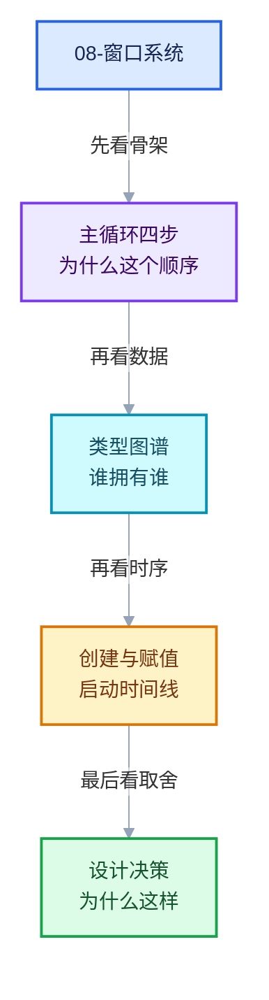

# 08-窗口系统与核心类型

导航
<a href="../README.md" style="font-size:13px;color:#334155;background:#F1F5F9;border:1px solid #E2E8F0;border-radius:999px;padding:3px 12px;text-decoration:none;white-space:nowrap">总入口</a>
<a href="../07-调用栈与调试/README.md" style="font-size:13px;color:#2563EB;background:#EFF6FF;border:1px solid #BFDBFE;border-radius:999px;padding:3px 12px;text-decoration:none;white-space:nowrap">‹ 07-调用栈与调试</a>
<a href="../90-实现依赖专题/README.md" style="font-size:13px;color:#7C3AED;background:#F5F3FF;border:1px solid #DDD6FE;border-radius:999px;padding:3px 12px;text-decoration:none;white-space:nowrap">90-实现依赖专题 ›</a>

本章回答：**Blender 的图形界面是怎么跑起来的，`bContext` 那一堆指针到底指向什么，这些类型谁创建、谁拥有、为什么这样分层。**

前面几章聚焦几何节点内部。本章向上退一层，看承载一切的窗口系统——
这也是读懂任何 Blender 编辑器代码的前置知识。

## 阅读顺序

- [08-01 WM主循环与核心数据类](01-WM主循环与核心数据类.md)
- [08-02 main函数全文解析](02-main函数全文解析.md)
- [08-03 启动术语与构建形态详解](03-启动术语与构建形态详解.md)
- [08-04 .inl、调用约定与命名约束](04-inl与调用约定与命名约束.md)
- [08-05 内存模型、Global 与类型注册](05-内存模型与Global与类型注册.md)

## 本章问题

- `WM_main` 里"采集事件 → 分发 → 处理通知 → 重绘"四步为什么必须是这个顺序？
- `bContext` / `wmWindowManager` / `wmWindow` / `bScreen` / `ScrArea` / `ARegion` 分别是什么？
- 这些对象在哪里创建、在哪里赋值？为什么 `wm_add_default` 要写那么长？
- 为什么有的类型是 `ID`、有的不是？这决定了什么能力？
- `ListBase` 为什么不用 `std::vector`？DNA 与 Runtime 为什么分开？
- `bContext` 为什么是"游标"而不是"容器"？
- `main()` 那 300 行里，各子系统的初始化顺序为什么不能乱？
- 命令行为什么要分五趟解析？`--python` 为什么必须延后执行？
- CRT / `__scrt` / SEH 分别是什么？为什么 CRT 那几个函数命名风格不统一？
- `.inl` 是什么？`__cdecl` 管什么？哪些名字可以改、哪些不能改？
- `malloc` 和 `new` 的区别？`G` / `G_MAIN` 是什么？`CPPType` 为什么必须有？
- 为什么有两个 `ClosurePtr`、三个 `register_cpp_types`？这是重复吗？
- `main_python_enter` 什么时候被调用？`WITH_HEADLESS` 和 `-b` 有什么本质区别？
- GHOST 全称是什么？为什么 Blender 要自己写它？

## 本章要建立的三个心智模型

1. **`ID` 是能力边界**。是 `ID` 就能存盘、能被引用、能进撤销、能被 Python 独立访问；
   不是 `ID` 就只能活在父对象里（`wmWindow`、`ScrArea`、`ARegion`）。
2. **`bContext` 是游标，不是容器**。它只存指针，描述"我现在在哪"。
   好处是廉价复制与可覆盖，代价是所有访问都要过 getter 且必须保证指针有效。
3. **数据分层是"存盘 / 运行"二分**。DNA 结构放持久化字段，`xxxRuntime *runtime` 放运行时状态。
   这让 `.blend` 兼容性不被内部重构牵连。

继续阅读
<a href="./01-WM主循环与核心数据类.md" style="font-size:13px;color:#7C3AED;background:#F5F3FF;border:1px solid #DDD6FE;border-radius:999px;padding:3px 12px;text-decoration:none;white-space:nowrap">WM主循环与核心数据类 ›</a>
回到顶部

