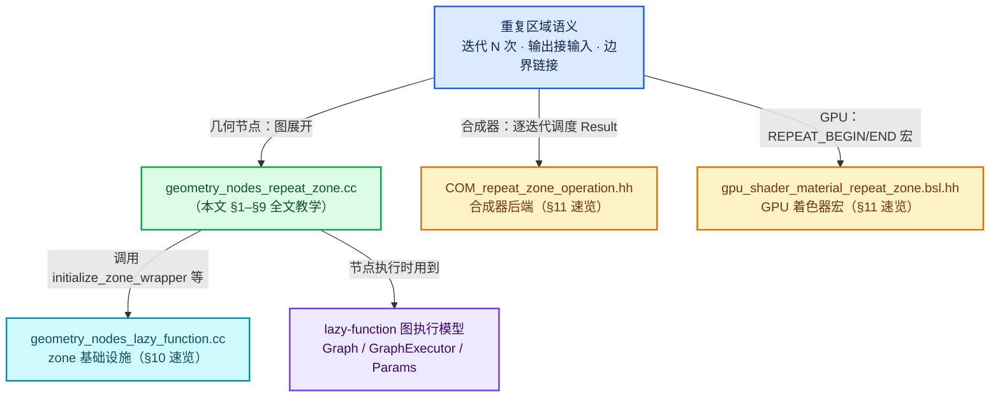
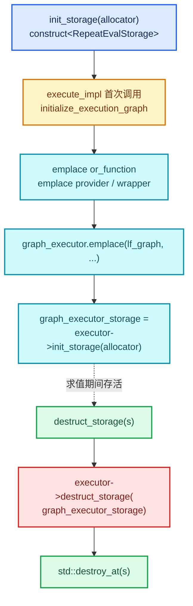
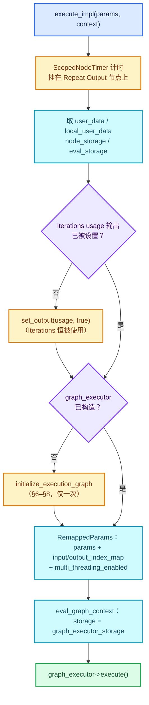
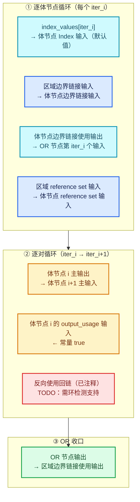
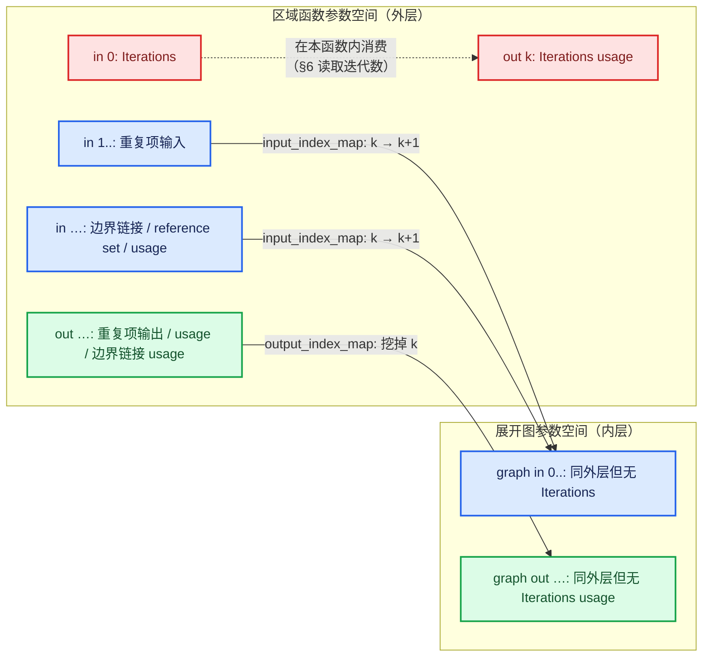
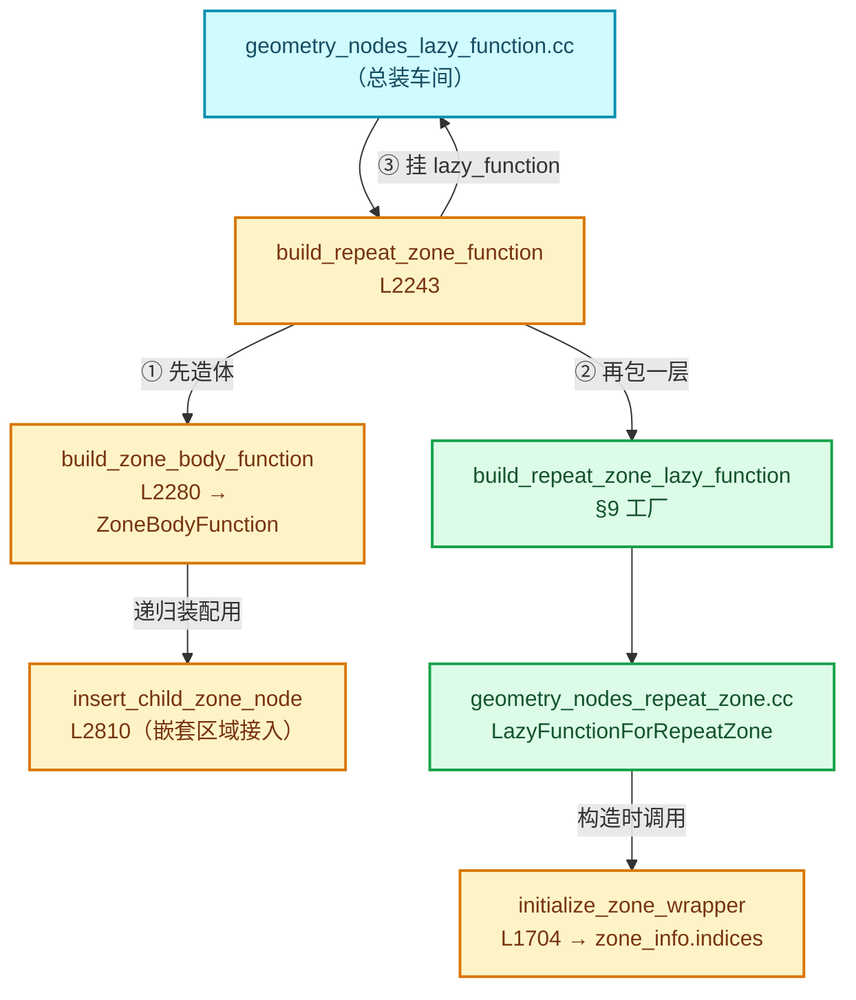
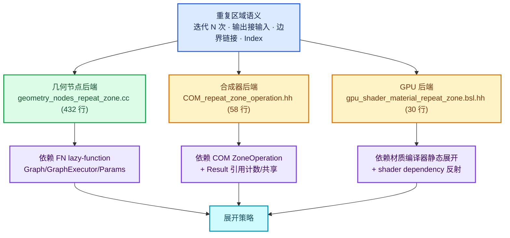

# 实现依赖专题：geometry_nodes_repeat_zone.cc 全文教学

[总入口](../README.md) · [验收报告](../91-验收报告.md)

> **基准说明**：本文所有行号、代码与结论均基于 Blender **5.4.0-alpha** 工作树
> （仓库：`D:\Repository\blender-git\blender`）。
> 主文件：[source/blender/nodes/intern/geometry_nodes_repeat_zone.cc](../../../source/blender/nodes/intern/geometry_nodes_repeat_zone.cc)（共 432 行）。
> 本文是该文件的**全文教学版**：432 行源码按逻辑单元切成 9 个小节，每一行可执行代码都会出现在"[讲解] 注释版"代码块中，并在每个小节末尾折叠保留原始源码供逐行核对。核心类名（`LazyFunctionForRepeatZone`、`RepeatEvalStorage`、`RepeatBodyNodeExecuteWrapper` 等）在全文中含义一致，可放心交叉引用。

---

## 如何使用本专题

1. **先看图再读码**。每个大机制前都配了 mermaid 图（类关系、execute_impl 流程、展开图连接分组、三后端依赖），先建立结构感，再逐小节读代码。
2. **每小节固定三段式**：职责概述 → `[讲解]` 注释版代码（语句保持原样，只加中文注释行）→ 折叠的原始源码（`<details>` 块）→ 关键设计点 2-4 条。
3. **折叠块用于核对**。讲解版注释可能精简了空白行，若怀疑注释与实现不符，展开 `<details>` 里的原文逐行比对，行号区间标在 summary 里。
4. **外围依赖不展开**。`geometry_nodes_lazy_function.cc` 中的 zone 基础设施（`initialize_zone_wrapper` 等 4 处）与合成器/GPU 后端文件只做"速览"（每项 5-15 行讲解 + 链接），需要细节时顺着链接跳到源文件。
5. **读完后自测**。文末"反例与边界"列出 6 个容易误判的行为，如果你能独立解释每一条为什么会这样，说明本专题读懂了。
6. **前置知识**：建议先掌握系列正篇中的重复区域概念（Iteration/Zone/Border Link），并至少扫过一遍 FN lazy-function 的 `Graph`/`GraphExecutor`/`Params` 概念。本专题不重复讲 lazy-function 通用机制本身。

---

## 文件覆盖总表

| 文件 | 行数 | 覆盖文档 | 覆盖方式 |
| --- | ---: | --- | --- |
| [source/blender/nodes/intern/geometry_nodes_repeat_zone.cc](../../../source/blender/nodes/intern/geometry_nodes_repeat_zone.cc) | 432 | 本文 §1–§9 | 全文教学版（逐语句注释 + 折叠原文） |
| [source/blender/nodes/intern/geometry_nodes_lazy_function.cc](../../../source/blender/nodes/intern/geometry_nodes_lazy_function.cc) | 4411 | 本文 §10 | 速览（4 个 zone 基础设施函数） |
| [source/blender/compositor/COM_repeat_zone_operation.hh](../../../source/blender/compositor/COM_repeat_zone_operation.hh) | 58 | 本文 §11 | 速览（类结构） |
| [source/blender/gpu/shaders/material/gpu_shader_material_repeat_zone.bsl.hh](../../../source/blender/gpu/shaders/material/gpu_shader_material_repeat_zone.bsl.hh) | 30 | 本文 §11 | 速览（宏定义） |

**主题结构图**：本专题从"几何节点后端"这一个文件的全文出发，向上追到它依赖的 zone 基础设施，横向对比合成器与 GPU 两个后端对"重复"这一语义的实现方式：



---

## §1 RepeatBodyNodeExecuteWrapper（L35–L65）：循环体执行的上下文注入

### 职责概述

这是整个文件里最短却最容易被忽略的一个类。它继承自 `lf::GraphExecutorNodeExecuteWrapper`，是 lazy-function 图执行器提供的一个**钩子接口**：每当图执行器准备执行图里的某一个"函数节点"时，都会先调用这个包装器的 `execute_node`，由包装器决定"用什么上下文去执行它"。

重复区域的需求恰好卡在这里：区域内同一批节点会被执行 N 次（N = 迭代数），而 Blender 的**节点日志系统**（inspector、warning、viewer 等）靠 `ComputeContext` 哈希来区分"同一个节点在不同执行上下文里的一次运行"。如果 N 次迭代都用同一个上下文哈希，第 3 次迭代的 viewer 输出会覆盖第 1 次的——用户只能看到最后一次。所以必须在每次执行循环体节点前，把"这是第 i 次迭代"注入 `ComputeContext`。

源文件顶部的注释（L29-L34）给出了作者自己的取舍：另一种做法是"每次迭代克隆一个独立的 `LazyFunction`"，但那样对象开销更高；包装器方案只在执行时构造一个栈上的临时 context，几乎零成本。

### [讲解] 注释版代码

```cpp
/**
 * Wraps the execution of a repeat loop body. The purpose is to setup the correct #ComputeContext
 * inside of the loop body. This is necessary to support correct logging inside of a repeat zone.
 * An alternative would be to use a separate `LazyFunction` for every iteration, but that would
 * have higher overhead.
 */
class RepeatBodyNodeExecuteWrapper : public lf::GraphExecutorNodeExecuteWrapper {
 public:
  // [讲解] 目标 Repeat Output 节点。ComputeContext 需要节点的 identifier 来构造哈希，
  //        所以包装器必须知道"自己服务的是哪个重复区域的输出节点"。
  const bNode *repeat_output_bnode_ = nullptr;

  // [讲解] 指向 storage 里的 lf_body_nodes（VectorSet<lf::FunctionNode *>）。
  //        VectorSet 兼具 Vector（按下标随机访问）与 Set（O(1) 查 index）两种能力，
  //        这里用 index_of_try 正是取其"元素 → 迭代序号"的反查能力。
  //        注意是指针：storage 在 init_storage 时才构造，包装器与 storage 的生命周期
  //        都挂在同一次 zone 求值上，用指针共享而不拷贝。
  VectorSet<lf::FunctionNode *> *lf_body_nodes_ = nullptr;

  // [讲解] 图执行器每要执行一个函数节点就回调这里。const 成员函数：包装器自身不被修改，
  //        修改的是"传下去的上下文"。
  void execute_node(const lf::FunctionNode &node,
                    lf::Params &params,
                    const lf::Context &context) const override
  {
    // [讲解] 取出几何节点求值专用的 user_data。它里面带着当前的 compute_context、
    //        call_data（日志/副作用注册表）等会话级数据。
    GeoNodesUserData &user_data = *static_cast<GeoNodesUserData *>(context.user_data);

    // [讲解] 反查：当前要执行的节点是不是某个迭代份的循环体节点？
    //        lf_body_nodes 在展开图时按迭代序号 add_new，所以它在 VectorSet 里的
    //        index 就是迭代号。找不到返回 -1。
    const int iteration = lf_body_nodes_->index_of_try(const_cast<lf::FunctionNode *>(&node));
    const LazyFunction &fn = node.function();
    if (iteration == -1) {
      /* The node is not a loop body node, just execute it normally. */
      // [讲解] 不是循环体节点（例如我们加进去的 LogicalOr 节点），
      //        用原上下文直接执行，不做任何注入。
      fn.execute(params, context);
      return;
    }

    /* Setup context for the loop body evaluation. */
    // [讲解] 构造"第 iteration 次迭代"的计算上下文：父上下文 + Repeat Output 节点 + 迭代号。
    //        RepeatZoneComputeContext 是 BKE_compute_contexts.hh 里的值类型，
    //        其 hash() 会把三者都混进去，因此每次迭代的哈希互不相同。
    //        注意它是栈上局部变量——execute_node 返回后就失效，
    //        所以日志系统必须在执行期间同步消费哈希，不能存指针。
    bke::RepeatZoneComputeContext body_compute_context{
        user_data.compute_context, *repeat_output_bnode_, iteration};

    // [讲解] 拷贝一份 user_data，只换两个与上下文相关的字段：
    //        compute_context 指向新的迭代上下文；
    GeoNodesUserData body_user_data = user_data;
    body_user_data.compute_context = &body_compute_context;

    // [讲解] verbose_log 按"上下文哈希"决定是否详细记录。should_log_verbose_in_context
    //        查询用户是否在 UI 里展开了某个具体迭代（或调试设置命中），
    //        只有命中的迭代才付得起详细日志的开销。
    body_user_data.verbose_log = should_log_verbose_in_context(user_data,
                                                               body_compute_context.hash());

    // [讲解] local_user_data 是线程本地数据的薄封装，同样要以新 user_data 重建，
    //        保证日志写入落到正确的上下文桶里。
    GeoNodesLocalUserData body_local_user_data{body_user_data};

    // [讲解] 组装真正传给节点函数的 Context：
    //        storage 不变（zone 级 storage 透传）、user_data 与 local_user_data 换成迭代版。
    //        随后正常执行节点函数——节点代码本身完全感知不到"我在循环里"。
    lf::Context body_context{context.storage, &body_user_data, &body_local_user_data};
    fn.execute(params, body_context);
  }
};
```

<details><summary>核对原始源码：source/blender/nodes/intern/geometry_nodes_repeat_zone.cc · L29–L65</summary>

```cpp
/**
 * Wraps the execution of a repeat loop body. The purpose is to setup the correct #ComputeContext
 * inside of the loop body. This is necessary to support correct logging inside of a repeat zone.
 * An alternative would be to use a separate `LazyFunction` for every iteration, but that would
 * have higher overhead.
 */
class RepeatBodyNodeExecuteWrapper : public lf::GraphExecutorNodeExecuteWrapper {
 public:
  const bNode *repeat_output_bnode_ = nullptr;
  VectorSet<lf::FunctionNode *> *lf_body_nodes_ = nullptr;

  void execute_node(const lf::FunctionNode &node,
                    lf::Params &params,
                    const lf::Context &context) const override
  {
    GeoNodesUserData &user_data = *static_cast<GeoNodesUserData *>(context.user_data);
    const int iteration = lf_body_nodes_->index_of_try(const_cast<lf::FunctionNode *>(&node));
    const LazyFunction &fn = node.function();
    if (iteration == -1) {
      /* The node is not a loop body node, just execute it normally. */
      fn.execute(params, context);
      return;
    }

    /* Setup context for the loop body evaluation. */
    bke::RepeatZoneComputeContext body_compute_context{
        user_data.compute_context, *repeat_output_bnode_, iteration};
    GeoNodesUserData body_user_data = user_data;
    body_user_data.compute_context = &body_compute_context;
    body_user_data.verbose_log = should_log_verbose_in_context(user_data,
                                                               body_compute_context.hash());

    GeoNodesLocalUserData body_local_user_data{body_user_data};
    lf::Context body_context{context.storage, &body_user_data, &body_local_user_data};
    fn.execute(params, body_context);
  }
};
```

</details>

### 关键设计点

1. **"身份"由数据位置决定**。迭代号不是显式字段，而是 `lf_body_nodes` 这个 `VectorSet` 的下标——展开图时第 i 个 `add_new` 的体节点天然就是第 i 次迭代。数据结构与语义复用，省掉了并行维护一套编号的负担，但也意味着**展开代码必须严格按迭代顺序 add**（§6 会看到它确实是循环顺序插入的）。
2. **上下文只换三样东西**：`compute_context`、`verbose_log`、由它们派生的 `local_user_data`。`storage` 与 `call_data` 等其余字段全部透传——副作用注册、内存池等机制对迭代不敏感。
3. **零对象开销的日志正确性**。对比"每迭代一个 LazyFunction"的方案：本方案对象数量与迭代数无关，只是每次执行多一次哈希计算与两次小结构拷贝，这正是文件头注释强调的取舍。
4. **`const_cast` 的出现位置值得留意**。`index_of_try` 的参数类型要求非 const 指针，而回调给的是 const 引用；这里只是为了查表，并不真的修改节点。这是 Blender 源码里 `const_cast` 用法中较安全的一类（查键、不改值）。

---

## §2 RepeatZoneSideEffectProvider（L67–L96）：副作用迭代清单

### 职责概述

第二个钩子类，继承自 `lf::GraphExecutorSideEffectProvider`。图执行器在求值过程中若需要"主动拉取"某些带副作用的节点去执行（典型场景：`Set Position`、viewer、写属性等改变外部状态的节点，即使用户的几何链路不依赖它们的输出，也必须执行），就会向 provider 询问"当前上下文里哪些函数节点有副作用"。

对普通（非区域）图，几何节点侧的全局 provider（`GeometryNodesLazyFunctionSideEffectProvider`，见 §10）按 `compute_context` 哈希查找注册的副作用节点即可。但重复区域有一层额外复杂度：**同一份循环体图对应 N 个上下文**（每迭代一个哈希，见 §1）。全局注册表里记录的是"某个迭代上下文哈希下有副作用"，provider 必须把这个哈希翻译回"这份共享循环体图里的哪个函数节点"。这正是 `iterations_by_iteration_zone` 这张表存在的意义——它由上游在执行每个副作用节点时登记：`(区域上下文哈希, 区域输出节点) → 需要执行的迭代号列表`。

### [讲解] 注释版代码

```cpp
/**
 * Knows which iterations of the loop evaluation have side effects.
 */
class RepeatZoneSideEffectProvider : public lf::GraphExecutorSideEffectProvider {
 public:
  // [讲解] 同 §1：用于拼出注册表查找键（上下文哈希 + 区域输出节点 identifier）。
  const bNode *repeat_output_bnode_ = nullptr;

  // [讲解] 注意与 §1 的差异：这里是 Span（值拷贝的视图）而不是指针——
  //        provider 只读这份清单，且本对象 emplace 于 storage 中，
  //        lf_body_nodes 的地址在 storage 生命周期内稳定，所以拷视图是安全的。
  Span<lf::FunctionNode *> lf_body_nodes_;

  // [讲解] 执行器回调：给我"此刻应当主动执行的函数节点"。
  Vector<const lf::FunctionNode *> get_nodes_with_side_effects(
      const lf::Context &context) const override
  {
    GeoNodesUserData &user_data = *static_cast<GeoNodesUserData *>(context.user_data);
    const GeoNodesCallData &call_data = *user_data.call_data;

    // [讲解] 整次几何节点求值可能根本没有副作用节点（纯表达式树），
    //        此时直接返回空表，避免查哈希表。
    if (!call_data.side_effect_nodes) {
      return {};
    }

    // [讲解] 当前上下文哈希——即"区域本身"的哈希（不是某个迭代的哈希，
    //        因为这个 provider 挂在区域级图执行器上，执行时的 user_data 仍是区域级的）。
    const ComputeContextHash &context_hash = user_data.compute_context->hash();

    // [讲解] 查注册表：键 = {区域上下文哈希, Repeat Output 节点 identifier}，
    //        值 = 需要执行的迭代号列表。这张表由副作用节点在被执行时登记，
    //        也就是"用户/节点系统声明过：这些迭代必须跑"。
    const Span<int> iterations_with_side_effects =
        call_data.side_effect_nodes->iterations_by_iteration_zone.lookup(
            {context_hash, repeat_output_bnode_->identifier});

    // [讲解] 把迭代号翻译成共享循环体图里的函数节点指针。
    //        i >= 0 && i < lf_body_nodes_.size() 是防御：登记表里的迭代号
    //        完全可能超出本次实际迭代数（比如迭代数由运行时输入决定，
    //        登记发生在上一次求值，或用户改了 Iterations 之后立刻重算）。
    Vector<const lf::FunctionNode *> lf_nodes;
    for (const int i : iterations_with_side_effects) {
      if (i >= 0 && i < lf_body_nodes_.size()) {
        lf_nodes.append(lf_body_nodes_[i]);
      }
    }
    return lf_nodes;
  }
};
```

<details><summary>核对原始源码：source/blender/nodes/intern/geometry_nodes_repeat_zone.cc · L67–L96</summary>

```cpp
/**
 * Knows which iterations of the loop evaluation have side effects.
 */
class RepeatZoneSideEffectProvider : public lf::GraphExecutorSideEffectProvider {
 public:
  const bNode *repeat_output_bnode_ = nullptr;
  Span<lf::FunctionNode *> lf_body_nodes_;

  Vector<const lf::FunctionNode *> get_nodes_with_side_effects(
      const lf::Context &context) const override
  {
    GeoNodesUserData &user_data = *static_cast<GeoNodesUserData *>(context.user_data);
    const GeoNodesCallData &call_data = *user_data.call_data;
    if (!call_data.side_effect_nodes) {
      return {};
    }
    const ComputeContextHash &context_hash = user_data.compute_context->hash();
    const Span<int> iterations_with_side_effects =
        call_data.side_effect_nodes->iterations_by_iteration_zone.lookup(
            {context_hash, repeat_output_bnode_->identifier});

    Vector<const lf::FunctionNode *> lf_nodes;
    for (const int i : iterations_with_side_effects) {
      if (i >= 0 && i < lf_body_nodes_.size()) {
        lf_nodes.append(lf_body_nodes_[i]);
      }
    }
    return lf_nodes;
  }
};
```

</details>

### 关键设计点

1. **两套坐标系的转换器**。注册表以"迭代号"为坐标（跨求值稳定、可被 UI/动画驱动），provider 输出以"函数节点指针"为坐标（执行器只认指针）。`lf_body_nodes_` 就是这两套坐标之间的桥。
2. **越界防御放在消费端而非生产端**。注册表的登记时机与展开图的构建时机解耦（可能跨帧、跨求值），所以迭代号是否有效只能在 provider 里现查现判。`i >= 0` 一并挡住了 `-1` 这类哨兵值。
3. **与 §1 的字段类型差异是刻意为之**：wrapper 持 `VectorSet *`（需要 `index_of_try` 反查），provider 持 `Span`（只需按下标取）。各自的成员类型精确匹配自己的访问模式，没有多余耦合。

---

## §3 RepeatEvalStorage（L98–L111）：一次求值的全部状态

### 职责概述

lazy-function 协议里，每个 `LazyFunction` 可以通过 `init_storage`/`destruct_storage` 管理一份**每次求值各一份**的可变状态（区别于函数对象本身携带的、跨求值共享的只读状态）。`RepeatEvalStorage` 就是重复区域函数的这份 storage——它一次性装下了：

- 展开出来的整张 `lf::Graph`（每迭代一个体节点）；
- 图执行器及其全部辅助对象（OR 函数、副作用 provider、执行包装器）；
- 展开图用的临时数据（迭代索引值数组、参数索引映射）；
- 线性分配器与执行器自己的 storage 指针。

为什么不能把展开图放在 `LazyFunctionForRepeatZone` 成员里？因为**图依赖运行时的迭代数**（`Iterations` 输入是节点树的一个普通输入，可能由上游节点计算得出），同一份函数对象可能被不同迭代数调用多次；而展开一次图的内存与时间都不便宜，必须严格绑定"一次具体求值"的生命周期。storage 正是 lazy-function 框架为此准备的挂载点。

### [讲解] 注释版代码

```cpp
struct RepeatEvalStorage {
  // [讲解] 线性分配器：本 storage 内部对象（尤其 graph_executor_storage）统一从这里出，
  //        析构时整体释放，不需要逐个追踪。
  LinearAllocator<> allocator;

  // [讲解] 展开时创建的循环体函数节点，按迭代序号排列（§1 依赖它的下标语义，
  //        §2 依赖它的按下标访问）。add_new 保证顺序插入不重复。
  VectorSet<lf::FunctionNode *> lf_body_nodes;

  // [讲解] 每次求值展开出来的图：N 个体节点 + 若干 OR 节点 + 图级输入输出。
  lf::Graph graph;

  // [讲解] "任一体节点用过某条边界链接 → 该边界链接视为被使用"的 OR 函数。
  //        std::optional 延迟构造：展开图时才 emplace，且全图共享一份函数对象
  //        （无状态函数可以在多个节点间复用）。
  std::optional<LazyFunctionForLogicalOr> or_function;

  // [讲解] §2 的副作用 provider，展开完成后 emplace 并挂到图执行器上。
  std::optional<RepeatZoneSideEffectProvider> side_effect_provider;

  // [讲解] §1 的执行包装器，同上。
  std::optional<RepeatBodyNodeExecuteWrapper> body_execute_wrapper;

  // [讲解] 真正干活的执行器：把展开图编译成可调用的执行单元。
  //        同样延迟到第一次 execute_impl 才构造。
  std::optional<lf::GraphExecutor> graph_executor;

  // [讲解] 提前算好的迭代索引值数组（0..iterations-1），仅当
  //        Repeat Input 的 Index 输出被下游连接时才 reinitialize 填充（§6）。
  //        SocketValueVariant 按位存储 int，避免每迭代临时构造。
  Array<SocketValueVariant> index_values;

  // [讲解] 图执行器自己的 storage（执行器内部的任务状态、缓存等）。
  //        由 graph_executor->init_storage 创建，destruct_storage 时必须先于
  //        本结构销毁归还给执行器（见 §4 的析构顺序）。
  void *graph_executor_storage = nullptr;

  // [讲解] 是否允许展开图内部多线程。它来自外层执行器的调度决策
  //        （例如外层已经在多线程上下文里，或迭代数太小不值得开线程），
  //        通过 RemappedParams 传给内层执行器（§5）。
  bool multi_threading_enabled = false;

  // [讲解] 参数索引映射：本 zone 函数的参数空间 ↔ 展开图参数空间。
  //        复杂度全部来自"Iterations 输入在本函数内消费、不进展开图"（§8 详解）。
  Vector<int> input_index_map;
  Vector<int> output_index_map;
};
```

<details><summary>核对原始源码：source/blender/nodes/intern/geometry_nodes_repeat_zone.cc · L98–L111</summary>

```cpp
struct RepeatEvalStorage {
  LinearAllocator<> allocator;
  VectorSet<lf::FunctionNode *> lf_body_nodes;
  lf::Graph graph;
  std::optional<LazyFunctionForLogicalOr> or_function;
  std::optional<RepeatZoneSideEffectProvider> side_effect_provider;
  std::optional<RepeatBodyNodeExecuteWrapper> body_execute_wrapper;
  std::optional<lf::GraphExecutor> graph_executor;
  Array<SocketValueVariant> index_values;
  void *graph_executor_storage = nullptr;
  bool multi_threading_enabled = false;
  Vector<int> input_index_map;
  Vector<int> output_index_map;
};
```

</details>

### 关键设计点

1. **"每求值一份"与"跨求值共享"的分界线画在这里**。函数对象（`LazyFunctionForRepeatZone`）只持有节点树侧的只读引用（§4 的五个成员）；一切会随迭代数、随具体求值变化的东西都进 storage。
2. **`std::optional` 三连**是懒初始化的惯用法：`or_function`、provider、wrapper 都只在展开图时才构造，而展开本身又只在第一次 `execute_impl` 时发生——两级延迟让"迭代数为 0 但从未真正执行"的调用路径完全不付展开成本。
3. **`graph_executor_storage` 用 `void *`** 是 lazy-function 协议的要求（执行器 storage 的类型对调用方不透明），代价是析构时必须手动按正确顺序归还（§4），不能依赖成员自动析构。

### storage 生命周期图



---

## §4 LazyFunctionForRepeatZone：构造与 storage 管理（L113–L151）

### 职责概述

区域函数本体登场。这个类继承 `LazyFunction`（几何节点侧的通用基类），成员分三组：

1. **节点树侧只读引用**（`btree_`、`zone_`、`repeat_output_bnode_`、`zone_info_`、`body_fn_`）——跨求值共享，构造时一次性绑定；
2. **构造逻辑**——调用 `initialize_zone_wrapper`（§10）填充输入输出描述符，并把 Iterations 输入标记为"总是被使用"；
3. **storage 协议实现**——`init_storage`/`destruct_storage`，管理 §3 那块每求值状态。

另外本类还 override 了 `input_name`/`output_name`（L412–L420），把参数名委托给 zone 基础设施的 `zone_wrapper_input_name`/`zone_wrapper_output_name`——这两个方法属于"装配阶段"（§9 的工厂到 §6 的展开）之外的日志/调试辅助，行数很少，一并归入本小节讲解。

### [讲解] 注释版代码

```cpp
class LazyFunctionForRepeatZone : public LazyFunction {
 private:
  // [讲解] 五个只读成员，全部是构造时绑定的节点树侧数据：
  const bNodeTree &btree_;                        // 所属节点树（主要用于日志取 original 树）
  const bke::bNodeTreeZone &zone_;                // 区域的运行时描述（输入/输出节点、边界链接）
  const bNode &repeat_output_bnode_;              // Repeat Output 节点（= zone.output_node() 的引用副本）
  const ZoneBuildInfo &zone_info_;                // 区域装配信息：输入/输出在各参数空间中的下标表
  const ZoneBodyFunction &body_fn_;               // 循环体的 lazy-function（一份，所有迭代共享）

 public:
  LazyFunctionForRepeatZone(const bNodeTree &btree,
                            const bke::bNodeTreeZone &zone,
                            ZoneBuildInfo &zone_info,
                            const ZoneBodyFunction &body_fn)
      : btree_(btree),
        zone_(zone),
        repeat_output_bnode_(*zone.output_node()),
        zone_info_(zone_info),
        body_fn_(body_fn)
  {
    debug_name_ = "Repeat Zone";

    // [讲解] 调 zone 基础设施（geometry_nodes_lazy_function.cc L1704，速览见 §10），
    //        按区域结构填充 inputs_/outputs_（基类的参数描述符表）：
    //        主输入/输出、边界链接输入、Usage 输入输出、边界链接 Usage 输出，
    //        以及（第四参数 true）全部 reference set 输入。
    //        zone_info_.indices.inputs/outputs 里的各组下标在这次调用中被登记，
    //        后续 §6–§8 的所有 add_link 都靠这些下标定位。
    initialize_zone_wrapper(zone, zone_info, body_fn, true, inputs_, outputs_);

    /* Iterations input is always used. */
    // [讲解] Iterations 是 main[0]（initialize_zone_wrapper 按顺序登记，
    //        第一个有效主输入就是 Iterations）。默认所有输入是 ValueUsage::Maybe
    //        （惰性：没人要就不算）；但迭代数决定循环行为本身，
    //        所以必须强制 Used——否则理论上可能出现"输出没人要 → 迭代数不算 → 循环不跑"。
    inputs_[zone_info_.indices.inputs.main[0]].usage = lf::ValueUsage::Used;
  }

  // [讲解] storage 协议：在调用方给的线性分配器上构造 §3 的结构体并返回。
  //        每次求值各一份；分配器与求值同生命周期。
  void *init_storage(LinearAllocator<> &allocator) const override
  {
    return allocator.construct<RepeatEvalStorage>().release();
  }

  void destruct_storage(void *storage) const override
  {
    RepeatEvalStorage *s = static_cast<RepeatEvalStorage *>(storage);
    if (s->graph_executor_storage) {
      // [讲解] 先把图执行器自己的 storage 还给执行器销毁——它是执行器用
      //        自己的类型知识创建的，调用方只能透传指针。
      s->graph_executor->destruct_storage(s->graph_executor_storage);
    }
    // [讲解] 再显式析构 RepeatEvalStorage 本身。注意内存不在这里 free：
    //        它来自 LinearAllocator，内存块随分配器整体回收；
    //        这里只负责调用析构函数（尤其让 lf::Graph、各 optional 释放内部资源）。
    std::destroy_at(s);
  }
```

`input_name` / `output_name`（属于同一类，紧跟在 `initialize_execution_graph` 之后）：

```cpp
  // [讲解] 参数命名委托给 zone 基础设施：按 zone_info_ 的下标表反查出
  //        "Iterations"/"Geometry"/"Usage"/"Border Link Usage" 等可读名字，
  //        供调试输出与日志使用。默认实现只会给 "Input 3" 这种编号。
  std::string input_name(const int i) const override
  {
    return zone_wrapper_input_name(zone_info_, zone_, inputs_, i);
  }

  std::string output_name(const int i) const override
  {
    return zone_wrapper_output_name(zone_info_, zone_, outputs_, i);
  }
};
```

<details><summary>核对原始源码：source/blender/nodes/intern/geometry_nodes_repeat_zone.cc · L113–L151 · L412–L421</summary>

```cpp
class LazyFunctionForRepeatZone : public LazyFunction {
 private:
  const bNodeTree &btree_;
  const bke::bNodeTreeZone &zone_;
  const bNode &repeat_output_bnode_;
  const ZoneBuildInfo &zone_info_;
  const ZoneBodyFunction &body_fn_;

 public:
  LazyFunctionForRepeatZone(const bNodeTree &btree,
                            const bke::bNodeTreeZone &zone,
                            ZoneBuildInfo &zone_info,
                            const ZoneBodyFunction &body_fn)
      : btree_(btree),
        zone_(zone),
        repeat_output_bnode_(*zone.output_node()),
        zone_info_(zone_info),
        body_fn_(body_fn)
  {
    debug_name_ = "Repeat Zone";

    initialize_zone_wrapper(zone, zone_info, body_fn, true, inputs_, outputs_);
    /* Iterations input is always used. */
    inputs_[zone_info_.indices.inputs.main[0]].usage = lf::ValueUsage::Used;
  }

  void *init_storage(LinearAllocator<> &allocator) const override
  {
    return allocator.construct<RepeatEvalStorage>().release();
  }

  void destruct_storage(void *storage) const override
  {
    RepeatEvalStorage *s = static_cast<RepeatEvalStorage *>(storage);
    if (s->graph_executor_storage) {
      s->graph_executor->destruct_storage(s->graph_executor_storage);
    }
    std::destroy_at(s);
  }

  // …… execute_impl 见 §5，initialize_execution_graph 见 §6–§8 ……

  std::string input_name(const int i) const override
  {
    return zone_wrapper_input_name(zone_info_, zone_, inputs_, i);
  }

  std::string output_name(const int i) const override
  {
    return zone_wrapper_output_name(zone_info_, zone_, outputs_, i);
  }
};
```

</details>

### 关键设计点

1. **`Iterations` 强制 `Used` 是本类构造逻辑里唯一一行"业务决策"**。其余参数保持 `Maybe` 惰性，唯独迭代数因为决定控制流必须无条件求值——这是理解后面索引映射为什么跳过 `main[0]` 的伏笔（§8）。
2. **析构顺序不可换**：`graph_executor_storage` 归还执行器 → `std::destroy_at`。若反过来，`graph_executor` 的 optional 先析构，归还指针就变成悬空调用。C++ 的成员自动析构帮不上忙，因为 `void *` 不携带类型信息。
3. **五个只读成员全是引用**：区域函数是"装配期产物"，其生命周期由外层 `ResourceScope`（§9 的工厂）管理，绑定的是当次节点树运行的 runtime 数据，不存在中途换树的问题。

---

## §5 execute_impl（L153–L185）：每次调用的执行入口

### 职责概述

`execute_impl` 是 lazy-function 框架每次调用区域函数时进入的入口。它要回答三个问题：

1. **迭代数用完了没有**（Usage 输出必须有人应答）；
2. **展开图建好了没有**（没有就先建，且只建一次）；
3. **怎么把外层参数空间接到内层展开图上**（索引映射 + 多线程开关）。

整个函数只有 30 行，但它是理解"区域函数 = 一台内嵌图执行器的壳"的最佳样本：`execute_impl` 自己不做任何循环，真正的循环发生在展开图里——N 个串联的体节点由内层 `GraphExecutor` 调度执行。

### execute_impl 流程图



### [讲解] 注释版代码

```cpp
  void execute_impl(lf::Params &params, const lf::Context &context) const override
  {
    // [讲解] 节点计时器：把本函数的耗时记到 Repeat Output 节点名下，
    //        profiling 视图里能看到"Repeat Zone"这一层。离开作用域自动停止。
    const ScopedNodeTimer node_timer{context, repeat_output_bnode_};

    // [讲解] 四个常用对象的引用别名，后面代码不再写满长类型名：
    auto &user_data = *static_cast<GeoNodesUserData *>(context.user_data);
    auto &local_user_data = *static_cast<GeoNodesLocalUserData *>(context.local_user_data);

    // [讲解] node_storage 是 Repeat Output 节点的自定义存储（items_num 迭代项数、
    //        inspection_index 检查项索引等 UI/序列化数据）。
    //        eval_storage 是本函数的每次求值状态（§3）。
    const NodeGeometryRepeatOutput &node_storage = *static_cast<const NodeGeometryRepeatOutput *>(
        repeat_output_bnode_.storage);
    RepeatEvalStorage &eval_storage = *static_cast<RepeatEvalStorage *>(context.storage);

    // [讲解] "Iterations 输入的使用状态"输出（zone_info_.indices.outputs.input_usages[0]）。
    //        lazy-function 协议要求：每个被声明为 Maybe 的输入，若最终被消费，
    //        必须把对应的 usage 输出置 true 通知上游"你该求值了"。
    //        由于构造时 Iterations 已强制 Used，这里无条件下 true，
    //        上游一定会算出迭代数。
    const int iterations_usage_index = zone_info_.indices.outputs.input_usages[0];
    if (!params.output_was_set(iterations_usage_index)) {
      /* The iterations input is always used. */
      params.set_output(iterations_usage_index, true);
    }

    if (!eval_storage.graph_executor) {
      /* Create the execution graph in the first evaluation. */
      // [讲解] 惰性展开：第一次执行才把循环体复制 N 份建成图（§6–§8）。
      //        注意 storage 是每次求值新的，所以"第一次"是针对本次求值而言；
      //        同一函数对象的下一次求值会重新展开（迭代数可能已经不同）。
      this->initialize_execution_graph(
          params, eval_storage, node_storage, user_data, local_user_data);
    }

    /* Execute the graph for the repeat zone. */
    // [讲解] RemappedParams 是 lazy-function 的参数转发器：
    //        内层图看到的"第 k 个参数"经 input_index_map/output_index_map
    //        翻译成外层 params 的真实下标（映射规则见 §8 末尾）。
    //        multi_threading_enabled 同时决定内层执行器能否并行调度体节点。
    lf::RemappedParams eval_graph_params{*eval_storage.graph_executor,
                                         params,
                                         eval_storage.input_index_map,
                                         eval_storage.output_index_map,
                                         eval_storage.multi_threading_enabled};

    // [讲解] 内层上下文：storage 换成执行器自己的 storage（图表状态），
    //        user_data / local_user_data 原样透传——区域级上下文，
    //        迭代级上下文由 §1 的 wrapper 在执行每个体节点时再注入。
    lf::Context eval_graph_context{
        eval_storage.graph_executor_storage, context.user_data, context.local_user_data};

    // [讲解] 真正执行。返回后所有被下游需要的输出已经写进 params
    //        （经映射转发），整个重复区域对外表现为一个普通函数调用。
    eval_storage.graph_executor->execute(eval_graph_params, eval_graph_context);
  }
```

<details><summary>核对原始源码：source/blender/nodes/intern/geometry_nodes_repeat_zone.cc · L153–L185</summary>

```cpp
  void execute_impl(lf::Params &params, const lf::Context &context) const override
  {
    const ScopedNodeTimer node_timer{context, repeat_output_bnode_};

    auto &user_data = *static_cast<GeoNodesUserData *>(context.user_data);
    auto &local_user_data = *static_cast<GeoNodesLocalUserData *>(context.local_user_data);

    const NodeGeometryRepeatOutput &node_storage = *static_cast<const NodeGeometryRepeatOutput *>(
        repeat_output_bnode_.storage);
    RepeatEvalStorage &eval_storage = *static_cast<RepeatEvalStorage *>(context.storage);

    const int iterations_usage_index = zone_info_.indices.outputs.input_usages[0];
    if (!params.output_was_set(iterations_usage_index)) {
      /* The iterations input is always used. */
      params.set_output(iterations_usage_index, true);
    }

    if (!eval_storage.graph_executor) {
      /* Create the execution graph in the first evaluation. */
      this->initialize_execution_graph(
          params, eval_storage, node_storage, user_data, local_user_data);
    }

    /* Execute the graph for the repeat zone. */
    lf::RemappedParams eval_graph_params{*eval_storage.graph_executor,
                                         params,
                                         eval_storage.input_index_map,
                                         eval_storage.output_index_map,
                                         eval_storage.multi_threading_enabled};
    lf::Context eval_graph_context{
        eval_storage.graph_executor_storage, context.user_data, context.local_user_data};
    eval_storage.graph_executor->execute(eval_graph_params, eval_graph_context);
  }
```

</details>

### 关键设计点

1. **`execute_impl` 本身零循环**。"重复"这一语义被完全编译进展开图的结构（体节点串联），控制流交给通用图执行器。这让多线程调度、惰性求值、副作用处理全部免费继承自 lazy-function 基础设施。
2. **两阶段惰性**：图执行器惰性（`!eval_storage.graph_executor`）+ 展开依赖的迭代数此时才从参数读出。因此"迭代数为 0"的求值也会真的走一遍展开（建一个空图、0 个体节点、直接连输入到输出），只是展开本身很便宜。
3. **Usage 应答先行**：`set_output(iterations_usage_index, true)` 必须在展开/执行前完成——它是对上游"迭代数要不算"询问的承诺，晚了上游可能已经被判为无用而跳过求值。
4. **`multi_threading_enabled` 是外层到内层的调度决策传递**，不是本函数自己决定的（它在别处被设置到 storage 上），体现了"嵌套执行器逐层收紧并行度"的设计：区域内部的并行由区域外部的并行预算决定。

---

## §6 initialize_execution_graph · 前半：读取与展开准备（L195–L272）

### 职责概述

从这一节进入全文最长的方法 `initialize_execution_graph`（L195–L410，共 216 行）。它把"循环体函数 `body_fn_` 复制 N 份、按数据流串联、再接回区域边界"这个核心想法落成一张真实的 `lf::Graph`。按逻辑可分三段，本节覆盖第一段（L195–L272）：

- 读入迭代数、给出线程提示与检查项越界警告；
- 在展开图上创建与区域函数同构的图级输入/输出；
- 创建 N 份体节点；
- 为每条边界链接创建 OR 节点（用于聚合"该链接是否被使用"）;
- 预计算迭代索引值。

方法头上有一段重要的设计注释（L187–L194）：**这张图依赖迭代数，原则上不可复用**；作者考虑过"按迭代数缓存图"，但认为建图远快于执行图、不值得缓存。读这段注释能帮你校准心智模型——展开是**每次求值都重来的廉价一次性装配**，不是一次性的预编译。

### [讲解] 注释版代码

```cpp
  /**
   * Generate a lazy-function graph that contains the loop body (`body_fn_`) as many times
   * as there are iterations. Since this graph depends on the number of iterations, it can't be
   * reused in general. We could consider caching a version of this graph per number of iterations,
   * but right now that doesn't seem worth it. In practice, it takes much less time to create the
   * graph than to execute it (for intended use cases of this generic implementation, more special
   * case repeat loop evaluations could be implemented separately).
   */
  void initialize_execution_graph(lf::Params &params,
                                  RepeatEvalStorage &eval_storage,
                                  const NodeGeometryRepeatOutput &node_storage,
                                  GeoNodesUserData &user_data,
                                  GeoNodesLocalUserData &local_user_data) const
  {
    // [讲解] num_repeat_items：重复项数（Repeat Output 上配了几组输入/输出对，
    //        用户可以在节点上增删）。num_border_links：跨界链接数
    //        （有链接从区域外绕过输入节点直接进入区域内——"边界链接"）。
    const int num_repeat_items = node_storage.items_num;
    const int num_border_links = body_fn_.indices.inputs.border_links.size();

    /* Number of iterations to evaluate. */
    // [讲解] 读迭代数：从区域函数参数 main[0]（即 Iterations）取 SocketValueVariant，
    //        ensure_type<int> 保证类型正确（上游可能给出可隐式转换的值）。
    //        std::max(0, ...) 钳制负数——用户输入 -5 之类按 0 处理。
    const int iterations = std::max<int>(
        0,
        params.get_input<SocketValueVariant>(zone_info_.indices.inputs.main[0])
            .ensure_type<int>());

    if (iterations >= 10) {
      /* Constructing and running the repeat zone has some overhead so that it's probably worth
       * trying to do something else in the meantime already. */
      // [讲解] 给外层 lazy-threading 调度器发提示："我这活儿不小，
      //        与其等我，不如先去干别的（或开新线程）"。
      //        阈值 10 是经验值：低于 10 次的循环开销占比通常可以忽略。
      lazy_threading::send_hint();
    }

    /* Show a warning when the inspection index is out of range. */
    // [讲解] inspection_index 是节点 UI 上的"检查第几次迭代"设置。
    //        若它 >= 本次实际迭代数，记一条 Info 级警告（不是 Error：
    //        这只影响调试视图里看不到想要的迭代，不影响求值正确性）。
    //        警告通过 tree_logger 追加，关联到 Repeat Output 节点的 identifier。
    if (node_storage.inspection_index > 0) {
      if (node_storage.inspection_index >= iterations) {
        if (eval_log::NodeTreeLogger *tree_logger = local_user_data.try_get_tree_logger(user_data))
        {
          tree_logger->node_warnings.append(
              *tree_logger->allocator,
              {repeat_output_bnode_.identifier,
               {NodeWarningType::Info, N_("Inspection index is out of range")}});
        }
      }
    }

    /* Take iterations input into account. */
    // [讲解] 两个固定偏移：main[0] 是 Iterations，不属于重复项，
    //        所以"第 i 个重复项的主输入"在区域参数空间里是 main[1 + i]；
    //        而体函数的 main[0] 是 Index 输出，第 i 个重复项在体函数参数空间里是
    //        main[1 + i]。两个偏移把两套下标对齐，后面所有链接都要用到。
    const int main_inputs_offset = 1;
    const int body_inputs_offset = 1;

    // [讲解] 展开图就放在 eval_storage.graph 里（引用别名）。
    lf::Graph &lf_graph = eval_storage.graph;

    // [讲解] 先建图级输入/输出：与区域函数的参数表完全同构
    //        （数量、类型、名字都一致）。lf_inputs/lf_outputs 记录这些图级
    //        socket 指针，后续 add_link 直接引用。这一步保证：
    //        外层 RemappedParams 的下标映射可以按"差一个 Iterations"的规律建立。
    Vector<lf::GraphInputSocket *> lf_inputs;
    Vector<lf::GraphOutputSocket *> lf_outputs;

    for (const int i : inputs_.index_range()) {
      const lf::Input &input = inputs_[i];
      lf_inputs.append(&lf_graph.add_input(*input.type, this->input_name(i)));
    }
    for (const int i : outputs_.index_range()) {
      const lf::Output &output = outputs_[i];
      lf_outputs.append(&lf_graph.add_output(*output.type, this->output_name(i)));
    }

    /* Create body nodes. */
    // [讲解] 核心一步：把循环体函数复制 iterations 份挂进图。
    //        lf_body_nodes.add_new 保持插入序 = 迭代序（§1 的反查依赖这一点）。
    //        [[maybe_unused]]：IndexRange 循环变量 i 在这里只用于计数。
    VectorSet<lf::FunctionNode *> &lf_body_nodes = eval_storage.lf_body_nodes;
    for ([[maybe_unused]] const int i : IndexRange(iterations)) {
      lf::FunctionNode &lf_node = lf_graph.add_function(*body_fn_.function);
      lf_body_nodes.add_new(&lf_node);
    }

    /* Create nodes for combining border link usages. A border link is used when any of the loop
     * bodies uses the border link, so an "or" node is necessary. */
    // [讲解] 每条边界链接配一个 OR 节点：N 个体节点各自报告
    //        "我用没用这条链接"（bool 输出），OR 起来就是区域级的
    //        "这条边界链接是否被使用"——用于通知区域外"要不要为它求值"。
    //        or_function 是无状态函数，全图所有 OR 节点共享一份。
    Array<lf::FunctionNode *> lf_border_link_usage_or_nodes(num_border_links);
    eval_storage.or_function.emplace(iterations);
    for (const int i : IndexRange(num_border_links)) {
      lf::FunctionNode &lf_node = lf_graph.add_function(*eval_storage.or_function);
      lf_border_link_usage_or_nodes[i] = &lf_node;
    }

    // [讲解] 只有当 Repeat Input 的 Index 输出真的被区域内节点连走时，
    //        才值得预计算 0..iterations-1 的索引值数组。
    //        is_directly_linked 看的是节点树层面的连接。
    const bool use_index_values = zone_.input_node()->output_socket(0).is_directly_linked();

    if (use_index_values) {
      // [讲解] 并行填充：每格就是一个 int 的 SocketValueVariant。
      //        grain size 1024——数组太小不值得开线程。
      //        预计算一次，供所有体节点共享（每个体节点把自己的那份设为默认值，
      //        见 §7 的 set_default_value）。
      eval_storage.index_values.reinitialize(iterations);
      threading::parallel_for(IndexRange(iterations), 1024, [&](const IndexRange range) {
        for (const int i : range) {
          eval_storage.index_values[i].emplace<int>(i);
        }
      });
    }
```

<details><summary>核对原始源码：source/blender/nodes/intern/geometry_nodes_repeat_zone.cc · L187–L272</summary>

```cpp
  /**
   * Generate a lazy-function graph that contains the loop body (`body_fn_`) as many times
   * as there are iterations. Since this graph depends on the number of iterations, it can't be
   * reused in general. We could consider caching a version of this graph per number of iterations,
   * but right now that doesn't seem worth it. In practice, it takes much less time to create the
   * graph than to execute it (for intended use cases of this generic implementation, more special
   * case repeat loop evaluations could be implemented separately).
   */
  void initialize_execution_graph(lf::Params &params,
                                  RepeatEvalStorage &eval_storage,
                                  const NodeGeometryRepeatOutput &node_storage,
                                  GeoNodesUserData &user_data,
                                  GeoNodesLocalUserData &local_user_data) const
  {
    const int num_repeat_items = node_storage.items_num;
    const int num_border_links = body_fn_.indices.inputs.border_links.size();

    /* Number of iterations to evaluate. */
    const int iterations = std::max<int>(
        0,
        params.get_input<SocketValueVariant>(zone_info_.indices.inputs.main[0])
            .ensure_type<int>());

    if (iterations >= 10) {
      /* Constructing and running the repeat zone has some overhead so that it's probably worth
       * trying to do something else in the meantime already. */
      lazy_threading::send_hint();
    }

    /* Show a warning when the inspection index is out of range. */
    if (node_storage.inspection_index > 0) {
      if (node_storage.inspection_index >= iterations) {
        if (eval_log::NodeTreeLogger *tree_logger = local_user_data.try_get_tree_logger(user_data))
        {
          tree_logger->node_warnings.append(
              *tree_logger->allocator,
              {repeat_output_bnode_.identifier,
               {NodeWarningType::Info, N_("Inspection index is out of range")}});
        }
      }
    }

    /* Take iterations input into account. */
    const int main_inputs_offset = 1;
    const int body_inputs_offset = 1;

    lf::Graph &lf_graph = eval_storage.graph;

    Vector<lf::GraphInputSocket *> lf_inputs;
    Vector<lf::GraphOutputSocket *> lf_outputs;

    for (const int i : inputs_.index_range()) {
      const lf::Input &input = inputs_[i];
      lf_inputs.append(&lf_graph.add_input(*input.type, this->input_name(i)));
    }
    for (const int i : outputs_.index_range()) {
      const lf::Output &output = outputs_[i];
      lf_outputs.append(&lf_graph.add_output(*output.type, this->output_name(i)));
    }

    /* Create body nodes. */
    VectorSet<lf::FunctionNode *> &lf_body_nodes = eval_storage.lf_body_nodes;
    for ([[maybe_unused]] const int i : IndexRange(iterations)) {
      lf::FunctionNode &lf_node = lf_graph.add_function(*body_fn_.function);
      lf_body_nodes.add_new(&lf_node);
    }

    /* Create nodes for combining border link usages. A border link is used when any of the loop
     * bodies uses the border link, so an "or" node is necessary. */
    Array<lf::FunctionNode *> lf_border_link_usage_or_nodes(num_border_links);
    eval_storage.or_function.emplace(iterations);
    for (const int i : IndexRange(num_border_links)) {
      lf::FunctionNode &lf_node = lf_graph.add_function(*eval_storage.or_function);
      lf_border_link_usage_or_nodes[i] = &lf_node;
    }

    const bool use_index_values = zone_.input_node()->output_socket(0).is_directly_linked();

    if (use_index_values) {
      eval_storage.index_values.reinitialize(iterations);
      threading::parallel_for(IndexRange(iterations), 1024, [&](const IndexRange range) {
        for (const int i : range) {
          eval_storage.index_values[i].emplace<int>(i);
        }
      });
    }
```

</details>

### 关键设计点

1. **迭代数在展开时才物化**。`params.get_input` 发生在展开函数里而非 `execute_impl` 里，暗示依赖关系：展开 = f(迭代数)。注释里"不缓存图"的判断也基于此——图的拓扑对每次求值都可能是新的。
2. **OR 节点是"使用传播"的汇点**。区域协议要求区域向外界报告"每条边界链接是否被用过"（外界据此决定是否求值链接源），而"任一迭代用过即算用过"天然是 OR 语义。N 份体节点共享一个 OR 函数对象是典型的无状态函数复用。
3. **索引值预计算的守门条件**（`use_index_values`）避免了"Index 无人使用时白造一个 N 长数组"；`static_unused_index`（§7）则覆盖了无人使用时的占位场景——两个分支合起来把 Index 的成本压到按需。
4. **警告级别是 Info 而非 Error**：检查项越界只影响调试视图，不影响几何结果，这符合 Blender 对 warning 分级的一贯处理（Error 会阻断求值并红显）。

---

## §7 initialize_execution_graph · 中半：逐节点与逐对连接（L274–L317）

### 职责概述

图已经搭好骨架（输入、输出、N 份体节点、OR 节点），本节把它们**按语义分组连起来**。连接分三类，每类一个循环：

1. **逐体节点**（L276–L294）：Index 默认值、边界链接输入、边界链接使用报告、reference set 输入；
2. **逐对体节点**（L299–L311）：第 i 份的主输出 → 第 i+1 份的主输入（这是"循环"二字的数据流本体），外加使用标记；
3. **OR 节点收口**（L314–L317）：OR 输出接到区域级边界链接使用输出。

### 展开图连接分组图



### [讲解] 注释版代码

```cpp
    /* Handle body nodes one by one. */
    // [讲解] Index 无人使用时的共享占位值：-1。
    //        static 保证整个进程只有一份，被所有体节点以默认值方式引用
    //        （set_default_value 存指针，不拷贝对象）。
    static const SocketValueVariant static_unused_index{-1};
    for (const int iter_i : lf_body_nodes.index_range()) {
      lf::FunctionNode &lf_node = *lf_body_nodes[iter_i];

      // [讲解] Index 输入的取值策略：若区域内确实用到了 Index，
      //        把预计算好的第 iter_i 个索引值设为该体节点 Index 输入的默认值；
      //        否则统一塞 -1 占位（反正没人读）。
      //        注意用"默认值"而不是连线：每个体节点的 Index 是常量，
      //        连线反而多此一举。
      const SocketValueVariant *index_value = use_index_values ?
                                                  &eval_storage.index_values[iter_i] :
                                                  &static_unused_index;
      lf_node.input(body_fn_.indices.inputs.main[0]).set_default_value(index_value);

      // [讲解] 边界链接三件套（每条边界链接 i）：
      //   (a) 区域级边界链接输入 → 本体节点的边界链接输入（数据）；
      //   (b) 本体节点的边界链接使用输出 → OR 节点的第 iter_i 个输入（使用报告）。
      //        OR 节点每个输入对应一个迭代——这正是 §6 里 emplace(iterations)
      //        传入的输入个数。
      for (const int i : IndexRange(num_border_links)) {
        lf_graph.add_link(*lf_inputs[zone_info_.indices.inputs.border_links[i]],
                          lf_node.input(body_fn_.indices.inputs.border_links[i]));
        lf_graph.add_link(lf_node.output(body_fn_.indices.outputs.border_link_usages[i]),
                          lf_border_link_usage_or_nodes[i]->input(iter_i));
      }

      /* Handle reference sets. */
      // [讲解] reference set（引用集）是几何节点传递"属性域引用关系"的机制
      //        （例如 Fields 求值时携带的引用上下文）。体函数需要的每个引用集
      //        都从区域级同名输入直接引一条线进来。items() 遍历
      //        "体函数引用集下标 → 区域引用集键"的映射表。
      for (const auto &item : body_fn_.indices.inputs.reference_sets.items()) {
        lf_graph.add_link(*lf_inputs[zone_info_.indices.inputs.reference_sets.lookup(item.key)],
                          lf_node.input(item.value));
      }
    }

    // [讲解] 第 ② 组循环用的共享常量 true：所有"我宣布我的输出会被用到"
    //        的使用输入都指它。
    static bool static_true = true;

    /* Handle body nodes pair-wise. */
    // [讲解] drop_back(1)：最后一对是"末节点 → 区域输出"，属于 §8 的职责，
    //        这里只连 i → i+1。
    for (const int iter_i : lf_body_nodes.index_range().drop_back(1)) {
      lf::FunctionNode &lf_node = *lf_body_nodes[iter_i];
      lf::FunctionNode &lf_next_node = *lf_body_nodes[iter_i + 1];
      for (const int i : IndexRange(num_repeat_items)) {
        // [讲解] 循环的数据流本体：第 i 份的每个重复项主输出
        //        → 第 i+1 份的对应主输入。注意体函数侧下标是 main[i + 1]：
        //        体函数的 main[0] 是 Index，重复项从 main[1] 开始
        //        （body_inputs_offset = 1，§6）。
        lf_graph.add_link(
            lf_node.output(body_fn_.indices.outputs.main[i]),
            lf_next_node.input(body_fn_.indices.inputs.main[i + body_inputs_offset]));

        /* TODO: Add back-link after being able to check for cyclic dependencies. */
        // [讲解] 被注释掉的反向链接：理想情况下，"下一份需要这个输出吗"
        //        （input_usages）应当反向喂给上一份的 output_usages 输入，
        //        让未被需要的迭代输出提前判死。但"输出接输入"的环形结构
        //        会触发现有 lazy-function 图的环检测/环打断机制
        //        （见 §10 中 socket_usage_inputs 与 fix_link_cycles 的注释），
        //        目前基础设施还不能安全处理这种环，所以先退化为
        //        "一律声称输出被使用"。
        // lf_graph.add_link(lf_next_node.output(body_fn_.indices.outputs.input_usages[i]),
        //                   lf_node.input(body_fn_.indices.inputs.output_usages[i]));

        // [讲解] 退化方案的落地：第 i 份的每个"我的输出被用了吗"输入
        //        恒设 true —— 即每份体节点都认为自己的全部输出有人要，
        //        全量求值，不做惰性裁剪。这是正确性优先、效率让步的取舍。
        lf_node.input(body_fn_.indices.inputs.output_usages[i]).set_default_value(&static_true);
      }
    }

    /* Handle border link usage outputs. */
    // [讲解] 第 ③ 组：OR 节点把 N 份使用报告汇成区域级结论，
    //        接到区域函数的"边界链接 i 是否被使用"输出上。
    for (const int i : IndexRange(num_border_links)) {
      lf_graph.add_link(lf_border_link_usage_or_nodes[i]->output(0),
                        *lf_outputs[zone_info_.indices.outputs.border_link_usages[i]]);
    }
```

<details><summary>核对原始源码：source/blender/nodes/intern/geometry_nodes_repeat_zone.cc · L274–L317</summary>

```cpp
    /* Handle body nodes one by one. */
    static const SocketValueVariant static_unused_index{-1};
    for (const int iter_i : lf_body_nodes.index_range()) {
      lf::FunctionNode &lf_node = *lf_body_nodes[iter_i];
      const SocketValueVariant *index_value = use_index_values ?
                                                  &eval_storage.index_values[iter_i] :
                                                  &static_unused_index;
      lf_node.input(body_fn_.indices.inputs.main[0]).set_default_value(index_value);
      for (const int i : IndexRange(num_border_links)) {
        lf_graph.add_link(*lf_inputs[zone_info_.indices.inputs.border_links[i]],
                          lf_node.input(body_fn_.indices.inputs.border_links[i]));
        lf_graph.add_link(lf_node.output(body_fn_.indices.outputs.border_link_usages[i]),
                          lf_border_link_usage_or_nodes[i]->input(iter_i));
      }

      /* Handle reference sets. */
      for (const auto &item : body_fn_.indices.inputs.reference_sets.items()) {
        lf_graph.add_link(*lf_inputs[zone_info_.indices.inputs.reference_sets.lookup(item.key)],
                          lf_node.input(item.value));
      }
    }

    static bool static_true = true;

    /* Handle body nodes pair-wise. */
    for (const int iter_i : lf_body_nodes.index_range().drop_back(1)) {
      lf::FunctionNode &lf_node = *lf_body_nodes[iter_i];
      lf::FunctionNode &lf_next_node = *lf_body_nodes[iter_i + 1];
      for (const int i : IndexRange(num_repeat_items)) {
        lf_graph.add_link(
            lf_node.output(body_fn_.indices.outputs.main[i]),
            lf_next_node.input(body_fn_.indices.inputs.main[i + body_inputs_offset]));
        /* TODO: Add back-link after being able to check for cyclic dependencies. */
        // lf_graph.add_link(lf_next_node.output(body_fn_.indices.outputs.input_usages[i]),
        //                   lf_node.input(body_fn_.indices.inputs.output_usages[i]));
        lf_node.input(body_fn_.indices.inputs.output_usages[i]).set_default_value(&static_true);
      }
    }

    /* Handle border link usage outputs. */
    for (const int i : IndexRange(num_border_links)) {
      lf_graph.add_link(lf_border_link_usage_or_nodes[i]->output(0),
                        *lf_outputs[zone_info_.indices.outputs.border_link_usages[i]]);
    }
```

</details>

### 关键设计点

1. **三组循环对应三种拓扑**：星形（每个体节点 ↔ 区域边界）、链形（体节点两两串联）、汇形（OR 收口）。分开循环让每组连接的意图一目了然，也避免了在单一循环里处理"首/尾节点特殊情况"的分支泥潭。
2. **注释掉的 TODO 是本文件最重要的"未完成设计"**。区域语义理论上允许"后续迭代不再需要某输出 → 前序迭代提前停止/裁剪"，但这要求使用信息沿链反传形成环，而当前图基础设施的环处理（constant-true 打断）尚未覆盖此场景。现实现以 `static_true` 全量求值保证正确。
3. **`set_default_value` 与 `add_link` 的分工**是读这段代码的钥匙：常量（Index 值、true、false）走默认值指针——零求值开销；真正的数据流（主输出、边界链接、引用集）才连线。
4. **`static_unused_index` / `static_true` 的 `static` 存储期**：这些是进程级共享常量，`set_default_value` 只存指针。体节点执行期间只读，天然线程安全。

---

## §8 initialize_execution_graph · 后半：首尾连接、0 迭代分支、索引映射、装配（L319–L410）

### 职责概述

展开的最后一段，把图收口成可执行的完整单元：

1. **迭代数 > 0**：首体节点接区域主输入（并回传首份的"输入使用"报告），末体节点接区域主输出（并接收"输出是否需要"的使用输入）；
2. **迭代数 = 0**：区域输入直连区域输出（恒等函数），边界链接使用输出恒 false；
3. **Usage 收尾**：Iterations 的使用输出恒 true；
4. **更新图索引**，建立内外参数索引映射（跳过 Iterations）；
5. **装配** wrapper、provider、`GraphExecutor`，初始化执行器 storage，登记调试用 dot 图。

### [讲解] 注释版代码

```cpp
    if (iterations > 0) {
      {
        /* Link first body node to input/output nodes. */
        // [讲解] 首体节点：区域的第 i 个重复项主输入 → 首份体节点的对应输入
        //        （区域侧下标 main[i + 1]，体侧 main[i + 1]，两套偏移恰好对齐）。
        //        同时把首份体节点报告的"这些输入我真的用了吗"
        //        （outputs.input_usages[i + 1]，体侧从 1 开始因为 0 是 Index）
        //        回传给区域函数的"主输入使用"输出——上游据此惰性求值。
        lf::FunctionNode &lf_first_body_node = *lf_body_nodes[0];
        for (const int i : IndexRange(num_repeat_items)) {
          lf_graph.add_link(
              *lf_inputs[zone_info_.indices.inputs.main[i + main_inputs_offset]],
              lf_first_body_node.input(body_fn_.indices.inputs.main[i + body_inputs_offset]));
          lf_graph.add_link(
              lf_first_body_node.output(
                  body_fn_.indices.outputs.input_usages[i + body_inputs_offset]),
              *lf_outputs[zone_info_.indices.outputs.input_usages[i + main_inputs_offset]]);
        }
      }
      {
        /* Link last body node to input/output nodes. */
        // [讲解] 末体节点：末份的重复项主输出 → 区域主输出（这就是用户拿到的结果）；
        //        区域的"输出是否需要"使用输入（output_usages[i]，来自区域外
        //        下游的求值请求）→ 末份体节点的对应使用输入。
        //        首尾各接一次，中间由 §7 的链形连接覆盖——链状结构收口完成。
        lf::FunctionNode &lf_last_body_node = *lf_body_nodes.as_span().last();
        for (const int i : IndexRange(num_repeat_items)) {
          lf_graph.add_link(lf_last_body_node.output(body_fn_.indices.outputs.main[i]),
                            *lf_outputs[zone_info_.indices.outputs.main[i]]);
          lf_graph.add_link(*lf_inputs[zone_info_.indices.inputs.output_usages[i]],
                            lf_last_body_node.input(body_fn_.indices.inputs.output_usages[i]));
        }
      }
    }
    else {
      /* There are no iterations, just link the input directly to the output. */
      // [讲解] 0 迭代分支：区域退化为恒等函数——第 i 个重复项输入直连输出。
      //        "输出是否需要"的使用输入也直通"输入是否被使用"的使用输出：
      //        下游要不要输出，原样转告上游要不要输入，惰性链路不因区域而断。
      for (const int i : IndexRange(num_repeat_items)) {
        lf_graph.add_link(*lf_inputs[zone_info_.indices.inputs.main[i + main_inputs_offset]],
                          *lf_outputs[zone_info_.indices.outputs.main[i]]);
        lf_graph.add_link(
            *lf_inputs[zone_info_.indices.inputs.output_usages[i]],
            *lf_outputs[zone_info_.indices.outputs.input_usages[i + main_inputs_offset]]);
      }
      for (const int i : IndexRange(num_border_links)) {
        // [讲解] 0 迭代时没有任何体节点，边界链接必然"未被使用"——恒 false。
        //        static_false 同样是进程级共享常量。
        static bool static_false = false;
        lf_outputs[zone_info_.indices.outputs.border_link_usages[i]]->set_default_value(
            &static_false);
      }
    }

    // [讲解] Iterations 的使用输出恒 true（与 §5 execute_impl 里的应答呼应，
    //        不过那是对外的运行期应答；这里是图内的静态接线——展开图里
    //        该输出不接任何线，用默认值顶上）。
    lf_outputs[zone_info_.indices.outputs.input_usages[0]]->set_default_value(&static_true);

    /* The graph is ready, update the node indices which are required by the executor. */
    // [讲解] 图结构定稿。执行器内部用连续下标索引节点，
    //        update_node_indices 完成指针→下标的重编号。此后不得再加节点/连线。
    lf_graph.update_node_indices();

    // std::cout << "\n\n" << lf_graph.to_dot() << "\n\n";
    // [讲解] 打开这行可把整张展开图 dump 成 Graphviz dot 文本——
    //        调试展开拓扑最直接的手段（首尾链、OR 收口一眼可见）。

    /* Create a mapping from parameter indices inside of this graph to parameters of the repeat
     * zone. The main complexity below stems from the fact that the iterations input is handled
     * outside of this graph. */
    // [讲解] 索引映射。核心事实：Iterations 输入（外层参数 0）在本函数内被消费，
    //        不进入展开图——展开图里的参数 0 对应外层参数 1，以此类推。
    //        所以输入映射 = [1, 2, 3, ...]（fill_index_range 的起始值 1
    //        正是跳过 Iterations）。
    eval_storage.output_index_map.reinitialize(outputs_.size() - 1);
    eval_storage.input_index_map.resize(inputs_.size() - 1);
    array_utils::fill_index_range<int>(eval_storage.input_index_map, 1);

    // [讲解] 图级输入同样跳过第 0 个（Iterations 的影子输入留在图里但没人连它）。
    Vector<const lf::GraphInputSocket *> lf_graph_inputs = lf_inputs.as_span().drop_front(1);

    // [讲解] 输出侧同理：Iterations 的 usage 输出（outputs.input_usages[0]，
    //        运行期在 execute_impl 里手动应答）也不属于展开图。
    //        output_index_map 分两段重建：usage 下标之前取 [0..k)，
    //        之后取 [k+1..)，整体跳过 k 本身。
    const int iteration_usage_index = zone_info_.indices.outputs.input_usages[0];
    array_utils::fill_index_range<int>(
        eval_storage.output_index_map.as_mutable_span().take_front(iteration_usage_index));
    array_utils::fill_index_range<int>(
        eval_storage.output_index_map.as_mutable_span().drop_front(iteration_usage_index),
        iteration_usage_index + 1);

    // [讲解] 图级输出列表按同样的"挖洞"方式拼接：前段 + 后段，
    //        中间恰好漏掉 usage 下标那一个。
    Vector<const lf::GraphOutputSocket *> lf_graph_outputs = lf_outputs.as_span().take_front(
        iteration_usage_index);
    lf_graph_outputs.extend(lf_outputs.as_span().drop_front(iteration_usage_index + 1));

    // [讲解] 装配两个钩子（§1/§2），把区域身份与体节点清单交给它们。
    //        注意 wrapper 拿 VectorSet 指针、provider 拷贝 Span——
    //        与 §1/§2 的成员类型一一对应。
    eval_storage.body_execute_wrapper.emplace();
    eval_storage.body_execute_wrapper->repeat_output_bnode_ = &repeat_output_bnode_;
    eval_storage.body_execute_wrapper->lf_body_nodes_ = &lf_body_nodes;
    eval_storage.side_effect_provider.emplace();
    eval_storage.side_effect_provider->repeat_output_bnode_ = &repeat_output_bnode_;
    eval_storage.side_effect_provider->lf_body_nodes_ = lf_body_nodes;

    // [讲解] 构造图执行器：图、（挖洞后的）图级输入输出、无 logger（日志由
    //        §1 的 wrapper 在节点级处理）、副作用 provider、执行包装器。
    //        最后向执行器要一份 storage 挂在本求值的分配器上——
    //        destruct_storage 时要先归还它（§4）。
    eval_storage.graph_executor.emplace(lf_graph,
                                        std::move(lf_graph_inputs),
                                        std::move(lf_graph_outputs),
                                        nullptr,
                                        &*eval_storage.side_effect_provider,
                                        &*eval_storage.body_execute_wrapper);
    eval_storage.graph_executor_storage = eval_storage.graph_executor->init_storage(
        eval_storage.allocator);

    /* Log graph for debugging purposes. */
    // [讲解] 把展开图以 dot 文本登记到 original 节点树的 logged_zone_graphs，
    //        键为 Repeat Output 的 identifier。only-first-wins（lookup_or_add_cb
    //        只在首登记时生成 to_dot）——同一区域多次求值图结构可能不同
    //        （迭代数变了），但调试视图只保留第一张，避免覆盖。
    //        加锁：多线程求值下可能并发登记。
    //        DEG_get_original 保证登记到的是原始树（eval copy 是临时的）。
    const bNodeTree &btree_orig = *DEG_get_original(&btree_);
    if (btree_orig.runtime->logged_zone_graphs) {
      std::lock_guard lock{btree_orig.runtime->logged_zone_graphs->mutex};
      btree_orig.runtime->logged_zone_graphs->graph_by_zone_id.lookup_or_add_cb(
          repeat_output_bnode_.identifier, [&]() { return lf_graph.to_dot(); });
    }
  }
```

<details><summary>核对原始源码：source/blender/nodes/intern/geometry_nodes_repeat_zone.cc · L319–L410</summary>

```cpp
    if (iterations > 0) {
      {
        /* Link first body node to input/output nodes. */
        lf::FunctionNode &lf_first_body_node = *lf_body_nodes[0];
        for (const int i : IndexRange(num_repeat_items)) {
          lf_graph.add_link(
              *lf_inputs[zone_info_.indices.inputs.main[i + main_inputs_offset]],
              lf_first_body_node.input(body_fn_.indices.inputs.main[i + body_inputs_offset]));
          lf_graph.add_link(
              lf_first_body_node.output(
                  body_fn_.indices.outputs.input_usages[i + body_inputs_offset]),
              *lf_outputs[zone_info_.indices.outputs.input_usages[i + main_inputs_offset]]);
        }
      }
      {
        /* Link last body node to input/output nodes. */
        lf::FunctionNode &lf_last_body_node = *lf_body_nodes.as_span().last();
        for (const int i : IndexRange(num_repeat_items)) {
          lf_graph.add_link(lf_last_body_node.output(body_fn_.indices.outputs.main[i]),
                            *lf_outputs[zone_info_.indices.outputs.main[i]]);
          lf_graph.add_link(*lf_inputs[zone_info_.indices.inputs.output_usages[i]],
                            lf_last_body_node.input(body_fn_.indices.inputs.output_usages[i]));
        }
      }
    }
    else {
      /* There are no iterations, just link the input directly to the output. */
      for (const int i : IndexRange(num_repeat_items)) {
        lf_graph.add_link(*lf_inputs[zone_info_.indices.inputs.main[i + main_inputs_offset]],
                          *lf_outputs[zone_info_.indices.outputs.main[i]]);
        lf_graph.add_link(
            *lf_inputs[zone_info_.indices.inputs.output_usages[i]],
            *lf_outputs[zone_info_.indices.outputs.input_usages[i + main_inputs_offset]]);
      }
      for (const int i : IndexRange(num_border_links)) {
        static bool static_false = false;
        lf_outputs[zone_info_.indices.outputs.border_link_usages[i]]->set_default_value(
            &static_false);
      }
    }

    lf_outputs[zone_info_.indices.outputs.input_usages[0]]->set_default_value(&static_true);

    /* The graph is ready, update the node indices which are required by the executor. */
    lf_graph.update_node_indices();

    // std::cout << "\n\n" << lf_graph.to_dot() << "\n\n";

    /* Create a mapping from parameter indices inside of this graph to parameters of the repeat
     * zone. The main complexity below stems from the fact that the iterations input is handled
     * outside of this graph. */
    eval_storage.output_index_map.reinitialize(outputs_.size() - 1);
    eval_storage.input_index_map.resize(inputs_.size() - 1);
    array_utils::fill_index_range<int>(eval_storage.input_index_map, 1);

    Vector<const lf::GraphInputSocket *> lf_graph_inputs = lf_inputs.as_span().drop_front(1);

    const int iteration_usage_index = zone_info_.indices.outputs.input_usages[0];
    array_utils::fill_index_range<int>(
        eval_storage.output_index_map.as_mutable_span().take_front(iteration_usage_index));
    array_utils::fill_index_range<int>(
        eval_storage.output_index_map.as_mutable_span().drop_front(iteration_usage_index),
        iteration_usage_index + 1);

    Vector<const lf::GraphOutputSocket *> lf_graph_outputs = lf_outputs.as_span().take_front(
        iteration_usage_index);
    lf_graph_outputs.extend(lf_outputs.as_span().drop_front(iteration_usage_index + 1));

    eval_storage.body_execute_wrapper.emplace();
    eval_storage.body_execute_wrapper->repeat_output_bnode_ = &repeat_output_bnode_;
    eval_storage.body_execute_wrapper->lf_body_nodes_ = &lf_body_nodes;
    eval_storage.side_effect_provider.emplace();
    eval_storage.side_effect_provider->repeat_output_bnode_ = &repeat_output_bnode_;
    eval_storage.side_effect_provider->lf_body_nodes_ = lf_body_nodes;

    eval_storage.graph_executor.emplace(lf_graph,
                                        std::move(lf_graph_inputs),
                                        std::move(lf_graph_outputs),
                                        nullptr,
                                        &*eval_storage.side_effect_provider,
                                        &*eval_storage.body_execute_wrapper);
    eval_storage.graph_executor_storage = eval_storage.graph_executor->init_storage(
        eval_storage.allocator);

    /* Log graph for debugging purposes. */
    const bNodeTree &btree_orig = *DEG_get_original(&btree_);
    if (btree_orig.runtime->logged_zone_graphs) {
      std::lock_guard lock{btree_orig.runtime->logged_zone_graphs->mutex};
      btree_orig.runtime->logged_zone_graphs->graph_by_zone_id.lookup_or_add_cb(
          repeat_output_bnode_.identifier, [&]() { return lf_graph.to_dot(); });
    }
  }
```

</details>

### 索引映射示意

以"2 个重复项、1 条边界链接、Iterations 用法输出在下标 3"为例（示意数字，实际下标由 `initialize_zone_wrapper` 的登记顺序决定）：



### 关键设计点

1. **"Iterations 在函数内消费"是全部索引复杂度的唯一根源**。输入映射整体 +1、输出映射在 usage 下标处挖一个洞、图级 socket 列表相应 drop/take——三处变形全部由同一事实推导，读懂这一句，映射代码就从"魔法下标运算"变成"显然的簿记"。
2. **0 迭代分支保持惰性链路完整**：`output_usages[i] → input_usages[i+1]` 的直连让"下游不需要输出"的信息穿透空区域传回上游，恒等函数也遵守区域协议（使用传播、边界链接报 false）。
3. **`update_node_indices` 是图从"可编辑"到"可执行"的分界**。之后唯一还会动图的是调试日志的 `to_dot()`（只读）。执行器、wrapper、provider 持有的一切节点指针都依赖这次重编号后的布局。
4. **调试图的 first-wins 语义**：`lookup_or_add_cb` 保证多次求值不互相覆盖，代价是只反映首次展开的拓扑。想看"迭代数变化后的图"，需要清空 `logged_zone_graphs` 或重启求值会话。

---

## §9 build_repeat_zone_lazy_function 工厂（L423–L430）

### 职责概述

文件末尾的 8 行工厂函数，是对外暴露的唯一装配入口。它被 §10 的 `build_repeat_zone_function`（geometry_nodes_lazy_function.cc L2243）在整体建图时调用：先由外层把循环体编译成 `ZoneBodyFunction`，再由本工厂把"循环体 + 区域结构"包装成区域函数。`ResourceScope` 负责函数对象的生命周期——与 §4 的结论呼应：函数对象跨求值共享，挂在装配期作用域上；每求值状态则在 storage 里（§3）。

### [讲解] 注释版代码

```cpp
LazyFunction &build_repeat_zone_lazy_function(ResourceScope &scope,
                                              const bNodeTree &btree,
                                              const bke::bNodeTreeZone &zone,
                                              ZoneBuildInfo &zone_info,
                                              const ZoneBodyFunction &body_fn)
{
  // [讲解] ResourceScope::construct：在 scope 上构造 LazyFunctionForRepeatZone，
  //        返回引用。scope 析构时按逆序销毁所有登记对象——
  //        函数对象生命周期 = 一次"节点树 → lazy-function 图"的装配会话。
  //        返回引用而非指针：调用方（zone_info.lazy_function = &zone_fn）
  //        只需要引用，所有权完全交给 scope。
  return scope.construct<LazyFunctionForRepeatZone>(btree, zone, zone_info, body_fn);
}

}  // namespace blender::nodes
```

<details><summary>核对原始源码：source/blender/nodes/intern/geometry_nodes_repeat_zone.cc · L423–L432</summary>

```cpp
LazyFunction &build_repeat_zone_lazy_function(ResourceScope &scope,
                                              const bNodeTree &btree,
                                              const bke::bNodeTreeZone &zone,
                                              ZoneBuildInfo &zone_info,
                                              const ZoneBodyFunction &body_fn)
{
  return scope.construct<LazyFunctionForRepeatZone>(btree, zone, zone_info, body_fn);
}

}  // namespace blender::nodes
```

</details>

### 关键设计点

1. **两层装配的接缝就在这个签名里**：`ZoneBodyFunction`（循环体，由外层先用 `build_zone_body_function` 造好）+ `ZoneBuildInfo`（区域下标表，构造时被 `initialize_zone_wrapper` 填充）——工厂参数表就是依赖清单。
2. **命名空间级自由函数而非静态成员**：这是 geometry nodes 各区域（repeat/foreach/closure/simulation）统一遵循的注册模式，`geometry_nodes_lazy_function.cc` 里的 `build_*_zone_lazy_function` 家族逐一对应，便于按区域类型拆文件维护。
3. **`ResourceScope` 集中管理函数对象**，与 storage 的按求值生命周期（§3）正交：前者随装配会话消亡，后者随单次求值消亡。

---

## §10 外围依赖速览：geometry_nodes_lazy_function.cc 的 zone 基础设施

本文件（4411 行）是几何节点 lazy-function 装配的总装车间，重复区域只是它装配的众多区域类型之一。以下 4 处是 `geometry_nodes_repeat_zone.cc` 直接依赖或对照理解必需的基础设施，每项只给速览，细节请点链接进源文件。

### 10.1 `initialize_zone_wrapper`（[L1704–L1756](../../../source/blender/nodes/intern/geometry_nodes_lazy_function.cc#L1704-L1756)）

区域函数参数表的**统一生成器**，§4 构造函数的第一行就调用它。逻辑分五步：

1. 遍历区域输入节点的输入 socket → 登记主输入（`SocketValueVariant`，`Maybe`），下标记入 `zone_info.indices.inputs.main`；
2. 遍历 `zone.border_links` → 登记边界链接输入（名字取自链接源 socket）；
3. 遍历输出节点的输出 socket → 每组登记一个 `Usage` 布尔输入（外界"要不要这个输出"）和一个主输出；
4. 再遍历输入节点输入 socket → 每组登记一个 `Usage` 布尔输出（区域内"要不要这个输入"的报告通道）；
5. 遍历边界链接 → 各登记一个 "Border Link Usage" 布尔输出；最后（`expose_all_reference_sets=true` 时）登记全部 reference set 输入。

所有下标同时写进 `zone_info.indices` 的八个桶（main / border_links / output_usages / input_usages / border_link_usages / reference_sets 的输入与输出两侧）——§6–§8 出现的每一个 `zone_info_.indices.inputs.main[i + 1]` 都源于这里的登记顺序。`ignore_zone_bsocket`（L1692）负责过滤不可用 socket 与扩展 socket。**repeat 与 closure 的差异只在一个布尔参数**：closure 传 `false`，不暴露全部引用集。

### 10.2 `build_zone_body_function`（[L2280–L2370 左右](../../../source/blender/nodes/intern/geometry_nodes_lazy_function.cc#L2280-L2370)）

把"区域内所有节点"编译成**一份**可复制调用的体函数。要点：

- 新建一张 `lf_body_graph`，先把区域输入节点的输出 socket 变成图的输入（并配 "Usage: xxx" 输出），输出节点的输入 socket 变成图的输出（并配 Usage 输入）；
- 边界链接同样进入体函数的输入/输出表（`build_zone_border_links_inputs` 等）；
- `insert_nodes_and_zones(zone.child_nodes(), zone.child_zones, ...)` 递归装配区域内全部节点与嵌套区域；
- 最后把体节点的使用输出接到 Usage 出口（未用时置 `static_false`），并处理引用集的合并（见 10.4）。

产物 `ZoneBodyFunction` 携带 `function`（lazy-function 指针）与 `indices`（体函数参数下标表）——正是 `LazyFunctionForRepeatZone` 构造函数的最后两个参数。**同一份体函数被复制 N 次挂进展开图**（§6 的 `add_function(*body_fn_.function)`），这是"编译一次、执行 N 次"的根基。

### 10.3 `build_repeat_zone_function`（[L2243–L2252](../../../source/blender/nodes/intern/geometry_nodes_lazy_function.cc#L2243-L2252)）

区域装配的分发入口，仅 9 行，但揭示了两阶段流程：

```cpp
void build_repeat_zone_function(const bNodeTreeZone &zone)
{
  ZoneBuildInfo &zone_info = zone_build_infos_[zone.index];
  /* Build a function for the loop body. */
  ZoneBodyFunction &body_fn = this->build_zone_body_function(
      zone, "Repeat Body", &scope_.construct<GeometryNodesLazyFunctionSideEffectProvider>());
  /* Wrap the loop body by another function that implements the repeat behavior. */
  auto &zone_fn = build_repeat_zone_lazy_function(scope_, btree_, zone, zone_info, body_fn);
  zone_info.lazy_function = &zone_fn;
}
```

先造体函数（名字 "Repeat Body"，配一个体级的副作用 provider），再调本文 §9 的工厂把它包成区域函数，最后把指针挂到 `zone_info.lazy_function` 供父图引用。同文件里 `build_foreach_geometry_element_zone_function`（L2254）、`build_closure_zone_function`（L2266）、`build_simulation_zone_function`（L2220 附近的 `LazyFunctionForSimulationZone`）结构完全同构——**四种区域，一套骨架，差异只在包装函数**。

### 10.4 `insert_child_zone_node`（[L2810–L2850+](../../../source/blender/nodes/intern/geometry_nodes_lazy_function.cc#L2810-L2850)）

当重复区域**嵌套在另一个区域/父图内部**时，父图装配器用这个函数把子区域当作一个普通函数节点接入：取 `child_zone_info.lazy_function` 加进父图，然后逐组把父图的 socket 映射到子区域函数的参数上——主输入接主输入、`Usage` 输出注册进 `usage_by_bsocket`、输出侧的 Usage 输入注册进 `socket_usage_inputs`（供 `fix_link_cycles` 在打断依赖环时替换为常量 true，见 L1680–L1687 的注释）。**嵌套重复区域**（repeat 套 repeat）能工作，靠的就是这段通用代码：外层展开图的体函数里自然包含内层区域函数节点，§1 的上下文注入会自动叠加两层 `RepeatZoneComputeContext`。

### 依赖关系图



---

## §11 外围依赖速览：合成器与 GPU 依赖

重复区域的语义（"迭代 N 次，输出接输入"）不止几何节点一个后端。合成器与 GPU 着色器各有一份自己的实现，对照阅读能看清"同一语义在不同执行模型下的形态差异"。

### 11.1 合成器：[COM_repeat_zone_operation.hh](../../../source/blender/compositor/COM_repeat_zone_operation.hh)（58 行）

这是纯头文件的类声明（实现在同目录 `.cc` 里）。类结构速览：

- `class RepeatZoneOperation : public ZoneOperation`（L26）：继承通用区域操作基类，`using ZoneOperation::ZoneOperation` 直接沿用构造。头注释（L21–L25）一句话定义语义："evaluates a zone a certain number of times, with the output of one evaluation being the inputs of the next"——与几何节点侧完全同义。
- 私有方法五件套（L33–L55）勾勒出合成器侧的执行模型——**不展开图，而是逐迭代调度**：
  - `set_reference_counts(ZoneTreeOperation &)`：只为**最后一次**迭代设置引用计数——中间迭代的输出直接回流为下一次的输入，不需要对外可见；
  - `map_inputs(zone_tree_operation, last_zone_tree_operation)`：把上一次迭代的输出结果经**共享数据的临时 Result** 映射为本次输入（`last_zone_tree_operation` 首迭代为 `nullptr`，此时从区域外部输入取）；
  - `map_external_inputs(...)`：只处理跨界进入区域的外部输入；
  - `write_outputs(...)`：末次迭代的输出**共享数据并释放**后写给区域操作自身——零拷贝的结果移交；
  - `cancel_evaluation(...)`：取消路径——输出填默认值并释放最后一次的结果。
- 与几何节点侧的本质差异：几何节点把 N 次迭代**静态展开成一张图**交给通用执行器；合成器维持一张体图，**运行期 for 循环 N 次重映射 Result**。前者换来惰性/并行/日志全继承，后者换来更低的图构建开销与更直接的内存控制（Result 共享替代值传递）。

### 11.2 GPU：[gpu_shader_material_repeat_zone.bsl.hh](../../../source/blender/gpu/shaders/material/gpu_shader_material_repeat_zone.bsl.hh)（30 行）

GPU 侧的"重复区域"收敛为两个着色器宏，是三个后端里最薄的实现：

- `#ifdef GPU_SHADER` 分支（L7–L13）：
  - `REPEAT_BEGIN(count, var)` 展开为 `for (int var##_i = 0; var##_i < count; var##_i++) { var = var##_i;`——一个朴素的 C 循环，`var`（迭代索引变量）每轮被赋为当前下标；
  - `REPEAT_END()` 就是 `}`。
  宏用 `##` 拼接变量名（`var##_i`）避免嵌套时内层循环计数器与外层冲突。**没有"输出接输入"的运行时机制**——GPU 材质节点图是静态编译的，重复区域的迭代间数据流在材质编译阶段已经内联展开，运行期只剩一个 plain loop。
- `#else` 分支（L15–L29）：给 `gpu_shader_dependency` 离线反射工具用的**哑函数**。`[[node]]` 标注 + 带参数的空函数体——注释明说"Functions need parameters to be reflected, but we don't really rely on the reflection data"。这保证了同一种材质节点声明在"真着色器"与"元数据收集"两种编译语境下都能通过解析。

### 三后端依赖图



**对比一句话**：几何节点"图展开 + 通用执行器"（最重、最灵活），合成器"单图 + 运行期循环重映射"（中庸），GPU"编译期内联 + plain loop"（最薄）。行数比 432 : 58 : 30 大致反映了三种策略的实现成本。

---

## 反例与边界

以下 6 条都是"直觉容易答错"的行为，答案均可在本文引用的源码中直接核对。

1. **"迭代数 = 0 时区域函数什么都不做"——错**。0 迭代照样走一遍 `initialize_execution_graph`（§5 的惰性判定只看 `graph_executor` 是否存在，不看迭代数），建一张"输入直连输出"的恒等图并执行。区别只是没有体节点、边界链接使用输出恒 false（§8 的 else 分支）。所以 0 迭代不是零成本，只是低成本的常规路径。

2. **"Iterations 输入可以像其他输入一样被惰性跳过"——错**。构造函数里 `inputs_[main[0]].usage = lf::ValueUsage::Used`（§4）+ `execute_impl` 无条件下 usage true（§5）双保险，迭代数永远会被求值。这正是索引映射必须 +1 / 挖洞的全部原因（§8）：它**不进入展开图**，在区域函数体内被消费掉。

3. **"重复区域会裁剪掉结果没被下游使用的迭代"——目前不会**。§7 中被注释的 TODO 反向链接说明设计者想这么做，但环检测基础设施未就绪，现状是每份体节点的 `output_usages` 恒接 `static_true`，即中间迭代的所有重复项输出都全量计算。行为上正确、性能上保守。

4. **"同一次求值里重复区域执行两遍，展开图会复用"——不会**。展开图在 `RepeatEvalStorage` 里，而 storage 每次 `init_storage` 都是新的（§3/§4）。同一函数对象、同一次求值内 storage 只有一份，所以"首次执行展开、后续执行复用"只在**同一次求值的多次调用**内成立（lazy-function 对单输出函数通常只调一次）；换一次求值（另一帧、另一 modifier 求值）就重新展开。文件头注释"不缓存"说的正是跨求值也不缓存。

5. **"把 Viewer 节点放进重复区域，能看到所有迭代的结果"——只能看到被登记的迭代**。副作用 provider（§2）按 `iterations_by_iteration_zone` 登记表拉取需要执行的迭代，且迭代号超出本次实际范围时被静默过滤（`i >= 0 && i < lf_body_nodes_.size()`）。而每个迭代有自己的 `ComputeContext` 哈希（§1），UI 侧按哈希区分显示——`inspection_index` 越界时还会收到一条 Info 警告（§6）。

6. **"日志里看到的迭代哈希可以长期持有"——不能**。`RepeatZoneComputeContext` 是 `execute_node` 里的**栈上局部变量**（§1），其哈希值（值类型，可拷贝）可以存，但任何指向该 context 的指针在 `execute_node` 返回后即悬空。`body_user_data.compute_context = &body_compute_context` 的有效性边界就是那一次 `fn.execute`。

---

## 继续阅读

- **系列入口**：[重复区域全面学习 · 总入口](../README.md) —— 概念、节点语义、UI 行为与用例。
- **验收对照**：[91-验收报告](../91-验收报告.md) —— 本系列各文档的覆盖度核对。
- **lazy-function 通用机制**：[FN_lazy_function_graph_executor.hh](../../../source/blender/functions/FN_lazy_function_graph_executor.hh) 与 [FN_lazy_function_execute.hh](../../../source/blender/functions/FN_lazy_function_execute.hh) —— `GraphExecutor`、`RemappedParams`、`Context`、side effect provider 与 execute wrapper 的接口定义（本文 §1/§2/§5 的钩子都出自这里）。
- **zone 基础设施全文**：[geometry_nodes_lazy_function.cc](../../../source/blender/nodes/intern/geometry_nodes_lazy_function.cc) —— §10 四处速览的完整上下文，重点 `BuildGraphParams`（L1660 附近）与 `fix_link_cycles`（环打断机制）。
- **区域上下文定义**：[BKE_compute_contexts.hh](../../../source/blender/blenkernel/BKE_compute_contexts.hh) —— `RepeatZoneComputeContext` 及各区域上下文类型的哈希组合方式。
- **合成器实现**：[COM_repeat_zone_operation.hh](../../../source/blender/compositor/COM_repeat_zone_operation.hh) + 同名 `.cc` —— §11.1 五个私有方法的实现细节（`map_inputs` 的 Result 共享技巧值得细读）。
- **GPU 宏的消费者**：在 `source/blender/gpu/shaders/` 下搜索 `REPEAT_BEGIN` 可以找到材质生成器如何把重复区域编译进着色器代码。
- **同族区域实现对照**：[geometry_nodes_foreach_geometry_element_zone.cc](../../../source/blender/nodes/intern/geometry_nodes_foreach_geometry_element_zone.cc)、geometry_nodes_closure_zone.cc、geometry_nodes_simulation_zone.cc —— 与本文同构的"体函数 + 包装函数"结构，读完本文后再看这三个文件会非常快。
