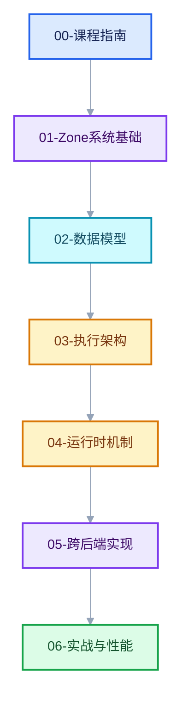

# 重复区域（Repeat Zone）全面学习

## 这套文档讲什么

重复区域是 Blender 几何节点（以及着色器/合成器节点树）中的通用循环结构：由 `GeometryNodeRepeatInput`（Repeat Input）与 `GeometryNodeRepeatOutput`（Repeat Output）两个节点圈出一个区域，区域内的节点体按 `Iterations` 输入指定的次数反复执行，前一轮的输出自动成为下一轮的输入，同时支持跨区域边界的 border link（穿越连线）与按需执行。

它处在 Blender 节点系统最核心的几条机制交汇处：

- **Zone 机制**：`bke::bNodeTreeZone` 如何圈定区域、如何配对输入/输出节点；
- **LazyFunction 执行图**：循环体如何被包装成一个函数、又如何按迭代数展开成执行图；
- **ComputeContext**：每一轮迭代如何拥有独立的上下文身份，日志、Viewer、副作用如何定位；
- **按需执行（usage inference）**：未使用的输出如何被裁剪，`iterations` 又为何永远被求值；
- **跨后端实现**：几何节点、合成器、GPU 着色器三套执行模型如何各自实现同一个语义。

## 课程地图

### [00-课程指南](00-课程指南/README.md)

| 文档 | 内容 |
| --- | --- |
| [01-学习路线与阶段验收](00-课程指南/01-学习路线与阶段验收.md) | 五个学习阶段的路线、每阶段交付物与验收标准 |
| [02-图表配色与阅读约定](00-课程指南/02-图表配色与阅读约定.md) | 全系列 mermaid 配色、链接格式与阅读方法 |
| [03-符号与源码索引](00-课程指南/03-符号与源码索引.md) | 全部关键类型/函数的定位表与文件覆盖索引 |

### 01-Zone 系统基础（区域从何而来）

| 文档 | 内容 |
| --- | --- |
| [01-NodeTreeZone区域表示与配对](01-Zone系统基础/01-NodeTreeZone区域表示与配对.md) | `bNodeTreeZone`/`bNodeTreeZones` 的构建、`parent_zone`/`child_zones` 树、输入输出节点配对规则 |
| [02-Zone输入输出与bundle迁移语义](01-Zone系统基础/02-Zone输入输出与bundle迁移语义.md) | Repeat Input/Output 节点的动态 socket 声明、`Item_` 标识符、trace_values 中的 bundle 迁移 |

### 02-Repeat区域数据模型（存储与编辑）

| 文档 | 内容 |
| --- | --- |
| [01-Repeat节点注册与UI](02-Repeat区域数据模型/01-Repeat节点注册与UI.md) | `node_geo_repeat.cc` 全文解析：注册、declare、insert_link、gather_link_searches |
| [02-DNA存储与NodeRepeatItem](02-Repeat区域数据模型/02-DNA存储与NodeRepeatItem.md) | `NodeGeometryRepeatInput/Output`、`NodeRepeatItem`、blend 读写与版本兼容 |
| [03-SocketItems通用条目框架](02-Repeat区域数据模型/03-SocketItems通用条目框架.md) | `NOD_socket_items.hh` 访问器协议、RepeatItemsAccessor、增删改查与 RNA/操作符 |

### 03-几何节点执行架构（循环如何被编译）

| 文档 | 内容 |
| --- | --- |
| [01-ZoneBodyFunction与ZoneBuildInfo](03-几何节点执行架构/01-ZoneBodyFunction与ZoneBuildInfo.md) | `geometry_nodes_lazy_function.cc` 中 zone 构建总流程：构建顺序、body graph、wrapper 接口 |
| [02-Repeat循环体函数构建详解](03-几何节点执行架构/02-Repeat循环体函数构建详解.md) | `build_zone_body_function` 逐段解析：main/border link/reference set 三组索引 |
| [03-执行图按迭代展开](03-几何节点执行架构/03-执行图按迭代展开.md) | `initialize_execution_graph` 逐段解析：body 节点复制、成对串联、or 节点、索引映射 |

### 04-运行时机制（每一轮如何执行）

| 文档 | 内容 |
| --- | --- |
| [01-RepeatEvalStorage与一次求值](04-运行时机制/01-RepeatEvalStorage与一次求值.md) | storage 生命周期、`execute_impl`、RemappedParams、0 次迭代与默认值路径 |
| [02-ComputeContext与迭代身份](04-运行时机制/02-ComputeContext与迭代身份.md) | `RepeatZoneComputeContext`、hash 构造、wrapper 借用栈、缓存与 viewer path |
| [03-副作用迭代与按需执行](04-运行时机制/03-副作用迭代与按需执行.md) | `RepeatZoneSideEffectProvider`、`iterations_by_iteration_zone`、usage inference 对 repeat 的特判 |

### 05-跨后端实现（同一语义的三种执行）

| 文档 | 内容 |
| --- | --- |
| [01-合成器RepeatZoneOperation](05-跨后端实现/01-合成器RepeatZoneOperation.md) | 合成器逐迭代构造 ZoneTreeOperation、Result 共享、取消处理 |
| [02-GPU着色器与GPU_stack_link_zone](05-跨后端实现/02-GPU着色器与GPU_stack_link_zone.md) | `REPEAT_BEGIN/END` 宏、zone GPU 编译路径、与几何节点模型的差异 |

### 06-实战与性能

| 文档 | 内容 |
| --- | --- |
| [01-使用模式与迭代设计](06-实战与性能/01-使用模式与迭代设计.md) | 累积/收敛/分形/批次处理等模式，与 Simulation/Foreach/Closure 的选型对比 |
| [02-性能模型与开销分析](06-实战与性能/02-性能模型与开销分析.md) | 图构建成本、隐式共享与写时复制、迭代数缩放、诊断工具（logged_zone_graphs、计时器） |

### 07-调用栈与调试（代码如何被跑起来）

| 文档 | 内容 |
| --- | --- |
| [01-主线程栈与depsgraph求值链路](07-调用栈与调试/01-主线程栈与depsgraph求值链路.md) | `WM_main` → `TaskPool::work_and_wait` 五层职责、构建期与执行期的分界、分阶段求值 |
| [02-Task与任务隔离](07-调用栈与调试/02-Task与任务隔离.md) | POD 概念详解、`Task` 为何不是 POD、`wait()` 会干活的现场证据、`CacheMutex`/`isolate`/`FunctionRef` |

### 08-窗口系统与核心类型（界面如何跑起来）

| 文档 | 内容 |
| --- | --- |
| [01-WM主循环与核心数据类](08-窗口系统与核心类型/01-WM主循环与核心数据类.md) | `WM_main` 四步、`bContext`/`wmWindowManager`/`wmWindow`/`bScreen`/`ScrArea`/`ARegion` 的定义与创建时序、七个设计决策 |
| [02-main函数全文解析](08-窗口系统与核心类型/02-main函数全文解析.md) | `creator.cc` L325-687 逐段：启动的 12 个阶段、五趟参数解析、依赖顺序表、15 个设计决策 |
| [03-启动术语与构建形态详解](08-窗口系统与核心类型/03-启动术语与构建形态详解.md) | CRT/`__scrt`/SEH 详解（含本机 MSVC 源码）、`main_python_enter` 触发链、`WITH_HEADLESS` vs `-b`、GHOST 由来、PyCapsule 退出检测 |
| [04-.inl与调用约定与命名约束](08-窗口系统与核心类型/04-inl与调用约定与命名约束.md) | `.inl` 的组织方式、`__cdecl` 调用约定、`tp_dealloc` 契约、哪些名字可以改 |
| [05-内存模型与Global与类型注册](08-窗口系统与核心类型/05-内存模型与Global与类型注册.md) | `malloc`/`new`/`MEM_new` 三层体系、`Global`/`G_MAIN`、`CPPType` 注册体系、同名类型辨析 |

### 附录

| 文档 | 内容 |
| --- | --- |
| [90-实现依赖专题README](90-实现依赖专题/README.md) | 逐文件实现索引（含 `geometry_nodes_repeat_zone.cc` 全文教学版） |
| [91-验收报告](91-验收报告.md) | 全系列验收结论与已知边界 |

## 阅读建议

- 想快速理解"循环是怎么跑起来的"：读 03-01、03-03、04-01 三篇即可。
- 想改 Repeat Zone 的代码：先读 02 章数据模型，再读 03-01 的索引表，最后读 04 章。
- 想对比三种后端：读 03 章（几何节点）、05-01（合成器）、05-02（GPU）。
- 想在调试器里断点定位：读 07-01，先搞清构建期/执行期与线程分工，再打条件断点。
- 想看懂 Blender 编辑器/窗口相关代码：读 08-01，先搞清 `bContext` 与各类的拥有关系。

