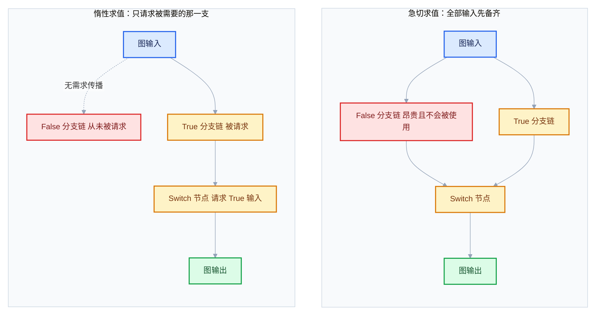
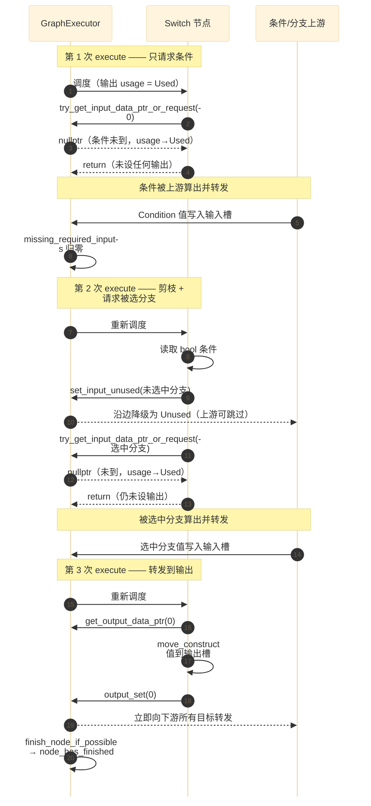
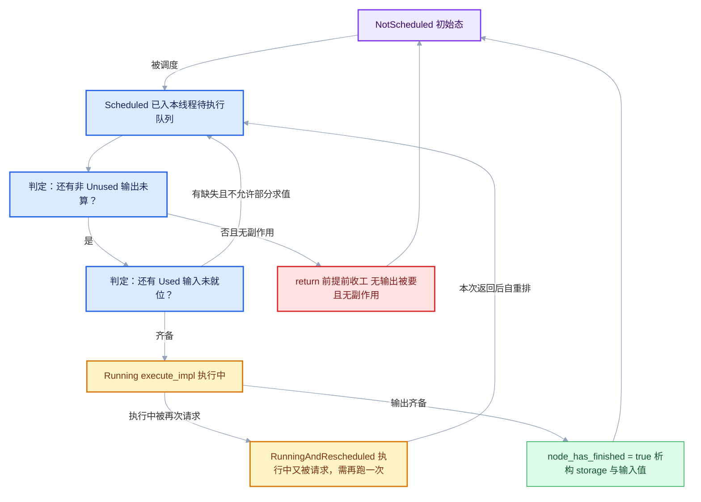
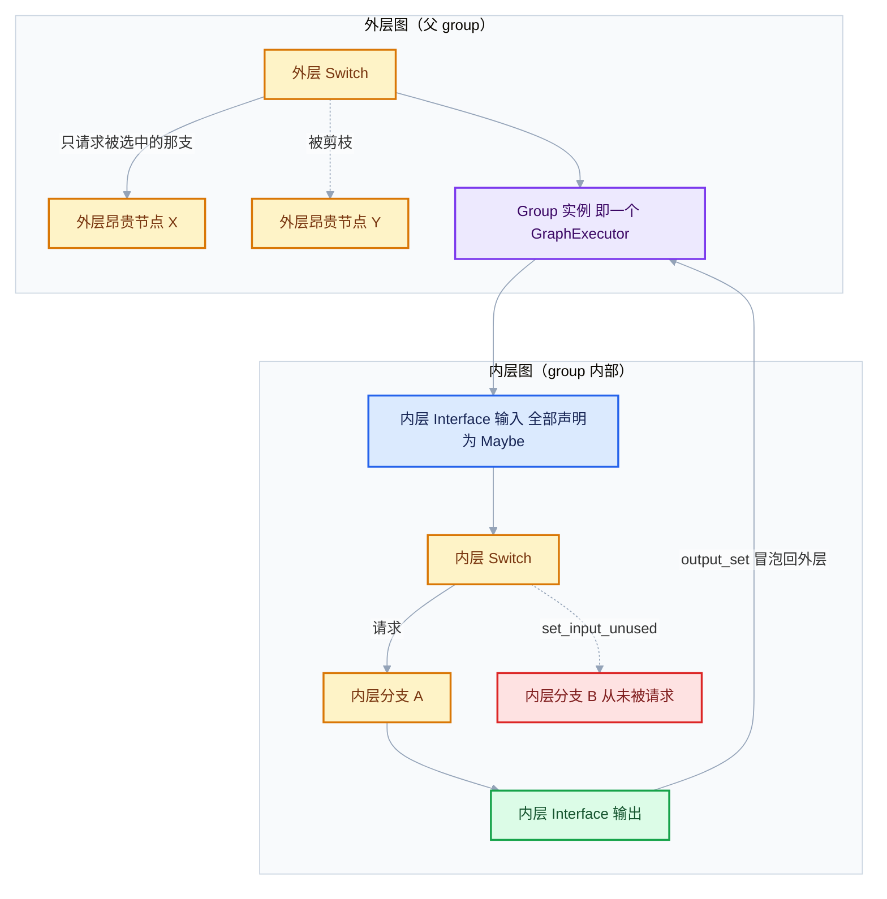
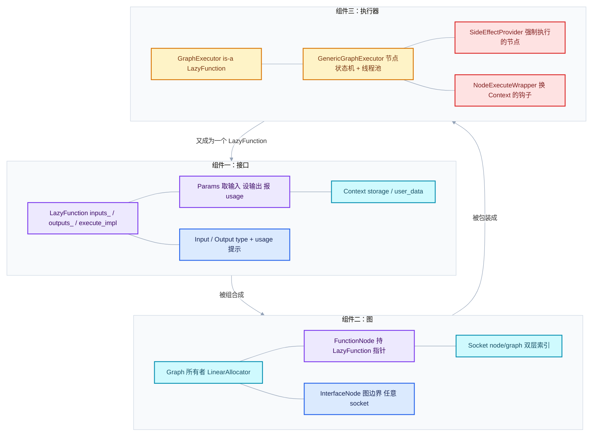
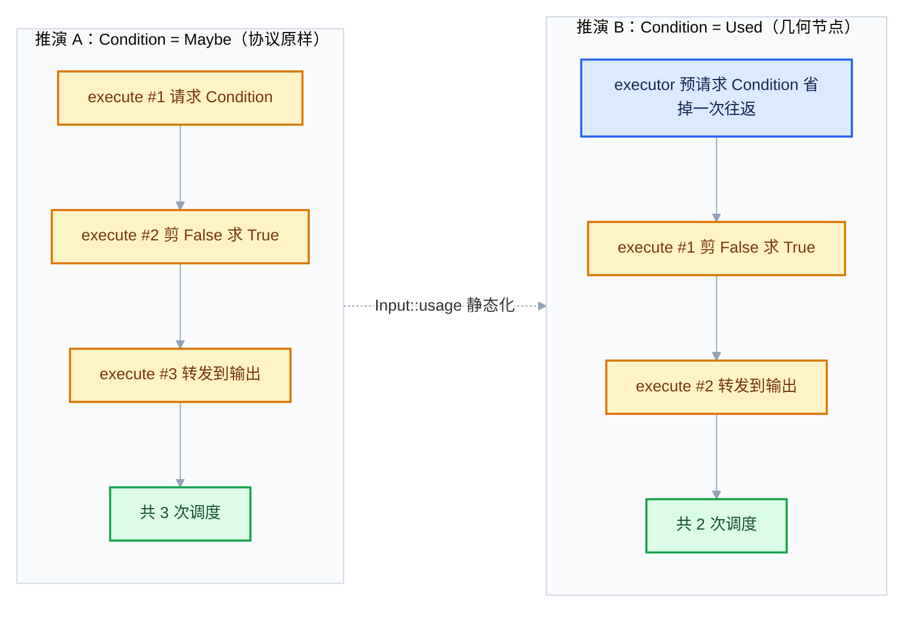
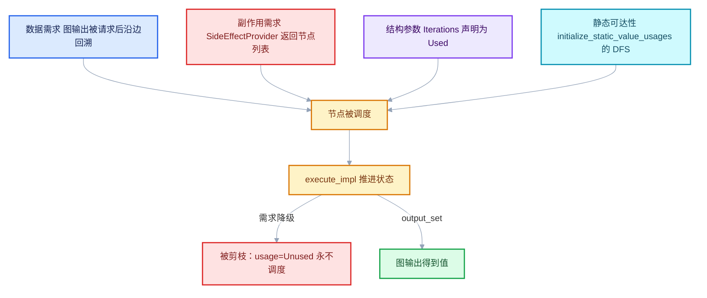

# 01 惰性求值模型与状态机

本篇是整个前置知识体系的第一篇，只回答一件事：**"惰性求值"到底是什么，为什么它天然长得像一台状态机**。这个模型是后面所有内容的母体—— `Params` 的调用约定、`ValueUsage` 的三值传播、`lf::Graph` 的构图规则、 `GraphExecutor` 的调度状态、直到 Repeat Zone 的"按需执行 + 副作用强制"，全部都是这一个模型的推论。

## 先回答一个具体问题

**问题：为什么几何节点的 Switch 能让未选中的那个分支完全不执行？**

搭一个最小节点树：

```text
[Index 巨大的网格 A] ──(几何)──┐
                              ├─[Switch]──(几何)──[Group Output / 末端]
[Index 巨大的网格 B] ──(几何)──┘
        ▲
        │
   [Boolean: False]  ──(Switch 的 Switch 输入)
```

你把布尔开关拨到 `False`，然后转动视角、改参数。直觉上，"B 的计算成本被省掉了"。可是——**图是静态的**：两条连线都在那儿，两个上游节点都在图里，没有任何一行代码"根据布尔值决定要不要建节点"。那么省掉的到底是什么？

先给结论，再用整篇去证明它：

1. **省掉的不是"节点"，而是"这一次求值中，`False` 输入背后的那条子图的需求（usage）"**。Executor 从不删除节点；它只是永远不去向那些节点索要值。没有被索要的输出，其生产者就不会被调度。
2. 这个"不索要"的决定**发生在运行时，而且是可以分几次做出的**。Switch 节点第一次被调用时还看不到布尔值，它必须先"请求"布尔值然后 **退出**（return，而不是阻塞等待）。等布尔值到了，它再被调用一次，这时才知道该向谁要值。这就是"执行多次"的来源。
3. 因为"执行一次"只推进一小步状态，`LazyFunction` 在工程上必须被当成 **一台状态机**，而不是一个普通函数。文件头注释把这句话写得很直接：

> "In some sense, a lazy-function can be thought of like a state machine. > Every time it is executed, it advances its state until all required > outputs are ready." > —— [FN_lazy_function.hh · L28-L29](../../../source/blender/functions/FN_lazy_function.hh#L28-L29)

注意这句话里的两个限定：**"every time it is executed"**（每次执行是一个离散事件，不是一次跑完）和 **"advances its state"**（每次执行必须让状态前进，不能原地打转）。后面第 5 节会把这两条拆成可检验的规则。

## 急切求值的困境

要理解惰性，最好的办法是先看"如果不惰性"会怎样。设想把执行模型改成最朴素的**急切求值（eager evaluation）**：一个节点要执行，就先把所有输入算出来；图怎么连就怎么算，从叶子一路往上。

这个模型非常简单、非常可预测，而且在很多场景下完全够用（`MultiFunction` 的普通调用就是这样）。但放到几何节点的规模上，它会同时撞上三堵墙。

### 困境一：浪费计算（数量级上的浪费）

几何节点里"贵"的操作集中在少数几类：`Index Switch` / `Distribute Points` / `Raycast` / `Sample Nearest` / `Mesh Boolean` / `Subdivision Surface`。一个典型的生产节点树里，这类节点往往被包在 3–5 层 Switch 或 `Menu Switch` 后面——因为作者就是想让它们在特定配置下才跑。

在急切模型下，`False` 分支的那一整条链仍然要被算出来，算完再被丢弃。丢弃的代价不是零：一个百万面的网格在 `Subdivision Surface` 之后再做一次 `Sample Nearest`，可能在几十毫秒到几百毫秒之间。而用户拨动开关的目的，恰恰是"这次不要跑它"。

更糟的是**这种浪费是递归的**。Group 里面套 Group，Group 里再套 Switch：急切模型会把每一个 group 的全部输入都先算出来，于是"外层一个布尔值" 无法裁剪"内层任何一个节点"。这直接摧毁了几何节点最重要的组织手段——把昂贵逻辑封进 group，用开关控制它跑不跑。

### 困境二：触发不该触发的副作用

如果节点树里存在**副作用节点**，急切求值的后果就不只是"慢"，而是 "错"。几何节点里典型的副作用来源：

- `Viewer`（把值送进电子表格 / Viewer 面板）；
- 属性存储类节点（`Store Named Attribute` 在特定域上写属性）；
- 几何节点里的告警与日志（`NodeWarningType`）；
- 更外围的：缓存、外部数据读取。

假设你把 `Viewer` 挂在 `True` 分支上，而开关是 `False`。急切模型会把 `True` 分支算完——于是 Viewer 面板里出现了你**根本没选中**的那条分支的数据。用户看到的是自相矛盾的结果，而代码层面没有任何 bug：它确实把所有输入都算了。

Blender 对这个问题的处理方式是**不对称的**：惰性求值负责"不该算的别算"，同时提供一个显式的"副作用强制"通道，让确实必须执行的节点**即使没人要它的输出也要执行**。这个通道在 `GraphExecutorSideEffectProvider` 里：

> "Has to be implemented when some of the nodes in the graph may have side > effects. The `GraphExecutor` has to know about that to make sure that these > nodes will be executed even though their outputs are not needed." > —— [FN_lazy_function_graph_executor.hh · L62-L71](../../../source/blender/functions/FN_lazy_function_graph_executor.hh#L62-L71)

也就是说：**惰性 ≠ 懒惰**。惰性求值不是"能不算就不算"，而是 "**只算被声明为需要的东西**"，而"需要"由两路来源共同定义——数据需求（usage）与副作用声明（side effect）。这一点在第 9 节 "反例与边界"里还会再钉一次。

### 困境三：无法处理（表面上的）循环依赖

第三个困境更本质。惰性函数图**允许存在环**，只要环里没有真实的数据依赖。测试用例把这件事写得很清楚：

```cpp
graph.add_link(input_socket, fn_node.input(0));
/* NOTE: This creates a cycle in the graph. However, it should still be possible to evaluate it,
 * because there is no actual data dependency in the cycle. */
graph.add_link(fn_node.output(0), fn_node.input(1));
graph.add_link(fn_node.output(1), output_socket);
```

—— [FN_lazy_function_test.cc · L169-L173](../../../source/blender/functions/tests/FN_lazy_function_test.cc#L169-L173)

拓扑上这是一个环：`fn` 的输出 0 喂给自己的输入 1。但**语义上**没有环：输出 1 只依赖输入 1，而输入 1 来自输出 0，输出 0 只依赖输入 0（也就是图输入）。真正被请求的是输出 1 → 需要输入 1 → 需要输出 0 → 需要输入 0（已有）→ 输出 0 算出 → 输入 1 到位 → 输出 1 算出。

急切求值做不到这件事：它必须在执行前把输入备齐，而"输入 1 需要输出 0" 在急切模型里就变成了"要执行这个节点，先执行这个节点"。拓扑排序直接失败。

惰性求值天然处理它，因为**依赖关系不是由图结构决定的，而是由运行时的请求顺序决定的**。同一个环，如果这次只请求输出 0，环根本不会被走到。

> "If true, the function can be executed even when some requested inputs are > not available yet. This allows the function to make some progress and maybe > to compute some outputs that are passed into this function again > (lazy-function graphs may contain cycles as long as there aren't actually > data dependencies)." > —— [FN_lazy_function.hh · L308-L313](../../../source/blender/functions/FN_lazy_function.hh#L308-L313)

`allow_missing_requested_inputs_` 这个字段就是为"部分求值"准备的。测试里的 `PartialEvaluationTestFunction` 把它设为 `true`，然后逐个输出独立判断"我需要的那个输入到了没有"：

```cpp
class PartialEvaluationTestFunction : public LazyFunction {
 public:
  PartialEvaluationTestFunction()
  {
    debug_name_ = "Partial Evaluation";
    allow_missing_requested_inputs_ = true;

    inputs_.append_as("A", CPPType::get<int>(), ValueUsage::Used);
    inputs_.append_as("B", CPPType::get<int>(), ValueUsage::Used);

    outputs_.append_as("A*2", CPPType::get<int>());
    outputs_.append_as("B*5", CPPType::get<int>());
  }
```

—— [FN_lazy_function_test.cc · L122-L134](../../../source/blender/functions/tests/FN_lazy_function_test.cc#L122-L134)

三堵墙小结（这张图对比的是**一次求值中被触达的节点集合**）：



## 惰性求值的两条核心承诺

整个模型只靠两条承诺支撑。它们的原文只有四行，但每一行都有精确的工程含义。

> "Most importantly, a `LazyFunction` supports laziness in its inputs and outputs: > - Only outputs that are actually used have to be computed. > - Inputs can be requested lazily based on which outputs are used or what side >   effects the function has." > —— [FN_lazy_function.hh · L11-L14](../../../source/blender/functions/FN_lazy_function.hh#L11-L14)

### 承诺一：输出按需 —— "只有真正被用到的输出才需要被计算"

这句话是**对调用者（executor）的约束**，不是对函数实现的建议。

- Executor 必须告诉函数："这一次，你的哪个输出是被要的"。这个信息通过 `Params::get_output_usage(int)` 暴露：

  ```cpp
  /**
   * Can be used to detect which outputs have to be computed.
   */
  ValueUsage get_output_usage(int index) const;
  ```

  —— [FN_lazy_function.hh · L155-L158](../../../source/blender/functions/FN_lazy_function.hh#L155-L158)

- 所以"某个输出没人要"是**合法的运行状态**。函数可以让它一直空着，直到整个节点被判定为"完成"。判定逻辑在 executor 的 `finish_node_if_possible` 里：

  ```cpp
  /* If there are outputs that may still be used, the node is not done yet. */
  for (const int output_index : node.outputs().index_range()) {
    const OutputState &output_state = node_state.outputs[output_index];
    if (output_state.usage != ValueUsage::Unused && !output_state.has_been_computed) {
      return;
    }
  }
  ```

  —— [lazy_function_graph_executor_generic.hh · L1023-L1029](../../../source/blender/functions/intern/lazy_function_graph_executor_generic.hh#L1023-L1029)

注意判断条件是 `usage != ValueUsage::Unused`，而不是 `usage == Used`。这是**保守**的写法：`Maybe` 也算"可能还要"，所以节点不会因为输出暂时没算而提前收工。只有在需求被明确降级成 `Unused` 之后，节点才能结束。

- 有一个容易被忽略的推论：**输出之间有优先级**。当函数有多个输出、只有一个被 `Used` 时，函数完全可以只算那一个，把剩下的留给"也许永远不会到来的下一次执行"。这就是为什么 `LazyFunction::execute` 的文档要写 "After execution, the function either has computed all required outputs or is waiting for more inputs."（[FN_lazy_function.hh · L296-L301](../../../source/blender/functions/FN_lazy_function.hh#L296-L301)）

### 承诺二：输入按需 —— "输入可以基于输出用途或副作用被惰性请求"

这句话是**对函数实现的授权**：函数有权在执行到一半时说"我还缺某个输入，先让我退出"。

授权的载体是两个 `Params` 方法：

| 方法 | 语义 | 半途退出的能力 |
| --- | --- | --- |
| `try_get_input_data_ptr(i)` | 只问"到了没有"，到就返回指针，没到返回 `nullptr`，**不产生需求** | 有，但不会促成计算 |
| `try_get_input_data_ptr_or_request(i)` | 到就返回指针；没到就**登记需求**并返回 `nullptr` | 有，且会促成上游计算 |
| `get_input<T>(i)` | 断言"一定到了"，取引用 | **没有**，用错就是断言失败 |
| `extract_input<T>(i)` | 断言"一定到了"，移动取出 | **没有** |

四种取法的区别是初学者最容易踩的坑。`try_get_input_data_ptr_or_request` 的"登记需求"具体做了什么？在 `BasicParams` 里只有一行：

```cpp
void *BasicParams::try_get_input_data_ptr_or_request_impl(const int index)
{
  void *value = inputs_[index].get();
  if (value == nullptr) {
    input_usages_[index] = ValueUsage::Used;
  }
  return value;
}
```

—— [lazy_function_execute.cc · L37-L44](../../../source/blender/functions/intern/lazy_function_execute.cc#L37-L44)

**"请求"就是"把 usage 提升为 `Used`"**。没有别的魔法。在真正的图执行器里，这一步会连锁触发上游节点被调度（第 7 节会看到 `set_input_required` 与 `forward_value_to_input` 如何配合）。

反过来，函数还可以**主动放弃**一个输入：

```cpp
/**
 * Tell the caller of the #LazyFunction that a specific input will definitely not be used.
 * Only an input that was not #ValueUsage::Used can become unused.
 */
void set_input_unused(int index);
```

—— [FN_lazy_function.hh · L160-L164](../../../source/blender/functions/FN_lazy_function.hh#L160-L164)

这条注释里有一个**硬约束**："只有原本不是 `Used` 的输入才能变成 unused"。Executor 侧用断言守住它：

```cpp
BLI_assert(input_state.usage != ValueUsage::Used);
if (input_state.usage == ValueUsage::Unused) {
  return;
}
input_state.usage = ValueUsage::Unused;
```

—— [lazy_function_graph_executor_generic.hh · L1092-L1096](../../../source/blender/functions/intern/lazy_function_graph_executor_generic.hh#L1092-L1096)

为什么这条约束如此重要？因为 `Used` 意味着"上游已经在算了，或者已经算完了"。此时宣布"我不要了"并不能撤回上游的工作量，只会制造状态不一致——上游可能已经把值放进来了，而下游声称不要，值就泄漏了。所以 **`set_input_unused` 只能用在 `Maybe`（或已 `Unused`）的输入上**。Switch 之所以能给不需要的分支打上 `Unused`，正是因为它在声明时把这两个输入标成了 `Maybe`。

### 两条承诺合起来说了什么

把两条承诺并排放，会看到它们其实是同一件事的两个方向：

| 方向 | 承诺 | 载体 | 触发点 |
| --- | --- | --- | --- |
| 向上（拉） | 输入按需请求 | `try_get_input_data_ptr_or_request` | 函数内部，运行时 |
| 向下（推） | 输出按需计算 | `get_output_usage` / `output_set` | Executor 通知 + 函数回报 |
| 向上（剪） | 输入可放弃 | `set_input_unused` | 函数内部，运行时 |
| 向下（知） | 输出完成通知 | `output_set` / `output_was_set` | 函数内部，`output_set` 之后 |

**没有第四条"向下剪枝"**。函数不能对 executor 说"这个输出你们别要了"——输出需求是调用者决定的，函数只能读取它。这个不对称不是设计疏漏，而是必要性使然：如果生产者能单方面取消消费者的需求，那么"图输出被请求" 这个最顶层的事实就不可靠了，整个 usage 传播会失去锚点。

## 状态机视角

现在进入本篇的核心。文件头注释用 Switch 节点做了三步演示，这是整个文档里信息密度最高的 6 行：

> "A lazy-function that uses laziness may be executed more than once. The most > common example is the geometry nodes switch node. Depending on a condition > input, it decides which one of the other inputs is actually used. From the > perspective of the switch node, its execution works as follows: > 1. The switch node is first executed. It sees that the output is used. Now it >    requests the condition input from the caller and exits. > 2. Once the caller is able to provide the condition input the switch node is >    executed again. This time it retrieves the condition and requests one of the >    other inputs. Then the node exits again, giving back control to the caller. > 3. When the caller computed the second requested input the switch node executes >    a last time. This time it retrieves the new input and forwards it to the >    output." > —— [FN_lazy_function.hh · L16-L26](../../../source/blender/functions/FN_lazy_function.hh#L16-L26)

### 三步完整展开

我把这三步拆成"进入时已知 / 做了什么 / 退出时状态"三段，逐条对照源码语义。

**第 1 次 execute**

| 项目 | 内容 |
| --- | --- |
| 触发原因 | 图输出被请求 → Switch 的输出变成 `Used` → 节点被调度 |
| 进入时已知 | 输出被要；`Condition` 未到；`False`/`True` 均未到 |
| 函数动作 | 请求 `Condition`（`try_get_input_data_ptr_or_request(0)`） |
| 返回值 | `nullptr`（未到） |
| 函数反应 | 直接 `return`，**不设任何输出** |
| 退出后状态 | `Condition` 的 usage 从 `Maybe` → `Used`；`missing_required_inputs += 1`；节点回到 `NotScheduled` |

**第 2 次 execute**

| 项目 | 内容 |
| --- | --- |
| 触发原因 | 上游把 `Condition` 的值转发进来 → `missing_required_inputs` 归零 → 重新调度 |
| 进入时已知 | 输出被要；`Condition` 已到；`False`/`True` 均未到 |
| 函数动作 | 取出布尔值；对**不被选中**的那一支调用 `set_input_unused`；对**被选中**的那一支调用 `try_get_input_data_ptr_or_request` |
| 返回值 | `nullptr`（被选中的那支还没算完） |
| 函数反应 | `return`，仍然不设输出 |
| 退出后状态 | 未被选中的输入 usage → `Unused`（并沿边把上游对应输出降级）；被选中的输入 usage → `Used`；`missing_required_inputs` 再 `+= 1` |

**第 3 次 execute**

| 项目 | 内容 |
| --- | --- |
| 触发原因 | 被选中分支的值被转发进来 |
| 进入时已知 | 输出被要；`Condition` 已到；被选中那一支已到；另一支 `Unused` |
| 函数动作 | `get_output_data_ptr(0)` → `move_construct` → `output_set(0)` |
| 返回值 | 有效指针 |
| 函数反应 | 设完输出；`output_set` 内部立即把值转发给所有下游输入 |
| 退出后状态 | 输出 `has_been_computed = true`；下游被唤醒；`finish_node_if_possible` 判定节点完成 |

### 时序图



### 最反直觉的一点：`execute` 可能被调用多次

大多数 C++ 程序员的肌肉记忆是"一个函数调用 = 一次完整的计算"。惰性函数打破这条直觉，而且是在**三个不同层次**上打破：

**层次一：同一次求值，多次 execute。** 就是上面三步。`FN_lazy_function.hh` L257-L305 的类声明里， `execute` 只是一层非虚包装，真正的实现在 `execute_impl`（L319-L324）。包装层做了两件事：性能剖析域，以及一个断言：

```cpp
inline void LazyFunction::execute(Params &params, const Context &context) const
{
  PRF_scope_with_name("LazyFunction", ProfileCategory::Default);
  PRF_scope_set_dynamic_name("%s", debug_name_);
  BLI_assert(this->always_used_inputs_available(params));
  this->execute_impl(params, context);
}
```

—— [FN_lazy_function.hh · L341-L347](../../../source/blender/functions/FN_lazy_function.hh#L341-L347)

那个断言检查的是"声明为 `Used` 的输入必须都已就位"：

```cpp
bool LazyFunction::always_used_inputs_available(const Params &params) const
{
  if (allow_missing_requested_inputs_) {
    return true;
  }
  for (const int i : inputs_.index_range()) {
    const Input &fn_input = inputs_[i];
    if (fn_input.usage == ValueUsage::Used) {
      if (params.try_get_input_data_ptr(i) == nullptr) {
        return false;
      }
    }
  }
  return true;
}
```

—— [lazy_function.cc · L50-L64](../../../source/blender/functions/intern/lazy_function.cc#L50-L64)

也就是说：**只要一个函数声明了 `Used` 输入，executor 就保证每次调用 `execute` 时它都在**。`allow_missing_requested_inputs_ = true` 是显式退出这个保证的开关（供 `GraphExecutor` 和部分求值测试使用，见 [lazy_function_graph_executor.cc · L49-L50](../../../source/blender/functions/intern/lazy_function_graph_executor.cc#L49-L50)）。

**层次二：不同求值之间，同一个函数对象被复用。** `LazyFunction` 对象是**无状态的**（`execute_impl` 是 `const` 方法），状态存在两处：`Context::storage`（函数私有，由 `init_storage` 分配）和 executor 的节点状态。所以同一个 `LazyFunction` 实例可以同时被几十个 `FunctionNode` 引用——Repeat Zone 就是靠这一点把同一个 `body_fn_.function` 加了 N 次（[geometry_nodes_repeat_zone.cc · L249-L252](../../../source/blender/nodes/intern/geometry_nodes_repeat_zone.cc#L249-L252)）。

```cpp
for ([[maybe_unused]] const int i : IndexRange(iterations)) {
  lf::FunctionNode &lf_node = lf_graph.add_function(*body_fn_.function);
  lf_body_nodes.add_new(&lf_node);
}
```

**同一个 `LazyFunction&`，N 个节点，各自独立的 storage。**

**层次三：节点可能被"唤醒又放弃"。** executor 有四种调度状态：

```cpp
enum class NodeScheduleState : uint8_t {
  NotScheduled,
  Scheduled,
  Running,
  RunningAndRescheduled,
};
```

—— [lazy_function_graph_executor_generic.hh · L62-L83](../../../source/blender/functions/intern/lazy_function_graph_executor_generic.hh#L62-L83)

其中 `RunningAndRescheduled` 的含义是"正在跑，且跑的过程中又被请求了"。代码注释解释了为什么需要它：

> "In this case the node run again. This state exists, because we don't want to > add the node to the task pool twice, because then the node might run twice at > the same time, which is not allowed. Instead, once the node is done running, > it will reschedule itself."

—— [lazy_function_graph_executor_generic.hh · L75-L82](../../../source/blender/functions/intern/lazy_function_graph_executor_generic.hh#L75-L82)

对应的收尾逻辑（`run_node_task` 末尾）：

```cpp
const bool reschedule_requested = node_state.schedule_state ==
                                  NodeScheduleState::RunningAndRescheduled;
node_state.schedule_state = NodeScheduleState::NotScheduled;
if (reschedule_requested && !node_state.node_has_finished) {
  this->schedule_node(locked_node, current_task, false);
}
```

—— [lazy_function_graph_executor_generic.hh · L975-L980](../../../source/blender/functions/intern/lazy_function_graph_executor_generic.hh#L975-L980)

### 状态机的形式化描述

把上面所有观察压缩成一台机器的定义：

| 组成部分 | 对应源码 | 说明 |
| --- | --- | --- |
| 状态集合 | `NodeState`（`inputs` / `outputs` / `missing_required_inputs` / `node_has_finished`） | 每个节点一份 |
| 输入符号 | "被调度"事件 | 只有被调度才会转移 |
| 转移函数 | `execute_impl` 的一次调用 | 必须前进，不能原地打转 |
| 终止条件 | 所有非 `Unused` 输出都已计算，且所有 `Used` 输入已就位 | `finish_node_if_possible` |
| 外部可见副作用 | `output_set` → 向下游转发 | 转移的结果会影响别的机器 |

用一张图表示单个节点的生命周期（注意 `Unused` 输出无需计算即可完成）：



## 组合性

第三条要展开的原文是组合性。它只有四行，但决定了整个系统的可扩展性：

> "The lazy-function interface is designed to support composition of many such > functions into a new lazy-functions, all while keeping the laziness working. > For example, in geometry nodes a switch node in a node group should still be > able to decide whether a node in the parent group will be executed or not. > This is essential to avoid doing unnecessary work." > —— [FN_lazy_function.hh · L31-L34](../../../source/blender/functions/FN_lazy_function.hh#L31-L34)

注意这句的措辞：**"a switch node in a node group should still be able to decide whether a node in the parent group will be executed or not"**。方向是从内向外——**内层的开关能裁剪外层的节点**。这比"外层开关裁剪内层"要强得多，也更难实现。

### 为什么"从内向外"这么难

设想三层结构：

```text
Group Output
  └─ Group 实例（内层 group）
        └─ Switch（在 group 内部）
              ├─ True  ─ 昂贵节点 X（在 group 内部）
              └─ False ─ 昂贵节点 Y（在 group 内部）
```

如果 group 是一个"黑盒函数"（急切求值），调用方必须先把 group 的所有输入算好。于是内层 Switch 只能在**输入已经算完之后**才做选择——裁剪失效。

惰性求值的做法是：**把整张图当成一个更大的 `LazyFunction`**。 `GraphExecutor` 本身就是 `LazyFunction` 的子类：

```cpp
class GraphExecutor : public LazyFunction {
```

—— [FN_lazy_function_graph_executor.hh · L91-L91](../../../source/blender/functions/FN_lazy_function_graph_executor.hh#L91-L91)

并且它的文件头注释直接把意图写出来：

> "This file provides means to create a `LazyFunction` from `Graph` (which could > then e.g. be used in another `Graph` again)." > —— [FN_lazy_function_graph_executor.hh · L7-L12](../../../source/blender/functions/FN_lazy_function_graph_executor.hh#L7-L12)

于是"图"和"函数"在类型上**互相闭合**：

- `Graph` 由多个 `LazyFunction` 组成（`Graph::add_function`）；
- `Graph` 可以包装成一个 `GraphExecutor`（它 **is-a** `LazyFunction`）；
- 这个 `GraphExecutor` 又能被加进另一个 `Graph`。

这是一个分形结构。任意深度的嵌套，在类型层面都只是"一个函数"。

### 惰性如何穿透

穿透的关键在于：`GraphExecutor` 作为 `LazyFunction` 时，**对外暴露的输入 usage 是 `Maybe`**：

```cpp
for (const int i : graph_inputs_.index_range()) {
  const OutputSocket &socket = *graph_inputs_[i];
  BLI_assert(socket.node().is_interface());
  inputs_.append({"In", socket.type(), ValueUsage::Maybe});
  graph_input_index_by_socket_index_[socket.index()] = i;
}
```

—— [lazy_function_graph_executor.cc · L52-L57](../../../source/blender/functions/intern/lazy_function_graph_executor.cc#L52-L57)

**所有图输入都是 `Maybe`，没有一个是 `Used`。** 这是整个组合性的技术基础。含义是：外层调用者**不需要**在调用 group 之前把任何输入算好；group 会在自己内部按需请求。

与此配套的是 `allow_missing_requested_inputs_ = true`：

```cpp
/* The graph executor can handle partial execution when there are still missing inputs. */
allow_missing_requested_inputs_ = true;
```

—— [lazy_function_graph_executor.cc · L49-L50](../../../source/blender/functions/intern/lazy_function_graph_executor.cc#L49-L50)

这两行合起来就是"可重入的惰性边界"：外层调度 group → group 内部发现需要某个输入 → 通过 `Params` 把需求**冒泡**到外层 → 外层去算 → 算完转发回来 → group 被重新调度，从上次的状态继续。

### 需求冒泡的实际路径



关键在两条虚线：**需求可以向下剪（`set_input_unused`），也可以向上冒（`try_get_input_data_ptr_or_request`）**，而这两条路径跨越 group 边界时**不需要任何特殊代码**——因为跨越边界的载体就是 `Params` 接口本身。 `RemappedParams` 负责把 group 内部的索引映射到外层的索引：

```cpp
void *RemappedParams::try_get_input_data_ptr_or_request_impl(const int index)
{
  return base_params_.try_get_input_data_ptr_or_request(input_map_[index]);
}
```

—— [lazy_function_execute.cc · L100-L103](../../../source/blender/functions/intern/lazy_function_execute.cc#L100-L103)

一行转发，索引重映射。整个"穿透"就靠这一行。

> 下一篇《02-LazyFunction接口契约》会逐字段讲清楚 `Params` 的七个虚方法 > 与 `RemappedParams` 的完整实现；再下一篇《03-Params调用约定》专门讲 > 线程许可与调用序。这里只需记住结论：**组合性不是额外机制，而是 > "接口足够窄"的副产品**。

## 三大组件

最后一段原文把系统切成三块：

> "The lazy-function system consists of multiple core components: > - The interface of a lazy-function itself including its calling convention. > - A graph data structure that allows composing many lazy-functions by >   connecting their inputs and outputs. > - An executor that allows multi-threaded execution or such a graph." > —— [FN_lazy_function.hh · L36-L40](../../../source/blender/functions/FN_lazy_function.hh#L36-L40)

（原文 "execution or such a graph" 里的 `or` 是上游笔误，应为 `of`。本系列所有引用原文的地方都保留原样，不做静默修正。）

### 组件一：接口（`LazyFunction` + `Params`）

| 类型 | 位置 | 职责 |
| --- | --- | --- |
| `LazyFunction` | [FN_lazy_function.hh · L247-L325](../../../source/blender/functions/FN_lazy_function.hh#L247-L325) | 声明输入/输出、持有 storage 生命周期、提供 `execute` 入口 |
| `Params` | [FN_lazy_function.hh · L109-L197](../../../source/blender/functions/FN_lazy_function.hh#L109-L197) | 调用约定：取输入、设输出、报告 usage、申请多线程 |
| `Input` / `Output` | [FN_lazy_function.hh · L202-L241](../../../source/blender/functions/FN_lazy_function.hh#L202-L241) | 类型 + 调试名 + **静态 usage 提示** |
| `Context` | [FN_lazy_function.hh · L83-L103](../../../source/blender/functions/FN_lazy_function.hh#L83-L103) | 三元组：`storage` / `user_data` / `local_user_data` |

`Input::usage` 的注释值得单独抄一遍，因为它解释了"静态 usage"和"运行时 usage"的分工：

> "Can be used to indicate a caller or this function if this input is used > statically before executing it the first time. This is technically not needed > but can improve efficiency because a round-trip through the `execute` method > can be avoided." > —— [FN_lazy_function.hh · L213-L219](../../../source/blender/functions/FN_lazy_function.hh#L213-L219)

**"技术上不必要，但能省掉一次 execute 往返"**。这句话是理解整个性能设计的钥匙：惰性协议是完备的，但每一次"请求-退出-重调度"都有固定开销（加锁、队列、重入）。所以凡是能静态知道的，就提前声明。

### 组件二：图（`lf::Graph`）

```cpp
/**
 * This file contains a graph data structure that allows composing multiple
 * lazy-functions into a combined lazy-function.
 *
 * There are two types of nodes in the graph:
 * - #FunctionNode: Corresponds to a #LazyFunction. The inputs and outputs of the
 *   function become input and output sockets of the node.
 * - #InterfaceNode: Is used to indicate inputs and outputs of the entire graph.
 *   It can have an arbitrary number of sockets.
 */
```

—— [FN_lazy_function_graph.hh · L7-L18](../../../source/blender/functions/FN_lazy_function_graph.hh#L7-L18)

只有两种节点，这是一个刻意的极简设计：

| 节点类型 | 是否有函数 | 用途 |
| --- | --- | --- |
| `FunctionNode` | 有（`fn_` 非空） | 承载一个 `LazyFunction` |
| `InterfaceNode` | 无（`fn_ == nullptr`） | 表示整张图的边界，socket 数量任意 |

判定方式就是看 `fn_` 是不是空：

```cpp
/**
 * The function this node corresponds to. If this is null, the node is an
 * #InterfaceNode. The function is not owned by this #Node nor by the #Graph.
 */
const LazyFunction *fn_ = nullptr;
```

—— [FN_lazy_function_graph.hh · L135-L139](../../../source/blender/functions/FN_lazy_function_graph.hh#L135-L139)

注意"**函数不被 node 也不被 graph 拥有**"。所有权在外面（几何节点里由 `GeometryNodesLazyFunctionGraphInfo` 持有）。这是 `LazyFunction` 无状态设计的直接后果，也是同一个函数能被复用 N 次的前提。

`socket` 的三层索引也值得记住：`index_in_node_`（节点内序号）、 `index_in_graph_`（全图唯一），加上 `index()` 返回节点内序号（[FN_lazy_function_graph.hh · L56-L73](../../../source/blender/functions/FN_lazy_function_graph.hh#L56-L73)）。Executor 全部用全图序号做数组下标，避免哈希表。

### 组件三：执行器（`GraphExecutor`）

| 类型 | 位置 | 职责 |
| --- | --- | --- |
| `GraphExecutor` | [FN_lazy_function_graph_executor.hh · L91-L153](../../../source/blender/functions/FN_lazy_function_graph_executor.hh#L91-L153) | 把 `Graph` 包装成一个 `LazyFunction`；惰性入口 |
| `GenericGraphExecutor` | [lazy_function_graph_executor_generic.hh](../../../source/blender/functions/intern/lazy_function_graph_executor_generic.hh)（1503 行） | 真正的调度器：节点状态、需求传播、线程池 |
| `GraphExecutorLogger` | [FN_lazy_function_graph_executor.hh · L25-L60](../../../source/blender/functions/FN_lazy_function_graph_executor.hh#L25-L60) | 调试钩子：socket 值、节点前后、缺失输出 |
| `GraphExecutorSideEffectProvider` | [FN_lazy_function_graph_executor.hh · L62-L71](../../../source/blender/functions/FN_lazy_function_graph_executor.hh#L62-L71) | 声明"哪些节点即使没人要输出也要跑" |
| `GraphExecutorNodeExecuteWrapper` | [FN_lazy_function_graph_executor.hh · L73-L89](../../../source/blender/functions/FN_lazy_function_graph_executor.hh#L73-L89) | 包裹节点执行，用来换 `Context` |

`GraphExecutor` 自身几乎没有逻辑——它把 storage 里的 `GenericExecutor` 取出来转发：

```cpp
void GraphExecutor::execute_impl(Params &params, const Context &context) const
{
  GenericExecutor &executor = *static_cast<GenericExecutor *>(context.storage);
  executor.execute(params, context);
}

void *GraphExecutor::init_storage(LinearAllocator<> &allocator) const
{
  GenericExecutor &executor = *allocator.construct<GenericExecutor>(*this).release();
  return &executor;
}
```

—— [lazy_function_graph_executor.cc · L68-L78](../../../source/blender/functions/intern/lazy_function_graph_executor.cc#L68-L78)

**这是"状态在 storage 里"这一原则的最纯粹体现**：`GraphExecutor` 是完全无状态的，所有调度状态都在 `init_storage` 分配的 `GenericExecutor` 里。所以一个 `GraphExecutor` 能同时被多个节点引用，各自有独立状态。

执行器自己的目标写得非常明确：

> "It's main objectives are: > - Only compute values that are actually used. > - Stay single threaded when nodes are executed quickly. > - Allow spreading the work over an arbitrary number of threads efficiently."

—— [lazy_function_graph_executor_generic.hh · L8-L11](../../../source/blender/functions/intern/lazy_function_graph_executor_generic.hh#L8-L11)

而且它明确继承了这个"状态机"心智模型：

> "Similar to how a `LazyFunction` can be thought of as a state machine > (see `FN_lazy_function.hh`), each node can also be thought of as a state > machine. The state of a node contains the evaluation state of its inputs and > outputs. Every time a node is executed, it has to advance its state in some > way (e.g. it requests a new input or computes a new output)."

—— [lazy_function_graph_executor_generic.hh · L30-L33](../../../source/blender/functions/intern/lazy_function_graph_executor_generic.hh#L30-L33)

### 三组件总览



## 与急切求值的对照表

把本篇讲的东西拉成一张对照表。为了让它有用，我不只对比 "LazyFunction vs 普通函数"，而是把三个真实存在的急切模型都放进来： `MultiFunction`（Blender 里最常见的批量算子）、`execute_lazy_function_eagerly` （测试用的一键急切执行包装）、以及朴素的手写 for 循环。

| # | 维度 | 急切求值 | 惰性求值 | 源码依据 |
| --- | --- | --- | --- | --- |
| 1 | 执行前输入是否必须齐备 | 必须全部齐备 | 只要求声明为 `Used` 的齐备 | `always_used_inputs_available`（lazy_function.cc L50-L64） |
| 2 | 一次调用的语义 | 一次调用算完所有输出 | 一次调用只推进状态，可能一个输出都不设 | 文件头 L28-L29 + L296-L301 |
| 3 | 调用次数 | 恰好一次 | 0 到 N 次（0 次 = 从未被调度） | 文件头 L16 |
| 4 | 输出裁剪 | 无法裁剪 | 未使用输出不计算 | `get_output_usage` L155-L158 |
| 5 | 分支裁剪 | 两支都算 | 只算被选中一支 | Switch L183-L199 |
| 6 | 无用输入的处置 | 已经算了，只能丢弃 | 可显式降级为 `Unused` 并释放 | `set_input_unused` L160-L164 |
| 7 | 环 | 拓扑排序失败 | 允许，只要无真实数据依赖 | L308-L313 + 测试 L170-L172 |
| 8 | 副作用 | 顺带发生（可能发生在被剪掉的分支上） | 需显式声明并强制调度 | `SideEffectProvider`（executor.hh L62-L71） |
| 9 | 组合方式 | 函数调用（黑盒，边界即屏障） | 图嵌套（边界可穿透） | 文件头 L31-L34 + `Maybe` 图输入 |
| 10 | 状态位置 | 调用栈 | `Context::storage` + `NodeState` | `init_storage` L269-L273 |
| 11 | 函数对象状态 | 可自由持有成员变量 | 必须无状态（`execute_impl` 为 `const`） | L301 / L324 |
| 12 | 并行化难度 | 需要外层并行（如 `parallel_for`） | 节点间天然可并行，由 executor 决定 | generic.hh L8-L11 + L13-L28 |
| 13 | 调试可见性 | 栈回溯 | 图 + 逐节点日志钩子 | `GraphExecutorLogger` L25-L60 |
| 14 | 最坏情况开销 | 全部输入 + 全部输出，恒定 | 可能多次调度往返（每输入一次） | `Input::usage` 注释 L213-L219 |

### 表格里的第 11 行值得单独强调

"函数必须无状态"这条约束在急切模型里是不可想象的——普通函数当然可以有成员变量。但 `LazyFunction::execute_impl` 是 `const`：

```cpp
virtual void execute_impl(Params &params, const Context &context) const = 0;
```

—— [FN_lazy_function.hh · L319-L324](../../../source/blender/functions/FN_lazy_function.hh#L319-L324)

这意味着**你不能在 `execute_impl` 里改任何成员变量**（除非 `mutable`，而那会立刻破坏多线程安全与多节点复用）。所有可变状态必须放 `storage`：

```cpp
/**
 * Allocates storage for this function. The storage will be passed to every call
 * to #execute. If the function does not keep track of any state, this does not
 * have to be implemented.
 */
virtual void *init_storage(LinearAllocator<> &allocator) const;
```

—— [FN_lazy_function.hh · L269-L273](../../../source/blender/functions/FN_lazy_function.hh#L269-L273)

默认实现返回 `nullptr`，析构时断言也是 `nullptr`：

```cpp
void *LazyFunction::init_storage(LinearAllocator<> & /*allocator*/) const
{
  return nullptr;
}

void LazyFunction::destruct_storage(void *storage) const
{
  BLI_assert(storage == nullptr);
  UNUSED_VARS_NDEBUG(storage);
}
```

—— [lazy_function.cc · L28-L37](../../../source/blender/functions/intern/lazy_function.cc#L28-L37)

**"无状态函数"和"有状态 storage"是一对必须同时重写的搭档**。只重写 `init_storage` 不重写 `destruct_storage`，在 debug 构建里会立刻断言失败。这是新手写自定义惰性节点的第一个坑。

## 教学注释代码

本节把两处关键代码做成"中文讲解 + 英文原文折叠"的形式。每一段都标注了精确行号，折叠区里是逐字原文，可以点开对照。

### 段一：文件头注释全文对照

[讲解]

这 35 行是整个惰性执行框架的规格说明书。它按六个部分组织：**定义** （L10-L14）→ **多次执行**（L16-L26）→ **状态机隐喻**（L28-L29）→ **组合性**（L31-L34）→ **三大组件**（L36-L40）。请特别注意它没有写的任何东西：没有写多线程、没有写内存管理、没有写缓存、没有写错误处理。这些全部留给了具体实现。规格说明书只规定"语义契约"，这是它能稳定支撑三层后端（几何节点 / 合成器 / GPU）的原因。

中文对照（按段落意译，保留术语原词）：

```cpp
/** \file
 * \ingroup fn
 *
 * 一个 `LazyFunction` 封装一次计算，它有输入、输出，以及可能的副作用。
 * 最重要的一点是：`LazyFunction` 在输入与输出两个方向上都支持惰性：
 * - 只有真正被用到的输出才需要被计算。
 * - 输入可以基于"哪些输出被用到"或"函数有什么副作用"被惰性请求。
 *
 * 一个使用了惰性的 lazy-function 可能被执行不止一次。最常见的例子是
 * 几何节点的 switch 节点。它根据一个条件输入，决定另外两个输入中哪一
 * 个真正被使用。从 switch 节点自身的视角看，它的执行过程如下：
 * 1. switch 节点第一次被执行。它看到输出被用到了。现在它向调用者请求
 *    条件输入，然后退出。
 * 2. 一旦调用者能够提供条件输入，switch 节点会被再次执行。这一次它取出
 *    条件，并请求另一个输入中的某一个。然后节点再次退出，把控制权交还
 *    给调用者。
 * 3. 当调用者算出了第二个被请求的输入，switch 节点最后执行一次。这一次
 *    它取出新的输入，并把它转发到输出。
 *
 * 在某种意义上，一个 lazy-function 可以被看成一台状态机。每一次它被
 * 执行，它就推进自己的状态，直到所有需要的输出都就绪。
 *
 * lazy-function 接口的设计目标是支持把许多这样的函数组合成一个新的
 * lazy-function，同时保持惰性继续生效。举例来说，在几何节点中，节点组
 * 内部的一个 switch 节点应当仍然能够决定父组中的某个节点是否会被执行。
 * 这对于避免做不必要的工作是至关重要的。
 *
 * lazy-function 系统由多个核心组件构成：
 * - lazy-function 自身的接口，包括它的调用约定。
 * - 一个图数据结构，允许通过连接输入与输出来组合许多 lazy-function。
 * - 一个执行器，允许对这样一张图进行多线程执行。
 */
```

[原文]

<details> <summary>展开：FN_lazy_function.hh L7-L41 英文原文</summary>

```cpp
/** \file
 * \ingroup fn
 *
 * A `LazyFunction` encapsulates a computation which has inputs, outputs and potentially side
 * effects. Most importantly, a `LazyFunction` supports laziness in its inputs and outputs:
 * - Only outputs that are actually used have to be computed.
 * - Inputs can be requested lazily based on which outputs are used or what side effects the
 *   function has.
 *
 * A lazy-function that uses laziness may be executed more than once. The most common example is
 * the geometry nodes switch node. Depending on a condition input, it decides which one of the
 * other inputs is actually used. From the perspective of the switch node, its execution works as
 * follows:
 * 1. The switch node is first executed. It sees that the output is used. Now it requests the
 *    condition input from the caller and exits.
 * 2. Once the caller is able to provide the condition input the switch node is executed again.
 *    This time it retrieves the condition and requests one of the other inputs. Then the node
 *    exits again, giving back control to the caller.
 * 3. When the caller computed the second requested input the switch node executes a last time.
 *    This time it retrieves the new input and forwards it to the output.
 *
 * In some sense, a lazy-function can be thought of like a state machine. Every time it is
 * executed, it advances its state until all required outputs are ready.
 *
 * The lazy-function interface is designed to support composition of many such functions into a new
 * lazy-functions, all while keeping the laziness working. For example, in geometry nodes a switch
 * node in a node group should still be able to decide whether a node in the parent group will be
 * executed or not. This is essential to avoid doing unnecessary work.
 *
 * The lazy-function system consists of multiple core components:
 * - The interface of a lazy-function itself including its calling convention.
 * - A graph data structure that allows composing many lazy-functions by connecting their inputs
 *   and outputs.
 * - An executor that allows multi-threaded execution or such a graph.
 */
```

</details>

### 段二：`ValueUsage` 三值 —— 需求的三档

[讲解]

整个需求传播系统只有一个枚举，三个值。它的精妙之处在于：**它有顺序**。 `Used` 是最强的需求，`Maybe` 是未知，`Unused` 是明确的否定。运行时只会朝一个方向降级（`Maybe → Unused`）或升级（`Maybe → Used`）， **绝不会在 `Used` 与 `Unused` 之间直接跳变**——这就是 `set_input_unused` 那条断言（L1092）的真正含义。

中文对照：

```cpp
enum class ValueUsage : uint8_t {
  /**
   * 这个值确实被用到，因此必须被计算。
   */
  Used,
  /**
   * 不知道这个值会不会被用到。计算它是允许的，但结果可能被丢弃。
   */
  Maybe,
  /**
   * 这个值确定不会被用到。它仍然可以被计算，但结果在任何情况下都会被丢弃。
   */
  Unused,
};
```

[原文]

<details> <summary>展开：FN_lazy_function.hh L61-L76 英文原文</summary>

```cpp
enum class ValueUsage : uint8_t {
  /**
   * The value is definitely used and therefore has to be computed.
   */
  Used,
  /**
   * It's unknown whether this value will be used or not. Computing it is ok but the result may be
   * discarded.
   */
  Maybe,
  /**
   * The value will definitely not be used. It can still be computed but the result will be
   * discarded in all cases.
   */
  Unused,
};
```

</details>

### 段三：Switch 的 `execute_single` —— 三步状态机的落地

[讲解]

这段代码只有 17 行，但它把文件头注释的三步全部实现了（去掉第一步的 "请求条件"，因为几何节点的 Switch 把 `Condition` 声明成了 `Used`，由 executor 提前备好，省掉一次往返——这正是 L213-L219 说的那类优化）。

逐行说明：

- `L185-L186`：先算出"要转发谁"和"要忽略谁"。两个索引是常量（L180-L181）。
- `L188`：`params.set_input_unused(input_to_ignore)` —— **剪枝发生在这里**。一行代码，未选中分支的整条上游链从此不再被请求。
- `L189`：`try_get_input_data_ptr_or_request(input_to_forward)` —— **请求发生在这里**。如果没到，返回 `nullptr`。
- `L190-L193`：`nullptr` 就 `return`。**不设输出、不报错、不留栈**。这就是"退出并把控制权交还调用者"。
- `L195-L198`：值到了，`get_output_data_ptr` + `move_construct` + `output_set`。注意用的是 `move_construct` 而不是 `copy_construct` ——输入值在这一刻被搬走，之后就不能再碰（L143-L147 的注释：调用 `output_set` 之后"the value must not be touched anymore"）。

```cpp
static constexpr int false_input_index = 1;
static constexpr int true_input_index = 2;

void execute_single(const bool condition, lf::Params &params) const
{
  const int input_to_forward = condition ? true_input_index : false_input_index;
  const int input_to_ignore = condition ? false_input_index : true_input_index;

  params.set_input_unused(input_to_ignore);
  void *value_to_forward = params.try_get_input_data_ptr_or_request(input_to_forward);
  if (value_to_forward == nullptr) {
    /* Try again when the value is available. */
    return;
  }

  const CPPType &type = *outputs_[0].type;
  void *output_ptr = params.get_output_data_ptr(0);
  type.move_construct(value_to_forward, output_ptr);
  params.output_set(0);
}
```

—— [node_geo_switch.cc · L180-L199](../../../source/blender/nodes/geometry/nodes/node_geo_switch.cc#L180-L199)

[原文]

<details> <summary>展开：node_geo_switch.cc L149-L199（构造 + execute_single）英文原文</summary>

```cpp
    debug_name_ = node.name;
    inputs_.append_as("Condition", CPPType::get<SocketValueVariant>());
    inputs_.append_as("False", cpp_type, lf::ValueUsage::Maybe);
    inputs_.append_as("True", cpp_type, lf::ValueUsage::Maybe);
    outputs_.append_as("Value", cpp_type);
  }

  void execute_impl(lf::Params &params, const lf::Context &context) const override
  {
    SocketValueVariant condition_variant = params.get_input<SocketValueVariant>(0);
    if (!condition_variant.is_context_dependent_field()) {
      this->execute_single(condition_variant.ensure_type<bool>(), params);
      return;
    }
    /* ... field 路径略，见段四 ... */
  }

  static constexpr int false_input_index = 1;
  static constexpr int true_input_index = 2;

  void execute_single(const bool condition, lf::Params &params) const
  {
    const int input_to_forward = condition ? true_input_index : false_input_index;
    const int input_to_ignore = condition ? false_input_index : true_input_index;

    params.set_input_unused(input_to_ignore);
    void *value_to_forward = params.try_get_input_data_ptr_or_request(input_to_forward);
    if (value_to_forward == nullptr) {
      /* Try again when the value is available. */
      return;
    }

    const CPPType &type = *outputs_[0].type;
    void *output_ptr = params.get_output_data_ptr(0);
    type.move_construct(value_to_forward, output_ptr);
    params.output_set(0);
  }
```

</details>

### 段四：`Index Switch` —— 循环版的同一台状态机

[讲解]

`Index Switch` 是 Switch 的 N 路推广，结构完全同构，只是"忽略"从一个输入变成 `N-1` 个，用循环表达：

- `L355-L359`：遍历所有分支，除了 `index` 那一个，全部 `set_input_unused`。注意 `if (i != index)` 这个判断——**选中分支不能被剪**，否则触发 `BLI_assert(input_state.usage != ValueUsage::Used)`（L1092）。
- `L362-L365`：越界检查。索引非法时不报错，而是把剩余输出设成默认值（`set_default_remaining_node_outputs`），节点正常完成。这是"错误也是一种合法状态"的体现。
- `L368-L371`：只请求被选中的那一个。
- `L373-L376`：同样的 `move_construct` + `output_set`。

把 Switch 和 Index Switch 并排看，会发现**惰性节点的实现有一个固定骨架**：算出该忽略谁 → 全部剪掉 → 请求该要的 → 没到就退出 → 到了就转发。这个骨架可以直接套用到你自己写的任何多路选择节点上。

```cpp
void execute_single(const int index, lf::Params &params) const
{
  const int values_num = this->values_num();
  for (const int i : IndexRange(values_num)) {
    if (i != index) {
      params.set_input_unused(value_inputs_start + i);
    }
  }

  /* Check for an invalid index. */
  if (!IndexRange(values_num).contains(index)) {
    set_default_remaining_node_outputs(params, node_);
    return;
  }

  /* Request input and try again if unavailable. */
  void *value_to_forward = params.try_get_input_data_ptr_or_request(index + value_inputs_start);
  if (value_to_forward == nullptr) {
    return;
  }

  const CPPType &type = *outputs_[0].type;
  void *output_ptr = params.get_output_data_ptr(0);
  type.move_construct(value_to_forward, output_ptr);
  params.output_set(0);
}
```

—— [node_geo_index_switch.cc · L352-L377](../../../source/blender/nodes/geometry/nodes/node_geo_index_switch.cc#L352-L377)

[原文]

<details> <summary>展开：node_geo_index_switch.cc L324-L377（构造 + execute_single）英文原文</summary>

```cpp
    lf_index_by_bsocket[index_socket.index_in_tree()] = inputs_.append_and_get_index_as(
        "Index", CPPType::get<SocketValueVariant>(), lf::ValueUsage::Used);
    lf_index_by_bsocket[output_socket.index_in_tree()] = outputs_.append_and_get_index_as(
        "Value", cpp_type);

    for (const int i : storage.items_span().index_range()) {
      const bNodeSocket &input = node.input_socket(value_inputs_start + i);
      lf_index_by_bsocket[input.index_in_tree()] = inputs_.append_and_get_index_as(
          input.identifier, cpp_type, lf::ValueUsage::Maybe);
    }
  }

  /* ... execute_impl / execute_field 略 ... */

  void execute_single(const int index, lf::Params &params) const
  {
    const int values_num = this->values_num();
    for (const int i : IndexRange(values_num)) {
      if (i != index) {
        params.set_input_unused(value_inputs_start + i);
      }
    }

    /* Check for an invalid index. */
    if (!IndexRange(values_num).contains(index)) {
      set_default_remaining_node_outputs(params, node_);
      return;
    }

    /* Request input and try again if unavailable. */
    void *value_to_forward = params.try_get_input_data_ptr_or_request(index + value_inputs_start);
    if (value_to_forward == nullptr) {
      return;
    }

    const CPPType &type = *outputs_[0].type;
    void *output_ptr = params.get_output_data_ptr(0);
    type.move_construct(value_to_forward, output_ptr);
    params.output_set(0);
  }
```

</details>

### 段五：Switch 在 `field` 下放弃剪枝 —— 边界案例

[讲解]

同一份代码里有一个极其重要的"失败"分支：当条件不是常量，而是一个 **字段（Field）** 时，剪枝**不可能**发生，因为"选哪支"取决于每个元素自己的条件值——可能一半元素走 `True`，一半走 `False`。于是代码改为 **同时请求两支**：

```cpp
void execute_field(Field<bool> condition, lf::Params &params) const
{
  /* When the condition is a non-constant field, we need both inputs. */
  auto *false_value_variant = params.try_get_input_data_ptr_or_request<SocketValueVariant>(
      false_input_index);
  auto *true_value_variant = params.try_get_input_data_ptr_or_request<SocketValueVariant>(
      true_input_index);
  if (ELEM(nullptr, false_value_variant, true_value_variant)) {
    /* Try again when inputs are available. */
    return;
  }
  /* ... 构造 switch multi-function 的 FieldOperation ... */
}
```

—— [node_geo_switch.cc · L201-L225](../../../source/blender/nodes/geometry/nodes/node_geo_switch.cc#L201-L225)

**这是理解"惰性的边界"最好的例子**。惰性不是万能的；它建立在 "选择在求值前可确定"这个前提上。字段化之后，选择变成了**逐元素**的运行时行为，执行器层面无法预知，只能把两支都拉进来，把选择推给 `MultiFunction`（L227-L247 的 `get_switch_multi_function`）。

[原文]

<details> <summary>展开：node_geo_switch.cc L201-L225 英文原文</summary>

```cpp
  void execute_field(Field<bool> condition, lf::Params &params) const
  {
    /* When the condition is a non-constant field, we need both inputs. */
    auto *false_value_variant = params.try_get_input_data_ptr_or_request<SocketValueVariant>(
        false_input_index);
    auto *true_value_variant = params.try_get_input_data_ptr_or_request<SocketValueVariant>(
        true_input_index);
    if (ELEM(nullptr, false_value_variant, true_value_variant)) {
      /* Try again when inputs are available. */
      return;
    }

    const MultiFunction &switch_multi_function = this->get_switch_multi_function();

    GField false_field = std::move(false_value_variant->ensure_type<GField>());
    GField true_field = std::move(true_value_variant->ensure_type<GField>());

    GField output_field{FieldOperation::from(
        switch_multi_function,
        {std::move(condition), std::move(false_field), std::move(true_field)})};

    void *output_ptr = params.get_output_data_ptr(0);
    new (output_ptr) SocketValueVariant(SocketValueVariant::from(std::move(output_field)));
    params.output_set(0);
  }
```

</details>

### 段六：Switch 状态推演伪代码

[讲解]

下面这段伪代码把"状态机"写得可以照着实现。它不是源码，而是把文件头注释的三步 + 源码里的 `ValueUsage` 语义压成一个可执行的骨架。每一处 `// 状态` 注释标出的是**退出后必须成立的事实**——这些才是 "状态机"里真正的状态，而不是 C++ 变量。

```cpp
// ============================================================
// Switch 节点的完整状态推演（伪代码，用于理解，不可编译）
// 输入: 0=Condition(bool)  1=False(值)  2=True(值)
// 输出: 0=Value
// 声明: Condition=Used, False=Maybe, True=Maybe
// ============================================================

execute_switch(Params& params):
    // ---- 前置不变量（每次进入都成立）----
    // Cond 已到：因为声明为 Used，executor 保证它齐备，
    //            否则 L345 的断言会先炸。
    bool cond = params.get_input<bool>(0);

    // ---- 决定谁是赢家、谁是输家 ----
    int winner = cond ? 2 : 1;
    int loser  = cond ? 1 : 2;

    // ---- 动作 1：剪枝（必须在请求之前）----
    params.set_input_unused(loser);
    // 状态: loser.usage = Unused
    //       并沿边把 loser 的上游输出降级
    //       若 loser 已有值，值被析构释放

    // ---- 动作 2：请求 ----
    void* v = params.try_get_input_data_ptr_or_request(winner);

    if v == nullptr:
        // 状态: winner.usage = Used
        //       missing_required_inputs += 1
        //       本节点仍未被判定完成
        return            // 退出，交还控制权；下一轮从这里"重新开始"
                          // 注意：重新开始时 cond 仍可读到，剪枝会重做一遍
                          //（幂等：第二次 set_input_unused 直接 return）

    // ---- 动作 3：转发 ----
    void* out = params.get_output_data_ptr(0);
    move_construct(v, out);       // v 被搬走，之后不可再读
    params.output_set(0);
    // 状态: output.has_been_computed = true
    //       值立即转发给所有下游目标
    //       若这是最后一个非 Unused 输出 → node_has_finished = true
    //       → storage 析构、Used 输入值析构、Maybe 输入自动降级 Unused
    return
```

这段伪代码里有三个"陷阱"，每一个都对应真实源码里的一行保护：

| 陷阱 | 后果 | 源码里的保护 |
| --- | --- | --- |
| 先请求后剪枝 | 未选中分支被无谓调度 | 段三 L188 在 L189 之前 |
| 对 `winner` 也调 `set_input_unused` | 断言失败 | generic.hh L1092 `!= Used` |
| 值到了却不 `output_set` | debug 构建断言失败 | generic.hh L984-L1012 |

第三条的保护是这样写的：

```cpp
if (output_state.usage_for_execution == ValueUsage::Used) {
  if (!output_state.has_been_computed) {
    missing_outputs.append(&node.output(i));
  }
}
```

—— [lazy_function_graph_executor_generic.hh · L997-L1004](../../../source/blender/functions/intern/lazy_function_graph_executor_generic.hh#L997-L1004)

**"你被要求算的输出，你必须算出来"**。这条不变量是整个系统可推理的基础：只要节点被调度并且输入齐备，被 `Used` 的输出一定会在某次执行后就绪。executor 依赖它来决定"节点是否完成"，调度器依赖它来保证不死锁。

## 用小数据走一遍

现在做一次完整的手工推演。为了同时展示"文件头协议"和"几何节点实际行为"，我给出**两个场景**。

### 场景设定

```text
图：
  [Graph Input: flag]  (bool, 值 = true)
        │
  [Node A: 昂贵链]  ──(float)──► Switch.False(1)
  [Node B: 昂贵链]  ──(float)──► Switch.True(2)
        │                              │
        └────(bool)────► Switch.Condition(0)
                                       │
                              Switch.Value(0) ──► [Graph Output]
```

三个节点：`GraphExecutor` 本身、`Node A`、`Node B`、`Switch`。 `flag` 直接连到 `Condition`。

---

### 推演 A：文件头协议版（`Condition` 声明为 `Maybe`）

假设 `Condition` 被声明成 `Maybe`（不是几何节点的实际做法，但是文件头 L16-L26 描述的场景）。这时 `execute` 会被调用 **3 次**。

#### 第 1 次 execute

| 项目 | 内容 |
| --- | --- |
| **已知输入** | 无。`Condition`、`False`、`True` 全部未到 |
| **已设输出** | 无（`output_was_set(0) == false`） |
| **请求了什么** | `request(0)` = `Condition` |
| **退出原因** | `request` 返回 `nullptr` → `return` |
| **退出后状态** | `Condition.usage: Maybe → Used`；`Switch.missing_required_inputs = 1`；`Condition` 的上游（图输入）被唤醒 |
| **节点调度状态** | `Scheduled → Running → NotScheduled`，`node_has_finished = false` |

#### 第 2 次 execute

| 项目 | 内容 |
| --- | --- |
| **已知输入** | `Condition = true`（`flag` 已算出并转发）；`False`、`True` 仍未到 |
| **已设输出** | 无 |
| **请求了什么** | `set_input_unused(1)` = 剪掉 `False`；然后 `request(2)` = `True` |
| **退出原因** | `request(2)` 返回 `nullptr` → `return` |
| **退出后状态** | `False.usage = Unused`（`Node A` 的输出被降级，`Node A` 若尚未开始则永不调度）；`True.usage = Used`；`missing_required_inputs = 1` |
| **节省的工作** | `Node A` 及其整条上游链**完全未被调度** |

#### 第 3 次 execute

| 项目 | 内容 |
| --- | --- |
| **已知输入** | `Condition = true`；`True = 42.0`；`False` 已 `Unused`（可能永远没有值） |
| **已设输出** | `Value(0) = 42.0`（`move_construct`） |
| **请求了什么** | 无 |
| **退出原因** | 正常返回（所有非 `Unused` 输出已算） |
| **退出后状态** | `output.has_been_computed = true`；值立即转发到 `Graph Output`；`node_has_finished = true` |
| **收尾动作** | storage 析构；`Condition`（`Used`）的值析构；`False`/`True` 中仍为 `Maybe` 的自动降级为 `Unused` 并释放 |

---

### 推演 B：几何节点实际行为（`Condition` 声明为 `Used`）

几何节点的 `Switch` 把 `Condition` 声明成 `Used`：

```cpp
inputs_.append_as("Condition", CPPType::get<SocketValueVariant>());
inputs_.append_as("False", cpp_type, lf::ValueUsage::Maybe);
inputs_.append_as("True", cpp_type, lf::ValueUsage::Maybe);
```

—— [node_geo_switch.cc · L150-L153](../../../source/blender/nodes/geometry/nodes/node_geo_switch.cc#L150-L153)

（`append_as` 的第三个参数缺省即 `ValueUsage::Used`，见 [FN_lazy_function.hh · L223-L226](../../../source/blender/functions/FN_lazy_function.hh#L223-L226)。）

于是 executor 在**第一次调度前**就替它把所有 `Used` 链接输入请求好了：

```cpp
if (!node_state.always_used_inputs_requested) {
  /* Request linked inputs that are always needed. */
  const Span<Input> fn_inputs = fn.inputs();
  for (const int input_index : fn_inputs.index_range()) {
    const Input &fn_input = fn_inputs[input_index];
    if (fn_input.usage == ValueUsage::Used) {
      const InputSocket &input_socket = node.input(input_index);
      if (input_socket.origin() != nullptr) {
        this->set_input_required(locked_node, input_socket);
      }
    }
  }
  node_state.always_used_inputs_requested = true;
}
```

—— [lazy_function_graph_executor_generic.hh · L899-L913](../../../source/blender/functions/intern/lazy_function_graph_executor_generic.hh#L899-L913)

**结果：3 次变 2 次。** 文件头注释的"第 1 次 execute 只请求条件并退出" 这一步被**消掉了**，代价是 `Condition` 这条请求提前到"节点第一次被调度" 之前发生。

#### 第 1 次 execute（几何节点实际）

| 项目 | 内容 |
| --- | --- |
| **已知输入** | `Condition = true`（由 executor 预请求，断言 L345 通过） |
| **已设输出** | 无 |
| **请求了什么** | `set_input_unused(1)`；`request(2)` |
| **退出原因** | `nullptr` → `return` |
| **退出后状态** | `False → Unused`；`True → Used`；`missing = 1` |

#### 第 2 次 execute

| 项目 | 内容 |
| --- | --- |
| **已知输入** | `Condition = true`；`True = 42.0` |
| **已设输出** | `Value(0) = 42.0` |
| **请求了什么** | 无 |
| **退出原因** | 正常返回 |
| **退出后状态** | 完成，值已下发 |

---

### 两个场景的对比



### 三次数值的具体流

把值本身也写出来，确认没有任何一步"凭空得到"数据：

| 时刻 | `Condition` | `False` 槽 | `True` 槽 | 输出槽 | `False.usage` | `True.usage` |
| --- | --- | --- | --- | --- | --- | --- |
| 初始 | 空 | 空 | 空 | 空 | `Maybe` | `Maybe` |
| execute #1 前 | `true` | 空 | 空 | 空 | `Maybe` | `Maybe` |
| execute #1 中 | `true` | 空 | 空 | 空 | → `Unused` | → `Used` |
| execute #1 后 | `true` | 空（永不填充） | 空 | 空 | `Unused` | `Used` |
| `Node B` 完成 | `true` | 空 | `42.0` | 空 | `Unused` | `Used` |
| execute #2 后 | `true` | 空 | **被搬走** | `42.0` | `Unused` | `Used`→析构 |
| 节点完成 | 析构 | — | — | 已转发 | — | — |

## 反例与边界

惰性求值不是"越多越好"。下面每一条都是真实会翻车的地方，并且都能在源码里找到对应的保护或注释。

### 边界 1：值语义 —— 字段条件下剪枝必然失效

前面段五已经看到：`field` 条件下 `execute_field` 会请求**两个**分支。这不是实现偷懒，而是语义要求。

- **现象**：把 Switch 的 `Switch` 输入接上一个 `Noise Texture` 之类的逐元素布尔场，两条昂贵分支都会被算。
- **原因**：选择变成了逐元素行为，无法在执行器层面二分。
- **正确做法**：如果确实要省，就得让条件保持**常量**（例如来自 `Menu Switch`、`Value` 节点、或 group 输入未连接字段的默认值）。
- **源码位置**：[node_geo_switch.cc · L201-L225](../../../source/blender/nodes/geometry/nodes/node_geo_switch.cc#L201-L225)、[node_geo_index_switch.cc · L379-L404](../../../source/blender/nodes/geometry/nodes/node_geo_index_switch.cc#L379-L404)

### 边界 2：`Used` 输入永远是屏障 —— 不能靠 `set_input_unused` 省

`set_input_unused` 有一个断言：输入不能已经是 `Used`。这是硬边界。

- **现象**：自定义节点把某个输入声明为 `Used`，然后在 `execute_impl` 里试图"根据情况不要它"。debug 构建直接 `BLI_assert` 失败。
- **根因**：`Used` 意味着上游已经在算或已算完；此时撤销需求只会泄漏值。
- **正确做法**：**所有可能被剪掉的输入都必须声明为 `Maybe`**。Switch（L151-L152）、Index Switch（L332）都这么做。
- **代价**：`Maybe` 意味着每次执行都要多一轮往返（推演 A vs 推演 B）。所以这是一个**明确的取舍**：可裁剪 ⇄ 少一次调度。

### 边界 3：副作用节点不能被剪 —— 但也不能被滥用

`SideEffectProvider` 让节点"即使没人要输出也执行"：

> "Nodes with side effects should always be executed when their required > inputs have been computed." > —— [lazy_function_graph_executor_generic.hh · L172-L176](../../../source/blender/functions/intern/lazy_function_graph_executor_generic.hh#L172-L176)

反面：如果一个本该纯计算的节点被错误地标成副作用节点，它会**无视所有剪枝**，把整条上游链都拖进来执行。这是"性能莫名其妙变差"的常见根因之一。

还有一个更隐蔽的连带效应：副作用节点在静态 usage 初始化时被当作 **可达根**，它依赖的所有节点都变成"可达"，从而不会被预先剪掉：

```cpp
/* Side effect nodes are always reachable. */
for (const FunctionNode *node : side_effect_nodes) {
  const int node_index = node->index_in_graph();
  reachable_node_flags[node_index] = true;
  reachable_nodes_to_check.push(node);
}
```

—— [lazy_function_graph_executor_generic.hh · L607-L612](../../../source/blender/functions/intern/lazy_function_graph_executor_generic.hh#L607-L612)

### 边界 4：节点必须"每次执行都前进" —— 否则死循环

executor **没有**通用的死循环检测。它依赖两件事：`missing_required_inputs` 只减不增（在同一批输入上），以及函数不会在没有任何状态变化的情况下重复返回。

- **反例**：`execute_impl` 里写了 `if (some_condition) return;`，而 `some_condition` 不依赖任何输入变化——那么节点每次被调度都会立刻返回，永远不设输出。
- **症状**：debug 构建下 `assert_expected_outputs_have_been_computed` 触发（L984-L1012），或者 release 构建下整个求值卡住。
- **判据**：每次 `return` 之前，必须至少有一项变化：`usage` 变了、请求了新输入、或设了输出。

### 边界 5：`Unused` 不是"保证不计算"，只是"结果被丢弃"

这一点在段二的红色提示里说过，这里给出它的实际后果：

- **现象**：执行图日志里仍然能看到某个 `Unused` 节点被算了一次。
- **原因**：它的值可能在需求降级**之前**就已经在路上了；`set_input_unused` 实现里会 `destruct_input_value_if_exists` 释放已到的值（[generic.hh · L1098](../../../source/blender/functions/intern/lazy_function_graph_executor_generic.hh#L1098)），但已经花掉的 CPU 时间收不回来。
- **推论**：性能分析时，"节点被执行了"和"节点的输出被使用了"是两件事，不能混为一谈。

### 边界 6：`const` 方法 + 无限复用 —— 不要用 `mutable`

`execute_impl` 是 `const`，同一个 `LazyFunction` 实例可能被 N 个 `FunctionNode` 同时使用（Repeat Zone L249-L252）。任何 `mutable` 成员都是**跨节点共享的全局状态**，在多线程下直接是数据竞争。

- **正确做法**：所有可变状态放 `init_storage` 分配的 `storage` 里，用 `context.storage` 访问。
- **额外注意**：`init_storage` 必须和 `destruct_storage` 成对重写。只写前者，debug 构建在 `BLI_assert(storage == nullptr)` 处失败（[lazy_function.cc · L33-L37](../../../source/blender/functions/intern/lazy_function.cc#L33-L37)）。

### 边界 7：多线程许可是"单向开关"

`Params::try_enable_multi_threading()` 一旦成功就不可回退：

> "Once multi-threading is enabled the executor starts using both. It is not > possible to switch back from multi-threaded to single-threaded mode." > —— [lazy_function_graph_executor_generic.hh · L13-L16](../../../source/blender/functions/intern/lazy_function_graph_executor_generic.hh#L13-L16)

`Params` 的默认实现是返回 `false`：

```cpp
bool Params::try_enable_multi_threading_impl()
{
  return false;
}
```

—— [lazy_function.cc · L66-L69](../../../source/blender/functions/intern/lazy_function.cc#L66-L69)

也就是说**默认情况下 `Params` 的所有非 const 方法都必须从同一线程调用**。debug 构建里这一点被 `FN_LAZY_FUNCTION_DEBUG_THREADS` 检查：

```cpp
inline void Params::assert_valid_thread() const
{
#ifdef FN_LAZY_FUNCTION_DEBUG_THREADS
  if (allow_multi_threading_) {
    return;
  }
  if (main_thread_id_ != std::this_thread::get_id()) {
    BLI_assert_unreachable();
  }
#endif
}
```

—— [FN_lazy_function.hh · L461-L471](../../../source/blender/functions/FN_lazy_function.hh#L461-L471)

- **反例**：在 `execute_impl` 里起一个 `threading::parallel_for`，让每个线程调 `params.set_output(...)`。debug 构建立刻炸；release 构建产生难以复现的错乱。

## 对理解 Repeat 的帮助

这一节把前面的模型直接映射到 Repeat Zone。**如果你只关心 Repeat，这一节是全文最重要的**。

### 映射一：`Iterations` 必须声明为 `Used` —— 轮数不能"按需"

`LazyFunctionForRepeatZone` 的构造函数只有一句真正的逻辑：

```cpp
initialize_zone_wrapper(zone, zone_info, body_fn, true, inputs_, outputs_);
/* Iterations input is always used. */
inputs_[zone_info.indices.inputs.main[0]].usage = lf::ValueUsage::Used;
```

—— [geometry_nodes_repeat_zone.cc · L134-L136](../../../source/blender/nodes/intern/geometry_nodes_repeat_zone.cc#L134-L136)

为什么**必须**是 `Used`？因为轮数决定**图的形状**。看 `initialize_execution_graph`：

```cpp
const int iterations = std::max<int>(
    0,
    params.get_input<SocketValueVariant>(zone_info_.indices.inputs.main[0])
        .ensure_type<int>());
```

—— [geometry_nodes_repeat_zone.cc · L204-L208](../../../source/blender/nodes/intern/geometry_nodes_repeat_zone.cc#L204-L208)

这个值直接出现在 `IndexRange(iterations)` 里，用来决定添加多少个 body 节点（L249-L252）。**它是一个构图参数，不是数据参数**。

由此得到一条硬结论：

> 惰性求值可以裁掉"不需要的**值**"，但**不能裁掉决定图结构的参数**。 > 轮数属于后者，所以它必须是 `Used`；否则 executor 就无法在构图前 > 拿到它，整个 repeat 无法展开。

这也解释了 `execute_impl` 开头那段看起来奇怪的代码：

```cpp
const int iterations_usage_index = zone_info_.indices.outputs.input_usages[0];
if (!params.output_was_set(iterations_usage_index)) {
  /* The iterations input is always used. */
  params.set_output(iterations_usage_index, true);
}
```

—— [geometry_nodes_repeat_zone.cc · L164-L168](../../../source/blender/nodes/intern/geometry_nodes_repeat_zone.cc#L164-L168)

Repeat Zone 有一个输出专门叫"`Iterations` 是否被用到"。它**无条件返回 `true`**。这不是占位符，而是把上面那条硬结论**对外声明**出去：外层的 usage 推断拿到这个 `true` 之后，就知道"不要试图裁剪轮数输入"。

### 映射二：循环体只在被需要时执行

展开后的图里，body 节点只是一堆普通的 `FunctionNode`，每个的输出是否被请求，完全遵循本篇讲的规则。**没有"循环"这个特殊概念**——这也是为什么 `initialize_execution_graph` 要把 body 成对串联：

```cpp
for (const int iter_i : lf_body_nodes.index_range().drop_back(1)) {
  lf::FunctionNode &lf_node = *lf_body_nodes[iter_i];
  lf::FunctionNode &lf_next_node = *lf_body_nodes[iter_i + 1];
  for (const int i : IndexRange(num_repeat_items)) {
    lf_graph.add_link(
        lf_node.output(body_fn_.indices.outputs.main[i]),
        lf_next_node.input(body_fn_.indices.inputs.main[i + body_inputs_offset]));
    ...
  }
}
```

—— [geometry_nodes_repeat_zone.cc · L299-L310](../../../source/blender/nodes/intern/geometry_nodes_repeat_zone.cc#L299-L310)

轮与轮之间是**普通的数据依赖边**。这意味着：

- 请求第 k 轮的输出 ⇒ 沿边回溯 ⇒ 第 0..k 轮全部被请求（串行链）。
- 没有被任何请求触达的轮次 ⇒ 从未被调度。
- 如果 repeat 的输出整体没人要（比如没连到 Group Output），**一轮都不会跑**。

还有一个细节值得注意：`iterations == 0` 时**根本不建 body 节点**，而是把图输入直接连到图输出：

```cpp
else {
  /* There are no iterations, just link the input directly to the output. */
  for (const int i : IndexRange(num_repeat_items)) {
    lf_graph.add_link(*lf_inputs[zone_info_.indices.inputs.main[i + main_inputs_offset]],
                      *lf_outputs[zone_info_.indices.outputs.main[i]]);
    ...
  }
}
```

—— [geometry_nodes_repeat_zone.cc · L344-L352](../../../source/blender/nodes/intern/geometry_nodes_repeat_zone.cc#L344-L352)

**"0 轮"不是一个特殊分支，而是一张更简单的图**。这是惰性求值模型（图即数据）带来的直接好处。

### 映射三：副作用必须强制执行

第二重需求来源在 Repeat 里的形态是 `RepeatZoneSideEffectProvider`：

```cpp
class RepeatZoneSideEffectProvider : public lf::GraphExecutorSideEffectProvider {
 public:
  const bNode *repeat_output_bnode_ = nullptr;
  Span<lf::FunctionNode *> lf_body_nodes_;

  Vector<const lf::FunctionNode *> get_nodes_with_side_effects(
      const lf::Context &context) const override
  {
    ...
    const Span<int> iterations_with_side_effects =
        call_data.side_effect_nodes->iterations_by_iteration_zone.lookup(
            {context_hash, repeat_output_bnode_->identifier});

    Vector<const lf::FunctionNode *> lf_nodes;
    for (const int i : iterations_with_side_effects) {
      if (i >= 0 && i < lf_body_nodes_.size()) {
        lf_nodes.append(lf_body_nodes_[i]);
      }
    }
    return lf_nodes;
  }
};
```

—— [geometry_nodes_repeat_zone.cc · L70-L96](../../../source/blender/nodes/intern/geometry_nodes_repeat_zone.cc#L70-L96)

注意它的**返回类型是"节点列表"**，而不是"某个节点的某个输出"。整个副作用机制的表达方式就是"把这些 `FunctionNode` 标记为必须执行"。executor 拿到列表后做两件事（L415-L427）：

1. 给每个节点打上 `has_side_effects = true`；
2. 对它们调用 `schedule_side_effect_nodes`，**主动调度**。

于是"第 5 轮有 Viewer"这件事被翻译成"第 5 个 body 节点有副作用"，它就会被执行——**即使没有任何数据需求指向它**。

这解释了一个初学者常问的问题：**为什么 Viewer 挂在中间轮次上，前面的轮次也要跑？** 因为：

- 第 5 轮的输入来自第 4 轮（数据依赖，必须跑 0..4）；
- 第 5 轮自身因为有副作用而被强制调度（副作用通道）。

两路需求叠加，第 0..5 轮都跑，第 6..9 轮不跑（除非最终输出被请求）。详细推演见正篇《04-运行时机制 / 03-副作用迭代与按需执行》。

### 三路需求来源总表



**四条"要"的路径，一条"不要"的结果。** 记住这张图，Repeat 的 "为什么这一轮跑、那一轮不跑"就永远有答案可查。

## 本篇要点回顾

| # | 要点 | 一句话 |
| --- | --- | --- |
| 1 | 两条承诺 | 输出按需计算、输入按需请求 |
| 2 | 请求 = 提升 usage | `try_get_input_data_ptr_or_request` 在 `BasicParams` 里只做 `usage = Used` |
| 3 | 剪枝 = 降级 usage | `set_input_unused` 且目标不能已是 `Used` |
| 4 | 执行是事件 | 一次 `execute` 只推进状态，可能不设任何输出 |
| 5 | 状态机 | 状态在 `storage` + `NodeState`，不在栈上 |
| 6 | 无状态函数 | `execute_impl` 是 `const`；状态走 `init_storage`/`destruct_storage` |
| 7 | 组合性 | `GraphExecutor` is-a `LazyFunction`，图输入全 `Maybe` |
| 8 | 惰性 ≠ 懒惰 | 副作用节点会被强制调度 |
| 9 | 边界 | 字段条件、`Used` 输入、`Unused` 非保证、线程许可单向 |
| 10 | 对 Repeat | `Iterations` 必须 `Used`；body 只按需求跑；副作用强制 |

## 继续阅读

| 篇目 | 内容 | 与本篇的衔接 |
| --- | --- | --- |
| [02-LazyFunction接口契约](02-LazyFunction接口契约.md) | `FN_lazy_function.hh` L247-L479：`inputs_`/`outputs_`/`init_storage`/`execute_impl`/`possible_output_dependencies` 逐字段 | 把本篇的"状态机"变成可继承的 C++ 契约 |
| [03-Params调用约定](03-Params调用约定.md) | `Params` 七个虚方法、`Context` 三元组、多线程许可 | 把"请求/设值"落到具体接口 |
| [04-ValueUsage三值与需求传播](04-ValueUsage三值与需求传播.md) | `ValueUsage` 三值 + `lazy_function_execute.cc` 全文 + 图执行器的 usage 推断 | 把"需求"讲成完整的传播算法 |
| [05-lf-Graph图结构](05-lf-Graph图结构.md) | `FN_lazy_function_graph.hh`（554 行） | 把"组合性"落到 `Node`/`Socket`/`Graph` |
| [06-GraphExecutor调度机制](06-GraphExecutor调度机制.md) | `lazy_function_graph_executor_generic.hh`（1503 行） | 把"节点状态机"讲成完整的调度器 |
| [07-执行钩子与副作用接口](07-执行钩子与副作用接口.md) | `GraphExecutorNodeExecuteWrapper` / `GraphExecutorSideEffectProvider` | 把"边界 3"讲成可实现的钩子 |

回到：[本章导航](README.md) · [前置知识总入口](../README.md) ·[主系列总入口](../../README.md)

正篇相关：

- 《03-几何节点执行架构 / 03-执行图按迭代展开》——本篇 `iterations` 结论的直接应用
- 《04-运行时机制 / 03-副作用迭代与按需执行》——本篇"映射三"的完整展开
- 《04-运行时机制 / 01-RepeatEvalStorage与一次求值》——`storage` 生命周期在 repeat 里的实例
